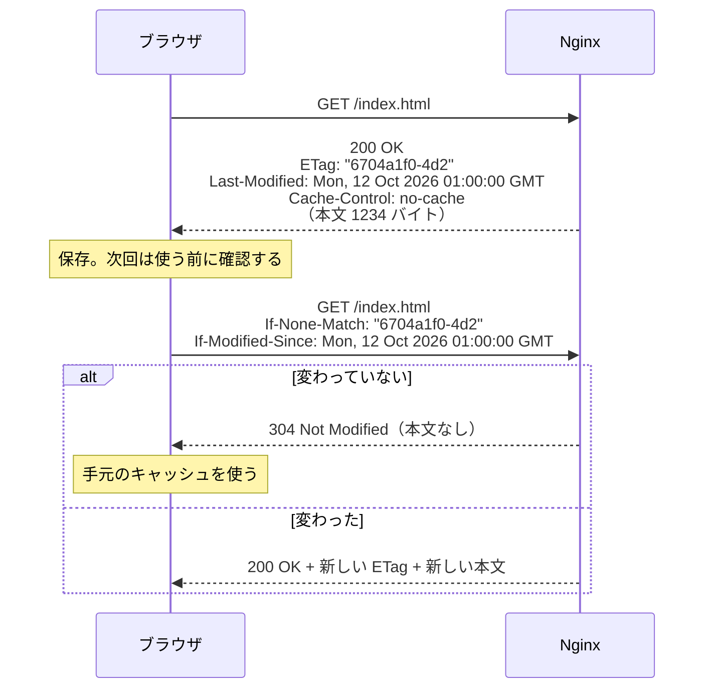

# HTTPキャッシュと圧縮

[[MOC_サーバー・インフラ体系|📚 目次]] ｜ [[05_Apache入門|← 前へ]] ｜ [[01_アプリケーションサーバーとは|次へ →]]

> [!abstract] この記事で分かること
> - `Cache-Control` の主要な値（`max-age`、`no-cache` と `no-store` の違い、`public` / `private`、`immutable`）
> - `ETag` / `Last-Modified` による再検証と 304 Not Modified の仕組み
> - 静的アセットのファイル名ハッシュ戦略と、Nginx での `expires` / `add_header` の設定
> - gzip と brotli による圧縮の設定
> - `proxy_cache` によるマイクロキャッシュと、キャッシュしてはいけないもの
>
> **前提**：[[02_Nginx入門]]、[[03_リバースプロキシ]] を読んでいると理解しやすいです。

## 1. ひとことで言うと

HTTP キャッシュは **「冷蔵庫の作り置き」**、圧縮は **「荷物の真空パック」** です。毎回スーパー（サーバー）に買いに行く代わりに、日持ちする食材は冷蔵庫（ブラウザや中継サーバー）に置いておき、賞味期限（`max-age`）内ならそのまま使います。期限が切れても「まだ同じ商品？」と電話で確認（再検証）して、同じなら買い直さずに済ませます。どうしても運ぶ荷物は真空パック（gzip / brotli）で小さくします。

- キャッシュの指示は **サーバーがレスポンスヘッダーで出す**。ブラウザや CDN はそれに従う
- 一番速いリクエストは「送らないリクエスト」、次に速いのは「中身を送らないレスポンス（304）」
- 何をどれだけキャッシュさせるかを決めるのはインフラとアプリの共同作業

## 2. Cache-Control の基本

### 2.1 キャッシュはどこにあるか

```
ブラウザ ──▶ [ブラウザキャッシュ] ──▶ [CDN / 共有プロキシ] ──▶ [Nginx proxy_cache] ──▶ Shop API
            private キャッシュ          共有（shared）キャッシュ        共有キャッシュ
            （その利用者専用）          （全利用者で共有）
```

| ディレクティブ | 意味 |
|---|---|
| `max-age=<秒>` | その秒数の間は「新鮮」。サーバーに問い合わせずに使ってよい |
| `s-maxage=<秒>` | 共有キャッシュ（CDN など）だけに適用される `max-age` |
| `no-cache` | 保存してよいが、**使う前に毎回サーバーに再検証** すること |
| `no-store` | **一切保存しない**（ディスクにもメモリにも） |
| `public` | 共有キャッシュにも保存してよい |
| `private` | 利用者のブラウザにだけ保存してよい（CDN は保存しない） |
| `immutable` | `max-age` の間は中身が絶対に変わらない。リロード時の再検証も不要 |
| `must-revalidate` | 期限切れ後は必ず再検証。サーバーに届かなければ古いものを使わずエラーにする |

### 2.2 `no-cache` と `no-store` の違い

名前から誤解されやすい代表です。

| | `no-cache` | `no-store` |
|---|---|---|
| 保存 | する | しない |
| 使うとき | 毎回サーバーに「変わった？」と聞き、変わっていなければ（304）手元のものを使う | 毎回すべてダウンロード |
| 向いているもの | `index.html` など「常に最新であるべきだが、変更は少ない」もの | 個人情報・決済結果など「端末に残ってはいけない」もの |

`no-cache` は「キャッシュするな」ではなく「**確認してから使え**」です。

### 2.3 Shop のコンテンツ別の方針

| コンテンツ | 例 | Cache-Control |
|---|---|---|
| ハッシュ付き静的アセット | `/assets/app.3f9a1c.js` | `public, max-age=31536000, immutable` |
| HTML（エントリポイント） | `/index.html` | `no-cache` |
| ハッシュなしの画像 | `/images/logo.png` | `public, max-age=86400`（1 日など、変更頻度に合わせる） |
| 公開 API（商品一覧） | `GET /products` | `public, max-age=0, s-maxage=10`（CDN / Nginx で短時間共有） |
| 個人の API | `GET /me`、`GET /cart` | `private, no-cache` または `no-store` |
| 決済・個人情報 | `GET /orders/123/receipt` | `no-store` |

API のヘッダーは基本的に **アプリ側で返す** のが正解です（どのレスポンスが個人向けかを知っているのはアプリだからです）。Nginx は静的ファイルのヘッダーと、アプリが何も指定しなかった場合の補助を担当します。

## 3. 再検証：ETag / Last-Modified と 304

`max-age` が切れたあと、またはそもそも `no-cache` の場合、ブラウザは「手元にあるものがまだ有効か」をサーバーに確認します。これを **条件付きリクエスト（Conditional Request）** と呼びます。



| ヘッダー | 中身 | 対応するリクエストヘッダー |
|---|---|---|
| `ETag` | コンテンツの識別子（バージョン番号のようなもの） | `If-None-Match` |
| `Last-Modified` | 最終更新日時 | `If-Modified-Since` |

- Nginx は静的ファイルに対して、ファイルの更新時刻とサイズから `ETag` と `Last-Modified` を **自動で付けます**（`etag on;` が既定）
- 304 は本文を送らないので転送量は減りますが、**往復 1 回の通信は発生します**。だから変わらないファイルは `max-age` + `immutable` で問い合わせ自体をなくすのが最善です
- 複数台のサーバーでファイルの更新時刻が揃っていないと、サーバーごとに ETag が変わって再検証が毎回外れることがあります。デプロイ時にタイムスタンプを揃えるか、ハッシュ付きファイル名で `immutable` にして再検証を不要にします

```bash
# 再検証の動作を確認
ETAG=$(curl -sI https://shop.example.com/ | awk -F': ' 'tolower($1)=="etag"{print $2}' | tr -d '\r')
curl -sI -H "If-None-Match: $ETAG" https://shop.example.com/ | head -1    # HTTP/2 304
```

## 4. 静的アセットの戦略と Nginx の設定

### 4.1 ファイル名ハッシュ（キャッシュバスティング）

「長くキャッシュさせたい」と「更新したらすぐ反映させたい」は矛盾します。これを解決するのが **ファイル名に中身のハッシュを入れる** 方法です。Vite や webpack などのビルドツールが自動で行います。

```
ビルド 1 回目:  index.html ─参照─▶ /assets/app.3f9a1c.js   （1 年キャッシュ）
ビルド 2 回目:  index.html ─参照─▶ /assets/app.b72e05.js   （新しい名前 = 別ファイル）
                  ↑ no-cache なので毎回確認され、新しい参照先がすぐ伝わる
```

- 中身が変われば名前が変わるので、同じ名前のファイルは **永遠に同じ中身**。だから 1 年 + `immutable` にできる
- 入口の `index.html` だけは `no-cache` にして、常に最新の参照先を取りに行かせる
- デプロイ時は **新しいアセットを先に置いてから `index.html` を差し替え**、古いアセットはしばらく残す（古い HTML を開いたままの利用者が古い JS を読みに来るため）

### 4.2 Nginx での設定

```nginx
# /etc/nginx/sites-available/shop （静的配信部分）
server {
    # ...listen / server_name / TLS は省略
    root /var/www/shop;

    # ハッシュ付きアセット: 1 年 + immutable
    location ^~ /assets/ {
        try_files $uri =404;
        expires 1y;                                   # Expires と Cache-Control: max-age=31536000 を付与
        add_header Cache-Control "public, immutable";
        access_log off;                               # 大量のアセットでログを埋めない
    }

    # SPA のエントリポイント: 毎回確認
    location / {
        try_files $uri $uri/ /index.html;
        add_header Cache-Control "no-cache";
    }
}
```

`expires` と `add_header Cache-Control` を両方書くと `Cache-Control` ヘッダーが 2 行になりますが、ブラウザは両方の値を合わせて解釈します。1 行にまとめたい場合は `expires` を使わず次のように書きます。

```nginx
add_header Cache-Control "public, max-age=31536000, immutable" always;
```

> [!warning] add_header の継承の罠（再掲）
> location 内で `add_header` を 1 つでも書くと、server レベルの `add_header`（HSTS やセキュリティヘッダー）はその location で **すべて消えます**。共通ヘッダーは `snippets/security-headers.conf` にまとめ、各 location で `include` します。また `add_header` は既定で 2xx / 3xx のレスポンスにしか付かないので、エラー時にも付けたいものは `always` を付けます。

## 5. 圧縮：gzip と brotli

### 5.1 仕組み

ブラウザが `Accept-Encoding: gzip, br` で「この圧縮形式なら読める」と伝え、サーバーは対応する形式で圧縮して `Content-Encoding: br` を付けて返します。テキスト系（HTML / CSS / JS / JSON / SVG）は 70〜80% 程度小さくなることが珍しくありません。

| | gzip | brotli（br） |
|---|---|---|
| 対応 | ほぼすべてのクライアント | 主要ブラウザ（HTTPS 時） |
| 圧縮率 | 標準 | gzip より 15〜25% 程度小さくなることが多い |
| CPU | 軽い | 高レベルでは重い → 事前圧縮が有効 |
| Nginx | 標準モジュール | 追加モジュールが必要 |

> [!note] 圧縮しないもの
> JPEG / PNG / WebP / MP4 / woff2 / zip などは **すでに圧縮済み** なので、再圧縮しても小さくならず CPU の無駄です。`gzip_types` にはテキスト系だけを並べます。

### 5.2 gzip の設定

Ubuntu の `nginx.conf` は `gzip on;` だけが有効で、詳細設定はコメントアウトされています。既定では `text/html` しか圧縮されないので、共通設定として追加します。

```nginx
# /etc/nginx/conf.d/compression.conf （nginx.conf の gzip on; と重複させないこと）
gzip_vary on;              # Vary: Accept-Encoding を付ける（CDN が圧縮版と非圧縮版を取り違えないように）
gzip_proxied any;          # リバースプロキシ経由のレスポンスも圧縮（既定 off）
gzip_comp_level 5;         # 1〜9。既定は 1。5〜6 で十分、9 は CPU に見合わない
gzip_min_length 1024;      # 小さすぎるものは圧縮しない（既定 20 バイト）
gzip_types
    text/plain text/css text/javascript application/javascript
    application/json application/xml image/svg+xml;
```

### 5.3 brotli の設定

Ubuntu 24.04 では universe リポジトリの動的モジュールで使えます。

```bash
sudo apt install -y libnginx-mod-http-brotli-filter libnginx-mod-http-brotli-static
# /etc/nginx/modules-enabled/ に読み込み設定が追加される
```

```nginx
# /etc/nginx/conf.d/compression.conf に追記
brotli on;
brotli_comp_level 5;
brotli_types
    text/plain text/css text/javascript application/javascript
    application/json application/xml image/svg+xml;

# ビルド時に作った app.js.br / app.js.gz があればそれを返す（実行時の圧縮 CPU がゼロ）
brotli_static on;
gzip_static on;
```

ビルドツールで `.br` / `.gz` を事前生成しておけば、最高圧縮レベルでも配信時の CPU コストはかかりません。

```bash
curl -sI -H 'Accept-Encoding: br' https://shop.example.com/assets/app.3f9a1c.js | grep -i -E 'content-encoding|vary'
# content-encoding: br
# vary: Accept-Encoding
```

> [!warning] HTTPS 上の圧縮と BREACH 攻撃
> 秘密情報（CSRF トークンなど）と利用者が操作できる文字列を同じレスポンスに含め、それを圧縮して HTTPS で返すと、圧縮後のサイズの変化から秘密を推測される攻撃（BREACH）が理論上あります。対策の中心はアプリ側（トークンをリクエストごとにマスクする等）で、圧縮を全部やめる必要は通常ありません。

## 6. proxy_cache（マイクロキャッシュ）とキャッシュしてはいけないもの

### 6.1 マイクロキャッシュ

**マイクロキャッシュ** は、動的レスポンスを **1〜数秒だけ** Nginx に保存する手法です。1 秒でも、セール開始直後に 1 秒間 1000 回来る商品一覧リクエストが 1 回のアプリ呼び出しで済みます。

```nginx
# http レベル（conf.d/cache.conf）
proxy_cache_path /var/cache/nginx/shop levels=1:2 keys_zone=shop_cache:10m
                 max_size=1g inactive=10m use_temp_path=off;
```

```nginx
# api.shop.example.com の server 内
location /products {
    proxy_pass http://shop_api;
    # ...（[[03_リバースプロキシ]] の proxy_set_header 一式）

    proxy_cache shop_cache;
    proxy_cache_valid 200 1s;                 # 200 だけ 1 秒キャッシュ
    proxy_cache_lock on;                      # 同時に来た同じリクエストはアプリに 1 本だけ送る
    proxy_cache_use_stale updating error timeout http_502 http_503;  # 更新中・障害時は古いものを返す
    proxy_cache_background_update on;
    proxy_cache_methods GET HEAD;            # 既定。POST はキャッシュしない

    # ログイン中の利用者はキャッシュを通さない
    proxy_cache_bypass $cookie_session $http_authorization;
    proxy_no_cache     $cookie_session $http_authorization;

    add_header X-Cache-Status $upstream_cache_status;   # HIT / MISS / BYPASS / STALE を確認用に返す
}
```

```bash
sudo mkdir -p /var/cache/nginx/shop && sudo chown www-data: /var/cache/nginx/shop
for i in 1 2 3; do curl -sI https://api.shop.example.com/products | grep -i x-cache; done
# x-cache-status: MISS → HIT → HIT
```

- `proxy_cache_lock` と `use_stale updating` の組み合わせで、キャッシュが切れた瞬間にリクエストがアプリへ殺到する **キャッシュスタンピード** を防ぎます
- `proxy_cache_use_stale error timeout` により、アプリが一時的に落ちても直前の内容を返し続けられます
- キャッシュのキー（既定 `$scheme$proxy_host$request_uri`）にクエリ文字列も含まれるので、`?page=2` は別エントリになります

### 6.2 キャッシュしてはいけないもの

共有キャッシュ（Nginx の proxy_cache、CDN）に個人向けのレスポンスが入ると、**他の利用者に別人のマイページや注文情報が表示される** という重大な情報漏えい事故になります。

| キャッシュしてはいけない | 理由 | 対策 |
|---|---|---|
| ログイン後のページ・個人の API（`/me`、`/cart`、`/orders`） | 他人に表示される | アプリが `Cache-Control: private` または `no-store` を返す。Nginx で認証 Cookie / `Authorization` があればバイパス |
| `Set-Cookie` を含むレスポンス | 他人にセッション Cookie が配られ、なりすましが成立する | Nginx は既定で `Set-Cookie` 付きレスポンスをキャッシュしない。`proxy_ignore_headers Set-Cookie` を安易に使わない |
| POST / PUT / DELETE の結果 | 副作用のある操作 | 既定どおり GET / HEAD のみ |
| 決済画面・個人情報を含む画面 | 共用 PC のブラウザにも残すべきでない | `no-store` |
| エラーレスポンス（長時間） | 一時的な障害が長く残る | `proxy_cache_valid` でステータスごとに短く指定 |

> [!danger] 実際に起きている事故の型
> 「CDN の設定でパス単位のキャッシュを有効にしたら、`/account` のレスポンスまでキャッシュされて他人の情報が表示された」という事故は、規模を問わず繰り返し起きています。**キャッシュは「許可されたものだけ」に効かせる（オプトイン）** のが原則で、「全部キャッシュして個人向けだけ除外」という設計は避けます。

CDN でのキャッシュ（エッジでのキャッシュ、パージ、キャッシュキー設計）は [[04_CDNによる負荷軽減]] で扱います。

## よくある誤解・つまずき

- ❌ 「`no-cache` を付ければキャッシュされない」
  ✅ `no-cache` は「保存してよいが毎回確認せよ」です。保存させたくないなら `no-store` です。
- ❌ 「JS / CSS を長くキャッシュすると更新が反映されない」
  ✅ ファイル名にハッシュを入れれば、更新時は別ファイルになるので問題ありません。反映されないのは、たいてい `index.html` まで長くキャッシュしているケースです。
- ❌ 「画像も gzip すれば軽くなる」
  ✅ JPEG / PNG / WebP などは圧縮済みなので効果がなく CPU を浪費します。圧縮はテキスト系だけです。
- ❌ 「location に `add_header Cache-Control` を足しただけなら他に影響はない」
  ✅ その location では server レベルの HSTS などの `add_header` がすべて消えます。共通ヘッダーは include で各 location に入れ直します。

## まとめ

- キャッシュの指示はレスポンスの `Cache-Control` で出す。`no-cache` は「確認してから使う」、`no-store` は「保存しない」
- `ETag` / `Last-Modified` による再検証で、変化がなければ 304（本文なし）が返る
- ハッシュ付きアセットは `max-age=31536000, immutable`、入口の HTML は `no-cache`
- 圧縮はテキスト系に gzip（`gzip_types` / `gzip_vary`）と brotli。事前圧縮（`*_static`）で CPU を節約
- `proxy_cache` の 1 秒マイクロキャッシュ + `proxy_cache_lock` でアクセス集中に強くなる
- 個人向けレスポンスと `Set-Cookie` は共有キャッシュに入れない。キャッシュはオプトインで

## 確認クイズ

1. ログイン後の「マイページ」API のレスポンスに付けるべき `Cache-Control` と、付けてはいけない値を答えてください。
> [!tip]- 答え
> `private, no-cache`（ブラウザには保存してよいが毎回確認）または、個人情報を端末にも残したくないなら `no-store` を付けます。`public` や `s-maxage` を付けると CDN や Nginx の共有キャッシュに保存され、他の利用者に表示される恐れがあるので付けてはいけません。

2. ビルドのたびにファイル名が変わる `/assets/app.<hash>.js` と、`/index.html` にはそれぞれどんなキャッシュ設定が適切ですか。理由も答えてください。
> [!tip]- 答え
> アセットは同じ名前なら中身が変わらないので `public, max-age=31536000, immutable` で 1 年キャッシュします。`index.html` は新しいアセット名を参照させる入口なので `no-cache` にして毎回再検証させ、デプロイ後すぐに新しい参照先が伝わるようにします。

3. 商品一覧 API に 1 秒のマイクロキャッシュを入れました。`proxy_cache_lock on;` を付ける目的は何ですか。
> [!tip]- 答え
> キャッシュが切れた瞬間に同じ URL へのリクエストが大量に来ても、アプリへは 1 本だけ送り、他はその結果を待って共有するためです。キャッシュスタンピード（期限切れ時のアプリへの殺到）を防ぎます。

## 関連ノート

- [[02_Nginx入門]] — location と `add_header` の継承
- [[03_リバースプロキシ]] — proxy_cache の前提となるプロキシ設定
- [[04_CDNによる負荷軽減]] — CDN のキャッシュとパージ
- [[01_アプリケーションサーバーとは]] — 次の章。動的処理を担うアプリ側へ
- [[MOC_パフォーマンス体系]] — Web パフォーマンス全般
- [[MOC_セッション管理]] — Cookie とキャッシュの関係
- [[MOC_Web脆弱性対策]] — キャッシュによる情報漏えい、BREACH

## 参考

- [MDN: HTTP キャッシュ](https://developer.mozilla.org/ja/docs/Web/HTTP/Caching)
- [MDN: Cache-Control](https://developer.mozilla.org/ja/docs/Web/HTTP/Headers/Cache-Control)
- [RFC 9111: HTTP Caching](https://www.rfc-editor.org/rfc/rfc9111)
- [nginx: ngx_http_headers_module（expires / add_header）](https://nginx.org/en/docs/http/ngx_http_headers_module.html)
- [nginx: ngx_http_gzip_module](https://nginx.org/en/docs/http/ngx_http_gzip_module.html)
- [nginx: ngx_http_proxy_module（proxy_cache 系）](https://nginx.org/en/docs/http/ngx_http_proxy_module.html)
- [google/ngx_brotli](https://github.com/google/ngx_brotli)
- [Launchpad: libnginx-mod-http-brotli（Ubuntu Noble）](https://launchpad.net/ubuntu/noble/+source/libnginx-mod-http-brotli)
- [web.dev: Love your cache](https://web.dev/articles/love-your-cache)
