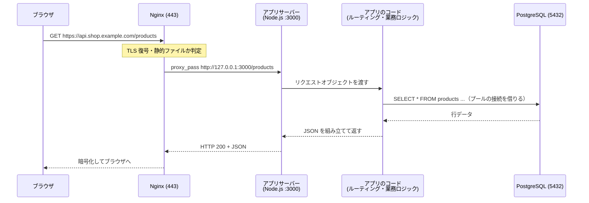
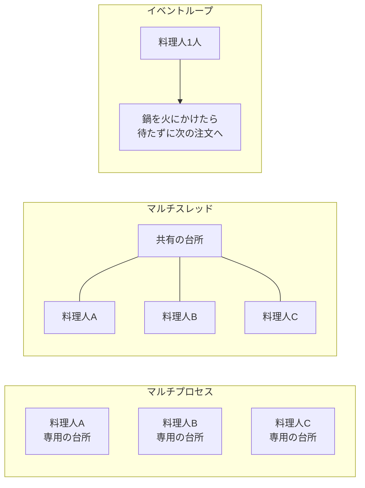

# アプリケーションサーバーとは

[[MOC_サーバー・インフラ体系|📚 目次]] ｜ [[06_HTTPキャッシュと圧縮|← 前へ]] ｜ [[02_Node.jsアプリを本番で動かす|次へ →]]

> [!abstract] この記事で分かること
> - Web サーバー（Nginx）とアプリケーションサーバーの役割の違いと「境界線」
> - リクエストが Nginx → アプリサーバー → アプリのコード → DB と流れる全体像
> - Node.js / Python / Ruby / Java / PHP それぞれの「アプリサーバー」の正体
> - プロセス・スレッド・イベントループという 3 つの同時処理モデルの違い
> - ステートレス設計とコネクションプールが本番で必須になる理由
> - 補足：プログラミング言語とデータベースの分類・選び方・連携（ORM・トランザクション）
>
> **前提**：[[01_Webサーバーとは]] と [[03_リバースプロキシ]] を読んでいると理解しやすいです。

## 1. ひとことで言うと

レストランに例えると、**Web サーバーは「ホール係」、アプリケーションサーバーは「厨房」** です。ホール係（Nginx）は入口でお客さんを迎え、水やメニュー（静的ファイル）ならその場で出し、料理の注文（動的なリクエスト）だけを厨房に通します。厨房（アプリケーションサーバー）はレシピ（あなたが書いたアプリのコード）に従って料理を作り、必要なら冷蔵庫（データベース）から食材を取り出します。

- **Web サーバー**：HTTP の受付・TLS 終端・静的ファイル配信・振り分けが得意。中身の「業務ロジック」は知らない
- **アプリケーションサーバー（Application Server）**：あなたのコードを実行して、リクエストごとに違う結果（動的コンテンツ）を作る
- 両者を分けるのは「得意なことが違う」から。Nginx は数万の接続をさばくのが得意だが、商品の在庫計算はできない。アプリは計算できるが、遅いクライアントや大量の静的ファイルの相手は苦手

## 2. Web サーバーとアプリサーバーの境界

### 2-1. それぞれの担当

| 仕事 | Web サーバー（Nginx） | アプリケーションサーバー |
| --- | --- | --- |
| HTTPS（TLS）の暗号化・復号 | ◎ ここでやる | ✕ 通常やらない |
| 画像・CSS・JS などの静的ファイル | ◎ ディスクから直接返す | △ できるが非効率 |
| 遅いクライアントの相手（バッファリング） | ◎ | ✕ 苦手 |
| ログイン判定・注文処理・DB 読み書き | ✕ | ◎ ここでやる |
| 複数のアプリへの振り分け・負荷分散 | ◎ | ✕ |

「アプリケーションサーバー」という言葉は少し曖昧で、次の 2 つの意味で使われます。

1. **ソフトウェアとしてのアプリサーバー**：Gunicorn、Puma、Tomcat など、「アプリのコードを読み込んで HTTP リクエストを渡してくれるプログラム」
2. **マシン（役割）としてのアプリサーバー**：「アプリが動いているサーバー機」。構成図で「AP サーバー」と書かれるもの

この記事では主に 1 の意味で使い、「アプリのコードを動かす実行環境」として説明します。

### 2-2. Shop でのリクエストの流れ

Shop の 1 台構成（Nginx ＋ Shop API ＋ PostgreSQL）で「商品一覧を見る」リクエストを追ってみます。



ポイントは、**ポート 3000 は外に公開せず、`127.0.0.1` で待ち受ける**ことです。外から届くのは Nginx の 443 番だけで、アプリサーバーは「Nginx からしか話しかけられない厨房」にしておきます（[[03_リバースプロキシ]] 参照）。

### 2-3. 「アプリサーバー」と「アプリのコード」の境界

言語によっては、アプリサーバーとアプリのコードの間に**決まったインターフェース（約束事）**があります。

```
              ┌───────────── アプリサーバー ─────────────┐   ┌── アプリのコード ──┐
Nginx ─HTTP─▶ │ ソケット受付 → HTTP解析 → ワーカーへ割当 │ ─▶│ Flask / FastAPI    │
              └──────────────────────────────────────────┘   │ Rails / Spring ... │
                         ▲ 約束事: WSGI / ASGI / Rack / Servlet / FastCGI        │
                                                              └────────────────────┘
```

この約束事があるおかげで、「Flask アプリを Gunicorn で動かす」「Rails アプリを Puma で動かす」のように、**アプリサーバーとフレームワークを自由に組み合わせられる**のです。

## 3. 言語ごとのアプリサーバー

| 言語 | 代表的なアプリサーバー | アプリとの約束事 | 同時処理モデル（既定） |
| --- | --- | --- | --- |
| Node.js | **なし（Node.js 自身がサーバー）** | `http` モジュール | イベントループ（1 プロセス） |
| Python（同期） | Gunicorn、uWSGI | WSGI | マルチプロセス（＋スレッド） |
| Python（非同期） | Uvicorn、Hypercorn、Gunicorn＋ASGI ワーカー | ASGI | イベントループ × プロセス |
| Ruby | Puma | Rack | マルチプロセス × マルチスレッド |
| Java | Tomcat、Jetty（Spring Boot に組み込み） | Servlet | スレッドプール |
| PHP | PHP-FPM | FastCGI | マルチプロセス（リクエストごとに使い捨ての状態） |

### Node.js：自分自身がサーバー

Node.js では、Express などのアプリが `app.listen(3000)` を呼んだ瞬間に**アプリ自体が HTTP サーバー**になります。Python の Gunicorn のような「間に入るアプリサーバー」はありません。その代わり、プロセスの監視や再起動、マルチコア活用は PM2 や systemd、コンテナ基盤に任せます。詳しくは [[02_Node.jsアプリを本番で動かす]]。

### Python：WSGI / ASGI サーバーが必要

Flask・Django（同期）は **WSGI**、FastAPI（非同期）は **ASGI** という約束事でアプリサーバーとつながります。`flask run` のような開発用サーバーは本番向けではないため、Gunicorn や Uvicorn を使います。詳しくは [[03_Pythonアプリを本番で動かす]]。

### Ruby：Puma

Rails の既定アプリサーバーです。`workers`（プロセス数）と `threads`（各プロセスのスレッド数）の 2 軸で同時処理数を決めます。

```ruby
# config/puma.rb（抜粋）
workers ENV.fetch("WEB_CONCURRENCY", 2)
threads 5, 5
bind "tcp://127.0.0.1:3000"
```

### Java：Tomcat / Jetty

Java では Servlet という仕様に沿ったコンテナ（Tomcat、Jetty）がアプリサーバーです。昔は Tomcat を別にインストールして WAR ファイルを配置していましたが、現在の Spring Boot は **Tomcat を内蔵した実行可能 JAR** を `java -jar app.jar` で起動するのが主流です。リクエストごとにスレッドプールのスレッドが 1 本割り当てられます。

### PHP：PHP-FPM

PHP は Nginx から **FastCGI** で PHP-FPM（FastCGI Process Manager）にリクエストを渡します。PHP-FPM はワーカープロセスを何本か用意し、1 リクエストずつ処理します。リクエストが終わると変数はすべて捨てられるので、**PHP は言語の仕組みとして自然にステートレス**になっています。

```ini
; /etc/php/8.3/fpm/pool.d/www.conf（Ubuntu 24.04 の PHP 8.3 の例・抜粋）
[www]
user = www-data
group = www-data
listen = /run/php/php8.3-fpm.sock
pm = dynamic
pm.max_children = 20      ; 同時に処理できるリクエスト数の上限
pm.start_servers = 4
pm.min_spare_servers = 2
pm.max_spare_servers = 6
pm.max_requests = 500     ; 500 リクエストごとにワーカーを作り直す（メモリリーク対策）
```

```nginx
location ~ \.php$ {
    include snippets/fastcgi-php.conf;
    fastcgi_pass unix:/run/php/php8.3-fpm.sock;
}
```

## 4. 同時処理モデル：プロセス・スレッド・イベントループ

アプリサーバー選びで一番大事なのは「**同時に来たリクエストをどうさばくか**」です。厨房の例えで比べます。



| モデル | 仕組み | 長所 | 短所 | 代表例 |
| --- | --- | --- | --- | --- |
| **マルチプロセス** | OS のプロセスを複数起動し、それぞれが 1 リクエストを担当 | 1 つが落ちても他は無事。メモリが独立していて安全 | プロセスごとにメモリを消費。同時数＝プロセス数 | Gunicorn sync、PHP-FPM |
| **マルチスレッド** | 1 プロセス内に複数スレッド。メモリを共有 | プロセスより軽い。同時数を増やしやすい | 共有データの競合（スレッドセーフ）に注意 | Tomcat、Puma、Gunicorn gthread |
| **イベントループ** | 1 スレッドが「待ち時間」の間に別の処理を進める | DB や外部 API 待ちが多い処理で非常に効率的 | CPU を長く使う処理が 1 つあると全体が止まる | Node.js、Uvicorn |

実際には組み合わせて使います。たとえば「Puma = プロセス × スレッド」「Gunicorn＋Uvicorn ワーカー = プロセス × イベントループ」「Node.js を PM2 cluster で 4 プロセス = プロセス × イベントループ」です。**プロセスを増やすのはマルチコア CPU を使い切るため**、スレッドやイベントループは **1 コアの中で待ち時間を有効活用するため**、と覚えると整理しやすいです。

> [!note] Web アプリは「待ち時間」が大半
> 一般的な API の処理時間の多くは、DB や外部 API の応答待ち（I/O 待ち）です。この待ち時間に CPU を遊ばせないために、スレッドやイベントループが使われます。逆に画像変換や暗号計算のような CPU を使う処理（CPU バウンド）は、プロセスを増やすかバックグラウンドジョブに逃がすのが基本です。

## 5. ステートレスにする理由

**ステートレス（stateless）** とは、「アプリサーバーのメモリやローカルディスクに、次のリクエストで必要な情報を残さない」設計です。

### なぜ必要か

Shop が成長して API を 2 台にし、ロードバランサーの後ろに置いたとします。

```
            ┌─▶ API サーバー1（メモリに「Aさんのカート」）
LB ─────────┤
            └─▶ API サーバー2（Aさんのカートを知らない！）
```

ログイン状態やカートをサーバー1のメモリに持っていると、次のリクエストがサーバー2に振られた瞬間に「ログアウトされた」「カートが空になった」という事故が起きます。また、デプロイや再起動でプロセスが入れ替わるたびに状態が消えます。同じことは 1 台の中でも起こります。PM2 cluster や Gunicorn のように**複数プロセスで動かすと、プロセス同士はメモリを共有しない**からです。

### どこに状態を置くか

| 状態 | 置き場所 |
| --- | --- |
| セッション・ログイン状態 | Redis などの共有ストア、または署名付きトークン（JWT など） |
| カート・注文などの業務データ | PostgreSQL |
| アップロード画像 | S3 などのオブジェクトストレージ |
| キャッシュ | Redis（ローカルメモリのキャッシュは「消えてもよい」ものだけ） |

ステートレスにしておけば、サーバーを増やす・減らす・入れ替えるのが自由になります。これは [[01_スケーリングの基本]] や [[03_ローリングアップデート]] の前提条件です。セッションの詳細は [[MOC_セッション管理]] を参照してください。

## 6. コネクションプール

### 例え

DB への接続は「電話をかけて相手が出るまで待つ」ようなもので、TCP 接続・認証・セッション準備に毎回時間がかかります。**コネクションプール（connection pool）** は、あらかじめ何本か電話をつないだままにしておき、使いたい処理が「借りて、使ったら返す」仕組みです。

### 仕組みと設定例（Shop API / Node.js + pg）

```ts
// src/db.ts
import { Pool } from "pg";

export const pool = new Pool({
  connectionString: process.env.DATABASE_URL,
  max: 10,                      // このプロセスが持つ最大接続数
  idleTimeoutMillis: 30_000,    // 使われない接続は 30 秒で閉じる
  connectionTimeoutMillis: 5_000, // 借りられないまま 5 秒経ったらエラー
});

// 使う側：pool.query は「借りる → 実行 → 返す」を自動で行う
const { rows } = await pool.query("SELECT id, name, price FROM products LIMIT 50");
```

### 実務での注意：接続数は「掛け算」で増える

プールはプロセスごとに作られます。DB から見た接続数は次の掛け算です。

```
DB への総接続数 = サーバー台数 × 1台あたりのプロセス数 × プールの max
例）API 2台 × PM2 4プロセス × max 10 = 80 接続
```

PostgreSQL の `max_connections` の既定値は 100 です。台数やプロセスを増やしたとたんに `too many connections` で落ちる、という事故がよくあります。対策は次のとおりです。

- プールの `max` を「DB の上限 ÷ 全プロセス数」から逆算する（管理用・マイグレーション用の余裕も残す）
- 接続数が多くなる構成では PgBouncer や RDS Proxy のような**外部のコネクションプーラー**を間に置く
- 詳しくは [[06_データベースサーバーの運用]] を参照

## 7. アプリサーバー選びの観点

多くの場合「言語とフレームワークが決まれば、アプリサーバーもほぼ決まる」ので、迷ったら各フレームワークの公式ドキュメントが推奨するものを選ぶのが正解です。そのうえで次の観点を確認します。

| 観点 | 確認すること |
| --- | --- |
| 処理の性質 | I/O 待ちが多い → イベントループ／スレッド。CPU を使う → プロセスを増やす・ジョブに分離 |
| 同時処理数 | プロセス数 × スレッド数（または非同期の同時実行数）が想定アクセスに足りるか |
| メモリ | 1 プロセスあたりのメモリ × プロセス数がサーバーのメモリに収まるか |
| 再起動とシャットダウン | SIGTERM で処理中のリクエストを終えてから止まれるか（グレースフルシャットダウン） |
| 運用のしやすさ | systemd・コンテナとの相性、ログの出し方、ヘルスチェックのしやすさ |
| 実行基盤 | VM なら 1 台でプロセスを複数、コンテナなら「1 コンテナ 1 プロセス」でコンテナ数を増やす方が素直 |

> [!tip] コンテナ時代の考え方
> Kubernetes や ECS では、プロセス監視・再起動・台数の増減を基盤が担当します。そのため、アプリサーバー側のマルチプロセス機能（PM2 cluster、Gunicorn の複数ワーカー）を使わず、**1 コンテナ 1 プロセスにしてコンテナ数で調整する**構成がよく選ばれます（[[本番向けベストプラクティス]]）。

## よくある誤解・つまずき

- ❌ Nginx があればアプリも動く → ✅ Nginx はアプリのコードを実行しません。アプリを実行するのはアプリサーバー（Node.js、Gunicorn など）で、Nginx は手前で受け付けて転送するだけです。
- ❌ Node.js はアプリサーバーがないから本番では Nginx が不要 → ✅ Node.js 自身が HTTP サーバーになれても、TLS 終端・静的ファイル・遅いクライアント対策のために Nginx を前に置くのが定番です。
- ❌ プロセスを増やせば増やすほど速くなる → ✅ CPU コア数やメモリ、DB の接続上限を超えると逆に遅くなったり落ちたりします。
- ❌ メモリ上の変数にセッションを持っても 1 台なら問題ない → ✅ 1 台でも複数プロセスで動かせばプロセス間で共有されず、再起動でも消えます。最初から外部ストアに置きましょう。
- ❌ コネクションプールの max は大きいほど安心 → ✅ 総接続数は「台数 × プロセス数 × max」。DB の上限を超えないよう逆算します。

## まとめ

- Web サーバーは「受付・TLS・静的ファイル・振り分け」、アプリサーバーは「アプリのコードの実行」を担当する
- Python は WSGI/ASGI、Ruby は Rack、Java は Servlet、PHP は FastCGI という約束事でアプリサーバーとアプリがつながる。Node.js はアプリ自身がサーバー
- 同時処理モデルはプロセス・スレッド・イベントループの 3 つ。マルチコア活用はプロセス、待ち時間の活用はスレッド／イベントループ
- 状態はアプリサーバーに持たず、DB・Redis・オブジェクトストレージに置く（ステートレス）
- DB 接続はコネクションプールで再利用し、総接続数を DB の上限から逆算する

## 確認クイズ

1. Shop API を 2 台に増やしたら「ときどきログインが外れる」と苦情が来ました。考えられる原因と対策は？
> [!tip]- 答え
> セッションを各サーバーのメモリに保存していることが原因と考えられます。ロードバランサーが別のサーバーに振ると、そのサーバーはセッションを知りません。Redis などの共有ストアにセッションを置くか、署名付きトークンを使ってアプリをステートレスにします。

2. API 3 台 × 各 4 プロセス × プール max 10 の構成で、PostgreSQL の `max_connections` が既定値の 100 だと何が起きますか？
> [!tip]- 答え
> 最大 3 × 4 × 10 = 120 接続になり、上限 100 を超えて `too many connections` エラーが起こり得ます。max を 6〜7 程度に下げるか、PgBouncer / RDS Proxy などのプーラーを入れます。

3. 画像のサムネイル生成（CPU を長く使う処理）を Node.js の API の中で同期的に実行すると、何が問題になりますか？
> [!tip]- 答え
> Node.js はイベントループ（1 スレッド）で動くため、CPU を占有する処理の間はそのプロセスの他のリクエストがすべて待たされます。ワーカースレッドやバックグラウンドジョブに分離するのが基本です。

## 補足：プログラミング言語とデータベースの役割

アプリサーバーの上で動くプログラミング言語と、その先にあるデータベースについて、種類・選び方・連携方法（ORM・トランザクション）を整理します。

### 概要

プログラミング言語とデータベースは、Web アプリケーションやシステム開発において重要な役割を果たします。プログラミング言語は、コンピュータに指示を与えるための言語であり、データベースは、データを効率的に保存・管理・検索するためのシステムです。両者は密接に関連し、現代の IT システムを支える基盤技術です。

### プログラミング言語の役割

#### プログラミング言語とは

- **定義**: コンピュータに指示を与えるための人工言語
- **役割**: 人間の意図をコンピュータが理解できる形式に変換
- **特徴**: 構文規則、データ型、制御構造を持つ
- **例**: Java、Python、JavaScript、C++、PHP

#### プログラミング言語の分類

##### 用途による分類

- **Web 開発**: JavaScript、PHP、Python、Ruby
- **システム開発**: C、C++、Rust、Go
- **データ分析**: Python、R、MATLAB
- **モバイル開発**: Swift、Kotlin、Dart
- **ゲーム開発**: C++、C#、Lua

##### 実行方式による分類

- **コンパイル型**: C、C++、Java、Go
- **インタープリター型**: Python、Ruby、JavaScript
- **ハイブリッド型**: Java、C#

##### パラダイムによる分類

- **手続き型**: C、Pascal、Fortran
- **オブジェクト指向**: Java、C++、Python
- **関数型**: Haskell、Lisp、Scala
- **論理型**: Prolog

#### 主要なプログラミング言語

##### JavaScript

- **特徴**: ブラウザとサーバー両方で動作
- **用途**: Web 開発、フロントエンド、バックエンド
- **フレームワーク**: React、Vue.js、Node.js
- **メリット**: 汎用性、豊富なライブラリ

##### Python

- **特徴**: 読みやすく、学習しやすい
- **用途**: Web 開発、データ分析、AI/ML
- **フレームワーク**: Django、Flask、FastAPI
- **メリット**: 豊富なライブラリ、コミュニティ

##### Java

- **特徴**: プラットフォーム独立、オブジェクト指向
- **用途**: エンタープライズ、Android 開発
- **フレームワーク**: Spring、Hibernate
- **メリット**: 高い信頼性、豊富なエコシステム

##### PHP

- **特徴**: Web 開発特化、サーバーサイド
- **用途**: Web アプリケーション、CMS
- **フレームワーク**: Laravel、Symfony
- **メリット**: Web 開発に最適化、学習コスト低

##### C#

- **特徴**: Microsoft 製、.NET Framework
- **用途**: Windows 開発、Web 開発、ゲーム開発
- **フレームワーク**: ASP.NET、Unity
- **メリット**: 統合開発環境、豊富なツール

#### プログラミング言語の選択基準

##### プロジェクト要件

- **性能要件**: 処理速度、メモリ使用量
- **開発期間**: 開発スピード、学習コスト
- **保守性**: コードの可読性、保守の容易さ
- **スケーラビリティ**: 拡張性、負荷対応

##### チーム要件

- **スキルレベル**: チームの技術レベル
- **経験**: 既存の経験と知識
- **学習コスト**: 新技術の習得時間
- **リソース**: 開発リソースの制約

##### 技術要件

- **プラットフォーム**: 対象プラットフォーム
- **統合**: 既存システムとの統合
- **ライブラリ**: 利用可能なライブラリ
- **コミュニティ**: サポートとドキュメント

### データベースの役割

#### データベースとは

- **定義**: データを効率的に保存・管理・検索するシステム
- **役割**: データの永続化、整合性の保証、高速検索
- **特徴**: ACID 特性、正規化、インデックス
- **例**: MySQL、PostgreSQL、MongoDB、Redis

#### データベースの分類

##### データモデルによる分類

- **リレーショナル（RDB）**: 表形式、SQL 使用
- **NoSQL**: 非リレーショナル、柔軟なスキーマ
- **グラフ**: ノードとエッジの関係
- **時系列**: 時間順のデータ

##### 用途による分類

- **OLTP**: オンライントランザクション処理
- **OLAP**: オンライン分析処理
- **キャッシュ**: 高速アクセス用
- **検索**: 全文検索、ファセット検索

#### 主要なデータベース

##### MySQL

- **特徴**: オープンソース、高信頼性
- **用途**: Web アプリケーション、CMS
- **メリット**: 低コスト、豊富な情報
- **デメリット**: 機能制限、性能制限

##### PostgreSQL

- **特徴**: 高機能、標準準拠
- **用途**: エンタープライズ、複雑なクエリ
- **メリット**: 豊富な機能、高い性能
- **デメリット**: 学習コスト、設定の複雑さ

##### MongoDB

- **特徴**: ドキュメント指向、スキーマレス
- **用途**: 大規模データ、リアルタイム処理
- **メリット**: 柔軟性、スケーラビリティ
- **デメリット**: トランザクション制限、メモリ使用量

##### Redis

- **特徴**: インメモリ、高速アクセス
- **用途**: キャッシュ、セッション管理
- **メリット**: 高速性、豊富なデータ型
- **デメリット**: 永続化の制限、メモリ依存

#### データベース設計の原則

##### 正規化

- **第 1 正規形**: 原子値のみ
- **第 2 正規形**: 部分関数従属の除去
- **第 3 正規形**: 推移関数従属の除去
- **目的**: データの重複排除、整合性確保

##### ACID 特性

- **Atomicity**: 原子性、全成功または全失敗
- **Consistency**: 一貫性、データの整合性
- **Isolation**: 独立性、並行実行の制御
- **Durability**: 永続性、データの永続化

##### インデックス設計

- **主キー**: 一意性の保証
- **外部キー**: 参照整合性
- **複合インデックス**: 複数カラムの組み合わせ
- **部分インデックス**: 条件付きインデックス

### プログラミング言語とデータベースの連携

#### データベース接続

- **ODBC**: データベース接続の標準
- **JDBC**: Java 用データベース接続
- **ORM**: オブジェクト関係マッピング
- **クエリビルダー**: 動的クエリ生成

#### 主要な ORM

- **Hibernate**: Java 用 ORM
- **Entity Framework**: .NET 用 ORM
- **Django ORM**: Python 用 ORM
- **Eloquent**: PHP 用 ORM
- **Sequelize**: Node.js 用 ORM

#### データベース操作のパターン

##### CRUD 操作

- **Create**: データの作成
- **Read**: データの読み取り
- **Update**: データの更新
- **Delete**: データの削除

##### トランザクション管理

- **開始**: トランザクションの開始
- **コミット**: 変更の確定
- **ロールバック**: 変更の取り消し
- **分離レベル**: 並行制御のレベル

##### エラーハンドリング

- **例外処理**: エラーの捕捉と処理
- **ログ記録**: エラー情報の記録
- **リトライ**: 失敗時の再試行
- **フォールバック**: 代替処理

### パフォーマンス最適化

#### プログラミング言語の最適化

- **アルゴリズム**: 効率的なアルゴリズムの選択
- **データ構造**: 適切なデータ構造の使用
- **メモリ管理**: メモリの効率的な使用
- **並行処理**: マルチスレッド、非同期処理

#### データベースの最適化

- **クエリ最適化**: 効率的な SQL の作成
- **インデックス**: 適切なインデックスの設定
- **正規化**: データベース設計の最適化
- **キャッシュ**: クエリ結果のキャッシュ

#### システム全体の最適化

- **負荷分散**: 複数サーバーでの処理分散
- **キャッシュ戦略**: 多層キャッシュの実装
- **非同期処理**: バックグラウンド処理
- **監視**: パフォーマンス監視

### セキュリティ対策

#### プログラミング言語のセキュリティ

- **入力検証**: 不正なデータの検出
- **認証・認可**: ユーザーの身元確認
- **暗号化**: データの保護
- **セキュアコーディング**: 安全なプログラミング

#### データベースのセキュリティ

- **アクセス制御**: ユーザー権限の管理
- **暗号化**: データの暗号化
- **監査**: アクセスログの記録
- **バックアップ**: データの保護

#### 共通のセキュリティ対策

- **SQL インジェクション**: 不正な SQL の実行防止
- **XSS**: クロスサイトスクリプティング対策
- **CSRF**: クロスサイトリクエストフォージェリ対策
- **HTTPS**: 通信の暗号化

### 開発ツールと環境

#### 統合開発環境（IDE）

- **Visual Studio Code**: 軽量で拡張性の高いエディタ
- **IntelliJ IDEA**: Java 開発に特化
- **Eclipse**: オープンソースの IDE
- **PyCharm**: Python 開発に特化
- **Visual Studio**: Microsoft 製の IDE

#### データベース管理ツール

- **phpMyAdmin**: MySQL 管理ツール
- **pgAdmin**: PostgreSQL 管理ツール
- **MongoDB Compass**: MongoDB 管理ツール
- **DBeaver**: 汎用データベース管理ツール
- **Navicat**: 商用データベース管理ツール

#### バージョン管理

- **Git**: 分散バージョン管理システム
- **GitHub**: Git ホスティングサービス
- **GitLab**: 統合開発プラットフォーム
- **Bitbucket**: Atlassian 製の Git サービス

### まとめ

プログラミング言語とデータベースは、現代の IT システムを支える重要な技術です。プログラミング言語は、コンピュータに指示を与えるための言語として、様々な用途に応じて選択されます。データベースは、データを効率的に保存・管理・検索するためのシステムとして、アプリケーションの基盤となります。両者の適切な選択と連携により、効率的で安全なシステムを構築することができます。また、パフォーマンス最適化とセキュリティ対策により、信頼性の高いシステム運用が可能になります。

## 関連ノート

- [[01_Webサーバーとは]] — Web サーバー側の役割
- [[03_リバースプロキシ]] — Nginx からアプリサーバーへの転送設定
- [[02_Node.jsアプリを本番で動かす]] — Node.js の本番運用
- [[03_Pythonアプリを本番で動かす]] — Gunicorn / Uvicorn の本番運用
- [[04_プロセス管理とsystemd]] — アプリサーバーを常駐・自動再起動させる
- [[06_データベースサーバーの運用]] — DB 側の接続上限とプーラー
- [[01_スケーリングの基本]] — ステートレスが前提になる水平スケール
- [[MOC_セッション管理]] — セッションの保存先と設計
- [[MOC_バックエンド体系]] — バックエンド全般

## 参考

- [Gunicorn - Design](https://gunicorn.org/design/)
- [PHP Manual - FastCGI Process Manager (FPM)](https://www.php.net/manual/en/install.fpm.php)
- [Puma - README](https://github.com/puma/puma)
- [Spring Boot - Embedded Web Servers](https://docs.spring.io/spring-boot/how-to/webserver.html)
- [node-postgres - Pooling](https://node-postgres.com/features/pooling)
- [PostgreSQL Documentation - Connections and Authentication (max_connections)](https://www.postgresql.org/docs/current/runtime-config-connection.html)
