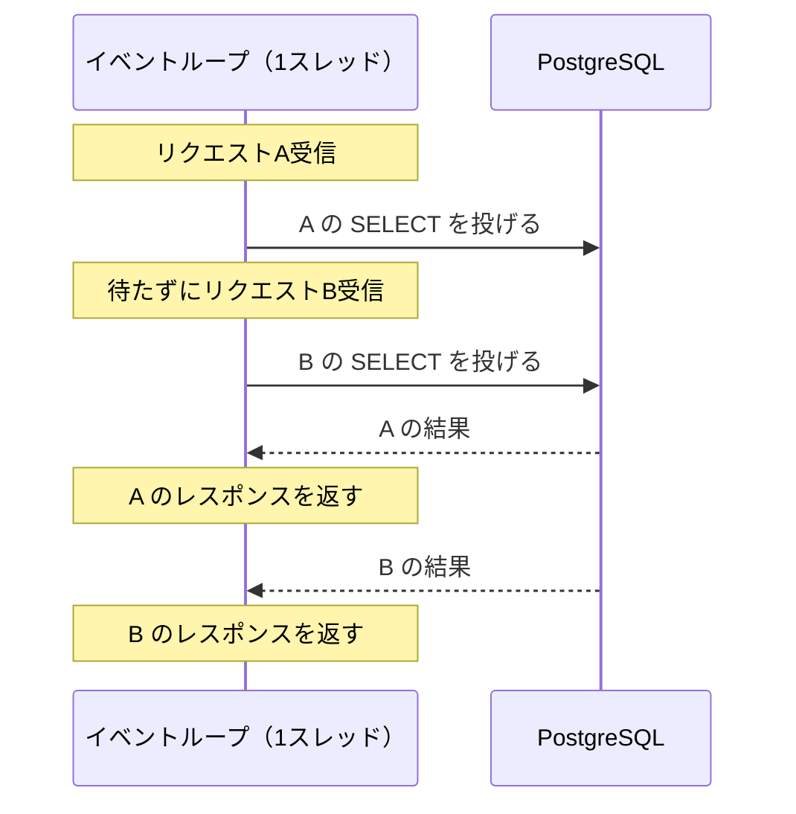

# Node.jsアプリを本番で動かす

[[MOC_サーバー・インフラ体系|📚 目次]] ｜ [[01_アプリケーションサーバーとは|← 前へ]] ｜ [[03_Pythonアプリを本番で動かす|次へ →]]

> [!abstract] この記事で分かること
> - イベントループとシングルスレッドが本番運用で何を意味するか
> - 本番での正しい起動方法（ビルド済み JS を `node` で起動、`NODE_ENV=production`）
> - cluster / PM2 / 複数コンテナによるマルチコア活用と、PM2 の基本設定
> - グレースフルシャットダウン、メモリ上限、未処理例外への備え
> - 2026 年時点での LTS バージョンの選び方と、Nginx の後ろに置く構成
>
> **前提**：[[01_アプリケーションサーバーとは]] を読んでいると理解しやすいです。

## 1. ひとことで言うと

Node.js は「**とても手際のいい料理人が 1 人で回している厨房**」です。煮込みを火にかけたら待たずに次の注文に取りかかるので、待ち時間の多い仕事（DB や外部 API の呼び出し）なら 1 人で驚くほど多くの注文をさばけます。ただし、この料理人が「玉ねぎ 100 個のみじん切り」（CPU を使う重い処理）を始めると、その間は他の注文がすべて止まります。

本番運用では、この特徴を前提に次のことを整えます。

- 料理人を CPU コアの数だけ増やす（cluster / PM2 / コンテナを複数）
- 倒れたらすぐ代わりを立てる（プロセスの自動再起動）
- 閉店時は作りかけの料理を仕上げてから帰る（グレースフルシャットダウン）
- 開発用の道具（ts-node、ホットリロード）は本番の厨房に持ち込まない

## 2. イベントループとシングルスレッドの意味

### 仕組み

Node.js の JavaScript は **1 本のメインスレッド**上の**イベントループ（event loop）** で実行されます。DB への問い合わせのような I/O は OS や libuv（Node.js 内部のライブラリ）に任せ、結果が返ってきたらコールバックや `await` の続きを実行します。



### CPU の重い処理はブロックする

問題は、JavaScript の処理そのものが長いときです。

```ts
// ❌ 悪い例：CPU を占有する同期処理
app.get("/report", (req, res) => {
  const hash = crypto.pbkdf2Sync(req.query.pw as string, "salt", 1_000_000, 64, "sha512"); // 数百ms〜数秒
  res.json({ hash: hash.toString("hex") });
});
```

この処理が走っている間、**同じプロセスの他のリクエストは 1 件も処理されません**。ヘルスチェックすら応答できず、ロードバランサーから「死んでいる」と判定されることもあります。

対策は次のとおりです。

- `pbkdf2Sync` などの `〜Sync` 関数を使わず、非同期版（`crypto.pbkdf2`、`fs.promises`）を使う
- 重い計算は `worker_threads` に逃がす、またはジョブキュー（BullMQ など）でバックグラウンドワーカーに渡す
- 巨大な JSON の `JSON.parse` / `JSON.stringify` もブロック要因。ページングでデータ量を抑える

## 3. 本番での起動方法

### 3-1. ビルドして `node` で起動する

Shop API は TypeScript で書かれています。開発中は `ts-node` や `tsx --watch` で直接動かしますが、本番では**事前に JavaScript にビルドしたものを `node` で起動**します。

```jsonc
// package.json（抜粋）
{
  "scripts": {
    "dev": "tsx watch src/server.ts",
    "build": "tsc -p tsconfig.json",
    "start": "node dist/server.js"
  }
}
```

```bash
# サーバー上（またはCI）で
npm ci                  # package-lock.json どおりに厳密にインストール
npm run build           # dist/ に JS を出力
npm prune --omit=dev    # 開発用パッケージを削除
NODE_ENV=production node dist/server.js
```

**ts-node / tsx を本番で使わない理由**

- 起動のたびに型チェックや変換が走り、起動が遅く、メモリも余計に使う
- 本番に TypeScript コンパイラなどの開発用依存が必要になる
- ビルドエラーが「本番起動時」に初めて見つかる。ビルドは CI で済ませ、失敗したらデプロイしない方が安全

> [!note] 2026 年時点の補足：Node.js の型除去（type stripping）
> Node.js 22.18 以降 / 24 では `.ts` ファイルの型注釈を取り除いて直接実行できるようになりました。ただし型チェックは行われず、`enum` など一部の構文は対象外です。本番では引き続き「CI で `tsc` による型チェック＋ビルド → 生成した JS を実行」が無難です。

### 3-2. `NODE_ENV=production`

`NODE_ENV` は Node.js 本体ではなく**ライブラリやフレームワークが見る慣習的な環境変数**です。Express では `production` にするとビューテンプレートのキャッシュが有効になり、エラー時にスタックトレースを返さなくなります。設定し忘れると「遅い」「内部情報が漏れる」原因になります。

### 3-3. `npm start` より `node` を直接

`npm start` 経由だと、npm がプロセスの間に挟まり、SIGTERM などのシグナルがアプリに正しく届かない場合があります。systemd や Dockerfile では `node dist/server.js` を直接起動するのが確実です。

```dockerfile
# Dockerfile の最後（抜粋）
ENV NODE_ENV=production
USER node
CMD ["node", "dist/server.js"]
```

## 4. マルチコアを活用する

1 つの Node.js プロセスは基本的に 1 コアしか使いません。4 コアのサーバーで 1 プロセスだけ動かすと、CPU の 75% を遊ばせることになります。方法は 3 つあります。

| 方法 | 仕組み | 向いている環境 |
| --- | --- | --- |
| `node:cluster` | 親プロセスが子プロセスを fork し、同じポートを共有して振り分け | ライブラリを足したくない場合。ただし自前で再起動処理を書く必要あり |
| **PM2 cluster mode** | PM2 が内部で cluster を使い、監視・再起動・ログも面倒を見る | VM / VPS に直接置く構成（Shop の 1 台構成） |
| **複数コンテナ／複数プロセス** | 1 プロセス 1 コンテナにして、コンテナ数で増やす | Docker / ECS / Kubernetes |

```
4コアの VPS（PM2 cluster mode）
Nginx :443 ──▶ :3000 ─┬─ Node プロセス1 (コア1)
                       ├─ Node プロセス2 (コア2)
                       ├─ Node プロセス3 (コア3)
                       └─ Node プロセス4 (コア4)
```

> [!warning] 複数プロセスにするならステートレスに
> プロセス同士はメモリを共有しません。セッションやキャッシュをメモリに持つと、プロセスごとに内容がバラバラになります（[[01_アプリケーションサーバーとは]] の「ステートレス」参照）。

## 5. PM2 の基本

**PM2** は Node.js 向けのプロセスマネージャーです。プロセスの起動・自動再起動・cluster 化・ログ管理をまとめて行います。

### ecosystem.config.js

```js
// /srv/shop-api/ecosystem.config.js
module.exports = {
  apps: [
    {
      name: "shop-api",
      script: "dist/server.js",
      cwd: "/srv/shop-api",
      instances: "max",          // CPU コア数だけ起動（数値指定も可）
      exec_mode: "cluster",
      env_production: {
        NODE_ENV: "production",
        PORT: 3000,
      },
      node_args: "--max-old-space-size=768", // 1プロセスのヒープ上限（MB）
      max_memory_restart: "900M",  // これを超えたら再起動（リーク対策の保険）
      kill_timeout: 10000,         // 停止シグナル後、強制終了までの猶予（ms）
      wait_ready: true,            // process.send('ready') を待ってから online 扱い
      listen_timeout: 10000,
      time: true,                  // ログにタイムスタンプ
    },
  ],
};
```

### よく使うコマンド

```bash
sudo npm install -g pm2
pm2 start ecosystem.config.js --env production
pm2 status                # 一覧
pm2 logs shop-api         # ログ
pm2 monit                 # CPU・メモリのリアルタイム表示
pm2 reload shop-api       # 1プロセスずつ入れ替える（cluster mode なら無停止）
pm2 save                  # 現在のプロセス一覧を保存
pm2 startup systemd       # OS 起動時に PM2 を自動起動する設定を出力
```

`restart` は全プロセスを一度に止めて起動し直すのに対し、`reload` は 1 つずつ入れ替えるので、cluster mode ならリクエストを落とさずに更新できます。

> [!tip] PM2 か systemd か
> PM2 を使わず、systemd で `node dist/server.js` を直接管理する構成も一般的です（1 台に 1 プロセス、またはポートを分けて複数ユニット）。コンテナで動かすなら PM2 は不要で、`node` を直接起動します。systemd の書き方は [[04_プロセス管理とsystemd]] を参照してください。

## 6. グレースフルシャットダウン

デプロイや再起動のたびに、処理中のリクエストを途中で切ってしまうと、注文処理が中途半端に終わるなどの事故につながります。**グレースフルシャットダウン（graceful shutdown）** は「新しい注文は断り、作りかけの料理は仕上げてから閉店する」仕組みです。

systemd・Docker・Kubernetes はプロセスを止めるときにまず **SIGTERM** を送り、一定時間待っても終わらなければ **SIGKILL** で強制終了します。なお PM2 は既定で **SIGINT** を送ります。そこで両方を受け取れるようにしておきます。

```ts
// src/server.ts
import http from "node:http";
import { app } from "./app";
import { pool } from "./db";

const server = http.createServer(app);
server.listen(Number(process.env.PORT ?? 3000), "127.0.0.1", () => {
  console.log("shop-api listening");
  process.send?.("ready"); // PM2 の wait_ready 用（PM2 以外では何もしない）
});

let shuttingDown = false;
function shutdown(signal: string) {
  if (shuttingDown) return;
  shuttingDown = true;
  console.log(`${signal} received, shutting down`);

  // 1) 新規接続の受付を止め、処理中のリクエストが終わるのを待つ
  server.close(async (err) => {
    // 2) DB プールなどの資源を閉じる
    await pool.end();
    process.exit(err ? 1 : 0);
  });

  // 3) 保険：一定時間で終わらなければ強制終了
  setTimeout(() => process.exit(1), 9_000).unref();
}
process.on("SIGTERM", () => shutdown("SIGTERM"));
process.on("SIGINT", () => shutdown("SIGINT"));
```

ポイント：

- `server.close()` は新規接続を受け付けなくなり、処理中のリクエストが終わると完了します（Node.js 19 以降はアイドル中の keep-alive 接続も閉じます）
- 自前のタイムアウト（9 秒）は、PM2 の `kill_timeout`、systemd の `TimeoutStopSec`、Kubernetes の `terminationGracePeriodSeconds` より**短く**しておく
- ロードバランサー配下では、シャットダウン開始時にヘルスチェックを失敗させて振り分けを止めてもらう工夫も有効です（[[08_ゼロダウンタイムデプロイの条件]]）

## 7. メモリと未処理例外

### メモリ：`--max-old-space-size`

V8（Node.js の JavaScript エンジン）のヒープには上限があり、超えると `JavaScript heap out of memory` でプロセスが落ちます。既定の上限は搭載メモリなどから自動で決まるため、**サーバーやコンテナのメモリ上限と合っていない**ことがあります。

```bash
node --max-old-space-size=768 dist/server.js   # ヒープ上限を 768MB に
```

目安は「プロセスに割り当てたいメモリの 75% 前後」です。ヒープ以外（バッファ、ネイティブモジュール）もメモリを使うため、コンテナのメモリ上限ぴったりにはしません。また、4 プロセス動かすなら「4 × 1 プロセスのメモリ」がサーバーに収まるかを確認します。

### 未処理例外：落ちたら再起動に任せる

`await` し忘れた Promise の失敗（unhandled rejection）や、キャッチされなかった例外（uncaught exception）が起きると、Node.js 15 以降は**プロセスが終了**します。これは「壊れた状態で動き続けるよりマシ」という設計です。

```ts
process.on("unhandledRejection", (reason) => {
  console.error({ msg: "unhandledRejection", reason });
  throw reason; // uncaughtException に回す
});
process.on("uncaughtException", (err) => {
  console.error({ msg: "uncaughtException", err });
  process.exit(1); // ログを残して終了 → PM2/systemd/コンテナ基盤が再起動
});
```

- `uncaughtException` で握りつぶして動き続けるのは危険です（状態が壊れている可能性がある）
- **ログを残して終了し、プロセスマネージャーに再起動させる**のが定石。だからこそ PM2 / systemd / コンテナの自動再起動が必須です
- 再起動が頻発していないかは監視で気づけるようにします（[[04_サーバー監視とログ管理の基本]]）

## 8. LTS バージョンの選び方（2026 年時点）

Node.js には **Current**（最新機能）と **LTS（Long Term Support、長期サポート）** があります。本番では LTS（Active LTS か Maintenance LTS）を使います。

| バージョン | 状態（2026 年 10 月時点） | サポート終了 |
| --- | --- | --- |
| v26 | Current → **2026-10-28 に Active LTS 入り予定** | 2029-04-30 |
| v24（Krypton） | Active LTS（2026-10-20 から Maintenance） | 2028-04-30 |
| v22（Jod） | Maintenance LTS | 2027-04-30 |
| v20 以前 | サポート終了（EOL） | — |

選び方の目安：

- **新規構築なら v24**。v26 が LTS になってしばらく経ち、依存ライブラリの対応が確認できたら v26 へ
- v22 は 2027 年 4 月に終わるので、今のうちにアップグレード計画を立てる
- サポート終了したバージョンにはセキュリティ修正が出ません。EOL の日付を運用カレンダーに入れておく
- Node.js 27 からはリリースが年 1 回になり、すべてのメジャーバージョンが LTS になる方針が発表されています

Ubuntu 24.04 の標準パッケージ（`apt install nodejs`）は古いことが多いので、NodeSource のリポジトリや公式バイナリ、Docker の `node:24-bookworm-slim` などの公式イメージでバージョンを固定します。

## 9. Nginx の後ろに置く構成

Node.js は自分で HTTP を話せますが、本番では Nginx を前に置きます。

```nginx
# /etc/nginx/sites-available/api.shop.example.com（抜粋）
upstream shop_api {
    server 127.0.0.1:3000;
    keepalive 32;                   # Node との接続を再利用
}

server {
    listen 443 ssl;
    http2 on;
    server_name api.shop.example.com;
    # ssl_certificate ... は 04_HTTPSとTLS証明書 を参照

    client_max_body_size 10m;

    location / {
        proxy_pass http://shop_api;
        proxy_http_version 1.1;
        proxy_set_header Connection "";        # upstream keepalive のため
        proxy_set_header Host $host;
        proxy_set_header X-Real-IP $remote_addr;
        proxy_set_header X-Forwarded-For $proxy_add_x_forwarded_for;
        proxy_set_header X-Forwarded-Proto $scheme;
        proxy_read_timeout 60s;
    }
}
```

アプリ側では、Express に「手前にプロキシが 1 段ある」ことを教えます。これで `req.ip` や `req.protocol` が `X-Forwarded-*` から正しく取れます。

```ts
app.set("trust proxy", 1); // Nginx 1段だけを信頼
```

WebSocket を使う場合は `Upgrade` / `Connection` ヘッダーの転送が別途必要です。詳しくは [[03_リバースプロキシ]] を参照してください。

## よくある誤解・つまずき

- ❌ 本番でも `ts-node src/server.ts` で動かせば楽 → ✅ 起動が遅くメモリも食い、開発用依存が本番に必要になります。CI でビルドした JS を `node` で起動しましょう。
- ❌ Node.js は非同期だから重い処理を入れても大丈夫 → ✅ 非同期なのは I/O だけ。JavaScript の計算はメインスレッドを止め、全リクエストが待たされます。
- ❌ `uncaughtException` をキャッチしておけば落ちない → ✅ 壊れた状態で動き続ける方が危険です。ログを残して終了し、自動再起動させます。
- ❌ `pm2 restart` で無停止更新できる → ✅ 無停止にしたいなら cluster mode で `pm2 reload`。さらにグレースフルシャットダウンの実装が必要です。
- ❌ コンテナの中でも PM2 cluster を使うべき → ✅ コンテナでは 1 コンテナ 1 プロセスにし、台数（レプリカ数）で増やすのが基本です。

## まとめ

- Node.js はイベントループ 1 本で動くので、I/O 待ちには強いが CPU の重い処理には弱い
- 本番は「CI でビルド → `NODE_ENV=production node dist/server.js`」。ts-node / tsx は開発専用
- マルチコアは PM2 cluster（VM）か、コンテナを複数（Docker / Kubernetes）で使い切る
- SIGTERM / SIGINT を受けたら `server.close()` で処理中のリクエストを終えてから止まる
- メモリ上限を明示し、未処理例外ではログを残して終了 → 自動再起動に任せる
- バージョンは LTS（2026 年 10 月時点なら v24 が基本、v26 が LTS 入り直前）を使い、EOL を管理する

## 確認クイズ

1. 4 コアの VPS で Shop API を `node dist/server.js` 1 プロセスだけで動かしています。CPU 使用率が 25% 付近で頭打ちなのに応答が遅いのはなぜでしょう？
> [!tip]- 答え
> 1 プロセスの Node.js は基本的に 1 コアしか使えないため、そのコアが飽和しています。PM2 cluster mode で 4 プロセスにするか、複数コンテナで動かしてマルチコアを使い切ります。

2. デプロイのたびに数件の注文 API が 502 エラーになります。アプリ側で何を実装すべきですか？
> [!tip]- 答え
> グレースフルシャットダウンです。SIGTERM（PM2 なら SIGINT）を受けたら `server.close()` で新規受付を止め、処理中のリクエストを終えてから DB プールを閉じて終了します。あわせて PM2 cluster の `reload` などで 1 プロセスずつ入れ替えます。

3. 2026 年 10 月に新しくサービスを立ち上げます。Node.js v22 と v24 のどちらを選ぶべきですか？
> [!tip]- 答え
> v24 です。v22 は 2027 年 4 月にサポートが終わるため、すぐにアップグレードが必要になります。v24 は 2028 年 4 月までサポートされます（v26 も 10 月末に LTS 入りする予定）。

## 関連ノート

- [[01_アプリケーションサーバーとは]] — 同時処理モデルとステートレス
- [[03_Pythonアプリを本番で動かす]] — Python 版の本番運用
- [[04_プロセス管理とsystemd]] — systemd で Node.js を常駐させる
- [[05_設定と環境変数・シークレット]] — `DATABASE_URL` などの渡し方
- [[03_リバースプロキシ]] — Nginx の proxy 設定の詳細
- [[08_ゼロダウンタイムデプロイの条件]] — グレースフルシャットダウンとデプロイ
- [[本番向けベストプラクティス]] — コンテナで動かす場合
- [[04_サーバー監視とログ管理の基本]] — 再起動やメモリの監視

## 参考

- [Node.js Releases](https://nodejs.org/en/about/previous-releases)
- [nodejs/Release - Release schedule](https://github.com/nodejs/Release)
- [Node.js Docs - Don't Block the Event Loop](https://nodejs.org/en/learn/asynchronous-work/dont-block-the-event-loop)
- [Node.js Docs - Cluster](https://nodejs.org/api/cluster.html)
- [Node.js Docs - http.Server.close()](https://nodejs.org/api/http.html#serverclosecallback)
- [Node.js Docs - Running TypeScript Natively](https://nodejs.org/en/learn/typescript/run-natively)
- [PM2 - Graceful Stop / Graceful Start](https://pm2.keymetrics.io/docs/usage/signals-clean-restart/)
- [PM2 - Ecosystem File](https://pm2.keymetrics.io/docs/usage/application-declaration/)
- [Express - Production Best Practices: Performance and Reliability](https://expressjs.com/en/advanced/best-practice-performance.html)
- [Express - Behind Proxies](https://expressjs.com/en/guide/behind-proxies.html)
