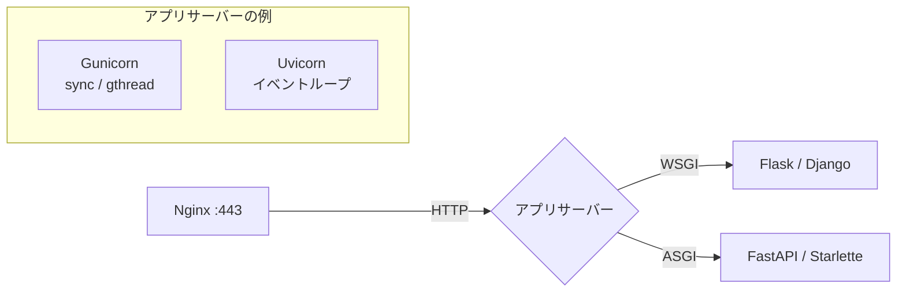

# Pythonアプリを本番で動かす

[[MOC_サーバー・インフラ体系|📚 目次]] ｜ [[02_Node.jsアプリを本番で動かす|← 前へ]] ｜ [[04_プロセス管理とsystemd|次へ →]]

> [!abstract] この記事で分かること
> - WSGI と ASGI の違いと、それぞれに対応するアプリサーバー
> - `flask run` や `uvicorn --reload` を本番で使ってはいけない理由
> - Gunicorn のワーカー数の目安とワーカーの種類（sync / gthread / Uvicorn 系）
> - Uvicorn 単体と Gunicorn＋Uvicorn ワーカーの使い分け（2026 年時点の公式の考え方）
> - venv / uv による環境の分離と依存パッケージの固定、Shop 管理画面（FastAPI）の起動例
>
> **前提**：[[01_アプリケーションサーバーとは]] を読んでいると理解しやすいです。

## 1. ひとことで言うと

Python の Web フレームワーク（Flask、Django、FastAPI）は「**レシピ集**」で、それだけでは料理は出てきません。レシピを読んで実際に料理を作る「**厨房のスタッフ**」が Gunicorn や Uvicorn といったアプリサーバーです。両者は **WSGI / ASGI** という「レシピの書式」で約束しているので、どのレシピ集でも対応するスタッフなら作れます。

- Node.js と違い、Python のアプリは**アプリサーバーとセットで動かす**のが前提
- `flask run` などの開発用サーバーは「試食用の簡易キッチン」。本番では使わない
- マルチコアは**ワーカープロセスを複数**起動して使い切る（Python は GIL があるため、1 プロセスでは基本的に 1 コア分しか Python コードを実行できない）

## 2. WSGI と ASGI

| | WSGI | ASGI |
| --- | --- | --- |
| 読み方・正式名 | Web Server Gateway Interface（PEP 3333） | Asynchronous Server Gateway Interface |
| 処理モデル | 同期。1 リクエストを 1 ワーカー（スレッド）が最後まで担当 | 非同期（async/await）。1 プロセスで多数の接続を並行処理 |
| 得意なこと | 一般的な CRUD、管理画面 | 外部 API 待ちが多い処理、WebSocket、SSE（Server-Sent Events） |
| フレームワーク | Flask、Django（従来の構成） | FastAPI、Starlette、Django（ASGI モード） |
| アプリサーバー | Gunicorn、uWSGI | Uvicorn、Hypercorn、Gunicorn＋ASGI ワーカー |

中身はとてもシンプルで、WSGI は「関数を 1 つ渡す」約束、ASGI はそれを非同期にした約束です。

```python
# WSGI アプリの最小形：環境変数の辞書を受け取り、レスポンスを返す関数
def app(environ, start_response):
    start_response("200 OK", [("Content-Type", "text/plain")])
    return [b"Hello WSGI"]

# ASGI アプリの最小形：async 関数で、送受信も await する
async def app(scope, receive, send):
    await send({"type": "http.response.start", "status": 200,
                "headers": [(b"content-type", b"text/plain")]})
    await send({"type": "http.response.body", "body": b"Hello ASGI"})
```

Flask の `app = Flask(__name__)` や FastAPI の `app = FastAPI()` は、この約束を満たした「呼び出せるオブジェクト」です。だから `gunicorn main:app`（main.py の中の app を動かせ）と指定できるのです。



## 3. 開発サーバーを本番で使わない理由

```bash
flask run --debug            # Flask の開発サーバー（Werkzeug）
uvicorn main:app --reload    # ファイル変更を監視して自動再起動
python manage.py runserver   # Django の開発サーバー
```

これらは開発をラクにするための道具で、本番には向きません。

- **Flask / Django の開発サーバー**は公式ドキュメントで「本番では使わないこと」と明記されています。性能・安定性・セキュリティが本番を想定していません
- **デバッグモード**では、エラー画面からブラウザ上で任意の Python コードを実行できる機能（Werkzeug デバッガ）が有効になり、外部に公開すると**サーバーを乗っ取られる**危険があります
- `--reload` はファイル監視のために余計な CPU を使い、ワーカーを複数持てません（Uvicorn では `--reload` と `--workers` は同時に指定できません）
- 落ちたときの再起動、ワーカーの監視、タイムアウトといった運用機能がありません

## 4. Gunicorn

**Gunicorn**（Green Unicorn）は、Python で最も広く使われているアプリサーバーです。**マスタープロセス**が複数の**ワーカープロセス**を起動・監視し、ワーカーが落ちたり応答しなくなったりしたら作り直します（pre-fork モデル）。

```
gunicorn（マスター：受付・監視のみ）
 ├─ ワーカー1  ← リクエストを処理
 ├─ ワーカー2
 ├─ ワーカー3
 └─ ...        ← 落ちたら自動で作り直す
```

### ワーカー数の目安

公式ドキュメントは**出発点として `(2 × CPU コア数) + 1`** を挙げ、「多くの場合 4〜12 ワーカーで大量のトラフィックをさばける」としています。2 コアなら 5、4 コアなら 9 から始め、負荷試験とメモリ使用量を見ながら調整します。

- 増やしすぎるとメモリ不足やコンテキストスイッチで逆に遅くなる
- 「ワーカー数 × 1 ワーカーのメモリ」がサーバーに収まるか確認する
- DB の接続数（ワーカー数 × プールサイズ）にも跳ね返る（[[01_アプリケーションサーバーとは]] のコネクションプール参照）
- コンテナでは「1 コンテナあたりのワーカーは少なめ、コンテナ数で増やす」方が管理しやすい

### ワーカーの種類（worker class）

| 種類 | 指定 | 特徴 | 向いているアプリ |
| --- | --- | --- | --- |
| **sync**（既定） | `-k sync` | 1 ワーカー＝同時 1 リクエスト。keep-alive 非対応なので Nginx などバッファするプロキシの後ろ必須 | 処理が速い WSGI アプリ |
| **gthread** | `-k gthread --threads 4` | 1 ワーカーに複数スレッド。I/O 待ちの間に別スレッドが動く | DB 待ちが多い Flask / Django |
| **Uvicorn ワーカー** | `-k uvicorn_worker.UvicornWorker` | 各ワーカーがイベントループで ASGI アプリを動かす | FastAPI などの ASGI アプリ |
| gevent | `-k gevent` | グリーンスレッドで大量接続。ライブラリの相性に注意 | 長時間接続の多い WSGI アプリ |

> [!note] 2026 年時点の補足
> - 以前よく使われた `uvicorn.workers.UvicornWorker` は Uvicorn 側で**非推奨**になり、別パッケージ `uvicorn-worker`（`uvicorn_worker.UvicornWorker`）への移行が案内されています。
> - Gunicorn の新しいバージョンには、Uvicorn なしで ASGI アプリを動かせるネイティブの `asgi` ワーカーも登場しています。採用する場合はバージョンと公式ドキュメントを確認してください。

### 設定ファイルの例（Flask / Django 向け・gthread）

```python
# /srv/shop-admin/gunicorn.conf.py
import multiprocessing

bind = "127.0.0.1:8000"            # 外部には出さず Nginx からのみ
workers = multiprocessing.cpu_count() * 2 + 1
worker_class = "gthread"
threads = 4
timeout = 30                        # 30 秒応答しないワーカーは作り直す（既定値）
graceful_timeout = 30               # SIGTERM 後、処理中リクエストを待つ時間
max_requests = 1000                 # 1000 リクエストごとにワーカーを作り直す（メモリリーク対策）
max_requests_jitter = 100           # 全ワーカーが同時に作り直されないようにずらす
accesslog = "-"                     # 標準出力へ（journald / コンテナのログに乗る）
errorlog = "-"
```

Gunicorn は **SIGTERM を受けるとグレースフルシャットダウン**（新規受付を止め、`graceful_timeout` まで処理中のリクエストを待つ）を行います。`kill -HUP <マスターのPID>` で設定を読み直してワーカーを入れ替えることもできます。

## 5. Uvicorn 単体 か Gunicorn＋Uvicorn ワーカーか

FastAPI のような ASGI アプリを動かす方法は 2 つあります。

```bash
# A) Uvicorn 単体（--workers で複数プロセス）
uvicorn main:app --host 127.0.0.1 --port 8000 --workers 4

# FastAPI CLI でも同じことができる（内部で Uvicorn を使う）
fastapi run main.py --host 127.0.0.1 --port 8000 --workers 4

# B) Gunicorn をプロセスマネージャーにして Uvicorn ワーカーを動かす
gunicorn main:app -k uvicorn_worker.UvicornWorker -w 4 -b 127.0.0.1:8000
```

**2026 年時点の FastAPI 公式ドキュメント**は、複数ワーカーを使う方法として `fastapi run --workers` / `uvicorn --workers` を紹介しており、Gunicorn との組み合わせは必須ではなくなっています。Uvicorn の `--workers` も、落ちた子プロセスを自動で再起動する程度のプロセス管理機能を持つようになりました。一方 Uvicorn のドキュメントは、Gunicorn を「本番で Uvicorn を動かし管理する最も簡単な方法の 1 つ」としており、どちらも現役の選択肢です。

| 構成 | 向いている場面 |
| --- | --- |
| **コンテナ 1 つに Uvicorn 1 プロセス**（`--workers` なし） | Kubernetes / ECS。複製と再起動は基盤に任せる（FastAPI 公式もこれを推す） |
| **Uvicorn `--workers N`** | VM / VPS で手軽に複数プロセス。依存が少ない |
| **Gunicorn＋Uvicorn ワーカー** | VM / VPS で、`timeout`・`max_requests`・HUP による入れ替えなど Gunicorn の成熟した管理機能を使いたい |

Nginx の後ろで動かす場合は、クライアントの IP やスキーム（https）を正しく扱うため、プロキシヘッダーを信頼する設定も入れます。

```bash
uvicorn main:app --host 127.0.0.1 --port 8000 --workers 4 \
  --proxy-headers --forwarded-allow-ips 127.0.0.1
```

## 6. 仮想環境とパッケージの固定

### なぜ必要か

Ubuntu 24.04 のシステムの Python（3.12）は OS のツールも使っています。そこに `sudo pip install` でパッケージを入れると OS を壊す恐れがあるため、Ubuntu 24.04 では**システムの Python に直接 pip でインストールしようとするとエラー**になります（PEP 668 の `externally-managed-environment`）。アプリごとに**仮想環境（venv）** を作り、その中にインストールします。

さらに、「開発機では動いたのに本番で動かない」を防ぐため、**依存パッケージのバージョンを完全に固定（ロック）** します。

### 方法 1：venv ＋ pip ＋ requirements.txt

```bash
sudo apt install -y python3-venv
cd /srv/shop-admin
python3 -m venv .venv
.venv/bin/pip install -r requirements.txt
```

`requirements.txt` には `fastapi==0.x.y` のように**バージョンを `==` で固定**します。間接的な依存まで固定したい場合は `pip-tools` の `pip-compile` で生成するとよいでしょう。

### 方法 2：uv（2026 年時点で広く使われている）

**uv** は Rust 製の高速なパッケージ・プロジェクト管理ツールです。`pyproject.toml` に依存を書き、`uv.lock` に全依存の正確なバージョンとハッシュを記録します。Python 本体のバージョン管理もできます。

```bash
# 開発機
uv add fastapi uvicorn sqlalchemy psycopg[binary]
uv add --dev pytest
git add pyproject.toml uv.lock

# 本番サーバー / CI / Dockerfile
uv sync --locked --no-dev   # uv.lock どおりに .venv を作る。lock と食い違えばエラー
.venv/bin/uvicorn shop_admin.main:app --host 127.0.0.1 --port 8000 --workers 2
```

`--locked` を付けると、`pyproject.toml` と `uv.lock` がずれている場合に失敗するので、「知らないうちに別バージョンが入る」事故を防げます。

## 7. 静的ファイルは Nginx から配る

管理画面の CSS・JS・画像を Python のワーカーに配らせると、貴重なワーカーが単純なファイル転送で埋まります。静的ファイルは Nginx から直接返します。

- **Django**：`python manage.py collectstatic` で `STATIC_ROOT`（例：`/srv/shop-admin/static`）に集め、Nginx の `location /static/` で配信。`DEBUG = False`、`ALLOWED_HOSTS` の設定も忘れずに
- **Flask / FastAPI**：`static/` ディレクトリを Nginx の `alias` で配信する
- コンテナで Nginx を置かない構成では、WhiteNoise（Django）を使うか、CDN / S3 から配信する（[[04_CDNによる負荷軽減]]）

## 8. 実例：Shop 管理画面（FastAPI）を起動する

Shop の管理画面（`admin.shop.example.com`）を、同じ VPS 上で FastAPI として動かす例です。

```
/srv/shop-admin/
├── pyproject.toml
├── uv.lock
├── .venv/                 ← uv sync で作成
├── static/                ← CSS / JS（Nginx が直接配信）
└── shop_admin/
    ├── __init__.py
    └── main.py            ← app = FastAPI()
```

```python
# shop_admin/main.py（抜粋）
from fastapi import FastAPI

app = FastAPI(title="Shop Admin", docs_url=None, redoc_url=None)  # 本番では API ドキュメントを隠す

@app.get("/healthz")
async def healthz():
    return {"status": "ok"}
```

**起動コマンド**（2 コアの VPS で Shop API と同居させるので控えめに 2 ワーカー）：

```bash
cd /srv/shop-admin
uv sync --locked --no-dev
.venv/bin/gunicorn shop_admin.main:app \
  -k uvicorn_worker.UvicornWorker -w 2 -b 127.0.0.1:8000 \
  --timeout 30 --graceful-timeout 30 --max-requests 1000 --max-requests-jitter 100 \
  --access-logfile -
```

Gunicorn を使わず `uvicorn --workers 2` でも構いません。どちらにしても、実際には systemd のユニットにして自動起動・自動再起動させます（[[04_プロセス管理とsystemd]]）。`DATABASE_URL` などの設定値の渡し方は [[05_設定と環境変数・シークレット]] で扱います。

**Nginx 側**：

```nginx
# /etc/nginx/sites-available/admin.shop.example.com（抜粋）
server {
    listen 443 ssl;
    http2 on;
    server_name admin.shop.example.com;

    location /static/ {
        alias /srv/shop-admin/static/;    # Python を通さず直接返す
        expires 7d;
    }

    location / {
        proxy_pass http://127.0.0.1:8000;
        proxy_set_header Host $host;
        proxy_set_header X-Real-IP $remote_addr;
        proxy_set_header X-Forwarded-For $proxy_add_x_forwarded_for;
        proxy_set_header X-Forwarded-Proto $scheme;
    }
}
```

管理画面は社内向けなので、IP 制限や認証を Nginx で追加するのが一般的です（[[03_ファイアウォールとネットワーク制御]]）。

> [!tip] Django / Flask の場合
> - **Flask**：`gunicorn -w 5 -k gthread --threads 4 -b 127.0.0.1:8000 "shop_admin:create_app()"` のように、アプリファクトリも指定できます。
> - **Django**：`gunicorn mysite.wsgi:application`（WSGI）、非同期機能を使うなら `mysite.asgi:application` を Uvicorn で動かします。

## よくある誤解・つまずき

- ❌ `app.run(debug=True)` のまま本番に出しても少しなら平気 → ✅ デバッガ経由で任意コード実行される危険があります。開発サーバーとデバッグモードは本番で絶対に使いません。
- ❌ async で書けば何でも速くなる → ✅ `async def` の中で同期の DB ドライバや `time.sleep` を呼ぶと、イベントループ全体が止まります。同期ライブラリを使うなら普通の `def` にする（FastAPI はスレッドプールで実行してくれる）か、非同期対応のライブラリを使います。
- ❌ ワーカー数は多いほどよい → ✅ `(2 × コア数) + 1` は出発点。メモリと DB 接続数の上限を超えない範囲で、負荷試験しながら決めます。
- ❌ `sudo pip install` でサーバーに入れればよい → ✅ Ubuntu 24.04 ではエラーになり、無理に入れると OS を壊す恐れがあります。venv / uv で環境を分け、lock ファイルで固定します。
- ❌ Gunicorn は Windows でも動く → ✅ Gunicorn は Unix 専用です。Windows の開発機では Uvicorn を使い、本番の Linux で Gunicorn を使う、といった差に注意します。

## まとめ

- 同期の Flask / Django は WSGI、非同期の FastAPI は ASGI でアプリサーバーとつながる
- `flask run` / `runserver` / `uvicorn --reload` は開発専用。本番は Gunicorn や Uvicorn を使う
- Gunicorn のワーカー数は `(2 × コア数) + 1` から始め、sync / gthread / Uvicorn ワーカーを用途で選ぶ
- ASGI は「コンテナ 1 つに Uvicorn 1 プロセス」「Uvicorn `--workers`」「Gunicorn＋`uvicorn-worker`」のいずれか。FastAPI 公式（2026 年時点）は前 2 つを紹介
- venv / uv で環境を分け、`requirements.txt`（`==` 固定）や `uv.lock` で依存を固定する
- 静的ファイルは Nginx から配り、Python のワーカーは動的な処理に専念させる

## 確認クイズ

1. 4 コアのサーバーで Gunicorn を使う場合、ワーカー数の出発点はいくつですか？ また、それを決めるときに他に確認すべきことは？
> [!tip]- 答え
> `(2 × 4) + 1 = 9` です。ただしこれは出発点で、9 ワーカー分のメモリがサーバーに収まるか、DB の接続数（ワーカー数 × プールサイズ）が上限を超えないかを確認し、負荷試験で調整します。

2. FastAPI の管理画面を Kubernetes にデプロイします。各コンテナで `--workers 4` を指定すべきですか？
> [!tip]- 答え
> 通常は指定しません。Kubernetes では複製（レプリカ数）や再起動を基盤が担うため、1 コンテナに Uvicorn 1 プロセスとし、Pod の数で増やすのが FastAPI 公式でも推奨される形です。

3. FastAPI のエンドポイントを `async def` で書き、中で同期版の `requests.get()` で外部 API を呼んでいます。何が問題ですか？
> [!tip]- 答え
> 同期の `requests.get()` が応答を待つ間、イベントループがブロックされ、そのワーカーの他のリクエストがすべて止まります。`httpx.AsyncClient` などの非同期クライアントを使うか、関数を普通の `def` にしてスレッドプールで実行させます。

## 関連ノート

- [[01_アプリケーションサーバーとは]] — WSGI / ASGI の位置づけと同時処理モデル
- [[02_Node.jsアプリを本番で動かす]] — Node.js 版の本番運用
- [[04_プロセス管理とsystemd]] — Gunicorn / Uvicorn を systemd で常駐させる
- [[05_設定と環境変数・シークレット]] — `DATABASE_URL` や秘密鍵の扱い
- [[03_リバースプロキシ]] — Nginx の proxy 設定
- [[04_CDNによる負荷軽減]] — 静的ファイルを CDN から配る
- [[本番向けベストプラクティス]] — コンテナで動かす場合
- [[MOC_バックエンド体系]] — バックエンド全般

## 参考

- [PEP 3333 – Python Web Server Gateway Interface v1.0.1](https://peps.python.org/pep-3333/)
- [ASGI Documentation](https://asgi.readthedocs.io/)
- [Gunicorn - Design（How Many Workers? / Worker Types）](https://gunicorn.org/design/)
- [Gunicorn - ASGI](https://gunicorn.org/asgi/)
- [Uvicorn - Deployment](https://uvicorn.dev/deployment/)
- [FastAPI - Server Workers](https://fastapi.tiangolo.com/deployment/server-workers/)
- [FastAPI - FastAPI in Containers](https://fastapi.tiangolo.com/deployment/docker/)
- [Flask - Deploying to Production](https://flask.palletsprojects.com/en/stable/deploying/)
- [Django - How to deploy with WSGI](https://docs.djangoproject.com/en/stable/howto/deployment/wsgi/)
- [uv - Locking and syncing](https://docs.astral.sh/uv/concepts/projects/sync/)
- [PEP 668 – Marking Python base environments as “externally managed”](https://peps.python.org/pep-0668/)
