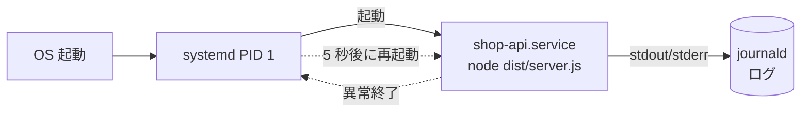
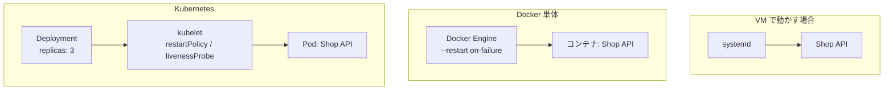

# プロセス管理とsystemd

[[MOC_サーバー・インフラ体系|📚 目次]] ｜ [[03_Pythonアプリを本番で動かす|← 前へ]] ｜ [[05_設定と環境変数・シークレット|次へ →]]

> [!abstract] この記事で分かること
> - `node dist/server.js` を手で打つだけでは本番運用にならない理由
> - systemd の unit ファイル（`[Unit]` / `[Service]` / `[Install]`）の読み書き
> - `systemctl` と `journalctl` による起動・停止・ログ確認
> - Shop API をそのまま使える unit ファイルの完全例（セキュリティ設定込み）
> - PM2 / supervisor との違いと、コンテナ環境では誰がこの役割を担うか
>
> **前提**：[[02_Node.jsアプリを本番で動かす]] と [[04_Linuxサーバーの基本]] を読んでいると理解しやすいです。

## 1. ひとことで言うと

プロセスマネージャ（process manager）は、アプリにとっての **「住み込みの管理人」** です。建物（サーバー）の電気が復旧したら真っ先にお店（アプリ）のシャッターを開け、お店が急に閉まったら（クラッシュ）すぐ開け直し、営業日誌（ログ）を付けてくれます。

Ubuntu をはじめとする現在の主要な Linux ディストリビューションでは、OS の起動時に最初に動くプロセス（PID 1）である **systemd** がこの管理人役を担います。追加ソフトをインストールしなくても使えるので、**VM / VPS 上でアプリを動かすなら、まず systemd を使う** のが 2026 年時点の定番です。

## 2. なぜプロセスマネージャが必要か

SSH でログインして `node dist/server.js` を実行すると、Shop API は確かに動きます。しかし、この状態には次の問題があります。

| 問題 | 何が起きるか | プロセスマネージャがやること |
|---|---|---|
| SSH を切ると止まる | ターミナルと一緒にプロセスが終了する | ターミナルと無関係にバックグラウンドで動かす |
| サーバー再起動で消える | OS アップデート後の再起動でアプリが起動しないまま | **起動時に自動起動** |
| クラッシュしたら終わり | 未処理例外 1 つで、誰かが気づくまで停止 | **異常終了時に自動再起動** |
| ログがどこにもない | 画面に出たログは流れて消える | **標準出力・標準エラーを収集・保存** |
| root で動いてしまう | 脆弱性があるとサーバー全体を乗っ取られる | **専用ユーザーで実行**、権限を絞る |

`nohup` や `screen` / `tmux` で「とりあえず」動かすこともできますが、自動起動・自動再起動・ログ管理がないため本番運用には向きません。



## 3. unit ファイルの構造

systemd が管理する対象を **unit（ユニット）** と呼び、その設定ファイルが **unit ファイル** です。サービス（常駐プロセス）は拡張子 `.service` で、自作のものは `/etc/systemd/system/` に置きます（パッケージが入れるものは `/usr/lib/systemd/system/`。同名なら `/etc` 側が優先）。

INI 形式で、3 つのセクションから成ります。

```ini
[Unit]        # このユニットの説明と、他のユニットとの関係（順序・依存）
Description=...
After=...

[Service]     # どう起動し、どう監視するか（本体）
ExecStart=...
Restart=...

[Install]     # 「systemctl enable」したとき、どのタイミングで起動対象に入るか
WantedBy=multi-user.target
```

### 3.1 [Unit] セクション

| 項目 | 意味 |
|---|---|
| `Description=` | 人間向けの説明。`systemctl status` に表示される |
| `After=` | 指定したユニットの **後に** 起動する（順序だけ。依存はしない） |
| `Wants=` | 指定したユニットも一緒に起動しようとする（失敗しても自分は起動する、弱い依存） |
| `Requires=` | 強い依存。相手が起動に失敗したら自分も起動しない |

ネットワークが使える状態になってから起動したいので、Web アプリでは `After=network-online.target` と `Wants=network-online.target` をセットで書くのが一般的です。DB が同じサーバーにあるなら `After=postgresql.service` も加えます。

### 3.2 [Service] セクション

**Type=（起動完了の判定方法）**

| 値 | 起動完了とみなすタイミング | 向いているもの |
|---|---|---|
| `simple` | プロセスを fork した直後（`ExecStart=` 指定時の既定値） | フォアグラウンドで動き続けるアプリ |
| `exec` | 実行ファイルの `execve()` が成功した後 | `simple` とほぼ同じだが、**実行ファイルが無い・ユーザーが無い等の失敗を `systemctl start` がエラーとして返してくれる** |
| `notify` | アプリが `sd_notify("READY=1")` で通知した後 | 通知に対応したデーモン（PostgreSQL など） |
| `forking` | 親プロセスが終了した後（自分で裏に回るタイプ） | 古いデーモン。新規アプリでは使わない |
| `oneshot` | プロセスが終了した後 | 一度だけ実行するバッチ・初期化処理 |

Node.js / Python のアプリはフォアグラウンドで動き続けるので、**`Type=exec`（または `simple`）** を選びます。アプリ側で「デーモン化（自分で裏に回る）」をする必要はありません。

**主な項目**

| 項目 | 意味・注意 |
|---|---|
| `ExecStart=` | 起動コマンド。**絶対パスで書く**（`node` ではなく `/usr/bin/node`）。シェルを経由しないので `&&` やリダイレクトは使えない |
| `User=` / `Group=` | 実行ユーザー。省略すると **root で動く** ので必ず指定 |
| `WorkingDirectory=` | カレントディレクトリ。相対パスでファイルを読むアプリで必須 |
| `Environment=` / `EnvironmentFile=` | 環境変数を渡す。詳しくは [[05_設定と環境変数・シークレット]] |
| `Restart=` | いつ再起動するか。既定値は `no`（再起動しない） |
| `RestartSec=` | 再起動までの待ち時間。既定値は 100ms |
| `TimeoutStopSec=` | 停止時に SIGTERM を送ってから SIGKILL するまでの猶予（既定 90 秒） |

**Restart= の選び方**

| 値 | 正常終了（exit 0） | 異常終了（exit ≠ 0、シグナルによる強制終了、タイムアウト） |
|---|---|---|
| `no` | 再起動しない | 再起動しない |
| `on-failure` | 再起動しない | **再起動する** |
| `always` | 再起動する | 再起動する |

Web アプリでは **`Restart=on-failure`** が基本です。「意図して正常終了したのに勝手に再起動される」ことがなく、クラッシュ時だけ立ち上げ直してくれます。

ただし、設定ミスで起動直後に毎回落ちるアプリを延々と再起動し続けないよう、systemd には **起動回数制限** があります。既定では「10 秒間に 5 回」起動すると諦めて `failed` 状態になります（`[Unit]` の `StartLimitIntervalSec=` / `StartLimitBurst=` で変更可）。`RestartSec=5` のように少し待たせると、DB の一時的な不調などからも回復しやすくなります。

### 3.3 [Install] セクション

`WantedBy=multi-user.target` と書くと、`systemctl enable` したときに「通常のマルチユーザー起動（サーバーの普段の状態）」の一部として **OS 起動時に自動起動** されるようになります。サーバー用のサービスはほぼこれ一択です。

## 4. Shop API の unit ファイル完全例

前提：
- アプリは `/opt/shop-api` に配置（`dist/server.js` がビルド成果物）
- 実行ユーザー `shop`（ログイン不可のシステムユーザー）
- 環境変数は `/etc/shop-api/env` に置く（root 所有、`shop` だけ読める）

まず実行ユーザーとディレクトリを用意します。

```bash
# ログインできないシステムユーザーを作成
sudo useradd --system --no-create-home --shell /usr/sbin/nologin shop

# アプリ本体は root 所有（アプリ自身が自分のコードを書き換えられないように）
sudo chown -R root:root /opt/shop-api

# 環境変数ファイル：root 所有、shop グループだけ読める
sudo mkdir -p /etc/shop-api
sudo install -m 640 -o root -g shop /dev/null /etc/shop-api/env
```

`/etc/systemd/system/shop-api.service`：

```ini
[Unit]
Description=Shop API (Node.js)
Documentation=https://github.com/example/shop-api
After=network-online.target
Wants=network-online.target
# DB が同じサーバーにある構成なら次の行も追加
# After=postgresql.service

# 60 秒間に 5 回より多く落ちたら再起動を諦めて failed にする
StartLimitIntervalSec=60
StartLimitBurst=5

[Service]
Type=exec
User=shop
Group=shop
WorkingDirectory=/opt/shop-api
EnvironmentFile=/etc/shop-api/env
Environment=NODE_ENV=production
ExecStart=/usr/bin/node dist/server.js

# クラッシュ時だけ 5 秒待って再起動
Restart=on-failure
RestartSec=5

# 停止時は SIGTERM → 30 秒待っても終わらなければ SIGKILL
# （アプリ側で SIGTERM を受けて処理中のリクエストを終えてから終了する）
KillSignal=SIGTERM
TimeoutStopSec=30

# ---- セキュリティ（サンドボックス） ----
NoNewPrivileges=true
ProtectSystem=strict
ProtectHome=true
PrivateTmp=true
PrivateDevices=true
ProtectKernelTunables=true
ProtectKernelModules=true
ProtectControlGroups=true
RestrictSUIDSGID=true
# 書き込みが必要な場所だけ許可（/var/lib/shop-api を自動作成し shop 所有にする）
StateDirectory=shop-api
# 万一のメモリリークでサーバー全体を道連れにしない
MemoryMax=1G

[Install]
WantedBy=multi-user.target
```

### 4.1 セキュリティ系オプションの意味

| 項目 | 効果 |
|---|---|
| `NoNewPrivileges=true` | このプロセスと子プロセスが setuid バイナリ（`sudo` など）経由で **権限を昇格できなくなる** |
| `ProtectSystem=strict` | ファイルシステム全体を **読み取り専用** にする（`/dev` `/proc` `/sys` を除く）。`true` は `/usr` と `/boot` のみ、`full` はそれに `/etc` を加えたもの |
| `ProtectHome=true` | `/home` `/root` `/run/user` を見えなくする |
| `PrivateTmp=true` | このサービス専用の `/tmp` を用意し、他プロセスの一時ファイルと分離 |
| `StateDirectory=shop-api` | `/var/lib/shop-api` を作って書き込み可能にする。任意の場所なら `ReadWritePaths=` で指定 |

これらは「アプリに脆弱性があって攻撃者にコードを実行されても、被害をこのサービスの中に閉じ込める」ための仕組みです。`systemd-analyze security shop-api` を実行すると、どの項目が未設定かをスコア付きで一覧できます。

> [!warning] strict にしたら動かなくなった
> `ProtectSystem=strict` にすると、アプリがログファイルやアップロード画像を `/opt/shop-api/uploads` に書こうとして `EROFS: read-only file system` で落ちることがあります。ログは標準出力へ（journald が集める）、データは `StateDirectory=` か `ReadWritePaths=` で許可した場所へ書くように直します。

### 4.2 反映と起動

```bash
sudo systemctl daemon-reload          # unit ファイルを書き換えたら必ず実行
sudo systemctl enable --now shop-api  # 自動起動を有効化 + 今すぐ起動
systemctl status shop-api             # 状態確認
```

## 5. systemctl と journalctl の使い方

### 5.1 systemctl（サービスの操作）

| コマンド | 意味 |
|---|---|
| `systemctl start / stop / restart shop-api` | 起動 / 停止 / 再起動 |
| `systemctl reload shop-api` | 設定の再読み込み（`ExecReload=` がある場合のみ） |
| `systemctl enable / disable shop-api` | OS 起動時の自動起動を ON / OFF |
| `systemctl status shop-api` | 状態・PID・メモリ・直近のログを表示 |
| `systemctl is-active shop-api` | `active` などを 1 語で返す（スクリプト向き） |
| `systemctl --failed` | 失敗しているユニットの一覧 |
| `systemctl cat shop-api` | 実際に読み込まれている unit ファイルを表示 |
| `sudo systemctl edit shop-api` | 元ファイルを変えずに一部を上書き（drop-in、`/etc/systemd/system/shop-api.service.d/override.conf`） |

`status` の出力例：

```
● shop-api.service - Shop API (Node.js)
     Loaded: loaded (/etc/systemd/system/shop-api.service; enabled; preset: enabled)
     Active: active (running) since Mon 2026-10-12 10:00:00 JST; 2h ago
   Main PID: 1234 (node)
     Memory: 85.3M (max: 1.0G)
```

`enabled` が自動起動 ON、`active (running)` が稼働中という意味です。

### 5.2 journalctl（ログの確認）

systemd で動かしたプロセスの標準出力・標準エラーは、既定で **journald** に集められます。アプリは `console.log` で JSON などを出力するだけでよく、ログファイルのローテーションを自分で書く必要がありません。

```bash
journalctl -u shop-api                 # shop-api のログ全部
journalctl -u shop-api -f              # tail -f のように流し見
journalctl -u shop-api -n 100          # 直近 100 行
journalctl -u shop-api --since "1 hour ago"
journalctl -u shop-api -p err          # エラー以上だけ
journalctl -u shop-api -b              # 今回の OS 起動以降だけ
journalctl --disk-usage                # ジャーナルの容量
```

Ubuntu 24.04 では journald のログは `/var/log/journal/` に永続化されます。保存量は `/etc/systemd/journald.conf` の `SystemMaxUse=` で上限を決められます。複数台のログを横断して検索したくなったら、ログ集約基盤（[[04_ログ集約基盤]]）へ転送します。

## 6. PM2 / supervisor との比較

| 観点 | systemd | PM2 | supervisor |
|---|---|---|---|
| 対象 | 何でも（OS 標準） | 主に Node.js | 何でも（Python 製） |
| 導入 | 不要（OS に内蔵） | `npm i -g pm2` | `apt install supervisor` |
| OS 起動時の自動起動 | 標準 | `pm2 startup`（内部で systemd 等に登録） | supervisor 自体を systemd で起動 |
| クラスタ（複数プロセス） | テンプレート unit（`shop-api@.service`）で実現 | `-i max` で簡単 | `numprocs` |
| ログ | journald | 独自ファイル（`pm2-logrotate` 等が必要） | 独自ファイル |
| セキュリティ制限 | 豊富（上記サンドボックス） | なし | ほぼなし |
| ゼロダウンタイム再起動 | 自前で工夫（LB 側で切り替え） | `pm2 reload` | なし |

**選び方の目安**：VM 上の本番では **systemd を第一候補** にします。PM2 は開発機や「Node.js だけを手早く複数プロセスで動かしたい」場面では便利ですが、PM2 自体も結局 systemd から起動されるので、管理の層が 1 つ増えます。supervisor は systemd が普及する前からある仕組みで、既存環境で見かける程度と考えてよいでしょう。

## 7. コンテナ環境では誰がこの役割を担うか

コンテナで動かす場合、**コンテナの中で systemd や PM2 を動かさない** のが原則です。コンテナは「1 コンテナ 1 プロセス」で、プロセス管理はコンテナの外側が担います。



| 役割 | VM + systemd | Docker | Kubernetes |
|---|---|---|---|
| 起動時の自動起動 | `systemctl enable` | `--restart unless-stopped`（Docker Engine 自体は systemd が起動） | ノード起動時に kubelet が Pod を復元 |
| クラッシュ時の再起動 | `Restart=on-failure` | `--restart on-failure[:回数]` | `restartPolicy: Always` ＋ livenessProbe |
| 台数の維持 | （自前） | （自前、Compose で一部） | Deployment の `replicas` |
| ログ | journald | `docker logs`（ログドライバ） | `kubectl logs`、ノードのログ収集 |

Docker の再起動ポリシーは `no`（既定）/ `on-failure` / `always` / `unless-stopped` の 4 種類で、起動後 10 秒以上動いてから初めて有効になります（起動直後に落ち続けるループを防ぐため）。詳しくは [[09-Docker]]、[[10-Kubernetes]]、[[本番向けベストプラクティス]] を参照してください。

> [!note] PID 1 問題
> コンテナ内でアプリが PID 1 になると、SIGTERM の扱いやゾンビプロセスの回収で問題が出ることがあります。`docker run --init` や `tini` を使う、`CMD ["node", "dist/server.js"]` のように exec 形式で書く（`npm start` を挟まない）、といった対策が定番です。

## よくある誤解・つまずき

- ❌ `ExecStart=node dist/server.js` で動く → ✅ 古い systemd では絶対パスが必須で、新しい版でも PATH は最小限です。nvm でインストールした Node は `/home/...` にあり、`ProtectHome=true` だと見えません。本番では apt（NodeSource 等）で `/usr/bin/node` に入れるのが無難です。
- ❌ unit ファイルを書き換えたら `restart` だけで反映される → ✅ 先に `sudo systemctl daemon-reload` が必要です。忘れると「変更したのに効かない」状態になります。
- ❌ `Restart=always` にしておけば安心 → ✅ 起動直後に落ち続ける場合、起動回数制限で結局 `failed` になります。原因は `journalctl -u` で確認し、監視で `failed` を検知できるようにしておきます。
- ❌ アプリ内でログファイルを開いて書くべき → ✅ systemd 配下では標準出力に出すだけで journald が保存・ローテーションしてくれます（The Twelve-Factor App の「ログはイベントストリーム」の考え方）。
- ❌ `systemctl stop` で即座に止まる → ✅ まず SIGTERM が送られ、`TimeoutStopSec` 経過後に SIGKILL です。アプリが SIGTERM を受けて処理中のリクエストを終えてから終了する（graceful shutdown）ように作ると、デプロイ時のエラーを減らせます（[[08_ゼロダウンタイムデプロイの条件]]）。

## まとめ

- 本番のアプリには「自動起動・自動再起動・ログ収集・権限分離」を担うプロセスマネージャが必要で、Linux VM では systemd が標準。
- unit ファイルは `[Unit]`（順序・依存）、`[Service]`（起動方法・再起動・実行ユーザー）、`[Install]`（自動起動のタイミング）の 3 部構成。
- Web アプリは `Type=exec`、`Restart=on-failure`、専用 `User=`、`WorkingDirectory=`、`EnvironmentFile=` が基本形。
- `NoNewPrivileges` や `ProtectSystem=strict` などのサンドボックスで、侵入されたときの被害を小さくできる。
- 操作は `systemctl`、ログは `journalctl -u`。変更後は `daemon-reload` を忘れない。
- コンテナでは Docker の restart policy や Kubernetes が同じ役割を担い、コンテナ内に systemd は入れない。

## 確認クイズ

1. Shop API が未処理例外で exit code 1 で終了しました。`Restart=on-failure` のとき systemd は再起動しますか？ また、`systemctl stop` で止めた場合はどうですか？
> [!tip]- 答え
> 異常終了（exit ≠ 0）なので再起動します。`systemctl stop` は管理者の意図的な停止なので、`Restart=` の設定にかかわらず再起動しません。

2. `ProtectSystem=strict` を付けたらアプリが画像アップロード時に落ちるようになりました。どう直しますか？
> [!tip]- 答え
> strict ではファイルシステム全体が読み取り専用になるため、書き込み先を `StateDirectory=shop-api`（`/var/lib/shop-api`）や `ReadWritePaths=/var/lib/shop-api/uploads` で明示的に許可し、アプリの保存先をそこに変えます。本格的にはオブジェクトストレージ（S3 等）に置くのが、サーバーを複数台にしたときにも困りません。

3. Kubernetes で動かす Shop API のコンテナイメージに PM2 を入れて `pm2-runtime` で起動しようとしています。何が問題になりやすいですか？
> [!tip]- 答え
> 再起動や台数維持は Kubernetes が担うため役割が重複します。PM2 がコンテナ内でアプリを再起動してしまうと、Kubernetes 側から見たクラッシュや再起動回数が分かりにくくなります。コンテナでは 1 プロセスを直接起動し、再起動は restartPolicy と livenessProbe に任せるのが原則です。

## 関連ノート
- [[02_Node.jsアプリを本番で動かす]] — systemd で起動する Shop API 本体の準備
- [[03_Pythonアプリを本番で動かす]] — Gunicorn / Uvicorn を systemd で動かす場合
- [[05_設定と環境変数・シークレット]] — `EnvironmentFile=` に何を書くか
- [[04_Linuxサーバーの基本]] — ユーザー・パーミッション・プロセスの基礎
- [[09-Docker]] / [[10-Kubernetes]] — コンテナでのプロセス管理
- [[08_ゼロダウンタイムデプロイの条件]] — graceful shutdown とデプロイ
- [[04_ログ集約基盤]] — journald のログを集めて横断検索する
- [[01_サーバーセキュリティの基本]] — 最小権限の考え方

## 参考
- [systemd.service（systemd 公式 man）](https://www.freedesktop.org/software/systemd/man/latest/systemd.service.html)
- [systemd.exec（systemd 公式 man）](https://www.freedesktop.org/software/systemd/man/latest/systemd.exec.html)
- [systemd.unit（systemd 公式 man）](https://www.freedesktop.org/software/systemd/man/latest/systemd.unit.html)
- [journalctl（systemd 公式 man）](https://www.freedesktop.org/software/systemd/man/latest/journalctl.html)
- [Start containers automatically（Docker Docs）](https://docs.docker.com/engine/containers/start-containers-automatically/)
- [PM2 Documentation](https://pm2.keymetrics.io/docs/usage/quick-start/)
- [The Twelve-Factor App — XI. Logs](https://12factor.net/logs)
