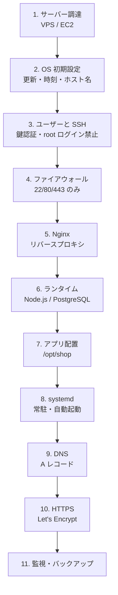
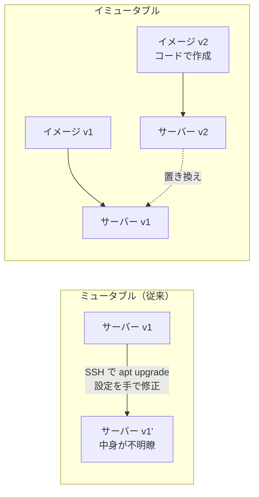

# サーバー構築の流れ

[[MOC_サーバー・インフラ体系|📚 目次]] ｜ [[06_データベースサーバーの運用|← 前へ]] ｜ [[02_IaCとは|次へ →]]

> [!abstract] この記事で分かること
> - Shop を「手作業で 1 台」構築するときの全手順と、その順番の理由
> - 各ステップが正しくできたかを確かめるコマンド
> - 手順書を書いても残る、手作業構築の限界（スノーフレークサーバー・構成ドリフト）
> - ペットと家畜（Pets vs Cattle）、イミュータブルインフラという考え方
> - なぜ IaC（Infrastructure as Code）が必要になるのか
>
> **前提**：[[04_Linuxサーバーの基本]]、[[02_Nginx入門]]、[[04_プロセス管理とsystemd]] を読んでいると理解しやすいです。

## 1. ひとことで言うと

サーバー構築は **「引っ越し先の部屋を、住める状態にする作業」** に似ています。部屋を借りる（サーバー調達）→ 鍵を替える（ユーザー/SSH）→ 戸締まり（ファイアウォール）→ 家具を入れる（Nginx・ランタイム・アプリ）→ 表札を出す（DNS）→ 防犯カメラと保険（監視・バックアップ）。順番を間違えると、たとえば「鍵を替える前に荷物を運び込んで、その間に空き巣に入られる」ようなことが起きます。

- 構築は **「安全を固める → 動かす → 公開する → 見守る」** の順で進める
- 各ステップには **「できたことを確かめる方法」** がセットで必要
- 1 台なら手作業でも作れるが、**2 台目・作り直し・半年後の変更** で手作業は破綻する。これが IaC へ進む理由

## 2. Shop を 1 台構築する全体地図

これまでの章で学んだ部品を、実際に組み立てる順番に並べると次のようになります。



> [!note] DNS と HTTPS の順番
> Let's Encrypt の HTTP-01 チャレンジは「そのドメインが本当にこのサーバーを指しているか」を確認するため、**DNS を先に向けておく必要があります**。図では DNS → HTTPS の順にしています。

| # | ステップ | 主な作業 | 詳しくは |
|---|---|---|---|
| 1 | サーバー調達 | Ubuntu Server 24.04 LTS のインスタンス作成、固定 IP 割当 | [[03_仮想化とクラウド]] |
| 2 | OS 初期設定 | `apt upgrade`、タイムゾーン、ホスト名、自動更新 | [[04_Linuxサーバーの基本]] |
| 3 | ユーザー/SSH | 作業ユーザー作成、公開鍵認証、パスワード・root ログイン禁止 | [[02_SSHの安全な運用]] |
| 4 | ファイアウォール | ufw で 22/80/443 だけ許可 | [[03_ファイアウォールとネットワーク制御]] |
| 5 | Nginx | インストール、`proxy_pass` で 3000 番へ | [[03_リバースプロキシ]] |
| 6 | ランタイム | Node.js LTS、PostgreSQL | [[02_Node.jsアプリを本番で動かす]]、[[06_データベースサーバーの運用]] |
| 7 | アプリ配置 | 専用ユーザー `shop`、ビルド、`.env` | [[05_設定と環境変数・シークレット]] |
| 8 | systemd | unit ファイル、`enable --now` | [[04_プロセス管理とsystemd]] |
| 9 | DNS | `shop.example.com` → サーバーの IP | [[05_ネットワークの基本（IP・ポート・DNS）]] |
| 10 | HTTPS | certbot で証明書取得・自動更新 | [[04_HTTPSとTLS証明書]] |
| 11 | 監視・バックアップ | 死活監視、ログ、DB の定期バックアップ | [[04_サーバー監視とログ管理の基本]]、[[04_DR訓練とRTO・RPO]] |

## 3. 各ステップの作業と確認方法

ここでは「何を打つか」と「どう確かめるか」を対にして示します。細かい設定の意味は各回に任せ、**流れをつかむ** ことを優先します。

### 3.1 OS 初期設定（ステップ 2）

```bash
sudo apt update && sudo apt upgrade -y
sudo timedatectl set-timezone Asia/Tokyo
sudo hostnamectl set-hostname shop-web-01
sudo apt install -y unattended-upgrades   # セキュリティ更新の自動適用
```

確認：

```bash
timedatectl            # Time zone: Asia/Tokyo になっているか
hostnamectl            # Static hostname を確認
cat /etc/os-release    # Ubuntu 24.04 であること
```

> [!tip] ロケールは英語のままが無難
> サーバーのロケールを `ja_JP.UTF-8` にすると、エラーメッセージが日本語になって検索しにくくなります。ログやエラーは `C.UTF-8` / `en_US.UTF-8` のまま、タイムゾーンだけ合わせるのが実務では一般的です。

### 3.2 ユーザーと SSH（ステップ 3）

```bash
# 作業用ユーザーを作り sudo を与える
sudo adduser deploy
sudo usermod -aG sudo deploy

# 手元 PC から公開鍵を登録（手元で実行）
ssh-copy-id deploy@<サーバーIP>

# 鍵でログインできるのを確かめてから、パスワードと root ログインを禁止
sudo tee /etc/ssh/sshd_config.d/10-hardening.conf <<'EOF'
PermitRootLogin no
PasswordAuthentication no
EOF
sudo sshd -t && sudo systemctl reload ssh
```

確認：**今の SSH セッションを閉じずに**、別ターミナルで `ssh deploy@<IP>` が通ることを確認します。設定ミスで締め出されても、開いているセッションから戻せます。

> [!warning] Ubuntu 24.04 のサービス名
> Ubuntu では SSH サーバーの unit 名は `ssh`（`sshd` ではない）です。また 24.04 は `ssh.socket` によるソケット起動が既定なので、ポート番号を変える場合は socket 側の設定も関係します。詳しくは [[02_SSHの安全な運用]]。

### 3.3 ファイアウォール（ステップ 4）

```bash
sudo ufw allow OpenSSH        # 先に SSH を許可しないと締め出される
sudo ufw allow 80/tcp
sudo ufw allow 443/tcp
sudo ufw enable
```

確認：`sudo ufw status verbose` で 22/80/443 だけが ALLOW になっていること。クラウドでは **セキュリティグループ（クラウド側の FW）も同じ方針** にそろえます。3000 番（Node.js）や 5432 番（PostgreSQL）は **外に開けません**。

### 3.4 Nginx・ランタイム・アプリ・systemd（ステップ 5〜8）

```bash
sudo apt install -y nginx postgresql
# Node.js LTS は NodeSource などのリポジトリから（2026 年時点の LTS は 24 系）
curl -fsSL https://deb.nodesource.com/setup_24.x | sudo -E bash -
sudo apt install -y nodejs

# アプリ専用ユーザー（ログイン不可）と配置先
sudo useradd --system --home /opt/shop --shell /usr/sbin/nologin shop
sudo mkdir -p /opt/shop && sudo chown shop:shop /opt/shop
# ここで git clone / ビルド成果物の転送、npm ci --omit=dev、.env の配置
sudo systemctl enable --now shop.service   # unit ファイルは前章参照
```

確認は **内側から外側へ** 順に行うのがコツです。どこで止まっているかがすぐ分かります。

```bash
systemctl status shop          # active (running) か
curl -i http://127.0.0.1:3000/health   # アプリ単体が応答するか
sudo nginx -t                  # Nginx 設定の文法
curl -i http://127.0.0.1/health        # Nginx 経由で届くか
ss -tlnp                       # 3000 番が 127.0.0.1 だけで待ち受けているか
```

### 3.5 DNS・HTTPS（ステップ 9〜10）

```bash
dig +short shop.example.com        # サーバーの IP が返るか（手元で確認）
sudo apt install -y certbot python3-certbot-nginx
sudo certbot --nginx -d shop.example.com -d api.shop.example.com
sudo certbot renew --dry-run       # 自動更新が通るか
```

確認：`curl -I https://shop.example.com` で 200 系、ブラウザで鍵マーク、`systemctl list-timers | grep certbot` で更新タイマーがあること。

### 3.6 監視・バックアップ（ステップ 11）

最低限、次の 3 つがないサーバーは「本番」と呼べません。

- **外形監視**：外部から `https://shop.example.com/health` を定期的に叩き、落ちたら通知（UptimeRobot、CloudWatch Synthetics など）
- **ログ**：`journalctl -u shop`、Nginx のアクセスログを見られる・保管される状態に（[[04_ログ集約基盤]]）
- **バックアップ**：`pg_dump` を毎日取り、**別の場所**（S3 など）に保存。そして **リストアを実際に試す**（[[06_データベースサーバーの運用]]）

## 4. 手順書（ランブック）にする

ここまでの作業を、次の人（＝半年後の自分）が再現できるように書き残したものが **手順書（Runbook、ランブック）** です。良い手順書は次の形をしています。

```markdown
## 手順 3: SSH のハードニング
目的: パスワード総当たり攻撃を防ぐ
前提: deploy ユーザーで鍵ログインできること
作業:
  1. /etc/ssh/sshd_config.d/10-hardening.conf を作成（内容は下記）
  2. sudo sshd -t で文法チェック
  3. sudo systemctl reload ssh
確認: 別端末から ssh deploy@<IP> が通る / ssh root@<IP> が拒否される
戻し方: 上記ファイルを削除して reload
```

**目的・前提・作業・確認・戻し方** の 5 点がそろっていると、他人が実行しても事故になりにくくなります（書き方の詳細は [[02_ランブックの書き方]]）。

…ところが、手順書をどれだけ丁寧に書いても、次の問題は残ります。

## 5. 手作業構築の限界

### 5.1 スノーフレークサーバー

**スノーフレーク（Snowflake、雪の結晶）サーバー** とは、「同じものが二つとない」サーバーのことです。手作業で作ると、

- 手順書の 12 行目を飛ばした、`apt upgrade` のタイミングが違ってパッケージのバージョンがずれた
- 障害対応で `nginx.conf` を直接直したが、手順書に反映し忘れた

といった小さな違いが積み重なり、「本番 1 号機だけで再現するバグ」「誰も作り直し方を知らないサーバー」が生まれます。

### 5.2 構成ドリフト

**構成ドリフト（Configuration Drift）** は、「あるべき姿（手順書・設計書）」と「実際のサーバーの状態」が時間とともにずれていく現象です。

```
構築直後            3 か月後                  1 年後
手順書 = 実機   →  手順書 ≒ 実機          →  手順書 ≠ 実機
                   (緊急パッチ・手動修正)     (誰も全体を知らない)
```

ドリフトが進むと、2 台目を作ろうとしても **1 号機と同じものが作れません**。ロードバランサーの後ろに API を 2 台並べる（[[01_スケーリングの基本]]）段階で、これは致命的になります。

### 5.3 再現できない・速くない・レビューできない

| 問題 | 具体例 |
|---|---|
| 再現性がない | 障害でサーバーが壊れた。作り直すのに手順書を見ながら 1 日かかり、しかも前と同じか分からない |
| 遅い | API を 2 台 → 10 台にしたい。10 回手で打つ？ |
| レビューできない | 「ufw のルールを変えた」が口頭とチャットでしか残らず、誰がいつなぜ変えたか追えない |
| 人に依存する | 構築できるのは A さんだけ。A さんが休むと誰も触れない |

## 6. ペットと家畜、イミュータブルインフラ

### 6.1 Pets vs Cattle

クラウド時代のサーバー観を表す有名な例えが **ペットと家畜（Pets vs Cattle）** です。

| | ペット（Pets） | 家畜（Cattle） |
|---|---|---|
| 名前 | `shop-main` のように愛称を付ける | `web-0a1b2c` のように番号 |
| 病気になったら | 手当てして治す（SSH して直す） | 群れから外して新しい個体に入れ替える |
| 作り方 | 一台ずつ手作業 | 同じ型から自動で量産 |
| 例 | 手作業の 1 号機 | オートスケーリングの EC2、コンテナ |

手作業構築のサーバーは必然的にペットになります。「壊れても同じものをすぐ作れる」家畜にするには、**作り方そのものをコード化** する必要があります。

> [!note] 全部を家畜にする必要はない
> DB サーバーのように状態（データ）を持つものは、簡単には「捨てて作り直す」ことができません。データはマネージド DB やバックアップで守り、**状態を持たない Web/API サーバーから家畜化する** のが現実的な順番です。

### 6.2 イミュータブルインフラ

**イミュータブルインフラ（Immutable Infrastructure、不変のインフラ）** は家畜の考え方を徹底したもので、**一度作ったサーバーには変更を加えない** というルールです。



変更したいときは、新しいイメージ（AMI やコンテナイメージ）を作り、新しいサーバーを立てて **古いものと入れ替え** ます。ドリフトは原理的に起きず、問題があれば古いイメージに戻すだけです。入れ替え方は [[04_Blue-Greenデプロイ]] や [[03_ローリングアップデート]] で扱います。コンテナ（[[Dockerとは]]）はこの考え方を最も手軽に実現する手段です。

## 7. そこで IaC へ

ここまでの問題はすべて「サーバーの作り方が **人の手と頭の中** にある」ことが原因です。これを **コード（テキストファイル）** にしてしまうのが **IaC（Infrastructure as Code）** です。

| 手作業の問題 | IaC での解決 |
|---|---|
| スノーフレーク | 同じコードからは同じサーバーができる |
| ドリフト | コードと実機の差分を検出し、コードの状態に戻せる |
| 再現できない | `apply` 一発で作り直せる |
| レビューできない | Git でプルリクエスト・履歴・差分が残る |

本章の残りでは、次の順で学びます。

1. [[02_IaCとは]] — 考え方とツールの全体像
2. [[03_Terraform入門]] — EC2 やセキュリティグループなど「箱」を作る
3. [[04_構成管理とAnsible]] — 箱の中（Nginx・Node・systemd）を整える
4. [[05_CloudFormationとCDK]] — AWS 純正の IaC

この記事の手順 1（調達）と 4（クラウド側 FW）・9（DNS）は Terraform、手順 2〜8 と 10 は Ansible、という対応を覚えておくと後の回が読みやすくなります。

## よくある誤解・つまずき

- ❌ 手順書を丁寧に書けば手作業でも再現できる
  ✅ 手順書は「実行されなかった変更」や「手順書に書かれなかった修正」を検出できません。ドリフトを防ぐには、手順そのものを実行可能なコードにする必要があります。
- ❌ ファイアウォールを有効にしてから SSH を許可すればよい
  ✅ `ufw enable` の時点で SSH が許可されていないと、その場で締め出されます。必ず `ufw allow OpenSSH` が先です。クラウドならコンソールから復旧できることもありますが、VPS では詰むこともあります。
- ❌ 動作確認はブラウザで https を開けば十分
  ✅ 失敗したときに原因が分かりません。`systemctl status` → `curl 127.0.0.1:3000` → `curl 127.0.0.1` → `curl https://...` と内側から順に確かめるのが近道です。
- ❌ イミュータブルインフラなら SSH は一切不要
  ✅ 調査のためにログインすることはあります。「ログインして **変更しない**」がルールです。最近は SSH 自体を閉じ、AWS Systems Manager Session Manager などで調査する構成も増えています。

## まとめ

- 構築は「調達 → OS → SSH → FW → Nginx → ランタイム → アプリ → systemd → DNS → HTTPS → 監視・バックアップ」の順
- 各ステップに確認コマンドを対にし、確認は内側から外側へ
- 手順書は「目的・前提・作業・確認・戻し方」で書く
- 手作業はスノーフレークと構成ドリフトを生み、2 台目・作り直しで破綻する
- サーバーはペットではなく家畜として扱い、変更は「入れ替え」で行うのがイミュータブルインフラ
- その実現手段が IaC

## 確認クイズ

1. Let's Encrypt で証明書を取得する前に、DNS の設定を済ませておく必要があるのはなぜですか。
> [!tip]- 答え
> HTTP-01 チャレンジでは、Let's Encrypt がそのドメイン名で HTTP アクセスしてきて、サーバーが所定の応答を返せるかを確認します。ドメインがまだこのサーバーの IP を指していないと検証に失敗するためです。

2. 「構成ドリフト」とは何で、なぜスケールアウトのときに問題になりますか。
> [!tip]- 答え
> あるべき構成（手順書・コード）と実機の状態が、手動修正などによって時間とともにずれていく現象です。ずれた 1 号機と同じものを 2 台目として作れないため、台数を増やしたときに「特定のサーバーだけ挙動が違う」問題が起きます。

3. イミュータブルインフラで、Nginx の設定を変えたいときはどうしますか。
> [!tip]- 答え
> 稼働中のサーバーを直接編集せず、設定を変更した新しいイメージ（またはコンテナイメージ）を作り、新しいサーバーを立てて古いサーバーと入れ替えます。

## 関連ノート

- [[02_IaCとは]] — 手作業の限界を解決する IaC の考え方
- [[04_プロセス管理とsystemd]] — ステップ 8 の unit ファイル
- [[04_HTTPSとTLS証明書]] — ステップ 10 の詳細
- [[02_SSHの安全な運用]] — ステップ 3 の詳細
- [[02_ランブックの書き方]] — 手順書の書き方（SRE）
- [[04_Blue-Greenデプロイ]] — イミュータブルな入れ替えの手法
- [[本番向けベストプラクティス]] — コンテナでの本番運用

## 参考

- [Ubuntu Server documentation](https://documentation.ubuntu.com/server/)
- [Let's Encrypt - Challenge Types](https://letsencrypt.org/docs/challenge-types/)
- [Certbot instructions (Nginx on Ubuntu)](https://certbot.eff.org/)
- [NodeSource distributions](https://github.com/nodesource/distributions)
- [Martin Fowler - SnowflakeServer](https://martinfowler.com/bliki/SnowflakeServer.html)
- [Martin Fowler - ImmutableServer](https://martinfowler.com/bliki/ImmutableServer.html)
