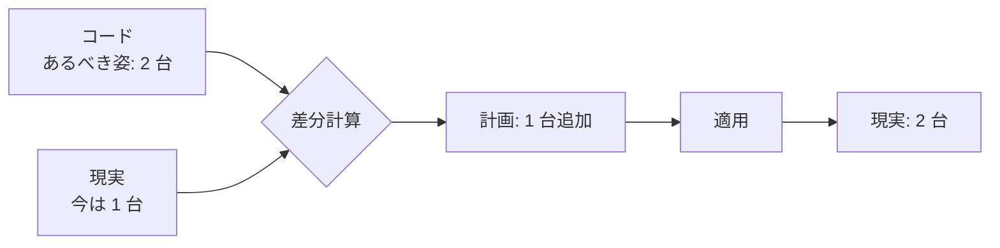
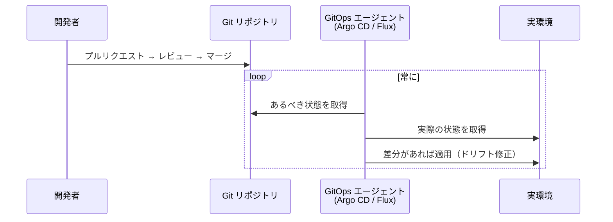

# IaCとは

[[MOC_サーバー・インフラ体系|📚 目次]] ｜ [[01_サーバー構築の流れ|← 前へ]] ｜ [[03_Terraform入門|次へ →]]

> [!abstract] この記事で分かること
> - Infrastructure as Code（IaC）の定義と、再現性・レビュー・履歴・自動化という 4 つの利点
> - 宣言型と命令型の違い、そして IaC で最重要の性質「冪等性」
> - プロビジョニング・構成管理・イメージ作成・コンテナの役割分担
> - Terraform / OpenTofu / CloudFormation / Pulumi / Ansible などの比較と選び方
> - GitOps の考え方と、Terraform のライセンス変更・OpenTofu の経緯
>
> **前提**：[[01_サーバー構築の流れ]] を読んでいると理解しやすいです。

## 1. ひとことで言うと

IaC は **「料理のレシピを、腕のいいシェフの頭の中から紙に書き出し、さらに調理ロボットが読める形式にしたもの」** です。手順書（人が読むレシピ）と違い、IaC のコードは **機械がそのまま実行** します。だから何度作っても同じ料理（サーバー）ができ、レシピの変更は Git で誰でもレビューできます。

- **IaC** = インフラ（サーバー、ネットワーク、DB、DNS…）の構成を **コードで記述し、ツールで自動的に作る・変える** やり方
- コードは Git で管理し、アプリと同じように **レビュー → マージ → 適用** する
- 鍵になる性質は **宣言型** と **冪等性**

## 2. IaC の 4 つの利点

前回見た手作業の問題が、IaC でどう解決されるかを整理します。

| 利点 | 内容 | Shop での例 |
|---|---|---|
| **再現性** | 同じコードから何度でも同じ環境ができる | 本番と同じ構成のステージング環境を 10 分で作れる |
| **レビュー** | 変更がプルリクエストとして差分で見える | 「セキュリティグループで 5432 番を 0.0.0.0/0 に開けてない？」と指摘できる |
| **履歴** | Git に「誰が・いつ・なぜ」が残る | 障害時に「昨日のこのコミットで ALB の設定が変わった」と特定できる |
| **自動化** | CI/CD から実行できる | マージしたら自動で `plan`、承認されたら `apply` |

加えて、コード自体が **常に正しいドキュメント** になる点も大きいです。手順書は古くなりますが、IaC のコードは実際に使われているので嘘をつきにくいのです。

## 3. 宣言型と命令型

IaC ツールの書き方には大きく 2 つのスタイルがあります。

**命令型（Imperative）** は「どうやって作るか（手順）」を書きます。

```bash
# 命令型：手順を書く（シェルスクリプト）
aws ec2 run-instances --image-id ami-xxxx --instance-type t3.small --count 2
```

これを 2 回実行すると、サーバーは **4 台** になります。「今何台あるか」を自分で調べて分岐を書かない限り、正しく動きません。

**宣言型（Declarative）** は「最終的にどうなっていてほしいか（あるべき姿）」を書きます。

```hcl
# 宣言型：あるべき姿を書く（Terraform）
resource "aws_instance" "api" {
  count         = 2
  ami           = "ami-xxxx"
  instance_type = "t3.small"
}
```

ツールが **現状とあるべき姿の差分** を計算し、足りなければ作り、多ければ消し、違えば直します。何回実行しても結果は 2 台です。



| | 命令型 | 宣言型 |
|---|---|---|
| 書くもの | 手順（How） | 最終状態（What） |
| 再実行 | 結果が変わり得る | 結果は同じ |
| 例 | シェルスクリプト、AWS CLI | Terraform、CloudFormation、Kubernetes マニフェスト |
| 得意 | 一度きりの処理、細かい順序制御 | 長期的に維持するインフラ |

> [!note] Ansible はどっち？
> Ansible のプレイブックは「上から順にタスクを実行する」点では手続き的ですが、各モジュールは「nginx が installed 状態であること」のように **状態を宣言** します。「手続き的に並べた宣言」と考えると分かりやすいです。Pulumi や AWS CDK は TypeScript などの命令型言語で書きますが、プログラムが **組み立てるのは宣言的なモデル** で、最終的な適用は宣言型として行われます。

## 4. 冪等性

**冪等性（Idempotency、べきとうせい）** とは、「**同じ操作を何回行っても、1 回行ったときと同じ結果になる**」性質です。エレベーターの「閉」ボタンを何回押しても、ドアが閉まった状態は変わらないのと同じです。

```bash
# 冪等でない例：実行するたびに行が増える
echo "PermitRootLogin no" >> /etc/ssh/sshd_config

# 冪等な例：何回やってもファイルの中身は同じ
echo "PermitRootLogin no" > /etc/ssh/sshd_config.d/10-hardening.conf
```

IaC ツールが冪等であることで、次のことが可能になります。

- **安心して再実行できる**：途中で失敗しても、もう一度流せばよい
- **定期実行でドリフトを直せる**：誰かが手で変えても、次の実行で「あるべき姿」に戻る
- **変化がないことを確認できる**：Terraform の `plan` が "No changes"、Ansible が `changed=0` なら、実機はコード通り

## 5. ツールの役割分担

IaC ツールは「何を作るか」によって担当が分かれます。Shop の構成で見てみましょう。

```
┌──────────────────────────────────────────────────────────────┐
│ ① プロビジョニング（箱を作る）  Terraform / OpenTofu /           │
│   VPC, サブネット, EC2, SG, RDS, ALB, Route 53     CloudFormation / Pulumi │
│                                                              │
│   ┌──────────────────────────────────────────────┐           │
│   │ EC2 インスタンス                              │           │
│   │  ② 構成管理（中身を整える）  Ansible / Chef / Puppet       │
│   │    Nginx, Node.js, ユーザー, sysctl, unit ファイル       │
│   │                                              │           │
│   │  ③ イメージ作成（②を焼き込んだ AMI）  Packer     │           │
│   │                                              │           │
│   │  ④ コンテナ（アプリ＋依存をまとめて配布）  Docker  │           │
│   │    Shop API イメージ  → ECS / Kubernetes で実行  │           │
│   └──────────────────────────────────────────────┘           │
└──────────────────────────────────────────────────────────────┘
```

| 層 | 役割 | 代表ツール | 例え |
|---|---|---|---|
| ① プロビジョニング（Provisioning） | クラウドの API を呼んでリソースを作る | Terraform、OpenTofu、CloudFormation、Pulumi | 部屋を借りる・間取りを決める |
| ② 構成管理（Configuration Management） | OS の中のパッケージ・設定ファイル・サービスを整える | Ansible、Chef、Puppet | 家具を入れて配置する |
| ③ イメージ作成（Image Building） | ②を済ませた状態をマシンイメージに焼く | Packer、EC2 Image Builder | 家具付きの部屋をモデルルームとして複製 |
| ④ コンテナ | アプリと依存関係をイメージにまとめる | Docker、Kubernetes | 家具ごと運べるコンテナハウス |

典型的な組み合わせは次の 3 パターンです。

1. **Terraform + Ansible**：Terraform で EC2 を作り、Ansible で中身を設定する（ミュータブル寄り。本章で扱う形）
2. **Packer + Terraform**：Packer で Ansible を使って AMI を作り、Terraform はその AMI で EC2 を作るだけ（イミュータブル）
3. **Terraform + コンテナ**：Terraform で ECS/EKS とネットワークを作り、アプリはコンテナイメージで配る（[[Dockerとは]]、[[10-Kubernetes]]）

## 6. 主要ツールの比較（2026 年時点）

| ツール | 種類 | 書き方 | 対象 | 状態管理 | ライセンス |
|---|---|---|---|---|---|
| Terraform | プロビジョニング | HCL（宣言型） | マルチクラウド・SaaS | state ファイル（自分で管理 or HCP Terraform） | BSL 1.1 |
| OpenTofu | プロビジョニング | HCL（Terraform 互換） | 同上 | state ファイル | MPL 2.0 |
| CloudFormation | プロビジョニング | YAML / JSON | AWS 専用 | AWS が管理（スタック） | AWS のサービス |
| AWS CDK | プロビジョニング | TypeScript / Python 等 → CloudFormation | AWS 専用 | CloudFormation スタック | Apache 2.0 |
| Pulumi | プロビジョニング | TypeScript / Python / Go / C# / Java / YAML | マルチクラウド | Pulumi Cloud or 自前バックエンド | Apache 2.0 |
| Ansible | 構成管理 | YAML（プレイブック） | OS 内部・ネットワーク機器 | 持たない（毎回実機を確認） | GPL v3 |
| Chef | 構成管理 | Ruby DSL | OS 内部 | Chef Server | Apache 2.0（配布物は商用ライセンス） |
| Puppet | 構成管理 | Puppet DSL（宣言型） | OS 内部 | Puppet Server | Apache 2.0（オープンソース版） |
| Packer | イメージ作成 | HCL | AMI、VM イメージ等 | なし | BSL 1.1 |

選び方の目安：

- **AWS だけ、AWS 純正が安心** → CloudFormation / CDK（[[05_CloudFormationとCDK]]）
- **複数クラウドや Cloudflare・GitHub・Datadog なども一緒に管理したい** → Terraform / OpenTofu（[[03_Terraform入門]]）
- **アプリ開発者が使い慣れた言語で書きたい** → Pulumi / CDK
- **VM の中身を整える** → Ansible（エージェント不要で学習コストが低い。[[04_構成管理とAnsible]]）
- Chef / Puppet はエージェント常駐型で、大規模な既存環境で使われていることが多く、新規採用は減っています

## 7. GitOps

**GitOps** は、IaC をさらに進めて **「Git リポジトリを唯一の正（Single Source of Truth）とし、実環境を自動的に Git に合わせ続ける」** 運用方法です。CNCF の OpenGitOps プロジェクトは原則を次の 4 つにまとめています。

1. **宣言的（Declarative）**：あるべき状態を宣言的に記述する
2. **バージョン管理され不変（Versioned and Immutable）**：その状態は Git などに履歴付きで保存される
3. **自動で取り込まれる（Pulled Automatically）**：エージェントが Git から状態を自動で取得する
4. **継続的に調整される（Continuously Reconciled）**：実環境と宣言を常に比較し、ずれを直す



人が `kubectl apply` や `terraform apply` を手元から打つのではなく、**Git にマージすることが唯一の変更手段** になります。Kubernetes の世界では Argo CD や Flux が代表的です。Terraform でも、CI でマージ時に `apply` する（Atlantis、HCP Terraform、Spacelift など）ことで近い運用ができます。

## 8. Terraform のライセンス変更と OpenTofu

ツール選定で知っておくべき出来事です（2026 年時点の情報）。

- **2023 年 8 月 10 日**：HashiCorp が Terraform を含む製品のライセンスを **MPL 2.0（オープンソース）から BSL 1.1（Business Source License）** に変更すると発表。BSL では、自社製品と競合する形で Terraform をホスティング・組み込み提供することが制限されます。**自社のインフラ管理に Terraform を使うこと自体は、商用でも引き続き可能** です。
- **2023 年 9 月**：コミュニティによるフォーク **OpenTofu**（当初の名前は OpenTF）が Linux Foundation のプロジェクトとして受け入れられる。ライセンスは MPL 2.0 のまま。
- **2024 年 1 月**：OpenTofu 1.6 が最初の安定版としてリリース。
- **2025 年 2 月**：IBM による HashiCorp の買収が完了。
- **2025 年 4 月**：OpenTofu が CNCF の Sandbox プロジェクトに。

OpenTofu は Terraform 1.5 系からの分岐で、HCL・プロバイダー・state 形式がおおむね互換です（コマンドは `tofu plan` など）。その後はそれぞれ独自機能（OpenTofu の state 暗号化など）を追加しており、**新しい機能ほど互換性は保証されない** 点に注意してください。本シリーズでは Terraform で説明しますが、ほぼそのまま OpenTofu にも読み替えられます。

## 発展：構成ドリフト・冪等性・バージョン管理（ネットワーク機器の例）

ネットワーク機器の設定を例に、構成ドリフト・冪等性・IaC と Git による変更管理を整理します。

### 構成管理の考え方：構成ドリフト・冪等性・IaCとバージョン管理

#### 構成ドリフト

**構成ドリフト（configuration drift）** とは、**手作業の変更が積み重なり、機器の設定が標準の設定から少しずつずれていく問題** です。

```
 標準設定（ゴールデンコンフィグ）
   SW1: ntp server 10.0.0.1 / logging 10.0.0.5 / snmp ... 
   SW2: 同上
   SW3: 同上
        │ 障害対応で SW2 に一時的な設定を追加 → 戻し忘れ
        │ SW3 は担当者が独自に ACL を修正
        ▼
   SW1: 標準どおり
   SW2: 標準 + debug設定 + 一時ACL        ← ドリフト
   SW3: 標準 - logging + 独自ACL          ← ドリフト
   → 同じ役割の機器なのに設定がばらばら → トラブルの原因
```

**対策**：構成管理ツールで「あるべき設定」をコードとして定義しておけば、
- 変更履歴が残る
- 標準とのずれを **機械的に検出** できる
- ツールを再実行して **元に戻せる**

構成ドリフトは「**設定内容のずれ**」のことであり、次とは無関係です。

| 似て非なるもの | 実際の話題 |
| --- | --- |
| STP の再計算でルートブリッジが移る | STP の動作 |
| NTP の同期が外れて時刻がずれる | 時刻のずれ（NTP で防ぐ） |
| 無線端末が AP 間を移動する | 無線 LAN のローミング |

#### 冪等性（べきとうせい）

**冪等性（idempotency）** とは、**同じ処理を何度実行しても、結果が同じ状態になる性質** です。

```
 処理：「VLAN 10 (Sales) が存在する状態にする」

 1回目: VLAN 10 なし → 作成する        → 結果：VLAN 10 あり   (changed)
 2回目: VLAN 10 あり → 何もしない      → 結果：VLAN 10 あり   (ok)
 3回目: VLAN 10 あり → 何もしない      → 結果：VLAN 10 あり   (ok)
         ↑ 何度実行しても同じ状態 ＝ 冪等
```

冪等でない例：実行するたびに設定が1行ずつ追加されていく（実行のたびに結果が変わる）。

**なぜ重要か**：
- すでに望ましい状態なら何も変更しないので、**安心して繰り返し実行できる**。
- 一部の機器で処理が失敗しても、**同じ処理をもう一度すべての機器に実行するだけで**、全体を望ましい状態にそろえられる。
- 構成ドリフトの修正にも使える（定期的に再実行すれば標準に戻る）。

冪等性は「処理時間（1秒以内に終わる）」や「並列実行（全機器に同時に実行）」とは関係ありません。

#### IaC（Infrastructure as Code）とバージョン管理

**IaC（Infrastructure as Code）** は、**インフラの設定をコードとして管理する考え方** です。ネットワークの設定やプレイブックを **Git などのバージョン管理システム** で管理すると、ソフトウェア開発と同じ方法でネットワークの変更を管理できます。

```
 担当者A: vlan.yml を編集 ─> git commit ─> プルリクエスト
                                              │ レビュー（担当者Bが差分を確認）
                                              ▼
                                         テスト環境で事前確認
                                              │
                                              ▼
                                       main にマージ → Ansible で本番適用
                                              │ 問題発生！
                                              ▼
                                       git revert で以前の版に戻して再適用
```

Git で管理する利点：

| 利点 | 内容 |
| --- | --- |
| 変更履歴 | **誰がいつ何を変更したか** が残る |
| 差分確認 | 変更前後の差分を確認できる |
| レビュー | 複数人で変更内容をレビューできる |
| テスト | テスト環境で事前に確認できる |
| 切り戻し | 問題が起きたとき **以前の状態（バージョン）へ戻しやすい** |

注意点：
- 機器の **転送性能は変わらない**（管理方法の話）。
- **セキュリティ対策は不要にならない**。むしろ **コードの中にパスワードなどを書かない** よう注意が必要（Ansible Vault や環境変数などで秘密情報を分離）。
- 設定ミスは減らせるが **絶対に起きなくなるわけではない**。レビューやテストと組み合わせる。

#### ひっかけポイント・よくある誤解

- 構成ドリフト＝ **設定内容のずれ**。STP のルートブリッジ移動、NTP の時刻ずれ、無線ローミングではない。
- 冪等性＝ **何度実行しても同じ結果**。1行ずつ追加される（冪等でない）、1秒以内、同時実行とは無関係。
- Git で管理しても性能向上・セキュリティ不要・ミスゼロにはならない。

#### 押さえておくポイント

- 構成ドリフト ＝ 手作業変更の蓄積による標準からのずれ。構成管理ツールで検出・修正。
- 冪等性 ＝ 何度実行しても同じ状態。望ましい状態なら何もしない。
- IaC ＋ Git ＝ 履歴・レビュー・テスト・切り戻し。秘密情報をコードに書かない。

## よくある誤解・つまずき

- ❌ IaC を導入すれば手作業は一切なくなる
  ✅ 初回のアカウント作成、state 用バケットの用意、緊急時の調査などは残ります。大事なのは「**変更は必ずコード経由**」というルールで、手で変えたら必ずコードに戻すことです。
- ❌ 宣言型ならどんな変更も安全
  ✅ 宣言型ツールは「あるべき姿に合わせる」ために **リソースを削除・再作成** することがあります。DB の再作成はデータ消失を意味します。適用前に計画（plan / 変更セット）を必ず読みます。
- ❌ Terraform と Ansible はどちらか一方を選ぶもの
  ✅ 得意分野が違います。「箱」は Terraform、「中身」は Ansible と分担するのが定番です。
- ❌ Terraform の BSL 化で、会社で Terraform を使うのは違法になった
  ✅ 自社インフラの管理に使うのは問題ありません。制限されるのは Terraform と競合する製品・サービスを提供するケースです。判断が必要な場合は法務に確認してください。

## まとめ

- IaC はインフラ構成をコード化し、ツールで自動的に作る・変える方法
- 利点は再現性・レビュー・履歴・自動化、そして「正しいドキュメント」
- 宣言型は「あるべき姿」を書き、ツールが差分を計算する。冪等なので何度でも安全に再実行できる
- プロビジョニング（Terraform 等）・構成管理（Ansible 等）・イメージ作成（Packer）・コンテナで役割を分担する
- GitOps は Git を唯一の正とし、エージェントが実環境を継続的に合わせる運用
- Terraform は 2023 年に BSL 化し、MPL のフォーク OpenTofu が生まれた

## 確認クイズ

1. 次のスクリプトは冪等ですか。理由とともに答えてください：`useradd shop`
> [!tip]- 答え
> 冪等ではありません。2 回目の実行では「ユーザーが既に存在する」というエラーになります。冪等にするには `id shop || useradd shop` のように存在確認を加えるか、Ansible の `user` モジュールのように「存在すること」を宣言するツールを使います。

2. Shop の EC2 インスタンスとセキュリティグループを作るのと、その EC2 に Nginx を入れて設定するのとでは、それぞれどの種類のツールが適していますか。
> [!tip]- 答え
> EC2 とセキュリティグループの作成はプロビジョニングツール（Terraform、CloudFormation など）、Nginx の導入と設定は構成管理ツール（Ansible など）が適しています。Packer で Nginx 入りの AMI を作る方法もあります。

3. GitOps で「継続的に調整される（Continuously Reconciled）」とはどういう意味ですか。
> [!tip]- 答え
> エージェントが Git 上の宣言と実環境を常に比較し、誰かが手で変更するなどしてずれが生じたら、自動的に Git の状態へ戻し続けることです。

## 関連ノート

- [[01_サーバー構築の流れ]] — 手作業構築の限界（IaC が必要な理由）
- [[03_Terraform入門]] — プロビジョニングの実践
- [[04_構成管理とAnsible]] — 構成管理の実践
- [[05_CloudFormationとCDK]] — AWS 純正の IaC
- [[Dockerとは]] — コンテナによるイミュータブルな配布
- [[10-Kubernetes]] — GitOps がよく使われる実行基盤
- [[MOC_リリース・デプロイ体系]] — CI/CD とデプロイ戦略

## 参考

- [HashiCorp adopts Business Source License (2023)](https://www.hashicorp.com/en/blog/hashicorp-adopts-business-source-license)
- [OpenTofu](https://opentofu.org/)
- [Linux Foundation Launches OpenTofu](https://www.linuxfoundation.org/press/announcing-opentofu)
- [IBM Completes Acquisition of HashiCorp](https://newsroom.ibm.com/2025-02-27-ibm-completes-acquisition-of-hashicorp,-creates-comprehensive,-end-to-end-hybrid-cloud-platform)
- [OpenGitOps Principles](https://opengitops.dev/)
- [Terraform - What is Infrastructure as Code](https://developer.hashicorp.com/terraform/tutorials/aws-get-started/infrastructure-as-code)
- [Ansible documentation](https://docs.ansible.com/)
- [Pulumi documentation](https://www.pulumi.com/docs/)
