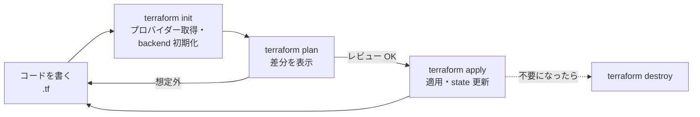

# Terraform入門

[[MOC_サーバー・インフラ体系|📚 目次]] ｜ [[02_IaCとは|← 前へ]] ｜ [[04_構成管理とAnsible|次へ →]]

> [!abstract] この記事で分かること
> - Terraform のインストールと HCL の基本要素（provider / resource / variable / output / data / locals）
> - `init → plan → apply → destroy` のワークフローと、plan をレビューする習慣
> - state ファイルの役割と危険性、S3 リモート state とロック（`use_lockfile`）
> - モジュールの使い方、Shop の EC2 + セキュリティグループを作る完全な例
> - 既存リソースの `import` と、ドリフトの検出
>
> **前提**：[[02_IaCとは]]、[[03_仮想化とクラウド]] を読んでいると理解しやすいです。

## 1. ひとことで言うと

Terraform は **「インフラの設計図を渡すと、現場との差を見積もって（plan）、その通りに工事してくれる（apply）建築会社」** です。そして工事記録台帳（**state ファイル**）を持っていて、「どの設計図の部品が、現実のどの建物に当たるか」を覚えています。

- HashiCorp 製のプロビジョニングツール。AWS / GCP / Azure / Cloudflare / GitHub など数千のプロバイダーに対応
- 設定は **HCL（HashiCorp Configuration Language）** という宣言型の言語で書く
- 「書く → plan で差分確認 → apply で適用」の繰り返し。**plan を読まずに apply しない** のが鉄則

## 2. インストールと HCL の基本

### 2.1 インストール（Ubuntu 24.04）

HashiCorp 公式の apt リポジトリから入れます。

```bash
wget -O - https://apt.releases.hashicorp.com/gpg | \
  sudo gpg --dearmor -o /usr/share/keyrings/hashicorp-archive-keyring.gpg
echo "deb [arch=$(dpkg --print-architecture) signed-by=/usr/share/keyrings/hashicorp-archive-keyring.gpg] \
https://apt.releases.hashicorp.com $(lsb_release -cs) main" | \
  sudo tee /etc/apt/sources.list.d/hashicorp.list
sudo apt update && sudo apt install -y terraform
terraform version
```

macOS なら `brew tap hashicorp/tap && brew install hashicorp/tap/terraform`。複数バージョンを使い分けるなら `tfenv` などのバージョンマネージャーも便利です。AWS の認証情報は `aws configure` や SSO（`aws sso login`）で設定しておきます。**アクセスキーをコードに書いてはいけません。**

### 2.2 HCL の 6 つの要素

```hcl
# provider: どのクラウドの API を使うか
provider "aws" {
  region = var.region
}

# variable: 外から渡せる入力値（関数の引数）
variable "region" {
  type    = string
  default = "ap-northeast-1"
}

# locals: ファイル内で使う計算済みの値（ローカル変数）
locals {
  name = "shop-${var.env}"
  tags = { Project = "shop", Env = var.env }
}

# data: 既存の情報を読み取る（作らない）
data "aws_ami" "ubuntu" {
  most_recent = true
  owners      = ["099720109477"] # Canonical
  filter {
    name   = "name"
    values = ["ubuntu/images/hvm-ssd-gp3/ubuntu-noble-24.04-amd64-server-*"]
  }
}

# resource: 作る・管理するもの（本体）
resource "aws_instance" "api" {
  ami           = data.aws_ami.ubuntu.id
  instance_type = "t3.small"
  tags          = merge(local.tags, { Name = "${local.name}-api" })
}

# output: 適用後に表示・他から参照する値（関数の戻り値）
output "api_public_ip" {
  value = aws_instance.api.public_ip
}
```

| 要素 | 役割 | 参照の書き方 |
|---|---|---|
| `provider` | API の接続先と認証 | — |
| `resource "型" "名前"` | 作成・管理するリソース | `aws_instance.api.id` |
| `data "型" "名前"` | 既存情報の読み取り | `data.aws_ami.ubuntu.id` |
| `variable` | 入力値 | `var.region` |
| `locals` | 内部の計算値 | `local.name` |
| `output` | 出力値 | `terraform output api_public_ip` |

参照（`aws_instance.api.id` など）を書くと、Terraform は **依存関係を自動で判断** し、作る順番を決めます。セキュリティグループを参照する EC2 は、セキュリティグループの後に作られます。

## 3. 基本ワークフロー



| コマンド | 何をするか | いつ |
|---|---|---|
| `terraform init` | プロバイダーのダウンロード、backend（state の置き場）の初期化 | 最初、プロバイダーや backend を変えたとき |
| `terraform fmt` / `validate` | 整形・文法チェック | コミット前（CI でも） |
| `terraform plan` | 現実と state とコードを比べ、何が起きるかを表示 | apply の前に毎回 |
| `terraform apply` | plan の内容を適用（確認プロンプトあり） | レビュー後 |
| `terraform destroy` | 管理している全リソースを削除 | 検証環境の後片付け |

`init` で作られる `.terraform.lock.hcl`（プロバイダーのバージョン固定）は **Git にコミット** します。`.terraform/` ディレクトリはコミットしません。

### 3.1 plan をレビューする習慣

plan の出力は記号で読みます。

```
  # aws_security_group.web will be updated in-place
  ~ resource "aws_security_group" "web" { ... }

  # aws_instance.api must be replaced
-/+ resource "aws_instance" "api" {
      ~ ami = "ami-0aaa" -> "ami-0bbb" # forces replacement
    }

Plan: 1 to add, 1 to change, 1 to destroy.
```

| 記号 | 意味 | 危険度 |
|---|---|---|
| `+` | 作成 | 低 |
| `~` | その場で変更（in-place） | 中 |
| `-/+` | **削除して作り直し**（replace） | 高：IP やディスクの中身が変わる |
| `-` | 削除 | 高 |

特に **`forces replacement`** と **`destroy` の数** を必ず確認します。「AMI を新しくしたつもりが、本番の API サーバーが作り直される」は典型的な事故です。実務では次のように **plan を保存して、その plan だけを apply** します。

```bash
terraform plan -out=tfplan      # 計画をファイルに保存
terraform show tfplan           # レビュー（PR に貼る・CI で表示）
terraform apply tfplan          # 保存した計画だけを適用（確認プロンプトなし）
```

消されては困るリソースには `lifecycle { prevent_destroy = true }` を付けておくと、削除を含む plan がエラーになります。

## 4. state ファイル

### 4.1 役割

`terraform.tfstate` は JSON ファイルで、**コード上の名前（`aws_instance.api`）と現実のリソース ID（`i-0abc...`）の対応表** です。Terraform は plan のたびに state を見て「このコードの部品はどれか」を知り、実機の現在値を読み直して差分を出します。

```
コード (.tf)            state (.tfstate)              AWS 上の実体
aws_instance.api  ←→  "aws_instance.api": i-0abc  ←→  EC2 i-0abc
```

state がないと、Terraform は既存のサーバーを「知らないもの」とみなし、**もう 1 台作ろうとします**。

### 4.2 state の危険

- **機密情報が平文で入る**：RDS のパスワードなど、リソースの属性はそのまま state に保存されます。**state を Git にコミットしてはいけません**（`.gitignore` に `*.tfstate*` を入れる）。
- **同時実行で壊れる**：2 人が同時に `apply` すると、後から書いた方が state を上書きし、対応表が壊れます。
- **ローカルに置くと失われる**：PC が壊れたら対応表も消えます。チームで共有もできません。

### 4.3 リモート state（S3 + ロック）

そこで state は **リモート backend** に置き、**ロック** で同時実行を防ぎます。AWS では S3 が定番です。

```hcl
terraform {
  backend "s3" {
    bucket       = "shop-terraform-state-123456789012"
    key          = "prod/web/terraform.tfstate"
    region       = "ap-northeast-1"
    encrypt      = true
    use_lockfile = true   # S3 ネイティブのロック
  }
}
```

**2026 年時点の状況**：

- 以前は S3 にロック機能がなく、**DynamoDB テーブル**（`dynamodb_table`）をロックに使っていました。
- Terraform 1.10 で S3 の条件付き書き込みを使った **`use_lockfile`** が実験的に導入され、**1.11 で正式機能（GA）** になりました。state と同じ場所に `.tflock` ファイルを作ってロックします。
- これに伴い **DynamoDB によるロックは非推奨（deprecated）** となり、将来のマイナーバージョンで削除予定です。移行期間中は両方を同時に指定することもできます。新規構築では `use_lockfile = true` だけで十分です。

state 用バケットには **バージョニング**（壊れたときに戻せる）、**暗号化**、**パブリックアクセスのブロック** を必ず設定し、アクセスできる IAM を絞ります。バケット自体は「鶏と卵」問題があるため、手作業か別の小さな Terraform 構成で先に作っておきます。

## 5. Shop の EC2 + セキュリティグループを作る完全な例

Shop の Web/API サーバー 1 台を作る構成です。ファイルを役割ごとに分けます。

```
infra/
├── versions.tf      # Terraform とプロバイダーのバージョン、backend
├── variables.tf
├── main.tf
├── outputs.tf
└── prod.tfvars      # 環境ごとの値
```

```hcl
# versions.tf
terraform {
  required_version = ">= 1.11"
  required_providers {
    aws = {
      source  = "hashicorp/aws"
      version = "~> 6.0"
    }
  }
  backend "s3" {
    bucket       = "shop-terraform-state-123456789012"
    key          = "prod/web/terraform.tfstate"
    region       = "ap-northeast-1"
    encrypt      = true
    use_lockfile = true
  }
}

provider "aws" {
  region = var.region
  default_tags {
    tags = { Project = "shop", Env = var.env, ManagedBy = "terraform" }
  }
}
```

```hcl
# variables.tf
variable "region" {
  type    = string
  default = "ap-northeast-1"
}
variable "env" {
  type = string
}
variable "instance_type" {
  type    = string
  default = "t3.small"
}
variable "admin_cidr" {
  description = "SSH を許可する管理者の IP（/32）"
  type        = string
}
variable "ssh_public_key" {
  type = string
}
```

```hcl
# main.tf
data "aws_vpc" "default" {
  default = true
}

data "aws_ami" "ubuntu" {
  most_recent = true
  owners      = ["099720109477"] # Canonical
  filter {
    name   = "name"
    values = ["ubuntu/images/hvm-ssd-gp3/ubuntu-noble-24.04-amd64-server-*"]
  }
}

resource "aws_key_pair" "deploy" {
  key_name   = "shop-${var.env}-deploy"
  public_key = var.ssh_public_key
}

resource "aws_security_group" "web" {
  name        = "shop-${var.env}-web"
  description = "Shop web/api server"
  vpc_id      = data.aws_vpc.default.id
}

# ルールは 1 つずつ別リソースにする（AWS プロバイダー推奨の書き方）
resource "aws_vpc_security_group_ingress_rule" "http" {
  security_group_id = aws_security_group.web.id
  cidr_ipv4         = "0.0.0.0/0"
  ip_protocol       = "tcp"
  from_port         = 80
  to_port           = 80
}

resource "aws_vpc_security_group_ingress_rule" "https" {
  security_group_id = aws_security_group.web.id
  cidr_ipv4         = "0.0.0.0/0"
  ip_protocol       = "tcp"
  from_port         = 443
  to_port           = 443
}

resource "aws_vpc_security_group_ingress_rule" "ssh_admin" {
  security_group_id = aws_security_group.web.id
  cidr_ipv4         = var.admin_cidr   # SSH は管理者の IP だけ
  ip_protocol       = "tcp"
  from_port         = 22
  to_port           = 22
}

resource "aws_vpc_security_group_egress_rule" "all" {
  security_group_id = aws_security_group.web.id
  cidr_ipv4         = "0.0.0.0/0"
  ip_protocol       = "-1"
}

resource "aws_instance" "web" {
  ami                    = data.aws_ami.ubuntu.id
  instance_type          = var.instance_type
  key_name               = aws_key_pair.deploy.key_name
  vpc_security_group_ids = [aws_security_group.web.id]

  root_block_device {
    volume_size = 20
    volume_type = "gp3"
    encrypted   = true
  }

  metadata_options {
    http_tokens = "required"   # IMDSv2 を強制
  }

  tags = { Name = "shop-${var.env}-web-01" }

  lifecycle {
    ignore_changes = [ami]     # 新 AMI が出ても勝手に作り直さない
  }
}

resource "aws_eip" "web" {
  instance = aws_instance.web.id
  domain   = "vpc"
}
```

```hcl
# outputs.tf
output "public_ip" {
  value = aws_eip.web.public_ip
}
```

```hcl
# prod.tfvars
env            = "prod"
admin_cidr     = "203.0.113.10/32"
ssh_public_key = "ssh-ed25519 AAAA... deploy@shop"
```

```bash
terraform init
terraform plan -var-file=prod.tfvars -out=tfplan
terraform apply tfplan
terraform output public_ip     # → Ansible のインベントリや DNS に使う
```

> [!note] 学習用の簡略化
> ここでは分かりやすさのためデフォルト VPC を使っています。本番では VPC・パブリック/プライベートサブネットも Terraform で作り、DB は RDS としてプライベートサブネットに置きます。また 5432 番（PostgreSQL）や 3000 番（Node.js）を **インターネットに開けていない** ことを確認してください。

## 6. モジュール

同じ構成を本番・ステージングで使い回すには **モジュール（Module）** にします。モジュールは「variable を受け取り、resource を作り、output を返す **関数**」のようなもので、ディレクトリ 1 つがモジュール 1 つです。

```hcl
# environments/prod/main.tf
module "web" {
  source        = "../../modules/web-server"
  env           = "prod"
  instance_type = "t3.medium"
  admin_cidr    = "203.0.113.10/32"
}

module "vpc" {
  source  = "terraform-aws-modules/vpc/aws"   # 公開 Registry のモジュール
  version = "~> 6.0"
  name    = "shop-prod"
  cidr    = "10.0.0.0/16"
  # ...
}

output "web_ip" {
  value = module.web.public_ip
}
```

- 自作モジュール：`modules/` に置き、環境ごとのディレクトリから呼ぶ
- 公開モジュール：Terraform Registry の `terraform-aws-modules` などは品質が高い。**`version` を必ず固定** する
- 環境（prod/stg）ごとに **state を分ける**（backend の `key` を変える）。1 つの state に全環境を入れると、ステージングの作業で本番を壊すリスクがあります

## 7. import と drift

### 7.1 既存リソースの import

手作業で作った既存の EC2 を Terraform 管理下に入れるには **import** を使います。Terraform 1.5 以降は `import` ブロックで宣言的に書けます。

```hcl
import {
  to = aws_instance.web
  id = "i-0abc1234def567890"
}
```

```bash
# 対応する resource ブロックの雛形を自動生成
terraform plan -generate-config-out=generated.tf
```

生成されたコードを整えて、`plan` が "No changes" になるまで調整してから `apply` します。これで「ペット」だったサーバーを段階的にコード化できます。

### 7.2 ドリフトの検出

誰かがコンソールからセキュリティグループに手でルールを足した場合、次の `plan` で「コードに戻すための変更」として表示されます。

```bash
terraform plan                  # ドリフトがあれば差分として出る
terraform plan -refresh-only    # 実機の変化だけを確認（state を実機に合わせる用途）
```

対処は 2 通りです。

1. **手動変更が間違い** → `terraform apply` でコードの状態に戻す
2. **手動変更が正しい（緊急対応など）** → コードを同じ内容に直し、`plan` が "No changes" になることを確認

CI で毎日 `terraform plan -detailed-exitcode`（差分ありで終了コード 2）を実行し、ドリフトを通知する運用もよく使われます。

## よくある誤解・つまずき

- ❌ `terraform.tfstate` は生成物だから Git に入れておけば安全
  ✅ state には秘密情報が平文で入り、同時実行の制御もできません。S3 などのリモート backend に暗号化して置き、ロックを有効にします。
- ❌ plan で `~`（変更）と出ていれば作り直しはされない
  ✅ `-/+` や `forces replacement` が付いていれば削除→再作成です。EC2 なら IP やローカルディスクの中身が失われます。plan の最終行の `to destroy` の数を必ず見ます。
- ❌ コンソールで少し直すくらいなら問題ない
  ✅ 次の `apply` で手動変更が消されるか、逆に手動変更を前提にした plan が誰かを混乱させます。直したら必ずコードに反映します。
- ❌ リモート state のロックには DynamoDB が必須
  ✅ Terraform 1.11 以降は S3 の `use_lockfile = true` だけでロックでき、DynamoDB 方式は非推奨になっています。
- ❌ `terraform destroy` は検証環境でしか動かないから安心
  ✅ どの backend・どの AWS アカウントに向いているかで決まります。本番の認証情報を持ったまま実行すれば本番が消えます。重要リソースには `prevent_destroy` を。

## まとめ

- Terraform は HCL で「あるべき姿」を書き、`init → plan → apply` で適用する
- HCL の要素は provider / resource / data / variable / locals / output
- plan は必ずレビューし、`-/+`（作り直し）と `destroy` に注意。`plan -out` → `apply tfplan` で計画通りに適用
- state はコードと実体の対応表。機密を含むので S3 などに暗号化して置き、`use_lockfile` でロックする（1.11 で GA、DynamoDB ロックは非推奨）
- モジュールで再利用し、環境ごとに state を分ける
- 既存リソースは `import` ブロックで取り込み、ドリフトは `plan` で検出する

## 確認クイズ

1. state ファイルを失うと、次の `terraform apply` で何が起きる可能性がありますか。
> [!tip]- 答え
> Terraform はコード上のリソースと既存の実体の対応を失うため、既存リソースを「存在しない」とみなして同じリソースをもう一式作ろうとします（名前の重複でエラーになるか、重複したリソースができる）。`import` で対応付けを復元する必要があります。

2. plan に `-/+ resource "aws_instance" "web"` と出ました。何を確認すべきですか。
> [!tip]- 答え
> EC2 が削除→再作成されることを意味するので、どの属性が `forces replacement` の原因か、再作成で IP・ディスクの中身・稼働中のサービスにどんな影響が出るかを確認します。意図しないなら原因の変更を取り消すか、`lifecycle` の `ignore_changes` などで抑止します。

3. 本番とステージングで同じ構成を使いたいとき、どう構成するのがよいですか。
> [!tip]- 答え
> 共通部分をモジュールにまとめ、環境ごとのディレクトリからモジュールを呼び出して、入力値（インスタンスタイプなど）を変えます。state は環境ごとに別の key（別ファイル）に分けます。

## 関連ノート

- [[02_IaCとは]] — 宣言型と冪等性
- [[04_構成管理とAnsible]] — Terraform で作った EC2 の中身を整える
- [[05_CloudFormationとCDK]] — AWS 純正の IaC との比較
- [[03_ファイアウォールとネットワーク制御]] — セキュリティグループの設計
- [[03_オートスケーリング]] — Terraform で起動テンプレートと ASG を作る先の話
- [[MOC_リリース・デプロイ体系]] — plan/apply を CI/CD に組み込む

## 参考

- [Install Terraform](https://developer.hashicorp.com/terraform/install)
- [Terraform Language Documentation](https://developer.hashicorp.com/terraform/language)
- [Backend Type: s3](https://developer.hashicorp.com/terraform/language/backend/s3)
- [Upgrading to Terraform v1.11](https://developer.hashicorp.com/terraform/language/v1.11.x/upgrade-guides)
- [Import - Terraform](https://developer.hashicorp.com/terraform/language/import)
- [AWS Provider - aws_vpc_security_group_ingress_rule](https://registry.terraform.io/providers/hashicorp/aws/latest/docs/resources/vpc_security_group_ingress_rule)
- [Ubuntu Amazon EC2 AMI Locator](https://documentation.ubuntu.com/aws/)
