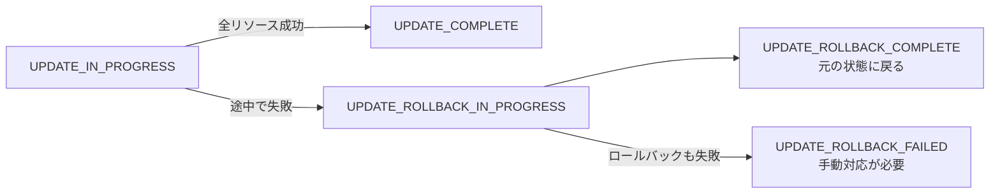
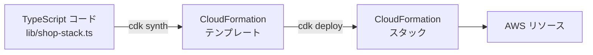

# CloudFormationとCDK

[[MOC_サーバー・インフラ体系|📚 目次]] ｜ [[04_構成管理とAnsible|← 前へ]] ｜ [[06_ネットワーク自動化とSDN|次へ →]]

> [!abstract] この記事で分かること
> - AWS CloudFormation のテンプレート（YAML）とスタックの考え方
> - 変更セットで事前確認し、ドリフト検出・ロールバックで安全に運用する方法
> - AWS CDK で TypeScript を使ってインフラを書く方法（synth / diff / deploy、L1/L2/L3 コンストラクト）
> - Pulumi との比較、そして Terraform とどちらを選ぶかの判断基準
>
> **前提**：[[02_IaCとは]]、[[03_Terraform入門]] を読んでいると理解しやすいです。

## 1. ひとことで言うと

CloudFormation は **「AWS 純正の施工管理サービス」**、CDK は **「その施工管理サービスへの発注書を、プログラミング言語で書けるようにする道具」** です。Terraform が「どの国（クラウド）の現場でも請け負う外部の建築会社」だとすると、CloudFormation は AWS の中に住んでいる専属の施工チームで、工事記録（state）も AWS 側が保管してくれます。

- **CloudFormation**：YAML / JSON のテンプレートを渡すと、AWS がリソースをまとめて作成・更新・削除する。まとめた単位を **スタック** と呼ぶ
- **AWS CDK（Cloud Development Kit）**：TypeScript / Python / Java / C# / Go でインフラを書き、CloudFormation テンプレートに **変換（synth）** してデプロイする
- どちらも **AWS 専用**。そのぶん AWS との統合が深い

> [!note] AWS 製品の詳細
> 個々の AWS サービス（CodePipeline など開発者ツール群）の詳細は 63_AWS/10_開発者ツール にまとめています。この記事は「IaC としての考え方と使い方」に絞ります。

## 2. CloudFormation のテンプレートとスタック

### 2.1 テンプレートの構造

テンプレートは「あるべき姿」を書いた宣言型のファイルです。主なセクションは次の通りです。

| セクション | 役割 | Terraform でいうと |
|---|---|---|
| `Parameters` | 外から渡す入力値 | `variable` |
| `Mappings` / `Conditions` | 表引き・条件分岐 | `locals`、`count` |
| `Resources` | 作るリソース（**必須**） | `resource` |
| `Outputs` | 出力値。他スタックへのエクスポートも可 | `output` |

Shop の Web サーバー（セキュリティグループ + EC2）を CloudFormation で書くと次のようになります。

```yaml
# shop-web.yml
AWSTemplateFormatVersion: "2010-09-09"
Description: Shop web/api server

Parameters:
  Env:
    Type: String
    AllowedValues: [stg, prod]
  AdminCidr:
    Type: String
    Description: SSH を許可する管理者の IP (/32)
  KeyName:
    Type: AWS::EC2::KeyPair::KeyName
  UbuntuAmi:
    # Canonical が公開している SSM パラメータから最新の Ubuntu 24.04 AMI を引く
    Type: AWS::SSM::Parameter::Value<AWS::EC2::Image::Id>
    Default: /aws/service/canonical/ubuntu/server/24.04/stable/current/amd64/hvm/ebs-gp3/ami-id

Resources:
  WebSecurityGroup:
    Type: AWS::EC2::SecurityGroup
    Properties:
      GroupDescription: Shop web server
      SecurityGroupIngress:
        - { IpProtocol: tcp, FromPort: 80,  ToPort: 80,  CidrIp: 0.0.0.0/0 }
        - { IpProtocol: tcp, FromPort: 443, ToPort: 443, CidrIp: 0.0.0.0/0 }
        - { IpProtocol: tcp, FromPort: 22,  ToPort: 22,  CidrIp: !Ref AdminCidr }

  WebInstance:
    Type: AWS::EC2::Instance
    Properties:
      ImageId: !Ref UbuntuAmi
      InstanceType: t3.small
      KeyName: !Ref KeyName
      SecurityGroupIds:
        - !GetAtt WebSecurityGroup.GroupId
      MetadataOptions:
        HttpTokens: required          # IMDSv2 を強制
      Tags:
        - Key: Name
          Value: !Sub shop-${Env}-web-01

Outputs:
  PublicIp:
    Value: !GetAtt WebInstance.PublicIp
```

`!Ref`（パラメータやリソースの参照）、`!GetAtt`（リソースの属性）、`!Sub`（文字列への埋め込み）は **組み込み関数** です。Terraform と同じく、参照関係から作成順序が自動で決まります。

### 2.2 スタック

**スタック（Stack）** は「1 つのテンプレートから作られたリソースのまとまり」です。スタック単位で作成・更新・削除するので、**スタックを消すと中のリソースもまとめて消えます**。

```bash
aws cloudformation deploy \
  --template-file shop-web.yml \
  --stack-name shop-prod-web \
  --parameter-overrides Env=prod AdminCidr=203.0.113.10/32 KeyName=shop-deploy

aws cloudformation describe-stacks --stack-name shop-prod-web \
  --query "Stacks[0].Outputs"
```

Terraform との大きな違いは **state を自分で管理しなくてよい** ことです。どのリソースがどのスタックに属するかは AWS 側が記録しており、S3 バケットやロックの準備は不要です。

実務では、ネットワーク・DB・アプリのように **ライフサイクルの違うものはスタックを分け**、`Outputs` の `Export` と `!ImportValue`（またはパラメータ）でつなぎます。誤削除が困る DB には `DeletionPolicy: Retain` や `Snapshot` を付け、スタックには **削除保護（Termination Protection）** を有効にします。

## 3. 安全に変更する仕組み

### 3.1 変更セット

**変更セット（Change Set）** は Terraform の `plan` に当たるもので、「このテンプレートを適用すると何が起きるか」を実行前に確認できます。

```bash
# 変更セットを作るだけで、実行はしない
aws cloudformation deploy --template-file shop-web.yml --stack-name shop-prod-web \
  --parameter-overrides Env=prod AdminCidr=203.0.113.10/32 KeyName=shop-deploy \
  --no-execute-changeset

aws cloudformation describe-change-set --stack-name shop-prod-web \
  --change-set-name <表示された名前>
# → 内容を確認してから
aws cloudformation execute-change-set --stack-name shop-prod-web \
  --change-set-name <名前>
```

各変更には `Action`（Add / Modify / Remove）と、Modify の場合は **`Replacement`（True / False / Conditional）** が表示されます。`Replacement: True` は Terraform の `-/+` と同じく **作り直し** なので、必ず確認します。

### 3.2 ロールバック

CloudFormation は更新の途中でエラーが起きると、**自動的に直前の正常な状態へロールバック** します。これは Terraform にはない大きな利点で、「半分だけ更新されて壊れた環境」が残りにくくなります。



- 新規作成時に失敗すると `ROLLBACK_COMPLETE` になり、そのスタックは削除して作り直すしかありません
- 調査のために `--disable-rollback` オプションを付けて、失敗時点の状態を残すこともできます（開発環境向け）
- CloudWatch アラームを **ロールバックトリガー** に設定すると、更新後にアラームが鳴ったら自動で戻すこともできます

### 3.3 ドリフト検出

コンソールで手動変更された場合に備え、**ドリフト検出（Drift Detection）** があります。

```bash
aws cloudformation detect-stack-drift --stack-name shop-prod-web
aws cloudformation describe-stack-resource-drifts --stack-name shop-prod-web \
  --stack-resource-drift-status-filters MODIFIED DELETED
```

結果は `IN_SYNC` / `MODIFIED` / `DELETED` などで表示され、どのプロパティがテンプレートと違うかが分かります。Terraform と違い、**検出するだけで自動では直しません**。テンプレートを再適用するか、テンプレートを実態に合わせて更新します（AWS Config のルールで定期的にチェックすることもできます）。

> [!tip] 既存リソースの取り込み
> 手作業で作ったリソースは **リソースのインポート**（`IMPORT` タイプの変更セット）でスタックに取り込めます。2024 年からは、既存リソースをスキャンしてテンプレートを生成する **IaC ジェネレーター** も使えます。

## 4. AWS CDK：TypeScript でインフラを書く

### 4.1 なぜ CDK か

CloudFormation の YAML は、規模が大きくなると **数千行** になり、繰り返しや条件分岐が書きにくくなります。CDK は TypeScript などのプログラミング言語でインフラを書き、**CloudFormation テンプレートを生成** します。ループ、関数、クラス、型チェック、IDE の補完がそのまま使えます。



### 4.2 始め方とワークフロー

```bash
npm install -g aws-cdk
mkdir shop-infra && cd shop-infra
cdk init app --language typescript
cdk bootstrap        # アカウント×リージョンごとに 1 回：CDK 用の S3 バケットや IAM ロールを作る
```

| コマンド | 役割 | Terraform でいうと |
|---|---|---|
| `cdk synth` | CloudFormation テンプレートを生成（`cdk.out/`） | — |
| `cdk diff` | デプロイ済みスタックとの差分を表示 | `plan` |
| `cdk deploy` | 変更セットを作って適用 | `apply` |
| `cdk destroy` | スタックを削除 | `destroy` |

### 4.3 Shop の Web サーバーを CDK で書く

```typescript
// lib/shop-web-stack.ts
import * as cdk from "aws-cdk-lib";
import * as ec2 from "aws-cdk-lib/aws-ec2";
import { Construct } from "constructs";

interface ShopWebStackProps extends cdk.StackProps {
  env: { account: string; region: string };
  stage: "stg" | "prod";
  adminCidr: string;
}

export class ShopWebStack extends cdk.Stack {
  constructor(scope: Construct, id: string, props: ShopWebStackProps) {
    super(scope, id, props);

    const vpc = ec2.Vpc.fromLookup(this, "Vpc", { isDefault: true });

    const sg = new ec2.SecurityGroup(this, "WebSg", {
      vpc,
      description: "Shop web server",
    });
    sg.addIngressRule(ec2.Peer.anyIpv4(), ec2.Port.tcp(80));
    sg.addIngressRule(ec2.Peer.anyIpv4(), ec2.Port.tcp(443));
    sg.addIngressRule(ec2.Peer.ipv4(props.adminCidr), ec2.Port.tcp(22));

    const instance = new ec2.Instance(this, "Web", {
      vpc,
      vpcSubnets: { subnetType: ec2.SubnetType.PUBLIC },
      instanceType: ec2.InstanceType.of(ec2.InstanceClass.T3, ec2.InstanceSize.SMALL),
      machineImage: ec2.MachineImage.fromSsmParameter(
        "/aws/service/canonical/ubuntu/server/24.04/stable/current/amd64/hvm/ebs-gp3/ami-id",
      ),
      securityGroup: sg,
      requireImdsv2: true,
      ssmSessionPermissions: true, // SSH の代わりに Session Manager で入れる IAM 権限
    });

    cdk.Tags.of(this).add("Project", "shop");
    new cdk.CfnOutput(this, "PublicIp", { value: instance.instancePublicIp });
  }
}
```

```typescript
// bin/shop-infra.ts
import * as cdk from "aws-cdk-lib";
import { ShopWebStack } from "../lib/shop-web-stack";

const app = new cdk.App();
const env = { account: "123456789012", region: "ap-northeast-1" };
for (const stage of ["stg", "prod"] as const) {
  new ShopWebStack(app, `shop-${stage}-web`, { env, stage, adminCidr: "203.0.113.10/32" });
}
```

`for` 文で stg と prod の 2 スタックを作っている点に注目してください。YAML ではコピーが必要だった部分が、普通のプログラムとして書けます。`ssmSessionPermissions` のような 1 行が、裏で IAM ロールやインスタンスプロファイルを自動生成してくれるのも CDK の特徴です。

```bash
cdk diff shop-prod-web
cdk deploy shop-prod-web
```

### 4.4 コンストラクトの L1 / L2 / L3

CDK の部品は **コンストラクト（Construct）** と呼ばれ、抽象度で 3 段階に分かれます。

| レベル | 正体 | 例 | 特徴 |
|---|---|---|---|
| **L1**（CFN リソース） | CloudFormation リソースと 1 対 1 | `ec2.CfnInstance`、`s3.CfnBucket` | 名前が `Cfn` で始まる。全プロパティを自分で指定。新サービスにすぐ対応 |
| **L2**（キュレーテッド） | 1 リソース＋妥当な既定値と便利メソッド | `ec2.Instance`、`s3.Bucket` | `bucket.grantRead(role)` のように IAM も自動。普段はこれを使う |
| **L3**（パターン） | 複数リソースを組み合わせた構成 | `ecs_patterns.ApplicationLoadBalancedFargateService` | ALB + ECS + Fargate などを数行で。細かい制御は難しい |

L2 で足りないプロパティは `node.defaultChild` で L1 に降りて上書き（エスケープハッチ）できます。抽象度が高いほど楽ですが、**生成されるリソースを把握しにくくなる** ので、`cdk synth` の出力や `cdk diff` で中身を確認する習慣を付けましょう。

## 5. Pulumi との比較

**Pulumi** も TypeScript / Python / Go などでインフラを書くツールで、CDK とよく比較されます。

| | AWS CDK | Pulumi |
|---|---|---|
| 対象 | AWS（CloudFormation 経由） | マルチクラウド・SaaS |
| 実行エンジン | CloudFormation | Pulumi エンジン（各クラウド API を直接呼ぶ） |
| state | CloudFormation が管理 | Pulumi Cloud または S3 等の自前バックエンド |
| ロールバック | CloudFormation の自動ロールバック | 自動ロールバックなし（Terraform と同様） |
| 速度・上限 | CloudFormation の制約（1 スタック 500 リソースなど）を受ける | CloudFormation の制約なし |
| 言語 | TS / JS / Python / Java / C# / Go | TS / JS / Python / Go / C# / Java / YAML |

「プログラミング言語で書きたいが、AWS 以外も管理したい」なら Pulumi、「AWS だけで、AWS のサポートや CloudFormation の安全機構を活かしたい」なら CDK、というのが大まかな分かれ目です。

## 6. Terraform とどちらを選ぶか

| 観点 | CloudFormation / CDK | Terraform / OpenTofu |
|---|---|---|
| 対応範囲 | AWS のみ | AWS + 他クラウド + Cloudflare / GitHub / Datadog など |
| state 管理 | 不要（AWS が管理） | 自分で用意（S3 + `use_lockfile` など） |
| 失敗時 | 自動ロールバック | 途中まで適用された状態で止まる（再 apply で前進） |
| 新サービス対応 | AWS 公式。リリース当日対応も多い | プロバイダーの更新待ち（多くは早い） |
| ドリフト | 検出のみ | plan で検出し apply で修正 |
| 学習資産 | AWS に閉じる | 他クラウドでも使える。求人・情報が多い |
| 費用 | CloudFormation 自体は AWS 公式リソースなら無料 | OSS 版は無料（HCP Terraform は有料プランあり） |

判断の目安：

- **AWS だけで完結し、チームが AWS に詳しい** → CDK（TypeScript に慣れたアプリ開発者なら特に）
- **DNS は Cloudflare、監視は Datadog、など AWS 外のサービスも一緒に管理したい** → Terraform / OpenTofu
- **すでに組織で使っているものがある** → それに合わせる。混在は運用コストが上がる
- どちらを選んでも、**plan / diff / 変更セットをレビューしてから適用する** 原則は同じです

## よくある誤解・つまずき

- ❌ CloudFormation のスタックを消しても、作ったリソースは残る
  ✅ スタックの削除は中のリソースの削除です。DB などには `DeletionPolicy: Retain` / `Snapshot` を設定し、スタックの削除保護を有効にします。
- ❌ CDK を使えば CloudFormation を知らなくてよい
  ✅ CDK は最終的に CloudFormation で動くので、エラーメッセージ、ロールバック、リソースの置き換え（Replacement）などは CloudFormation の知識が必要です。
- ❌ ドリフト検出すれば自動で元に戻る
  ✅ CloudFormation のドリフト検出は差分を報告するだけです。修正はテンプレートの再適用やテンプレート側の更新で行います。
- ❌ CDK でコンストラクトの ID（`"Web"` など）を変えても、名前が変わるだけ
  ✅ 論理 ID が変わるため、CloudFormation は「古いリソースを削除して新しいものを作る」と判断します。リファクタリング時は `cdk diff` で置き換えが起きないか確認します。

## まとめ

- CloudFormation は AWS 純正の宣言型 IaC。テンプレートからスタック単位でリソースを管理し、state 管理は不要
- 変更セットで事前確認し、失敗時は自動ロールバック。ドリフト検出は検出のみ
- CDK は TypeScript などで書いて CloudFormation テンプレートを生成する。`synth` / `diff` / `deploy`
- コンストラクトは L1（Cfn そのまま）/ L2（既定値付き）/ L3（パターン）
- AWS 専用なら CDK、マルチクラウドや SaaS も管理するなら Terraform / OpenTofu、言語で書きつつマルチクラウドなら Pulumi

## 確認クイズ

1. CloudFormation の変更セットで `Replacement: True` と表示されたリソースがありました。どういう意味で、何に注意しますか。
> [!tip]- 答え
> そのリソースが削除→再作成されることを意味します（Terraform の `-/+` に相当）。EC2 なら IP やディスクの中身、DB ならデータが失われる可能性があるため、原因のプロパティ変更が本当に必要か、データ退避や `DeletionPolicy` の設定があるかを確認してから実行します。

2. CDK の L1 と L2 コンストラクトの違いを、S3 バケットを例に説明してください。
> [!tip]- 答え
> L1 の `s3.CfnBucket` は CloudFormation の `AWS::S3::Bucket` と 1 対 1 で、全プロパティを自分で指定します。L2 の `s3.Bucket` は妥当な既定値に加え、`grantRead()` のように IAM ポリシーを自動生成する便利メソッドを持つ、より高水準な部品です。

3. Shop が DNS を Cloudflare で、インフラを AWS で管理している場合、IaC ツールの選択で何を考慮しますか。
> [!tip]- 答え
> CloudFormation / CDK は AWS 外の Cloudflare を管理できないため、両方を 1 つのツールで管理したいなら Terraform / OpenTofu（または Pulumi）が向いています。AWS 部分を CDK にする場合は、Cloudflare 側を別ツールで管理する運用コストを考慮します。

## 関連ノート

- [[03_Terraform入門]] — Terraform の plan / state との比較対象
- [[02_IaCとは]] — 宣言型・冪等性・ツールの全体像
- [[04_構成管理とAnsible]] — EC2 の中身を整える側
- [[06_ネットワーク自動化とSDN]] — 次へ：ネットワーク機器の構築・設定を自動化する
- [[01_スケーリングの基本]] — 次章：作ったサーバーを増やす
- [[03_ヘルスチェックと自動ロールバック]] — デプロイ時のロールバックの考え方
- [[MOC_リリース・デプロイ体系]] — CDK / CloudFormation を CI/CD に組み込む

## 参考

- [AWS CloudFormation User Guide](https://docs.aws.amazon.com/AWSCloudFormation/latest/UserGuide/Welcome.html)
- [Update CloudFormation stacks using change sets](https://docs.aws.amazon.com/AWSCloudFormation/latest/UserGuide/using-cfn-updating-stacks-changesets.html)
- [Detect unmanaged configuration changes to stacks and resources (drift)](https://docs.aws.amazon.com/AWSCloudFormation/latest/UserGuide/using-cfn-stack-drift.html)
- [DeletionPolicy attribute](https://docs.aws.amazon.com/AWSCloudFormation/latest/UserGuide/aws-attribute-deletionpolicy.html)
- [AWS CDK v2 Developer Guide - Constructs](https://docs.aws.amazon.com/cdk/v2/guide/constructs.html)
- [AWS CDK CLI reference](https://docs.aws.amazon.com/cdk/v2/guide/cli.html)
- [Find Ubuntu images on AWS (SSM parameters)](https://ubuntu.com/aws/docs/aws-how-to/instances/find-ubuntu-images/)
- [Pulumi vs. AWS CDK](https://www.pulumi.com/docs/iac/concepts/vs/cloud-template-transpilers/aws-cdk/)
