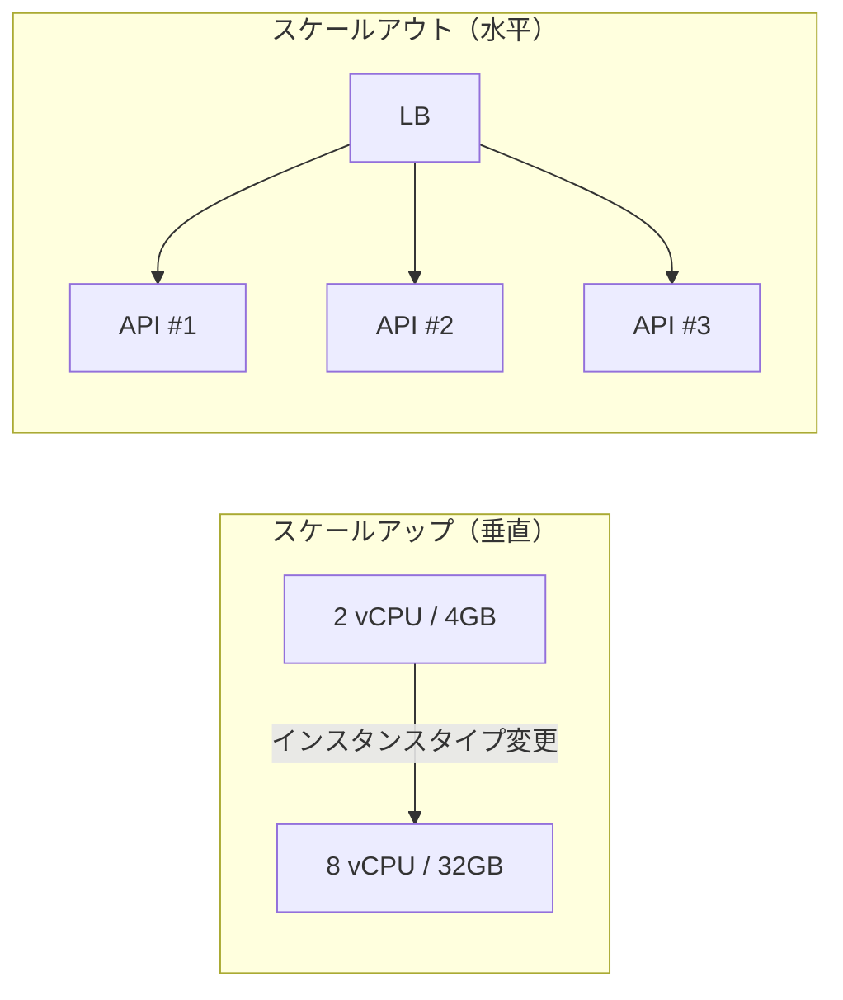
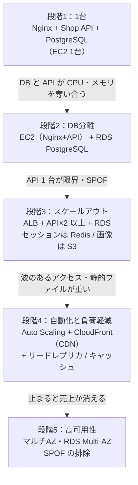

# スケーリングの基本

[[MOC_サーバー・インフラ体系|📚 目次]] ｜ [[05_CloudFormationとCDK|← 前へ]] ｜ [[02_ロードバランサーの仕組み|次へ →]]

> [!abstract] この記事で分かること
> - スケールアップ（垂直）とスケールアウト（水平）の違いと、どちらを先に選ぶべきか
> - 「どこが詰まっているか（ボトルネック）」を CPU・メモリ・ディスク・ネットワーク・DB の順に調べる方法
> - スケールアウトするための前提「ステートレス化」で、何をサーバーの外へ出すのか
> - Shop が 1 台から複数台へ育っていく段階と、DB のスケールの考え方
>
> **前提**：[[01_サーバーとは何か]]、[[03_仮想化とクラウド]]、[[02_Node.jsアプリを本番で動かす]] を読んでいると理解しやすいです。

## 1. ひとことで言うと

ラーメン屋が繁盛して行列ができたとき、取れる手は 2 つあります。1 つは **店主の腕を上げて大きな寸胴鍋に替える**（1 人を強くする）。もう 1 つは **店員を雇い、厨房を増やす**（人数を増やす）。前者は簡単ですが限界があり、店主が倒れたら店は閉まります。後者は限界が遠く、1 人休んでも営業できますが、「誰がどのお客さんの注文を受けたか」をメモで共有する仕組みが必要になります。

サーバーの **スケーリング（Scaling：処理能力を増やすこと）** もまったく同じです。

- **スケールアップ（Scale Up / 垂直スケーリング）**：1 台のサーバーを大きくする（CPU・メモリを増やす）
- **スケールアウト（Scale Out / 水平スケーリング）**：同じ役割のサーバーを並べて台数を増やす
- 逆方向はそれぞれ **スケールダウン**（小さくする）、**スケールイン**（台数を減らす）
- スケールアウトの前提は **ステートレス（Stateless：サーバー自身が利用者ごとの状態を持たない）** にすること

## 2. スケールアップとスケールアウトの比較



| 観点 | スケールアップ（垂直） | スケールアウト（水平） |
|---|---|---|
| やること | インスタンスタイプを大きくする | 同じサーバーを増やし、[[02_ロードバランサーの仕組み|ロードバランサー]]で振り分ける |
| アプリの改修 | ほぼ不要 | ステートレス化が必要 |
| 上限 | 1 台の最大サイズで頭打ち | 理論上はかなり遠い（ただし DB など共有部分が先に詰まる） |
| 停止 | クラウドでもタイプ変更には再起動が必要なことが多い | 1 台ずつ入れ替えれば無停止 |
| 障害への強さ | 1 台なので **単一障害点（SPOF）** のまま | 1 台落ちても残りで動く |
| コスト | 大きいサイズほど割高になりやすい | 小さい台を必要な数だけ。自動増減（[[03_オートスケーリング]]）と相性が良い |
| 向いているもの | DB（特に書き込み）、初期のとりあえずの対処 | Web / API サーバー、ワーカー |

**実務での順番**：まずは **計測してボトルネックを特定** → コード・クエリの改善（インデックス追加など）→ 足りなければスケールアップ → それでも足りない、または可用性が必要ならスケールアウト、が定番です。スケールアップは「時間を買う」手段としてとても有効で、恥ずかしいことではありません。

> [!note] スケールアップの再起動
> AWS EC2 でインスタンスタイプを変えるには、インスタンスを一度 **停止** する必要があります（2026 年時点）。1 台構成ならその間 Shop は止まります。メンテナンス時間を告知するか、先に 2 台構成にしておくのが安全です。

## 3. ボトルネックの見つけ方

**ボトルネック（Bottleneck：瓶の首のように一番細くて流れを制限している所）** を直さずに台数を増やしても、効果はありません。例えば DB が詰まっているのに API サーバーを 10 台にすると、DB への接続数が 10 倍になって **むしろ悪化** します。

調べる順番の目安と、Ubuntu 24.04 で使える基本コマンドです。

| 資源 | 詰まったときの症状 | 確認コマンド | 見る値 |
|---|---|---|---|
| CPU | 応答が全体的に遅い、ロードアベレージが高い | `top`、`mpstat -P ALL 1` | `%us`（アプリ）が高い／`%wa` が高いならディスク待ち |
| メモリ | 突然プロセスが死ぬ（OOM Killer）、スワップ多発 | `free -h`、`vmstat 1` | `available` が少ない、`si/so`（スワップ入出力）が 0 でない |
| ディスク I/O | 書き込みやログ出力で固まる | `iostat -xz 1` | `%util` が 100% 近い、`await`（待ち時間）が大きい |
| ネットワーク | 大きなファイル配信で遅い、帯域上限 | `sar -n DEV 1`、`ss -s` | 送受信量がインスタンスの帯域上限付近、接続数が異常 |
| DB | API は暇なのに遅い | `pg_stat_activity`、スロークエリログ | 長時間実行のクエリ、ロック待ち、接続数上限 |

```bash
# sysstat（mpstat / iostat / sar）は Ubuntu では別パッケージ
sudo apt install -y sysstat

# 1 秒ごとに全 CPU コアの使用率
mpstat -P ALL 1

# ディスクごとの使用率と待ち時間
iostat -xz 1

# PostgreSQL：いま実行中で長いクエリ
sudo -u postgres psql -c "
  SELECT pid, now() - query_start AS duration, state, left(query, 80)
  FROM pg_stat_activity
  WHERE state <> 'idle'
  ORDER BY duration DESC;"
```

コマンドで一時的に見るだけでなく、**監視（メトリクスの継続記録）** があれば「いつから」「何と一緒に」上がったのかが分かります。監視の仕組みは [[13-監視・ログ]] と [[MOC_可観測性体系]] を参照してください。

> [!tip] 「アプリは暇なのに遅い」は外部待ち
> API サーバーの CPU が 10% なのにレスポンスが 2 秒かかるなら、時間は DB や外部 API の **待ち** に使われています。このとき API サーバーを増やしても速くなりません。

## 4. スケールアウトの前提：ステートレス化

1 台のときは何も考えずに済んでいたことが、2 台になると問題になります。

```text
利用者 A ─ ログイン ─▶ API #1（メモリにセッション保存）
利用者 A ─ カートを見る ─▶ API #2（「誰？」→ ログイン画面へ）  ← 事故
```

これを防ぐには、**サーバーのメモリやローカルディスクに「状態」を置かない** ことです。どの API サーバーに当たっても同じ結果になれば、自由に台数を増減できます。

| 状態 | 1 台時代の置き場所 | スケールアウト後の置き場所 |
|---|---|---|
| ログインセッション | プロセスのメモリ（express-session の MemoryStore など） | Redis（ElastiCache 等）や DB。または署名付きトークン（JWT）で状態をクライアント側に持たせる |
| アップロードファイル（商品画像） | `/var/www/shop/uploads` | オブジェクトストレージ（S3 など）。配信は [[04_CDNによる負荷軽減|CDN]] から |
| アプリ内キャッシュ | プロセス内の Map | 共有キャッシュ（Redis）。プロセス内キャッシュは「消えても困らない短命なもの」だけ |
| 定期実行（cron） | 各サーバーの crontab | 1 か所だけで動く仕組み（専用ワーカー、EventBridge Scheduler 等）。全台で動くと二重実行になる |
| ログ | ローカルファイル | ログ集約基盤へ送る（[[04_ログ集約基盤]]） |
| 設定・シークレット | サーバー上で手編集 | 環境変数・シークレットストア（[[05_設定と環境変数・シークレット]]） |

```ts
// Shop API（Express）：セッションを Redis に置く例
import session from "express-session";
import { RedisStore } from "connect-redis";
import { createClient } from "redis";

const redisClient = createClient({ url: process.env.REDIS_URL });
await redisClient.connect();

app.use(
  session({
    store: new RedisStore({ client: redisClient, prefix: "shop:sess:" }),
    secret: process.env.SESSION_SECRET!,
    resave: false,
    saveUninitialized: false,
    cookie: { secure: true, httpOnly: true, sameSite: "lax" },
  }),
);
```

セッション管理の詳細は [[05_クッキーとセッション管理（旧サーバー教材）]]、[[MOC_セッション管理]] を参照してください。「同じ利用者を同じサーバーへ送る」**スティッキーセッション** で回避する方法もありますが、サーバーが落ちたら状態が消えるので、根本対策はあくまでステートレス化です（[[02_ロードバランサーの仕組み]]）。

## 5. DB のスケール

Web / API サーバーはステートレスにすれば簡単に増やせますが、**DB は状態そのもの** なので単純には増やせません。多くのシステムで、最後に詰まるのは DB です。手を打つ順番の目安は次のとおりです。

1. **クエリとインデックスの改善**：遅いクエリを `EXPLAIN ANALYZE` で調べる。最も安く効果が大きい
2. **コネクションプーリング**：API を増やすと DB 接続が増える。PgBouncer や RDS Proxy で束ねる（[[06_データベースサーバーの運用]]）
3. **スケールアップ**：DB は垂直スケールが基本。メモリを増やしてキャッシュに載せる
4. **キャッシュ**：よく読まれる商品一覧などを Redis に置き、DB に届く読み取りを減らす
5. **リードレプリカ（Read Replica：読み取り専用の複製）**：読み取りを複製に分散。ただし複製には少し遅れ（レプリケーションラグ）がある
6. **シャーディング（Sharding：データを分割して複数 DB に分ける）**：最終手段。アプリの設計が大きく変わる

5 と 6、および整合性の問題は分散システムの領域なので、詳しくは [[MOC_分散システム体系]] と [[MOC_データアーキテクチャ体系]] を参照してください。

## 6. Shop が 1 台から複数台へ育つ段階



| 段階 | きっかけ | 主な作業 | 該当回 |
|---|---|---|---|
| 1 | サービス開始 | 1 台に全部入り | [[01_サーバー構築の流れ]] |
| 2 | DB と API がリソースを奪い合う、バックアップが不安 | DB を RDS に移す | [[06_データベースサーバーの運用]] |
| 3 | API の CPU が常に高い、1 台落ちると全停止 | ステートレス化 → LB の後ろに 2 台 | [[02_ロードバランサーの仕組み]] |
| 4 | セール時だけ急増、画像配信が重い | オートスケーリング、CDN | [[03_オートスケーリング]]、[[04_CDNによる負荷軽減]] |
| 5 | 停止時間の目標ができた | マルチ AZ、冗長化 | [[05_高可用性と冗長化]] |

大事なのは **全部を最初からやらない** ことです。段階 1 で月間数万 PV は十分さばけます。早すぎる分散は、運用の手間と障害点を増やすだけです。

## 7. キャパシティ計画の入口

**キャパシティ計画（Capacity Planning）** は「いつ・どれだけ増やすか」を事前に決めることです。最低限次の 3 つを押さえます。

1. **現状の上限を測る**：負荷試験ツール（k6、wrk など）で、API 1 台が何 RPS（1 秒あたりリクエスト数）までレイテンシを保てるかを測る
2. **ピークを見積もる**：普段の何倍のアクセスが来るか（セール、テレビ放映、月末）
3. **余裕を持つ**：CPU 使用率 100% を上限と考えない。目安として平常時 40〜60% 程度に収めると、急増や 1 台故障に耐えられる

```bash
# k6 での簡単な負荷試験（別マシンから実行する）
# 50 仮想ユーザーで 2 分間、商品一覧 API を叩く
k6 run --vus 50 --duration 2m - <<'EOF'
import http from "k6/http";
export default function () {
  http.get("https://api.shop.example.com/products");
}
EOF
```

例えば「API 1 台で 200 RPS、ピーク予測 900 RPS、1 台壊れても耐えたい」なら、900 ÷ 200 = 4.5 → 5 台、さらに 1 台故障分で **6 台** が目安です（N+1 の考え方は [[05_高可用性と冗長化]]）。詳しい性能計測・計画は [[MOC_パフォーマンス体系]] を参照してください。

> [!warning] 本番に負荷試験をかけない
> 本番環境に予告なしで負荷試験をすると、それ自体が障害になります。クラウドによっては事前申請や規約上の制限もあります。本番と同じ構成のステージング環境で行いましょう。

## よくある誤解・つまずき

- ❌ 遅くなったら台数を増やせばいい → ✅ ボトルネックが DB なら API を増やすと悪化します。まず計測です。
- ❌ スケールアウトのほうが常に優れている → ✅ アプリ改修と運用の複雑さが増えます。小さいうちはスケールアップで十分なことが多いです。
- ❌ ロードバランサーを置けばそのまま複数台にできる → ✅ セッションやアップロードファイルをサーバー内に持っていると、ログインが切れたり画像が見つからなくなったりします。
- ❌ DB もリードレプリカを足せばどんどんスケールする → ✅ レプリカで増やせるのは読み取りだけです。書き込みは 1 台（プライマリ）に集まります。
- ❌ cron は全台に同じ設定を入れておけばいい → ✅ 全台で同時に実行され、メールの二重送信などが起きます。

## まとめ

- スケールアップは 1 台を大きく、スケールアウトは台数を増やす。前者は簡単だが限界と SPOF がある
- 増やす前に CPU・メモリ・ディスク・ネットワーク・DB のどこが詰まっているかを計測する
- スケールアウトの前提はステートレス化。セッションは Redis、ファイルは S3、ログは集約基盤へ出す
- DB は最後に詰まりやすい。クエリ改善 → プーリング → スケールアップ → キャッシュ・レプリカ → シャーディングの順
- Shop は 1 台 → DB 分離 → LB+複数台 → 自動化と CDN → 高可用性と段階的に育てる
- キャパシティ計画は「1 台の上限 × ピーク予測 × 余裕」で台数を見積もる

## 確認クイズ

1. API サーバーの CPU 使用率は 15% なのに、レスポンスが遅いです。API サーバーを 2 倍に増やすのは良い対策でしょうか。
> [!tip]- 答え
> 良い対策ではない可能性が高いです。CPU が暇なのに遅いのは、DB や外部 API の待ちに時間を使っているからです。まず `pg_stat_activity` やスロークエリログで DB を調べます。API を増やすと DB 接続が増え、かえって悪化することもあります。

2. Shop API を 2 台にしたところ、「ログインしたのに次の画面でログアウトされる」と報告がありました。原因と根本対策は何でしょうか。
> [!tip]- 答え
> セッションを各 API サーバーのメモリに保存しているため、2 回目のリクエストが別のサーバーに届くと「知らない人」になります。根本対策はセッションを Redis などの共有ストアに出す（ステートレス化する）ことです。スティッキーセッションは応急処置にすぎません。

3. API 1 台で 150 RPS さばけ、ピークは 600 RPS の見込みです。1 台故障しても耐えるには何台必要でしょうか。
> [!tip]- 答え
> 600 ÷ 150 = 4 台がピークに必要な台数です。1 台故障に備えて +1 で **5 台** です（N+1）。実際には CPU の余裕も考えて、さらに少し多めにすることがあります。

## 関連ノート

- [[02_ロードバランサーの仕組み]] — スケールアウトした複数台に振り分ける仕組み
- [[03_オートスケーリング]] — 台数を負荷に合わせて自動で増減する
- [[05_高可用性と冗長化]] — 台数を増やすもう 1 つの理由「止まらないこと」
- [[06_データベースサーバーの運用]] — DB 分離、コネクションプーリング
- [[05_クッキーとセッション管理（旧サーバー教材）]] / [[MOC_セッション管理]] — セッションの外出し
- [[MOC_分散システム体系]] — レプリケーション、シャーディング、整合性
- [[MOC_パフォーマンス体系]] — 計測、負荷試験、キャパシティ計画
- [[13-監視・ログ]] — ボトルネック特定に必要なメトリクス

## 参考

- [Change the instance type - Amazon EC2](https://docs.aws.amazon.com/AWSEC2/latest/UserGuide/ec2-instance-resize.html)
- [PostgreSQL Documentation: The Cumulative Statistics System (pg_stat_activity)](https://www.postgresql.org/docs/current/monitoring-stats.html)
- [sysstat（Ubuntu パッケージ）](https://packages.ubuntu.com/noble/sysstat)
- [connect-redis（npm）](https://www.npmjs.com/package/connect-redis)
- [Grafana k6 Documentation](https://grafana.com/docs/k6/latest/)
