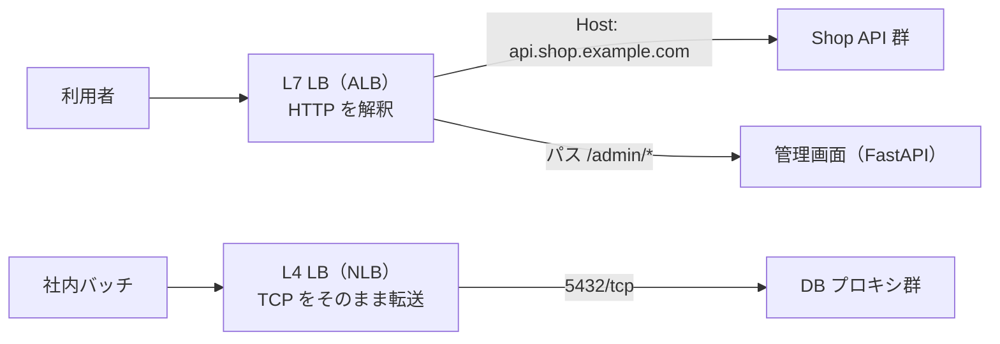
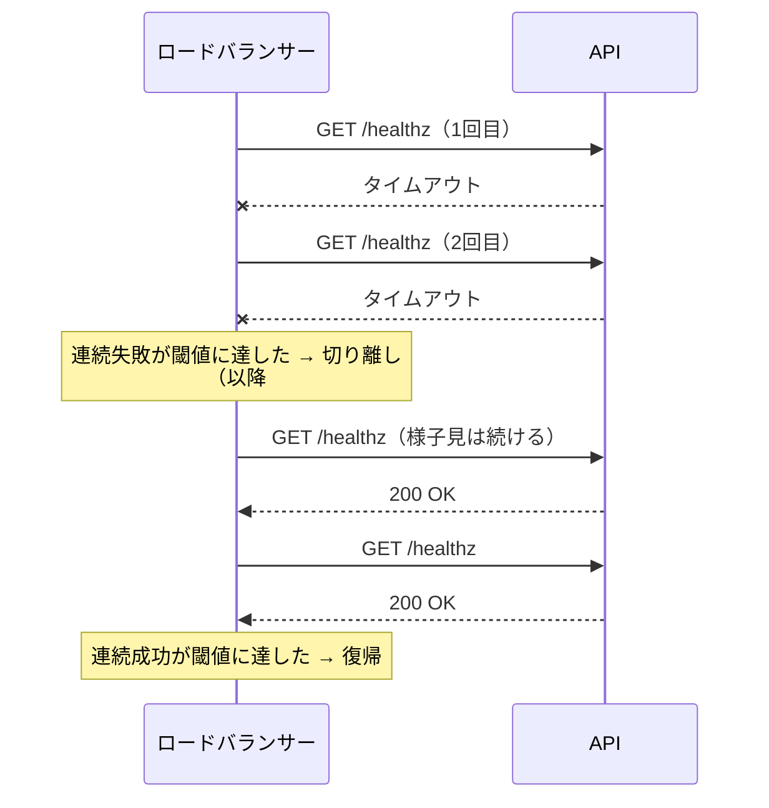

# ロードバランサーの仕組み

[[MOC_サーバー・インフラ体系|📚 目次]] ｜ [[01_スケーリングの基本|← 前へ]] ｜ [[03_オートスケーリング|次へ →]]

> [!abstract] この記事で分かること
> - L4 ロードバランサーと L7 ロードバランサーの違い
> - 振り分けアルゴリズム（ラウンドロビン・最小接続・重み付き・IP ハッシュ・最小応答時間）の特徴と弱点
> - ヘルスチェックでの切り離し、スティッキーセッション、TLS 終端、コネクションドレイニング
> - Nginx upstream と AWS ALB での具体的な設定、DNS ラウンドロビンとの違い
>
> **前提**：[[01_スケーリングの基本]]、[[03_リバースプロキシ]] を読んでいると理解しやすいです。

## 1. ひとことで言うと

**ロードバランサー（Load Balancer、LB：負荷分散装置）** は、銀行の「番号札の受付係」です。お客さんは入口で受付に並ぶだけで、どの窓口に行くかは受付係が「空いている窓口」を見て案内してくれます。窓口の係員が倒れたら、受付係はそこに案内するのをやめます。

- 入口（IP アドレス・ドメイン）を **1 つ** にまとめ、後ろの複数サーバーに振り分ける
- 振り分け方（**アルゴリズム**）を選べる
- **ヘルスチェック** で壊れたサーバーを自動で切り離し、直れば戻す
- 利用者からは後ろに何台いても 1 台に見える

ロードバランサーは [[03_リバースプロキシ|リバースプロキシ]] の一種と考えると分かりやすいです。リバースプロキシの転送先が複数になったものがロードバランサーです。

## 2. L4 と L7 の違い

「L4」「L7」は OSI 参照モデルの層（レイヤー）を指します。**どの層の情報を見て振り分けるか** の違いです。

| | L4 ロードバランサー | L7 ロードバランサー |
|---|---|---|
| 見る情報 | IP アドレスとポート（TCP/UDP） | HTTP の中身（パス、ホスト名、ヘッダー、Cookie） |
| 例え | 封筒の宛名だけ見て仕分ける | 手紙を開けて内容を読んで仕分ける |
| できること | 高速な転送、TCP 以外（UDP、DB 接続、ゲームなど）も扱える | `/api/*` は API へ、`/admin/*` は管理画面へ、などの経路ルール。ヘッダー追加、リダイレクト |
| TLS | そのまま通すことが多い（終端も可能） | 終端して中身を見るのが普通 |
| 速さ | 速い、遅延が小さい | 中身を解析するぶん少し重い |
| 製品例 | AWS NLB、HAProxy（mode tcp）、Nginx stream | AWS ALB、Nginx（http）、HAProxy（mode http）、Envoy、GCP 外部アプリケーション LB |



Web アプリ（Shop）ではたいてい **L7** を使います。L4 は「固定 IP が欲しい」「HTTP 以外のプロトコル」「とにかく低遅延・大量接続」などの場合に選びます。

## 3. 振り分けアルゴリズム

| アルゴリズム | 仕組み | 得意 | 弱点 |
|---|---|---|---|
| **ラウンドロビン（Round Robin）** | 順番に 1 台ずつ配る | リクエストの重さが揃っているとき。既定値であることが多い | 重さを見ない。重い処理が 1 台に続くとそこだけ詰まる |
| **重み付き（Weighted）** | 性能に応じて配る比率を変える（例 3:1） | 性能の違うサーバーが混在、新バージョンに少しだけ流す | 重みの管理が必要 |
| **最小接続（Least Connections）** | 処理中の接続・リクエストが最も少ない所へ | 処理時間がバラバラな API | 「すぐエラーを返す壊れたサーバー」は処理中が少なく見え、そこに集まる |
| **IP ハッシュ（IP Hash）** | 送信元 IP から計算して毎回同じサーバーへ | 簡易的なスティッキー | 会社や携帯キャリアの NAT で同じ IP の利用者が大量だと偏る。台数が変わると振り先がずれる |
| **最小応答時間（Least Time / Least Response Time）** | 応答が速いサーバーを優先 | 性能差や一時的な遅延に追従 | 実装が製品依存。計測のための仕組みが必要 |

ねる前エンジニアリングのクリップ（[[ロードバランサの裏側 — 振り分けと切り離し｜ねる前エンジニアリング]]）が指摘するとおり、**最小接続は良い選択であることが多い** ものの、「早く失敗するサーバーに依頼が集まる」危険があります。だからこそ次のヘルスチェックがセットで必要です。

AWS ALB では「ラウンドロビン（既定）」「最小未処理リクエスト（Least outstanding requests）」「重み付きランダム（Weighted random）」から選べます（2026 年時点）。

## 4. ヘルスチェックと切り離し

何もしなければ、LB は落ちたサーバーにも律儀に振り分け続けます。3 台中 1 台が落ちれば、**3 回に 1 回エラー** です。

**ヘルスチェック（Health Check）** には 2 種類あります。

- **アクティブ**：LB が数秒ごとに `/healthz` などへリクエストを送り、決まった時間内に 200 が返るか確かめる（ALB、HAProxy、NGINX Plus）
- **パッシブ**：実際のリクエストの失敗を数えて判断する（オープンソース版 Nginx の `max_fails`）



設計のポイントは次の 3 つです。

1. **気づくまでの時間 ≒ 間隔 × 失敗回数**。ALB の既定（間隔 30 秒・Unhealthy 閾値 2 回）だと最大 1 分ほど気づきません。短くしすぎると、一瞬遅れただけで外してしまいます。
2. **浅いチェックと深いチェック**。`/healthz` が「プロセスが動いているか」だけなら軽いが DB 障害を見落とします。DB まで確認すると、**DB 全体が落ちたときに全台が不合格になり全部外れる** という事故が起きます。
3. **全台不合格のときの挙動を知っておく**。ALB は全ターゲットが Unhealthy になると、あえて全台に流す **フェイルオープン** の動作をします。

```ts
// Shop API のヘルスチェック窓口（浅い／深いを分ける）
app.get("/healthz", (_req, res) => res.status(200).send("ok")); // LB 用：生きているか

app.get("/readyz", async (_req, res) => {                        // 監視用：依存先も見る
  try {
    await pool.query("SELECT 1");
    res.status(200).send("ready");
  } catch {
    res.status(503).send("db unavailable");
  }
});
```

Kubernetes の liveness / readiness の考え方やデプロイ時の自動ロールバックは [[03_ヘルスチェックと自動ロールバック]] を参照してください。

## 5. スティッキーセッション・TLS 終端・コネクションドレイニング

### スティッキーセッション（Sticky Session / Session Affinity）

同じ利用者を同じサーバーへ送り続ける機能です。ALB では LB が `AWSALB` という Cookie を発行して実現します。サーバーのメモリにセッションがあるアプリを、とりあえず複数台で動かすための **応急処置** です。偏りやすく、そのサーバーが落ちるとセッションは消えるので、根本対策はステートレス化（[[01_スケーリングの基本]]）です。

### TLS 終端（TLS Termination）

HTTPS の暗号を **LB で解いて**、後ろには HTTP（または再暗号化した HTTPS）で渡すことです。

- 証明書を LB 1 か所で管理できる（ALB なら ACM の証明書を無料で自動更新）
- 暗号処理の CPU 負荷をアプリサーバーから外せる
- L7 の振り分け（パス・Cookie を見る）には TLS 終端が必須
- アプリには `X-Forwarded-Proto: https` や `X-Forwarded-For`（元の利用者 IP）が渡るので、アプリ側で信頼するプロキシを設定する（Express なら `app.set("trust proxy", 1)`）

証明書そのものの話は [[04_HTTPSとTLS証明書]] を参照してください。

### コネクションドレイニング（Connection Draining）

サーバーを止めるとき、いきなり切ると処理中のリクエストがエラーになります。**「新しいリクエストを送るのをやめる → 処理中のものが終わるのを待つ → 止める」** の順にする機能です。ALB では「登録解除の遅延（Deregistration delay）」と呼び、既定 300 秒です。API が数秒で応答するなら 30〜60 秒程度に短くするとデプロイやスケールインが速くなります。アプリ側も SIGTERM を受けたら新規受付を止めて処理中を片付けるようにします（[[08_ゼロダウンタイムデプロイの条件]]、[[03_ローリングアップデート]]）。

## 6. 設定例：Nginx upstream と AWS ALB

### Nginx upstream（Shop：API 2 台 + 予備）

```nginx
# /etc/nginx/conf.d/shop-api.conf
upstream shop_api {
    least_conn;                      # 最小接続（既定はラウンドロビン）

    # 10 秒（fail_timeout）の間に 3 回（max_fails）失敗したら、
    # 10 秒間そのサーバーを使わない（パッシブヘルスチェック）
    server 10.0.1.11:3000 max_fails=3 fail_timeout=10s;
    server 10.0.1.12:3000 max_fails=3 fail_timeout=10s;
    server 10.0.1.13:3000 backup;    # 上 2 台が使えないときだけ使う

    keepalive 32;                    # 後ろとの接続を再利用
}

server {
    listen 443 ssl;
    http2 on;
    server_name api.shop.example.com;
    # ssl_certificate などは「HTTPSとTLS証明書」の回を参照

    location / {
        proxy_pass http://shop_api;
        proxy_http_version 1.1;
        proxy_set_header Connection "";
        proxy_set_header Host $host;
        proxy_set_header X-Forwarded-For $proxy_add_x_forwarded_for;
        proxy_set_header X-Forwarded-Proto $scheme;

        # 失敗時に次のサーバーへ再送する条件（POST など非冪等は既定で再送しない）
        proxy_next_upstream error timeout http_502 http_503;
        proxy_connect_timeout 3s;
    }
}
```

- `max_fails` の既定は 1、`fail_timeout` の既定は 10 秒です。`fail_timeout` は「失敗を数える時間幅」と「使わない期間」の 2 つの意味を持ちます。
- オープンソース版 Nginx には **アクティブヘルスチェック（`health_check`）がありません**（NGINX Plus の機能）。実リクエストが失敗して初めて気づくので、その 1 回は利用者にエラーが見えることがあります（`proxy_next_upstream` で別サーバーへ再送して隠せる場合もあります）。
- `least_time`（最小応答時間）や `drain` パラメータは長く商用版のみでしたが、最近のバージョンでオープンソース版にも入りつつあります。使う前に手元のバージョンのドキュメントで確認してください（2026 年時点）。
- 設定変更後は `sudo nginx -t && sudo systemctl reload nginx`。

### AWS ALB の構成要素

```text
ALB（shop-alb）  ← DNS 名を Route 53 で api.shop.example.com に紐付け
 ├─ リスナー :80   → ルール：すべて HTTPS へリダイレクト
 └─ リスナー :443（ACM 証明書・TLS 終端）
     ├─ ルール 1：Host = api.shop.example.com      → ターゲットグループ shop-api-tg
     ├─ ルール 2：Path = /admin/*                  → ターゲットグループ shop-admin-tg
     └─ デフォルト：固定レスポンス 404
ターゲットグループ shop-api-tg（HTTP:3000）
 ├─ ヘルスチェック：GET /healthz、間隔・閾値
 ├─ 属性：アルゴリズム、登録解除の遅延、スティッキー
 └─ ターゲット：EC2 ×N（Auto Scaling Group が自動登録）
```

| 要素 | 役割 |
|---|---|
| **リスナー（Listener）** | どのポート・プロトコルで待ち受けるか。443 では証明書を持つ |
| **ルール（Rule）** | 条件（ホスト名・パス・ヘッダー等）と行き先（転送・リダイレクト・固定応答）。優先度順に評価 |
| **ターゲットグループ（Target Group）** | 振り分け先の集まり。ヘルスチェックとアルゴリズムはここで設定 |

ターゲットグループのヘルスチェック既定値（instance / ip ターゲット、2026 年時点）は、間隔 30 秒、タイムアウト 5 秒、Healthy 閾値 5 回、Unhealthy 閾値 2 回、成功コード 200 です。Terraform で書くと次のようになります（Terraform の基本は [[03_Terraform入門]]）。

```hcl
resource "aws_lb_target_group" "shop_api" {
  name     = "shop-api-tg"
  port     = 3000
  protocol = "HTTP"
  vpc_id   = aws_vpc.main.id

  load_balancing_algorithm_type = "least_outstanding_requests"
  deregistration_delay          = 60   # 既定 300 秒を短縮

  health_check {
    path                = "/healthz"
    interval            = 10
    timeout             = 5
    healthy_threshold   = 3
    unhealthy_threshold = 2
    matcher             = "200"
  }
}

resource "aws_lb_listener_rule" "api" {
  listener_arn = aws_lb_listener.https.arn
  priority     = 10
  condition {
    host_header { values = ["api.shop.example.com"] }
  }
  action {
    type             = "forward"
    target_group_arn = aws_lb_target_group.shop_api.arn
  }
}
```

### その他の製品

- **HAProxy**：オープンソースの高性能 LB。L4/L7 両方、アクティブヘルスチェック標準搭載。オンプレや自前構築の定番
- **AWS NLB**：L4。AZ ごとに固定 IP（Elastic IP）を持てる、超大量接続向け
- **GCP Cloud Load Balancing**：グローバルな単一 Anycast IP で複数リージョンに振り分けられる外部アプリケーション LB などがある
- **Envoy**：サービスメッシュ（Istio など）やモダンなプロキシの中核。動的設定、リトライ、サーキットブレーカーが得意。Kubernetes の Ingress / Gateway の実体として使われることも多い（[[10-Kubernetes]]）

## 7. DNS ラウンドロビンとの違い

DNS に同じ名前で複数の A レコードを登録し、問い合わせごとに順番を変えて返す方法を **DNS ラウンドロビン** と呼びます（DNS の基本は [[05_ネットワークの基本（IP・ポート・DNS）]]）。

```text
api.shop.example.com.  60  IN  A  203.0.113.11
api.shop.example.com.  60  IN  A  203.0.113.12
```

| | DNS ラウンドロビン | ロードバランサー |
|---|---|---|
| 費用・手軽さ | ほぼ無料、すぐできる | LB の費用がかかる |
| 壊れたサーバー | 基本は気づかない。TTL の間、キャッシュした利用者は落ちたサーバーに行き続ける | ヘルスチェックで数十秒以内に外す |
| 振り分けの細かさ | クライアントやリゾルバのキャッシュ次第で偏る | リクエスト単位で制御 |
| サーバー入れ替え | DNS 変更が全世界に行き渡るまで時間がかかる | ターゲット登録・解除で即時 |

実務では「DNS で複数リージョンや複数 LB に大まかに分け、その先は LB で細かく振り分ける」という **組み合わせ** が一般的です。Route 53 のヘルスチェック付きフェイルオーバールーティングは [[05_高可用性と冗長化]] で扱います。

## よくある誤解・つまずき

- ❌ LB を置けば壊れたサーバーは自動で外れる → ✅ ヘルスチェックの設定と、アプリ側の `/healthz` 窓口が正しくないと外れません。OSS 版 Nginx はパッシブのみです。
- ❌ ヘルスチェックは深いほど安全 → ✅ DB まで見ると、DB 障害時に全台が外れて全面停止します。外したら何が起きるかを考えて決めます。
- ❌ スティッキーセッションでセッション問題は解決 → ✅ そのサーバーが落ちればセッションは消えます。偏りも出ます。根本はステートレス化です。
- ❌ LB 自体は壊れない → ✅ 自前の Nginx/HAProxy 1 台の LB は新たな SPOF です。ALB などのマネージド LB は複数 AZ に分散されていますが、サブネットを 2 つ以上の AZ に置く必要があります。
- ❌ デプロイ時の数秒のエラーは仕方ない → ✅ コネクションドレイニングとアプリの graceful shutdown で防げます。

## まとめ

- LB は入口を 1 つにまとめ、後ろの複数台に振り分けるリバースプロキシ。L4 は IP/ポート、L7 は HTTP の中身を見る
- アルゴリズムは重さが揃えばラウンドロビン、バラバラなら最小接続。ただし壊れた台に集まらないようヘルスチェックとセット
- ヘルスチェックは「間隔 × 回数」で気づく速さが決まる。浅い／深いの使い分けが大事
- TLS 終端は LB で行い、`X-Forwarded-*` で元の情報をアプリへ渡す
- 止めるときはコネクションドレイニングで処理中のリクエストを待つ
- DNS ラウンドロビンは手軽だが壊れたサーバーを外せない。LB と組み合わせて使う

## 確認クイズ

1. ALB のヘルスチェックを「間隔 30 秒・Unhealthy 閾値 2」のまま使っています。API が 1 台落ちてから切り離されるまで、最大でどれくらいかかりますか。また短くしすぎると何が起きますか。
> [!tip]- 答え
> およそ 30 秒 × 2 回 = 最大 1 分ほどです（タイムアウト時間も加わります）。短くしすぎると、GC や一時的な高負荷で少し遅れただけのサーバーまで外してしまい、残りのサーバーに負荷が集中して連鎖的に落ちる危険があります。

2. オープンソース版 Nginx の `server 10.0.1.11:3000 max_fails=3 fail_timeout=10s;` は何を意味しますか。
> [!tip]- 答え
> 10 秒の間にこのサーバーへの通信が 3 回失敗したら、その後 10 秒間はこのサーバーを使わない、という意味です。実リクエストの失敗で判断するパッシブヘルスチェックです。

3. 最小接続アルゴリズムで「1 台だけエラー率が高いのに、そこにリクエストが集まる」現象が起きました。なぜでしょうか。
> [!tip]- 答え
> 壊れたサーバーはリクエストを受けるとすぐエラーを返すため、処理中の接続数が常に少なく見えます。最小接続は「処理中が少ない所」を選ぶので、そこに集まります。ヘルスチェックで切り離す、あるいはエラー率を見て外す仕組み（ALB の自動ターゲット重みなど）と組み合わせます。

## 関連ノート

- [[ロードバランサの裏側 — 振り分けと切り離し｜ねる前エンジニアリング]] — 振り分けの決め方とヘルスチェック・入れ替え手順を動画で解説（同フォルダのクリップ）
- [[01_スケーリングの基本]] — スケールアウトとステートレス化
- [[03_オートスケーリング]] — LB のターゲットを自動で増減する
- [[03_リバースプロキシ]] — LB の土台になる仕組み
- [[04_HTTPSとTLS証明書]] — TLS 終端で使う証明書
- [[03_ヘルスチェックと自動ロールバック]] — デプロイと組み合わせたヘルスチェック
- [[03_ローリングアップデート]] / [[08_ゼロダウンタイムデプロイの条件]] — ドレイニングを使った無停止入れ替え
- [[05_高可用性と冗長化]] — LB 自身の冗長化、DNS フェイルオーバー

## 参考

- [Module ngx_http_upstream_module（nginx.org）](https://nginx.org/en/docs/http/ngx_http_upstream_module.html)
- [Using nginx as HTTP load balancer（nginx.org）](https://nginx.org/en/docs/http/load_balancing.html)
- [Health checks for Application Load Balancer target groups（AWS）](https://docs.aws.amazon.com/elasticloadbalancing/latest/application/target-group-health-checks.html)
- [Edit target group attributes for your Application Load Balancer（AWS）](https://docs.aws.amazon.com/elasticloadbalancing/latest/application/edit-target-group-attributes.html)
- [HAProxy Configuration Manual](https://docs.haproxy.org/)
- [Envoy Proxy Documentation](https://www.envoyproxy.io/docs)
- [Cloud Load Balancing overview（Google Cloud）](https://cloud.google.com/load-balancing/docs/load-balancing-overview)
