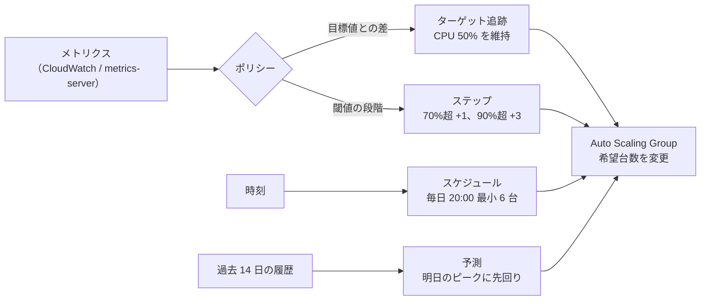

# オートスケーリング

[[MOC_サーバー・インフラ体系|📚 目次]] ｜ [[02_ロードバランサーの仕組み|← 前へ]] ｜ [[04_CDNによる負荷軽減|次へ →]]

> [!abstract] この記事で分かること
> - 何を指標（メトリクス）にしてサーバー台数を増減させるか
> - ターゲット追跡・ステップ・スケジュール・予測の 4 つのポリシーの使い分け
> - クールダウン／ウォームアップ、起動時間の問題と AMI・コンテナでの短縮
> - AWS Auto Scaling Group と Kubernetes HPA の設定例、コストとの関係、オートスケールで防げない障害
>
> **前提**：[[01_スケーリングの基本]]、[[02_ロードバランサーの仕組み]] を読んでいると理解しやすいです。

## 1. ひとことで言うと

**オートスケーリング（Auto Scaling：自動拡張・縮小）** は、スーパーのレジ係のシフトを **自動で組み替える店長** です。レジ待ちの行列が長くなったら休憩中の店員を呼び、空いてきたら帰ってもらう。ただし呼ばれた店員がエプロンを着けてレジに立つまでには数分かかるので、行列が急に伸びる時間（夕方）が分かっていれば先に呼んでおきます。

- 「何を見て」（メトリクス）「どう増減するか」（ポリシー）を決める
- 台数には **最小** と **最大** の枠を設ける
- 新しいサーバーが使えるようになるまでの **起動時間** が最大の敵
- 減らすとき（スケールイン）は処理中のリクエストを壊さないように

## 2. 何を指標に増減させるか

| 指標 | 向いているもの | 注意点 |
|---|---|---|
| **CPU 使用率** | 計算が中心の API・Web サーバー | 一番手軽。ただし DB 待ちが多いアプリでは CPU が上がらず、遅いのに増えない |
| **リクエスト数（1 台あたり）** | Web / API。ALB の `ALBRequestCountPerTarget` | 1 台がさばける RPS を負荷試験で測っておく必要がある |
| **キュー長（滞留メッセージ数）** | 非同期ワーカー（画像変換、メール送信） | 「1 台あたり何件まで溜まってよいか」で考える（SQS の `ApproximateNumberOfMessagesVisible` など） |
| **レイテンシ** | 利用者体験に直結 | 原因が DB だと増やしても改善しないので、主指標にするのは慎重に |
| **メモリ** | メモリを多く使う処理 | アプリが確保したメモリを返さないことが多く、減らす判断に向かない |

Shop の場合、**API は「CPU 使用率」か「1 台あたりリクエスト数」**、注文確定後にメールや在庫連携を行う **ワーカーは「キュー長」** で増減させるのが自然です。

## 3. スケーリングポリシー



| ポリシー | 仕組み | 例 | 向く場面 |
|---|---|---|---|
| **ターゲット追跡（Target Tracking）** | 「この値を保つ」と目標だけ指定。台数はクラウドが計算 | 平均 CPU 50% を維持 | **まずはこれ**。エアコンの温度設定のように簡単 |
| **ステップ（Step）** | 閾値ごとに増やす台数を段階的に決める | CPU 70〜90% で +1 台、90% 超で +3 台 | 急増時に一気に増やしたい、細かく制御したい |
| **スケジュール（Scheduled）** | 決めた時刻に台数を変える | セール開始 30 分前に最小 10 台 | 予定されたイベント、平日昼と夜間の差 |
| **予測（Predictive）** | 過去の周期パターンから将来の負荷を予測して先回り | 毎日 21 時のピーク前に増やす | 日次・週次の波がはっきりしているサービス |

実務では **ターゲット追跡を基本に、予定が分かっているイベントはスケジュールで最小台数を引き上げる** 組み合わせが多いです。AWS では予測スケーリングとターゲット追跡を同時に使うこともできます。

## 4. 起動時間・ウォームアップ・クールダウン

### 起動時間の問題

オートスケーリングの判断から「新しいサーバーが実際にリクエストを処理する」までには、これだけの時間がかかります。

```text
メトリクス集計(1〜数分) → 判断 → EC2 起動(数十秒〜) → OS 起動
 → セットアップ(apt install・npm ci…数分!) → アプリ起動
 → LB のヘルスチェック合格(間隔×Healthy閾値) → ようやく処理開始
```

急増に間に合わないと、増え終わる前に既存サーバーが倒れます。短縮する方法は次のとおりです。

| 方法 | 内容 |
|---|---|
| **ゴールデン AMI（作り込み済みイメージ）** | Node.js・Nginx・アプリまで入れた AMI を Packer などで事前に作る。起動時はほぼ設定を読むだけ |
| **コンテナ化** | 起動するのはコンテナだけなので数秒〜数十秒（[[Dockerとは]]、[[本番向けベストプラクティス]]） |
| **user data を最小にする** | 起動スクリプトで `apt upgrade` やビルドをしない |
| **ウォームプール** | 停止状態のインスタンスを事前に用意しておく（ASG の Warm pools） |
| **余裕を持った目標値** | 目標 CPU を 70% ではなく 50% にして、増え終わるまでの余裕を確保する |

### ウォームアップ（Warmup）とクールダウン（Cooldown）

- **インスタンスウォームアップ**：起動直後のサーバーは JIT コンパイルやキャッシュ作成で CPU が一時的に高く、その値で判断すると「さらに増やす」誤判定が起きます。ウォームアップ期間中のメトリクスは集計に入れません。AWS は既定インスタンスウォームアップの設定を強く推奨しており、迷ったら 300 秒から始めて調整するよう案内しています（既定では無効、2026 年時点）。
- **クールダウン**：あるスケーリング操作の直後に、次の操作をしばらく待つ期間です。シンプルスケーリングポリシーで使われ、ASG の既定は 300 秒です。ターゲット追跡やステップでは、代わりにウォームアップの考え方が使われます。

## 5. 最小・最大台数とスケールインの安全性

| 設定 | 決め方 |
|---|---|
| **最小（min）** | 可用性の下限。マルチ AZ なら **最低 2**（AZ ごとに 1 台）。深夜でも 1 台故障に耐えられる数 |
| **最大（max）** | 暴走ブレーキ。バグによる無限ループや攻撃で 100 台立ち上がって請求が跳ねるのを防ぐ。**DB の最大接続数 ÷ 1 台あたりの接続プール数** も上限の目安 |
| **希望（desired）** | 現在の目標台数。ポリシーが自動で変える。Terraform で管理するときは上書きに注意 |

**スケールイン（台数を減らす）** は増やすより危険です。

1. ASG がインスタンスを終了対象に決める
2. ALB のターゲットグループから登録解除 → **コネクションドレイニング**（登録解除の遅延の間、処理中のリクエストを待つ）
3. インスタンスに SIGTERM が届く → アプリは新規受付を止め、処理中を片付けて終了
4. 長いバッチ処理を行っているワーカーは、**スケールイン保護** やライフサイクルフック（終了前に処理を完了させる猶予）を使う

さらに、増減が頻繁に繰り返される **フラッピング** を防ぐため、減らす判断はゆっくりにします（Kubernetes HPA は既定でスケールダウンに 300 秒の安定化ウィンドウを持ちます）。

## 6. 設定例：AWS Auto Scaling Group と Kubernetes HPA

### AWS（Terraform）

```hcl
resource "aws_launch_template" "shop_api" {
  name_prefix   = "shop-api-"
  image_id      = data.aws_ami.shop_api.id   # Packer で作った作り込み済み AMI
  instance_type = "t3.small"
  vpc_security_group_ids = [aws_security_group.api.id]
  user_data = base64encode(<<-EOT
    #!/bin/bash
    # 設定の取得とサービス起動だけ。ビルドはしない
    systemctl start shop-api
  EOT
  )
}

resource "aws_autoscaling_group" "shop_api" {
  name                = "shop-api-asg"
  min_size            = 2
  max_size            = 10
  vpc_zone_identifier = [aws_subnet.private_a.id, aws_subnet.private_c.id] # 2 AZ
  target_group_arns   = [aws_lb_target_group.shop_api.arn]  # ALB に自動登録
  health_check_type         = "ELB"   # ALB のヘルスチェック結果で入れ替える
  health_check_grace_period = 120
  default_instance_warmup   = 120

  launch_template {
    id      = aws_launch_template.shop_api.id
    version = "$Latest"
  }

  lifecycle {
    ignore_changes = [desired_capacity] # ポリシーが変えた台数を Terraform が戻さない
  }
}

# ターゲット追跡：平均 CPU 50% を維持
resource "aws_autoscaling_policy" "cpu50" {
  name                   = "cpu-target-50"
  autoscaling_group_name = aws_autoscaling_group.shop_api.name
  policy_type            = "TargetTrackingScaling"
  target_tracking_configuration {
    predefined_metric_specification {
      predefined_metric_type = "ASGAverageCPUUtilization"
    }
    target_value = 50
  }
}

# スケジュール：毎週金曜 19:30（JST）にセールに備えて最小 6 台
resource "aws_autoscaling_schedule" "friday_sale" {
  scheduled_action_name  = "friday-sale"
  autoscaling_group_name = aws_autoscaling_group.shop_api.name
  recurrence             = "30 19 * * FRI"
  time_zone              = "Asia/Tokyo"
  min_size               = 6
  max_size               = 10
  desired_capacity       = 6
}
```

`health_check_type = "ELB"` にすると、ALB のヘルスチェックで不合格になったインスタンスを ASG が **自動で作り直し** ます（既定の `EC2` だとインスタンス自体が動いている限り入れ替えません）。Terraform の書き方は [[03_Terraform入門]] を参照してください。

### Kubernetes HPA（Horizontal Pod Autoscaler）

```yaml
apiVersion: autoscaling/v2
kind: HorizontalPodAutoscaler
metadata:
  name: shop-api
spec:
  scaleTargetRef:
    apiVersion: apps/v1
    kind: Deployment
    name: shop-api
  minReplicas: 2
  maxReplicas: 10
  metrics:
    - type: Resource
      resource:
        name: cpu
        target:
          type: Utilization
          averageUtilization: 60   # Pod の requests.cpu に対する割合
  behavior:
    scaleDown:
      stabilizationWindowSeconds: 300  # 減らす判断は 5 分様子を見る（既定値と同じ）
      policies:
        - type: Pods
          value: 1
          periodSeconds: 60            # 1 分に最大 1 Pod ずつ減らす
```

- HPA は既定で 15 秒ごとに `必要レプリカ数 = ceil(現在数 × 現在値 ÷ 目標値)` を計算します。
- CPU の割合は **Pod の `resources.requests.cpu` に対する比率** なので、requests を書いていないと HPA は動きません。metrics-server も必要です。
- Pod を増やしてもノード（VM）が足りなければ Pending のままです。ノードの自動増減は Cluster Autoscaler や Karpenter が担当します。詳しくは [[10-Kubernetes]] を参照してください。

## 7. コストとの関係、オートスケールで防げない障害

### コスト

- オートスケーリングの最大の利点の 1 つは **夜間や閑散期に台数を減らして料金を下げられる** ことです。常に最大台数を並べるより大幅に安くなります。
- 一方で、最大台数を高くしすぎると **攻撃やバグで請求が爆発** します。最大台数と AWS Budgets のアラートをセットにします。
- 最小台数ぶんはリザーブドインスタンス / Savings Plans、変動分はオンデマンドやスポットインスタンス、という組み合わせがよく使われます。

### オートスケールでは防げない障害

| 障害 | なぜ防げないか | 対策 |
|---|---|---|
| **DB の限界** | API を増やすと DB 接続とクエリが増え、むしろ悪化 | DB 側のスケール、接続プール、最大台数の制限（[[01_スケーリングの基本]]） |
| **アプリのバグ（全台共通）** | 同じバグのサーバーが増えるだけ | ロールバック（[[03_ヘルスチェックと自動ロールバック]]） |
| **一瞬のスパイク** | 起動が間に合わない | 事前のスケジュール、余裕のある目標値、CDN やキューで受け止める |
| **外部 API の障害・遅延** | 増やしても待ち時間は同じ | タイムアウト、リトライ制限、サーキットブレーカー |
| **AZ・リージョン全体の障害** | 同じ場所に増やしても意味がない | マルチ AZ・マルチリージョン（[[05_高可用性と冗長化]]） |
| **DDoS 攻撃** | 攻撃に合わせて増やすとコストだけ増える | CDN・WAF・Shield（[[04_CDNによる負荷軽減]]） |

## よくある誤解・つまずき

- ❌ オートスケーリングを設定すればアクセス急増に必ず耐えられる → ✅ 起動に数分かかるので、急なスパイクには間に合いません。スケジュールや余裕のある目標値と組み合わせます。
- ❌ 最小台数は 1 でよい → ✅ 1 台が落ちると作り直すまでサービス停止です。可用性のため最低 2 台、2 AZ に分けます。
- ❌ 最大台数は大きいほど安心 → ✅ DB 接続の上限を超えたり、請求が膨らんだりします。根拠を持って決めます。
- ❌ HPA を作れば CPU で増える → ✅ Pod に `resources.requests.cpu` が無いと計算できず動きません。
- ❌ Terraform で `desired_capacity` を書いておけば安心 → ✅ apply のたびにポリシーが変えた台数を上書きしてしまいます。`ignore_changes` を使います。

## まとめ

- 指標は API なら CPU か 1 台あたりリクエスト数、ワーカーならキュー長が基本
- ポリシーはターゲット追跡を基本に、予定されたピークはスケジュール、周期的な波は予測で補う
- 起動時間が最大の敵。作り込み済み AMI やコンテナで短縮し、ウォームアップ期間を正しく設定する
- 最小は可用性（2 台以上・2 AZ）、最大は DB とコストのブレーキとして決める
- スケールインはドレイニングと graceful shutdown で安全に、ゆっくり減らす
- DB の限界・全台共通のバグ・AZ 障害・DDoS はオートスケールでは防げない

## 確認クイズ

1. Shop の API は DB 待ちが多く、遅いときでも CPU 使用率が 30% 程度です。CPU 50% のターゲット追跡では何が起きますか。
> [!tip]- 答え
> CPU が目標に達しないので台数が増えず、遅いままです。そもそも DB 待ちが原因なら API を増やしても改善しない可能性が高いので、まず DB のボトルネックを調べます。API 側の負荷で増やしたいなら 1 台あたりリクエスト数を指標にする方法もあります。

2. 毎週金曜 20 時のセール開始直後に数分間だけエラーが多発します。ターゲット追跡は設定済みです。何を追加すべきでしょうか。
> [!tip]- 答え
> スケジュールポリシーで、セール開始前（例えば 19:30）に最小台数を引き上げます。ターゲット追跡はメトリクスが上がってから増やすため、起動時間の分だけ間に合いません。

3. ASG の `health_check_type` を `EC2` から `ELB` に変えると何が変わりますか。
> [!tip]- 答え
> `EC2` ではインスタンス自体が動いていれば健全扱いですが、`ELB` にすると ALB のヘルスチェック（例：`/healthz` が 200 を返すか）に不合格になったインスタンスも ASG が終了して作り直します。アプリだけが固まった場合も自動復旧できます。

## 関連ノート

- [[02_ロードバランサーの仕組み]] — ASG のインスタンスを登録するターゲットグループとドレイニング
- [[01_スケーリングの基本]] — ステートレス化と DB のスケール
- [[04_CDNによる負荷軽減]] — スパイクをオリジンに届く前に吸収する
- [[05_高可用性と冗長化]] — マルチ AZ と最小台数の考え方
- [[10-Kubernetes]] — HPA、Cluster Autoscaler
- [[Dockerとは]] / [[本番向けベストプラクティス]] — 起動の速いイメージ作り
- [[03_Terraform入門]] — ASG をコードで管理する
- [[MOC_パフォーマンス体系]] — 負荷試験で 1 台の限界を測る

## 参考

- [Target tracking scaling policies for Amazon EC2 Auto Scaling（AWS）](https://docs.aws.amazon.com/autoscaling/ec2/userguide/as-scaling-target-tracking.html)
- [Set the default instance warmup for an Auto Scaling group（AWS）](https://docs.aws.amazon.com/autoscaling/ec2/userguide/ec2-auto-scaling-default-instance-warmup.html)
- [Scaling cooldowns for Amazon EC2 Auto Scaling（AWS）](https://docs.aws.amazon.com/autoscaling/ec2/userguide/ec2-auto-scaling-scaling-cooldowns.html)
- [Predictive scaling for Amazon EC2 Auto Scaling（AWS）](https://docs.aws.amazon.com/autoscaling/ec2/userguide/ec2-auto-scaling-predictive-scaling.html)
- [Horizontal Pod Autoscaling（Kubernetes）](https://kubernetes.io/docs/tasks/run-application/horizontal-pod-autoscale/)
- [Terraform: aws_autoscaling_group](https://registry.terraform.io/providers/hashicorp/aws/latest/docs/resources/autoscaling_group)
