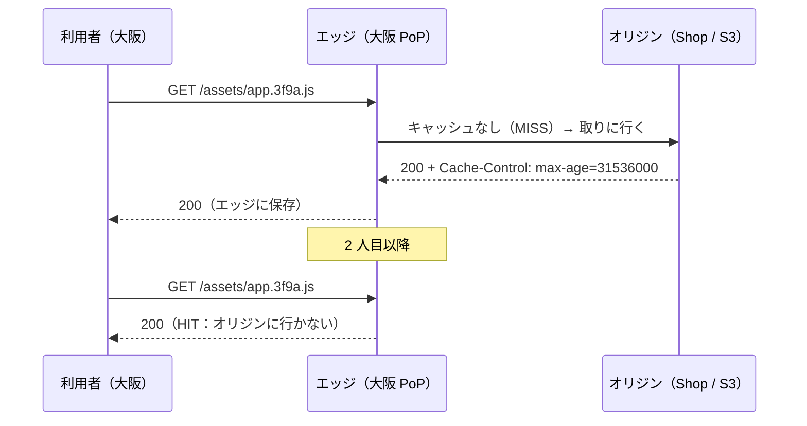
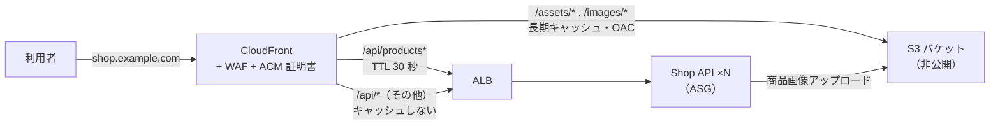

# CDNによる負荷軽減

[[MOC_サーバー・インフラ体系|📚 目次]] ｜ [[03_オートスケーリング|← 前へ]] ｜ [[05_高可用性と冗長化|次へ →]]

> [!abstract] この記事で分かること
> - CDN の仕組み（エッジ・オリジン・キャッシュヒット率）と、なぜサーバー負荷が下がるのか
> - 何をキャッシュしてよいか（静的アセット・画像・API の一部）と、キャッシュキー・パージの考え方
> - オリジン保護（オリジンシールド、OAC など）と DDoS 対策としての側面
> - Shop の画像と JS を CloudFront に載せる構成
>
> **前提**：[[06_HTTPキャッシュと圧縮]]、[[02_ロードバランサーの仕組み]] を読んでいると理解しやすいです。

## 1. ひとことで言うと

**CDN（Content Delivery Network：コンテンツ配信網）** は、本店の商品を全国の **コンビニに置いておく** 仕組みです。お客さんは遠くの本店まで行かず近所のコンビニで買えるので速く、本店の行列もなくなります。コンビニに在庫がないときだけ本店から取り寄せます。

- **オリジン（Origin）**：本来のサーバー（Shop の ALB や S3）。本店
- **エッジ（Edge / PoP）**：世界中にある CDN のサーバー。コンビニ
- **キャッシュヒット**：エッジに在庫があり、オリジンに行かずに返せた
- **キャッシュヒット率**：全リクエストのうちヒットした割合。これが高いほどオリジンの負荷が減る

スケーリングの観点では、CDN は「サーバーを増やす」のではなく **「サーバーに届くリクエストを減らす」** 最も安くて効果の大きい手段です。

## 2. CDN の仕組み



なぜ速く・軽くなるのか：

1. **距離が近い**：利用者の近くのエッジが返すので往復時間（RTT）が短い。TLS ハンドシェイクもエッジで完結
2. **オリジンに届かない**：ヒット率 95% なら、オリジンに来るのは 20 回に 1 回だけ
3. **帯域を肩代わり**：画像や動画など大きなデータの転送を CDN が担う。オリジンのネットワーク帯域とデータ転送料が減る

エッジが「どれくらいの間キャッシュしてよいか」は、オリジンが返す `Cache-Control` ヘッダーで決まります。`max-age`、`s-maxage`、`private`、`no-store` などヘッダーの意味は [[06_HTTPキャッシュと圧縮]] で詳しく扱っているので、ここでは CDN 側の設計に絞ります。

## 3. 何をキャッシュするか

| 種類 | 例 | キャッシュ方針 |
|---|---|---|
| **ファイル名にハッシュ付きの静的アセット** | `app.3f9a1c.js`、`style.8b2e.css` | 1 年など **長期キャッシュ**。中身が変わればファイル名が変わるので、古いものが残っても困らない |
| **画像** | 商品画像 `/images/products/123.webp` | 長め（数日〜）。差し替えるときはファイル名を変えるかパージ |
| **HTML** | トップページ | 短め（数十秒〜数分）か、キャッシュしない。ログイン状態で内容が変わるなら **キャッシュしない** |
| **公開 API の一部** | `GET /products`（商品一覧）、`GET /categories` | 数秒〜数十秒の **短い TTL** でも、セール時のアクセス集中を劇的に減らせる |
| **個人データ・更新系** | `GET /me`、`/cart`、`POST /orders` | **絶対にキャッシュしない**。`Cache-Control: private, no-store` |

> [!warning] 個人情報のキャッシュ事故
> ログイン中の利用者向けページを誤って CDN にキャッシュすると、**他人のマイページや住所が別の人に表示される** 事故が起きます。CDN 側の設定で「Cookie や Authorization ヘッダーがあるリクエストはキャッシュしない」「API は既定でキャッシュ無効、許可したパスだけキャッシュ」という **安全側の既定** にしてください。

## 4. キャッシュキーとパージ

### キャッシュキー（Cache Key）

エッジが「同じものか」を判定する鍵です。既定は **ホスト名 + パス** が中心で、クエリ文字列・ヘッダー・Cookie をどこまで含めるかを設定します。

- 含めすぎる → `?utm_source=...` や Cookie の違いで別物扱いになり、ヒット率が激減する
- 含めなさすぎる → `?page=2` と `?page=1` が同じ扱いになり、**違う内容が返る**

```text
良い例（商品一覧 API）
  キャッシュキー = Host + Path + クエリ(page, category, sort のみ)
  → utm_* などの計測用パラメータは無視
  → Cookie・Authorization はキーに含めず、そもそも転送しない
```

CloudFront では「キャッシュポリシー」でキャッシュキーと TTL を、「オリジンリクエストポリシー」でオリジンに転送する値を分けて管理します。キーに含めたものはオリジンにも転送されますが、転送するだけでキーに含めないことも可能です。

### パージ（Purge / Invalidation）

エッジのキャッシュを期限前に消すことです。

```bash
# CloudFront：商品画像を差し替えたのでキャッシュを無効化
aws cloudfront create-invalidation \
  --distribution-id E1234567890ABC \
  --paths "/images/products/123.webp"
```

- 全消し（`/*`）は簡単ですが、直後にオリジンへリクエストが殺到する（**キャッシュスタンピード**）ので注意
- CloudFront の無効化は月 1,000 パスまで無料、それ以上は有料です（2026 年時点）
- 理想は **パージに頼らない設計**：ファイル名にハッシュやバージョンを付ける（`app.3f9a.js`、`123.webp?v=2` ではなく `123-v2.webp`）
- Fastly や Cloudflare（Enterprise）には、関連するキャッシュをまとめて消せる **サロゲートキー / キャッシュタグ** があります（例：商品 123 に関するページ・API を一括パージ）

## 5. オリジン保護と DDoS 対策

CDN を置いても、オリジンに直接アクセスできてしまっては意味がありません。

| 仕組み | 内容 |
|---|---|
| **OAC（Origin Access Control）** | CloudFront から S3 へのアクセスを署名付きにし、S3 バケットは **CloudFront 経由のみ** 許可する。S3 を公開しなくて済む（旧方式 OAI の後継） |
| **オリジンシールド（Origin Shield）** | エッジとオリジンの間にもう 1 段の集約キャッシュ層を置く。世界中のエッジのミスが 1 か所にまとまり、オリジンへのリクエストがさらに減る |
| **ALB をCDN 経由のみに** | ALB のセキュリティグループで CloudFront のマネージドプレフィックスリストだけ許可し、さらにカスタムヘッダー（秘密の値）を CloudFront から付けて ALB のルールで検査する。CloudFront の VPC オリジンを使えば ALB をプライベートサブネットに置ける |
| **Cloudflare Tunnel など** | オリジンから CDN へ外向きに接続し、オリジンの受信ポートを開けない方式 |

**DDoS（Distributed Denial of Service：大量のアクセスでサービスを止める攻撃）** に対して、CDN は巨大な防波堤になります。

- 世界中のエッジに分散した大容量のネットワークで攻撃トラフィックを吸収する
- L3/L4 の攻撃（SYN フラッドなど）は CDN 側で落とされ、オリジンに届かない（CloudFront には AWS Shield Standard が追加料金なしで付く）
- L7 の攻撃（大量の HTTP リクエスト）には **WAF（Web Application Firewall）** のレート制限ルールを CDN に付ける
- キャッシュヒットするリクエストは、攻撃であってもオリジンに届かない

ただし、キャッシュされない API（検索・ログイン）を狙われるとオリジンに届くので、WAF のレート制限とオートスケーリングの最大台数（[[03_オートスケーリング]]）で守ります。セキュリティ全般は [[MOC_セキュリティ体系]] を参照してください。

## 6. 主要 CDN とShop の構成

| CDN | 特徴（2026 年時点） |
|---|---|
| **Amazon CloudFront** | AWS（S3・ALB・ACM・WAF）との統合が強い。OAC、Origin Shield、CloudFront Functions / Lambda@Edge |
| **Cloudflare** | DNS と一体で手軽、無料プランあり。DDoS 対策が強く、Workers でエッジ処理 |
| **Fastly** | 設定変更とパージが非常に速い（秒単位）。サロゲートキーによる細かいパージ。大手メディアで実績 |
| **Akamai** | 最古参で最大級のネットワーク。大企業・金融・動画配信 |

Shop では AWS を使っているので CloudFront を選び、1 つのディストリビューションでパスごとにオリジンを分けます。



| ビヘイビア（パスパターン） | オリジン | キャッシュ |
|---|---|---|
| `/assets/*` | S3（OAC） | 1 年。ビルド時にハッシュ付きファイル名で出力 |
| `/images/*` | S3（OAC） | 7 日。差し替えは別ファイル名で |
| `/api/products*` | ALB | 30 秒。クエリ `page`・`category`・`sort` だけキーに含める |
| `/api/*` | ALB | キャッシュ無効（AWS 管理の `CachingDisabled` ポリシー）。Cookie・Authorization を転送 |
| 既定 `*` | ALB | HTML は短い TTL、またはキャッシュ無効 |

デプロイ時に JS を S3 に置く例です。

```bash
# ハッシュ付きアセットは長期キャッシュ
aws s3 sync ./dist/assets s3://shop-static/assets \
  --cache-control "public, max-age=31536000, immutable"

# index.html はキャッシュさせず、毎回新しいアセット名を参照させる
aws s3 cp ./dist/index.html s3://shop-static/index.html \
  --cache-control "no-cache"
```

> [!tip] 効果を確かめる
> レスポンスヘッダーの `X-Cache: Hit from cloudfront` / `Miss from cloudfront` や `Age` でヒットを確認できます。CloudFront のレポートでキャッシュヒット率を定期的に見て、低いパスはキャッシュキーの設計を見直しましょう。

## よくある誤解・つまずき

- ❌ CDN は画像や動画のためだけのもの → ✅ 公開 API の短い TTL キャッシュでも、セール時のオリジン負荷を大きく減らせます。
- ❌ キャッシュキーに全部のクエリと Cookie を含めれば安全 → ✅ ヒット率がほぼ 0 になり、CDN の意味がなくなります。必要な値だけを含めます。
- ❌ 更新したらパージすればいい → ✅ 全パージはオリジンへの殺到を招きます。ファイル名にハッシュを付けてパージ不要にするのが基本です。
- ❌ CDN を置いたからオリジンは安全 → ✅ オリジンの IP や ALB の DNS 名に直接アクセスされると素通りです。OAC・セキュリティグループ・カスタムヘッダーで CDN 経由に限定します。
- ❌ ログイン後のページも CDN に載せれば速くなる → ✅ 他人の個人情報を返す事故の原因になります。個人向けは `private, no-store` です。

## まとめ

- CDN はエッジにコピーを置き、オリジンに届くリクエストそのものを減らす。ヒット率が鍵
- ハッシュ付き静的アセットは長期、画像は長め、公開 API は短い TTL、個人データはキャッシュしない
- キャッシュキーは必要最小限の値だけ。パージに頼らずファイル名で世代管理する
- OAC やセキュリティグループでオリジンを CDN 経由に限定し、オリジンシールドでさらに保護する
- CDN は DDoS の防波堤。L7 攻撃には WAF のレート制限を組み合わせる
- Shop は CloudFront でパスごとに S3 と ALB を振り分ける

## 確認クイズ

1. 商品一覧 API に CDN を設定したところ、キャッシュヒット率が 2% しかありません。考えられる原因は何でしょうか。
> [!tip]- 答え
> キャッシュキーにすべてのクエリ文字列（`utm_source` など計測用パラメータ）や Cookie を含めているため、利用者ごとに別物扱いになっている可能性があります。キーに含めるのを `page`・`category`・`sort` など内容に影響する値だけにします。

2. JS ファイルを `app.js` という固定名で 1 年キャッシュしたところ、デプロイしても古い JS が使われ続けます。どう直すべきですか。
> [!tip]- 答え
> ビルド時にファイル名へ内容のハッシュを付け（`app.3f9a.js`）、HTML 側はキャッシュさせない（`no-cache`）ようにします。新しいデプロイでは HTML が新しいファイル名を参照するので、パージせずに切り替わります。

3. S3 に置いた商品画像を CloudFront で配信しています。S3 バケットを公開設定にしないためには何を使いますか。
> [!tip]- 答え
> OAC（Origin Access Control）を使い、S3 のバケットポリシーで「この CloudFront ディストリビューションからのアクセスだけ許可」とします。S3 のブロックパブリックアクセスは有効のままにできます。

## 関連ノート

- [[06_HTTPキャッシュと圧縮]] — `Cache-Control`・ETag など CDN の動きを決める HTTP ヘッダー
- [[03_オートスケーリング]] — CDN で吸収しきれない負荷を台数で受ける
- [[02_ロードバランサーの仕組み]] — CDN のオリジンになる ALB
- [[05_高可用性と冗長化]] — CDN もエッジ側で冗長化された仕組み
- [[04_HTTPSとTLS証明書]] — CDN での証明書（CloudFront は us-east-1 の ACM 証明書）
- [[MOC_セキュリティ体系]] / [[MOC_Web脆弱性対策]] — WAF・DDoS 対策
- [[MOC_パフォーマンス体系]] — フロントエンド配信の高速化

## 参考

- [How CloudFront delivers content（AWS）](https://docs.aws.amazon.com/AmazonCloudFront/latest/DeveloperGuide/HowCloudFrontWorks.html)
- [Control the cache key with a policy（AWS CloudFront）](https://docs.aws.amazon.com/AmazonCloudFront/latest/DeveloperGuide/controlling-the-cache-key.html)
- [Restrict access to an Amazon S3 origin（OAC）](https://docs.aws.amazon.com/AmazonCloudFront/latest/DeveloperGuide/private-content-restricting-access-to-s3.html)
- [Use Amazon CloudFront Origin Shield](https://docs.aws.amazon.com/AmazonCloudFront/latest/DeveloperGuide/origin-shield.html)
- [Pay for file invalidation（AWS CloudFront）](https://docs.aws.amazon.com/AmazonCloudFront/latest/DeveloperGuide/PayingForInvalidation.html)
- [Cloudflare Cache documentation](https://developers.cloudflare.com/cache/)
- [Fastly: Purging](https://docs.fastly.com/en/guides/purging)
