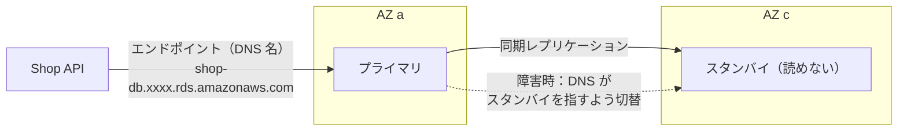
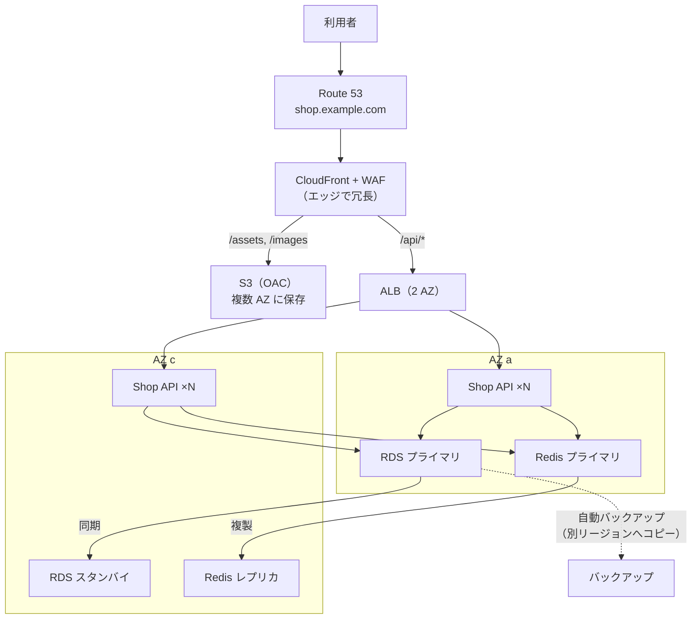

# 高可用性と冗長化

[[MOC_サーバー・インフラ体系|📚 目次]] ｜ [[04_CDNによる負荷軽減|← 前へ]] ｜ [[01_サーバーセキュリティの基本|次へ →]]

> [!abstract] この記事で分かること
> - 可用性 99.9% / 99.99% が「年間どれだけ止まってよいか」を意味するのか
> - 単一障害点（SPOF）の洗い出し方と、アクティブ-アクティブ／アクティブ-スタンバイ／N+1 の冗長化パターン
> - マルチ AZ・マルチリージョン、DB の Multi-AZ とフェイルオーバーにかかる時間
> - RTO / RPO と「バックアップは冗長化ではない」理由、Shop の最終構成
> - （発展）デフォルトゲートウェイの冗長化：HSRP / VRRP / GLBP の仕組みと違い
>
> **前提**：[[01_スケーリングの基本]]、[[02_ロードバランサーの仕組み]]、[[03_オートスケーリング]] を読んでいると理解しやすいです。

## 1. ひとことで言うと

飛行機にはエンジンが 2 つ以上あり、1 つ止まっても飛び続けられます。パイロットも 2 人乗っています。**冗長化（Redundancy）** とは、このように **予備を用意して、1 つ壊れても全体が止まらないようにすること** です。そして **高可用性（High Availability、HA）** は、その結果として「サービスが使える時間の割合が高い」状態のことです。

- 可用性は **%（稼働率）** で表し、「年間何分まで止まってよいか」に直して考える
- まず **単一障害点（SPOF：Single Point of Failure）** を見つけて潰す
- 予備への **切り替え（フェイルオーバー）** には時間がかかる。ゼロにはならない
- 冗長化は「壊れても動き続ける」、バックアップは「壊れた後に戻す」。**別物** で両方必要

## 2. 可用性の数字

| 可用性 | 年間停止時間 | 月間停止時間（30 日） | イメージ |
|---|---|---|---|
| 99% | 約 3.65 日 | 約 7.2 時間 | 1 台構成＋手作業復旧 |
| 99.9%（スリーナイン） | 約 8.76 時間 | 約 43 分 | 単一 AZ で冗長化、手早い復旧 |
| 99.95% | 約 4.38 時間 | 約 22 分 | マルチ AZ を正しく組んだ構成 |
| 99.99%（フォーナイン） | 約 52.6 分 | 約 4.3 分 | マルチ AZ ＋自動フェイルオーバー＋無停止デプロイ |
| 99.999%（ファイブナイン） | 約 5.3 分 | 約 26 秒 | マルチリージョン、通信キャリア級。費用と運用が桁違い |

覚えておきたいポイントは 3 つです。

1. **9 を 1 つ増やすごとに、許される停止時間は 1/10、費用と手間は数倍** になる
2. **直列につながる部品の可用性は掛け算** で下がる。99.9% の部品が 3 つ直列なら 0.999³ ≈ 99.7%
3. **並列（冗長化）にすると上がる**。99% の部品 2 台が独立に壊れるなら、両方同時に壊れる確率は 1% × 1% = 0.01% → 99.99%（ただし「独立に壊れる」が前提。同じ AZ・同じバグなら同時に壊れる）

> [!note] 計画停止も停止
> 利用者から見れば、メンテナンスでもデプロイでも止まっていれば同じです。99.99% を目指すなら、OS パッチ・DB のバージョンアップ・デプロイも無停止で行える必要があります（[[08_ゼロダウンタイムデプロイの条件]]）。目標値の決め方（SLO・エラーバジェット）は [[MOC_SRE・インシデント対応体系]] を参照してください。

## 3. SPOF の洗い出し

**SPOF** は「そこが 1 つ壊れたら全体が止まる部品」です。構成図を描き、リクエストの通り道を入口から順にたどって、**1 つしかないもの** に印を付けます。

Shop の段階 2（[[01_スケーリングの基本]]）の構成で洗い出すと次のようになります。

| 部品 | 1 つしかない？ | 壊れたら | 対策 |
|---|---|---|---|
| DNS（Route 53） | マネージドで冗長 | — | そのまま（レジストラ・ネームサーバー設定の誤りには注意） |
| EC2（Nginx + API） | **1 台** | 全停止 | ALB + ASG で 2 台以上、2 AZ |
| RDS PostgreSQL | **Single-AZ** | 全停止、データ損失の恐れ | Multi-AZ 化 |
| セッション（API のメモリ） | **各サーバー内** | ログイン切れ | Redis（ElastiCache、レプリカ付き）へ |
| 商品画像（EC2 のディスク） | **1 台のディスク** | 画像が消える | S3 へ（S3 は複数 AZ に保存される） |
| AZ（データセンター） | **ap-northeast-1a のみ** | AZ 障害で全停止 | 2 AZ 以上に分散 |
| TLS 証明書の更新 | 手作業 1 人 | 期限切れで全停止 | ACM で自動更新 |
| 運用担当者 | **1 人だけが手順を知っている** | 復旧できない | [[02_ランブックの書き方|ランブック]]、IaC（[[02_IaCとは]]） |

最後の 2 行のように、**人・手順・証明書・外部サービス（決済代行など）** も SPOF になり得ます。機械だけを見ないことが大切です。

## 4. 冗長化パターン

| パターン | 仕組み | 長所 | 短所 | 例 |
|---|---|---|---|---|
| **アクティブ-アクティブ** | 全台が同時に処理する | 予備が遊ばない。切り替え時間がほぼゼロ（LB が外すだけ） | ステートレスである必要。1 台壊れたとき残りで全負荷を受けられる容量が必要 | ALB 配下の API サーバー |
| **アクティブ-スタンバイ** | 1 台が処理、もう 1 台は待機してデータだけ同期 | 状態を持つもの（DB）でも実現しやすい | 待機機が遊ぶ。切り替えに数十秒〜数分 | RDS Multi-AZ、Redis のレプリカ |
| **N+1** | 必要台数 N に予備 1 を足す | 1 台故障に耐える最小の追加コスト | 2 台同時故障には耐えない | API 4 台必要なら 5 台 |
| **N+2 / 2N** | 予備を 2 台、または全体を 2 倍 | メンテナンス中の故障にも耐える | コスト増 | 重要度の高いシステム |

マルチ AZ で N+1 を考えるときは **AZ 単位** で考えます。「API が 4 台必要」で 2 AZ に分けるなら、1 AZ が丸ごと落ちても残り 1 AZ で 4 台必要なので、**各 AZ 4 台 = 合計 8 台**（あるいは AZ 障害時にオートスケールで増えるまでの劣化を許容して少なめにする）という判断になります。3 AZ に分ければ各 AZ 2 台・合計 6 台で済み、効率が上がります。

## 5. マルチ AZ・マルチリージョンと DB の冗長化

### マルチ AZ とマルチリージョン

- **AZ（Availability Zone）**：同じリージョン内の、電源・ネットワーク・建物が独立したデータセンター群。AZ 間は低遅延の専用回線（[[03_仮想化とクラウド]]）
- **マルチ AZ**：ALB・ASG・RDS を 2〜3 AZ に分散。AZ 間の遅延は小さいので、DB の **同期レプリケーション** が使える。**多くのサービスはまずここまでで十分**
- **マルチリージョン**：東京と大阪など、地理的に離れたリージョンで動かす。大地震やリージョン全体の障害に耐えるが、距離があるので DB は **非同期レプリケーション** になり、切り替え時に直近のデータが失われ得る。費用・複雑さが大幅に増える

| | マルチ AZ | マルチリージョン |
|---|---|---|
| 守れるもの | 1 データセンターの障害 | リージョン全体の障害・広域災害 |
| DB 複製 | 同期（データ損失ほぼなし） | 非同期（数秒分の損失があり得る） |
| 切り替え | 自動（数十秒〜数分） | Route 53 フェイルオーバーなど。手順と訓練が必要 |
| コスト・複雑さ | 中 | 大 |

### DB の冗長化（RDS Multi-AZ）



- **Multi-AZ DB インスタンス**：別 AZ に同期スタンバイを 1 台持つ。スタンバイは読み取りには使えない（読み取り分散は [[01_スケーリングの基本]] のリードレプリカで）。フェイルオーバーは **通常 60〜120 秒**（AWS の記載、2026 年時点）
- **Multi-AZ DB クラスター**：読み取り可能なスタンバイを 2 台持つ構成。フェイルオーバーがより短い
- 切り替えは **DNS の向き先変更** で行われるので、アプリは **既存の接続が切れたら再接続する** 必要があります。接続プールの再接続設定、DNS を長時間キャッシュしない設定（JVM は TTL 60 秒以下が推奨）を確認します
- 同期レプリケーションのため、Single-AZ より書き込みレイテンシがやや増えます

自前の PostgreSQL で冗長化する場合はストリーミングレプリケーションと Patroni などの自動フェイルオーバーツールが必要で、難易度が高いです（[[06_データベースサーバーの運用]]、[[05_WALとクラッシュリカバリ]]）。

### フェイルオーバーと切り替え時間

「冗長化しているから止まらない」は誤りで、正確には **「切り替え時間だけ止まる・遅くなる」** です。

| 部品 | 検知 + 切り替えの目安 | 利用者への影響 |
|---|---|---|
| API サーバー 1 台（ALB 配下） | ヘルスチェック間隔 × 閾値（数十秒） | その間、一部のリクエストがエラー |
| RDS Multi-AZ | 60〜120 秒 | 書き込み・読み込みとも失敗。アプリは再接続 |
| Redis（ElastiCache レプリカ付き） | 数十秒程度 | セッション読み書き失敗。キャッシュなら DB にフォールバック |
| リージョン（Route 53 フェイルオーバー） | ヘルスチェック + DNS TTL（数分）＋手順次第 | 数分〜数十分 |

切り替え中に利用者に起きることを想定し、**リトライ（冪等な処理だけ）**、**タイムアウト**、**エラー画面の文言** まで設計しておきます。

## 6. RTO / RPO と「バックアップは冗長化ではない」

- **RTO（Recovery Time Objective：目標復旧時間）**：障害発生から何分以内に復旧させるか
- **RPO（Recovery Point Objective：目標復旧時点）**：最大で何分前までのデータなら失ってよいか

| 手段 | 主に縮めるもの | 例 |
|---|---|---|
| 冗長化（Multi-AZ、ASG） | **RTO**（自動で数分以内に戻る） | RDS Multi-AZ で RTO 2 分・RPO ほぼ 0 |
| バックアップ（スナップショット、PITR） | **RPO**（どの時点に戻せるか） | RDS の自動バックアップで 5 分前の時点に復元 |
| マルチリージョン | 広域災害時の RTO / RPO | 非同期レプリカで RPO 数秒、RTO 数十分 |

> [!warning] バックアップは冗長化ではない、冗長化はバックアップではない
> - バックアップからの復元は **数十分〜数時間** かかります。止まらないための仕組みではありません。
> - 逆に、冗長化は **間違った操作もそのまま複製** します。`DELETE FROM orders;` を誤って実行すれば、スタンバイからも一瞬で消えます。ランサムウェアや誤削除から守るのはバックアップ（できれば別アカウント・別リージョン、削除できない設定）です。
> - そして **復元を試したことのないバックアップは、無いのと同じ** です。定期的に復元訓練をします。

RTO / RPO の決め方と復旧訓練の進め方は [[04_DR訓練とRTO・RPO]]、手順書の作り方は [[02_ランブックの書き方]] を参照してください。

## 7. Shop の最終構成

この章までで、Shop は次のような構成になりました。



| 層 | 冗長化の方法 | 残るリスク |
|---|---|---|
| DNS / CDN | マネージドで冗長 | 設定ミス（IaC とレビューで防ぐ） |
| LB | ALB を 2 AZ のサブネットに配置 | — |
| API | ASG で最小 2 台・2 AZ、ヘルスチェックで自動入れ替え | 全台共通のバグ → デプロイ戦略とロールバック |
| セッション | ElastiCache（レプリカ・自動フェイルオーバー） | 切り替え中の数十秒 |
| DB | RDS Multi-AZ、自動バックアップ + PITR | 60〜120 秒の切り替え、誤操作（バックアップで対処） |
| ファイル | S3（バージョニング有効） | 誤削除（バージョニングで復元） |
| リージョン | 東京のみ | 東京リージョン全体の障害 → 必要なら大阪へ DR 構成 |

マルチリージョンまで進むかは、「東京リージョン全体が止まったとき、Shop は何時間止まってよいか」という **ビジネス側の判断** で決めます。多くの EC サイトではマルチ AZ ＋別リージョンへのバックアップコピーで十分です。

この構成は Terraform でコード化し（[[03_Terraform入門]]）、次の章ではこのサーバー群を **攻撃から守る** 方法を学びます（[[01_サーバーセキュリティの基本]]）。

## よくある誤解・つまずき

- ❌ 冗長化すれば止まらない → ✅ フェイルオーバーの切り替え時間（RDS なら 1〜2 分）は止まります。アプリ側の再接続とリトライの設計が必要です。
- ❌ バックアップを取っているから冗長化は不要（またはその逆） → ✅ 冗長化は止まらないため（RTO）、バックアップは戻すため（RPO・誤操作対策）。両方必要です。
- ❌ 2 台にすれば可用性は 2 倍 → ✅ 同じ AZ・同じ電源・同じバグなら同時に落ちます。「独立して壊れる」ように分けることが重要です。
- ❌ RDS Multi-AZ のスタンバイで読み取りを分散できる → ✅ Multi-AZ DB インスタンスのスタンバイは読めません。読み取り分散はリードレプリカか Multi-AZ DB クラスターです。
- ❌ 99.99% を目標にすれば安心 → ✅ 年 52 分しか止められず、デプロイやパッチも無停止が前提になります。費用と手間に見合う目標を選びます。

## まとめ

- 可用性は年間停止時間に直して考える。99.9% は約 8.8 時間、99.99% は約 53 分
- 構成図をたどり、機械だけでなく人・手順・証明書も含めて SPOF を洗い出す
- ステートレスな層はアクティブ-アクティブ＋N+1、DB はアクティブ-スタンバイ（Multi-AZ）が基本
- まずはマルチ AZ。マルチリージョンは非同期複製と運用負担を理解したうえでビジネス判断で
- 冗長化は RTO を、バックアップは RPO と誤操作対策を担う。バックアップは冗長化ではない
- Shop は CloudFront → ALB（2 AZ）→ API（ASG）→ RDS Multi-AZ ＋ Redis ＋ S3 の構成になった

## 確認クイズ

1. ALB（99.99%）→ API 群（99.95%）→ RDS（99.95%）が直列につながっているとき、全体の可用性はおよそいくつですか。
> [!tip]- 答え
> 0.9999 × 0.9995 × 0.9995 ≈ 0.9989、つまり **約 99.89%** です。直列の部品が増えるほど全体の可用性は下がります。各部品を冗長化して個々の可用性を上げることが大切です。

2. 開発者が誤って本番 DB の `orders` テーブルを DROP しました。RDS は Multi-AZ 構成です。スタンバイから復旧できますか。
> [!tip]- 答え
> できません。Multi-AZ は同期レプリケーションなので、DROP もスタンバイに即座に反映されます。自動バックアップのポイントインタイムリカバリ（PITR）で、DROP 直前の時点に復元する必要があります。これが「冗長化はバックアップではない」理由です。

3. Shop の API は通常 4 台でピークをさばけます。2 AZ に分けて、1 AZ 全体が落ちてもピーク性能を保ちたい場合、何台必要ですか。3 AZ ならどうですか。
> [!tip]- 答え
> 2 AZ では、残る 1 AZ だけで 4 台必要なので各 AZ 4 台・合計 **8 台** です。3 AZ なら、1 AZ が落ちても残り 2 AZ で 4 台あればよいので各 AZ 2 台・合計 **6 台** で済みます。AZ を増やすほど予備の割合が小さくなります。

## 発展：デフォルトゲートウェイの冗長化（FHRP：HSRP / VRRP / GLBP）

ここまではサーバー・DB・AZ の冗長化を見てきましたが、ネットワークの入口である **デフォルトゲートウェイ（ルーター）** も SPOF になり得ます。この節では、複数のルーターで仮想IPアドレスを共有してゲートウェイを冗長化する FHRP（HSRP / VRRP / GLBP）を扱います。ルーティングの基本は [[28ルーティングの基本とスタティックルート]]、デフォルトゲートウェイそのものは [[05IPアドレスとサブネットとゲートウェイ]] を参照してください。

### FHRPの目的

PCに設定できるデフォルトゲートウェイは通常**1つだけ**です。そのため、デフォルトゲートウェイのルータが故障すると、PCはサブネットの外と通信できなくなります。

**FHRP（First Hop Redundancy Protocol、ファーストホップ冗長化プロトコル）**は、**デフォルトゲートウェイを冗長化**するための仕組みです。複数のルータで**1つの仮想ルータ**を作り、**仮想IPアドレス**（と仮想MACアドレス）を共有します。担当ルータが故障すると、別のルータが自動で引き継ぎます。

```
                        インターネット / 社内WAN
                         │                 │
                    G0/0 │                 │ G0/0
                       [R1]              [R2]
                 Active │ .1           .2 │ Standby
                 Pri 110│                 │ Pri 100
                        └──────┬──────────┘
                               │  192.168.1.0/24
                  仮想IP 192.168.1.254 / 仮想MAC 0000.0c07.ac01
                               │
                 ┌─────────────┼─────────────┐
                PC1           PC2           PC3
        デフォルトゲートウェイ = 192.168.1.254（仮想IP）
```

よくある誤答の整理（他の技術の目的）:

| 目的 | 技術 |
|---|---|
| **デフォルトゲートウェイの冗長化** | **FHRP**（HSRP / VRRP / GLBP） |
| L2ネットワークのループ防止 | STP |
| 端末へのIPアドレス自動割り当て | DHCP |
| 宛先までの最短経路の計算 | OSPFなどのルーティングプロトコル |

### HSRPの動作

HSRP（Hot Standby Router Protocol）は**Cisco独自**のFHRPです。

- グループ内で **アクティブルータ** が仮想IPアドレスと仮想MACアドレスで応答し、**実際の転送**を行う。
- **スタンバイルータ** は普段は転送を担当しない。アクティブの故障時に引き継ぐ予備。
- アクティブルータが故障すると、スタンバイルータが**仮想IP/仮想MACを引き継ぐ**。
- PCから見ると、ゲートウェイのIPアドレスもMACアドレスも変わらないので、**設定を変えずに通信を続けられる**（ARPキャッシュの更新も不要）。

**PCのデフォルトゲートウェイには HSRP の仮想IPアドレスを設定**します。

| 誤答 | なぜダメか |
|---|---|
| アクティブルータの実際のIPアドレス | アクティブが故障するとそのアドレスに届かなくなり、冗長化の意味がない |
| スタンバイルータの実際のIPアドレス | スタンバイは普段は転送を担当しない |
| HSRPの仮想MACアドレス | デフォルトゲートウェイにはIPアドレスを設定する。仮想MACは、PCがARPで仮想IPを問い合わせたときに返される |

HSRPの仮想MACアドレス:

- HSRPv1: `0000.0c07.acXX`（XX はグループ番号の16進数。グループ1なら `0000.0c07.ac01`）
- HSRPv2: `0000.0c9f.fXXX`

### アクティブルータの選出

| 順番 | 比較する値 | 優先 |
|---|---|---|
| ① | **HSRPプライオリティ** | **大きい方**（デフォルト **100**、範囲 0〜255） |
| ② | （同じなら）インターフェースの**IPアドレス** | **大きい方** |

HSRPは**ルータID**を使いません（ルータIDはOSPFの用語）。MACアドレスも比較しません（MACアドレスの小さい方が選ばれるのは、優先度が同じ場合のSTPのルートブリッジ選出）。

```
R1(config)# interface GigabitEthernet0/1
R1(config-if)# ip address 192.168.1.1 255.255.255.0
R1(config-if)# standby version 2
R1(config-if)# standby 1 ip 192.168.1.254      ← 仮想IPアドレス
R1(config-if)# standby 1 priority 110          ← プライオリティ（デフォルト100）
R1(config-if)# standby 1 preempt               ← プリエンプトを有効化

R2(config)# interface GigabitEthernet0/1
R2(config-if)# ip address 192.168.1.2 255.255.255.0
R2(config-if)# standby version 2
R2(config-if)# standby 1 ip 192.168.1.254
```

```
R1# show standby brief
                     P indicates configured to preempt.
                     |
Interface   Grp  Pri P State   Active          Standby         Virtual IP
Gi0/1       1    110 P Active  local           192.168.1.2     192.168.1.254

R2# show standby brief
Interface   Grp  Pri P State   Active          Standby         Virtual IP
Gi0/1       1    100   Standby 192.168.1.1     local           192.168.1.254
```

#### 例題の解き方：HSRPのアクティブ選出

| ルータ | プライオリティ | IPアドレス |
|---|---|---|
| R1 | 100（デフォルト） | 192.168.1.1 |
| R2 | 100（デフォルト） | 192.168.1.2 |
| R3 | 90 | 192.168.1.3 |

1. プライオリティを比較 → R1, R2 が 100 で最大（R3 は 90 で脱落）。
2. 同じなので IPアドレスを比較 → 192.168.1.2 > 192.168.1.1 → **R2がアクティブ**、次点の R1 がスタンバイ。
3. ※ ただし、すでに動作しているグループに後から加わった場合は、プリエンプトの有無で結果が変わる（次節）。

### プリエンプト

**HSRPのプリエンプトはデフォルトで無効**です。そのため、一度アクティブが入れ替わると、プライオリティの高いルータが故障から復旧して戻ってきても、**アクティブの役割は交代しません**。

意図したルータを常にアクティブにしたい場合は、**プライオリティを高くしたうえで `standby <グループ> preempt` も設定**します。

```
 時刻   R1（Pri 110, preempt なし）     R2（Pri 100）
 ──────────────────────────────────────────────────────
  t0    Active                          Standby
  t1    故障                            Active に昇格
  t2    復旧 → Standby のまま           Active のまま   ← プリエンプトがないので戻らない
 ──────────────────────────────────────────────────────
        R1 に standby 1 preempt を設定していれば、t2 で R1 が Active を取り戻す
```

| 誤答 | なぜダメか |
|---|---|
| `standby 1 priority 100` | プライオリティをデフォルト値にするだけ。プリエンプトがなければ役割は交代しない |
| `standby 1 ip 192.168.1.254` | 仮想IPアドレスを設定するコマンド |
| `spanning-tree portfast` | STPの機能で、HSRPとは関係ない |

プリエンプトのデフォルト:

| プロトコル | プリエンプトのデフォルト |
|---|---|
| HSRP | **無効** |
| VRRP | **有効** |
| GLBP（AVG） | 無効 |
| OSPFのDR | そもそもプリエンプションの仕組みがない |

### HSRP / VRRP / GLBP の比較

| 項目 | HSRP | VRRP | GLBP |
|---|---|---|---|
| 標準/独自 | **Cisco独自** | **IETF標準**（RFC 5798） | **Cisco独自** |
| 転送役 | **アクティブ**（1台） | **マスター**（1台） | **AVF**（複数台が同時に転送） |
| 予備 | スタンバイ | バックアップ | — |
| 負荷分散 | グループ内では不可（1台のみ転送） | グループ内では不可（1台のみ転送） | **可能**（グループ内の複数ルータで負荷分散） |
| デフォルトプライオリティ | 100 | 100 | 100 |
| プリエンプト | デフォルト無効 | デフォルト有効 | デフォルト無効 |
| 仮想MAC | 0000.0c07.acXX（v1） | 0000.5e00.01XX | 0007.b400.XXYY |
| マルチキャスト | 224.0.0.2（v1）/ 224.0.0.102（v2） | 224.0.0.18 | 224.0.0.102 |

**GLBP（Gateway Load Balancing Protocol）**は、1つの仮想IPアドレスに対して、**ルータごとに異なる仮想MACアドレス**をARP応答で答えて、PCごとに通信を振り分けます。

- **AVG**（Active Virtual Gateway）: ARPに応答し、どの仮想MACを返すかを割り振る役（1台）
- **AVF**（Active Virtual Forwarder）: 実際に転送する役（最大4台）

```
 PC1 ─ARP「192.168.1.254 のMACは？」→ AVG ─応答→ 「0007.b400.0101（R1の仮想MAC）」 → PC1 は R1 経由
 PC2 ─ARP「192.168.1.254 のMACは？」→ AVG ─応答→ 「0007.b400.0102（R2の仮想MAC）」 → PC2 は R2 経由
```

HSRPやVRRPでも、**VLANごとにアクティブ（マスター）のルータを分ける**ことで、ネットワーク全体として負荷を分散する設計はできます（例：VLAN10 は R1 がアクティブ、VLAN20 は R2 がアクティブ）。ただし1つのグループ内で同時に転送するのは1台だけです。

OSPFはルーティングプロトコルであり、デフォルトゲートウェイの冗長化（FHRP）ではありません（[[29OSPF（リンクステート型ルーティング）]]）。

### ひっかけポイント・よくある誤解

- FHRPの目的はデフォルトゲートウェイの冗長化。STP（ループ防止）、DHCP（アドレス割当）、OSPF（経路計算）と混同しない。
- PCのゲートウェイは**仮想IP**。実IPでも仮想MACでもない。
- HSRPのアクティブは**プライオリティが大きい方**（同じならIPアドレスが大きい方）。ルータIDやMACは使わない。
- HSRPのプリエンプトは**デフォルト無効**。復旧後に戻すには `standby <グループ> preempt`。VRRPはデフォルト有効。
- グループ内で負荷分散できるのは **GLBP** だけ。
- HSRP＝アクティブ/スタンバイ、VRRP＝マスター/バックアップ（用語を取り違えない）。

### 押さえておくポイント

- FHRP＝仮想IP/仮想MACを共有してデフォルトゲートウェイを冗長化。
- HSRP: Cisco独自、アクティブ/スタンバイ、プライオリティ100、大きい方が優先、preemptはデフォルト無効。
- VRRP: 標準、マスター/バックアップ、preemptはデフォルト有効。
- GLBP: Cisco独自、ルータごとに異なる仮想MACで負荷分散。
- 設定: `standby <grp> ip <VIP>`、`standby <grp> priority <値>`、`standby <grp> preempt`。確認: `show standby brief`。

### 数値・コマンドの整理

| 項目 | 値・優先 |
|---|---|
| HSRP アクティブ: プライオリティ → IP | **大きい**方 |
| HSRP / VRRP / GLBP のデフォルトプライオリティ | 100 |
| OSPF DR 選出（参考） | プライオリティ → ルータIDの**大きい**方。デフォルト1、プリエンプションなし |
| STP ルートブリッジ（参考） | ブリッジID（プライオリティ→MAC）の**小さい**方 |

| コマンド | 意味 |
|---|---|
| `standby <grp> ip / priority / preempt` | HSRPの仮想IP / 優先度 / プリエンプト |
| `show standby [brief]` | HSRPの状態 |
| `spanning-tree portfast` | STP用（HSRPとは無関係） |

## 関連ノート

- [[01_スケーリングの基本]] — ステートレス化とリードレプリカ
- [[02_ロードバランサーの仕組み]] — ヘルスチェックによる自動切り離し
- [[03_オートスケーリング]] — 最小台数と AZ 分散、自動入れ替え
- [[04_CDNによる負荷軽減]] — エッジでの冗長化と DDoS 対策
- [[04_DR訓練とRTO・RPO]] — RTO / RPO の決め方と復旧訓練
- [[02_ランブックの書き方]] — フェイルオーバー手順を誰でも実行できるように
- [[06_データベースサーバーの運用]] / [[05_WALとクラッシュリカバリ]] — DB のレプリケーションとバックアップ
- [[MOC_SRE・インシデント対応体系]] — SLO・エラーバジェット・障害対応
- [[MOC_分散システム体系]] — レプリケーションと整合性、分断耐性

## 参考

- [Multi-AZ DB instance deployments for Amazon RDS（AWS）](https://docs.aws.amazon.com/AmazonRDS/latest/UserGuide/Concepts.MultiAZSingleStandby.html)
- [Failing over a Multi-AZ DB instance for Amazon RDS（AWS）](https://docs.aws.amazon.com/AmazonRDS/latest/UserGuide/Concepts.MultiAZ.Failover.html)
- [Multi-AZ DB cluster deployments for Amazon RDS（AWS）](https://docs.aws.amazon.com/AmazonRDS/latest/UserGuide/multi-az-db-clusters-concepts.html)
- [AWS Well-Architected Framework – Reliability Pillar](https://docs.aws.amazon.com/wellarchitected/latest/reliability-pillar/welcome.html)
- [Configuring DNS failover（Amazon Route 53）](https://docs.aws.amazon.com/Route53/latest/DeveloperGuide/dns-failover-configuring.html)
- [Google SRE Book – Embracing Risk](https://sre.google/sre-book/embracing-risk/)
