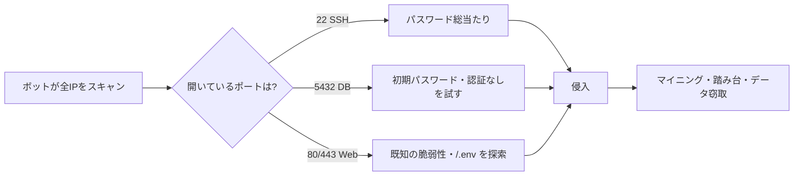
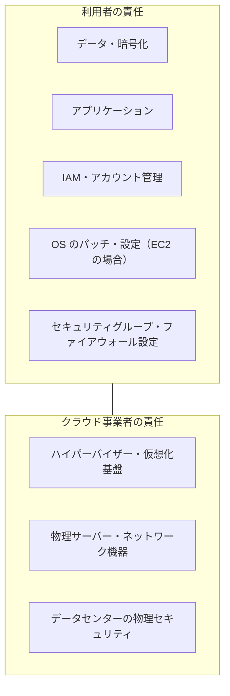

# サーバーセキュリティの基本

[[MOC_サーバー・インフラ体系|📚 目次]] ｜ [[05_高可用性と冗長化|← 前へ]] ｜ [[02_SSHの安全な運用|次へ →]]

> [!abstract] この記事で分かること
> - インターネットに公開したサーバーが「公開した瞬間から」機械的に攻撃される理由
> - 攻撃面の縮小・多層防御・最小権限という 3 つの基本原則
> - クラウドの責任共有モデルで「自分が守る範囲」はどこか
> - Shop サーバーの脅威と対策を層ごとに整理したマップ
>
> **前提**：[[05_ネットワークの基本（IP・ポート・DNS）]] と [[04_Linuxサーバーの基本]] を読んでいると理解しやすいです。

## 1. ひとことで言うと

サーバーセキュリティは「家の防犯」に似ています。泥棒は特定の家を狙うより、住宅街を歩いて**鍵の掛かっていない窓を探します**。インターネットのサーバーも同じで、攻撃者は「あなたの Shop」を狙っているのではなく、世界中の IP アドレスを総当たりで調べ、開いている窓（ポート）や古い鍵（脆弱なソフト）を自動で探しています。

だから防御の基本は次の 3 つです。

- **窓を減らす**（攻撃面の縮小）
- **鍵を何重にも掛ける**（多層防御）
- **合鍵を配りすぎない**（最小権限）

派手な製品を入れることより、この 3 つを地道に守ることが、個人や小さなチームのサーバーでは最も効果があります。

## 2. 公開した瞬間から攻撃される現実

### 2.1 ボットによる全自動スキャン

VPS や EC2 を起動してグローバル IP を付けると、数分〜数時間のうちに SSH へのログイン試行が `/var/log/auth.log` に並び始めます。これは誰かがあなたを見つけたのではなく、**ボット（自動プログラム）がインターネットの全 IPv4 アドレスを常にスキャンしている**からです。IPv4 は約 43 億個しかなく、高速なスキャナーなら全範囲を 1 時間足らずで調べ終えられます。

起動直後のサーバーで実際に確認してみると、次のような行がすぐに見つかります。

```bash
# SSH のログイン失敗を数える（Ubuntu 24.04）
sudo grep "Invalid user" /var/log/auth.log | tail -5
# journald から見る場合
sudo journalctl -u ssh --since "1 hour ago" | grep -c "Invalid user"
```

```
sshd[1234]: Invalid user admin from 203.0.113.45 port 51234
sshd[1240]: Invalid user oracle from 198.51.100.7 port 40112
sshd[1251]: Invalid user test from 192.0.2.88 port 38820
```

ボットが狙うものの代表例は次のとおりです。

| 狙い | 例 |
|---|---|
| 弱いパスワード | SSH に `root` / `admin` / `ubuntu` などで総当たり（ブルートフォース） |
| うっかり公開された管理ポート | PostgreSQL（5432）、MySQL（3306）、Redis（6379）、Docker API（2375） |
| 既知の脆弱性 | 古い Nginx・WordPress・ライブラリの CVE（公開済みの脆弱性番号） |
| 置き忘れたファイル | `/.env`、`/.git/config`、`/backup.sql` への HTTP リクエスト |

> [!warning] 「小さなサイトだから狙われない」は通用しない
> ボットは相手の規模を見ていません。乗っ取られたサーバーは暗号資産のマイニング、スパム送信、他サイトへの攻撃の踏み台として「再利用」されます。データが無価値でも、**計算資源とグローバル IP そのものに価値がある**のです。

### 2.2 攻撃の流れ



どの経路も「開いている」「古い」「弱い」のどれかが入口です。逆に言えば、この 3 つを潰すだけで自動攻撃の大半は空振りになります。

## 3. 3 つの基本原則

### 3.1 攻撃面の縮小（Attack Surface Reduction）

**攻撃面（attack surface）** とは、外から触れる場所の総量です。開いているポート、動いているサービス、インストールされたパッケージ、ログインできるユーザー、すべてが攻撃面です。

- 使わないポートは閉じる → [[03_ファイアウォールとネットワーク制御]]
- 使わないサービス・パッケージは消す → [[04_OSのハードニングとパッチ管理]]
- 管理用の入口（SSH、DB）はインターネットに出さない → [[02_SSHの安全な運用]]

「守る」より「そもそも存在させない」方が確実です。存在しないポートの脆弱性は突けません。

### 3.2 多層防御（Defense in Depth）

1 つの対策は必ずいつか破られる、という前提で**防御を何層にも重ねる**考え方です。城でいえば、堀・城壁・門番・天守の金庫を全部用意しておくイメージです。

```
   インターネット
        │
 ┌──────▼──────────────────────────┐ ① ネットワーク：SG / ufw で 22,80,443 だけ
 │ ┌──────────────────────────────┐│ ② OS：パッチ適用・SSH 鍵認証・fail2ban
 │ │ ┌──────────────────────────┐ ││ ③ ミドルウェア：Nginx/DB の安全な設定
 │ │ │ ┌──────────────────────┐ │ ││ ④ アプリ：入力検証・認証・認可
 │ │ │ │  ⑤ データ：暗号化・   │ │ ││
 │ │ │ │     バックアップ     │ │ ││
 │ │ │ └──────────────────────┘ │ ││
 │ │ └──────────────────────────┘ ││
 │ └──────────────────────────────┘│
 └─────────────────────────────────┘
        ＋ 全層を横断：ログ監査と侵入の検知
```

たとえばアプリに SQL インジェクションがあっても、DB ユーザーに `DROP` 権限がなければテーブル削除は防げます。1 層が破られても次の層が被害を食い止める、これが多層防御です。

### 3.3 最小権限（Principle of Least Privilege）

**必要な人・プロセスに、必要な権限だけを、必要な期間だけ**与える原則です。

| 対象 | ダメな例 | 良い例 |
|---|---|---|
| SSH ログイン | 全員が `root` で入る | 個人ユーザーで入り、必要時だけ `sudo` |
| アプリの実行ユーザー | `root` で Node.js を起動 | 専用ユーザー `shop` で起動（[[04_プロセス管理とsystemd]]） |
| DB ユーザー | アプリがスーパーユーザーで接続 | `SELECT/INSERT/UPDATE/DELETE` のみの専用ロール |
| クラウド権限 | 全員に `AdministratorAccess` | 役割ごとの IAM ポリシー |

権限を絞ると、侵入されたときに**攻撃者ができることも絞られます**。被害の大きさを決めるのは、侵入されたかどうかより「侵入された先で何ができたか」です。

## 4. 責任共有モデル：クラウドで自分が守る範囲

AWS などのクラウドでは **責任共有モデル（Shared Responsibility Model）** という考え方が公式に示されています。ざっくり言うと、**クラウド事業者は「クラウドそのもの」のセキュリティ**（データセンター、物理サーバー、ハイパーバイザー）を守り、**利用者は「クラウドの中に置いたもの」のセキュリティ**を守ります。



境界線は**サービスの種類で動きます**。

| サービス | OS のパッチ | ミドルウェア | アプリ・データ |
|---|---|---|---|
| EC2 / VPS（IaaS） | **利用者** | **利用者** | **利用者** |
| RDS（マネージド DB） | 事業者 | 事業者（ただしバージョン選択・パラメータは利用者） | **利用者**（ユーザー権限・公開設定） |
| Lambda / Fargate | 事業者 | 事業者 | **利用者** |

> [!important] 「クラウドだから安全」ではない
> クラウドの事故の多くは、事業者側ではなく**利用者側の設定ミス**（S3 バケットの公開、セキュリティグループで DB を `0.0.0.0/0` に開放、漏れたアクセスキー）が原因です。マネージドサービスを使うほど自分の責任範囲は狭くなりますが、**IAM・ネットワーク設定・データ**は常に利用者の責任です。

Shop の最初の構成（EC2 1 台に Nginx + API + PostgreSQL）は IaaS なので、**OS から上は全部自分の担当**です。DB を RDS に移すと OS とパッチの責任は AWS に移りますが、「RDS をパブリックアクセス可能にしない」のは自分の仕事として残ります。

## 5. Shop サーバーの脅威と対策マップ

Shop を題材に、層ごとに「何が起きうるか」と「どの回で対策するか」を整理します。これがこの章全体の地図です。

| 層 | 主な脅威 | 対策 | 詳しくは |
|---|---|---|---|
| ネットワーク | 不要なポートへの侵入、DB の直接公開 | 22/80/443 だけ開放、DB はプライベートサブネット | [[03_ファイアウォールとネットワーク制御]] |
| OS（入口） | SSH 総当たり、鍵の漏えい | 公開鍵認証のみ、root ログイン禁止、SSM | [[02_SSHの安全な運用]] |
| OS（本体） | 未修正の脆弱性、過剰な sudo | 自動セキュリティ更新、不要サービス削除、fail2ban | [[04_OSのハードニングとパッチ管理]] |
| ミドルウェア | 古い Nginx/PostgreSQL、弱い TLS、初期設定のまま | バージョン更新、TLS 設定、DB の最小権限 | [[04_HTTPSとTLS証明書]]、[[06_データベースサーバーの運用]] |
| アプリ | SQL インジェクション、XSS、認証の不備 | 入力検証、認証・認可の正しい実装 | [[MOC_Web脆弱性対策]]、[[MOC_認証認可]] |
| データ・秘密情報 | `.env` の漏えい、バックアップの盗難 | シークレット管理、暗号化、アクセス制限 | [[05_設定と環境変数・シークレット]] |
| 全層横断 | 侵入に気づかない | ログ集約、改ざん検知、クラウド監査ログ | [[05_ログ監査と侵入の検知]] |

この章（サーバーセキュリティ）が主に扱うのは**ネットワーク・OS・ログ**の層です。アプリの脆弱性（OWASP Top 10 など）や、ログイン・セッションの設計はそれぞれ専用の体系で扱います。

- Web アプリの脆弱性 → [[MOC_Web脆弱性対策]]
- 認証・認可 → [[MOC_認証認可]]、セッション → [[MOC_セッション管理]]
- セキュリティ全般の理論 → [[MOC_セキュリティ体系]]

### 5.1 まず最初にやること（優先順位）

全部を一度にやる必要はありません。サーバーを公開する前に、最低限これだけは済ませます。

1. **SSH をパスワードでログインできないようにする**（鍵認証のみ）
2. **ファイアウォールで 22/80/443 以外を閉じる**（SSH は自分の IP だけに絞れればなお良い）
3. **`sudo apt update && sudo apt upgrade` を実行し、自動セキュリティ更新を有効にする**
4. **DB をインターネットに出さない**（`listen_addresses` と SG を確認）
5. **`.env` などの秘密情報を Git や公開ディレクトリに置かない**

この 5 つで、前節のボットの攻撃経路はほぼすべて塞がります。

## 6. セキュリティは「設定」より「運用」

MySQL が「セキュリティが弱い」と言われがちなことについて、[[MySQLはセキュリティが弱いのか]] は「弱いのはソフトではなく**設定と運用**」と指摘しています。初期設定のまま使う、権限を緩くする、サポート切れのバージョンを使い続ける、これはどのソフトでも同じ事故を生みます。

サーバーセキュリティも同じで、構築時に完璧に設定しても、次のことが起きれば穴が開きます。

- 半年パッチを当てていない
- 退職者の SSH 鍵が `authorized_keys` に残っている
- 一時的に開けたポートを閉じ忘れた
- サポート切れの OS（例：Ubuntu 20.04 の標準サポートは 2025 年 5 月に終了）を使い続けている

だからこそ、設定はコード化して（[[04_構成管理とAnsible]]、[[03_Terraform入門]]）、更新は自動化し、ログで異常に気づける状態にしておくことが大切です。

## よくある誤解・つまずき

- ❌ **「小規模サイトは狙われない」** → ✅ ボットは IP を総当たりしており、規模は見ていません。公開直後から攻撃は来ます。
- ❌ **「クラウドならセキュリティは AWS がやってくれる」** → ✅ 責任共有モデルでは、EC2 の OS・設定・IAM・データは利用者の責任です。事故の多くは利用者側の設定ミスです。
- ❌ **「ファイアウォールさえあれば大丈夫」** → ✅ 80/443 は開けざるを得ず、そこからアプリの脆弱性を突かれます。1 つの対策に頼らず多層で守ります。
- ❌ **「セキュリティ製品を入れれば安全」** → ✅ 不要なポートを閉じる、パッチを当てる、権限を絞るといった基本の方が効果は大きく、製品はその上に足すものです。
- ❌ **「一度設定すれば終わり」** → ✅ 新しい脆弱性は毎週見つかります。パッチ・鍵の棚卸し・ログ確認は継続的な運用です。

## まとめ

- 公開サーバーはボットに常時スキャンされており、「開いている・古い・弱い」が侵入の入口になる
- 基本原則は **攻撃面の縮小**・**多層防御**・**最小権限** の 3 つ
- クラウドの責任共有モデルでは、EC2 なら OS から上、マネージドでも IAM・ネットワーク設定・データは自分の責任
- Shop の対策はネットワーク・OS・ミドルウェア・アプリ・データの層ごとに考え、ログで全層を横断して見張る
- セキュリティは一度の設定ではなく、パッチ・棚卸し・監視を続ける運用である

## 確認クイズ

1. Shop の EC2 を立ち上げて 1 時間後、`auth.log` に見知らぬ IP からのログイン失敗が大量にありました。誰かに Shop の存在が知られたのでしょうか？
> [!tip]- 答え
> いいえ。ボットがインターネット全体の IP を自動スキャンしているだけで、Shop を狙ったわけではありません。これは正常な（そして避けられない）状況なので、パスワード認証を無効にして鍵認証のみにする、SSH を自分の IP だけに絞るといった対策で「試されても入れない」状態にします。

2. Shop の DB を EC2 上の PostgreSQL から RDS に移しました。責任共有モデルで、引き続き自分が担当するものを 2 つ挙げてください。
> [!tip]- 答え
> 例：RDS をパブリックアクセス不可にしセキュリティグループで API サーバーからの接続だけ許可すること、DB ユーザーの権限設計（最小権限）、データの暗号化設定やバックアップ保持期間の設定、IAM の管理など。OS のパッチやハードウェアは AWS の担当に移ります。

3. アプリの DB ユーザーから `DROP` 権限を外しておくことは、3 つの原則のどれに当たり、どんな場面で効きますか？
> [!tip]- 答え
> 最小権限（かつ多層防御の 1 層）です。アプリに SQL インジェクションの脆弱性があって攻撃者が任意の SQL を実行できても、テーブル削除のような破壊的操作は権限不足で失敗するため、被害を小さくできます。

## 関連ノート

- [[02_SSHの安全な運用]] — 最初に塞ぐべき入口、SSH の守り方
- [[03_ファイアウォールとネットワーク制御]] — 開けるポートを最小にする
- [[04_OSのハードニングとパッチ管理]] — OS 本体を固め、更新し続ける
- [[05_ログ監査と侵入の検知]] — 侵入に気づくための仕組み
- [[MySQLはセキュリティが弱いのか]] — 「弱いのは設定と運用」という視点（クリップ）
- [[03_仮想化とクラウド]] — IaaS / PaaS の違いと責任範囲の前提
- [[MOC_Web脆弱性対策]] — アプリ層の脆弱性対策
- [[MOC_認証認可]] — 認証・認可の設計
- [[MOC_セキュリティ体系]] — セキュリティ全般の理論

## 参考

- [AWS 責任共有モデル](https://aws.amazon.com/jp/compliance/shared-responsibility-model/)
- [Ubuntu Server documentation - Security](https://ubuntu.com/server/docs/explanation/security/)
- [Ubuntu lifecycle and release cadence](https://ubuntu.com/about/release-cycle)
- [OWASP Top 10](https://owasp.org/www-project-top-ten/)
- [CIS Benchmarks](https://www.cisecurity.org/cis-benchmarks)
