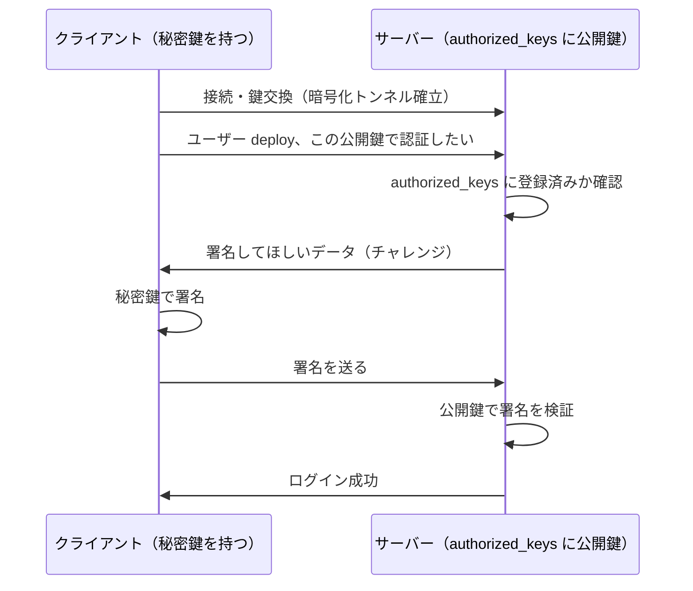
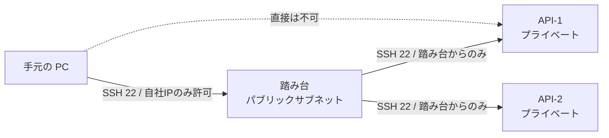
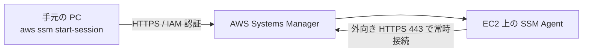

# SSHの安全な運用

[[MOC_サーバー・インフラ体系|📚 目次]] ｜ [[01_サーバーセキュリティの基本|← 前へ]] ｜ [[03_ファイアウォールとネットワーク制御|次へ →]]

> [!abstract] この記事で分かること
> - 公開鍵認証がパスワードより安全な理由と、その仕組み
> - ed25519 鍵の作り方・配置方法と、Ubuntu 24.04 での sshd の推奨設定
> - `~/.ssh/config` と踏み台サーバー（ProxyJump）の使い方
> - ポート番号変更の効果と限界、そして「SSH を開けない」運用（AWS SSM Session Manager）
> - 鍵の管理と失効（退職者・漏えい時の対応）
>
> **前提**：[[01_サーバーセキュリティの基本]] と [[04_Linuxサーバーの基本]] を読んでいると理解しやすいです。

## 1. ひとことで言うと

SSH（Secure Shell）はサーバーの「玄関」です。玄関の鍵が**暗証番号（パスワード）**だと、泥棒は何万回でも番号を試せます。一方**物理的な鍵（公開鍵認証）**なら、鍵そのものを盗まない限り開けられません。

安全な SSH 運用の要点は次の 3 つです。

- **パスワードを捨てて鍵だけにする**（総当たりを無意味にする）
- **入れる人を絞る**（root 禁止・特定ユーザーのみ・接続元 IP の制限）
- **できれば玄関自体をなくす**（SSM Session Manager などでポート 22 を閉じる）

## 2. 公開鍵認証の仕組み

SSH の接続は大きく 2 段階に分かれます。[[SSHの仕組み]] で紹介されているとおり、まず**鍵交換で暗号化トンネルを作り**、次に**その中で「あなたは誰か」を確認**します。

- **鍵交換**：クライアントとサーバーが公開情報だけをやり取りして、双方で同じ使い捨ての**セッション鍵**を計算します。以降の通信はこの鍵で暗号化されます。
- **ユーザー認証**：パスワード認証か公開鍵認証で本人確認をします。

公開鍵認証では、手元で**鍵ペア**（秘密鍵と公開鍵）を作り、**公開鍵だけ**をサーバーの `~/.ssh/authorized_keys` に置きます。



ポイントは、**秘密鍵もパスワードもネットワークを流れない**ことです。サーバーが盗まれても公開鍵しか置いていないので、他のサーバーに入られることはありません。総当たりで「正しい秘密鍵」を当てることも現実的に不可能です。

| | パスワード認証 | 公開鍵認証 |
|---|---|---|
| 総当たり攻撃 | 弱いパスワードなら破られる | 事実上不可能 |
| フィッシング・使い回し | 他サービスで漏れたら終わり | 秘密鍵がサーバーに渡らない |
| サーバー側に保存するもの | パスワードハッシュ | 公開鍵（漏れても無害） |
| 弱点 | 人間が覚えられる強度しかない | 秘密鍵ファイルの管理が必要 |

> [!note] EC2 の `.pem` の正体
> EC2 作成時にダウンロードする `.pem` ファイルは**秘密鍵**です。AWS は対応する公開鍵をインスタンスの `authorized_keys` に入れています。GitHub に SSH で push するのも同じ仕組みです。

## 3. 鍵の作成と配置

### 3.1 ed25519 鍵を作る

2026 年時点で新しく作るなら **ed25519**（楕円曲線暗号の一種）が推奨です。RSA より鍵が短く高速で、安全性も十分です（古い機器との互換が必要な場合のみ RSA 3072bit 以上）。

```bash
# 手元の PC で実行
ssh-keygen -t ed25519 -C "taro@laptop-2026"
# 保存先: ~/.ssh/id_ed25519（秘密鍵）, ~/.ssh/id_ed25519.pub（公開鍵）
# パスフレーズを必ず設定する（PC が盗まれても秘密鍵を使われないため）
```

`-C` のコメントは「誰の、どの端末の鍵か」が後から分かるように付けます。鍵の棚卸しや失効のときに効いてきます。パスフレーズを毎回打つのが面倒なら `ssh-agent`（macOS ならキーチェーン連携）を使います。

### 3.2 サーバーに公開鍵を置く

```bash
# パスワードログインがまだ使える初期段階なら
ssh-copy-id -i ~/.ssh/id_ed25519.pub deploy@203.0.113.10

# 手作業で置く場合（サーバー側で）
mkdir -p ~/.ssh
chmod 700 ~/.ssh
echo "ssh-ed25519 AAAAC3Nza... taro@laptop-2026" >> ~/.ssh/authorized_keys
chmod 600 ~/.ssh/authorized_keys
```

パーミッションは重要です。`~/.ssh` やホームディレクトリが他ユーザーから書き込める状態だと、sshd は安全でないと判断して**公開鍵認証を拒否**します（`StrictModes yes` が既定）。「鍵を置いたのに入れない」ときはまずここを疑います。

クラウドでは、インスタンス作成時に cloud-init が公開鍵を自動で配置してくれるので、Terraform などで鍵を指定しておくのが一般的です（[[03_Terraform入門]]）。

## 4. sshd_config の推奨設定

### 4.1 Ubuntu 24.04 の設定ファイル構成

Ubuntu の `/etc/ssh/sshd_config` は**先頭に** `Include /etc/ssh/sshd_config.d/*.conf` があり、追加設定はこのディレクトリに置くのが推奨です。本体を直接いじらないので、パッケージ更新時の衝突も避けられます。

注意点が 1 つあります。sshd は**同じ項目が複数回出てきたら、最初に読んだ値を採用**します。`sshd_config.d/` 内のファイルは名前順に読まれ、しかも本体より先に読まれます。

```
/etc/ssh/sshd_config
  ├─ Include sshd_config.d/*.conf   ← 先に読まれる（名前順）
  │    ├─ 01-hardening.conf          ← 自分の設定（番号を若くする）
  │    └─ 50-cloud-init.conf         ← クラウドイメージが自動生成することがある
  └─ （本体の残りの設定）             ← 上で決まった項目は無視される
```

クラウドのイメージでは `50-cloud-init.conf` に `PasswordAuthentication yes` などが書かれていることがあります。自分の設定ファイルを `99-...conf` のような名前にすると、**先に読まれた 50 番の値が勝ってしまう**ので、`01-` のように若い番号を付けます。

### 4.2 推奨設定

```bash
sudo tee /etc/ssh/sshd_config.d/01-hardening.conf > /dev/null <<'EOF'
# パスワード系の認証を無効化し、公開鍵のみ許可
PasswordAuthentication no
KbdInteractiveAuthentication no
PubkeyAuthentication yes
AuthenticationMethods publickey

# root で直接ログインさせない
PermitRootLogin no

# ログインできるユーザーを限定（複数はスペース区切り）
AllowUsers deploy taro

# 総当たり・放置接続の抑制
MaxAuthTries 3
LoginGraceTime 30

# 不要な機能を切る（使うなら個別に有効化）
X11Forwarding no
AllowAgentForwarding no
EOF
```

| 項目 | 意味 | なぜ |
|---|---|---|
| `PasswordAuthentication no` | パスワード認証を禁止 | 総当たり攻撃を無意味にする |
| `KbdInteractiveAuthentication no` | キーボード対話型認証を禁止 | パスワード入力の抜け道を塞ぐ |
| `PermitRootLogin no` | root の直接ログイン禁止 | 全ボットが狙う名前。誰が操作したか記録にも残らない |
| `AllowUsers` | 許可ユーザーを列挙 | アプリ用ユーザー等がログインに使われるのを防ぐ |
| `MaxAuthTries 3` | 1 接続あたりの認証試行回数 | 総当たりの速度を落とす |
| `LoginGraceTime 30` | 認証完了までの猶予（秒） | 中途半端な接続で資源を占有されない |

`AllowUsers` の代わりに `AllowGroups sshusers` としてグループで管理する方法もあります。人の出入りが多いならグループの方が管理しやすいです。

### 4.3 締め出されないための手順

設定を誤ると**自分も入れなくなります**。次の手順を必ず守ります。

```bash
# 1. 文法チェック（何も出力されなければ OK）
sudo sshd -t

# 2. 実際に効いている設定値を確認
sudo sshd -T | grep -Ei 'passwordauthentication|permitrootlogin|allowusers'

# 3. 反映（Ubuntu のサービス名は sshd ではなく ssh）
sudo systemctl restart ssh

# 4. 今の SSH セッションは閉じずに、別ターミナルから新しくログインできるか試す
ssh deploy@203.0.113.10
```

既存の接続は再起動しても切れないので、**新しい接続が成功するまで元のセッションを閉じない**のが鉄則です。クラウドならシリアルコンソールや SSM（後述）を「最後の命綱」として用意しておくとさらに安心です。

## 5. ~/.ssh/config と踏み台（ProxyJump）

### 5.1 ~/.ssh/config で接続を楽にする

毎回 `ssh -i ~/.ssh/id_ed25519 -p 22 deploy@203.0.113.10` と打つのは大変でミスの元です。手元の `~/.ssh/config` に書いておきます。

```
# ~/.ssh/config（手元の PC）
Host shop-bastion
    HostName 203.0.113.10
    User deploy
    IdentityFile ~/.ssh/id_ed25519
    IdentitiesOnly yes

Host shop-api-1
    HostName 10.0.2.11          # プライベート IP
    User deploy
    IdentityFile ~/.ssh/id_ed25519
    IdentitiesOnly yes
    ProxyJump shop-bastion      # 踏み台経由で接続
```

`IdentitiesOnly yes` は「指定した鍵だけを使う」設定です。ssh-agent に鍵が多数あると全部試して `MaxAuthTries` に引っかかることがあるため付けておきます。

### 5.2 踏み台サーバー（Bastion）

Shop を [[05_高可用性と冗長化]] のように API 2 台 + DB の構成にすると、API や DB はプライベートサブネットに置き、インターネットから直接入れないようにします。そこへ入るための唯一の入口が**踏み台（bastion host / jump host）**です。



```bash
ssh shop-api-1               # config の ProxyJump で自動的に踏み台経由
ssh -J shop-bastion deploy@10.0.2.11   # config なしで同じことをする場合
```

`ProxyJump` は踏み台上に秘密鍵を置かずに済む点が重要です。昔よく見た「踏み台に秘密鍵をコピーして、そこからさらに ssh する」やり方や、`ForwardAgent yes`（エージェント転送）は、踏み台が乗っ取られたときに鍵を悪用されるので避けます。

DB に GUI ツールでつなぎたいときは、[[SSHの仕組み]] で紹介されているポートフォワーディングが使えます。

```bash
# 手元の 15432 → 踏み台経由 → DB サーバーの 5432
ssh -N -L 15432:10.0.3.20:5432 shop-bastion
# 別ターミナルで psql -h localhost -p 15432 ...
```

## 6. ポート変更の効果と限界

SSH を 22 番から 2222 番などに変えるのはよく紹介される対策ですが、**効果は限定的**です。

- ✅ **効果**：22 番だけを狙う雑なボットのログイン試行が激減し、ログが静かになる
- ❌ **限界**：ポートスキャンをすれば数秒で見つかる。認証の強さは何も変わらない（いわゆる「隠すことによるセキュリティ」）
- ⚠️ **副作用**：ファイアウォール・SG・`~/.ssh/config`・Ansible の設定を全部合わせる必要があり、変更漏れで締め出されやすい

鍵認証にした時点で総当たりは成功しないので、ポート変更は「ログのノイズを減らす」程度の位置づけです。やるとしても鍵認証・root 禁止の**後**です。

> [!warning] Ubuntu 24.04 ではポート変更の手順が違う
> Ubuntu 22.10 以降は sshd が **systemd のソケット起動（ssh.socket）** で動いており、待ち受けポートは sshd ではなく **ssh.socket 側**が持っています。24.04 では `sshd-socket-generator` が `sshd_config`（と `sshd_config.d/`）の `Port` / `ListenAddress` を読んで ssh.socket の設定を生成するため、`Port` を変えて `systemctl restart ssh` しただけでは**待ち受けポートは変わりません**。次の順で反映します。
> ```bash
> sudo ufw allow 2222/tcp             # 先に新ポートを開ける（SG も同様）
> sudo sshd -t
> sudo systemctl daemon-reload        # ソケット設定を再生成
> sudo systemctl restart ssh.socket   # 新ポートで待ち受け直す
> sudo ss -tlnp | grep -E ':22|:2222' # 実際の待ち受けを確認
> ```
> ポート以外の設定（`PasswordAuthentication` など）は、4.3 節のとおり `systemctl restart ssh`（または `reload ssh`）で反映されます。

## 7. SSH を開けない運用：AWS SSM Session Manager

最も強い対策は、**SSH のポートをインターネットに一切開けない**ことです。AWS では **Systems Manager Session Manager**（SSM）を使うと、インバウンドのポートを 1 つも開けずにシェル操作ができます。



インスタンス側の SSM Agent が**外向きに** AWS へ接続しに行く仕組みなので、セキュリティグループのインバウンドは空で構いません。

| 項目 | SSH + 踏み台 | SSM Session Manager |
|---|---|---|
| 開けるポート | 22（踏み台） | なし |
| 認証 | SSH 鍵 | IAM（MFA と組み合わせ可能） |
| 鍵の配布・失効 | 自分で管理 | IAM ユーザー/ロールの権限で管理 |
| 操作ログ | 自前で仕組みが必要 | CloudWatch Logs / S3 にセッション記録を保存可能 |
| 前提 | — | SSM Agent（Ubuntu の公式 AMI には導入済み）、インスタンスに `AmazonSSMManagedInstanceCore` 権限の IAM ロール、AWS への外向き通信（または VPC エンドポイント） |

```bash
# 手元に AWS CLI と Session Manager プラグインを入れて
aws ssm start-session --target i-0123456789abcdef0
```

`scp` やポートフォワーディングが必要なら、SSH 自体を SSM の上に通す方法（`~/.ssh/config` の `ProxyCommand` で `AWS-StartSSHSession` を使う）もあります。他のクラウドにも同様の仕組み（GCP の IAP TCP フォワーディング、Azure Bastion など）があります。

## 8. 鍵の管理と失効

鍵認証は「鍵を持っている人＝本人」なので、**鍵の管理がそのまま入館証の管理**になります。

- **1 人 1 鍵、端末ごとに 1 鍵**：共有鍵（チーム全員が同じ `.pem`）は、誰が操作したか分からず、1 人辞めたら全員の鍵を替える羽目になります。
- **秘密鍵にはパスフレーズ**：PC の紛失・マルウェア対策。
- **定期的な棚卸し**：`authorized_keys` に知らない鍵、退職者の鍵がないか。コメント（`-C`）がここで役立ちます。
- **配布はコードで**：Ansible の `authorized_key` モジュールなどで「あるべき鍵の一覧」を管理し、手作業の追加を許さない（[[04_構成管理とAnsible]]）。

鍵が漏れた・人が辞めたときは**すぐに失効**させます。

```bash
# 1. 全サーバーの authorized_keys から該当鍵を削除（Ansible で state: absent が確実）
# 2. 念のため sshd 側でも拒否リストに入れる
echo "ssh-ed25519 AAAAC3Nza... former@laptop" | sudo tee -a /etc/ssh/revoked_keys
echo "RevokedKeys /etc/ssh/revoked_keys" | sudo tee /etc/ssh/sshd_config.d/02-revoked.conf
sudo sshd -t && sudo systemctl restart ssh
# 3. その鍵でログインされた形跡がないか auth.log を確認（→ 05_ログ監査と侵入の検知）
```

サーバー台数や人数が増えてきたら、**SSH 証明書**（CA が有効期限付きで鍵に署名し、サーバーは CA だけを信頼する方式）や、前節の SSM のように「鍵をそもそも配らない」方式を検討します。

## よくある誤解・つまずき

- ❌ **「ポートを 2222 に変えたから安全」** → ✅ スキャンですぐ見つかります。安全性を決めるのは鍵認証・root 禁止・接続元制限です。
- ❌ **「`sshd_config` の末尾に `PasswordAuthentication no` を書いたのに効かない」** → ✅ 最初に読んだ値が優先です。`sshd_config.d/50-cloud-init.conf` の値が先に効いていないか、`sudo sshd -T` で確認しましょう。
- ❌ **「設定変更後すぐにログアウトして確認」** → ✅ 誤設定なら締め出されます。今のセッションを残したまま、別ターミナルで新規ログインを試します。
- ❌ **「チームで 1 つの .pem を共有すれば楽」** → ✅ 誰が操作したか追えず、失効もできません。1 人 1 鍵が原則です。
- ❌ **「踏み台に秘密鍵を置けば便利」** → ✅ 踏み台が乗っ取られたら全サーバーが危険です。`ProxyJump` を使えば踏み台に鍵は不要です。

## まとめ

- 公開鍵認証は秘密鍵もパスワードもネットワークに流さず、総当たりを事実上不可能にする
- 新規鍵は ed25519 + パスフレーズ、`~/.ssh` は 700・`authorized_keys` は 600
- Ubuntu 24.04 では `sshd_config.d/01-hardening.conf` に書き、`PasswordAuthentication no`・`PermitRootLogin no`・`AllowUsers` を設定。最初に読まれた値が勝つ点に注意
- 変更時は `sshd -t` → 再起動 → 別ターミナルで確認、既存セッションは閉じない
- 内部サーバーへは `ProxyJump` で踏み台経由、さらに進めて SSM Session Manager でポート 22 を閉じる
- 鍵は 1 人 1 鍵・コードで配布・退職時は即失効

## 確認クイズ

1. `/etc/ssh/sshd_config.d/99-hardening.conf` に `PasswordAuthentication no` と書いたのに、パスワードでログインできてしまいます。考えられる原因と確認方法は？
> [!tip]- 答え
> `sshd_config.d/` 内のファイルは名前順に読まれ、同じ項目は最初に読んだ値が採用されます。`50-cloud-init.conf` に `PasswordAuthentication yes` があると、99 番より先に読まれてそちらが勝ちます。`sudo sshd -T | grep -i passwordauthentication` で実際の値を確認し、自分のファイルを `01-` などの若い番号にします。

2. 踏み台サーバー経由で API サーバーに入るとき、踏み台に秘密鍵をコピーする方法と `ProxyJump` を使う方法では、セキュリティ上どんな違いがありますか？
> [!tip]- 答え
> 秘密鍵をコピーすると、踏み台が侵入された際にその鍵を盗まれ、API サーバーなど他のサーバーにも入られます。`ProxyJump` は踏み台を単なる通り道として使い、認証は手元の秘密鍵で直接行うため、踏み台に鍵を置く必要がありません。

3. SSM Session Manager を使うと、セキュリティグループのインバウンドでポート 22 を開けなくてもシェル操作できるのはなぜですか？
> [!tip]- 答え
> インスタンス上の SSM Agent が AWS の Systems Manager に**外向き（HTTPS 443）**で接続し、その接続を通じて操作が届くからです。外から内への接続を受け付ける必要がないため、インバウンドを空にできます。認証は IAM で行い、操作ログも保存できます。

## 関連ノート

- [[SSHの仕組み]] — 鍵交換・公開鍵認証・ポートフォワーディングの概要（クリップ）
- [[01_サーバーセキュリティの基本]] — 攻撃面の縮小と最小権限
- [[03_ファイアウォールとネットワーク制御]] — SSH を接続元 IP で絞る、SG の設計
- [[04_OSのハードニングとパッチ管理]] — fail2ban、sudo とユーザー管理
- [[05_ログ監査と侵入の検知]] — auth.log でログイン履歴を追う
- [[04_構成管理とAnsible]] — 鍵の配布と sshd 設定をコード化する
- [[MOC_認証認可]] — 認証方式の一般論

## 参考

- [Ubuntu Server docs - OpenSSH server](https://ubuntu.com/server/docs/how-to/security/openssh-server/)
- [SSHd now uses socket-based activation (Ubuntu 22.10 and later)（Ubuntu Discourse）](https://discourse.ubuntu.com/t/sshd-now-uses-socket-based-activation-ubuntu-22-10-and-later/30189)
- [OpenBSD manual - sshd_config(5)](https://man.openbsd.org/sshd_config)
- [OpenBSD manual - ssh_config(5)（ProxyJump）](https://man.openbsd.org/ssh_config)
- [OpenBSD manual - ssh-keygen(1)](https://man.openbsd.org/ssh-keygen)
- [AWS Systems Manager Session Manager](https://docs.aws.amazon.com/systems-manager/latest/userguide/session-manager.html)
- [Session Manager で SSH 接続を許可する](https://docs.aws.amazon.com/systems-manager/latest/userguide/session-manager-getting-started-enable-ssh-connections.html)
