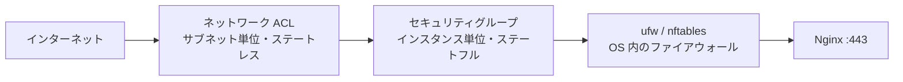
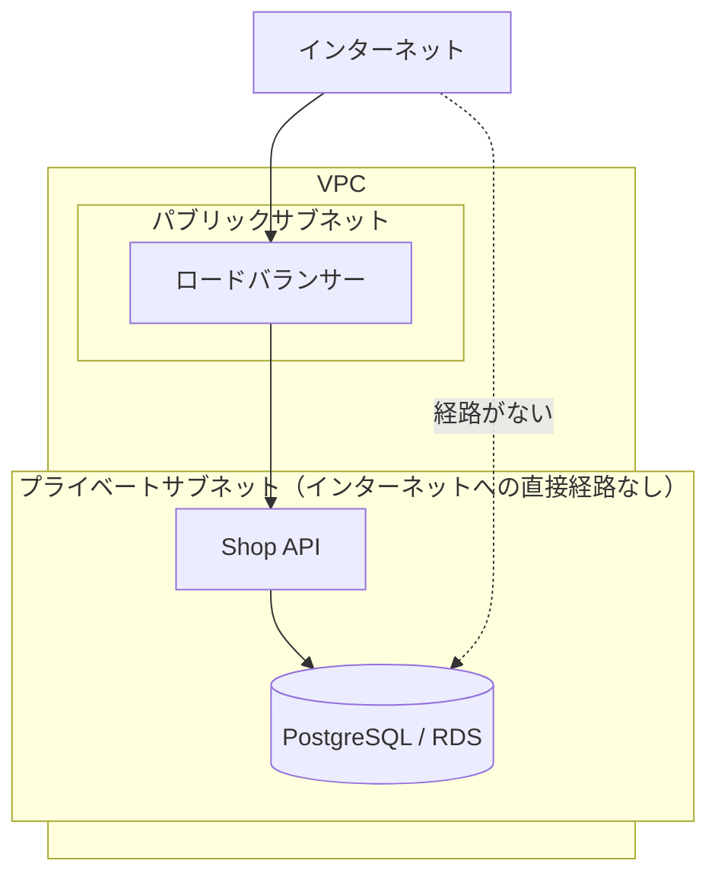

# ファイアウォールとネットワーク制御

[[MOC_サーバー・インフラ体系|📚 目次]] ｜ [[02_SSHの安全な運用|← 前へ]] ｜ [[04_OSのハードニングとパッチ管理|次へ →]]

> [!abstract] この記事で分かること
> - 「開けるポートを最小に」の考え方と、Shop で開けるべきポート
> - ufw の基本操作（default deny、allow、status）と iptables / nftables との関係
> - クラウドのセキュリティグループとネットワーク ACL の違い（ステートフル / ステートレス）
> - DB をインターネットに出さない構成と、Docker が ufw を迂回する落とし穴
> - `ss` と `nmap` で自分のサーバーの公開ポートを確認する方法
>
> **前提**：[[05_ネットワークの基本（IP・ポート・DNS）]] と [[01_サーバーセキュリティの基本]] を読んでいると理解しやすいです。

## 1. ひとことで言うと

ファイアウォールは**建物の受付**です。「配達業者（HTTP/HTTPS）は正面玄関から入ってよい」「社員（SSH）は通用口から、社員証のある人だけ」「金庫室（DB）には外から直接行けない」というルールを決め、それ以外は全部追い返します。

基本方針はたった 1 つ、**「原則すべて拒否し、必要なものだけ許可する」（default deny）**です。Shop なら外に開けるのは次の 3 つだけです。

| ポート | 用途 | 誰に開けるか |
|---|---|---|
| 22/tcp | SSH | 管理者の IP だけ（できれば SSM で閉じる） |
| 80/tcp | HTTP（HTTPS へのリダイレクト・証明書取得） | 全世界 |
| 443/tcp | HTTPS | 全世界 |

Shop API の 3000 番、PostgreSQL の 5432 番は**外に開けません**。Nginx が 443 で受けて 3000 に転送するので（[[03_リバースプロキシ]]）、外から 3000 に直接来る理由はないからです。

## 2. 防御の層：クラウドとサーバーの 2 段構え

クラウドのサーバーには、通信が届くまでに**複数の関所**があります。



外側（クラウド）で止めればサーバーに負荷すらかからず、内側（OS）で止めればクラウド設定のミスをカバーできます。**両方を設定するのが多層防御**です。VPS など SG のない環境では ufw が主役になります。

## 3. ufw の使い方

### 3.1 ufw・iptables・nftables の関係

Linux のパケットフィルタリングの本体はカーネルの **netfilter** です。それを操作するツールが何層かあります。

```
  ufw（Uncomplicated Firewall）  ← 人間向けの簡単なコマンド（Ubuntu 標準）
       │ ルールを変換
  iptables コマンド              ← 従来からある低レベルのルール記述
       │ Ubuntu 24.04 では iptables-nft（nftables 互換層）として動作
  nftables                       ← iptables の後継となる新しい仕組み
       │
  netfilter（カーネル）           ← 実際にパケットを止める・通す
```

初心者は **ufw だけを触る**のが安全です。ufw と手書きの iptables / nftables ルールを混在させると、どのルールが効いているか分からなくなります。RHEL 系では ufw ではなく `firewalld` が標準です。

### 3.2 基本の設定手順

```bash
# 1. 既定のポリシー：入ってくる通信は拒否、出ていく通信は許可
sudo ufw default deny incoming
sudo ufw default allow outgoing

# 2. SSH を先に許可する（これを忘れて enable すると締め出される）
sudo ufw allow from 198.51.100.24 to any port 22 proto tcp   # 管理者の固定 IP のみ
# 固定 IP がない場合は全体に開けつつ回数制限（30 秒に 6 回以上で拒否）
# sudo ufw limit 22/tcp

# 3. Web を許可
sudo ufw allow 80/tcp
sudo ufw allow 443/tcp

# 4. 有効化
sudo ufw enable

# 5. 確認
sudo ufw status verbose
```

```
Status: active
Logging: on (low)
Default: deny (incoming), allow (outgoing), deny (routed)

To                         Action      From
--                         ------      ----
22/tcp                     ALLOW IN    198.51.100.24
80/tcp                     ALLOW IN    Anywhere
443/tcp                    ALLOW IN    Anywhere
80/tcp (v6)                ALLOW IN    Anywhere (v6)
443/tcp (v6)               ALLOW IN    Anywhere (v6)
```

### 3.3 よく使う操作

```bash
sudo ufw status numbered          # 番号付きで一覧
sudo ufw delete 3                 # 3 番のルールを削除
sudo ufw allow 'Nginx Full'       # アプリプロファイル（80+443）で許可
sudo ufw app list                 # 利用できるプロファイル一覧
sudo ufw allow from 10.0.2.0/24 to any port 5432 proto tcp  # API のサブネットからだけ DB を許可
sudo ufw reload
```

> [!warning] SSH 接続中に ufw を有効にするとき
> SSH の許可ルールを入れる前に `ufw enable` すると、次の接続から入れなくなります（既存接続も切れる場合があります）。クラウドならシリアルコンソールや SSM で復旧できますが、VPS ではコントロールパネルのコンソール頼みになります。**必ず「SSH の allow → enable → 別ターミナルで接続確認」の順**にします。

## 4. クラウドのセキュリティグループとネットワーク ACL

AWS には 2 種類のネットワーク制御があります。

| | セキュリティグループ（SG） | ネットワーク ACL（NACL） |
|---|---|---|
| 適用単位 | インスタンス（ENI）ごと | サブネットごと |
| 状態 | **ステートフル** | **ステートレス** |
| ルール | 許可（allow）のみ | 許可と拒否（deny） |
| 評価 | 全ルールを見て 1 つでも許可なら通す | ルール番号の小さい順に評価し、最初に一致したもので決定 |
| 主な使い道 | 普段の通信制御の主役 | 特定 IP 帯の一括拒否などの補助 |

### 4.1 ステートフルとステートレス

**ステートフル（stateful）**とは「行きの通信を覚えている」ことです。SG で 443 のインバウンドを許可すれば、その**返事（レスポンス）は自動で通ります**。

**ステートレス（stateless）**な NACL は通信を覚えていません。443 のインバウンドを許可しても、返事はクライアント側の**エフェメラルポート**（一時的に使われる 1024〜65535 番あたりのポート）宛てに出ていくので、**アウトバウンドにもそのための許可が必要**です。NACL の設定でよくある「入れるのに応答が返らない」はこれが原因です。

```
クライアント :52311  ──→  サーバー :443     （インバウンド：443 を許可）
クライアント :52311  ←──  サーバー :443     （アウトバウンド：宛先 52311 を許可する必要あり）
                                              SG は自動で許可／NACL は明示的に許可が必要
```

既定の NACL は全許可なので、まずは **SG だけをしっかり設計**し、NACL はデフォルトのままにするのが初心者には安全です。

### 4.2 Shop の SG 設計

SG は**別の SG をルールの送信元に指定できる**のが強力です。IP アドレスではなく「役割」で許可できるので、API サーバーが増えても設定を変える必要がありません。

| SG 名 | インバウンド許可 | 送信元 |
|---|---|---|
| `sg-alb` | 80, 443 | `0.0.0.0/0` |
| `sg-api` | 3000 | `sg-alb`（ロードバランサーからだけ） |
| `sg-db` | 5432 | `sg-api`（API サーバーからだけ） |
| `sg-bastion` | 22 | 管理者の IP `/32`（SSM を使うなら SG ごと不要） |

Terraform で書くと次のようになります（[[03_Terraform入門]]）。

```hcl
resource "aws_security_group_rule" "db_from_api" {
  type                     = "ingress"
  from_port                = 5432
  to_port                  = 5432
  protocol                 = "tcp"
  security_group_id        = aws_security_group.db.id
  source_security_group_id = aws_security_group.api.id
}
```

## 5. DB ポートを外に出さない

インターネット上には、公開された PostgreSQL・MySQL・Redis・MongoDB を探すボットが常に動いています。[[MySQLはセキュリティが弱いのか]] でも、事故の原因として `bind-address` の設定ミスやセキュリティグループの誤りで DB ポートが公開されてしまう例が挙げられています。DB は**3 重に閉じます**。



1. **ネットワーク**：DB はプライベートサブネットに置き、パブリック IP を付けない（RDS なら「パブリックアクセス：なし」）
2. **SG**：5432 番は `sg-api` からだけ許可
3. **DB 自身**：待ち受けアドレスと接続元を限定する

```bash
# PostgreSQL：同一サーバーなら localhost のみで待ち受け（既定値）
# /etc/postgresql/16/main/postgresql.conf
listen_addresses = 'localhost'
# 別サーバーにした場合はプライベート IP のみ
# listen_addresses = '10.0.3.20'

# /etc/postgresql/16/main/pg_hba.conf：API サブネットからだけ、パスワード（SCRAM）必須
host  shop  shop_app  10.0.2.0/24  scram-sha-256
```

DB に手元から GUI でつなぎたいときは、ポートを開けるのではなく SSH トンネルや SSM のポートフォワーディングを使います（[[02_SSHの安全な運用]]）。DB 設定の詳細は [[06_データベースサーバーの運用]] を参照してください。

## 6. Docker が ufw を迂回する問題

Docker を使うサーバーで非常によくある事故です。

```bash
docker run -d -p 5432:5432 postgres:16
sudo ufw status   # 5432 は許可していない…はずなのに
```

この状態で、**外部から 5432 番に接続できてしまいます**。Docker は公開ポート（`-p`）のために iptables の **nat テーブル**でパケットの宛先を書き換えます。この処理は ufw が見ている INPUT チェーンより**前**に行われ、転送された通信は FORWARD チェーン側を通るため、ufw の「deny incoming」が効きません。Docker の公式ドキュメントでも、ufw と併用した場合にコンテナ宛ての通信が ufw の設定を通らずに転送されると明記されています。

対策は次のとおりです（上から順におすすめ）。

| 対策 | 方法 | 補足 |
|---|---|---|
| **localhost にだけ公開** | `-p 127.0.0.1:5432:5432`（Compose なら `"127.0.0.1:5432:5432"`） | 同じサーバーの Nginx からだけ使うならこれで十分 |
| **そもそも公開しない** | `-p` を付けず、Docker ネットワーク内でサービス名で通信 | API と DB を同じ Compose ネットワークに置く |
| **クラウドの SG で止める** | SG で 5432 を開けない | OS の外で止まるので Docker の影響を受けない |
| **DOCKER-USER チェーン** | Docker が用意する、ユーザー用ルールの差し込み口に拒否ルールを書く | 上級者向け。ルール設計を誤りやすい |

```yaml
# compose.yaml：Shop API は Nginx（ホスト側）からだけ使うので localhost に限定
services:
  api:
    image: shop-api:1.4.0
    ports:
      - "127.0.0.1:3000:3000"
  db:
    image: postgres:16
    # ports は書かない（api からはサービス名 db:5432 で接続）
```

コンテナを本番で使う際の注意は [[本番向けベストプラクティス]] や [[09-Docker]] も参照してください。

## 7. 自分のサーバーの公開ポートを確認する

「設定したつもり」ではなく、**実際にどこが開いているか**を内側と外側の両方から確認します。

### 7.1 内側から：ss

```bash
sudo ss -tlnp
# -t TCP  -l 待ち受け中  -n 数字で表示  -p プロセス名も表示
```

```
State  Local Address:Port  Process
LISTEN 0.0.0.0:22          users:(("sshd",pid=812),("systemd",pid=1))
LISTEN 0.0.0.0:80          users:(("nginx",pid=1020))
LISTEN 0.0.0.0:443         users:(("nginx",pid=1020))
LISTEN 127.0.0.1:3000      users:(("node",pid=1544))
LISTEN 127.0.0.1:5432      users:(("postgres",pid=901))
```

読み方のポイントは **Local Address** です。

- `0.0.0.0` / `[::]` … 全インターフェースで待ち受け＝外から届く可能性がある（ファイアウォール次第）
- `127.0.0.1` / `[::1]` … 自分自身からしか届かない＝安全

上の例は理想的な状態です。もし `0.0.0.0:5432` や `0.0.0.0:3000` があれば、まず待ち受けアドレスを直します。UDP も見るなら `ss -ulnp` を使います。

### 7.2 外側から：nmap

手元の PC など**サーバーの外**から、攻撃者と同じ視点でスキャンします。

```bash
# 自分が管理するサーバーにだけ実行すること
nmap -Pn -p- shop.example.com          # 全 65535 ポートを TCP スキャン
nmap -Pn -sV -p 22,80,443 shop.example.com   # バージョン情報も取得
```

```
PORT    STATE    SERVICE
22/tcp  filtered ssh
80/tcp  open     http
443/tcp open     https
```

`open` は接続できる、`filtered` はファイアウォールで黙って捨てられている、`closed` は届くが何も待ち受けていない、という意味です。期待するのは **80/443 だけが open** の状態です。

> [!warning] スキャンは自分の管理下だけに
> 他人のサーバーへの無断ポートスキャンは、不正アクセスの準備行為とみなされたり、利用規約違反になったりする可能性があります。対象は自分が管理するサーバーに限ってください。クラウド事業者によってはスキャン前のルール確認が必要です。

## よくある誤解・つまずき

- ❌ **「ufw で deny しているから Docker のコンテナも守られている」** → ✅ `-p` で公開したポートは ufw を迂回します。`127.0.0.1:` を付けて公開するか、SG で止めます。
- ❌ **「SG を設定したから OS のファイアウォールは不要」** → ✅ SG の設定ミス・変更に備え、OS 側でも絞るのが多層防御です（VPS には SG がないことも多い）。
- ❌ **「NACL で 443 を許可したのに通信できない」** → ✅ NACL はステートレスなので、応答用のエフェメラルポート宛てのアウトバウンドも許可が必要です。
- ❌ **「ss で LISTEN していれば外から使える／していなければ安全」** → ✅ LISTEN は待ち受けているだけで、外から届くかはファイアウォール次第です。外側からの `nmap` と組み合わせて判断します。
- ❌ **「DB は強いパスワードを付けたから公開しても平気」** → ✅ DB ソフトの脆弱性やログイン試行の負荷に晒されます。DB は経路ごと閉じるのが原則です。

## まとめ

- 方針は default deny。Shop で外に開けるのは 22（管理者のみ）・80・443 だけ
- ufw は `default deny incoming` → SSH を allow → `enable` → `status verbose` で確認。裏では nftables が動いている
- SG はステートフルで許可のみ、NACL はステートレスでエフェメラルポートにも注意。SG は「SG を送信元に指定」して役割で許可する
- DB はプライベートサブネット・SG・`listen_addresses` の 3 重で閉じる
- Docker の `-p` は ufw を迂回するので `127.0.0.1:` を付けて公開する
- `ss -tlnp`（内側）と `nmap`（外側）で、実際に開いているポートを定期的に確認する

## 確認クイズ

1. Shop サーバーで `ss -tlnp` を実行したら `0.0.0.0:3000 node` と表示されました。ufw では 3000 番を許可していません。直すべきですか？
> [!tip]- 答え
> 直すべきです。今は ufw で守られていても、ufw を無効化したり設定を誤ったりすると即座に公開されます。Node.js は Nginx からしか使わないので、`127.0.0.1` で待ち受けるようにアプリの設定（listen するホスト）を変えるのが多層防御として正しい対応です。

2. `sg-db` のインバウンドに「5432 番、送信元 `sg-api`」と設定するのは、「5432 番、送信元 `10.0.2.11/32` と `10.0.2.12/32`」と設定するのと比べて何が良いですか？
> [!tip]- 答え
> API サーバーをオートスケーリングなどで増減させても、SG が付いていれば自動で許可対象になり、IP を書き換える必要がありません。役割で許可するので設定漏れや古い IP の消し忘れも起きにくくなります。

3. `docker run -p 6379:6379 redis` で起動した Redis が外部から読めてしまいました。ufw は `default deny incoming` です。なぜですか？どう直しますか？
> [!tip]- 答え
> Docker が iptables の nat テーブルで宛先を書き換え、通信が ufw の INPUT チェーンを通らずにコンテナへ転送されるためです。`-p 127.0.0.1:6379:6379` のように localhost に限定するか、`-p` を外して Docker ネットワーク内だけで使い、クラウドなら SG でも 6379 を開けないようにします。

## 関連ノート

- [[02_SSHの安全な運用]] — SSH の入口を絞る、SSM でポート 22 を閉じる
- [[04_OSのハードニングとパッチ管理]] — 不要なサービスを止めて待ち受けを減らす
- [[02_ロードバランサーの仕組み]] — ALB を前段に置く構成
- [[06_データベースサーバーの運用]] — DB の接続制限と権限
- [[MySQLはセキュリティが弱いのか]] — bind-address・SG のミスによる DB 公開の事故（クリップ）
- [[09-Docker]] / [[本番向けベストプラクティス]] — コンテナ運用の注意点
- [[MOC_コンピューターサイエンス体系]] — TCP/IP とネットワークの理論

## 参考

- [Ubuntu Server docs - Firewall (ufw)](https://ubuntu.com/server/docs/how-to/security/firewalls/)
- [ufw(8) manual page](https://manpages.ubuntu.com/manpages/noble/man8/ufw.8.html)
- [Docker docs - Packet filtering and firewalls](https://docs.docker.com/engine/network/packet-filtering-firewalls/)
- [AWS - Control traffic to your AWS resources using security groups](https://docs.aws.amazon.com/vpc/latest/userguide/vpc-security-groups.html)
- [AWS - Control subnet traffic with network access control lists](https://docs.aws.amazon.com/vpc/latest/userguide/vpc-network-acls.html)
- [PostgreSQL docs - Connections and Authentication](https://www.postgresql.org/docs/16/runtime-config-connection.html)
- [Nmap Reference Guide](https://nmap.org/book/man.html)
