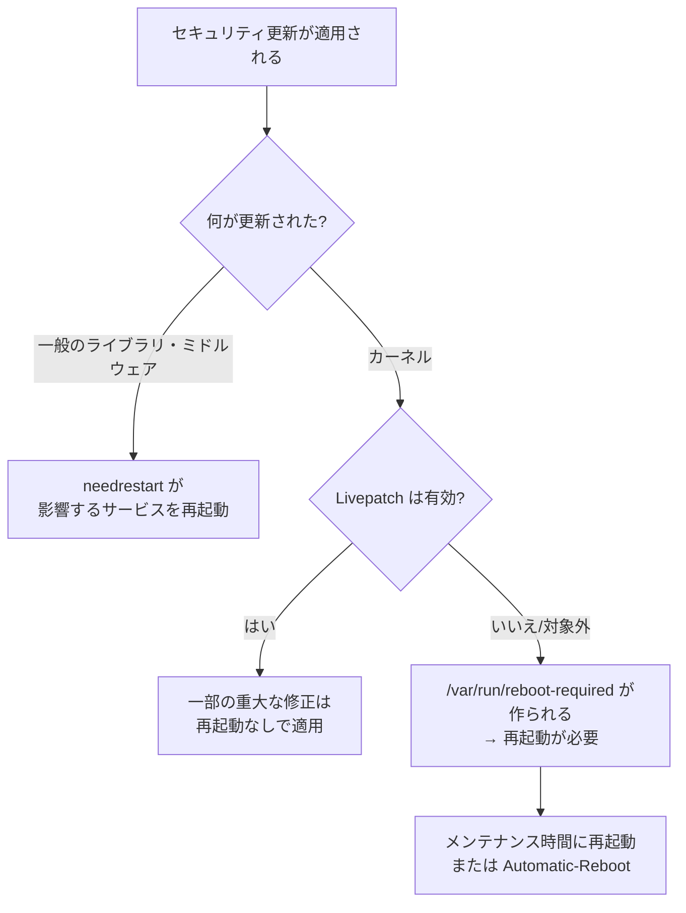
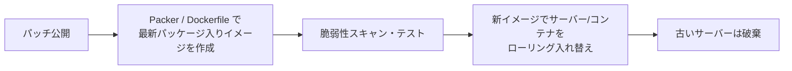

# OSのハードニングとパッチ管理

[[MOC_サーバー・インフラ体系|📚 目次]] ｜ [[03_ファイアウォールとネットワーク制御|← 前へ]] ｜ [[05_ログ監査と侵入の検知|次へ →]]

> [!abstract] この記事で分かること
> - ハードニング（hardening）とは何か、なぜ「減らす」ことが基本なのか
> - 不要なサービス・パッケージの削除、ユーザーと sudo の管理、ファイルパーミッション
> - unattended-upgrades による自動セキュリティ更新と、再起動の扱い（needrestart・Livepatch）
> - fail2ban と sysctl によるカーネルパラメータの代表的な設定
> - CIS Benchmarks・Lynis による自動チェックと、イミュータブルインフラでのパッチの考え方
>
> **前提**：[[04_Linuxサーバーの基本]] と [[02_SSHの安全な運用]] を読んでいると理解しやすいです。

## 1. ひとことで言うと

**ハードニング（hardening）**とは、OS を「固くする」こと、つまり攻撃に使える隙を一つずつ潰していく作業です。引っ越したばかりの家で、使わない勝手口を塞ぎ、合鍵を回収し、古い鍵を最新のものに交換していくイメージです。

OS のハードニングは次の 2 本柱で考えます。

- **減らす**：不要なサービス・パッケージ・ユーザー・権限を削る（攻撃面の縮小）
- **更新し続ける**：脆弱性の修正（パッチ）を素早く、できれば自動で当てる

特に後者が重要です。実際の侵入の多くは、**修正パッチがすでに公開されている既知の脆弱性**を突かれたものです。

## 2. 不要なサービス・パッケージを削る

動いているサービスはそれぞれが攻撃面です。まず「今なにが動いているか」を把握します。

```bash
# 動いているサービスの一覧
systemctl list-units --type=service --state=running

# ネットワークで待ち受けているもの（→ 03_ファイアウォールとネットワーク制御）
sudo ss -tulnp

# 自動起動が有効なもの
systemctl list-unit-files --type=service --state=enabled
```

Shop サーバーで必要なのは、おおむね `ssh`・`nginx`・`shop-api`（自作の systemd ユニット）・`postgresql`・`systemd-journald`・`cron`/タイマー・`unattended-upgrades` などです。用途が分からないものは**すぐ消さずに調べてから**判断します。

```bash
# 不要なサービスを停止し、自動起動も無効にする
sudo systemctl disable --now avahi-daemon.service

# パッケージごと消す（設定ファイルも含めて削除するなら purge）
sudo apt purge telnet
sudo apt autoremove --purge
```

> [!note] クラウドのイメージは最初から絞られている
> Ubuntu Server のクラウドイメージは、デスクトップ版のような不要なサービスはほとんど入っていません。ただし `snapd` は AWS の SSM Agent などが snap で提供されているので、安易に消すと管理手段を失います。「なんとなく消す」のではなく、**何のためのものかを確認してから**消しましょう。

新しいサーバーを作るときは「インストールしてから削る」より「**最初から最小構成で作る**」方が確実です。Ansible や Packer で必要なものだけを入れる構成にしておけば、削り忘れも起きません（[[04_構成管理とAnsible]]）。

## 3. ユーザーと sudo の管理

### 3.1 ユーザーの原則

| 種類 | 例 | ルール |
|---|---|---|
| 人間の管理者 | `taro`, `hanako` | 1 人 1 アカウント。SSH 鍵でログインし、必要時に sudo |
| アプリの実行ユーザー | `shop` | ログインシェルなし（`/usr/sbin/nologin`）、sudo なし |
| root | `root` | 直接ログインさせない（`PermitRootLogin no`） |

```bash
# 管理者ユーザーを作り、sudo グループに追加
sudo adduser taro
sudo usermod -aG sudo taro

# アプリ用のシステムユーザー（ログイン不可、ホームなし）
sudo useradd --system --shell /usr/sbin/nologin --no-create-home shop

# ログイン可能なシェルを持つユーザーを棚卸し
awk -F: '$7 !~ /(nologin|false)$/ {print $1, $7}' /etc/passwd

# 辞めた人のアカウントをロック（削除前の一時措置）
sudo usermod --lock --expiredate 1 hanako
```

共有アカウント（全員が `ubuntu` でログインする等）は、誰が何をしたか追えなくなるので避けます。ログ監査の前提が崩れてしまいます（[[05_ログ監査と侵入の検知]]）。

### 3.2 sudo の設定

sudo の設定は必ず `visudo` で編集します。文法エラーのまま保存すると sudo 自体が使えなくなるため、`visudo` は保存前にチェックしてくれます。

```bash
# 追加設定は /etc/sudoers.d/ に分けて書く
sudo visudo -f /etc/sudoers.d/deploy
```

```
# デプロイ用ユーザーには、Shop API の再起動だけを許可する（最小権限）
deploy ALL=(root) NOPASSWD: /usr/bin/systemctl restart shop-api.service
```

`NOPASSWD: ALL`（パスワードなしで何でもできる）は、そのユーザーの SSH 鍵が漏れた瞬間に root を取られるのと同じです。自動化のためにパスワードなしが必要なら、上の例のように**コマンドを限定**します。

## 4. 自動セキュリティアップデートと再起動

### 4.1 unattended-upgrades

Ubuntu には **unattended-upgrades** が既定でインストールされており、セキュリティ更新が自動で適用されるようになっています。まず有効になっているか確認します。

```bash
# 有効化されているか確認（両方 "1" なら有効）
cat /etc/apt/apt.conf.d/20auto-upgrades
# APT::Periodic::Update-Package-Lists "1";
# APT::Periodic::Unattended-Upgrade "1";

# 無効なら対話的に有効化
sudo dpkg-reconfigure --priority=low unattended-upgrades

# 何が更新されるかを試す（実際には変更しない）
sudo unattended-upgrade -v --dry-run

# 実行ログ
less /var/log/unattended-upgrades/unattended-upgrades.log
```

動作の細かい設定は `/etc/apt/apt.conf.d/50unattended-upgrades` にあります。既定では**セキュリティ更新のみ**（`${distro_codename}-security`）が対象で、通常の機能更新は自動では入りません。この既定のままが無難です。

### 4.2 再起動が必要な更新の扱い

パッケージを更新しても、**すでに動いているプロセスは古いコードのまま**です。ここが見落とされがちなポイントです。



- **needrestart**：更新後、古いライブラリを使い続けているサービスを検出します。Ubuntu 24.04 からは**既定で自動的にサービスを再起動**するようになりました。つまり unattended-upgrades で OpenSSL が更新されると、Nginx などが自動で再起動されます。再起動されると困るサービス（例：単一構成の DB）は `/etc/needrestart/conf.d/` で除外設定ができます。
- **カーネル更新**：カーネルは再起動しないと切り替わりません。再起動が必要になると `/var/run/reboot-required` が作られるので、監視して計画的に再起動します。

```bash
# 再起動が必要か確認
[ -f /var/run/reboot-required ] && cat /var/run/reboot-required.pkgs

# 50unattended-upgrades で深夜に自動再起動させる場合
# Unattended-Upgrade::Automatic-Reboot "true";
# Unattended-Upgrade::Automatic-Reboot-Time "03:00";
```

自動再起動を有効にするかは構成次第です。Shop が API 2 台以上 + ロードバランサーの構成なら、1 台ずつ再起動しても止まりません（[[05_高可用性と冗長化]]）。1 台構成なら、再起動の時間帯をユーザーの少ない時間に決めて手動で行う方が安全です。

- **Livepatch**：Canonical の **Livepatch** を使うと、重大なカーネルの脆弱性修正の一部を再起動なしで適用できます。Ubuntu Pro（2026 年時点で個人利用は少数台まで無料）に登録し `sudo pro enable livepatch` で有効化します。ただし**すべての修正が対象ではない**ため、定期的な再起動が不要になるわけではありません。

### 4.3 サポート期限（EOL）にも注意

パッチは**サポート期間中の OS・ソフトにしか出ません**。[[MySQLはセキュリティが弱いのか]] では、2023 年 10 月にサポートが終了した MySQL 5.7 を「動いているから」と使い続ける危険性が語られています。OS も同様で、Ubuntu LTS の標準サポートは 5 年です（24.04 は 2029 年まで。Ubuntu Pro の ESM で延長可能）。OS・Node.js・PostgreSQL それぞれの EOL を把握し、計画的にバージョンアップしましょう。

## 5. fail2ban：総当たりを自動でブロック

**fail2ban** はログを監視し、ログイン失敗を繰り返す IP をファイアウォールで一定時間ブロックするツールです。鍵認証にしていれば総当たりは成功しませんが、ログのノイズと無駄な負荷を減らせます。

```bash
sudo apt install fail2ban
```

設定は `jail.conf` を直接編集せず、`jail.local` または `jail.d/` に書きます。

```ini
# /etc/fail2ban/jail.d/sshd.local
[sshd]
enabled  = true
backend  = systemd     # journald から sshd のログを読む
maxretry = 5           # 5 回失敗したら
findtime = 10m         # 10 分以内に
bantime  = 1h          # 1 時間ブロック
ignoreip = 127.0.0.1/8 198.51.100.24   # 自分の IP は除外（締め出し防止）
```

```bash
sudo systemctl enable --now fail2ban
sudo systemctl restart fail2ban
sudo fail2ban-client status sshd        # ブロック中の IP を確認
sudo fail2ban-client set sshd unbanip 203.0.113.45   # 解除
```

Nginx のログを対象に、ログインページへの総当たりや不審なスキャンをブロックする jail も作れます。ただし fail2ban は**補助的な対策**で、IP を変えながら来る攻撃（分散した総当たり）には効きにくい点は理解しておきましょう。

## 6. ファイルパーミッションとカーネルパラメータ

### 6.1 ファイルパーミッション

| ファイル | 推奨 | 理由 |
|---|---|---|
| `~/.ssh/` | `700` | 他人に鍵を見られない・書き換えられない |
| `~/.ssh/authorized_keys` | `600` | 他人が鍵を追加できない |
| `/etc/shadow` | `640 root:shadow`（既定） | パスワードハッシュの保護 |
| `/etc/shop/.env`（シークレット） | `600` 所有者 `shop` | アプリ以外が読めない（[[05_設定と環境変数・シークレット]]） |
| `/var/www/shop`（静的ファイル） | 所有者 `root`、Nginx は読み取りのみ | Web から書き換えられない |

```bash
# 誰でも書き込めるファイルを探す（/proc 等は除外）
sudo find / -xdev -type f -perm -0002 -ls 2>/dev/null

# SUID（実行すると所有者=root の権限で動く）ファイルの一覧。普段と違うものが増えていないか
sudo find / -xdev -perm -4000 -type f 2>/dev/null
```

SUID ファイルの一覧は、後で比較できるよう保存しておくと侵入検知にも役立ちます（[[05_ログ監査と侵入の検知]]）。

### 6.2 カーネルパラメータ（sysctl）

**sysctl** はカーネルの動作を実行時に変える仕組みです。ネットワーク関連を中心に、代表的なものを紹介します。多くは Ubuntu の既定値で既に安全側ですが、明示しておくと監査で確認しやすくなります。

```bash
sudo tee /etc/sysctl.d/99-hardening.conf > /dev/null <<'EOF'
# SYN フラッド攻撃への耐性（SYN Cookie）
net.ipv4.tcp_syncookies = 1
# 送信元アドレスの偽装パケットを捨てる（逆経路フィルタ）
net.ipv4.conf.all.rp_filter = 1
net.ipv4.conf.default.rp_filter = 1
# ICMP リダイレクトを受け付けない・送らない（経路の乗っ取り防止）
net.ipv4.conf.all.accept_redirects = 0
net.ipv6.conf.all.accept_redirects = 0
net.ipv4.conf.all.send_redirects = 0
# ソースルーティングされたパケットを拒否
net.ipv4.conf.all.accept_source_route = 0
# ルーターではないので転送しない（Docker / Kubernetes ホストでは 1 が必要なので注意）
net.ipv4.ip_forward = 0
# 一般ユーザーにカーネルのアドレスやログを見せない
kernel.kptr_restrict = 2
kernel.dmesg_restrict = 1
EOF

sudo sysctl --system      # 反映
sysctl net.ipv4.tcp_syncookies   # 確認
```

> [!warning] コピペで済ませない
> `ip_forward = 0` は Docker やルーター役のサーバーでは通信を壊します。sysctl の設定は**用途を理解したうえで**入れ、変更後はサービスの動作確認をしてください。

## 7. CIS Benchmarks と自動チェック

「何をどこまで固めればよいか」を自分で考えるのは大変です。そこで業界標準のチェックリストを使います。

- **CIS Benchmarks**：非営利団体 CIS（Center for Internet Security）が公開している、OS やソフトごとの推奨設定集です。Ubuntu 24.04 用もあり、**Level 1**（業務への影響が少ない基本設定）と **Level 2**（より厳しい設定）に分かれています。数百項目あるので、まず Level 1 を目安にします。Ubuntu Pro の **Ubuntu Security Guide（usg）** を使うと、CIS に沿った監査と自動適用ができます。
- **Lynis**：オープンソースのセキュリティ監査ツールで、サーバーを診断して改善提案と「ハードニング指数」を出してくれます。

```bash
sudo apt install lynis
sudo lynis audit system
```

```
  -[ Lynis Results ]-
  Warnings (1):
  ! Found one or more vulnerable packages. [PKGS-7392]
  Suggestions (28):
  * Consider hardening SSH configuration [SSH-7408]
      - Details  : MaxAuthTries (6 --> 3)
  ...
  Hardening index : 68 [#############       ]
```

すべての提案に従う必要はありません。指摘を読んで「Shop に必要か」を判断し、対応したものは Ansible のロールに入れてコード化します。こうしておけば、新しいサーバーも最初から同じ水準で作れます。

## 8. イミュータブルインフラなら「パッチ＝イメージ作り直し」

ここまでは「動いているサーバーを更新し続ける」前提でした。もう 1 つの考え方が **イミュータブルインフラ（immutable infrastructure、不変のインフラ）**です。サーバーには一切手を入れず、変更が必要なら**新しいイメージを作って入れ替える**方式です。



| | 更新し続ける（ミュータブル） | 作り直す（イミュータブル） |
|---|---|---|
| パッチ適用 | `apt upgrade`・unattended-upgrades | イメージを再ビルドして入れ替え |
| 構成のずれ | 手作業の変更が溜まりやすい | 全台が同じイメージで揃う |
| 再起動の問題 | 計画が必要 | 入れ替え＝新しいカーネルで起動 |
| 侵入された場合 | 痕跡を消しきれたか不安が残る | 破棄して作り直せる |

コンテナの場合も同じで、**ベースイメージを定期的に更新してビルドし直す**ことがパッチ適用になります。古いイメージのコンテナを動かし続けるのは、パッチを当てていないサーバーと同じです。入れ替え手順は [[03_ローリングアップデート]] や [[04_Blue-Greenデプロイ]]、オートスケーリングとの組み合わせは [[03_オートスケーリング]] を参照してください。

## よくある誤解・つまずき

- ❌ **「`apt upgrade` したからもう安全」** → ✅ 動いているプロセスやカーネルは再起動まで古いままです。needrestart の動作と `/var/run/reboot-required` を確認しましょう。
- ❌ **「自動更新はサービスが壊れるから切っておく」** → ✅ 既定はセキュリティ更新のみで、止めるリスクの方が大きいです。止めたいサービスは needrestart の除外や、冗長構成で対応します。
- ❌ **「fail2ban を入れたからパスワード認証でも大丈夫」** → ✅ 分散した総当たりは防げません。鍵認証が本命で、fail2ban は補助です。
- ❌ **「CIS の全項目を満たさないと危険」** → ✅ Level 1 を目安に、自分の環境に合わせて取捨選択します。重要なのは判断した理由を残し、コード化することです。
- ❌ **「コンテナならパッチは関係ない」** → ✅ ベースイメージの中の OS パッケージにも脆弱性があります。定期的な再ビルドがパッチ適用です。

## まとめ

- ハードニングの基本は「減らす（サービス・パッケージ・ユーザー・権限）」と「更新し続ける」の 2 本柱
- 人は 1 人 1 アカウント + sudo、アプリは nologin の専用ユーザー、`NOPASSWD: ALL` は避けてコマンドを限定
- unattended-upgrades でセキュリティ更新を自動化し、24.04 の needrestart の自動再起動とカーネル更新後の再起動を計画する（Livepatch は補助）
- fail2ban・パーミッション・sysctl で隙を減らし、Lynis / CIS Benchmarks で抜けを点検する
- イミュータブルインフラでは、パッチ適用＝イメージを作り直して入れ替えること

## 確認クイズ

1. unattended-upgrades で `libssl` のセキュリティ更新が入りました。Nginx は新しいライブラリを使っていますか？Ubuntu 24.04 の場合で答えてください。
> [!tip]- 答え
> Ubuntu 24.04 では needrestart が既定で影響のあるサービスを自動再起動するため、通常は Nginx も再起動されて新しいライブラリを使います。ただし除外設定をしたサービスや、カーネルの更新は再起動するまで古いままです。`/var/run/reboot-required` と needrestart の出力で確認します。

2. CI からのデプロイ用に `deploy ALL=(ALL) NOPASSWD: ALL` と設定しようとしています。何が問題で、どう直すべきですか？
> [!tip]- 答え
> deploy ユーザーの鍵が漏れると、パスワードなしで root 権限のあらゆる操作ができてしまいます（最小権限に反する）。`deploy ALL=(root) NOPASSWD: /usr/bin/systemctl restart shop-api.service` のように、必要なコマンドだけに限定します。

3. Shop をコンテナで動かしています。ベースイメージの OpenSSL に脆弱性が公表されました。イミュータブルな運用ではどう対処しますか？
> [!tip]- 答え
> 動いているコンテナの中で `apt upgrade` するのではなく、修正済みのベースイメージで Shop のイメージを再ビルドし、スキャンとテストを通してから、ローリングアップデート等で新しいコンテナに入れ替え、古いコンテナを破棄します。

## 関連ノート

- [[02_SSHの安全な運用]] — SSH の設定と鍵管理
- [[03_ファイアウォールとネットワーク制御]] — 待ち受けポートの確認とファイアウォール
- [[05_ログ監査と侵入の検知]] — ハードニングした状態からの変化を検知する
- [[04_プロセス管理とsystemd]] — アプリを専用ユーザーで動かす
- [[04_構成管理とAnsible]] — ハードニング設定をコード化する
- [[MySQLはセキュリティが弱いのか]] — EOL のソフトを使い続ける危険（クリップ）
- [[03_ローリングアップデート]] — イメージ入れ替えでパッチを当てる手順
- [[本番向けベストプラクティス]] — コンテナイメージの運用

## 参考

- [Ubuntu Server docs - Automatic updates](https://ubuntu.com/server/docs/how-to/software/automatic-updates/)
- [needrestart changes in Ubuntu 24.04: service restarts（Ubuntu Discourse）](https://discourse.ubuntu.com/t/needrestart-changes-in-ubuntu-24-04-service-restarts/44671)
- [Ubuntu Livepatch](https://ubuntu.com/security/livepatch)
- [Ubuntu Security Guide（CIS / DISA-STIG）](https://ubuntu.com/security/certifications/docs/usg)
- [CIS Benchmarks - Ubuntu Linux](https://www.cisecurity.org/benchmark/ubuntu_linux)
- [Lynis（CISOfy）](https://cisofy.com/lynis/)
- [Fail2Ban（GitHub）](https://github.com/fail2ban/fail2ban)
- [Linux kernel docs - IP sysctl](https://docs.kernel.org/networking/ip-sysctl.html)
