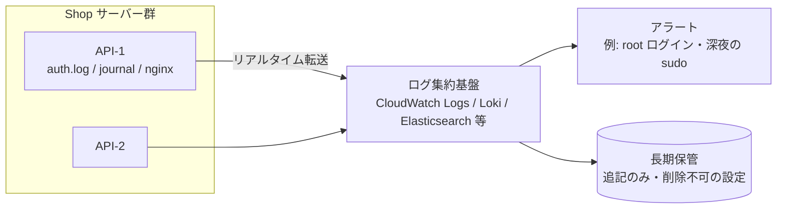
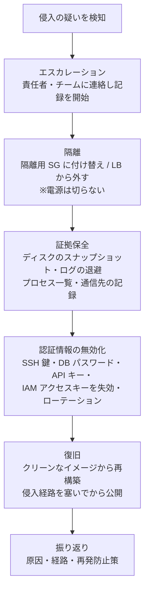

# ログ監査と侵入の検知

[[MOC_サーバー・インフラ体系|📚 目次]] ｜ [[04_OSのハードニングとパッチ管理|← 前へ]]

> [!abstract] この記事で分かること
> - セキュリティの観点で見るべきログ（auth.log / journal、Nginx アクセスログ、sudo）と読み方
> - ログを別サーバーへ送るべき理由と、auditd・AIDE による操作記録と改ざん検知
> - 侵入の兆候と、気づいたときの初動（隔離・証拠保全）
> - クラウドの監査ログ（CloudTrail・GuardDuty）
> - シリーズ全体のまとめとしての Shop セキュリティチェックリスト
>
> **前提**：[[01_サーバーセキュリティの基本]] 〜 [[04_OSのハードニングとパッチ管理]] を読んでいると理解しやすいです。

## 1. ひとことで言うと

ここまでの回は「鍵を掛ける」話でした。この回は**防犯カメラと警報装置**の話です。どれだけ鍵を固くしても、100% 侵入を防ぐことはできません。大切なのは、

- **記録が残っている**（誰が・いつ・何をしたか）
- **異常にすぐ気づける**（警報が鳴る）
- **気づいたときに慌てず動ける**（初動の手順がある）

ことです。侵入から発覚までの期間が長いほど被害は大きくなります。防御と同じくらい「検知」に投資するのが、実務のセキュリティです。

## 2. 見るべきログ

### 2.1 認証ログ：auth.log と journal

SSH のログイン、sudo の実行、ユーザーの追加などは**認証ログ**に残ります。Ubuntu 24.04 では rsyslog により `/var/log/auth.log` に書かれ、同じ内容を `journalctl` でも見られます。

```bash
# SSH ログインの成功（誰が、どこから、どの鍵で）
sudo grep "Accepted" /var/log/auth.log
# Accepted publickey for taro from 198.51.100.24 port 50122 ssh2: ED25519 SHA256:abc...

# 失敗（ボットの総当たりはここに大量に出る）
sudo grep -E "Failed|Invalid user" /var/log/auth.log | tail

# journal で SSH サービスのログを見る
sudo journalctl -u ssh --since today

# ログイン履歴（成功）と失敗の履歴
last -n 20
sudo lastb -n 20
```

最も注目すべきは**「失敗」ではなく「成功」**です。失敗はボットの日常ですが、**見覚えのない IP・時間帯・鍵での成功**は侵入そのものかもしれません。鍵のフィンガープリント（`SHA256:...`）を見れば、どの鍵が使われたかが分かります（[[02_SSHの安全な運用]] で鍵にコメントを付けたのはこのためです）。

### 2.2 sudo のログ

sudo の実行は、誰がどのコマンドを root 権限で実行したかの記録です。

```bash
sudo journalctl _COMM=sudo --since "2026-10-01"
# taro : TTY=pts/0 ; PWD=/home/taro ; USER=root ; COMMAND=/usr/bin/systemctl restart nginx
```

root で直接ログインさせず、個人ユーザー + sudo にしたのは、この記録を残すためでもあります（[[04_OSのハードニングとパッチ管理]]）。

### 2.3 Nginx のアクセスログ

Web 経由の攻撃は Nginx のアクセスログ（`/var/log/nginx/access.log`）に表れます。

```bash
# 秘密ファイルや管理画面を探すリクエスト
sudo grep -E '\.env|\.git/|wp-login|phpmyadmin' /var/log/nginx/access.log | tail

# リクエスト数の多い IP 上位 10
sudo awk '{print $1}' /var/log/nginx/access.log | sort | uniq -c | sort -rn | head

# 4xx/5xx の急増
sudo awk '{print $9}' /var/log/nginx/access.log | sort | uniq -c
```

`/.env` へのリクエストに **200** を返していたら大問題です（秘密情報が漏れている）。404 なら探られただけです。アプリの攻撃の見分け方は [[MOC_Web脆弱性対策]] も参照してください。

| ログ | 場所 | 主に分かること |
|---|---|---|
| 認証 | `/var/log/auth.log`、`journalctl -u ssh` | SSH ログイン成否、ユーザー追加、sudo |
| システム全般 | `journalctl`、`/var/log/syslog` | サービスの起動・停止・異常終了 |
| Web | `/var/log/nginx/access.log`, `error.log` | 攻撃的なリクエスト、不審な IP |
| パッケージ | `/var/log/apt/history.log`、`/var/log/dpkg.log` | 誰がいつ何をインストールしたか |
| 自動更新 | `/var/log/unattended-upgrades/` | パッチ適用の状況 |
| ファイアウォール | `journalctl -k | grep UFW` | ブロックされた通信 |

## 3. ログを別サーバーへ送る理由

侵入した攻撃者が最初にやることの 1 つは、**自分の痕跡をログから消すこと**です。root を取られれば、同じサーバー上のログは自由に書き換えられます。だからログは**リアルタイムでサーバーの外へ送り**、攻撃者の手が届かない場所に保管します。



別サーバーへ送る利点は次のとおりです。

- **改ざん対策**：サーバー側のログが消されても、送信済みの記録は残る
- **横断的な検索**：API 2 台・DB・LB のログをまとめて時系列で追える
- **アラート**：「root でのログイン成功」「`authorized_keys` の変更」などをルール化して通知できる
- **サーバーが消えても残る**：オートスケーリングで削除されたインスタンスのログも残る

送信には rsyslog の転送機能、CloudWatch Agent、Fluent Bit、Grafana Alloy などを使います。集約基盤の設計は [[04_ログ集約基盤]]、監視全般は [[13-監視・ログ]] と [[MOC_可観測性体系]] を参照してください。保管先には S3 のオブジェクトロックのような「一定期間削除できない」設定を使うと、さらに改ざんに強くなります。

## 4. auditd と AIDE：操作の記録と改ざんの検知

### 4.1 auditd：カーネルレベルの操作記録

**auditd**（Linux Audit）は、カーネルが「どのファイルに誰がアクセスしたか」「どのシステムコールが呼ばれたか」を記録する仕組みです。auth.log では分からない、**重要ファイルの変更**を記録できます。

```bash
sudo apt install auditd
```

```bash
# /etc/audit/rules.d/shop.rules
# アカウント情報の変更を監視（w=書き込み, a=属性変更）
-w /etc/passwd -p wa -k identity
-w /etc/shadow -p wa -k identity
-w /etc/group -p wa -k identity
# sudo 設定と SSH 設定の変更
-w /etc/sudoers -p wa -k privilege
-w /etc/sudoers.d/ -p wa -k privilege
-w /etc/ssh/sshd_config -p wa -k sshd
-w /etc/ssh/sshd_config.d/ -p wa -k sshd
# 管理者の authorized_keys
-w /home/taro/.ssh/authorized_keys -p wa -k ssh_keys
```

```bash
sudo augenrules --load            # ルールを読み込む
sudo auditctl -l                  # 有効なルールを確認
sudo ausearch -k identity -i      # キーで検索（-i で UID を名前に変換）
sudo aureport --summary           # 集計レポート
```

最初から大量のルールを入れるとログが膨れるので、上のような「変更されたら重大なファイル」から始めます。CIS Benchmarks にも推奨ルールの一覧があります（[[04_OSのハードニングとパッチ管理]]）。

### 4.2 AIDE：ファイル改ざん検知

**AIDE**（Advanced Intrusion Detection Environment）は、**正常な状態のファイルのハッシュ値を記録しておき、定期的に比較して変化を検出する**ツールです。攻撃者が `/usr/bin/ls` や `/usr/sbin/sshd` をバックドア入りのものに差し替えても、ハッシュが変わるので気づけます。

```bash
sudo apt install aide
sudo aideinit                    # 初期データベースを作成（時間がかかる）
# 作成された /var/lib/aide/aide.db が「正しい状態」の基準になる

sudo aide --check --config /etc/aide/aide.conf    # 現在の状態と比較
```

```
AIDE found differences between database and filesystem!!
Changed entries:
f   ...    .C... : /usr/sbin/sshd
```

Ubuntu のパッケージでは日次チェックの仕組みも用意されています。注意点は、**パッケージ更新でも当然ファイルは変わる**ことです。正当な更新の後はデータベースを更新し（`aideinit` で作り直す）、「説明できない変化」だけを調べる運用にします。また基準のデータベースが同じサーバー上にあると攻撃者に書き換えられうるため、コピーを外部に保管しておくと確実です。

## 5. 侵入の兆候と初動

### 5.1 こんなときは疑う

| 兆候 | 確認方法 |
|---|---|
| CPU が理由なく 100% に張り付く（マイニング） | `top`、`ps aux --sort=-%cpu` |
| 見知らぬプロセス・`/tmp` や `/dev/shm` から動く実行ファイル | `ps aux`、`ls -la /tmp /dev/shm` |
| 知らない外部 IP への大量の通信 | `ss -tnp`、クラウドの VPC フローログ |
| `authorized_keys` に知らない鍵、知らないユーザー | `cat ~/.ssh/authorized_keys`、`/etc/passwd` |
| 見覚えのない cron・systemd ユニット | `crontab -l`、`ls /etc/cron.*`、`systemctl list-timers` |
| 知らない IP・時間帯の SSH ログイン成功 | `auth.log` の `Accepted` |
| AIDE / auditd の想定外の変更検知 | 前節のコマンド |

### 5.2 初動の流れ

侵入を疑ったときに**最もやってはいけないのは、慌ててサーバーを消したり再起動したりすること**です。メモリ上の証拠（動いているプロセス、通信先）が失われ、何が起きたか分からなくなります。



1. **隔離**：インバウンド・アウトバウンドともに全拒否の「隔離用 SG」に付け替え、ロードバランサーから外します。攻撃者の操作と外部への通信（データ流出・他への攻撃）を止めつつ、サーバーは動かしたままにします。冗長構成なら Shop のサービスは残りの台で継続できます（[[05_高可用性と冗長化]]）。
2. **証拠保全**：EBS スナップショットを取り、`ps`・`ss` の結果、ログを外部へ退避します。集約基盤にログを送っていれば、ここで大いに役立ちます。
3. **認証情報の無効化**：そのサーバーにあった秘密情報は**すべて漏れた前提**で、鍵・パスワード・トークンを作り直します（[[05_設定と環境変数・シークレット]]）。
4. **復旧**：侵入されたサーバーを「掃除して使い続ける」のではなく、**クリーンなイメージから作り直す**のが原則です。どこにバックドアが残っているか完全には分からないからです。IaC でサーバーを作れるようにしておくことが、ここで効いてきます。

個人情報が漏えいした可能性がある場合は、法令に基づく報告や利用者への通知が必要になることがあるため、早い段階で責任者に判断を仰ぎます。インシデント対応の体制・コミュニケーション・ポストモーテムは [[MOC_SRE・インシデント対応体系]]、手順書の作り方は [[02_ランブックの書き方]] を参照してください。**この初動手順を事前にランブックとして書いておく**ことが、本番で慌てないための最大の準備です。

## 6. クラウドの監査ログ：CloudTrail と GuardDuty

クラウドでは、サーバーの中だけでなく**クラウドの操作そのもの**も攻撃対象です。漏れたアクセスキーで EC2 を大量に起動される、SG を書き換えて DB を公開される、といった攻撃はサーバーのログには一切残りません。

| サービス | 役割 | ポイント |
|---|---|---|
| **AWS CloudTrail** | 「誰が・いつ・どの API を呼んだか」の記録 | 管理イベントは既定で 90 日分をイベント履歴で閲覧可能。長期保管にはトレイルを作成して S3 へ保存し、ログファイルの整合性検証を有効にする |
| **Amazon GuardDuty** | CloudTrail・VPC フローログ・DNS ログなどを分析する脅威検知サービス | 有効化するだけで動く。「EC2 が SSH 総当たりを受けている／している」「暗号資産マイニングのドメインと通信」などを検出 |
| VPC フローログ | VPC 内の通信の記録（誰と誰が通信したか） | 侵入後の外部通信の調査に使う |
| AWS Config | リソース設定の変更履歴 | 「いつ SG が開けられたか」を追える |

```bash
# 例：最近 SG を変更した操作を CloudTrail で探す
aws cloudtrail lookup-events \
  --lookup-attributes AttributeKey=EventName,AttributeValue=AuthorizeSecurityGroupIngress \
  --max-results 10
```

GuardDuty の検出結果（finding）は EventBridge 経由で Slack やメールに通知できます。小規模な Shop でも、**CloudTrail のトレイル作成・GuardDuty の有効化・ルートアカウントの MFA** は最初の日にやっておく価値があります。

## 7. シリーズのまとめ：Shop セキュリティチェックリスト

サーバー・インフラシリーズの締めくくりとして、Shop を公開・運用する際のチェックリストをまとめます。

### 公開前（構築時）

- [ ] SSH は公開鍵認証のみ（`PasswordAuthentication no`）、`PermitRootLogin no`、`AllowUsers` 設定済み（[[02_SSHの安全な運用]]）
- [ ] SSH は管理者の IP だけに許可、または SSM Session Manager でポート 22 を閉じている
- [ ] ufw / SG で外に開いているのは 80・443（と制限付きの 22）だけ（[[03_ファイアウォールとネットワーク制御]]）
- [ ] Shop API（3000）と PostgreSQL（5432）は `127.0.0.1` かプライベートサブネットでのみ待ち受け
- [ ] Docker の公開ポートに `127.0.0.1:` を付けている
- [ ] 外部から `nmap` して、80/443 以外が open でないことを確認した
- [ ] HTTPS 化と HTTP→HTTPS リダイレクト（[[04_HTTPSとTLS証明書]]）
- [ ] アプリは専用ユーザー（nologin）で動作、`.env` は 600（[[04_OSのハードニングとパッチ管理]]、[[05_設定と環境変数・シークレット]]）
- [ ] DB のアプリ用ユーザーは必要最小限の権限（[[06_データベースサーバーの運用]]）
- [ ] 不要なサービス・パッケージを削除、sudo はコマンドを限定
- [ ] 構成は Ansible / Terraform でコード化されている（[[04_構成管理とAnsible]]、[[03_Terraform入門]]）

### 継続運用

- [ ] unattended-upgrades が有効、`/var/run/reboot-required` を監視し計画的に再起動
- [ ] OS・Node.js・PostgreSQL・Nginx の EOL を把握している
- [ ] fail2ban が動作している
- [ ] ログ（auth・sudo・Nginx）を集約基盤へ転送し、重要イベントにアラートを設定（[[04_ログ集約基盤]]）
- [ ] auditd で重要ファイルの変更を記録、AIDE で改ざんを定期チェック
- [ ] CloudTrail トレイル・GuardDuty 有効、ルートアカウントに MFA
- [ ] 四半期ごとに `authorized_keys`・ユーザー・sudo・SG の棚卸し、Lynis で再診断
- [ ] バックアップを取り、リストアを試している（[[04_DR訓練とRTO・RPO]]）
- [ ] 侵入時の初動手順がランブックになっている（[[02_ランブックの書き方]]）

アプリケーション自体の脆弱性（SQL インジェクション、XSS など）は [[MOC_Web脆弱性対策]]、ログインやセッションの設計は [[MOC_認証認可]] と [[MOC_セッション管理]] で確認してください。

## よくある誤解・つまずき

- ❌ **「ログはサーバーに残っているから大丈夫」** → ✅ root を取られればローカルのログは消されます。リアルタイムで外部に送って初めて証拠になります。
- ❌ **「侵入されたらすぐ電源を切る」** → ✅ メモリ上の証拠が失われます。まずネットワークで隔離し、スナップショットなどで証拠を保全してから対処します。
- ❌ **「怪しいファイルを消せば元通り」** → ✅ バックドアがどこに残っているか分かりません。認証情報を全部替え、クリーンなイメージから作り直すのが原則です。
- ❌ **「ログイン失敗が多いのが一番危ない」** → ✅ 失敗はボットの日常です。本当に注目すべきは見覚えのないログイン「成功」です。
- ❌ **「クラウドの操作はサーバーのログで追える」** → ✅ SG の変更や EC2 の起動は CloudTrail にしか残りません。クラウドの監査ログは別途有効化が必要です。

## まとめ

- 見るべきは auth.log / journal（特に見覚えのないログイン成功）、sudo の記録、Nginx アクセスログ
- ログは改ざん対策のためリアルタイムで別サーバーへ送り、アラートを設定する
- auditd で重要ファイルへの操作を記録し、AIDE でシステムファイルの改ざんを検知する
- 侵入を疑ったら「隔離 → 証拠保全 → 認証情報の無効化 → クリーンな再構築 → 振り返り」。電源を切らない、掃除して使い続けない
- クラウドでは CloudTrail と GuardDuty でクラウド操作そのものを監査する
- セキュリティは構築時のチェックと継続運用の両輪。チェックリストとランブックで仕組み化する

## 確認クイズ

1. Shop の API サーバーの `auth.log` に、深夜 3 時に海外の IP から `Accepted publickey for deploy` という行がありました。まず何を確認しますか？
> [!tip]- 答え
> ログの鍵フィンガープリント（`SHA256:...`）から、どの鍵が使われたかを確認し、その鍵の持ち主や CI など正当な利用か確かめます。説明がつかなければ侵入の可能性が高いので、責任者に連絡し、サーバーの隔離・証拠保全の初動に移ります。集約基盤のログで、その後に実行された sudo や他サーバーへのログインも追います。

2. 侵入されたサーバーで、攻撃者が `/var/log/auth.log` を消していました。どうすれば侵入の経緯を調べられたでしょうか？
> [!tip]- 答え
> ログをリアルタイムでログ集約基盤（CloudWatch Logs など別の場所）に転送していれば、消される前の記録が残っています。さらに、保管先を削除不可の設定にしておく、auditd の記録も転送する、CloudTrail や VPC フローログといったサーバー外の記録を組み合わせることで経緯を再構成できます。

3. GuardDuty から「EC2 インスタンスが暗号資産マイニングに関連するドメインと通信している」という検出結果が届きました。インスタンスをすぐ終了（削除）するのはなぜ良くないのですか？
> [!tip]- 答え
> 終了するとメモリ上のプロセスや通信状況、ディスクの状態といった証拠が失われ、侵入経路や被害範囲が分からなくなります。まず隔離用 SG に付け替えて外部通信を止め、EBS スナップショットやログを保全してから、認証情報の無効化とクリーンなイメージからの再構築を行います。

## 関連ノート

- [[01_サーバーセキュリティの基本]] — 多層防御の全体像（この章の地図）
- [[02_SSHの安全な運用]] — 鍵のコメントとフィンガープリントで操作者を追う
- [[04_OSのハードニングとパッチ管理]] — 検知の前提となる「正しい状態」を作る
- [[04_ログ集約基盤]] — ログを外部に集めて検索・アラートする仕組み
- [[13-監視・ログ]] / [[MOC_可観測性体系]] — 監視とログ全般
- [[MOC_SRE・インシデント対応体系]] — インシデント対応の体制とポストモーテム
- [[02_ランブックの書き方]] — 初動手順を手順書にする
- [[04_DR訓練とRTO・RPO]] — バックアップと復旧の訓練
- [[MOC_セキュリティ体系]] — セキュリティ全般の体系

## 参考

- [Ubuntu Server docs - Security（Logging / Auditing）](https://ubuntu.com/server/docs/explanation/security/)
- [auditctl(8) / audit.rules(7) manual](https://manpages.ubuntu.com/manpages/noble/man7/audit.rules.7.html)
- [AIDE - Advanced Intrusion Detection Environment](https://aide.github.io/)
- [AWS CloudTrail ユーザーガイド](https://docs.aws.amazon.com/awscloudtrail/latest/userguide/cloudtrail-user-guide.html)
- [Amazon GuardDuty finding types](https://docs.aws.amazon.com/guardduty/latest/ug/guardduty_finding-types-active.html)
- [NIST SP 800-61 Rev.3 Incident Response Recommendations](https://csrc.nist.gov/pubs/sp/800/61/r3/final)
- [CIS Benchmarks - Ubuntu Linux](https://www.cisecurity.org/benchmark/ubuntu_linux)
