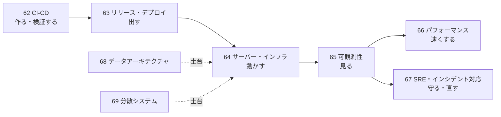
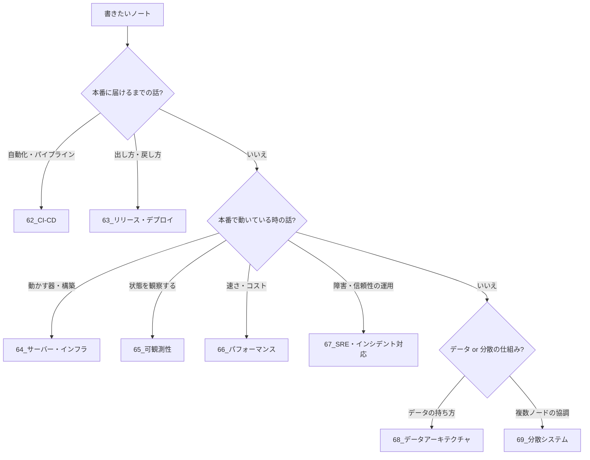

# MOC_運用領域マップ

62〜69 全体の入口ノート。**書いたコードを本番に届け、動かし続け、観察して直す**ための領域を、ライフサイクルの順に 8 分野へ分けている。roadmap.sh DevOps の学習順と、Google SRE 本の「原則 → 実践」の流れ、DDIA（Designing Data-Intensive Applications 第2版）の構成を参考にした。

## 分野一覧

| フォルダ | 扱うこと | 入口 |
|---|---|---|
| 62_CI-CD | ビルド・テスト・パイプライン・DevSecOps・GitOps | [[MOC_CI-CD体系]] |
| 63_リリース・デプロイ | デプロイ戦略・バージョニング・リリース判定・ロールバック | [[MOC_リリース・デプロイ体系]] |
| 64_サーバー・インフラ | サーバーの種類・Webサーバー・実行環境・構築/IaC・スケーリング | [[MOC_サーバー・インフラ体系]] |
| 65_可観測性 | ログ・メトリクス・トレース・OpenTelemetry・SLO/アラート | [[MOC_可観測性体系]] |
| 66_パフォーマンス | 計測・分析・フロント/バックエンド最適化・キャパシティ | [[MOC_パフォーマンス体系]] |
| 67_SRE・インシデント対応 | SRE原則・オンコール・障害対応・ポストモーテム・カオス/DR | [[MOC_SRE・インシデント対応体系]] |
| 68_データアーキテクチャ | DB基礎・データモデル・スキーマ・インデックス・トランザクション・マイグレーション | [[MOC_データアーキテクチャ体系]] |
| 69_分散システム | 分散の難しさ・複製/分割・一貫性・キュー・分散キャッシュ・障害耐性 | [[MOC_分散システム体系]] |

## 迷ったときの置き場所

## 他領域との分担

| テーマ | 本拠地 | 62〜69 との関係 |
|---|---|---|
| AWS 製品の使い方 | 61_AWS | 62〜69 は製品に依存しない概念。AWS での実装は 61 へリンク |
| Docker・Kubernetes | 53_コンテナ | 64 はサーバーとしての位置づけだけ |
| Git・GitHub Actions 入門 | 51_Git | 62 はパイプライン設計、操作手順は 51 |
| バックエンドへの組み込み方（キャッシュ・キュー・ORM） | 34_Backend | 69/68 は仕組み・理論 |
| アーキテクチャスタイル・横断的関心事の設計 | 41_アーキテクチャ | 65/69 はツールと運用 |
| テストの書き方・テストツール | 81〜83 | 62/40 は CI への組み込み方 |
| 実際に起きた事故の記録 | 91_トラブルシューティング事例集 | 67 は対応の型 |
| セキュリティ全般 | 71〜75 | 62/50・64/60 は運用での適用 |

## 経緯
- 2026-09-26 再編。旧 67_リリース・サーバー を 63（リリース）と 64（サーバー）に分割、旧 69_分散システム可観測性 を 65（可観測性）と 69（分散システム）に分割、67 を SRE・インシデント対応として新設
- 旧構想は [[目次_旧10_Operations]]（CI-CD / Release / Incident / Performance の未作成ノート一覧の出典）
