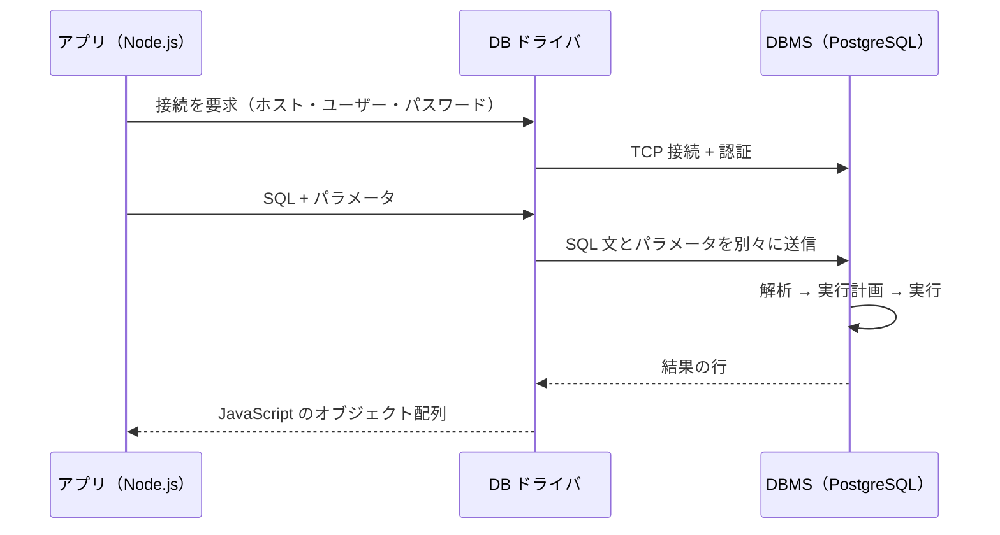
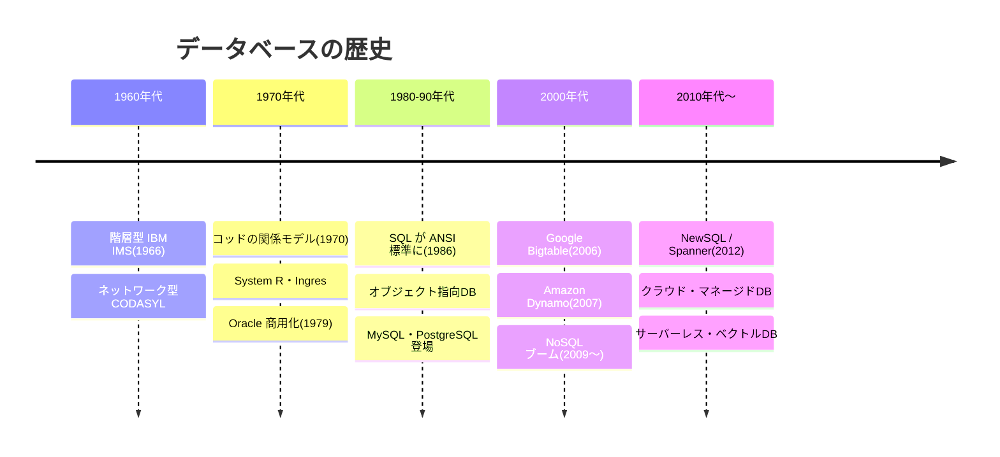

# データベースとは

[[MOC_データアーキテクチャ体系|📚 目次]] ｜ [[02_DBMSの仕組み|次へ →]]

> [!abstract] この記事で分かること
> - データを「ファイル」ではなく「データベース」に置く理由（同時書き込み・クラッシュ・検索・整合性）
> - データベース（DB）と DBMS の違い、RDB と NoSQL のざっくりした違い
> - CRUD と、アプリから DB を使う流れ（接続 → SQL → 結果）、プレースホルダによる SQL インジェクション対策
> - コッドの関係モデル（1970）から NoSQL・NewSQL・クラウド DB までの歴史
>
> **前提**：プログラミング（変数・関数・ファイル読み書き）が少し分かれば読めます。DB の予備知識は不要です。

## 1. ひとことで言うと

データベースは「**図書館の蔵書管理システム**」のようなものです。本（データ）を棚に並べるだけなら倉庫でもできますが、図書館では「何人が同時に貸出・返却しても台帳がずれない」「停電しても貸出記録が消えない」「書名や著者からすぐ探せる」「存在しない会員には貸し出さない」といったルールが守られています。

- **データベース（Database）**：整理して保存されたデータの集まり（図書館の蔵書と台帳）
- **DBMS（Database Management System）**：そのデータを安全に読み書きするためのソフトウェア（司書と管理ルール）
- アプリケーションは DBMS に **SQL** などの命令を送り、DBMS が「壊さず・同時に・速く・正しく」データを扱ってくれる

## 2. なぜファイルではなく DB を使うのか

CSV や JSON ファイルにデータを保存しても、データは残ります。小さな個人スクリプトならそれで十分です。しかし Web サービスのように「たくさんの人が同時に使い、止まってはいけない」システムでは、ファイルだけだと次の 4 つの問題を**自分で**解かなければなりません。

### 2.1 同時書き込み

EC サイト「Shop」で、在庫 1 個の商品を A さんと B さんがほぼ同時に買ったとします。在庫を `stock.json` で管理していると、次のようなことが起きます。

```
時刻  A さんのプロセス              B さんのプロセス
 t1   ファイルを読む（stock=1）
 t2                                 ファイルを読む（stock=1）
 t3   stock=0 を書き込む → 購入成功
 t4                                 stock=0 を書き込む → 購入成功 ← 1 個しかないのに 2 個売れた！
```

これを**更新の消失（Lost Update）**と呼びます。ファイルでも排他ロックを自作すれば防げますが、プロセスが 100 個になったとき、読み取りは止めたくないとき……と考え始めると大仕事です。DBMS は **ロック** や **MVCC（Multi-Version Concurrency Control：更新前の版を残して読み取りを止めない仕組み）** でこれを解決します（→ [[03_ロックとMVCC]]）。

### 2.2 途中で落ちる・クラッシュ

「注文を登録する」「在庫を 1 減らす」の 2 つを書き込む途中でサーバーが落ちたら？ ファイルだと「注文はあるのに在庫が減っていない」中途半端な状態が残ります。書きかけでファイル自体が壊れることもあります。

DBMS には **トランザクション（Transaction）：複数の操作を「全部成功」か「全部なかったこと」にまとめる単位** があり、さらに **WAL（Write-Ahead Logging）：データ本体より先に変更ログをディスクに書く仕組み** で、電源断のあとでも「コミット済みの変更は必ず残り、未完了の変更は消える」状態に戻せます（→ [[01_トランザクションとACID]]、[[05_WALとクラッシュリカバリ]]）。

### 2.3 検索

100 万人分のユーザーが入ったファイルから `email = 'sato@example.com'` の人を探すには、ファイルを先頭から全部読むしかありません。DBMS は **インデックス（Index）：本の巻末索引のように、値から行の場所を引ける補助データ** を持ち、さらに **オプティマイザ** が「どの索引をどう使うと速いか」を自動で選びます（→ [[03_インデックスの基本と設計]]）。

### 2.4 整合性（データの矛盾を防ぐ）

ファイルには「存在しないユーザー ID の注文」も「価格がマイナスの商品」も、書こうと思えば書けてしまいます。DBMS では **制約（Constraint）** をテーブルに宣言でき、ルール違反の書き込みを DB 側で拒否します。

```sql
CREATE TABLE products (
  id          BIGSERIAL PRIMARY KEY,                -- 主キー：行を一意に特定する列
  category_id BIGINT REFERENCES categories(id),    -- 外部キー：存在するカテゴリしか指せない
  name        TEXT NOT NULL,                        -- NOT NULL：空は禁止
  price       INTEGER NOT NULL CHECK (price >= 0),  -- CHECK：0 円以上のみ
  stock       INTEGER NOT NULL DEFAULT 0
);

INSERT INTO products (name, price) VALUES ('壊れた商品', -100);
-- ERROR:  new row for relation "products" violates check constraint "products_price_check"
```

アプリのコードにバグがあっても、最後の砦として DB がデータを守ってくれます（→ [[04_キーと制約の設計]]）。

### 2.5 まとめると

| 問題 | ファイルで起きること | DBMS が提供するもの |
|---|---|---|
| 同時書き込み | 片方の更新が消える・ファイルが壊れる | ロック / MVCC による**同時実行制御** |
| 途中で落ちる | 中途半端な状態が残る | **トランザクション**（全部成功か全部取り消し） |
| 電源断 | 最後の更新が残ったか分からない | **WAL とクラッシュリカバリ** |
| 検索 | 毎回全件を読む | **インデックス**と**クエリ最適化** |
| データの矛盾 | 何でも書けてしまう | **制約**（主キー・外部キー・NOT NULL・CHECK） |
| アクセス制御 | ファイル単位の権限しかない | ユーザー・ロール・テーブル/列単位の**権限管理** |
| 構造の変更 | 読むコードを全部直す | **データ独立性**（→ [[02_DBMSの仕組み]]） |

## 3. DB と DBMS、RDB と NoSQL

### 3.1 データベースと DBMS の違い

日常会話では「DB」と言えば両方を指しますが、厳密には別物です。

| 用語 | 意味 | 例 |
|---|---|---|
| データベース | 整理されたデータそのもの | 「Shop の注文データ」 |
| DBMS | データベースを管理するソフトウェア | PostgreSQL、MySQL、SQLite、MongoDB |
| データベースシステム | DB + DBMS + それを使うアプリ全体 | 「Shop のバックエンド」 |

1 つの DBMS（例：PostgreSQL サーバー 1 台）の中に、`shop` `blog` のように**複数のデータベース**を作れる、という関係です。DBMS が具体的に何をしているかは [[02_DBMSの仕組み]] で詳しく見ます。

### 3.2 RDB と NoSQL

| | リレーショナル DB（RDB） | NoSQL |
|---|---|---|
| データの形 | 行と列の**テーブル**。テーブル同士を JOIN でつなぐ | キーと値、JSON 文書、グラフなどさまざま |
| 操作言語 | SQL（標準化されている） | 製品ごとの API・独自言語 |
| スキーマ | 事前に列と型を定義する | 柔軟（書き込み時に決めない「スキーマレス」が多い） |
| 得意 | 整合性、複雑な問い合わせ、トランザクション | 特定のアクセスパターンでの高速化、水平分散 |
| 代表例 | PostgreSQL、MySQL、Oracle、SQL Server、SQLite | Redis（KV）、MongoDB（ドキュメント）、Cassandra（ワイドカラム）、Neo4j（グラフ） |

**NoSQL** はもともと「RDB 以外」をまとめた呼び名で、「SQL を使わない」より「Not only SQL」と説明されることが多いです。同じ「ユーザー」を表すと、次のような違いになります。

```sql
-- RDB（PostgreSQL）：列が決まったテーブルの 1 行
INSERT INTO users (name, email) VALUES ('山田太郎', 'yamada@example.com');
```

```javascript
// ドキュメント DB（MongoDB）：JSON 風の文書。入れ子や配列もそのまま入る
db.users.insertOne({
  name: '山田太郎',
  email: 'yamada@example.com',
  addresses: [{ type: 'home', city: '東京' }]
});
```

どちらが優れているかではなく、**データの形とアクセスのしかたで選ぶ**ものです。種類と選び方は [[03_データベースの種類と選び方]] で整理します。初心者のうちは「まず RDB（特に PostgreSQL）を理解する」のが近道です。このシリーズも RDB を中心に進みます。

## 4. CRUD：データ操作の基本 4 種

どんな DB でも、データ操作は突き詰めると 4 種類です。頭文字を取って **CRUD** と呼びます。

| 操作 | 意味 | SQL | ORM 風の書き方（例） |
|---|---|---|---|
| **C**reate | 作成 | `INSERT INTO users (name, email) VALUES ('山田太郎', 'yamada@example.com');` | `User.create({ name, email })` |
| **R**ead | 読み取り | `SELECT id, name FROM users WHERE id = 1;` | `User.findById(1)` |
| **U**pdate | 更新 | `UPDATE users SET name = '山田花子' WHERE id = 1;` | `User.update({ name }, { where: { id: 1 } })` |
| **D**elete | 削除 | `DELETE FROM users WHERE id = 1;` | `User.destroy({ where: { id: 1 } })` |

SQL は「**何が欲しいか**」を書く**宣言型（Declarative）言語**です。「ファイルを開いて 1 行ずつ読んで if で比べて……」という**手順**は書きません。手順は DBMS が考えます。そのおかげで、JOIN や集計のような処理も短く書けます。

```sql
-- カテゴリごとの商品数と平均価格（集計）
SELECT c.name AS category, COUNT(*) AS products, AVG(p.price) AS avg_price
FROM products p
JOIN categories c ON c.id = p.category_id
GROUP BY c.name;
```

> [!warning] UPDATE / DELETE の WHERE 忘れ
> `UPDATE users SET name = '山田花子';` のように WHERE を忘れると**全行**が書き換わります。本番で実行する前に、同じ WHERE で `SELECT` して対象件数を確かめる習慣をつけましょう。

SQL の詳しい書き方は [[02_SQLの基本操作（CRUD）]] から始まる 20 章で扱います。ORM（SQL をオブジェクト操作に変換するライブラリ）については [[17_ORMとは]] を参照してください。

## 5. アプリから DB を使う流れ

### 5.1 全体像

Web アプリから DB を使うときは、次の流れになります。



1. **接続（Connection）**：DB サーバーへネットワーク接続し、ユーザー名・パスワードで認証する。
2. **SQL の送信**：ドライバ（DB と話すためのライブラリ）経由で SQL を送る。
3. **結果の受け取り**：結果の行がプログラムのデータ（配列・オブジェクト）として返る。

接続の確立は意外と重い処理なので、実務ではリクエストのたびに接続を作らず、**コネクションプール（Connection Pool）：接続を使い回すための待機所** を使います。

### 5.2 Node.js の例（PostgreSQL + node-postgres）

```javascript
import pg from 'pg';

// コネクションプールを作る（接続情報は環境変数から読む）
const pool = new pg.Pool({ connectionString: process.env.DATABASE_URL });

// ① 新規登録（Create）
const { rows } = await pool.query(
  'INSERT INTO users (name, email) VALUES ($1, $2) RETURNING id',
  ['山田太郎', 'yamada@example.com']
);
const userId = rows[0].id;

// ② 取得（Read）
const result = await pool.query(
  'SELECT id, name, email FROM users WHERE id = $1',
  [userId]
);
console.log(result.rows[0]); // { id: '1', name: '山田太郎', email: 'yamada@example.com' }

await pool.end();
```

`$1` `$2` が **プレースホルダ（Placeholder）：あとから値を入れる穴** です。SQL の文面と値を**別々に**サーバーへ送ります。

> [!note] MySQL との違い
> PostgreSQL のプレースホルダは `$1, $2, …`、MySQL のドライバ（mysql2）では `?` を使います。考え方は同じです。また BIGINT（BIGSERIAL）の値は JavaScript の数値の精度を超えうるため、node-postgres は既定で文字列 `'1'` として返します。

### 5.3 SQL インジェクションとプレースホルダ

もしユーザー入力を文字列連結で SQL に埋め込むとどうなるでしょう。

```javascript
// ❌ 危険：入力をそのまま SQL に連結
const sql = `SELECT * FROM users WHERE email = '${input}'`;
```

`input` に `' OR '1'='1` と入力されると、SQL は次のようになります。

```sql
SELECT * FROM users WHERE email = '' OR '1'='1'
-- 条件が常に真になり、全ユーザーが漏えいする
```

これが **SQL インジェクション（SQL Injection）**：入力値を SQL の一部として解釈させる攻撃です。プレースホルダを使えば、値はあくまで「データ」として扱われ、SQL の構文には決してなりません。

```javascript
// ✅ 安全：値はパラメータとして別に渡す
await pool.query('SELECT * FROM users WHERE email = $1', [input]);
```

> [!warning] プレースホルダが使えない場所
> テーブル名・列名（識別子）や `ORDER BY` の並び順はプレースホルダにできません。ユーザー入力で切り替えたい場合は、**許可リスト**（`['price', 'name']` のどれかか）で検証してから組み立てます。

### 5.4 実務での注意

- **接続情報をコードに直書きしない**：環境変数やシークレット管理サービスに置く。
- **最小権限**：アプリ用 DB ユーザーには必要なテーブルへの SELECT/INSERT/UPDATE/DELETE だけを与え、`DROP` できるような管理者ユーザーで接続しない。
- **通信の暗号化**：クラウド DB では TLS 接続を有効にする。
- **パスワードは平文で保存しない**：bcrypt や Argon2 などでハッシュ化してから DB に入れる。

## 6. データベースの歴史

なぜ今の DB がこの形なのかは、歴史を追うと分かりやすくなります。



| 時代 | 何が起きたか | なぜ重要か |
|---|---|---|
| 1960 年代 | IBM の **IMS**（1966、階層型）や CODASYL の**ネットワーク型** DB | データを親子のポインタでたどる方式。プログラムが「データの置き場所と経路」を知っている必要があった |
| 1970 | E.F. コッドが論文 *A Relational Model of Data for Large Shared Data Banks* で**関係モデル**を提案 | データを「表」と「値」で表し、置き場所と切り離した。**データ独立性**の考え方の出発点 |
| 1970 年代 | IBM の **System R**（SQL の原型）、UC バークレーの **Ingres**。1979 年に Oracle が商用 RDB を出荷 | 関係モデルが実用になることを証明 |
| 1986〜87 | SQL が ANSI / ISO 標準に | 製品が違っても同じ言語で操作できるように |
| 1990 年代 | オブジェクト指向 DB、オブジェクトリレーショナル DB。MySQL（1995）や PostgreSQL（Ingres の後継 Postgres が 1996 年に改名）が登場 | オープンソース RDB が Web の普及を支える |
| 2000 年代後半 | Google **Bigtable**（2006）、Amazon **Dynamo**（2007）の論文。2009 年に「NoSQL」という呼び名が広まる | 1 台の RDB では捌けない Web 規模のデータを、多数のサーバーに分散 |
| 2010 年代〜 | Google **Spanner**（2012）などの **NewSQL / 分散 SQL**、クラウドのマネージド DB、サーバーレス DB | 「SQL とトランザクション」と「水平スケール」の両立。運用はクラウドに任せる時代へ |
| 現在 | マルチモデル化（PostgreSQL の JSONB・pgvector など）、AI 向けのベクトル検索 | RDB と NoSQL の境界が曖昧に |

歴史を通じて見えるのは、**「データの意味（論理）」と「置き方（物理）」を切り離す**という関係モデルの思想が 50 年以上生き残っている、ということです。NoSQL は一時「RDB の終わり」と言われましたが、結局は多くの NoSQL 製品が SQL 風の問い合わせやトランザクションを取り入れ、RDB も JSON や分散を取り入れる形で歩み寄りました。

## よくある誤解・つまずき

- ❌「DB はデータを保存する場所にすぎない」→ ✅ 保存だけならファイルで足ります。DB の価値は**同時実行・障害復旧・検索・整合性**をまとめて保証してくれる点にあります。
- ❌「NoSQL は RDB の新しい版で、RDB は時代遅れ」→ ✅ NoSQL は特定の用途に特化した選択肢です。DB の人気指標（DB-Engines）でも今なお上位は RDB です。
- ❌「ORM を使えば SQL インジェクションは心配ない」→ ✅ ORM も「生 SQL を書く機能」で文字列連結をすれば脆弱になります。値は常にパラメータで渡しましょう。
- ❌「COMMIT すればデータは即座にデータファイルに書かれている」→ ✅ 実際に確実に書かれるのは WAL（ログ）です。データ本体は後でまとめて書かれます（→ [[02_DBMSの仕組み]]）。
- ❌「DB と DBMS は同じ意味」→ ✅ DB はデータの集まり、DBMS はそれを管理するソフトウェアです。1 つの DBMS が複数の DB を持てます。

## まとめ

- ファイル保存では、**同時書き込み・クラッシュ・検索・整合性**の問題を自力で解く必要があり、DBMS はそれらをまとめて引き受けるソフトウェアです。
- **DB** はデータそのもの、**DBMS** はそれを管理するソフトウェア。RDB はテーブルと SQL、NoSQL はそれ以外の多様なモデルです。
- データ操作の基本は **CRUD**（INSERT / SELECT / UPDATE / DELETE）。SQL は「何が欲しいか」を書く宣言型言語です。
- アプリからは **接続 → SQL 送信 → 結果受け取り**。値は必ず**プレースホルダ**で渡して SQL インジェクションを防ぎます。
- 1970 年のコッドの関係モデルから、NoSQL、NewSQL、クラウド DB へと進化しつつ、RDB は今も中心にあります。

## 確認クイズ

1. 在庫を JSON ファイルで管理していたところ、在庫 1 個の商品が 2 人に売れてしまいました。何という問題で、DBMS はどんな仕組みで防ぎますか？
> [!tip]- 答え
> **更新の消失（Lost Update）** です。2 つのプロセスが同じ値を読み、それぞれ書き戻したため一方の更新が消えました。DBMS は**ロックや MVCC による同時実行制御**とトランザクションで防ぎます。たとえば `UPDATE products SET stock = stock - 1 WHERE id = 1 AND stock > 0` のように DB 側で条件付き更新すれば、2 人目の更新は 0 行となり売り越しになりません。

2. 次のコードの問題点と直し方を答えてください。`pool.query("DELETE FROM users WHERE id = " + req.query.id)`
> [!tip]- 答え
> 入力を文字列連結しているため **SQL インジェクション**の危険があります（例：`id=1 OR 1=1` で全件削除）。`pool.query('DELETE FROM users WHERE id = $1', [req.query.id])` のようにプレースホルダで値を渡します。

3. コッドの関係モデルが、それ以前の階層型・ネットワーク型 DB と比べて画期的だった点は何ですか？
> [!tip]- 答え
> データを「表と値」で表し、**データの意味と物理的な置き場所・アクセス経路を切り離した**点です。プログラムがポインタをたどる経路を知らなくても、宣言的に問い合わせられるようになりました（データ独立性）。

## 関連ノート

- [[02_DBMSの仕組み]] — 次の回。DBMS の内部で SQL がどう処理されるか
- [[03_データベースの種類と選び方]] — RDB / NoSQL / 用途別 DB の整理と選定フロー
- [[02_SQLの基本操作（CRUD）]] — CRUD を SQL で詳しく
- [[01_トランザクションとACID]] — 「全部成功か全部取り消し」の詳しい話
- [[03_インデックスの基本と設計]] — 検索を速くする仕組み
- [[17_ORMとは]] — SQL をオブジェクト操作に変換するライブラリ
- [[MOC_バックエンド体系]] — コネクションプールなどアプリ側の話題
- （このフォルダにクリップはまだありません）

## 参考

- [Database（Wikipedia）](https://en.wikipedia.org/wiki/Database)
- [NoSQL（Wikipedia）](https://en.wikipedia.org/wiki/NoSQL)
- [E.F. Codd: A Relational Model of Data for Large Shared Data Banks (1970)](https://dl.acm.org/doi/10.1145/362384.362685)
- [node-postgres: Queries（パラメータ化クエリ）](https://node-postgres.com/features/queries)
- [OWASP: SQL Injection Prevention Cheat Sheet](https://cheatsheetseries.owasp.org/cheatsheets/SQL_Injection_Prevention_Cheat_Sheet.html)
- [PostgreSQL Documentation: Constraints](https://www.postgresql.org/docs/current/ddl-constraints.html)
