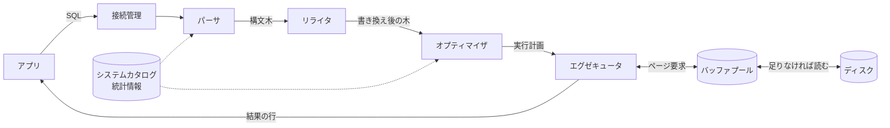

# DBMSの仕組み

[[MOC_データアーキテクチャ体系|📚 目次]] ｜ [[01_データベースとは|← 前へ]] ｜ [[03_データベースの種類と選び方|次へ →]]

> [!abstract] この記事で分かること
> - ANSI/SPARC の 3 層スキーマと、物理的・論理的データ独立性
> - DBMS の内部部品（接続管理、パーサ → リライタ → オプティマイザ → エグゼキュータ、バッファプール、ロック/MVCC、WAL、システムカタログ）
> - 1 本の SELECT と 1 本の UPDATE が DBMS の中をどう通るか
> - 「COMMIT が返った」とき実際に何がディスクに書かれているか
>
> **前提**：[[01_データベースとは]] を読んでいると理解しやすいです。

## 1. ひとことで言うと

DBMS は「**レストランの厨房**」に似ています。お客さん（アプリ）は「パスタ 1 つ」と**何が欲しいか**だけを注文します（SQL）。ホール係が注文を受け（接続管理）、注文票が正しいか確認し（パーサ）、料理長が段取りを決め（オプティマイザ）、調理担当が作ります（エグゼキュータ）。よく使う食材は冷蔵庫ではなく手元の作業台に出しておき（バッファプール）、同じ鍋を 2 人が同時に触らないよう調整し（ロック/MVCC）、何を作ったかは必ず先に伝票に書きます（WAL）。

- DBMS の内部は大きく **クエリプロセッサ**（SQL を解釈して実行する）と **ストレージマネージャ**（データを壊さず速く読み書きする）に分かれる
- 利用者は「何が欲しいか」だけを書けば、「どう取ってくるか」は DBMS が決める
- その裏側にあるのが **3 層スキーマ** と **データ独立性** という考え方

## 2. 3 層スキーマとデータ独立性（ANSI/SPARC）

DB の構造を考える古典的な枠組みが、ANSI/X3/SPARC が 1975 年に提唱した **3 層スキーマアーキテクチャ** です。**スキーマ（Schema）**とは「データの構造の定義」のことです。

```
  利用者A        利用者B        アプリC
     │              │              │
 ┌───┴──────────────┴──────────────┴───┐
 │  外部スキーマ（利用者ごとの見え方）   │  ← RDB では「ビュー」
 └──────────────────┬──────────────────┘
                    │  論理的データ独立性
 ┌──────────────────┴──────────────────┐
 │  概念スキーマ（業務全体の論理構造）   │  ← テーブル定義・ER 図
 └──────────────────┬──────────────────┘
                    │  物理的データ独立性
 ┌──────────────────┴──────────────────┐
 │  内部スキーマ（物理的な格納方法）     │  ← ファイル・ページ・インデックス
 └─────────────────────────────────────┘
```

| 層 | 何を表すか | RDB での実体 | 主に関わる人 |
|---|---|---|---|
| 外部スキーマ | 利用者・アプリから見えるデータ | ビュー | 利用者・アプリ開発者 |
| 概念スキーマ | 業務全体をデータで表した構造 | テーブル・列・制約・ER 図 | DB 設計者 |
| 内部スキーマ | ディスク上にどう置くか | ファイル、ページ、インデックス、パーティション | DBA |

層を分ける目的は **データ独立性（Data Independence）：ある層を変えても上の層に影響しないこと** です。

- **物理的データ独立性**：インデックスを追加する、表領域を移すなど内部スキーマを変えても、SQL の書き方は変わりません。「インデックスを張ってもアプリを書き換えなくていい」のはこのおかげです。
- **論理的データ独立性**：テーブルを分割するなど概念スキーマを変えても、ビューで元の形を見せればアプリは変わりません。

```sql
-- 例：users から住所を別テーブルに分けたあとも、旧形式で読めるビューを置く
CREATE VIEW users_with_address AS
SELECT u.id, u.name, u.email, a.city
FROM users u
LEFT JOIN user_addresses a ON a.user_id = u.id;
```

実務では、テーブル構造を変えるときに互換ビューを置いて段階移行する、といった形で使います（→ [[07_ゼロダウンタイムのスキーマ変更]]）。ただし論理的独立性は完全ではなく、更新できないビューもあるため「ビューを置けば何でも隠せる」わけではありません。

## 3. DBMS の内部構造：見取り図

Hellerstein・Stonebraker・Hamilton の論文 *Architecture of a Database System*（2007）で整理された構成が、RDBMS の標準的な見取り図です。

```
 クライアント（アプリ / psql / ORM）
        │  SQL
 ┌──────▼─────────────────────────────────────────┐
 │ ① 接続管理（プロセス / スレッドの割り当て、認証）  │
 ├────────────────────────────────────────────────┤
 │ ② クエリプロセッサ                               │
 │   パーサ → リライタ → オプティマイザ → エグゼキュータ │
 ├────────────────────────────────────────────────┤
 │ ③ ストレージマネージャ                           │
 │   アクセスメソッド（ヒープ、B-Tree 等）          │
 │   バッファマネージャ（バッファプール）            │
 │   ロック / トランザクションマネージャ（MVCC）     │
 │   ログマネージャ（WAL）                          │
 ├────────────────────────────────────────────────┤
 │ ④ 共通機能：システムカタログ、統計情報、メモリ管理、│
 │   レプリケーション、バックアップ など             │
 └──────▲─────────────────────────────────────────┘
        │ ページ単位の読み書き
   ディスク（データファイル + WAL ファイル）
```

ここからは、Shop のデータベースに次の 2 本の SQL を投げたときの「旅」として、各部品を順に見ていきます。

```sql
-- 旅 1：読み取り
SELECT id, name, email FROM users WHERE email = 'sato@example.com';

-- 旅 2：書き込み
BEGIN;
UPDATE products SET stock = stock - 1 WHERE id = 42 AND stock > 0;
COMMIT;
```

## 4. SELECT の旅：SQL が結果になるまで



### 4.1 接続管理

アプリが接続すると、DBMS は認証のあと、その接続専用の処理担当を割り当てます。

- **PostgreSQL**：接続ごとに OS の**プロセス**を 1 つ起動する（プロセス・パー・コネクション）。
- **MySQL**：1 プロセスの中で接続ごとに**スレッド**を割り当てる。

いずれも接続 1 本ごとにメモリを使うため、接続数を無制限には増やせません（PostgreSQL の `max_connections` 既定値は 100）。アプリ側で**コネクションプール**を使ったり、PgBouncer のようなプーラーを挟んだりするのが定石です。

### 4.2 パーサ（Parser）

SQL 文字列の**文法をチェック**し、**構文木（Parse Tree）**という木構造に変換します。続いてシステムカタログを見て「`users` テーブルは存在するか」「`email` 列はあるか」「この利用者に SELECT 権限はあるか」を確認します。

```sql
SELECT id, nmae FROM users;
-- ERROR:  column "nmae" does not exist  ← この段階で弾かれる
```

### 4.3 リライタ（Rewriter）

意味を変えずに問い合わせを書き換える段階です。代表例は**ビューの展開**で、`SELECT * FROM users_with_address` は、ビューの定義（JOIN を含む SELECT）に置き換えられます。PostgreSQL ではこれをルールシステムが担います。

### 4.4 オプティマイザ（Optimizer / Planner）

ここが DBMS の頭脳です。同じ SQL でも実行方法はたくさんあります。

- `users` を全件読む（**Seq Scan：シーケンシャルスキャン**）か、`email` のインデックスを使う（**Index Scan**）か
- JOIN があれば、どのテーブルから、どの方式（Nested Loop / Hash Join / Merge Join）でつなぐか

オプティマイザは**統計情報**（行数、値の分布、NULL の割合など）を使って各案の**コスト**を見積もり、一番安い**実行計画（Execution Plan）**を選びます。この仕組みを**コストベース最適化**と呼びます。`EXPLAIN` で選ばれた計画を覗けます。

```sql
EXPLAIN SELECT id, name, email FROM users WHERE email = 'sato@example.com';
--  Index Scan using users_email_key on users  (cost=0.42..8.44 rows=1 width=48)
--    Index Cond: (email = 'sato@example.com'::text)
```

`email` には UNIQUE 制約があるため自動でインデックス（`users_email_key`）が作られており、それを使う計画が選ばれています（数値は環境により異なります）。読み方は [[05_実行計画の読み方]] で詳しく扱います。

### 4.5 エグゼキュータ（Executor）

実行計画の木を下から順に動かし、行を 1 件ずつ（あるいはまとめて）上に渡して結果を組み立てます。ここで行を取り出すとき、ディスクを直接読むのではなく**バッファマネージャ**に「このページをください」と頼みます。

### 4.6 バッファプールとページ

DB はデータを 1 行ずつではなく、**ページ（Page）**という固定サイズのかたまりで読み書きします。

| DBMS | 既定のページサイズ | バッファプールの設定 |
|---|---|---|
| PostgreSQL | 8KB | `shared_buffers`（既定 128MB） |
| MySQL（InnoDB） | 16KB | `innodb_buffer_pool_size`（既定 128MB） |

**バッファプール（Buffer Pool）**は、ディスクのページをメモリに置いておく DBMS 専用のキャッシュです。

1. エグゼキュータが「users のページ 123 番」を要求する
2. バッファプールにあれば（**キャッシュヒット**）そのまま返す ── メモリなので速い
3. なければディスクから読み込み、空きがなければ古いページを追い出してから置く

OS にもファイルキャッシュがあるのに DBMS が自前で管理するのは、「どのページを追い出すか」「変更されたページ（**ダーティページ**）をいつディスクに書くか」を、WAL と整合するように自分で制御したいからです。本番 DB の性能は、よく使うデータがバッファプールに収まるかどうかで大きく変わります。ページの中身の構造は [[01_データはディスクにどう保存されるか]]、インデックスの構造は [[02_B-TreeとLSM-Tree]] で扱います。

### 4.7 システムカタログと統計情報

テーブル・列・インデックス・権限などの**メタデータ（データについてのデータ）**は、**システムカタログ（System Catalog）**というテーブル群に保存されています。DBMS 自身もこれを SQL で読んでいます。

```sql
-- 標準 SQL の information_schema でテーブルの列を見る
SELECT column_name, data_type
FROM information_schema.columns
WHERE table_name = 'users';

-- PostgreSQL 独自の pg_catalog：オプティマイザが使う統計情報（推定行数）
SELECT relname, reltuples FROM pg_class WHERE relname = 'users';
```

統計情報は `ANALYZE` で更新されます（PostgreSQL では autovacuum が自動で実行）。大量にデータを入れた直後などで統計が古いと、オプティマイザが行数を見誤り、極端に遅い計画を選ぶことがあります。

## 5. UPDATE の旅：書き込みはどう守られるか

書き込みでは、読み取りの旅（パース → 最適化 → 実行）に加えて、**同時実行制御**と**耐久性**の仕組みが登場します。

```
BEGIN;
UPDATE products SET stock = stock - 1 WHERE id = 42 AND stock > 0;
COMMIT;

 ① パース・最適化・実行開始（id=42 を主キーのインデックスで探す）
 ② 対象行にロックを取る（他の UPDATE は待たされる）
 ③ バッファプール上のページを書き換える（MVCC：新しい版の行を作る）
 ④ 変更内容を WAL バッファに記録
 ⑤ COMMIT：WAL をディスクに fsync → ここで初めて「成功」を返す
 ⑥ （後で）チェックポイントでダーティページをデータファイルへ書き出す
```

### 5.1 ロックと MVCC

同じ商品を 2 人が同時に買おうとしたとき、2 つ目の UPDATE は 1 つ目の COMMIT（または ROLLBACK）まで**行ロック**で待たされます。待ったあとの 2 つ目は、最新の値で `stock > 0` を再確認するため、在庫がマイナスになりません。

一方、同じ行を**読むだけ**の SELECT は待たされません。これは **MVCC（多版型同時実行制御）** のおかげです。

- PostgreSQL：UPDATE すると古い版の行を残したまま**新しい版の行**を作る。各トランザクションは「自分が見てよい版」を読む。不要になった古い版は **VACUUM** が回収する。
- MySQL（InnoDB）：行を上書きし、古い版は **undo ログ**から組み立てて読ませる。

「読み取りは書き込みを待たず、書き込みは読み取りを待たない」のが MVCC の大きな利点です。ただし書き込み同士の衝突はロックで制御されます。詳しくは [[03_ロックとMVCC]] と [[02_分離レベルと読み取り異常]] へ。

### 5.2 WAL（Write-Ahead Logging）

**WAL の原則**は「**データページをディスクに書く前に、その変更を記録したログを先にディスクへ書く**」です。

- COMMIT 時に確実に書く（fsync する）のは、追記するだけの**小さな WAL** だけ。散らばったデータページをランダムに書くより圧倒的に速い。
- 変更されたデータページはバッファプールに置いたまま、後で**チェックポイント（Checkpoint）**としてまとめて書く。
- クラッシュしたら、最後のチェックポイント以降の WAL を**再生（Redo）**して、コミット済みの変更を復元する。

> [!important] ポイント
> 「COMMIT が返った＝データファイルに書かれた」ではなく「**WAL がディスクに書かれた**」です。これが性能と耐久性（ACID の D）を両立させるからくりです。WAL はレプリカへの変更の伝達（レプリケーション）やポイントインタイムリカバリの材料にもなります。

詳しくは [[05_WALとクラッシュリカバリ]]、ACID 全体は [[01_トランザクションとACID]] で扱います。

### 5.3 旅のまとめ

| 部品 | SELECT での役割 | UPDATE での追加の役割 |
|---|---|---|
| 接続管理 | プロセス/スレッドを割り当て | 同じ（トランザクションは接続に紐づく） |
| パーサ・リライタ | 文法・存在・権限チェック、ビュー展開 | 同じ |
| オプティマイザ | 統計からコストを見積もり計画を選ぶ | 更新対象の探し方を決める |
| エグゼキュータ | 計画どおり行を取り出す | 行を書き換える |
| バッファプール | ページをメモリにキャッシュ | 書き換えたページをダーティとして保持 |
| ロック/MVCC | 自分が見てよい版を読む | 行ロックを取り、新しい版を作る |
| WAL | （ほぼ関与しない） | COMMIT 前に変更ログを確実に書く |
| カタログ・統計 | 存在確認・計画作りに使う | 大量更新後は ANALYZE で更新が必要 |

## 6. 実務での注意

- **接続数は資源**：「アクセスが増えたので `max_connections` を 1000 に」は危険です。PostgreSQL では接続ごとにプロセスが増え、メモリを圧迫します。まずコネクションプールを見直しましょう（→ [[MOC_バックエンド体系]]）。
- **メモリ設定はバッファプールから**：自前でサーバーを立てる場合、既定の 128MB は小さすぎることが多いです。PostgreSQL では物理メモリの 25% 程度から調整するのが一般的な目安です。
- **急に遅くなったら統計を疑う**：大量投入直後は `ANALYZE` を実行し、`EXPLAIN ANALYZE` で推定行数と実際の行数を比べます（→ [[MOC_パフォーマンス体系]]）。
- **長いトランザクションを放置しない**：MVCC の古い版が回収できず、テーブルが膨らむ（bloat）原因になります。
- **ディスクの fsync を無効にしない**：PostgreSQL の `fsync = off` や `synchronous_commit = off` は速くなりますが、クラッシュ時のデータ消失を受け入れる設定です（後者は直近のコミットを失う可能性、前者はデータ破損の可能性）。

## よくある誤解・つまずき

- ❌「SQL は書いた順番どおりに実行される」→ ✅ SQL は宣言型で、実際の処理順序はオプティマイザが決めます。同じ SQL でもデータ量や統計によって計画が変わります（→ [[06_SQLの実行順序]]）。
- ❌「COMMIT した瞬間にデータファイルが更新される」→ ✅ 確実に書かれるのは WAL です。データファイルへの反映はチェックポイントで後から行われます。
- ❌「インデックスを作れば必ず使われる」→ ✅ オプティマイザがコストで判断します。全体の多くの行を読むなら、全件スキャンの方が安いと判断されることもあります（→ [[04_インデックスが効かないパターン]]）。
- ❌「DB のメモリが大きいほど OS キャッシュも効いて二重にお得」→ ✅ バッファプールと OS キャッシュに同じページが二重に載る無駄もあります。だからこそ DB ごとの推奨設定があります。
- ❌「読み取りしかしないなら、ロックや MVCC は関係ない」→ ✅ 読み取りも「どの版を見るか」の判断に MVCC が関わり、長時間の読み取りトランザクションは古い版の回収を妨げます。

## まとめ

- **3 層スキーマ**（外部・概念・内部）で層を分けることで、インデックス追加やテーブル分割をしてもアプリへの影響を抑える**データ独立性**が得られます。
- DBMS は **接続管理 → パーサ → リライタ → オプティマイザ → エグゼキュータ** の順で SQL を処理し、オプティマイザが統計情報を使って実行計画を選びます。
- データは **ページ** 単位で扱われ、よく使うページは **バッファプール** に置かれます。
- 同時実行は **ロックと MVCC**、耐久性は **WAL** とチェックポイントで支えられ、COMMIT は「WAL がディスクに届いた」ことを意味します。
- メタデータと統計情報は **システムカタログ** にあり、統計が古いと実行計画が悪化します。

## 確認クイズ

1. `users` テーブルの `email` にインデックスを追加しましたが、アプリの SQL は 1 行も書き換えずに速くなりました。これは 3 層スキーマのどの性質によるものですか？
> [!tip]- 答え
> **物理的データ独立性**です。インデックスは内部スキーマの変更であり、概念スキーマ（テーブル定義）や SQL の書き方には影響しません。どのインデックスを使うかはオプティマイザが自動で判断します。

2. COMMIT 直後にサーバーの電源が落ちました。データファイルにはまだ変更が書かれていません。再起動後、そのコミットは残っていますか？ 理由とともに答えてください。
> [!tip]- 答え
> **残っています**。COMMIT が成功を返した時点で、変更内容は WAL としてディスクに書かれています（fsync 済み）。再起動時のクラッシュリカバリで、最後のチェックポイント以降の WAL を再生（Redo）してデータページを復元します。

3. 昨日まで 10ms だった SELECT が、夜間に 1000 万行を一括投入した翌朝から 10 秒かかるようになりました。最初に疑うべきことと確認方法は？
> [!tip]- 答え
> **統計情報が古く、オプティマイザが行数を見誤って悪い実行計画を選んでいる**可能性です。`EXPLAIN ANALYZE` で推定行数（rows）と実際の行数の差を確認し、`ANALYZE テーブル名;` で統計を更新します。

## 関連ノート

- [[01_データベースとは]] — 前の回。なぜ DB を使うのか、CRUD、アプリからの使い方
- [[03_データベースの種類と選び方]] — 次の回。DB の種類と選定
- [[06_SQLの実行順序]] — SQL の論理的な評価順序と物理的な実行順序
- [[01_データはディスクにどう保存されるか]] — ページ・ヒープ・行のレイアウト
- [[02_B-TreeとLSM-Tree]] — アクセスメソッドの 2 大方式
- [[05_実行計画の読み方]] — EXPLAIN の読み方とオプティマイザ
- [[03_ロックとMVCC]] — 同時実行制御の詳細
- [[05_WALとクラッシュリカバリ]] — WAL・チェックポイント・リカバリの詳細
- [[MOC_分散システム体系]] — WAL を使ったレプリケーション
- （このフォルダにクリップはまだありません）

## 参考

- [Hellerstein, Stonebraker, Hamilton: Architecture of a Database System (2007)](https://dsf.berkeley.edu/papers/fntdb07-architecture.pdf)
- [「ANSI/SPARC 3層スキーマアーキテクチャ」を理解する（@IT）](https://atmarkit.itmedia.co.jp/ait/articles/1703/01/news177.html)
- [PostgreSQL Documentation: The Path of a Query](https://www.postgresql.org/docs/current/query-path.html)
- [PostgreSQL Documentation: Database Page Layout](https://www.postgresql.org/docs/current/storage-page-layout.html)
- [PostgreSQL Documentation: Write-Ahead Logging (WAL)](https://www.postgresql.org/docs/current/wal-intro.html)
- [PostgreSQL Documentation: Resource Consumption（shared_buffers）](https://www.postgresql.org/docs/current/runtime-config-resource.html)
- [MySQL 8.4 Reference Manual: InnoDB Startup Options and System Variables](https://dev.mysql.com/doc/refman/8.4/en/innodb-parameters.html)
- [CSE 544 Lecture: DBMS Architecture（University of Washington）](https://courses.cs.washington.edu/courses/cse544/11wi/lectures/lecture08-architecture.pdf)
