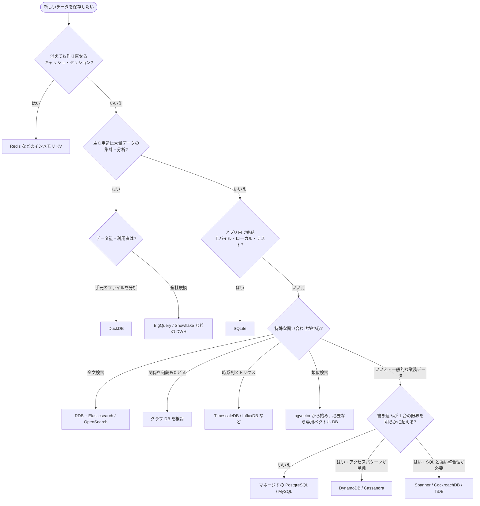

# データベースの種類と選び方

[[MOC_データアーキテクチャ体系|📚 目次]] ｜ [[02_DBMSの仕組み|← 前へ]] ｜ [[01_リレーショナルモデルとテーブル|次へ →]]

> [!abstract] この記事で分かること
> - データモデル別の DB の種類（RDB / KV / ドキュメント / ワイドカラム / グラフ / 時系列 / 全文検索 / ベクトル）と得意・不得意
> - マルチモデル化と NewSQL によって「RDB か NoSQL か」の境界が曖昧になっていること
> - OLTP/OLAP、サーバー型/組み込み型、インメモリ、マネージド/サーバーレスといった「用途・提供形態」の軸
> - DB-Engines ランキングの正しい読み方と、実務での DB 選定フロー・Polyglot Persistence の例
>
> **前提**：[[01_データベースとは]]、[[02_DBMSの仕組み]] を読んでいると理解しやすいです。

## 1. ひとことで言うと

DB 選びは「**収納家具選び**」に似ています。何でも入る本棚（RDB）は万能ですが、靴は靴箱（KV）、書類はファイルボックス（ドキュメント）、家系図はコルクボードに糸で（グラフ）、と専用の家具の方が出し入れしやすいものもあります。ただし家具を増やすほど掃除（運用）は大変になります。

- DB の種類は **「データモデル」（データをどんな形で持つか）** と **「用途・提供形態」（どう使い、どう動かすか）** の 2 軸で整理できる
- 現在の主要 DB は複数のモデルを扱えるようになっており、二択で考える必要は薄れている
- 実務の基本戦略は「**まず RDB（特に PostgreSQL）で始め、必要がはっきりしてから専用 DB を足す**」

## 2. データモデル別の種類

### 2.1 全体像

| 種類 | データの持ち方 | 得意なこと | 苦手なこと | 代表例 |
|---|---|---|---|---|
| リレーショナル（RDB） | 行と列のテーブル、JOIN でつなぐ | 整合性、柔軟な問い合わせ、トランザクション | 1 台を超える書き込みの水平分散 | PostgreSQL, MySQL, Oracle, SQL Server, SQLite |
| キーバリュー（KV） | キー → 値 | キー指定の読み書きを超高速に | 値の中身での検索、複雑な集計 | Redis, Memcached, DynamoDB |
| ドキュメント | JSON 風のネストした文書 | 1 文書で完結するアクセス、変わりやすい構造 | 文書をまたぐ JOIN・整合性 | MongoDB, Firestore, Couchbase |
| ワイドカラム | 行キー → 可変個の列（列ファミリ） | 大量の書き込み、多数ノードへの分散 | アドホックな問い合わせ | Cassandra, HBase, Bigtable |
| グラフ | ノード（点）とエッジ（線） | 関係を何段もたどる問い合わせ | 全件の集計、単純な大量書き込み | Neo4j, Amazon Neptune |
| 時系列 | 時刻をキーにした測定値の列 | 時間範囲の集計、古いデータの間引き・削除 | 個別レコードの頻繁な更新 | InfluxDB, TimescaleDB, Prometheus |
| 全文検索 | 転置インデックス（単語 → 文書の一覧） | キーワード検索、関連度スコア、ログ検索 | トランザクション、正の記録（Source of Truth） | Elasticsearch, OpenSearch |
| ベクトル | 埋め込みベクトル（数値の配列） | 意味の近さによる類似検索（RAG、推薦） | 厳密な一致検索、トランザクション | Pinecone, Milvus, Qdrant, pgvector |

### 2.2 同じデータを各モデルで持つと

Shop の「ユーザー 1 人と、その注文」を例に、データの形の違いを見てみましょう。

```
【RDB】テーブルに分けて JOIN でつなぐ
 users:   (1, '山田太郎', 'yamada@example.com')
 orders:  (100, user_id=1, 'paid')
 order_items: (order_id=100, product_id=42, quantity=2, unit_price=1980)

【KV】キーで丸ごと取り出す（中身は DB から見ると不透明な値）
 "session:abc123" → "{user_id:1, cart:[42,43]}"   （TTL 30分）

【ドキュメント】1 文書に入れ子で持つ
 { _id: 100, user: {id: 1, name: "山田太郎"},
   items: [{product_id: 42, quantity: 2, unit_price: 1980}], status: "paid" }

【グラフ】点と線で関係を持つ
 (山田太郎)-[:購入した]->(商品42)<-[:購入した]-(佐藤花子)-[:購入した]->(商品77)
   → 「商品42を買った人は商品77も買っています」がたどるだけで出る

【時系列】時刻ごとの測定値
 time=2026-10-12T10:00:00Z  metric=api_latency_ms  host=web1  value=35
```

ドキュメント DB は「注文画面で 1 回読めば全部そろう」のが強みですが、ユーザー名を変えたときに、各注文文書に埋め込んだ名前をどうするかという問題が生まれます。RDB はその逆で、重複がない代わりに読むたびに JOIN します。この**トレードオフ**が DB 選びの本質です。各モデルの詳しい設計は [[07_NoSQLのデータモデル]] で扱います。

### 2.3 ひとことずつ補足

- **KV**：Redis はメモリ上で動き、値に有効期限（**TTL：Time To Live**）を付けられるため、セッションやキャッシュの定番です。DynamoDB は KV とドキュメントの性質を併せ持つマネージドサービスで、**アクセスパターンを先に決めてからキー設計する**のが鉄則です。
- **ワイドカラム**：Cassandra は書き込みが極めて多いデータ（メッセージ、IoT）を多数ノードに分散するのが得意ですが、「どのキーで引くか」に合わせてテーブルを作るため、後から問い合わせ方を変えにくいです。
- **全文検索・ベクトル**：多くの場合「正のデータ」は RDB に置き、検索用に**コピー**して使います。元データと検索インデックスのずれ（同期遅延）に注意が必要です。

## 3. 境界は曖昧になっている

### 3.1 マルチモデル化

現在の主要 DB は 1 つのモデルに閉じていません。

| DB | 本来のモデル | 追加で扱えるもの |
|---|---|---|
| PostgreSQL | RDB | `JSONB`（ドキュメント）、全文検索、拡張で時系列（TimescaleDB）・ベクトル（pgvector）・地理空間（PostGIS） |
| MySQL | RDB | JSON 型 |
| MongoDB | ドキュメント | マルチドキュメントトランザクション、全文検索、ベクトル検索 |
| Redis | KV | JSON、検索、ベクトル検索 |

```sql
-- PostgreSQL で「ドキュメント DB 的」に使う例：商品ごとに違う属性を JSONB に入れる
ALTER TABLE products ADD COLUMN attributes JSONB NOT NULL DEFAULT '{}';
UPDATE products SET attributes = '{"color": "black", "size": "M"}' WHERE id = 42;

SELECT id, name FROM products WHERE attributes @> '{"color": "black"}';
-- GIN インデックスを張れば JSONB の中身でも高速に検索できる
CREATE INDEX products_attributes_idx ON products USING GIN (attributes);
```

このため、「スキーマが柔軟なデータがあるから MongoDB」と即決する前に、「PostgreSQL の JSONB で足りないか」を検討する価値があります。

### 3.2 NewSQL / 分散 SQL

**NewSQL（分散 SQL）**は、RDB の SQL とトランザクションを保ったまま、NoSQL のように多数のサーバーへ水平にスケールさせることを狙った系統です。Google Spanner、CockroachDB、TiDB、YugabyteDB などがあります。

- 長所：書き込みが 1 台の限界を超えても、アプリからは「普通の SQL DB」に見える
- 短所：ノード間の合意のため 1 件あたりのレイテンシは単一ノードの RDB より大きくなりがちで、運用・コストも重い

多くのサービスは **1 台の RDB ＋ 読み取りレプリカ ＋ キャッシュ** で長く持ちます。NewSQL は「それでは足りないことが明らか」になってから検討するもので、複製・分割・一貫性の話は [[MOC_分散システム体系]] へ。

## 4. 用途・提供形態による分類

データモデルとは別の軸でも DB は分けられます。

### 4.1 OLTP と OLAP

| | OLTP（Online Transaction Processing：業務処理） | OLAP（Online Analytical Processing：分析処理） |
|---|---|---|
| 典型的な処理 | 注文を 1 件登録、ユーザー 1 人を取得 | 過去 3 年の売上を地域別・月別に集計 |
| 1 回で触る行 | 少ない（キー指定） | 非常に多い（大量スキャン） |
| 重視するもの | 低レイテンシ、同時実行、整合性 | スループット、集計速度 |
| 格納形式 | **行指向**（1 行をまとめて置く） | **列指向**（1 列をまとめて置く、圧縮が効く） |
| 例 | PostgreSQL, MySQL | BigQuery, Snowflake, Redshift, ClickHouse, DuckDB |

アプリの本番 DB で重い集計を回すと、注文処理まで遅くなります。分析用にはデータウェアハウス（DWH）にデータを移す（ETL/ELT）のが一般的です（→ [[01_OLTPとOLAP]]、[[02_列指向ストレージとデータウェアハウス]]）。

### 4.2 サーバー型と組み込み型

- **クライアントサーバー型**：DB サーバーが独立したプロセスとして動き、ネットワーク越しに接続します（PostgreSQL, MySQL）。複数のアプリ・多数のユーザーからの同時書き込みに向きます。
- **組み込み型（Embedded）**：アプリのプロセス内でライブラリとして動き、DB は 1 つのファイルです。設定もサーバーも不要です。
  - **SQLite**：OLTP 向け。モバイルアプリ、デスクトップアプリ、テスト、小規模 Web。公式サイトは「SQLite はクライアントサーバー DB と競合するのではなく、`fopen()` と競合する」と説明しています。
  - **DuckDB**：OLAP 向けの「分析版 SQLite」。CSV や Parquet ファイルをその場で SQL 集計するのに強力です。

```sql
-- DuckDB：ファイルを直接テーブルのように集計できる
SELECT status, COUNT(*) FROM 'orders.parquet' GROUP BY status;
```

> [!note] 組み込み型の注意
> SQLite・DuckDB はいずれも**同時に書き込めるのは基本的に 1 つ**です。多数のユーザーが同時に書き込む Web サービスの本番 DB には、通常はサーバー型を選びます。

### 4.3 インメモリとディスク

データを主にメモリに置く DB（Redis など）は桁違いに速い反面、容量がメモリに制限され、永続化設定次第で障害時に直近のデータを失います。Redis の永続化には、一定間隔でスナップショットを取る **RDB** と、書き込みを追記していく **AOF（Append Only File）** があり、併用もできます。「消えても作り直せるデータ（キャッシュ、セッション）」に使うのが基本です。

### 4.4 セルフホスト、マネージド、サーバーレス

| 形態 | 説明 | 例 | 向いている場面 |
|---|---|---|---|
| セルフホスト | 自分でサーバーに DBMS を入れて運用 | EC2 や自社サーバー上の PostgreSQL | 細かいチューニングや特殊な拡張が必要、コストを極限まで抑えたい |
| マネージド | バックアップ・パッチ・フェイルオーバーをクラウドに任せる | Amazon RDS / Aurora、Cloud SQL、Azure Database | ほとんどの業務システムの第一候補 |
| サーバーレス | 負荷に応じて自動伸縮し、使った分だけ課金 | Aurora Serverless v2、Neon、DynamoDB（オンデマンド） | アクセスの波が大きい、開発環境、小規模サービス |

サーバーレスでも、アイドル時にゼロまで縮むタイプ（Aurora Serverless v2 は 2024 年に対応）では、再開時に数秒〜十数秒の待ちが生じることがあります。常時低レイテンシが必要な本番では注意が必要です。

## 5. DB-Engines ランキングの見方

[DB-Engines](https://db-engines.com/en/ranking) は 400 以上の DBMS を毎月順位付けしているサイトで、2024 年に Redgate が買収しました。スコアは次のような指標の組み合わせです。

- 検索エンジンでの言及数、Google Trends での検索頻度
- Stack Overflow / DBA Stack Exchange での質問数
- 求人数、LinkedIn のプロフィールでの言及、SNS での言及

上位は長年、Oracle・MySQL・SQL Server・PostgreSQL といった RDB が占めています。読むときの注意点は次のとおりです。

- ✅ 分かること：**話題性・人気・採用市場**での存在感。「学んで損がないか」「人を採用しやすいか」の参考になる
- ❌ 分からないこと：性能、インストール数、売上シェア、自分の用途への適性
- 💡 使い方：順位そのものより、**モデル別ランキング**（例：Document stores だけの順位）や**推移グラフ**で、その分野の定番と勢いを見るのが有効

## 6. DB 選定の考え方

### 6.1 選定フローチャート



### 6.2 チェックリスト

1. **データの形**：表に収まるか、ネストした文書か、関係のネットワークか。
2. **アクセスパターン**：キー指定の単純な読み書きか、JOIN・集計を含む柔軟な問い合わせか。**後から問い合わせ方が増えそうなら RDB が無難**です。
3. **整合性の要求**：お金・在庫・予約など「絶対にずれてはいけない」データは、トランザクションと制約を持つ DB に置きます。
4. **規模とスケールの方向**：今の 10 倍、100 倍で 1 台に収まるか。読み取りが多いならレプリカとキャッシュで足りることが多いです。
5. **運用体制**：チームに運用経験があるか、マネージドで済むか。**DB を 1 つ増やすたびに、監視・バックアップ・障害対応・学習コストが増えます**。
6. **迷ったら**：PostgreSQL から始め、キャッシュが必要になったら Redis、分析が重くなったら DWH、と**必要になってから足す**。

## 7. 実務例：Polyglot Persistence

用途に合わせて複数の DB を併用することを **Polyglot Persistence** と呼びます。中規模の EC サイト Shop の構成例です。

```
                       ┌────────────── アプリ（API サーバー） ──────────────┐
                       │                                                     │
   ┌───────────────────▼──────┐  ┌──────────────┐  ┌──────────────────┐     │
   │ PostgreSQL（正のデータ）  │  │ Redis         │  │ OpenSearch        │◀────┘
   │ users / orders / products │  │ セッション     │  │ 商品のキーワード  │
   │ 在庫・決済はトランザクション│  │ (TTL 30分)    │  │ 検索（コピー）    │
   └──────┬──────────┬────────┘  │ 人気商品キャッシュ│  └────────▲─────────┘
          │ レプリカ  │ 変更データ   └──────────────┘           │ 同期
          ▼          └──────────────────────────────────────────┘
   読み取りレプリカ          │ 夜間 / 準リアルタイムで ELT
                             ▼
                   BigQuery（売上分析・BI）
```

| データ | 置き場所 | 理由 |
|---|---|---|
| ユーザー・注文・在庫 | PostgreSQL | 在庫引き当てと注文登録を 1 トランザクションで行い、外部キーで整合性を守る（→ [[01_トランザクションとACID]]） |
| ログインセッション | Redis | 全 API サーバーから共有でき、TTL で自動的に消える。消えても再ログインで済む |
| 商品検索 | OpenSearch | あいまい検索・関連度順。正のデータは PostgreSQL にあり、検索用にコピーするだけ |
| 売上分析 | BigQuery | 本番 DB に重い集計をかけないため（→ [[03_ETL・ELTとデータパイプライン]]） |
| IoT 倉庫センサー（将来） | DynamoDB や時系列 DB | 書き込みが膨大で、アクセスはデバイス ID ＋時刻で単純。パーティションキー設計がカギ |

> [!warning] 併用の落とし穴
> - **二重書き込み問題**：アプリが PostgreSQL と OpenSearch の両方に書くと、片方だけ失敗したときにずれます。正のデータを 1 つに決め、変更データキャプチャ（CDC）などで**一方向に同期**するのが定石です。
> - **運用の掛け算**：DB ごとにバックアップ、監視、障害時の切り替え手順書（フェイルオーバー）、バージョンアップが必要です。
> - **スキーマ変更の管理**：RDB はマイグレーションツール（Flyway、Prisma Migrate など）で変更履歴を管理し、CI/CD に組み込みます（→ [[01_マイグレーションとは]]）。

RDB 単体の運用でも、スロークエリログでボトルネックを特定し `EXPLAIN` で原因を調べる、データが巨大になったらパーティショニングで分割する、といった定番の手順があります。これらは [[05_実行計画の読み方]] や [[MOC_パフォーマンス体系]] で扱います。

## よくある誤解・つまずき

- ❌「NoSQL は RDB より速い」→ ✅ 特定のアクセスパターン（キー指定など）に最適化しているから速いのであって、想定外の問い合わせ（JOIN 相当、集計）ではむしろ遅く、不得意です。
- ❌「スキーマレスだから設計しなくていい」→ ✅ スキーマを DB が強制しないだけで、アプリ側が暗黙のスキーマを持っています。設計を怠ると、データの形がバラバラになり読む側が苦しみます。
- ❌「DB-Engines の 1 位が一番優れた DB」→ ✅ 話題性・求人などの人気指標です。性能や自分の用途への適性は分かりません。
- ❌「将来スケールするかもしれないから、最初から分散 DB にする」→ ✅ 多くのサービスは 1 台の RDB ＋レプリカ＋キャッシュで長く運用できます。早すぎる分散は複雑さとコストを先払いするだけになりがちです。
- ❌「SQLite はおもちゃ」→ ✅ 世界で最も広く使われている DB エンジンの 1 つで、スマートフォンやブラウザに組み込まれています。用途（組み込み・単一書き込み）が違うだけです。

## まとめ

- DB は **データモデル**（RDB / KV / ドキュメント / ワイドカラム / グラフ / 時系列 / 全文検索 / ベクトル）と、**用途・提供形態**（OLTP / OLAP、サーバー / 組み込み、インメモリ、マネージド / サーバーレス）の 2 軸で整理できます。
- 主要 DB は**マルチモデル化**しており、PostgreSQL の JSONB や pgvector のように 1 つで多くをこなせます。**NewSQL** は SQL と水平スケールの両立を狙う系統です。
- **DB-Engines** は人気の指標であり、性能やシェアの順位ではありません。
- 選定は「データの形・アクセスパターン・整合性・規模・運用体制」で判断し、**迷ったら PostgreSQL から始めて必要に応じて足す**のが基本です。
- 複数 DB の併用（**Polyglot Persistence**）では、正のデータを 1 つに決め、一方向に同期するのが定石です。

## 確認クイズ

1. ログインセッションを Redis に置くのは適切ですが、注文データを Redis だけに置くのは不適切です。なぜですか？
> [!tip]- 答え
> セッションは消えても再ログインで作り直せますが、注文は失ってはいけない**正のデータ**だからです。インメモリ DB は永続化設定次第で障害時に直近のデータを失う可能性があり、また在庫引き当てと注文登録を 1 つのトランザクションで守る・外部キーで整合性を保つ、といった RDB の機能も使えません。

2. 「商品ごとに属性（色、サイズ、容量など）がバラバラなので MongoDB を導入したい」という提案に対し、まず検討すべき代替案は？
> [!tip]- 答え
> PostgreSQL の **JSONB 列**です。可変の属性だけを JSONB に入れ、価格・在庫など共通の列は通常のカラムとして制約付きで持てば、トランザクションや JOIN を保ったまま柔軟性を得られます。GIN インデックスで JSONB の中身も検索できます。DB を増やす運用コストも避けられます。

3. 本番の PostgreSQL で毎朝「過去 1 年の売上の月別集計」を実行したところ、その時間帯の注文 API が遅くなりました。どう改善しますか？
> [!tip]- 答え
> OLTP の本番 DB で OLAP 的な重い集計を行っているのが原因です。短期的には読み取りレプリカで集計を実行し、本格的にはデータを列指向の DWH（BigQuery など）へ ELT で移して分析をそちらで行います。

## 関連ノート

- [[02_DBMSの仕組み]] — 前の回。DBMS の内部構造
- [[01_リレーショナルモデルとテーブル]] — 次の回。RDB のデータモデルを詳しく
- [[07_NoSQLのデータモデル]] — KV・ドキュメント・ワイドカラム・グラフの設計
- [[02_B-TreeとLSM-Tree]] — RDB と NoSQL の書き込み性能の違いの源
- [[01_OLTPとOLAP]] — 業務処理と分析処理の違い
- [[02_列指向ストレージとデータウェアハウス]] — 列指向と DWH
- [[03_非正規化と実務での判断]] — ドキュメント的な「埋め込み」をいつ選ぶか
- [[MOC_分散システム体系]] — レプリケーション・シャーディング・NewSQL の裏側
- （このフォルダにクリップはまだありません）

## 参考

- [DB-Engines Ranking](https://db-engines.com/en/ranking) / [DB-Engines ranking（Wikipedia）](https://en.wikipedia.org/wiki/DB-Engines_ranking)
- [SQLite: Appropriate Uses For SQLite](https://www.sqlite.org/whentouse.html)
- [DuckDB: An Embeddable Analytical Database](https://duckdb.org/science/duckdb)
- [Redis persistence（公式ドキュメント）](https://redis.io/docs/latest/operate/oss_and_stack/management/persistence/)
- [Amazon Aurora Serverless v2 supports scaling to zero capacity（AWS, 2024）](https://aws.amazon.com/about-aws/whats-new/2024/11/amazon-aurora-serverless-v2-scaling-zero-capacity)
- [PostgreSQL Documentation: JSON Types](https://www.postgresql.org/docs/current/datatype-json.html)
- [Database Periodic Table（Bytebase）](https://www.bytebase.com/database-periodic-table/)
- Martin Kleppmann, *Designing Data-Intensive Applications* 第2版（Part I）
