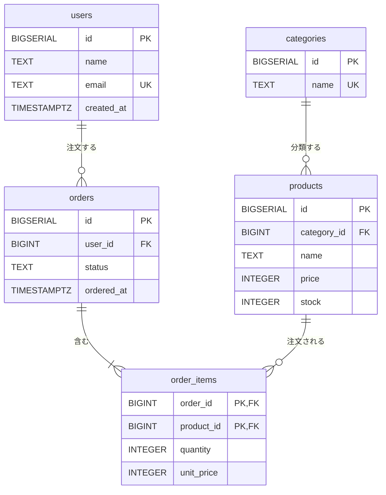

# リレーショナルモデルとテーブル

[[MOC_データアーキテクチャ体系|📚 目次]] ｜ [[03_データベースの種類と選び方|← 前へ]] ｜ [[02_SQLの基本操作（CRUD）|次へ →]]

> [!abstract] この記事で分かること
> - リレーショナルモデルの「関係・タプル・属性」と、テーブル・行・列との対応
> - 列のデータ型の選び方（お金・日時・文字列で迷わないために）
> - 主キー・外部キー・UNIQUE・NOT NULL・CHECK などの制約が「何を守るのか」
> - 1対1／1対多／多対多の表し方と、中間テーブルが必要な理由
> - このシリーズで使い続ける例題スキーマ「Shop」の全体像
>
> **前提**：[[01_データベースとは]]、[[03_データベースの種類と選び方]] を読んでいると理解しやすいです。

## 1. ひとことで言うと

リレーショナルデータベース（RDB）は、**データを「きっちり列が決まった表」に分けてしまい、表どうしを「番号（キー）」で結びつける**仕組みです。
学校の名簿を思い浮かべてください。「生徒名簿」には出席番号・氏名・クラスが並び、「成績表」には出席番号と点数だけが書かれています。成績表に氏名を書かなくても、出席番号を名簿と突き合わせれば誰の点数か分かります。これがリレーショナルモデルの発想そのものです。

- 表（テーブル）は「同じ種類のもの」の集まり（ユーザーの表、商品の表、注文の表…）
- 表どうしは **キー** でつながる（成績表の「出席番号」→ 名簿の「出席番号」）
- 「入れてはいけないデータ」は **制約** で DB 自身が拒否する

## 2. 関係モデルの用語とテーブルの対応

リレーショナルモデル（Relational Model）は 1970 年に IBM の E.F. コッド（Edgar F. Codd）が提案した、データを数学の「関係（relation）」として扱う理論です。理論の用語と、普段使う SQL の用語はほぼ 1 対 1 で対応します。

| 理論の用語 | SQL / 実務の用語 | 意味 |
|---|---|---|
| 関係（Relation） | テーブル（Table） | 同じ形のデータの集まり |
| タプル（Tuple） | 行（Row）／レコード | 1 件分のデータ |
| 属性（Attribute） | 列（Column）／カラム | データの項目 |
| 定義域（Domain） | データ型 + 制約 | その列に入りうる値の範囲 |
| 関係スキーマ（Relation Schema） | テーブル定義（CREATE TABLE） | 表の「形」の宣言 |

```
                 属性（列）
          ┌──────┬────────┬──────────────────┐
          │ id   │ name   │ email            │   ← 関係スキーマ（表の形）
          ├──────┼────────┼──────────────────┤
タプル → │ 1    │ 山田   │ yamada@example.com│
（行）    │ 2    │ 佐藤   │ sato@example.com  │
          └──────┴────────┴──────────────────┘
                    関係 users（テーブル）
```

### 理論と SQL の「ずれ」

実は SQL のテーブルは、理論上の「関係」と少しだけ違います。この違いが後の回で効いてきます。

| 理論上の関係 | SQL のテーブル |
|---|---|
| タプルは **集合**。同じ行が 2 つ存在することはない | 主キーを付けないと **同じ行が何行でも** 入る |
| 行に順番はない | 順番はない（ORDER BY を書かない限り保証されない）← ここは同じ |
| 値は必ず存在する（2 値論理） | **NULL**（値がない）を許し、三値論理になる |

「行の順番は保証されない」はとても重要です。`SELECT * FROM users` が毎回 id 順で返ってくるように見えても、それはたまたまです。順番が必要なら必ず `ORDER BY` を書きます（[[02_SQLの基本操作（CRUD）]]）。NULL の話は [[05_NULLと三値論理]] で詳しく扱います。

## 3. データ型の選び方

列にはデータ型（Data Type）：その列に入れてよい値の種類 を決めます。型は「入れ間違いを防ぐ最初の防波堤」であり、保存サイズや比較・並べ替えの速さにも影響します。PostgreSQL でよく使う型と選び方の目安です。

| 用途 | おすすめの型 | 避けたい型・理由 |
|---|---|---|
| ID（連番） | `BIGINT`（`BIGSERIAL` / `GENERATED ... AS IDENTITY`） | `INTEGER` は約 21 億で枯渇する |
| 個数・在庫 | `INTEGER` | 文字列に数字を入れると `'10' < '9'` になる |
| 金額 | `INTEGER`（円）または `NUMERIC(12,2)` | `REAL`/`DOUBLE PRECISION` は 2 進小数で誤差が出る |
| 文字列 | `TEXT`（PostgreSQL では `VARCHAR(n)` と性能差なし） | 長さ制限が業務ルールなら `CHECK` か `VARCHAR(n)` |
| 日時 | `TIMESTAMPTZ`（タイムゾーン付き） | `TIMESTAMP`（タイムゾーンなし）は時差のバグの元 |
| 日付だけ | `DATE` | 文字列 `'2026/10/12'` は並べ替え・計算ができない |
| 真偽値 | `BOOLEAN` | `'Y'/'N'` 文字列や 0/1 は意味が曖昧 |
| 柔軟な属性 | `JSONB` | 何でも JSONB に入れると制約が効かなくなる |

> [!note] MySQL との違い
> MySQL では `TEXT` 型にインデックスを張るときにプレフィックス長が必要で、`VARCHAR(n)` を使うのが一般的です。また MySQL の `TIMESTAMP` は内部で UTC に変換して保存する（PostgreSQL の `TIMESTAMPTZ` に近い）一方、`DATETIME` は変換しません。

**選び方の原則**は「その値でやりたい計算・比較ができる、いちばん狭い型」です。日付を文字列で持つと「先月の注文」を取るのに文字列操作が必要になり、インデックスも効きにくくなります（[[04_インデックスが効かないパターン]]）。

## 4. 主キー・外部キー・制約の入門

制約（Constraint）：テーブルに入れてよいデータのルールを DB に宣言したもの です。アプリのコードでチェックするだけでは、別のプログラムや手作業の SQL から不正なデータが入り込みます。制約は **DB の入口で必ず検査される** ので、最後の砦になります。

### 4.1 主キー（Primary Key）

主キー：テーブルの中で行を一意に特定する列（または列の組） です。`PRIMARY KEY` は「`UNIQUE` かつ `NOT NULL`」を意味し、1 テーブルに 1 つだけ定義できます。

```sql
CREATE TABLE users (
  id         BIGSERIAL PRIMARY KEY,          -- 自動採番の主キー
  name       TEXT NOT NULL,
  email      TEXT NOT NULL UNIQUE,           -- 重複不可
  created_at TIMESTAMPTZ NOT NULL DEFAULT now()
);
```

主キーには「意味を持たない連番（サロゲートキー）」を使うのが一般的です。メールアドレスのような「意味のある値（ナチュラルキー）」は変更される可能性があるからです。どちらを選ぶかの詳しい議論は [[04_キーと制約の設計]] で扱います。

### 4.2 外部キー（Foreign Key）

外部キー：ある列の値が、別テーブルの主キー（または UNIQUE 列）に必ず存在することを保証する制約 です。これを **参照整合性（Referential Integrity）** と呼びます。

```sql
CREATE TABLE orders (
  id         BIGSERIAL PRIMARY KEY,
  user_id    BIGINT NOT NULL REFERENCES users(id),   -- users.id に存在する値だけ
  status     TEXT NOT NULL DEFAULT 'pending',
  ordered_at TIMESTAMPTZ NOT NULL DEFAULT now()
);

INSERT INTO orders (user_id) VALUES (9999);
-- ERROR:  insert or update on table "orders" violates foreign key constraint ...
-- DETAIL:  Key (user_id)=(9999) is not present in table "users".
```

参照されている側の行を消そうとしたときの動きは `ON DELETE` で指定できます。

| 指定 | 親（users）の行を消そうとすると |
|---|---|
| `NO ACTION`（デフォルト） | 子が残っていればエラー（チェックをトランザクション末尾まで遅延可能） |
| `RESTRICT` | 子が残っていれば即エラー |
| `CASCADE` | 子（orders）も一緒に削除 |
| `SET NULL` | 子の外部キー列を NULL にする |

> [!warning] 外部キーにインデックスは自動で作られない
> PostgreSQL は外部キーを宣言しても、**参照する側の列（orders.user_id）にインデックスを自動作成しません**。親を削除・更新するたびに子テーブルの全件確認が走ったり、JOIN が遅くなったりするので、通常は自分で `CREATE INDEX` します。なお MySQL（InnoDB）は外部キー列にインデックスを自動作成します。

### 4.3 その他の制約

```sql
CREATE TABLE products (
  id          BIGSERIAL PRIMARY KEY,
  category_id BIGINT REFERENCES categories(id),
  name        TEXT NOT NULL,                        -- 必須
  price       INTEGER NOT NULL CHECK (price >= 0),  -- 0 円以上
  stock       INTEGER NOT NULL DEFAULT 0            -- 省略時は 0
);
```

| 制約 | 守るもの |
|---|---|
| `NOT NULL` | 必須項目が空にならない |
| `UNIQUE` | 重複しない（ただし NULL 同士は重複とみなされない） |
| `CHECK (式)` | 値が業務ルールを満たす |
| `DEFAULT` | （厳密には制約ではないが）値を省略したときの初期値 |

## 5. 1対1／1対多／多対多と中間テーブル

テーブル間の関係（カーディナリティ：Cardinality、相手が何件対応するか）は 3 種類に分けられます。

### 1対多（最も多い）

「1 人のユーザーは複数の注文をする。1 つの注文は 1 人のユーザーのもの」。
**「多」の側に、「1」の側の主キーを外部キーとして持たせます**（orders.user_id）。

```
users                orders
┌────┬──────┐        ┌────┬─────────┐
│ id │ name │        │ id │ user_id │
├────┼──────┤        ├────┼─────────┤
│ 1  │ 山田 │◀───┬───│ 10 │ 1       │
│ 2  │ 佐藤 │◀┐  └───│ 11 │ 1       │
└────┴──────┘ └──────│ 12 │ 2       │
                     └────┴─────────┘
```

逆に users 側に「order_ids」列を作って `10,11` のように詰め込むのは典型的なアンチパターンです（検索も制約もできない）。

### 1対1

「1 人のユーザーに 1 つのプロフィール」。子テーブルの外部キー列に `UNIQUE` を付ける（または外部キー自体を主キーにする）と 1対1 になります。

```sql
CREATE TABLE user_profiles (
  user_id BIGINT PRIMARY KEY REFERENCES users(id),  -- 主キー兼外部キー
  bio     TEXT,
  avatar_url TEXT
);
```

本当に常に 1対1 なら同じテーブルの列にしてよいことが多いです。分けるのは「めったに読まない大きな列を分離したい」「権限を分けたい」などの理由があるときです。

### 多対多と中間テーブル

「1 つの注文には複数の商品が入り、1 つの商品は複数の注文に登場する」。
RDB の 1 つのセルには 1 つの値しか入れないので、**多対多は直接表現できません**。そこで間に **中間テーブル（Junction Table / 連関テーブル）** を置き、「1対多 + 多対1」に分解します。

```sql
CREATE TABLE order_items (
  order_id   BIGINT REFERENCES orders(id),
  product_id BIGINT REFERENCES products(id),
  quantity   INTEGER NOT NULL CHECK (quantity > 0),
  unit_price INTEGER NOT NULL,              -- 購入時点の単価
  PRIMARY KEY (order_id, product_id)        -- 同じ注文に同じ商品は 1 行
);
```

中間テーブルは単なる「つなぎ」ではなく、**関係そのものが持つ情報**（数量、購入時の単価）を置く場所でもあります。`unit_price` を products.price から引かずにここへコピーしているのは、「商品の値段が後で変わっても、過去の注文金額は変わってはいけない」からです。

## 6. 例題スキーマ「Shop」の全体像

このシリーズでは EC サイト「Shop」のスキーマを全章で使います。



記号の読み方：`||` は「ちょうど 1」、`o{` は「0 以上」、`|{` は「1 以上」です。たとえば `users ||--o{ orders` は「注文は必ず 1 人のユーザーに属し、ユーザーは 0 件以上の注文を持つ」と読みます。products.category_id は NULL を許すので、本来は「カテゴリ未分類の商品」もありえます（ER 図の書き方は [[01_データベース設計の流れとER図]] で詳しく扱います）。

テーブルを作る順番にも注意します。外部キーは「参照先がすでに存在する」必要があるので、`users` → `categories` → `products` → `orders` → `order_items` の順に作成します。全体の CREATE 文は次回 [[02_SQLの基本操作（CRUD）]] で実際に流します。

## よくある誤解・つまずき

- ❌ **テーブルの行は入れた順に並んでいる** → ✅ 順番は保証されません。更新や VACUUM で物理的な位置は変わります。順番が必要なら必ず `ORDER BY` を書きます。
- ❌ **外部キーはパフォーマンスが落ちるから付けない方がいい** → ✅ 検査コストはわずかで、付けないと「存在しないユーザーの注文」のような孤児データが必ず生まれます。まず付けて、本当に問題になったら計測してから判断します。
- ❌ **金額は小数があるかもしれないから FLOAT** → ✅ 浮動小数点は `0.1 + 0.2 = 0.30000000000000004` のような誤差が出ます。お金は `INTEGER`（最小単位で持つ）か `NUMERIC` です。
- ❌ **多対多はカンマ区切りで 1 列に入れれば済む** → ✅ 検索・集計・制約がすべて効かなくなります。中間テーブルを作ります。
- ❌ **UNIQUE を付ければ NULL も 1 つしか入らない** → ✅ PostgreSQL・MySQL では NULL 同士は「等しくない」扱いなので複数入ります（PostgreSQL 15 以降は `UNIQUE NULLS NOT DISTINCT` で変更可能）。

## まとめ

- リレーショナルモデルの「関係・タプル・属性」は、SQL の「テーブル・行・列」に対応する
- SQL のテーブルは理論と違い、重複行と NULL を許す。行の順番は保証されない
- データ型は「やりたい計算・比較ができる最も狭い型」。お金に FLOAT、日時に文字列は使わない
- 主キーは行を一意に特定し、外部キーは参照先の存在を保証する。制約は DB の入口で働く最後の砦
- 1対多は「多」側に外部キー、多対多は中間テーブルで分解する。中間テーブルは関係の情報も持つ

## 確認クイズ

1. `orders` と `products` の関係は何対何でしょうか？また、なぜ `orders` に `product_id` 列を直接置かないのでしょうか？
> [!tip]- 答え
> 多対多です。1 つの注文に複数の商品が入るので、orders に product_id を 1 列置くだけでは 1 商品しか表せません。中間テーブル `order_items` で「注文 1対多 明細 多対1 商品」に分解します。

2. `order_items` に `unit_price` を持たせているのはなぜでしょうか？`products.price` を JOIN で引けば足りるのでは？
> [!tip]- 答え
> 商品価格は将来変わりうるためです。products.price を参照すると、値上げした瞬間に過去の注文金額まで変わってしまいます。「購入した時点の価格」は注文明細固有の事実なので、明細に保存します。

3. PostgreSQL で `orders.user_id` に外部キーを付けました。他に何をしておくとよいでしょうか？
> [!tip]- 答え
> `CREATE INDEX ON orders (user_id);` で参照側の列にインデックスを作ります。PostgreSQL は外部キーにインデックスを自動作成しないため、JOIN やユーザー削除時のチェックが遅くなるのを防ぎます。

## 関連ノート

- [[02_SQLの基本操作（CRUD）]] — このスキーマを実際に作り、データを出し入れする
- [[05_NULLと三値論理]] — SQL のテーブルが理論から外れる最大のポイント「NULL」
- [[01_データベース設計の流れとER図]] — ER 図の描き方と設計の進め方
- [[02_正規化]] — 「どうテーブルを分けるか」の理論
- [[04_キーと制約の設計]] — サロゲートキー vs ナチュラルキー、制約設計の詳細
- [[SQL、NoSQLの違い]] — （クリップ）RDB の「構造」と NoSQL の「スケール」を 5 観点で比較した短い動画

## 参考

- [PostgreSQL Documentation: Constraints](https://www.postgresql.org/docs/current/ddl-constraints.html)
- [PostgreSQL Documentation: Data Types](https://www.postgresql.org/docs/current/datatype.html)
- [E. F. Codd, A Relational Model of Data for Large Shared Data Banks (1970)](https://dl.acm.org/doi/10.1145/362384.362685)
