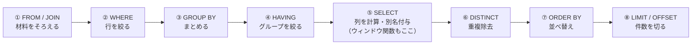

# SQLの実行順序

[[MOC_データアーキテクチャ体系|📚 目次]] ｜ [[05_NULLと三値論理|← 前へ]] ｜ [[07_NoSQLのデータモデル|次へ →]]

> [!abstract] この記事で分かること
> - SQL の「書く順序」と「論理的な評価順序」が違うこと
> - FROM → WHERE → GROUP BY → HAVING → SELECT → DISTINCT → ORDER BY → LIMIT の各段階で何が起きるか
> - 「WHERE で別名が使えない」「WHERE で集約関数が使えない」などの現象が評価順序で説明できること
> - 論理的な順序と、DB が実際に動く物理的な手順（実行計画）の違い
> - オプティマイザと EXPLAIN の入口
>
> **前提**：[[02_SQLの基本操作（CRUD）]]、[[04_集約とウィンドウ関数]] を読んでいると理解しやすいです。

## 1. ひとことで言うと

料理のレシピは「完成写真 → 材料 → 手順」の順に書かれていますが、作るときは「材料をそろえる → 下ごしらえ → 調理 → 盛り付け」の順です。
SQL も同じで、**見た目の完成形（SELECT）を最初に書きますが、意味の上では終盤に評価されます**。まず FROM で材料（テーブル）をそろえ、WHERE で下ごしらえ（行の選別）をし、GROUP BY でまとめ、最後に SELECT で盛り付ける（列を選ぶ）のです。

- 書く順序：SELECT → FROM → WHERE → GROUP BY → HAVING → ORDER BY → LIMIT
- 評価順序：**FROM → WHERE → GROUP BY → HAVING → SELECT → DISTINCT → ORDER BY → LIMIT**
- この順序を知ると、多くのエラーや「なぜか書けない」理由が一発で分かる

## 2. 論理的な評価順序

SQL 標準が定める「結果がどうなるべきか」を決める順序を、**論理的な評価順序（Logical Processing Order）** と呼びます。各段階は前の段階の出力（仮想的なテーブル）を受け取り、加工して次に渡します。



| 順 | 句 | 入力 → 出力 | この時点で使えるもの |
|---|---|---|---|
| ① | FROM / JOIN | テーブル → 結合済みの行の集まり | テーブルの全列 |
| ② | WHERE | 行 → 条件が TRUE の行だけ | 元の列（別名・集約はまだない） |
| ③ | GROUP BY | 行 → グループ（1 グループ 1 行） | 元の列 |
| ④ | HAVING | グループ → 条件が TRUE のグループ | グループ列・集約関数 |
| ⑤ | SELECT | 出力する列を計算し、**別名を付ける** | グループ列・集約関数・ウィンドウ関数 |
| ⑥ | DISTINCT | 重複した行を 1 つに | SELECT の結果 |
| ⑦ | ORDER BY | 並べ替え | **SELECT の別名も使える** |
| ⑧ | LIMIT / OFFSET | 先頭から件数で切る | — |

ウィンドウ関数は HAVING の後、SELECT の段階で計算されます（DISTINCT・ORDER BY より前）。

### 通しで追ってみる

「2026 年の注文について、購入総額 3000 円以上のユーザーを総額の多い順に上位 10 人」を追います。

```sql
SELECT   o.user_id, sum(oi.quantity * oi.unit_price) AS total   -- ⑤
FROM     orders o                                               -- ①
JOIN     order_items oi ON oi.order_id = o.id                   -- ①
WHERE    o.ordered_at >= '2026-01-01'                           -- ②
GROUP BY o.user_id                                              -- ③
HAVING   sum(oi.quantity * oi.unit_price) >= 3000               -- ④
ORDER BY total DESC                                             -- ⑦
LIMIT    10;                                                    -- ⑧
```

```
① FROM/JOIN   注文 × 明細          250,000 行（例）
② WHERE       2026 年以降          120,000 行
③ GROUP BY    ユーザーごとに 1 行    8,400 行   ← ここで表の形が変わる
④ HAVING      総額 3000 以上           310 行
⑤ SELECT      user_id, total の 2 列   310 行   ← 別名 total が誕生
⑦ ORDER BY    total の降順             310 行
⑧ LIMIT       上位 10                   10 行
```

（行数は [[【入門】SQLの実行順序（論理・物理）。実行計画とは何か。]] の例をもとにした目安です）

## 3. 評価順序で説明できる現象

### 3.1 WHERE で SELECT の別名が使えない

```sql
SELECT name, price * 110 / 100 AS price_with_tax
FROM products
WHERE price_with_tax > 1000;
-- ERROR:  column "price_with_tax" does not exist
```

別名 `price_with_tax` は ⑤ SELECT で生まれます。② WHERE の時点ではまだ存在しません。式をもう一度書くか、サブクエリ / CTE で先に計算します。

```sql
SELECT name, price * 110 / 100 AS price_with_tax
FROM products
WHERE price * 110 / 100 > 1000;       -- 式を繰り返す
```

### 3.2 ORDER BY では別名が使える

```sql
SELECT name, price * 110 / 100 AS price_with_tax
FROM products
ORDER BY price_with_tax DESC;         -- OK
```

⑦ ORDER BY は ⑤ SELECT の後なので、別名はもう存在します。

### 3.3 WHERE で集約関数が使えない（HAVING が必要な理由）

```sql
SELECT user_id, count(*) FROM orders
WHERE count(*) >= 2 GROUP BY user_id;
-- ERROR:  aggregate functions are not allowed in WHERE
```

集約は ③ GROUP BY で初めて計算されます。② WHERE の時点では「グループ」も「件数」もまだありません。だから集約後に絞る ④ HAVING が別に用意されているのです。

### 3.4 WHERE でウィンドウ関数が使えない

`row_number() OVER (...)` は ⑤ で計算されるので、② WHERE や ④ HAVING でも使えません。[[04_集約とウィンドウ関数]] でサブクエリに包んで `WHERE rn = 1` と書いたのはこのためです。

### 3.5 LIMIT は並べ替えの後

`ORDER BY price DESC LIMIT 3` は「並べ替えてから 3 件」です。「適当な 3 件を取ってから並べる」ではありません。逆に言えば ORDER BY のない LIMIT は「⑦ で順序が決まっていない集まりから 3 件」なので、どの行かは不定です。

### 3.6 SELECT DISTINCT と ORDER BY

```sql
SELECT DISTINCT category_id FROM products ORDER BY price;
-- ERROR:  for SELECT DISTINCT, ORDER BY expressions must appear in select list
```

⑥ DISTINCT で重複を消した後の各行には「price」が 1 つに決まりません（本カテゴリには 2800 円と 3200 円がある）。だから並べ替えのキーにできないのです。

### 3.7 DB 独自の拡張に注意

標準の順序からすると不自然でも、DB が便宜的に許していることがあります。

| 書き方 | PostgreSQL | MySQL |
|---|---|---|
| `GROUP BY 別名` | 可（独自拡張。入力列と同名なら入力列が優先） | 可 |
| `HAVING 別名 > 0` | **不可**（式を書く） | 可 |
| `WHERE 別名 > 0` | 不可 | 不可 |
| `ORDER BY 別名` | 可 | 可 |

移植性を重視するなら「別名は ORDER BY だけで使う」と覚えておけば安全です。

## 4. 論理順序と物理実行は違う

ここまでの順序は **「結果がこうなるべき」という意味のルール** です。DB が実際にこの順番どおりに、全行を作ってから次の段階に渡しているわけではありません。**結果が同じになるなら、どんな手順で計算してもよい** のです。実際の手順は DB 自身が組み立てます。これを **物理的な実行（Physical Execution）** と呼びます。

例を見てみましょう。

```sql
SELECT u.name, o.ordered_at
FROM users u
JOIN orders o ON o.user_id = u.id
WHERE u.email = 'yamada@example.com'
ORDER BY o.ordered_at DESC
LIMIT 5;
```

論理順序どおりなら「全ユーザー × 全注文を JOIN → 山田さんだけ残す → 並べ替え → 5 件」ですが、実際の DB は次のように動きます。

| 論理的な意味 | 実際の物理的な手順（例） |
|---|---|
| ① 全行を JOIN してから ② で絞る | **先に** email の一意インデックスで山田さん 1 行を見つけ、その id で orders を探す（条件の押し下げ：Predicate Pushdown） |
| JOIN は書いた順（users → orders） | 小さい方・絞り込める方から読む（結合順序の入れ替え） |
| ⑦ 全件を並べ替え → ⑧ 5 件 | `(user_id, ordered_at)` のインデックスがあれば、並んだ順に読んで 5 件で **打ち切る**（並べ替え自体が不要） |
| 相関サブクエリは 1 行ごとに実行 | セミ結合（Hash Join など）に書き換えて一括処理 |

論理順序は **「何が書けて、結果がどうなるか」** を説明し、物理実行は **「どれだけ速いか」** を決めます。両者を混同すると「WHERE は JOIN の後に評価されるから、WHERE で絞っても JOIN は軽くならない」のような誤解をしてしまいます。

## 5. オプティマイザと実行計画の入口

### 5.1 オプティマイザ

オプティマイザ（Optimizer / クエリプランナー）：SQL を受け取り、結果が同じになる無数の手順の中から **最も安そうなもの** を選ぶ DB の部品 です（DBMS の中での位置づけは [[02_DBMSの仕組み]]）。カーナビが目的地までのルートを複数比べて最短を選ぶのに似ています。

判断材料は **統計情報（Statistics）**：各テーブルの行数や、列にどんな値がどれくらいの割合で入っているか です。PostgreSQL では `ANALYZE` で収集され、autovacuum が定期的に更新します。統計情報が古いと、「100 行しかないと思って選んだ手順が、実は 100 万行に対して走る」といった誤判断が起きます。

### 5.2 EXPLAIN：DB の頭の中を覗く

選ばれた手順は **実行計画（Execution Plan）** と呼ばれ、`EXPLAIN` で見られます。

```sql
EXPLAIN
SELECT name FROM users WHERE email = 'yamada@example.com';
--                                   QUERY PLAN
-- ------------------------------------------------------------------------------
--  Index Scan using users_email_key on users  (cost=0.15..8.17 rows=1 width=32)
--    Index Cond: (email = 'yamada@example.com'::text)
```

- `Index Scan using users_email_key`：UNIQUE 制約が作ったインデックスを使って探している
- `cost`：オプティマイザが見積もったコスト（相対値）
- `rows=1`：返ると見積もった行数

`EXPLAIN ANALYZE` を付けると **実際に実行して** 実測時間と実際の行数も表示します（UPDATE/DELETE に付けると本当に更新されるので、`BEGIN; ... ROLLBACK;` で囲みます）。見積もりと実測の行数が大きくずれていたら、統計情報が古いサインです。

計画の読み方（Seq Scan / Index Scan / Nested Loop / Hash Join の見分け方、ボトルネックの探し方）は [[05_実行計画の読み方]] で詳しく扱います。インデックスが使われない書き方は [[04_インデックスが効かないパターン]] へ。

> [!tip] 遅いクエリに出会ったら
> 1. 推測せず `EXPLAIN ANALYZE` を取る
> 2. 最も時間（行数）を食っている 1 ステップを探す
> 3. 直したら、もう一度計画を取って変化を確認する
>
> 「SQL の書き方を変えたら速くなるはず」という思い込みより、計画を見る方が確実です。

## よくある誤解・つまずき

- ❌ **SQL は上から書いた順に実行される** → ✅ 論理的には FROM から始まり、SELECT は終盤です。別名が WHERE で使えないのはこのためです。
- ❌ **論理順序どおりに DB が全行を処理している** → ✅ 論理順序は結果の意味を決めるだけで、実際の手順はオプティマイザが自由に組み替えます（条件の押し下げ、結合順序の入れ替え、LIMIT での打ち切りなど）。
- ❌ **WHERE と HAVING はどちらで絞っても同じ** → ✅ WHERE は集約前の行、HAVING は集約後のグループに対する条件です。集約と関係ない条件は WHERE で早めに絞る方が効率的です。
- ❌ **サブクエリより JOIN の方が必ず速い（またはその逆）** → ✅ オプティマイザが同じ計画に書き換えることも多く、書き方だけでは決まりません。実行計画で確かめます。
- ❌ **EXPLAIN ANALYZE は安全な調査コマンド** → ✅ 実際に実行するので、更新系 SQL ではデータが変わります。トランザクションで囲んでロールバックします。

## まとめ

- SQL の論理的な評価順序は FROM → WHERE → GROUP BY → HAVING → SELECT → DISTINCT → ORDER BY → LIMIT
- 別名は SELECT で生まれるので WHERE では使えず ORDER BY では使える。集約は GROUP BY 以降なので WHERE ではなく HAVING
- ウィンドウ関数は SELECT 段階で計算されるため、絞り込みにはサブクエリが必要
- 論理順序は「結果の意味」、物理実行は「速さ」。DB は結果が同じなら手順を自由に組み替える
- 手順を選ぶのはオプティマイザで、判断材料は統計情報。選ばれた手順は EXPLAIN で確認できる

## 確認クイズ

1. 次の SQL はエラーになります。理由を評価順序で説明し、動くように直してください。
   `SELECT user_id, count(*) AS cnt FROM orders WHERE cnt >= 2 GROUP BY user_id;`
> [!tip]- 答え
> 別名 `cnt`（と集約 count）は GROUP BY・SELECT の段階で生まれるため、それより前の WHERE では使えません。集約後の条件は HAVING に書きます：`SELECT user_id, count(*) AS cnt FROM orders GROUP BY user_id HAVING count(*) >= 2;`（PostgreSQL では HAVING でも別名は使えないので式を書きます）。

2. 「WHERE は JOIN の後に評価されるので、WHERE に条件を書いても JOIN する行数は減らない」という主張は正しいですか？
> [!tip]- 答え
> 正しくありません。それは論理順序（結果の意味）の話で、実際にはオプティマイザが条件を JOIN の前に押し下げ（Predicate Pushdown）、先に行を絞ってから結合するのが普通です。実際の手順は EXPLAIN で確認します。

3. `EXPLAIN` の見積もり行数が 10 行、`EXPLAIN ANALYZE` の実際の行数が 50 万行でした。何を疑いますか？
> [!tip]- 答え
> 統計情報が古い（あるいは実態を表せていない）ことを疑います。`ANALYZE テーブル名;` で統計を更新し、計画が変わるか確認します。見積もりが大きく外れると、オプティマイザは不適切な結合方法やアクセス方法を選びがちです。

## 関連ノート

- [[04_集約とウィンドウ関数]] — GROUP BY / HAVING / ウィンドウ関数の書き方
- [[05_実行計画の読み方]] — EXPLAIN の出力を詳しく読む
- [[03_インデックスの基本と設計]] — 「早く絞る」ための道具
- [[04_インデックスが効かないパターン]] — 列を関数で包むなど、計画を悪くする書き方
- [[MOC_パフォーマンス体系]] — DB 以外も含めた性能改善の全体像
- [[【入門】SQLの実行順序（論理・物理）。実行計画とは何か。]] — （クリップ）書く順と論理順序、実行計画の読み方、SARGable な書き方を通しで解説した動画

## 参考

- [PostgreSQL Documentation: SELECT（Description の処理手順）](https://www.postgresql.org/docs/current/sql-select.html)
- [PostgreSQL Documentation: Using EXPLAIN](https://www.postgresql.org/docs/current/using-explain.html)
- [PostgreSQL Documentation: Statistics Used by the Planner](https://www.postgresql.org/docs/current/planner-stats.html)
- [MySQL 8.0 Reference Manual: Problems with Column Aliases](https://dev.mysql.com/doc/refman/8.0/en/problems-with-alias.html)
