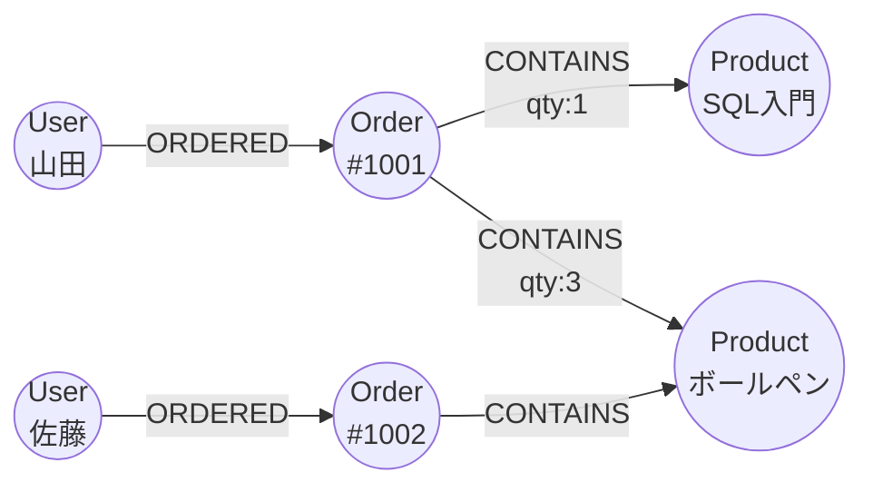

# NoSQLのデータモデル

[[MOC_データアーキテクチャ体系|📚 目次]] ｜ [[06_SQLの実行順序|← 前へ]] ｜ [[01_データベース設計の流れとER図|次へ →]]

> [!abstract] この記事で分かること
> - キーバリュー・ドキュメント・ワイドカラム・グラフの 4 つのデータモデルの構造
> - 同じ「注文」データが、それぞれのモデルでどう表されるか
> - ドキュメント設計の核心「埋め込み vs 参照」の判断基準
> - 「アクセスパターンから設計する」DynamoDB 流の考え方
> - CAP・BASE の概要と、SQL と NoSQL の選び分け
>
> **前提**：[[01_リレーショナルモデルとテーブル]]、[[03_データベースの種類と選び方]] を読んでいると理解しやすいです。

## 1. ひとことで言うと

リレーショナル DB は **図書館** に似ています。本は分類ごとの棚に整然と並び、索引カードを使えばどんな探し方（著者・題名・分類）にも対応できます。その代わり、毎回「棚を回って集める」手間（JOIN）があります。
NoSQL の多くは **お弁当** に似ています。食べる場面（アクセスパターン）が決まっているなら、必要なおかずを最初から 1 つの箱に詰めておけば、開けるだけで食べられます。ただし「全お弁当から卵焼きだけ集めて」と言われると大変です。

- NoSQL（Not Only SQL）は「リレーショナル以外のデータモデルを持つ DB」の総称
- 多くは **使い方（アクセスパターン）を先に決め、それに合わせてデータの形を決める**
- 得意なのは決まった読み方を大規模・高速に捌くこと。苦手なのは想定外の検索と、複数データにまたがる整合性

## 2. 4 つのデータモデル

| モデル | 構造 | 代表製品 | 得意なこと |
|---|---|---|---|
| キーバリュー（Key-Value） | キー → 値（中身は DB から見えない塊） | Redis, Memcached, DynamoDB | キー指定の超高速読み書き（キャッシュ、セッション） |
| ドキュメント（Document） | キー → JSON のような入れ子の文書 | MongoDB, Firestore, Couchbase | 1 つの文書に関連データをまとめて読む |
| ワイドカラム（Wide-Column） | パーティションキー → 並んだ行（行ごとに列が可変） | Cassandra, HBase, Bigtable | 大量の書き込み、時系列データ |
| グラフ（Graph） | ノード（点）とエッジ（線） | Neo4j, Amazon Neptune | 「友達の友達」のような関係の探索 |

> [!note] ワイドカラムと列指向は別物
> Cassandra などの「ワイドカラム」は、行ごとに異なる列を持てるという **データモデル** の話です。分析用 DWH の「列指向ストレージ」（列ごとにまとめて保存する **保存方式**）とは別の概念です。後者は [[02_列指向ストレージとデータウェアハウス]] で扱います。

## 3. 同じ「注文」を 5 つのモデルで表す

「山田さんの注文 #1001：SQL入門 ×1、ボールペン ×3」を表してみます。

### 3.1 リレーショナル（比較用）

```
users           orders                order_items
id | name       id   | user_id        order_id | product_id | qty
1  | 山田       1001 | 1              1001     | 1          | 1
                                      1001     | 3          | 3
```

正規化されて 3 テーブルに分かれ、読むときに JOIN で組み立てます（[[03_JOINとサブクエリ]]）。

### 3.2 キーバリュー

```
キー                  値（DB からは中身が見えない）
"order:1001"   →     '{"user":"山田","items":[{"p":"SQL入門","q":1},{"p":"ボールペン","q":3}]}'
"user:1:cart"  →     '[3, 5]'
"session:ab12" →     '{"user_id":1,"expires":"..."}'
```

キーを知っていれば一瞬で取れますが、「山田さんの注文一覧」のような **値の中身による検索はできません**。必要なら `"user:1:orders" → [1001, 1002]` のような索引用のキーを自分で作って管理します。

### 3.3 ドキュメント

```json
// orders コレクションの 1 ドキュメント
{
  "_id": 1001,
  "user": { "id": 1, "name": "山田太郎" },
  "status": "pending",
  "ordered_at": "2026-10-12T10:00:00+09:00",
  "items": [
    { "product_id": 1, "name": "SQL入門",   "qty": 1, "unit_price": 2800 },
    { "product_id": 3, "name": "ボールペン", "qty": 3, "unit_price": 150 }
  ]
}
```

注文画面に必要な情報が **1 回の読み取り** で全部そろいます。中身の項目で検索・インデックス作成もできます。一方、ユーザー名を変更したら、このユーザーの全注文ドキュメントに埋め込んだ名前をどうするか（更新するのか、注文時点の名前として残すのか）を決める必要があります。

### 3.4 ワイドカラム（Cassandra）

```sql
-- CQL（Cassandra Query Language）。SQL に似ているが JOIN はない
CREATE TABLE orders_by_user (
  user_id    bigint,
  ordered_at timestamp,
  order_id   bigint,
  product    text,
  qty        int,
  PRIMARY KEY ((user_id), ordered_at, order_id, product)
) WITH CLUSTERING ORDER BY (ordered_at DESC, order_id ASC, product ASC);
```

```
パーティション user_id=1（同じノードに、ordered_at の新しい順に並んで保存）
├─ 2026-10-12 10:00 | 1001 | SQL入門    | 1
├─ 2026-10-12 10:00 | 1001 | ボールペン | 3
└─ 2026-09-30 18:00 | 0987 | ...
```

テーブル名が `orders_by_user` なのがポイントです。「ユーザーごとの注文履歴を新しい順に」という **問い合わせ 1 つのためにテーブルを設計** します。「商品ごとの注文」が欲しければ、`orders_by_product` を別に作り、両方に書き込みます（意図的な重複）。

### 3.5 グラフ



```cypher
// Neo4j の Cypher：山田さんと同じ商品を買った人が、他に買った商品（おすすめ）
MATCH (me:User {name:'山田'})-[:ORDERED]->(:Order)-[:CONTAINS]->(p:Product)
      <-[:CONTAINS]-(:Order)<-[:ORDERED]-(other:User)
      -[:ORDERED]->(:Order)-[:CONTAINS]->(rec:Product)
WHERE other <> me
RETURN rec.name, count(*) AS score ORDER BY score DESC;
```

関係そのものを「線」として保存するので、何段も関係をたどる検索が得意です。RDB で同じことをすると自己結合が何重にもなります。

## 4. 埋め込み vs 参照

ドキュメント DB 設計の最大の判断は、関連データを **埋め込む（Embed）** か、ID で **参照する（Reference）** かです。

```json
// 埋め込み：明細を注文の中に入れる
{ "_id": 1001, "items": [ { "product_id": 1, "qty": 1 }, ... ] }

// 参照：レビューは別コレクションに置き、product_id で指す
{ "_id": "r-501", "product_id": 1, "user_id": 2, "rating": 5, "body": "..." }
```

| 観点 | 埋め込み向き | 参照向き |
|---|---|---|
| 一緒に読むか | いつも親と一緒に読む（注文と明細） | 単独で読む・一覧することが多い |
| 個数 | 少数で上限がある（明細は数十件） | 際限なく増える（商品へのレビュー、ログ） |
| 更新 | 親と一緒に更新、または不変（購入時の価格） | 独立して頻繁に更新される（在庫数） |
| 共有 | その親専用 | 多くの親から共有される（ユーザー情報） |

判断のコツは「**一緒に読み、一緒に変わり、際限なく増えないなら埋め込む**」です。際限なく増える配列を埋め込むと、ドキュメントサイズの上限（MongoDB は 1 ドキュメント 16MB）に達したり、読むたびに巨大な文書を転送したりします。

これはリレーショナルでいう **非正規化** と同じトレードオフです（[[03_非正規化と実務での判断]]）。読みは速くなり、書き（重複箇所の更新）と整合性の維持が難しくなります。

## 5. アクセスパターン駆動設計（DynamoDB の例）

RDB では「データの構造」から正規化して設計し、どんな問い合わせにも後から SQL で対応できます。DynamoDB のような NoSQL では逆に、**どんな問い合わせ（アクセスパターン）が来るかを先に全部洗い出し、それが最速になる形にデータを置きます**。AWS 公式ドキュメントも「答えるべき質問が分かるまでスキーマ設計を始めるべきではない」と述べています。

### 5.1 DynamoDB の基本

- データは **パーティションキー（PK）** でノードに振り分けられ、同じ PK の項目は **ソートキー（SK）** 順に並ぶ
- 効率的な読み取り（Query）は「PK を指定し、SK の範囲で絞る」形だけ。それ以外は全件スキャン（Scan）になり遅く高い
- JOIN はない。関連データは **同じ PK に並べて置き**、1 回の Query で取る
- 別の検索軸が必要なら **グローバルセカンダリインデックス（GSI）** で別のキーの並びを作る

### 5.2 Shop をシングルテーブル設計にする

まずアクセスパターンを列挙します。

1. ユーザー情報を取る
2. ユーザーの注文一覧を新しい順に取る
3. 注文と明細をまとめて取る
4. ステータスが pending の注文を古い順に取る（発送作業用）

これを 1 つのテーブルで満たすように、キーを設計します。

| PK | SK | その他の属性 | 用途 |
|---|---|---|---|
| `USER#1` | `PROFILE` | name, email | ① |
| `USER#1` | `ORDER#2026-10-12T10:00#1001` | status, total | ② SK の前方一致・降順で注文一覧 |
| `ORDER#1001` | `META` | user_id, status, GSI1PK=`STATUS#pending`, GSI1SK=`2026-10-12T10:00` | ③④ |
| `ORDER#1001` | `ITEM#1` | name=SQL入門, qty=1, unit_price=2800 | ③ |
| `ORDER#1001` | `ITEM#3` | name=ボールペン, qty=3, unit_price=150 | ③ |

- ② は `PK = USER#1 AND begins_with(SK, 'ORDER#')` を降順で Query
- ③ は `PK = ORDER#1001` で Query すれば、注文本体と明細が 1 回で返る（JOIN の代わり）
- ④ は GSI1 で `GSI1PK = STATUS#pending` を Query（ステータス変更時は GSI1PK も書き換える）

注文一覧の項目（`USER#1 / ORDER#...`）と注文本体（`ORDER#1001 / META`）にステータスが **重複** している点に注目してください。書き込み時に両方を更新する（トランザクション書き込みを使う）手間と引き換えに、読み取りを常に 1 回の Query にしています。

> [!warning] アクセスパターンが変わると作り直し
> 後から「商品ごとの売上ランキング」が欲しくなっても、今のキー設計では効率的に取れません。GSI の追加や、データの再投入が必要です。要件が固まっていない初期のサービスや、分析的な問い合わせが多いシステムには RDB の方が向いています。分析は別途 DWH に流すのが定石です（[[01_OLTPとOLAP]]）。

## 6. CAP・BASE と、SQL / NoSQL の選び分け

### 6.1 CAP と BASE（軽く）

多くの NoSQL は複数ノードへの分散を前提に作られているため、分散システムの制約と一緒に語られます。

- **CAP 定理**：ネットワーク分断（Partition）が起きたとき、全ノードが最新の同じ値を返す **一貫性（Consistency）** と、全ノードが応答し続ける **可用性（Availability）** のどちらかを諦める必要がある、という定理です。「3 つのうち 2 つを選ぶ」と紹介されがちですが、分断は避けられないので実際は「分断時に C と A のどちらを優先するか」の選択です。
- **BASE**：RDB の ACID（[[01_トランザクションとACID]]）と対比される考え方で、Basically Available（基本的に応答する）、Soft state（状態は途中で変わりうる）、Eventually consistent（**結果整合性**：しばらく待てば全ノードが同じ値に収束する）の略です。

ただし最近は境界が曖昧で、DynamoDB や MongoDB も強い整合性の読み取りやトランザクションを提供しています。逆に RDB もレプリカから読めば結果整合になります。レプリケーションや合意アルゴリズムなどの詳細は [[MOC_分散システム体系]] を参照してください。

### 6.2 選び分け

| 判断軸 | RDB（SQL）が向く | NoSQL が向く |
|---|---|---|
| アクセスパターン | まだ固まっていない、多様な検索・集計 | 少数の決まったパターンを大量に捌く |
| 整合性 | お金・在庫など複数データの厳密な整合が必要 | 多少の遅れが許容できる（いいね数、閲覧履歴） |
| データの形 | 構造が明確で、関係が多い | 入れ子・可変（ドキュメント）、関係中心（グラフ） |
| 規模 | 1 台（＋リードレプリカ）で収まる | 水平分散が必須なほどの書き込み量・データ量 |
| チーム | SQL の知識が広く使える | 製品ごとの API・設計手法を学ぶ必要がある |

迷ったら **まず RDB** が無難な出発点です。PostgreSQL は `JSONB` 型でドキュメント的な柔軟さもある程度持てます。そのうえで、セッションやキャッシュは Redis、検索は全文検索エンジン、のように **用途ごとに DB を使い分ける構成（ポリグロット・パーシステンス：Polyglot Persistence）** が実務ではよく見られます。カートは NoSQL、確定した注文は RDB という組み合わせもその一例です。

## よくある誤解・つまずき

- ❌ **NoSQL はスキーマがないから設計しなくてよい** → ✅ DB が強制しないだけで、スキーマはアプリ側に存在します。むしろアクセスパターンに合わせたキー設計を最初に慎重に行う必要があります（「スキーマレス」ではなく「スキーマ・オン・リード」）。
- ❌ **NoSQL は RDB より速い** → ✅ 想定したアクセスパターンでは速く、想定外の検索（全件スキャン）では遅く高価です。速さは設計次第です。
- ❌ **NoSQL ではトランザクションが使えない** → ✅ MongoDB（4.0 以降）や DynamoDB（TransactWriteItems）など、多くの製品が複数項目のトランザクションを提供しています。ただし制約やコストは RDB と異なります。
- ❌ **ドキュメント DB なら全部埋め込めばよい** → ✅ 際限なく増えるデータや、多くの親から共有され頻繁に変わるデータは参照にします。
- ❌ **CAP の C は ACID の C と同じ** → ✅ CAP の C は「全ノードが同じ最新値を返す」こと、ACID の C は「制約を満たした状態を保つ」ことで、別の概念です。

## まとめ

- NoSQL は キーバリュー・ドキュメント・ワイドカラム・グラフ の 4 系統。それぞれ得意な読み方が違う
- 同じ注文でも、RDB は正規化して JOIN、ドキュメントは 1 文書に埋め込み、ワイドカラムは問い合わせごとにテーブル、グラフは関係を線で持つ
- 埋め込みは「一緒に読み、一緒に変わり、際限なく増えない」データに。それ以外は参照
- DynamoDB などはアクセスパターンを先に決め、PK/SK と GSI で 1 回の Query で取れる形にする
- 迷ったらまず RDB。規模・アクセスパターン・整合性要件に応じて NoSQL を併用する

## 確認クイズ

1. ブログ記事のドキュメントに、コメントを配列で埋め込む設計にしました。人気記事で問題になりうることは何ですか？
> [!tip]- 答え
> コメントは際限なく増えるため、ドキュメントサイズの上限（MongoDB は 16MB）に近づいたり、記事を読むたびに大量のコメントまで転送されたりします。コメントは別コレクションに置き、記事 ID で参照する方が適切です（最新数件だけを埋め込む折衷案もあります）。

2. DynamoDB で `PK = USER#1`、`SK = ORDER#<日時>#<注文ID>` という設計にしました。この設計で効率的に答えられる問い合わせと、答えにくい問い合わせを 1 つずつ挙げてください。
> [!tip]- 答え
> 答えやすい：「ユーザー 1 の注文を新しい順に 10 件」（PK 指定 + SK の範囲・順序）。答えにくい：「全ユーザーの pending の注文一覧」や「商品ごとの売上」（PK を指定できないので Scan になる）。必要なら GSI を追加します。

3. 「新規サービスで要件がまだ流動的、売上の集計画面も必要」という場合、RDB と NoSQL のどちらから始めるのがよいでしょうか？
> [!tip]- 答え
> RDB が無難です。アクセスパターンが固まっていない段階では、後から任意の検索・集計を SQL で書ける柔軟さが重要だからです。NoSQL はアクセスパターンを先に確定させる必要があり、要件変更のたびにキー設計の見直しが発生します。

## 関連ノート

- [[03_データベースの種類と選び方]] — DB の種類の全体像
- [[01_リレーショナルモデルとテーブル]] — 比較対象としてのリレーショナルモデル
- [[03_非正規化と実務での判断]] — 埋め込みと同じトレードオフを RDB 側から見る
- [[01_トランザクションとACID]] — BASE と対比される ACID
- [[MOC_分散システム体系]] — レプリケーション・CAP・合意など分散の詳細
- [[SQL、NoSQLの違い]] — （クリップ）構造・スケール・問い合わせ・トランザクション・スキーマの 5 観点で SQL と NoSQL を比較し、「カートは NoSQL、確定注文は SQL」の併用例も紹介

## 参考

- [Amazon DynamoDB Developer Guide: NoSQL design for DynamoDB](https://docs.aws.amazon.com/amazondynamodb/latest/developerguide/bp-general-nosql-design.html)
- [Amazon DynamoDB Developer Guide: Core components（Partition key / Sort key）](https://docs.aws.amazon.com/amazondynamodb/latest/developerguide/HowItWorks.CoreComponents.html)
- [MongoDB Manual: Embedded Data Versus References](https://www.mongodb.com/docs/manual/data-modeling/concepts/embedding-vs-references/)
- [MongoDB Manual: MongoDB Limits and Thresholds](https://www.mongodb.com/docs/manual/reference/limits/)
- [Apache Cassandra Documentation: Data Modeling](https://cassandra.apache.org/doc/latest/cassandra/developing/data-modeling/index.html)
