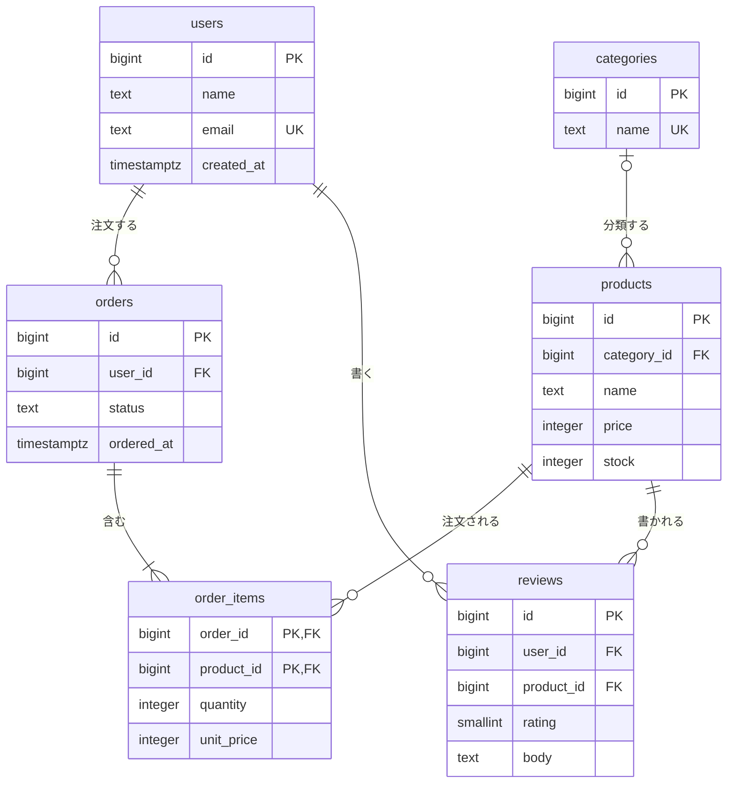

# データベース設計の流れとER図

[[MOC_データアーキテクチャ体系|📚 目次]] ｜ [[07_NoSQLのデータモデル|← 前へ]] ｜ [[02_正規化|次へ →]]

> [!abstract] この記事で分かること
> - データベース設計が「概念設計 → 論理設計 → 物理設計」の 3 段階で進む理由
> - 要件の文章からエンティティ（テーブルの候補）と関係を見つける手順
> - ER 図の読み方（IE 記法・カラスの足）と、Obsidian で描ける mermaid の書き方
> - カーディナリティ（1対1・1対多・多対多）と、多対多を中間テーブルで解く方法
> - EC サイト「Shop」を題材に、要件からテーブル定義までを 1 本通しで設計する流れ
>
> **前提**：[[01_リレーショナルモデルとテーブル]] と [[03_JOINとサブクエリ]] を読んでいると理解しやすいです。

## 1. ひとことで言うと

家を建てるとき、いきなり柱を立てる人はいません。まず「家族 4 人、在宅ワーク用の部屋がほしい」という**要望**を聞き、次に「LDK＋3 部屋」という**間取り図**を描き、最後に「柱は何センチ角、断熱材はこれ」という**施工図**に落とします。データベース設計も同じで、

- **概念設計**：業務に登場する「モノ・コト」と、その関係を洗い出す（要望 → 間取りのラフ）
- **論理設計**：それをテーブル・列・キーに落とし、正規化する（間取り図）
- **物理設計**：特定の DBMS 上で型・インデックス・パーティションなどを決める（施工図）

の 3 段階で進めます。ER 図（Entity-Relationship Diagram：実体と関係の図）は、この 3 段階を通して「関係者の共通言語」として使う図です。

> [!info] 要点
> 上流ほど「業務の言葉」、下流ほど「DBMS の言葉」で考えます。上流の誤り（関係の取り違え）は下流では直せず、後から直すとマイグレーションが大工事になります。

## 2. 設計の 3 段階

### 2.1 それぞれで決めること

| 段階 | 主な成果物 | 決めること | 決めないこと |
|---|---|---|---|
| 概念設計（Conceptual） | 概念 ER 図、用語集 | エンティティ、関係、カーディナリティ、業務ルール | 型、主キーの方式、DBMS |
| 論理設計（Logical） | 論理 ER 図、テーブル定義 | テーブル、列、主キー・外部キー、正規化、NULL 可否 | インデックス、容量、パーティション |
| 物理設計（Physical） | DDL（CREATE TABLE 文）、インデックス設計 | 具体的な型（`BIGINT` / `TEXT` …）、インデックス、パーティション、権限 | — |

- **エンティティ（Entity）**：管理したい「モノ・コト」の種類。例：会員、商品、注文。後でほぼテーブルになります。
- **属性（Attribute）**：エンティティが持つ性質。例：会員の名前、メールアドレス。後で列になります。
- **リレーションシップ（Relationship）**：エンティティ同士の関係。例：「会員が注文する」。後で外部キーになります。

### 2.2 なぜ段階を分けるのか

段階を分けると、**議論の相手と粒度を分けられる**からです。概念設計は業務担当者と「1 つの注文に複数の商品を入れられますか？」と話す段階で、`BIGINT` か `UUID` かは関係ありません。逆に物理設計はエンジニアだけで「この検索条件にインデックスが要る」を決める段階です。混ぜると、業務の確認が技術の話に埋もれて漏れます。

実務では 3 段階をきっちりウォーターフォールで回すことは少なく、小さなサービスなら 1 枚の ER 図を描きながら行き来します。それでも「今どの段階の話をしているか」を意識するだけで、レビューの質が上がります。

> [!note] 旧来の「設計の流れ」との対応
> よく紹介される「要件定義 → エンティティ抽出（ER 図）→ テーブル・カラム設計 → 正規化/非正規化 → キー・インデックス設計 → マイグレーション・運用設計」という流れは、上の 3 段階をさらに細かく分けたものです。正規化は [[02_正規化]]、非正規化は [[03_非正規化と実務での判断]]、キーは [[04_キーと制約の設計]]、インデックスは [[03_インデックスの基本と設計]]、運用は [[01_マイグレーションとは]] で扱います。

## 3. 要件からエンティティを見つける手順

### 3.1 名詞と動詞に線を引く

最も古典的で効く方法は、**要件の文章の名詞に丸、動詞に下線を引く**ことです。名詞がエンティティや属性の候補、動詞がリレーションシップの候補になります。Shop の要件を書いてみます。

> - **会員**は**メールアドレス**と**名前**を登録して<u>会員登録する</u>。
> - **商品**は 1 つの**カテゴリ**に<u>属する</u>。商品には**価格**と**在庫数**がある。
> - 会員は複数の商品をまとめて 1 回で<u>注文する</u>。注文には**注文日時**と**ステータス**がある。
> - 注文した**数量**と、**注文時の価格**を記録する（後で商品の価格が変わっても請求額は変わらない）。
> - 会員は商品に**レビュー**を<u>書ける</u>（1 商品につき 1 人 1 件）。

### 3.2 候補を振り分ける

名詞を次の基準で振り分けます。

1. **それ自体を複数件、独立して管理したいか？** → Yes ならエンティティ（会員、商品、カテゴリ、注文、レビュー）
2. **何かを説明する値にすぎないか？** → 属性（メールアドレス、名前、価格、在庫数、注文日時、ステータス）
3. **「誰が・何を・いくつ」のように 2 つのエンティティにまたがるか？** → 関係そのものが属性を持つので、**関係エンティティ（中間テーブル）**（「注文の中の各商品＝注文明細」：数量、注文時の価格）

迷ったら「その値に**さらに属性がぶら下がるか**」を考えます。カテゴリが「名前だけ」なら属性でもよいですが、「表示順」「親カテゴリ」などが付くならエンティティです。また「選択肢を後から管理画面で増やしたいか」もエンティティ化のサインです。

### 3.3 ルールを質問で確かめる

関係ごとに、業務担当者へ**両方向から**質問します。

- 「1 人の会員は注文を何件持てますか？」→ 0 件以上（まだ注文しない会員もいる）
- 「1 件の注文は何人の会員のものですか？」→ ちょうど 1 人
- 「1 件の注文に商品は何種類入りますか？」→ 1 種類以上
- 「1 つの商品は何件の注文に入りますか？」→ 0 件以上

この答えがそのまま次節の**カーディナリティ**になります。片方向だけ聞くと「多対多」を「1 対多」と取り違えるのが典型的な失敗です。

## 4. ER 図の記法とカーディナリティ

### 4.1 カーディナリティとは

**カーディナリティ（Cardinality：多重度）**は「相手側に何件対応するか」です。最小値（0 か 1 か＝必須かどうか、**オプショナリティ**とも呼ぶ）と最大値（1 か多か）の組で表します。

| 関係 | 例 | テーブルでの表し方 |
|---|---|---|
| 1 対 1 | 会員 ― 会員プロフィール | 片方の主キーをもう片方の外部キー兼主キー（または外部キー＋UNIQUE）にする |
| 1 対多 | 会員 ― 注文 | 「多」側（orders）に外部キー（user_id）を置く |
| 多対多 | 注文 ― 商品 | 中間テーブル（order_items）を作り、1対多 × 2 に分解する |

リレーショナルデータベースでは**多対多を直接表現できません**。1 つのセルには 1 つの値しか入らないからです（[[01_リレーショナルモデルとテーブル]]）。そのため中間テーブルで分解します。そして中間テーブルには「数量」「注文時の価格」のような**関係そのものの属性**が載ることが多い、というのが実務での大事な気づきです。

### 4.2 IE 記法（カラスの足）

ER 図の記法はいくつかありますが、実務で最も見るのが **IE 記法（Information Engineering 記法）**です。線の端の記号で最小・最大を表し、「多」を表す三つ又の形から**カラスの足（Crow's Foot）**とも呼ばれます。

```
記号（線の端）     意味
  ──┼┼          ちょうど 1（最小1・最大1）
  ──○┼          0 または 1
  ──┼<          1 以上（最小1・最大多）
  ──○<          0 以上

例：会員 ┼┼───────○< 注文
   「注文から見て会員はちょうど1人」「会員から見て注文は0件以上」
```

読み方のコツは「**線の向こう側の端を読む**」ことです。会員の箱から線をたどり、注文側の端に `○<` があれば「会員 1 人につき注文は 0 以上」です。

他に、大学の教科書で見る **Chen 記法**（ひし形で関係を描く）や、日本の情報処理試験で使われる矢印の記法もありますが、考え方は同じです。

### 4.3 mermaid の erDiagram

Obsidian では mermaid の `erDiagram` で IE 記法の ER 図を描けます。記号の対応は次のとおりです。

| mermaid（左端 / 右端） | 意味 |
|---|---|
| `\|o` / `o\|` | 0 または 1 |
| `\|\|` / `\|\|` | ちょうど 1 |
| `}o` / `o{` | 0 以上 |
| `}\|` / `\|{` | 1 以上 |

`A ||--o{ B : "ラベル"` は「A 1 件に B が 0 件以上」です。`--` は実線（識別関係：子の主キーに親のキーが含まれる）、`..` は点線（非識別関係）です。

## 5. 実践：Shop を 1 から設計する

### 5.1 概念設計：エンティティと関係

3 章の要件から、エンティティは「会員・カテゴリ・商品・注文・注文明細・レビュー」の 6 つ、関係は次のとおりです。

- 会員 1 ― 注文 0..多（会員は注文しなくてもよい）
- 注文 1 ― 注文明細 1..多（明細のない注文はない）
- 商品 1 ― 注文明細 0..多
- カテゴリ 0..1 ― 商品 0..多（カテゴリ未設定の商品を許す）
- 会員 1 ― レビュー 0..多、商品 1 ― レビュー 0..多（会員×商品で一意）

### 5.2 論理設計：ER 図に落とす



ここで行った判断を言葉にしておきます。

- **多対多（注文 ⇔ 商品）を order_items で分解**し、数量 `quantity` と注文時単価 `unit_price` を持たせました。`unit_price` は「商品の価格のコピー」ではなく「その注文で合意した価格」という**別の事実**です（詳しくは [[03_非正規化と実務での判断]]）。
- **order_items の主キーは (order_id, product_id) の複合キー**です。「同じ注文に同じ商品が 2 行入らない」という業務ルールを主キーで表現しています。
- **会員の合計購入額は列として持たない**ことにしました。orders と order_items から計算できる値を保存すると不整合の元になるからです（[[02_正規化]]）。
- **住所**は今回の要件にないので入れていません。将来「複数の配送先」が要件になれば `addresses` エンティティ（会員 1 ― 住所 0..多）を足します。

### 5.3 物理設計：DDL にする

共通スキーマに `reviews` を足した DDL です。

```sql
CREATE TABLE reviews (
  id         BIGSERIAL PRIMARY KEY,
  user_id    BIGINT   NOT NULL REFERENCES users(id),
  product_id BIGINT   NOT NULL REFERENCES products(id),
  rating     SMALLINT NOT NULL CHECK (rating BETWEEN 1 AND 5),
  body       TEXT,
  created_at TIMESTAMPTZ NOT NULL DEFAULT now(),
  UNIQUE (user_id, product_id)          -- 1商品につき1人1件
);

-- 外部キー列には自動でインデックスが張られない（PostgreSQL）ので、
-- 「商品ごとのレビュー一覧」を出すなら明示的に作る
CREATE INDEX reviews_product_id_idx ON reviews (product_id);
```

物理設計では、型の選び方（金額は `INTEGER`（円単位）か `NUMERIC` か）、インデックス、将来の件数見積もりなどを決めます。キーと制約の詳細は [[04_キーと制約の設計]]、インデックスは [[03_インデックスの基本と設計]] で扱います。

> [!warning] MySQL との違い
> MySQL（InnoDB）は外部キーを作ると、参照側の列にインデックスが無ければ**自動で作成**します。PostgreSQL は作らないため、自分で作る必要があります。

### 5.4 設計レビューの観点

設計がひととおりできたら、次の観点で見直します。

- **用語の一貫性**：同じものを `member` と `user` で呼び分けていないか
- **関係の両方向**：最小 0 か 1 か（NOT NULL を付けるか）を両側から確認したか
- **導出値**：他の列から計算できる値を保存していないか（保存するなら理由と同期方法があるか）
- **時間**：「変わる値」の過去を残す必要はないか（価格、住所、ステータス）
- **将来の拡張**：「1 つ」と言われたものが「複数」になりそうか（電話番号、カテゴリ）

## よくある誤解・つまずき

- ❌ ER 図はドキュメント作成のための形式的な作業 → ✅ 「1 対多か多対多か」を関係者と合意するための道具です。描く過程で業務ルールの食い違いが見つかることが最大の価値です。
- ❌ 名詞はすべてテーブルになる → ✅ 多くは属性です。「独立して複数件を管理したいか」「さらに属性がぶら下がるか」で判断します。
- ❌ 多対多は外部キー列を 2 つ持てば表せる → ✅ RDB では中間テーブルが必要です。`products.order_ids` のような列は [[05_設計パターンとアンチパターン]] で扱う「カンマ区切り列」アンチパターンになります。
- ❌ カーディナリティは片方向から聞けば十分 → ✅ 「会員→注文」と「注文→会員」を両方確かめないと、1 対多と多対多を取り違えます。
- ❌ 物理設計から始めても後で直せる → ✅ 関係の取り違えはデータが溜まってからだと大規模なマイグレーションになります（[[07_ゼロダウンタイムのスキーマ変更]]）。

## まとめ

- DB 設計は **概念設計（何を管理するか）→ 論理設計（テーブル・キー・正規化）→ 物理設計（型・インデックス）** の順に進める
- 要件の**名詞はエンティティ/属性、動詞はリレーションシップ**の候補。属性を持つ関係は中間テーブルになる
- **カーディナリティ**は最小（0/1）と最大（1/多）の組。必ず両方向から確かめる
- **IE 記法（カラスの足）**が実務の標準。Obsidian では mermaid の `erDiagram` で描ける
- 多対多は中間テーブルで 1 対多 × 2 に分解し、関係固有の属性（数量・注文時価格）を載せる

## 確認クイズ

1. 「インデックスをどの列に張るか」は 3 段階のどこで決めますか？
> [!tip]- 答え
> 物理設計です。インデックスは特定の DBMS の性能のための仕組みで、業務上の意味（概念設計）やテーブル構造（論理設計）とは独立に決められます。

2. mermaid で `users ||--o{ orders : "注文する"` と書いたとき、どんなルールを表していますか？
> [!tip]- 答え
> 「会員 1 人に対して注文は 0 件以上」「注文 1 件に対して会員はちょうど 1 人」です。orders 側の端が `o{`（0 以上）、users 側の端が `||`（ちょうど 1）です。テーブルでは `orders.user_id BIGINT NOT NULL REFERENCES users(id)` になります。

3. 「学生は複数の講義を履修し、講義には複数の学生がいる。成績は学生×講義ごとに付く」をテーブルにするとき、成績はどこに置きますか？
> [!tip]- 答え
> 学生と講義の多対多を分解する中間テーブル（例：`enrollments(student_id, course_id, grade)`）に置きます。成績は学生だけ・講義だけでは決まらず、「その学生のその講義」という関係そのものの属性だからです。

## 関連ノート

- [[02_正規化]] — 論理設計で行う正規化の手順
- [[04_キーと制約の設計]] — 主キー・外部キー・制約の決め方
- [[05_設計パターンとアンチパターン]] — よくある設計の型と落とし穴
- [[01_リレーショナルモデルとテーブル]] — テーブル・キーの基本
- [[教科書通りの正規化が現場で嫌われる理由]] — （クリップ）設計段階での正規化と非正規化の使い分け
- [[17_ORMとは]] — ORM のモデル定義と ER 図の対応

## 参考

- [Entity Relationship Diagrams | Mermaid](https://mermaid.js.org/syntax/entityRelationshipDiagram.html)
- [PostgreSQL Documentation: 5.5. Constraints](https://www.postgresql.org/docs/current/ddl-constraints.html)
- [MySQL 8.0 Reference Manual: FOREIGN KEY Constraints](https://dev.mysql.com/doc/refman/8.0/en/create-table-foreign-keys.html)
