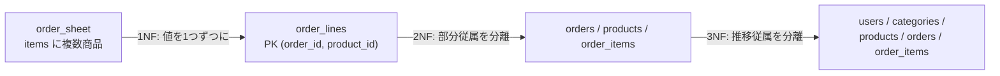

# 正規化

[[MOC_データアーキテクチャ体系|📚 目次]] ｜ [[01_データベース設計の流れとER図|← 前へ]] ｜ [[03_非正規化と実務での判断|次へ →]]

> [!abstract] この記事で分かること
> - 正規化しないと起きる 3 つの更新時異常（挿入異常・更新異常・削除異常）
> - 正規化の土台になる「関数従属」という考え方
> - 1 つの崩れた注文テーブルを、第 1 → 第 2 → 第 3 正規形へ段階的に分解する手順
> - BCNF・第 4〜第 6 正規形が何を解決するのか（概要）
> - なぜ実務では第 3 正規形（または BCNF）で止めるのが合理的なのか
>
> **前提**：[[01_データベース設計の流れとER図]] と [[03_JOINとサブクエリ]] を読んでいると理解しやすいです。

## 1. ひとことで言うと

住所録を Excel で管理していて、同じ人の住所が 3 つのシートにコピーされていたとします。引っ越したとき 1 シートだけ直し忘れると、どれが正しい住所か分からなくなります。**正規化（Normalization）**とは、「1 つの事実は 1 か所にだけ書く」ようにテーブルを分割していく手順です。

> [!info] 要点
> - 正規化の目的は**更新時異常（矛盾したデータが入る余地）をなくす**こと。容量節約は副産物
> - 判断基準は「どの列が、どの列によって決まるか（関数従属）」
> - 第 1〜第 3 正規形は「キーに、キー全体に、キー以外の何物にも依存しない」という 1 文で覚えられる

## 2. 崩れたテーブルと更新時異常

### 2.1 出発点：1 枚の注文表

Shop を始めたばかりで、注文を 1 枚の表で管理していたとします。

```
order_sheet
order_id | ordered_at | user_email   | user_name | items
---------+------------+--------------+-----------+---------------------------------------------
1        | 2026-10-01 | aki@ex.com   | 秋山      | P1:ペン:文具:120円×2, P2:ノート:文具:200円×1
2        | 2026-10-02 | aki@ex.com   | 秋山      | P3:マグ:食器:800円×1
3        | 2026-10-02 | bob@ex.com   | 坂本      | P1:ペン:文具:120円×5
```

人間には読みやすいのですが、データベースとしては次の問題を抱えています。

### 2.2 3 つの更新時異常

**更新時異常（Update Anomaly）**とは、データを変更する操作のときに矛盾や情報の欠落が起きることです。

| 異常 | 何が起きるか | この表での例 |
|---|---|---|
| **挿入異常**（Insertion Anomaly） | ある事実を登録したいのに、無関係な別の事実がないと登録できない | 新商品「消しゴム」を、まだ誰も注文していないので登録する場所がない |
| **更新異常**（Modification Anomaly） | 1 つの事実が複数行にあり、一部だけ更新すると矛盾する | 秋山さんが名前を変えたとき、注文 1 だけ直すと「秋山」「秋本」が混在する |
| **削除異常**（Deletion Anomaly） | ある行を消すと、残したかった別の事実まで消える | 注文 2 をキャンセルで消すと「マグは食器カテゴリ」という情報が消える |

これらはバグの温床です。アプリで「全部の行を同時に更新する」と気をつけても、別のスクリプトや手作業の UPDATE で必ず漏れます。**矛盾が入る余地をテーブル構造でなくしてしまう**のが正規化です。

## 3. 関数従属：正規化のものさし

**関数従属（Functional Dependency）**とは、「列 X の値が決まれば、列 Y の値がただ 1 つに決まる」関係で、`X → Y` と書きます。

- `user_email → user_name`：メールアドレスが決まれば名前は 1 つに決まる
- `product_id → product_name, category, price`：商品 ID が決まれば商品名・カテゴリ・価格が決まる
- `(order_id, product_id) → quantity`：注文と商品の**組**が決まって初めて数量が決まる
- `ordered_at → user_email` は成り立たない（同じ日時に別の人が注文しうる）

関数従属は**データを眺めて見つけるものではなく、業務ルールから決めるもの**です。たまたま今のデータで同じ値が並んでいても、ルールとして保証されていなければ従属ではありません。

用語を 3 つ押さえておきます。

- **候補キー（Candidate Key）**：行を一意に決められる最小の列の組。主キーはその中から 1 つ選んだもの
- **部分関数従属**：複合キーの**一部**だけで決まる列がある状態（例：`(order_id, product_id)` がキーなのに `product_id → product_name`）
- **推移的関数従属**：キー → A → B のように、キー以外の列 A を経由して決まる列 B がある状態（例：`order_id → user_email → user_name`）

## 4. 第 1 〜 第 3 正規形へ段階的に分解する

### 4.1 第 1 正規形（1NF）：セルに 1 つの値

**第 1 正規形**：すべての列が**原子的（それ以上分けない単一の値）**で、繰り返しのグループがない状態。

`items` 列に複数の商品が詰め込まれているので、1 商品 1 行にばらし、中身も列に分けます。

```
order_lines（1NF）  主キー：(order_id, product_id)
order_id | ordered_at | user_email | user_name | product_id | product_name | category | price | quantity
---------+------------+------------+-----------+------------+--------------+----------+-------+---------
1        | 2026-10-01 | aki@ex.com | 秋山      | P1         | ペン         | 文具     | 120   | 2
1        | 2026-10-01 | aki@ex.com | 秋山      | P2         | ノート       | 文具     | 200   | 1
2        | 2026-10-02 | aki@ex.com | 秋山      | P3         | マグ         | 食器     | 800   | 1
3        | 2026-10-02 | bob@ex.com | 坂本      | P1         | ペン         | 文具     | 120   | 5
```

これで SQL の `WHERE product_id = 'P1'` が使えるようになりました。しかし重複は増えています（「ペン・文具・120」が 2 回）。

> [!note] 「原子的」の線引き
> 住所を「都道府県・市区町村・番地」に分けるべきかは、**その単位で検索・集計するか**で決まります。分けないこと自体は 1NF 違反ではありません。1NF 違反の典型は「カンマ区切りで複数値」「`tel1, tel2, tel3` のような繰り返し列」です（[[05_設計パターンとアンチパターン]]）。

### 4.2 第 2 正規形（2NF）：キー全体に依存させる

**第 2 正規形**：1NF であり、かつ**部分関数従属がない**（キーでない列はすべて、候補キー**全体**に依存する）状態。

order_lines の主キーは `(order_id, product_id)` ですが、

- `order_id → ordered_at, user_email, user_name`（注文だけで決まる）
- `product_id → product_name, category, price`（商品だけで決まる）
- `(order_id, product_id) → quantity`（組で決まる）

という部分関数従属があります。決定する列ごとにテーブルを分けます。

```
orders（2NF）  PK: order_id
order_id | ordered_at | user_email | user_name
1        | 2026-10-01 | aki@ex.com | 秋山
2        | 2026-10-02 | aki@ex.com | 秋山
3        | 2026-10-02 | bob@ex.com | 坂本

products（2NF）  PK: product_id
product_id | product_name | category | price
P1         | ペン         | 文具     | 120
P2         | ノート       | 文具     | 200
P3         | マグ         | 食器     | 800

order_items（2NF）  PK: (order_id, product_id)
order_id | product_id | quantity | unit_price
1        | P1         | 2        | 120
1        | P2         | 1        | 200
2        | P3         | 1        | 800
3        | P1         | 5        | 120
```

これで「まだ誰も注文していない消しゴム」を products に登録でき（挿入異常の解消）、注文 2 を消してもマグの情報は残ります（削除異常の解消）。

> [!important] unit_price はなぜ order_items に残したのか
> 1NF の `price` は「現在の商品価格」と「注文時の価格」が混ざっていました。業務ルールが「注文後に値上げしても請求額は変わらない」なら、注文時価格は `(order_id, product_id)` で決まる**別の事実**です。だから order_items に `unit_price` として持ちます。これは重複ではありません（[[03_非正規化と実務での判断]]）。

単一列の主キーしか持たないテーブルは、部分関数従属が起きようがないので、1NF なら自動的に 2NF です。

### 4.3 第 3 正規形（3NF）：キー以外に依存させない

**第 3 正規形**：2NF であり、かつ**推移的関数従属がない**（キーでない列が、キーでない別の列に依存しない）状態。

orders には `order_id → user_email → user_name` という推移があります。秋山さんの名前が 2 行に重複しているのはこのせいです。同じく products には、カテゴリに表示順などの属性が増えると `product_id → category_id → category_name` という推移が現れます。これらを切り出します。

```sql
CREATE TABLE users (
  id         BIGSERIAL PRIMARY KEY,
  name       TEXT NOT NULL,
  email      TEXT NOT NULL UNIQUE,
  created_at TIMESTAMPTZ NOT NULL DEFAULT now()
);
CREATE TABLE categories (
  id   BIGSERIAL PRIMARY KEY,
  name TEXT NOT NULL UNIQUE
);
CREATE TABLE products (
  id          BIGSERIAL PRIMARY KEY,
  category_id BIGINT REFERENCES categories(id),
  name        TEXT NOT NULL,
  price       INTEGER NOT NULL CHECK (price >= 0),
  stock       INTEGER NOT NULL DEFAULT 0
);
CREATE TABLE orders (
  id         BIGSERIAL PRIMARY KEY,
  user_id    BIGINT NOT NULL REFERENCES users(id),
  status     TEXT NOT NULL DEFAULT 'pending',
  ordered_at TIMESTAMPTZ NOT NULL DEFAULT now()
);
CREATE TABLE order_items (
  order_id   BIGINT REFERENCES orders(id),
  product_id BIGINT REFERENCES products(id),
  quantity   INTEGER NOT NULL CHECK (quantity > 0),
  unit_price INTEGER NOT NULL,
  PRIMARY KEY (order_id, product_id)
);
```

これがシリーズ共通の Shop スキーマそのものです。名前の変更は `UPDATE users SET name = '秋本' WHERE id = 1;` の 1 行で済み、更新異常は起きません。元の注文表が欲しければ JOIN で**いつでも再構成**できます。

```sql
SELECT o.id AS order_id, o.ordered_at, u.email, u.name,
       p.name AS product_name, c.name AS category,
       oi.unit_price, oi.quantity
FROM orders o
JOIN users u        ON u.id = o.user_id
JOIN order_items oi ON oi.order_id = o.id
JOIN products p     ON p.id = oi.product_id
LEFT JOIN categories c ON c.id = p.category_id
ORDER BY o.id;
```

「情報を失わずに分解し、JOIN で元に戻せる」ことを**無損失分解（Lossless Decomposition）**と言い、正規化はこれを保ちながら進めます。

### 4.4 分解の全体像



ウィリアム・ケント（1983）の有名な要約がこれを 1 文にしています。

> キーに依存し（1NF）、キー全体に依存し（2NF）、キー以外の何物にも依存しない（3NF）。

## 5. BCNF・第 4〜第 6 正規形（概要）

3NF より上の正規形もありますが、ここでは「何を解決するか」だけ押さえます。

| 正規形 | 解決する問題 | 例 | 実務での出番 |
|---|---|---|---|
| **BCNF**（ボイス・コッド正規形、3.5NF） | 候補キーが複数あり重なっていると、3NF でも残る重複 | `(学生, 科目, 講師)` で「講師は 1 科目のみ担当」→ 講師→科目が複数行に重複 | ときどき。複合キーが重なるときに確認 |
| **第 4 正規形**（4NF） | 多値従属：互いに無関係な複数のリストを 1 表に同居させたときの組み合わせ爆発 | 講師×担当科目×話せる言語（3 科目×2 言語＝6 行） | ほぼない。普通は直感で別テーブルにする |
| **第 5 正規形**（5NF） | 結合従属：3 つ以上に分けて初めて重複が消える | 代理店×メーカー×製品の三者関係 | まれ |
| **第 6 正規形**（6NF） | 属性ごとの独立した履歴 | 社員×名前、社員×部署、社員×給与に全部分ける | 業務 DB ではほぼない。DWH の設計法（アンカーモデリング等）の発想に残る |

BCNF の定義は「すべての自明でない関数従属 X → Y において、X が候補キー（を含む）」です。3NF は「Y がキーの一部なら例外を認める」ので、その例外の隙間を塞いだのが BCNF です。

## 6. なぜ実務は第 3 正規形で止まるのか

1. **それ以上の異常はまれ**：ケント自身が「3NF のテーブルの大半はそのまま 4NF・5NF も満たす」と述べています。4NF 違反のような表は、理論を知らなくても「気持ち悪い」と感じて避けるのが普通です。
2. **分解しすぎると JOIN が増える**：6NF まで分ければ画面 1 枚に何十もの JOIN が要ります。読み取りの多い業務システムではコストが見合いません。
3. **主キーに代理キーを使うことが多い**：`id` 1 列の主キーなら部分関数従属は起こらず、2NF の問題は自然と消えます（ただし「業務上の一意性」は UNIQUE 制約で別途守る必要があります。[[04_キーと制約の設計]]）。
4. **正規形は「目盛り」**：階段を登りきることが目的ではなく、「このテーブルにはどの異常が起こりうるか」を診断する物差しです。

実務の進め方は「**まず 3NF（必要なら BCNF）まで正規化する → 計測して遅い箇所だけ意図的に崩す**」です。崩し方と、その整合性の守り方は次回 [[03_非正規化と実務での判断]] で扱います。

## よくある誤解・つまずき

- ❌ 正規化の目的は容量の節約 → ✅ 主目的は**更新時異常の防止**（整合性）です。容量削減は副産物にすぎません。
- ❌ 同じ値が複数行にあれば正規化不足 → ✅ `unit_price` のように**別の事実**（注文時点の合意価格）なら重複ではありません。判断基準は値の見た目ではなく関数従属です。
- ❌ データを見て関数従属を判断する → ✅ 業務ルールで判断します。今たまたま 1 対 1 に見えても、ルール上複数ありうるなら従属ではありません。
- ❌ 主キーを `id` にすれば正規形の問題は解決 → ✅ 部分関数従属は消えますが、推移的従属（`user_email → user_name` の重複）は残ります。
- ❌ 正規化は高いほど良い → ✅ 4NF 以上は特殊な状況のためのもので、業務システムは 3NF/BCNF で十分なことがほとんどです。

## まとめ

- 正規化は「1 つの事実を 1 か所にだけ書く」ための分解手順で、**挿入・更新・削除異常**を構造で防ぐ
- ものさしは**関数従属**（X が決まれば Y が決まる）。業務ルールから決める
- **1NF**：セルに 1 値 ／ **2NF**：部分関数従属をなくす ／ **3NF**：推移的関数従属をなくす
- **BCNF** は 3NF の穴埋め。4NF〜6NF は特殊な状況向けで、業務 DB ではまず使わない
- 実務は 3NF（または BCNF）まで正規化し、計測に基づいて部分的に非正規化する

## 確認クイズ

1. `enrollments(student_id, course_id, student_name, grade)`（主キーは `(student_id, course_id)`）は第何正規形で、何が問題ですか？
> [!tip]- 答え
> 1NF ですが 2NF ではありません。`student_name` が主キーの一部である `student_id` だけで決まる（部分関数従属）ため、学生が 10 講義を履修すると名前が 10 回重複し、更新異常が起きます。`students(student_id, student_name)` に分けます。

2. `products(id, name, category_id, category_name)` は第何正規形を満たしていませんか？
> [!tip]- 答え
> 第 3 正規形です。`id → category_id → category_name` という推移的関数従属があります。`categories(id, name)` に切り出し、products には `category_id` だけを残します。

3. 「商品が値上げされたとき、過去の注文の請求額は変わってはいけない」。この要件で `order_items.unit_price` を消して `products.price` を JOIN で参照するとどうなりますか？
> [!tip]- 答え
> 過去の注文の金額が値上げ後の価格で表示され、誤った請求・売上集計になります。注文時価格は注文明細ごとに決まる別の事実なので、`order_items` に保存するのが正しい設計です。

## 関連ノート

- [[03_非正規化と実務での判断]] — 正規化したテーブルを意図的に崩すとき
- [[01_データベース設計の流れとER図]] — 正規化は論理設計の一部
- [[05_設計パターンとアンチパターン]] — 1NF 違反の典型（カンマ区切り列・EAV）
- [[正規形は6つあるのに、なぜ全員第3で降りるのか]] — （クリップ）BCNF〜6NF の歴史と、第 3 で止まる理由
- [[教科書通りの正規化が現場で嫌われる理由]] — （クリップ）正規化のメリット・デメリットと使い分け

## 参考

- [Database normalization - Wikipedia](https://en.wikipedia.org/wiki/Database_normalization)
- [William Kent, "A Simple Guide to Five Normal Forms in Relational Database Theory" (1983)](https://www.bkent.net/Doc/simple5.htm)
- [Boyce–Codd normal form - Wikipedia](https://en.wikipedia.org/wiki/Boyce%E2%80%93Codd_normal_form)
