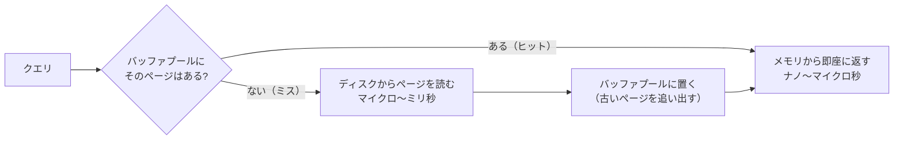

# データはディスクにどう保存されるか

[[MOC_データアーキテクチャ体系|📚 目次]] ｜ [[06_マルチテナント設計|← 前へ]] ｜ [[02_B-TreeとLSM-Tree|次へ →]]

> [!abstract] この記事で分かること
> - メモリとディスク（SSD/HDD）の速度差と、それが DB の設計を決めている理由
> - DB がデータを「ページ」という固定サイズの箱で読み書きすること（PostgreSQL 8KB / InnoDB 16KB）
> - ヒープ・タプル・バッファプール・キャッシュヒット率の意味
> - シーケンシャル I/O とランダム I/O の違いと、フルスキャンが遅い本当の理由
> - 行指向ストレージの特徴（列指向との違いの入口）
>
> **前提**：[[02_DBMSの仕組み]] を読んでいると理解しやすいです。

## 1. ひとことで言うと

DB は巨大な倉庫のようなものです。商品（データ）は倉庫の棚（ディスク）に「段ボール箱（ページ）」単位でしまわれていて、作業台（メモリ）はとても狭いけれど手元なので一瞬で扱えます。倉庫の奥まで箱を取りに行くのは時間がかかるので、**よく使う箱は作業台に置きっぱなしにし（バッファプール）、取りに行く回数そのものを減らす（インデックス）**のが DB の基本戦略です。

- DB の性能の大半は「**ディスクから何ページ読んだか**」で決まる
- DB は 1 行ずつではなく、**ページ（固定サイズのブロック）単位**で読み書きする
- メモリ上にページをキャッシュする仕組みが **バッファプール**
- フルスキャンが遅いのは「全ページを読む」から。インデックスは「読むページを減らす」ための道具

## 2. メモリとディスクの速度差

### 2.1 記憶装置の階層

コンピュータの記憶装置は「速いが小さく高価」なものから「遅いが大きく安価」なものまで階層になっています。

| 記憶装置 | 1 回のアクセスにかかる時間（目安） | 容量の目安 | 電源を切ると |
|---|---|---|---|
| CPU キャッシュ | 約 1〜10 ナノ秒 | 数 MB | 消える |
| メインメモリ（RAM） | 約 100 ナノ秒 | 数十〜数百 GB | 消える |
| SSD（NVMe） | 約 10〜100 マイクロ秒 | 数 TB | 残る |
| HDD | 約 5〜10 ミリ秒 | 数〜数十 TB | 残る |

※ 数値はハードウェアにより大きく異なる、オーダー感をつかむための目安です。

メモリと HDD のランダムアクセスでは **約 10 万倍**、メモリと SSD でも **数百〜千倍** の差があります。人間の時間に置き換えると、メモリが「1 秒」なら HDD は「1 日以上」です。

### 2.2 なぜそれでもディスクに保存するのか

- **永続性（Durability）**：メモリの内容は電源が落ちると消えます。DB は「コミットしたデータは消えない」ことを約束するので、必ずディスクに残す必要があります（詳しくは [[05_WALとクラッシュリカバリ]]）。
- **容量と価格**：数 TB のデータをすべてメモリに載せるのは高価です。

つまり DB は「本体はディスク、作業はメモリ」という二重構造で動いています。この構造を前提に、**ディスクアクセスをいかに減らすか**が、ストレージエンジン（Storage Engine：データの物理的な読み書きを担う DB の部品）の設計思想の中心です。

## 3. ページ：DB が読み書きする最小単位

### 3.1 ページとは

ページ（Page、ブロックとも）：DB がディスクとメモリの間でデータをやり取りする固定サイズの単位です。

| DB | ページサイズ（デフォルト） |
|---|---|
| PostgreSQL | 8KB（コンパイル時に変更可能） |
| MySQL InnoDB | 16KB（`innodb_page_size`、初期化時に決定） |

ポイントは、**1 行だけ欲しくても、その行を含むページ丸ごと（8KB や 16KB）を読む**ことです。本の 1 文だけ読みたくても、そのページを開かないと読めないのと同じです。

### 3.2 PostgreSQL のページの中身

PostgreSQL の 1 ページ（8KB）は、おおよそ次の構造をしています。

```
┌──────────────────────────────────────────────┐
│ ページヘッダ (24 バイト)：空き領域の位置など      │
├──────────────────────────────────────────────┤
│ 行ポインタ(ItemId) [1][2][3][4] →  (前から増える) │
│                                              │
│              ……… 空き領域 ………                  │
│                                              │
│      (後ろから増える) ← [タプル4][タプル3]          │
│                     [タプル2][タプル1]          │
├──────────────────────────────────────────────┤
│ 特殊領域（インデックス用。通常のテーブルでは空）    │
└──────────────────────────────────────────────┘
```

- **行ポインタ（ItemId）**：「このページの何バイト目から何バイトが行か」を指す 4 バイトの目次。前から積み上がります。
- **タプル（Tuple）**：行の実データ。ページの後ろから積み上がり、真ん中の空き領域がなくなったらページは満杯です。

行の住所は「**何番目のページの、何番目の行ポインタか**」で表せます。PostgreSQL ではこれを **TID（Tuple ID）** や **ctid** と呼び、実際に見ることもできます。

```sql
SELECT ctid, id, name FROM users LIMIT 3;
--  ctid  | id | name
-- -------+----+------
--  (0,1) |  1 | 佐藤     ← 0 番ページの 1 番目
--  (0,2) |  2 | 鈴木
--  (0,3) |  3 | 高橋
```

インデックスは、この「行の住所」を値と一緒に持っていて、目的の行へまっすぐ取りに行けるようにする仕組みです（[[03_インデックスの基本と設計]]）。

## 4. ヒープとタプル

### 4.1 ヒープ（Heap）：順番を気にしない置き場

PostgreSQL のテーブル本体は **ヒープ（Heap）**：行を特定の順序に並べず、空いている場所に詰めていくファイル です。名前の「heap」は「山積み」の意味で、データ構造のヒープ（優先度付きキュー）とは別物です。

- 新しい行は、空きのあるページに入れられます。**ID 順や名前順に並んでいる保証はありません**。
- そのため「`name = '中村'` の行はどこ？」という問いには、インデックスがなければ**全ページを見るしかありません**。

```sql
-- テーブルが何ページ・何行か（統計上の推定値）を確認
SELECT relname, relpages, reltuples
FROM pg_class
WHERE relname = 'orders';

-- 実際のサイズ
SELECT pg_size_pretty(pg_relation_size('orders'));       -- テーブル本体
SELECT pg_size_pretty(pg_total_relation_size('orders')); -- インデックス等込み
```

### 4.2 タプルと MVCC の関係

PostgreSQL では、行を UPDATE しても元の場所を書き換えず、**新しいバージョンのタプルを別の場所に追加**し、古いタプルは「もう見えない」印をつけて残します。これは同時実行制御の仕組み MVCC（[[03_ロックとMVCC]]）のためです。古いタプルは後で **VACUUM** が回収します。

UPDATE や DELETE が多いテーブルで VACUUM が追いつかないと、使われないタプルが溜まってページ数が膨らむ「**肥大化（bloat）**」が起き、フルスキャンが遅くなります。

> [!note] MySQL（InnoDB）との違い
> InnoDB はヒープではなく、**主キーの順に並んだ B+Tree の中に行そのものを格納する**「クラスタ化インデックス」方式です。UPDATE は基本的にその場で書き換え、古いバージョンは undo ログに退避します。詳しくは [[03_インデックスの基本と設計]] で比較します。

## 5. バッファプールとキャッシュヒット率

### 5.1 バッファプールとは

バッファプール（Buffer Pool）：ディスクから読んだページをメモリ上に保持しておく DB 専用のキャッシュ領域 です。



| DB | 設定名 | デフォルト |
|---|---|---|
| PostgreSQL | `shared_buffers` | 通常 128MB |
| MySQL InnoDB | `innodb_buffer_pool_size` | 128MB |

どちらもデフォルトは本番には小さすぎます。一般的な目安として、PostgreSQL の `shared_buffers` はサーバーメモリの 25% 程度から（PostgreSQL は OS のページキャッシュも併用するため）、DB 専用サーバーの InnoDB では 50〜75% 程度が出発点とよく言われます。

書き込みもまずバッファプール上のページを書き換え（このページを**ダーティページ**と呼ぶ）、ディスクへの反映は後でまとめて行います。それでもコミット済みデータが消えないのは WAL のおかげです（[[05_WALとクラッシュリカバリ]]）。

### 5.2 キャッシュヒット率

キャッシュヒット率：読んだページのうち、ディスクに行かずバッファプールで済んだ割合 です。OLTP（日々の業務処理）の DB では **99% 以上** を目安にすることが多いです。

```sql
-- PostgreSQL：DB 全体のキャッシュヒット率
SELECT datname,
       blks_hit,
       blks_read,
       round(blks_hit * 100.0 / nullif(blks_hit + blks_read, 0), 2) AS hit_ratio
FROM pg_stat_database
WHERE datname = current_database();

-- テーブルごと
SELECT relname, heap_blks_hit, heap_blks_read
FROM pg_statio_user_tables
ORDER BY heap_blks_read DESC
LIMIT 10;
```

> [!warning] 注意
> PostgreSQL の `blks_read` は「`shared_buffers` になかった」回数で、OS のページキャッシュに当たった場合も含みます。つまり「read = 本当にディスクに行った」とは限りません。目安として見る指標です。

ヒット率が急に下がったら、「データがメモリに乗り切らなくなった」「巨大なフルスキャンがキャッシュを押し流した」などを疑います。

## 6. シーケンシャル I/O とランダム I/O

### 6.1 2 種類の読み方

- **シーケンシャル I/O（Sequential I/O）**：ディスク上で連続した場所を順番に読む。まとめて先読みできるので効率がよい。
- **ランダム I/O（Random I/O）**：あちこちに散らばった場所を飛び飛びに読む。1 回ごとに「探しに行く」コストがかかる。

HDD では、読み取りヘッドを物理的に動かす（シーク）必要があるため、ランダム I/O はシーケンシャルより桁違いに遅くなります。SSD では差は小さくなりましたが、ゼロではありません。

PostgreSQL のオプティマイザ（実行計画を選ぶ部品）は、この差をコストの設定値で表しています。

| パラメータ | デフォルト | 意味 |
|---|---|---|
| `seq_page_cost` | 1.0 | 連続したページを 1 ページ読むコスト |
| `random_page_cost` | 4.0 | ランダムに 1 ページ読むコスト |

SSD 環境では `random_page_cost` を 1.1〜2 程度に下げることもあります（インデックスが選ばれやすくなる）。

### 6.2 なぜフルスキャンは遅いのか

フルスキャン（PostgreSQL では Seq Scan）は、シーケンシャル I/O なので **1 ページあたりは効率がよい** のです。それでも遅いのは、**読むページ数がテーブルの大きさに比例する**からです。

```
orders テーブル：1,000 万行、1 ページに約 100 行 → 約 10 万ページ（約 800MB）

WHERE id = 12345 で 1 行だけ欲しい場合
  フルスキャン ：10 万ページを全部読む
  インデックス ：インデックスを 3〜4 ページ + テーブル 1 ページ ≒ 5 ページ
```

1 ページ当たりのコストがランダム I/O で 4 倍だとしても、5 × 4 = 20 と 100,000 × 1 では勝負になりません。

逆に、**テーブルの大半の行を返すクエリ**では、インデックス経由で 1 行ずつランダムに取りに行くより、フルスキャンでまとめて読む方が速くなります。「インデックスがあるのに使われない」理由の 1 つがこれです（[[04_インデックスが効かないパターン]]）。

> [!tip] 覚え方
> - 少数の行を探す → **インデックス**（読むページ数を激減させる）
> - 大量の行を読む → **フルスキャン**（シーケンシャルにまとめて読む）
> どちらが得かを判断するのがオプティマイザの仕事です（[[05_実行計画の読み方]]）。

## 7. 行指向ストレージ

ここまで見てきた PostgreSQL や InnoDB は **行指向（Row-oriented）ストレージ**：1 行のすべての列をまとめて同じページに格納する方式 です。

```
行指向（PostgreSQL / InnoDB）
 ページ1: [1, 佐藤, sato@.., 2026-01-01] [2, 鈴木, suzuki@.., 2026-01-02] ...

列指向（分析用 DB：BigQuery, Snowflake, ClickHouse など）
 name 列のファイル : [佐藤, 鈴木, 高橋, ...]
 email 列のファイル: [sato@.., suzuki@.., ...]
```

| 観点 | 行指向 | 列指向 |
|---|---|---|
| 1 行をまるごと読む・書く | 得意（1 ページで完結） | 苦手（列ごとに別の場所） |
| 1 列を全行分集計（`SUM(price)`） | 不要な列も一緒に読む | その列だけ読めて、圧縮も効く |
| 向いている用途 | OLTP（注文登録、会員情報の更新） | OLAP（売上集計、分析） |

「注文を 1 件登録する」「ユーザー 1 人の情報を表示する」といったアプリの日常処理は行指向が得意です。一方、「全注文の売上を月別に集計する」ような分析は、列指向の方が読むデータ量を桁違いに減らせます。詳しくは [[02_列指向ストレージとデータウェアハウス]] と [[01_OLTPとOLAP]] で扱います。

## よくある誤解・つまずき

- ❌「1 行だけ読むなら、読む量は 1 行分」
  ✅ DB は**ページ単位**で読みます。1 行のために 8KB/16KB を読み、インデックスをたどる分のページも読みます。
- ❌「テーブルの行は INSERT した順（ID 順）に並んでいる」
  ✅ PostgreSQL のヒープは空いている場所に詰めるので、順序の保証はありません。`ORDER BY` なしの `SELECT` の結果順も保証されません。
- ❌「SSD ならランダム I/O は気にしなくていい」
  ✅ 差は縮みましたが、メモリとの差は依然として数百倍以上あります。「読むページ数を減らす」原則は SSD でも変わりません。
- ❌「メモリを増やせば DB は必ず速くなる」
  ✅ ワーキングセット（よく使うデータ）がすでにメモリに乗っているなら効果は小さいです。全件スキャンのような「読む量が多すぎる」問題は、メモリではなくインデックスやクエリで直します。
- ❌「DELETE すればテーブルのファイルは小さくなる」
  ✅ PostgreSQL では削除されたタプルは VACUUM で再利用可能になるだけで、通常ファイルサイズは縮みません（`VACUUM FULL` は縮めますが、テーブルを排他ロックします）。

## まとめ

- メモリとディスクには数百〜10 万倍の速度差があり、DB は「ディスクアクセスを減らす」ことを中心に設計されている。
- DB はページ（PostgreSQL 8KB / InnoDB 16KB）単位で読み書きし、行の住所は「ページ番号 + ページ内の位置」で表される。
- PostgreSQL のテーブル本体はヒープ（順序なしの置き場）で、UPDATE は新しいタプルを追加する。InnoDB は主キー順の B+Tree に行を格納する。
- バッファプールはページのメモリキャッシュ。OLTP ではキャッシュヒット率 99% 以上が目安。
- フルスキャンは「シーケンシャルだが全ページを読む」から遅い。少数の行ならインデックス、大半の行ならフルスキャンが有利。
- PostgreSQL / InnoDB は行指向。分析向けには列指向がある。

## 確認クイズ

1. `users` テーブルから `id = 42` の 1 行だけを取得しました。DB がディスクから読んだデータ量は「1 行分の数十バイト」でしょうか？
> [!tip]- 答え
> いいえ。DB はページ単位で読むので、最低でもその行を含む 1 ページ（PostgreSQL なら 8KB）を読みます。さらに主キーのインデックスをたどるためのページも数ページ読みます（バッファプールに既にあればディスクには行きません）。

2. フルスキャンはシーケンシャル I/O なので効率がよいはずなのに、大きなテーブルで遅くなるのはなぜですか？
> [!tip]- 答え
> 1 ページあたりの効率はよくても、読むページ数がテーブルのサイズに比例するからです。1,000 万行のテーブルなら 10 万ページ規模を読むことになり、インデックスで数ページだけ読む方法とは比較になりません。

3. 売上を月別に集計する分析クエリが、行指向の本番 DB で遅いのはなぜですか？
> [!tip]- 答え
> 行指向は 1 行の全列を同じページに持つため、`price` と `ordered_at` だけ使いたくても、他の列も含むページをすべて読む必要があるからです。列指向ストレージなら必要な列だけを読め、圧縮も効きます。

## 関連ノート

- [[02_B-TreeとLSM-Tree]] — 次回。ページの上にどんなデータ構造を作ると速く探せるか
- [[03_インデックスの基本と設計]] — 「行の住所」を引くための索引の仕組み
- [[05_実行計画の読み方]] — Seq Scan と Index Scan の選択を実際に見る
- [[03_ロックとMVCC]] — UPDATE で新しいタプルが作られる理由
- [[05_WALとクラッシュリカバリ]] — メモリ上の変更が消えない仕組み
- [[02_列指向ストレージとデータウェアハウス]] — 列指向ストレージの詳細
- [[インデックスがあると、なぜ速いのか｜ねる前エンジニアリング]] — クリップ（YouTube）。フルスキャンと索引の違いを直感的に解説
- [[MOC_パフォーマンス体系]] — DB 以外も含めた性能の考え方

## 参考

- [PostgreSQL Documentation: Database Page Layout](https://www.postgresql.org/docs/current/storage-page-layout.html)
- [PostgreSQL Documentation: Resource Consumption (shared_buffers)](https://www.postgresql.org/docs/current/runtime-config-resource.html)
- [PostgreSQL Documentation: Query Planning (seq_page_cost / random_page_cost)](https://www.postgresql.org/docs/current/runtime-config-query.html)
- [MySQL 8.4 Reference Manual: The Physical Structure of an InnoDB Index](https://dev.mysql.com/doc/refman/8.4/en/innodb-physical-structure.html)
- [MySQL 8.4 Reference Manual: InnoDB Startup Options and System Variables](https://dev.mysql.com/doc/refman/8.4/en/innodb-parameters.html)
- [Martin Kleppmann, Chris Riccomini: Designing Data-Intensive Applications, 2nd Edition, Chapter 4. Storage and Retrieval](https://www.oreilly.com/library/view/designing-data-intensive-applications/9781098119058/ch04.html)（初版・邦訳『データ指向アプリケーションデザイン』では 3 章）
