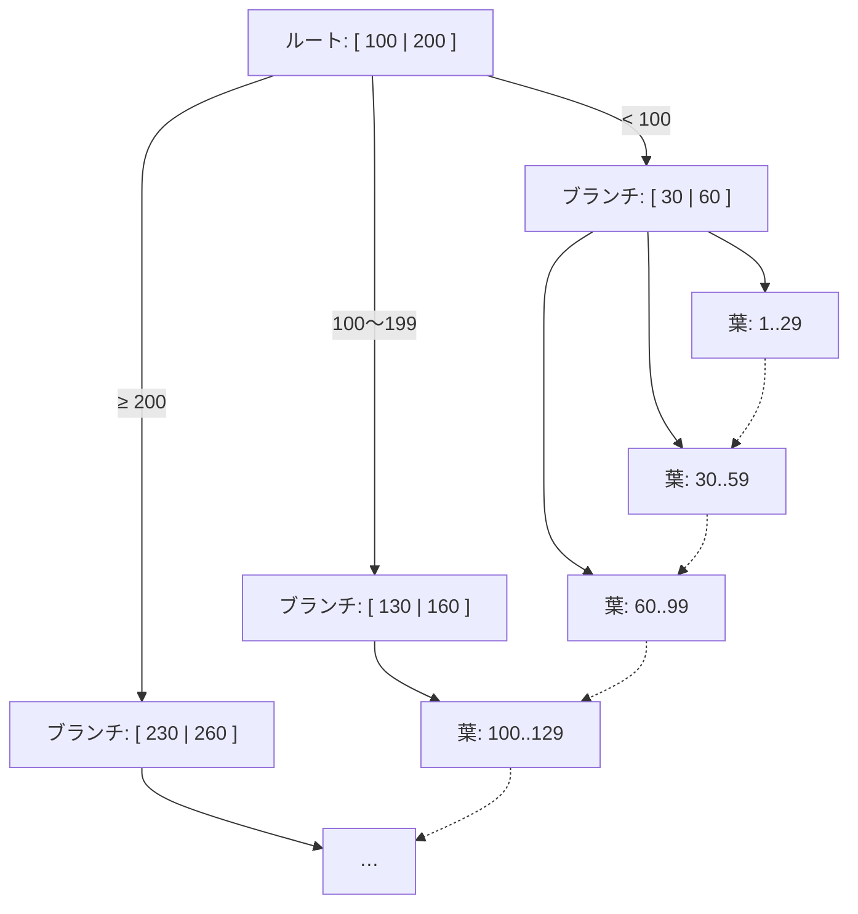

# B-TreeとLSM-Tree

[[MOC_データアーキテクチャ体系|📚 目次]] ｜ [[01_データはディスクにどう保存されるか|← 前へ]] ｜ [[03_インデックスの基本と設計|次へ →]]

> [!abstract] この記事で分かること
> - 二分探索木から B-Tree / B+Tree へ、「ディスク向けの木」に進化した理由
> - B+Tree の高さが低く、何億件でも数回の I/O で目的の行に届く仕組み
> - ページ分割（page split）とは何か、なぜ連番 ID が有利なのか
> - LSM-Tree（memtable・SSTable・コンパクション・ブルームフィルタ）の仕組み
> - 書き込み増幅・読み取り増幅のトレードオフと、どの DB がどちらを使っているか
>
> **前提**：[[01_データはディスクにどう保存されるか]] を読んでいると理解しやすいです。

## 1. ひとことで言うと

**B-Tree は「きれいに整理された辞書」**、**LSM-Tree は「とりあえず付箋に書いて、後でまとめて清書するノート」**です。

- 辞書（B-Tree）は、新しい単語を正しい位置に差し込むのが少し手間ですが、引くのは速い。
- 付箋ノート（LSM-Tree）は、書くのは一瞬（とにかく末尾に追記）ですが、探すときは複数の付箋の束を見る必要があり、ときどき束を清書（コンパクション）します。

| | B-Tree | LSM-Tree |
|---|---|---|
| 得意 | 読み取り・範囲検索 | 大量の書き込み |
| 書き方 | ページをその場で書き換え | 追記のみ（ファイルは書き換えない） |
| 代表 | PostgreSQL, MySQL InnoDB, SQLite, Oracle | RocksDB, Cassandra, LevelDB, HBase, ScyllaDB |

ストレージエンジンの世界は、大きくこの 2 つの流派に分かれます。

## 2. 二分探索木から B-Tree へ

### 2.1 二分探索木（Binary Search Tree）

並んだデータは「真ん中と比べて、半分を捨てる」ことで速く探せます（二分探索）。これを木の形にしたのが二分探索木です。各ノードは子を 2 つだけ持ちます。

```
              [50]
            /      \
        [25]        [75]
        /  \        /  \
     [10] [30]   [60] [90]
```

100 万件なら高さは約 20（2^20 ≒ 100 万）。メモリ上なら 20 回の比較は一瞬です。

### 2.2 ディスクでは「高さ」がそのまま I/O 回数になる

しかしディスク上に置くと、ノードを 1 段降りるたびに **1 回のディスク読み込み（ページ読み込み）** が発生します。高さ 20 なら 20 回のランダム I/O で、HDD なら 100ms 以上かかります。

しかも DB はどうせ 8KB / 16KB のページ単位で読むのに、1 ノードに値を 1 個しか入れないのはもったいない。そこで **1 ノード = 1 ページにして、1 ページに数百個のキーを詰め込み、子も数百個持たせる** ことにしたのが B-Tree です。1970 年にボーイング社の研究所で Rudolf Bayer と Edward McCreight が発表しました。

### 2.3 B+Tree の構造

実際の DB で使われているのは、B-Tree の改良版である **B+Tree** です。

- **内部ノード（ルート・ブランチ）**：「どの子に進むか」の区切りキーだけを持つ
- **リーフノード（葉）**：実際のキーと、行の場所（または行そのもの）を持つ
- **リーフ同士が横に連結**されていて、範囲検索や ORDER BY は葉を横にたどるだけで済む



（図では区切りを 2 個にしていますが、実際は 1 ページに数百個入ります）

### 2.4 何億件でも数回の I/O

1 ノードが持てる子の数を **分岐数（fan-out）** と呼びます。BIGINT のキーなら、1 ページに数百個のキーが入ります。分岐数を 500 とすると、

| 高さ（段数） | 届く件数（およそ） |
|---|---|
| 1 | 500 |
| 2 | 25 万 |
| 3 | 1 億 2,500 万 |
| 4 | 625 億 |

つまり **1 億件のテーブルでも 3〜4 回ページを読めば目的の行の場所が分かる**のです。さらにルートや上位のブランチは頻繁に使われるので、ほぼ常にバッファプール（[[01_データはディスクにどう保存されるか]]）に乗っています。実際にディスクに行くのは葉とテーブル本体の 1〜2 回程度で済むことが多いです。

```sql
-- PostgreSQL: pageinspect 拡張でインデックスの高さ（level）を確認できる
CREATE EXTENSION IF NOT EXISTS pageinspect;
SELECT level, fastroot FROM bt_metap('orders_pkey');
-- level = 2 なら、ルート → ブランチ → 葉 の 3 段
```

B-Tree は、どの葉までの距離も同じに保たれる**平衡木（balanced tree）**です。データの入り方が偏っても、高さはデータ件数の対数でしか増えません。

## 3. B-Tree の書き込みとページ分割

### 3.1 挿入はその場で書き換える

B-Tree に新しいキーを挿入するときは、

1. ルートから降りて、キーが入るべき葉を探す
2. 葉のページに空きがあれば、正しい位置に差し込む（ページを書き換える）

という手順です。ディスク上のページを**その場で上書き（in-place update）**するのが B-Tree の特徴です。

### 3.2 ページ分割（Page Split）

葉が満杯のときは、**ページ分割**が起きます。

```
挿入前（満杯の葉）           キー 45 を挿入
[ 10 | 20 | 30 | 40 | 50 ]   →   [ 10 | 20 | 30 ]  [ 40 | 45 | 50 ]
                                   ↑ 親ノードに区切りキー「40」を追加
```

- 葉を 2 つに割り、半分ずつに分ける
- 親ノードに新しい区切りキーを追加する（親も満杯なら親も分割、最悪ルートまで連鎖して木が 1 段高くなる）

ページ分割は複数ページの書き換えを伴う重い処理で、分割後のページは半分空いた状態になります（容量効率が落ちる）。

### 3.3 連番 ID とランダム ID

- **連番（BIGSERIAL など）**：新しいキーは常に右端の葉に入る。分割は右端で起こるだけで、ページはほぼ満杯まで詰まる。
- **ランダム（UUID v4 など）**：新しいキーが木のあちこちの葉に散らばる。あちこちで分割が起き、書き込むページもキャッシュに乗りにくい。

InnoDB の公式ドキュメントでも、順番に挿入したページは約 15/16 まで埋まるが、ランダムに挿入すると 1/2〜15/16 になると説明されています。主キーにランダムな UUID を使うと挿入性能が落ちやすいのはこのためで、時刻順に並ぶ **UUID v7** や ULID が好まれる理由の 1 つです（キー設計は [[04_キーと制約の設計]]）。

### 3.4 クラッシュへの備え

ページ分割の途中で電源が落ちると、木が壊れた状態になりかねません。そのため B-Tree を使う DB は、変更内容を先にログへ書く **WAL（Write-Ahead Log、InnoDB では redo log）** を使って、クラッシュ後に整合した状態へ戻せるようにしています（[[05_WALとクラッシュリカバリ]]）。

## 4. LSM-Tree の仕組み

### 4.1 発想：書き込みを全部「追記」にする

LSM-Tree（Log-Structured Merge-Tree）は、**ディスクへの書き込みをすべてシーケンシャルな追記にする**ことで、書き込みを極限まで速くする構造です。ディスク上のファイルは一度書いたら変更しません（イミュータブル）。

```mermaid
flowchart LR
    W[書き込み] --> LOG[コミットログ / WAL<br/>（クラッシュ対策の追記）]
    W --> MEM[memtable<br/>メモリ上・キー順に整列]
    MEM -->|一定サイズで書き出し<br/>flush| S1[SSTable 新]
    S1 --> C{{コンパクション<br/>複数のSSTableをマージ}}
    S2[SSTable 古] --> C
    C --> S3[SSTable マージ済み]
    R[読み取り] -.1.-> MEM
    R -.2. 新しい順.-> S1
    R -.3.-> S3
```

### 4.2 構成要素

1. **memtable**：メモリ上の、キー順に並んだデータ構造（RocksDB ではスキップリストが標準）。書き込みはまずここに入ります。同時に、クラッシュで消えないようコミットログ（WAL）にも追記します。
2. **SSTable（Sorted String Table）**：memtable が一定サイズになると、キー順に並んだまま**ディスクへ丸ごと書き出し**（flush）たファイル。書き出したら二度と変更しません。
3. **コンパクション（Compaction）**：SSTable はどんどん増えるので、バックグラウンドで複数の SSTable を**マージソート**して 1 つにまとめます。同じキーの古い値や、削除済みの値はこのとき捨てられます。
4. **削除**：ファイルを書き換えられないので、「このキーは削除済み」という印（**トゥームストーン / tombstone**）を書き込み、コンパクションで実際に消します。

### 4.3 読み取りの手順とブルームフィルタ

あるキーを読むときは、**新しいものから順に**探します。

1. memtable を見る
2. なければ、最新の SSTable を見る
3. なければ、次に新しい SSTable を見る … と続く

存在しないキーを探すと、全部の SSTable を見ることになり遅くなります。これを防ぐのが **ブルームフィルタ（Bloom Filter）**：「このキーはこのファイルに**絶対にない**」か「**あるかもしれない**」かを、少ないメモリで高速に判定できる確率的データ構造 です。

- 「絶対にない」と言われたファイルは読まずに飛ばせる
- 「あるかもしれない」は外れることもある（偽陽性）が、「ない」と言ったのに実はある（偽陰性）ことはない

Cassandra も RocksDB も、SSTable ごとにブルームフィルタを持っています。

### 4.4 コンパクション戦略

| 戦略 | 考え方 | 傾向 |
|---|---|---|
| レベル型（Leveled） | データをレベル L0, L1, L2… に分け、各レベル内ではキー範囲が重ならないように保つ | 読み取りと容量に強い、書き込み増幅は大きめ。RocksDB のデフォルト |
| サイズ階層型（Size-tiered / Universal） | 似たサイズの SSTable がいくつか溜まったらまとめる | 書き込み増幅が小さい、読み取り・容量の増幅は大きめ |

## 5. 書き込み増幅と読み取り増幅

### 5.1 増幅（Amplification）とは

- **書き込み増幅（Write Amplification）**：アプリが 1 バイト書いたとき、ディスクには実際に何バイト書かれるか
- **読み取り増幅（Read Amplification）**：1 件読むために、何回（何ページ / 何ファイル）読む必要があるか
- **容量増幅（Space Amplification）**：論理的なデータ量に対して、実際にどれだけディスクを使うか

### 5.2 比較

| 観点 | B-Tree | LSM-Tree |
|---|---|---|
| 書き込み増幅 | 1 行の変更でもページ（8〜16KB）丸ごと + WAL を書く。インデックスが多いと全部書き換える | 追記なので 1 回は小さいが、コンパクションで同じデータを何度も書き直す |
| 書き込みの I/O パターン | ランダム（あちこちのページを書き換え） | シーケンシャル（追記とマージ）→ 書き込みスループットが高い |
| 読み取り増幅 | 小さい。木を 1 本たどるだけ | 大きめ。複数の SSTable を見る可能性（ブルームフィルタで軽減） |
| 範囲検索 | 葉を横にたどるだけで得意 | 複数 SSTable をマージしながら読む |
| 性能の安定性 | 比較的予測しやすい | コンパクションが重なると、応答時間が一時的に悪化することがある |
| 容量 | ページ分割で空きが生じる | 圧縮しやすい。ただしコンパクション前は古い値が残る |

> [!note] 書き込み増幅は「どちらが大きい」とは一概に言えない
> LSM-Tree はコンパクションで同じデータを何度も書き直すため、書き込み増幅の数値自体は B-Tree より大きくなることもあります。それでも書き込みに強いのは、**シーケンシャルな大きな書き込み**にまとまるからです。実際の優劣はワークロードと設定次第で、ベンチマークで確かめるのが確実です（DDIA でもそう強調されています）。

### 5.3 どちらを選ぶか

- **読み取りが多い・トランザクションが重要・範囲検索が多い**（一般的な業務アプリ、EC サイト）→ B-Tree 系の RDB
- **書き込みが非常に多い**（ログ、IoT のセンサーデータ、メッセージ、時系列、イベント）→ LSM-Tree 系

アプリ開発者が直接「B-Tree か LSM-Tree か」を選ぶ場面は多くありませんが、**DB 製品を選ぶ = ストレージエンジンを選ぶ**ことでもあります（[[03_データベースの種類と選び方]]）。

## 6. どの DB がどちらを使っているか

| DB / エンジン | 構造 | 補足 |
|---|---|---|
| PostgreSQL | B-Tree（インデックス）+ ヒープ（テーブル本体） | インデックスの葉は行の住所（TID）を指す |
| MySQL InnoDB | B+Tree | テーブル本体が主キーの B+Tree（クラスタ化インデックス） |
| SQLite | B-Tree | |
| Oracle / SQL Server | B-Tree | |
| MongoDB（WiredTiger） | B-Tree（標準） | |
| RocksDB | LSM-Tree | Meta 製の組み込みエンジン。多くの DB の土台 |
| LevelDB | LSM-Tree | Google 製。RocksDB の元になった |
| Cassandra / ScyllaDB | LSM-Tree | コミットログ → memtable → SSTable |
| HBase / Bigtable | LSM-Tree | |
| MyRocks | LSM-Tree | MySQL のストレージエンジンとして RocksDB を使う |
| CockroachDB / TiKV | LSM-Tree | Pebble / RocksDB を利用 |

PostgreSQL と InnoDB の「ヒープ vs クラスタ化インデックス」の違いは、次回 [[03_インデックスの基本と設計]] で詳しく扱います。

## よくある誤解・つまずき

- ❌「B-Tree の B は Binary（二分）の B」
  ✅ B-Tree は 1 ノードに数百の子を持つ「多分木」で、二分木ではありません。B の由来は公表されていません（Balanced, Boeing, Bayer などの説があります）。
- ❌「1 億件あると、インデックスでも探すのに時間がかかる」
  ✅ B+Tree の高さは 3〜4 程度なので、件数が 100 倍になっても読むページは 1 段増える程度です。遅いのは「インデックスが使われていない」場合です。
- ❌「LSM-Tree は書き込みが速いので、何にでも LSM-Tree 系を使えばいい」
  ✅ 読み取り、とくに存在しないキーの検索や範囲検索、コンパクション中の応答時間のばらつきなどで不利になることがあります。用途で選びます。
- ❌「LSM-Tree では DELETE するとすぐにディスク容量が空く」
  ✅ 削除はトゥームストーンを追記するだけで、実際に消えるのはコンパクション後です。大量削除直後はかえって容量が増えることもあります。
- ❌「主キーは UUID の方がモダンだから常に良い」
  ✅ ランダムな UUID v4 は B-Tree のあちこちでページ分割を起こしやすいです。使うなら時刻順の UUID v7 などを検討します。

## まとめ

- ディスク上の木では「高さ = I/O 回数」なので、1 ページに数百のキーを詰めた B-Tree / B+Tree で木を低くする。
- B+Tree は葉が横に連結され、範囲検索・ORDER BY に強い。1 億件でも 3〜4 段。
- B-Tree はページをその場で書き換え、満杯ならページ分割する。連番キーは分割が少なく有利。
- LSM-Tree は memtable → SSTable（追記のみ）→ コンパクションの流れで、書き込みをシーケンシャルにして高速化する。読み取りはブルームフィルタで補う。
- 書き込み増幅・読み取り増幅・容量増幅のトレードオフがあり、RDB の多くは B-Tree、RocksDB / Cassandra などは LSM-Tree。

## 確認クイズ

1. 分岐数 500 の B+Tree で、1 億件のキーを持つインデックスの高さはおよそ何段ですか？ また、それはなぜ重要ですか？
> [!tip]- 答え
> 500^3 = 1 億 2,500 万なので、約 3 段です。1 段降りるごとに 1 ページ読むので、1 億件でも数回の I/O で目的のキーに届きます。上位の段はバッファプールに乗っていることが多いので、実際のディスク I/O はさらに少なくなります。

2. LSM-Tree で「存在しないキー」を検索すると遅くなりがちなのはなぜですか？ それを防ぐ仕組みは？
> [!tip]- 答え
> 新しい SSTable から順に探すため、存在しないキーだと最後のファイルまで全部見ることになるからです。各 SSTable のブルームフィルタで「このファイルには絶対にない」と分かれば、そのファイルの読み込みを省略できます。

3. 主キーに UUID v4 を使ったテーブルで INSERT が遅くなった場合、B-Tree の観点からどう説明できますか？
> [!tip]- 答え
> UUID v4 はランダムなので、新しいキーが B-Tree のあちこちの葉に挿入されます。その結果、多くのページでページ分割が起き、書き換えるページもキャッシュに乗りにくくなります。連番や UUID v7 のように順に増えるキーなら、挿入は右端の葉に集中します。

## 関連ノート

- [[01_データはディスクにどう保存されるか]] — 前回。ページとバッファプール
- [[03_インデックスの基本と設計]] — 次回。B-Tree インデックスの実践的な使い方
- [[05_WALとクラッシュリカバリ]] — B-Tree / LSM-Tree の両方が頼るログの仕組み
- [[04_キーと制約の設計]] — 連番 ID と UUID の選び方
- [[03_データベースの種類と選び方]] — DB 製品の選び方
- [[インデックスがあると、なぜ速いのか｜ねる前エンジニアリング]] — クリップ（YouTube）。二分探索から木の形の索引までを図解
- [[インデックスが効かない瞬間を、エンジニアはどこで見抜くのか]] — クリップ（YouTube）。B 木の誕生（1970 年ボーイング）の話も紹介
- [[MOC_分散システム体系]] — Cassandra などの分散 DB

## 参考

- [Martin Kleppmann, Chris Riccomini: Designing Data-Intensive Applications, 2nd Edition, Chapter 4. Storage and Retrieval](https://www.oreilly.com/library/view/designing-data-intensive-applications/9781098119058/ch04.html)（初版・邦訳『データ指向アプリケーションデザイン』では 3 章）
- [MySQL 8.4 Reference Manual: The Physical Structure of an InnoDB Index](https://dev.mysql.com/doc/refman/8.4/en/innodb-physical-structure.html)
- [PostgreSQL Documentation: B-Tree Indexes](https://www.postgresql.org/docs/current/btree.html)
- [PostgreSQL Documentation: pageinspect](https://www.postgresql.org/docs/current/pageinspect.html)
- [RocksDB Wiki: RocksDB Overview](https://github.com/facebook/rocksdb/wiki/RocksDB-Overview)
- [Apache Cassandra Documentation: Storage Engine](https://cassandra.apache.org/doc/latest/cassandra/architecture/storage-engine.html)
