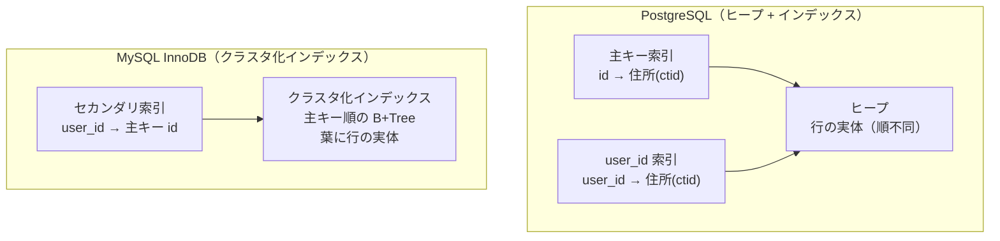

# インデックスの基本と設計

[[MOC_データアーキテクチャ体系|📚 目次]] ｜ [[02_B-TreeとLSM-Tree|← 前へ]] ｜ [[04_インデックスが効かないパターン|次へ →]]

> [!abstract] この記事で分かること
> - インデックスの正体（「並べ替えた写し + 行の住所」）と CREATE INDEX の書き方
> - 複合インデックスの列順と「左端一致」のルール
> - カバリングインデックス / Index Only Scan、ユニーク・部分・式インデックス
> - B-Tree 以外のインデックス（GIN / GiST / BRIN / Hash）の使いどころ
> - インデックスのコストと、どの列に張るかの判断基準、InnoDB のクラスタ化インデックスと PostgreSQL のヒープの違い
>
> **前提**：[[02_B-TreeとLSM-Tree]] を読んでいると理解しやすいです。

## 1. ひとことで言うと

インデックスは**本の巻末の索引**です。「トランザクション」という言葉を探すとき、本を 1 ページ目からめくる人はいません。巻末の索引で「トランザクション …… p.215」を見つけて、215 ページを開きます。

- 索引は「キーワードを五十音順に並べたもの + ページ番号」
- DB のインデックスも「**列の値を並べ替えた写し + 行の住所**」
- 並んでいるので速く探せる（[[02_B-TreeとLSM-Tree]] の B+Tree）
- その代わり、本文を書き換えたら索引も直す必要がある（**書き込みのコスト**）

```
orders テーブル（ヒープ：順不同）        idx_orders_user_id（user_id 順に並んだ写し）
 住所   id   user_id  status            user_id  住所
 (0,1)  1    42       paid               7      (3,8)
 (0,2)  2    7        pending           42      (0,1)
 (0,3)  3    105      paid              42      (5,2)
 ...                                    105      (0,3)
 (5,2)  801  42       shipped           ...
```

`WHERE user_id = 42` なら、索引で 42 の位置まで木を降り、隣り合った 2 件の住所 (0,1) と (5,2) を取りに行くだけで済みます。

## 2. CREATE INDEX の基本

### 2.1 作成と確認

```sql
-- 単一列インデックス（種類を指定しなければ B-Tree）
CREATE INDEX idx_orders_user_id ON orders (user_id);

-- 本番の大きなテーブルでは、書き込みを止めないように CONCURRENTLY を付ける
CREATE INDEX CONCURRENTLY idx_orders_ordered_at ON orders (ordered_at);

-- 確認（psql）
\d orders

-- 削除
DROP INDEX CONCURRENTLY idx_orders_ordered_at;
```

> [!warning] 本番での注意
> 通常の `CREATE INDEX` は作成中、テーブルへの書き込み（INSERT/UPDATE/DELETE）をブロックします。PostgreSQL では `CONCURRENTLY` を使うと書き込みを止めずに作れます（時間はかかり、トランザクション内では実行できません）。MySQL InnoDB はオンライン DDL で多くの場合書き込みを止めずに作成できます。詳しくは [[07_ゼロダウンタイムのスキーマ変更]]。

### 2.2 自動で作られるインデックス

- **主キー（PRIMARY KEY）** と **UNIQUE 制約** には、DB が自動でユニークインデックスを作ります。例題スキーマの `users.email` には既にインデックスがあります。
- **外部キー（FOREIGN KEY）の参照元の列には、PostgreSQL は自動でインデックスを作りません**。`orders.user_id` や `order_items.product_id` には自分で張る必要があります（MySQL InnoDB は外部キー列に自動で作ります）。外部キー列にインデックスがないと、JOIN が遅いだけでなく、親行の DELETE 時に子テーブルのフルスキャンが走ります。

```sql
CREATE INDEX idx_orders_user_id ON orders (user_id);
CREATE INDEX idx_order_items_product_id ON order_items (product_id);
-- order_items.order_id は複合主キー (order_id, product_id) の先頭列なので不要
```

## 3. 複合インデックスと列の順番

### 3.1 複合インデックスは「電話帳」

複合インデックス（Composite Index、マルチカラムインデックス）：複数の列を組み合わせて 1 つにしたインデックス。

```sql
CREATE INDEX idx_orders_user_status ON orders (user_id, status);
```

これは「まず `user_id` 順に並べ、同じ `user_id` の中では `status` 順に並べた」写しです。電話帳が「姓 → 名」の順に並んでいるのと同じです。

```
 user_id | status
 --------+---------
    7    | paid
   42    | paid       ← user_id=42 の塊の中で status 順
   42    | pending
   42    | shipped
  105    | paid
  105    | pending
```

### 3.2 左端一致（Leftmost Prefix）のルール

| 条件 | idx (user_id, status) は効く？ | 理由 |
|---|---|---|
| `WHERE user_id = 42` | ✅ 効く | 先頭列で絞れる |
| `WHERE user_id = 42 AND status = 'paid'` | ✅ 効く（最も効率的） | 両方で絞れる |
| `WHERE status = 'paid' AND user_id = 42` | ✅ 効く | WHERE の書き順は関係ない |
| `WHERE status = 'paid'` | ❌ 基本的に効かない | `status` は `user_id` の塊ごとにバラバラに散らばっている |
| `WHERE user_id = 42 ORDER BY status` | ✅ 並べ替えも省ける | 塊の中は `status` 順 |

電話帳で「名が『太郎』の人」を探せないのと同じで、**先頭列の条件がないと並び順を活かせません**（例外として PostgreSQL 18 や MySQL 8.0.13 以降には「スキップスキャン」があり、先頭列の種類が少なければ使えることがあります。[[04_インデックスが効かないパターン]] 参照）。

### 3.3 列の順番の決め方

1. **等価条件（`=`）で使う列を前に、範囲条件（`<`, `>`, `BETWEEN`）や ORDER BY の列を後ろに**
2. 単独でもよく検索される列を先頭に（`(a, b)` があれば `a` 単独の検索にも使える）
3. 迷ったら、実際のクエリで EXPLAIN して確かめる（[[05_実行計画の読み方]]）

```sql
-- 「ユーザーの注文履歴を新しい順に 20 件」
SELECT id, status, ordered_at
FROM orders
WHERE user_id = 42
ORDER BY ordered_at DESC
LIMIT 20;

-- 等価条件の user_id が先、並べ替えの ordered_at が後
CREATE INDEX idx_orders_user_ordered ON orders (user_id, ordered_at);
-- → user_id=42 の塊を後ろから 20 件読むだけ。ソート不要
```

逆に `(ordered_at, user_id)` にすると、`user_id = 42` の行が日付順の中にバラバラに散らばり、効率が大きく落ちます。

> [!tip] (a) と (a, b) は両方必要？
> `(a, b)` があれば `a` だけの検索にも使えるので、`(a)` 単独のインデックスは多くの場合不要（冗長）です。

## 4. 便利なインデックスの種類

### 4.1 カバリングインデックスと Index Only Scan

通常、インデックスで住所を見つけた後、**テーブル本体（ヒープ）へ行を取りに行く**必要があります。しかし、クエリが必要とする列がすべてインデックスに入っていれば、テーブル本体を見ずに答えられます。これを **カバリングインデックス（Covering Index）** と呼び、PostgreSQL の実行計画では **Index Only Scan** と表示されます。

```sql
-- user_id で絞り、status と ordered_at だけ返したい
CREATE INDEX idx_orders_user_cover
  ON orders (user_id) INCLUDE (status, ordered_at);   -- PostgreSQL 11 以降

SELECT status, ordered_at FROM orders WHERE user_id = 42;
-- → Index Only Scan using idx_orders_user_cover
```

`INCLUDE` 句の列は検索キーにはならず、葉に「おまけ」として載るだけです。

> [!note] PostgreSQL の Index Only Scan と VACUUM
> PostgreSQL では、そのページの行が全トランザクションから見えるか（visibility map）を確認できないと、結局ヒープを見に行きます。更新が多いテーブルでは VACUUM が進んでいないと Index Only Scan の効果が薄れます。実行計画の `Heap Fetches` で確認できます。

### 4.2 ユニークインデックス

```sql
CREATE UNIQUE INDEX uq_products_name ON products (name);
```

一意性を保証する制約の役割も果たします。通常は `UNIQUE` 制約として宣言するのが分かりやすいです（制約の設計は [[04_キーと制約の設計]]）。

### 4.3 部分インデックス（Partial Index）

**条件を満たす行だけ**にインデックスを張ります。

```sql
-- 「未処理の注文」だけをよく検索する。全注文の 1% 程度
CREATE INDEX idx_orders_pending ON orders (ordered_at)
WHERE status = 'pending';

SELECT * FROM orders WHERE status = 'pending' ORDER BY ordered_at LIMIT 100;
```

- インデックスが小さくなり、書き込みコストも減る
- 「論理削除されていない行だけユニーク」も表現できる

```sql
-- deleted_at 列を足した場合：削除されていないユーザーの中で email を一意に
CREATE UNIQUE INDEX uq_users_email_active ON users (email) WHERE deleted_at IS NULL;
```

MySQL には部分インデックスはありません。

### 4.4 式インデックス（Expression Index / 関数インデックス）

列そのものではなく、**式の結果**を並べます。

```sql
-- メールアドレスを大文字小文字を区別せず検索したい
CREATE INDEX idx_users_lower_email ON users (lower(email));

SELECT * FROM users WHERE lower(email) = 'sato@example.com';  -- ✅ 効く
SELECT * FROM users WHERE email = 'Sato@example.com';         -- 別のインデックス（email）を使う
```

**クエリの式とインデックスの式が完全に一致しているとき**だけ使われます。MySQL では 8.0.13 以降の「関数キーパート」で同様のことができます。

### 4.5 B-Tree 以外のインデックス（PostgreSQL）

| 種類 | 得意な検索 | 典型的な用途 |
|---|---|---|
| **B-Tree**（デフォルト） | `=`, `<`, `>`, `BETWEEN`, `IN`, `IS NULL`, 前方一致 `LIKE 'abc%'`, ORDER BY | ほとんどすべて。迷ったらこれ |
| **Hash** | `=` のみ | 等価検索専用。B-Tree で十分なことが多い（PostgreSQL 10 以降はクラッシュセーフ） |
| **GIN**（Generalized Inverted Index） | 1 つの値が複数の要素を持つデータ：配列の `@>`, JSONB の `@>` `?`, 全文検索 | タグ配列、JSONB 列、全文検索、`pg_trgm` による中間一致 |
| **GiST**（Generalized Search Tree） | 範囲の重なり、位置関係、近傍検索 | 地理情報（PostGIS）、範囲型、排他制約 |
| **SP-GiST** | 偏りのある空間分割 | 電話番号・IP アドレス、点データ |
| **BRIN**（Block Range Index） | ページ範囲ごとの最小値・最大値 | 物理的な並びと値が相関する巨大テーブル（ログの時刻列など）。非常に小さい |

```sql
-- JSONB の属性検索（products に attrs JSONB 列を足した場合）
CREATE INDEX idx_products_attrs ON products USING gin (attrs);
SELECT * FROM products WHERE attrs @> '{"color": "red"}';

-- 追記されるだけの巨大なアクセスログ（時刻順に INSERT される）
CREATE INDEX idx_access_logs_at ON access_logs USING brin (accessed_at);
```

## 5. インデックスのコストと、どの列に張るか

### 5.1 インデックスはタダではない

- **書き込みが遅くなる**：INSERT のたびに、すべてのインデックスに「正しい位置への差し込み」が発生します。インデックスが 5 本なら 5 本とも更新します。PostgreSQL では、インデックス対象の列を更新しない UPDATE は HOT（Heap-Only Tuple）更新で済むことがありますが、インデックス列を含む更新は全インデックスに新しいエントリを追加します。
- **容量を使う**：インデックスはテーブルと別のファイルです。インデックスの合計がテーブル本体より大きいことも珍しくありません。
- **メモリを奪い合う**：インデックスのページもバッファプールを使います。

```sql
-- PostgreSQL：使われていないインデックスを探す
SELECT relname AS table, indexrelname AS index, idx_scan,
       pg_size_pretty(pg_relation_size(indexrelid)) AS size
FROM pg_stat_user_indexes
WHERE idx_scan = 0
ORDER BY pg_relation_size(indexrelid) DESC;
```

`idx_scan = 0` のインデックスは（統計リセット以降）一度も使われていません。ユニーク制約のためのもの以外は削除候補です。

### 5.2 どの列に張るか：チェックリスト

1. **WHERE でよく絞り込む列**（特に結果が少数行になるもの）
2. **JOIN の結合キー**（外部キー列）
3. **ORDER BY / GROUP BY でよく使う列**（ソートを省略できる）
4. **選択性（Selectivity）が高い列**：値の種類が多く、条件で行がよく絞れる列。`email` は高く、`status`（数種類）は低い
5. 逆に避ける：めったに検索しない列、更新が非常に頻繁な列、書き込み中心のテーブル（ログ）への過剰なインデックス

> [!tip] 選択性が低い列でも効くケース
> `status` のように値が数種類でも、「`pending` は全体の 1%」のように偏っていれば、その値の検索には効きます。部分インデックス（4.3）との相性がよい場面です。

インデックスは「張って終わり」ではなく、**実際のクエリと本番の統計を見て張り、使われていなければ剥がす**ものです。

## 6. クラスタ化インデックス（InnoDB）とヒープ（PostgreSQL）

テーブル本体の持ち方は、PostgreSQL と MySQL InnoDB で根本的に違います。



| 観点 | PostgreSQL（ヒープ） | MySQL InnoDB（クラスタ化） |
|---|---|---|
| テーブル本体 | 順不同のヒープ | **主キー順の B+Tree の葉そのもの** |
| 主キー以外のインデックスが持つもの | 行の物理的な住所（ctid） | **主キーの値** |
| 主キーでの検索 | 索引 → ヒープ（2 段階） | 木を降りれば行がある（1 段階）。主キーの範囲検索が非常に速い |
| セカンダリ索引での検索 | 索引 → ヒープ | セカンダリ索引 → 主キーで**もう一度**クラスタ化インデックスを降りる |
| 主キーの大きさの影響 | 小さい | 全セカンダリ索引に主キーが入るので、**長い主キーは全索引を太らせる** |
| ランダムな主キー（UUID v4） | 主キー索引だけ影響 | テーブル本体ごとページ分割が起きやすい |

MySQL InnoDB で「主キーは短い連番にせよ」とよく言われるのは、この構造のためです。また InnoDB のセカンダリインデックスは主キーを含むので、`(user_id)` のインデックスは実質 `(user_id, id)` として働き、`SELECT id FROM orders WHERE user_id = 42` はカバリングになります。

PostgreSQL にも `CLUSTER` コマンドがありますが、これは一度だけテーブルをインデックス順に並べ替えるもので、その後の INSERT では順序が維持されません。

## よくある誤解・つまずき

- ❌「インデックスはたくさん張るほど速くなる」
  ✅ 読み取りは速くなり得ますが、書き込みは本数に比例して遅くなり、容量も増えます。使われないインデックスは純粋なコストです。
- ❌「`(a)` と `(b)` に別々にインデックスがあれば、`WHERE a = 1 AND b = 2` は複合インデックスと同じ速さ」
  ✅ PostgreSQL はビットマップで 2 つを組み合わせることもできますが、`(a, b)` の複合インデックスの方が一般に効率的です。
- ❌「複合インデックスの列順は何でもよい」
  ✅ 左端一致のルールがあります。等価条件の列を前、範囲・ソートの列を後ろに置くのが基本です。
- ❌「外部キーを張ればインデックスも自動で作られる」
  ✅ PostgreSQL では作られません（MySQL InnoDB は作ります）。
- ❌「インデックスを張れば、DB は必ずそれを使う」
  ✅ 返す行が多いときなど、オプティマイザはフルスキャンを選ぶことがあり、それが正しい判断の場合もあります（[[04_インデックスが効かないパターン]]）。

## まとめ

- インデックスは「列の値を並べ替えた写し + 行の住所」。巻末の索引と同じ発想。
- 主キー・UNIQUE には自動で作られるが、PostgreSQL では外部キー列には自分で張る。
- 複合インデックスは左端一致。等価条件の列を前に、範囲・ORDER BY の列を後ろに。
- カバリング（INCLUDE）、部分、式、GIN / GiST / BRIN など、用途に応じた種類を使い分ける。
- インデックスは書き込み・容量・メモリのコストを伴う。`pg_stat_user_indexes` で使われていないものは剥がす。
- PostgreSQL はヒープ + 住所、InnoDB は主キー順のクラスタ化インデックス + 主キー参照。

## 確認クイズ

1. `CREATE INDEX ON orders (status, user_id);` があるとき、`WHERE user_id = 42` のクエリは効率よくこのインデックスを使えますか？
> [!tip]- 答え
> 基本的に使えません。インデックスは `status` 順に並び、`user_id` はその各塊の中でしか並んでいないため、`user_id = 42` の行がバラバラに散らばっています（左端一致のルール）。`user_id` を先頭にしたインデックスを用意するのが基本です。

2. 「ユーザーごとの最新注文 10 件」を表示するクエリ `WHERE user_id = ? ORDER BY ordered_at DESC LIMIT 10` に最適なインデックスは？
> [!tip]- 答え
> `CREATE INDEX ON orders (user_id, ordered_at);` です。等価条件の `user_id` で塊に絞り、その中は `ordered_at` 順に並んでいるので、後ろから 10 件読むだけでソートが不要になります。

3. MySQL InnoDB で主キーを長い文字列（例：36 文字の UUID 文字列）にすると、セカンダリインデックスにどんな影響がありますか？
> [!tip]- 答え
> InnoDB のセカンダリインデックスは葉に主キーの値を持つため、すべてのセカンダリインデックスが大きくなり、容量とメモリ効率が悪化します。さらにランダムな値だとクラスタ化インデックス（テーブル本体）でもページ分割が増えます。

## 関連ノート

- [[02_B-TreeとLSM-Tree]] — 前回。インデックスの土台となる B+Tree
- [[04_インデックスが効かないパターン]] — 次回。張ったのに使われない典型例
- [[05_実行計画の読み方]] — インデックスが使われているかを確かめる
- [[04_キーと制約の設計]] — 主キー・UNIQUE 制約の設計
- [[07_ゼロダウンタイムのスキーマ変更]] — 本番での安全なインデックス追加
- [[インデックスがあると、なぜ速いのか｜ねる前エンジニアリング]] — クリップ（YouTube）。「並べ替えた写し」としての索引、複合索引、索引の代償
- [[インデックスが効かない瞬間を、エンジニアはどこで見抜くのか]] — クリップ（YouTube）。使われないインデックスを本番統計で見つけて剥がす話
- [[17_ORMとは]] — ORM が発行する SQL とインデックス

## 参考

- [PostgreSQL Documentation: Index Types](https://www.postgresql.org/docs/current/indexes-types.html)
- [PostgreSQL Documentation: Multicolumn Indexes](https://www.postgresql.org/docs/current/indexes-multicolumn.html)
- [PostgreSQL Documentation: Index-Only Scans and Covering Indexes](https://www.postgresql.org/docs/current/indexes-index-only-scans.html)
- [PostgreSQL Documentation: Partial Indexes](https://www.postgresql.org/docs/current/indexes-partial.html)
- [PostgreSQL Documentation: CREATE INDEX](https://www.postgresql.org/docs/current/sql-createindex.html)
- [MySQL 8.4 Reference Manual: Clustered and Secondary Indexes](https://dev.mysql.com/doc/refman/8.4/en/innodb-index-types.html)
- [Use The Index, Luke（Markus Winand）](https://use-the-index-luke.com/ja)
