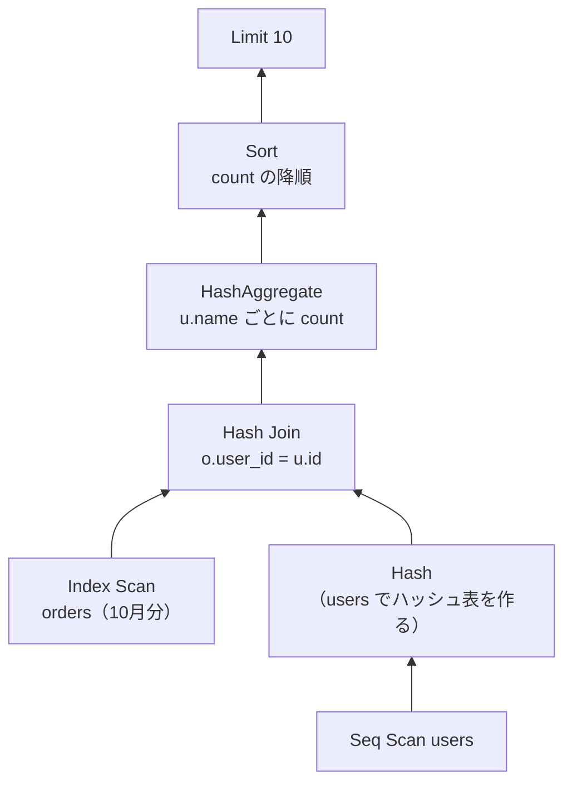

# 実行計画の読み方

[[MOC_データアーキテクチャ体系|📚 目次]] ｜ [[04_インデックスが効かないパターン|← 前へ]] ｜ [[01_トランザクションとACID|次へ →]]

> [!abstract] この記事で分かること
> - EXPLAIN / EXPLAIN ANALYZE / BUFFERS の違いと、出力の読む順番（内側から・下から）
> - スキャン方法（Seq Scan / Index Scan / Index Only Scan / Bitmap Heap Scan）と結合方法（Nested Loop / Hash Join / Merge Join）
> - cost・rows・actual time の意味と、「見積もり行数と実際の行数のズレ」が最重要の手がかりであること
> - 遅いクエリを見つけて直すまでの手順（pg_stat_statements、スロークエリログ）と MySQL の EXPLAIN
>
> **前提**：[[04_インデックスが効かないパターン]] と [[06_SQLの実行順序]] を読んでいると理解しやすいです。

## 1. ひとことで言うと

実行計画（Execution Plan / Query Plan）は、**カーナビが出す「ルート案内」**です。SQL は「どこに行きたいか（どんな結果が欲しいか）」しか書きません。「どの道を通るか（どのインデックスを使い、どの順にテーブルを結合するか）」は、DB の **オプティマイザ（Optimizer / プランナ）** が統計情報をもとに選びます。

- `EXPLAIN`：ルート案内を**見るだけ**（実際には走らない）。所要時間は**見積もり**
- `EXPLAIN ANALYZE`：**実際に走って**、見積もりと実際の所要時間を並べて見せる
- 遅いクエリの原因は、たいてい「**見積もりが外れて、悪いルートを選んだ**」か「**良いルートが存在しない**（インデックスがない等）」のどちらか

SQL の論理的な実行順序と物理的な実行計画の関係は [[06_SQLの実行順序]] で扱いました。ここでは実行計画そのものの読み方を身につけます。

## 2. EXPLAIN の基本

### 2.1 3 つの使い方

```sql
-- 1. 見積もりだけ（クエリは実行されない）
EXPLAIN
SELECT * FROM orders WHERE user_id = 42;

-- 2. 実際に実行して、実測値も表示
EXPLAIN ANALYZE
SELECT * FROM orders WHERE user_id = 42;

-- 3. 実測 + バッファ（ページ）の読み込み状況
EXPLAIN (ANALYZE, BUFFERS)
SELECT * FROM orders WHERE user_id = 42;
```

> [!warning] EXPLAIN ANALYZE は本当に実行される
> `EXPLAIN ANALYZE UPDATE ...` や `DELETE` は**実際にデータを書き換えます**。更新系を調べるときはトランザクションで囲んで戻しましょう。
> ```sql
> BEGIN;
> EXPLAIN ANALYZE DELETE FROM orders WHERE status = 'cancelled';
> ROLLBACK;
> ```

> [!note] BUFFERS は PostgreSQL 18 から自動
> PostgreSQL 18 以降は `EXPLAIN ANALYZE` だけで BUFFERS 情報も表示されます。17 以前では `(ANALYZE, BUFFERS)` と明示します。

### 2.2 1 行の読み方

```
Index Scan using idx_orders_user_id on orders  (cost=0.43..12.56 rows=11 width=40) (actual time=0.031..0.058 rows=12.00 loops=1)
  Index Cond: (user_id = 42)
  Buffers: shared hit=15 read=2
```

| 項目 | 意味 |
|---|---|
| `Index Scan using … on orders` | ノード（処理の単位）の種類と対象 |
| `cost=0.43..12.56` | 見積もりコスト。「最初の 1 行を返すまで .. 全行を返し終えるまで」。単位は時間ではなく、**1 ページをシーケンシャルに読む = 1.0** とした相対値 |
| `rows=11` | 見積もり行数（このノードが返すと予想した行数） |
| `width=40` | 1 行の平均バイト数の見積もり |
| `actual time=0.031..0.058` | 実測（ミリ秒）。最初の 1 行まで .. 最後の行まで。**1 ループあたり** |
| `rows=12.00` | 実際に返した行数（1 ループあたり。PostgreSQL 18 から小数表示） |
| `loops=1` | このノードが何回実行されたか。合計は `actual time × loops`、`rows × loops` |
| `Index Cond` | インデックスで絞り込んだ条件 |
| `Filter` | 読んだ後にふるいにかけた条件（`Rows Removed by Filter` が大きいと無駄読みが多い） |
| `Buffers: shared hit=15 read=2` | バッファプールで済んだページ 15、ディスク（OS キャッシュ含む）から読んだページ 2 |

## 3. 読む順番：内側から、下から

実行計画は**木構造**です。インデント（`->`）が深いノードが先に動き、その結果を親ノードに渡します。

```sql
-- 「2026 年 10 月に注文したユーザーの名前と注文数」
EXPLAIN ANALYZE
SELECT u.name, count(*) AS order_count
FROM orders o
JOIN users u ON u.id = o.user_id
WHERE o.ordered_at >= '2026-10-01' AND o.ordered_at < '2026-11-01'
GROUP BY u.name
ORDER BY order_count DESC
LIMIT 10;
```

```
Limit  (cost=5120.10..5120.13 rows=10 width=40) (actual time=48.20..48.22 rows=10 loops=1)
  ->  Sort  (cost=5120.10..5145.10 rows=10000 width=40) (actual time=48.19..48.20 rows=10 loops=1)
        Sort Key: (count(*)) DESC
        Sort Method: top-N heapsort  Memory: 26kB
        ->  HashAggregate  (cost=4800.00..4900.00 rows=10000 width=40) (actual time=45.10..46.90 rows=9500 loops=1)
              Group Key: u.name
              ->  Hash Join  (cost=380.00..4550.00 rows=50000 width=32) (actual time=3.20..35.40 rows=51200 loops=1)
                    Hash Cond: (o.user_id = u.id)
                    ->  Index Scan using idx_orders_ordered_at on orders o  (cost=0.43..3900.00 rows=50000 width=8) (actual time=0.02..18.30 rows=51200 loops=1)
                          Index Cond: ((ordered_at >= '2026-10-01 …') AND (ordered_at < '2026-11-01 …'))
                    ->  Hash  (cost=255.00..255.00 rows=10000 width=32) (actual time=3.10..3.10 rows=10000 loops=1)
                          ->  Seq Scan on users u  (cost=0.00..255.00 rows=10000 width=32) (actual time=0.01..1.20 rows=10000 loops=1)
Planning Time: 0.30 ms
Execution Time: 48.40 ms
```

（数値は説明用の例です）



読み方：

1. **一番深いノードから**：`orders` を日付のインデックスで 51,200 行取り出す。`users` を全件読んでハッシュ表にする
2. **Hash Join** で 2 つを結合
3. **HashAggregate** で名前ごとに集計 → **Sort** → **Limit**
4. **どこで時間を使っているか**：各ノードの `actual time` の終わりの値は**子ノードの時間を含む累積**です。Hash Join（35.4ms）のうち Index Scan が 18.3ms、集計（46.9 − 35.4 ≒ 11ms）……と、**親と子の差**を見ると、そのノード自体の時間が分かります

> [!tip] 長い実行計画は可視化ツールで
> [explain.depesz.com](https://explain.depesz.com/) や [explain.dalibo.com](https://explain.dalibo.com/) に貼り付けると、ノードごとの「自分の時間」や見積もりのズレを色分けしてくれます（本番データを含む場合は社内ルールに注意）。

## 4. スキャンと結合の種類

### 4.1 スキャン（テーブルからの読み方）

| ノード | 何をしているか | 選ばれやすい場面 |
|---|---|---|
| **Seq Scan** | テーブル全ページを先頭から読む | 返す行が多い、テーブルが小さい、使えるインデックスがない |
| **Index Scan** | インデックスをたどり、1 行ずつヒープを読む | 返す行が少ない。ORDER BY をインデックス順で済ませたいとき |
| **Index Only Scan** | インデックスだけで答える（ヒープを読まない） | 必要な列がすべてインデックスにある（カバリング）。`Heap Fetches` が 0 に近いほど効果大 |
| **Bitmap Index Scan → Bitmap Heap Scan** | まずインデックスで該当行の「ページ番号の地図（ビットマップ）」を作り、ページ番号順にまとめてヒープを読む | 中くらいの行数（Index Scan だとランダム I/O が多すぎ、Seq Scan だと無駄が多い）。`BitmapAnd` / `BitmapOr` で複数インデックスを組み合わせることも |

```
Bitmap Heap Scan on orders  (cost=95.20..4210.50 rows=8000 ...)
  Recheck Cond: (status = 'pending')
  ->  Bitmap Index Scan on idx_orders_status  (cost=0.00..93.20 rows=8000 ...)
        Index Cond: (status = 'pending')
```

Seq Scan を見たら即「悪」ではありません。**「返す行数に対して、読んだ量が多すぎないか」**で判断します（`Rows Removed by Filter` や `Buffers` を見る）。

### 4.2 結合（JOIN の実現方法）

| ノード | 仕組み | 得意な場面 |
|---|---|---|
| **Nested Loop** | 外側の各行について、内側を探す（二重ループ） | 外側が少数行で、内側を**インデックスで引ける**とき。`LIMIT` 付きにも強い |
| **Hash Join** | 小さい方でハッシュ表を作り、大きい方を流して突き合わせる | 等価結合（`=`）で、両方がそこそこ大きいとき。インデックス不要 |
| **Merge Join** | 両方を結合キーでソート済みにして、端から突き合わせる | 両方が大きく、すでにソート済み（インデックス順に読める）とき |

```
Nested Loop  (actual time=0.05..0.40 rows=12 loops=1)
  ->  Index Scan using users_pkey on users u  (… rows=1 loops=1)
        Index Cond: (id = 42)
  ->  Index Scan using idx_orders_user_id on orders o  (… rows=12 loops=1)
        Index Cond: (user_id = 42)
```

> [!warning] Nested Loop の loops に注意
> 内側ノードの `loops=50000` のように、内側が何万回も実行されていたら要注意です。外側の行数の見積もりが外れて（例：1 行と見積もったが実際は 5 万行）、本来 Hash Join にすべきところを Nested Loop にしている典型パターンです。

その他よく見るノード：`Sort`（`Sort Method: external merge Disk: …` ならメモリ不足でディスクを使っている → `work_mem` やインデックスを検討）、`HashAggregate` / `GroupAggregate`（GROUP BY）、`Limit`、`Materialize`、`Gather`（並列実行）。

## 5. 見積もりと実際のズレを読む

### 5.1 最重要ポイント：rows の見積もり vs 実際

オプティマイザは**見積もり行数**をもとにスキャン方法・結合方法・結合順を選びます。見積もりが 10 倍、100 倍と外れると、選んだプランも外れます。

```
Index Scan using idx_orders_status on orders  (cost=0.43..8.45 rows=1 ...) (actual time=0.03..920.50 rows=480000 loops=1)
                                                                ^^^^^^                          ^^^^^^^^^^^
                                                                見積もり 1 行                    実際 48 万行
```

この例では「1 行しか返らない」と思って Index Scan（や、その上の Nested Loop）を選んだのに、実際は 48 万行でした。

### 5.2 ズレの主な原因と対処

| 原因 | 対処 |
|---|---|
| 統計情報が古い（大量投入・削除の後） | `ANALYZE テーブル名;` |
| 値の分布が偏っていて、統計のサンプルで捉えきれない | 列の統計精度を上げる：`ALTER TABLE orders ALTER COLUMN status SET STATISTICS 1000;` → `ANALYZE` |
| 列同士に相関がある（例：都道府県と市区町村）。オプティマイザは列を独立と仮定する | 拡張統計：`CREATE STATISTICS ... (dependencies) ON col_a, col_b FROM t;` → `ANALYZE` |
| 列に関数をかけている（統計が使えない） | 式インデックスを作ると、その式の統計も集められる |
| 汎用プラン（プリペアドステートメント） | `plan_cache_mode` を検討 |

### 5.3 ANALYZE（統計の更新）

`EXPLAIN ANALYZE` と名前が似ていますが、`ANALYZE` 単独は**統計情報を集めるコマンド**で、別物です。

```sql
ANALYZE orders;              -- orders の統計を更新
ANALYZE;                     -- DB 全体

-- オプティマイザが持っている統計を見る
SELECT attname, n_distinct, most_common_vals, most_common_freqs
FROM pg_stats
WHERE tablename = 'orders' AND attname = 'status';
```

## 6. 遅いクエリ調査の手順

### 6.1 全体の流れ

```
① 見つける     pg_stat_statements / スロークエリログ / APM
      ↓        「合計時間」が大きいものから（1 回は速くても大量に呼ばれるものに注意）
② 再現する     本番相当のデータ・パラメータで EXPLAIN (ANALYZE, BUFFERS)
      ↓
③ 原因を特定   時間を使っているノードは？ 見積もりと実際のズレは？ Seq Scan で大量に捨てていないか？
      ↓
④ 直す         統計更新 / クエリ書き換え（前回の記事）/ インデックス追加
      ↓
⑤ 確かめる     再度 EXPLAIN ANALYZE。書き込み性能・他のクエリへの影響も確認
```

### 6.2 PostgreSQL：pg_stat_statements

`pg_stat_statements`：実行された SQL を「形」ごとに（値を `$1` などに置き換えて）まとめ、回数・合計時間などを記録する拡張 です。

```
# postgresql.conf（設定後に再起動が必要）
shared_preload_libraries = 'pg_stat_statements'
```

```sql
CREATE EXTENSION IF NOT EXISTS pg_stat_statements;

-- 合計実行時間の多い順 TOP 10（PostgreSQL 13 以降の列名）
SELECT calls,
       round(total_exec_time::numeric, 1) AS total_ms,
       round(mean_exec_time::numeric, 2)  AS mean_ms,
       rows,
       left(query, 80) AS query
FROM pg_stat_statements
ORDER BY total_exec_time DESC
LIMIT 10;
```

- **合計時間（total）**で並べるのが基本。1 回 5ms でも 1 日 100 万回呼ばれていれば最優先です（N+1 問題など。[[17_ORMとは]]）。
- 遅いクエリをログに残すには `log_min_duration_statement`（例：`'500ms'`）、ログに実行計画まで残すには `auto_explain` 拡張を使います。

### 6.3 MySQL：スロークエリログ

```sql
-- 実行時間が long_query_time 秒を超えたクエリを記録（デフォルトは 10 秒）
SET GLOBAL slow_query_log = ON;
SET GLOBAL long_query_time = 0.5;
-- インデックスを使わなかったクエリも記録したい場合
SET GLOBAL log_queries_not_using_indexes = ON;
```

集計には `mysqldumpslow` や Percona の `pt-query-digest`、`performance_schema` の `events_statements_summary_by_digest` が使えます。

### 6.4 MySQL の EXPLAIN

MySQL の `EXPLAIN` はデフォルトで**表形式**です。

```sql
EXPLAIN SELECT * FROM orders WHERE user_id = 42;
```

| id | select_type | table | type | possible_keys | key | rows | Extra |
|---|---|---|---|---|---|---|---|
| 1 | SIMPLE | orders | ref | idx_orders_user_id | idx_orders_user_id | 12 | NULL |

| 列 | 見るポイント |
|---|---|
| `type` | アクセス方法。良い順におおよそ `const`（主キー/ユニークで 1 行）→ `eq_ref` → `ref` → `range` → `index`（インデックス全体を走査）→ **`ALL`（フルスキャン）** |
| `key` | 実際に使ったインデックス。`NULL` なら使っていない |
| `rows` | 読むと見積もった行数 |
| `Extra` | `Using index`（カバリング）、`Using where`、**`Using filesort`**（追加のソート）、**`Using temporary`**（一時テーブル） |

MySQL 8.0.18 以降は `EXPLAIN ANALYZE` で実測値付きのツリー形式も見られます（`EXPLAIN FORMAT=TREE` は見積もりのみのツリー）。

```sql
EXPLAIN ANALYZE SELECT * FROM orders WHERE user_id = 42;
-- -> Index lookup on orders using idx_orders_user_id (user_id=42)
--      (cost=4.2 rows=12) (actual time=0.05..0.07 rows=12 loops=1)
```

## よくある誤解・つまずき

- ❌「cost の数字はミリ秒」
  ✅ cost は「シーケンシャルに 1 ページ読む = 1.0」とした相対値です。時間は `actual time` を見ます。
- ❌「Seq Scan が出たら必ずインデックスを張るべき」
  ✅ 小さいテーブルや大量の行を返すクエリでは Seq Scan が最適です。返す行数に対して読んだ量が多すぎるかで判断します。
- ❌「`actual time` は、そのノード単体の時間」
  ✅ 子ノードの時間を含む累積で、しかも 1 ループあたりです。`loops` を掛け、子との差を見ます。
- ❌「EXPLAIN ANALYZE は見るだけだから安全」
  ✅ 実際に実行されます。UPDATE / DELETE は BEGIN … ROLLBACK で囲みます。本番で重いクエリを実行するときは負荷にも注意します。
- ❌「`ANALYZE` と `EXPLAIN ANALYZE` は同じ」
  ✅ `ANALYZE` は統計情報の収集、`EXPLAIN ANALYZE` はクエリを実行して計画と実測を表示するものです。

## まとめ

- `EXPLAIN` は見積もりのみ、`EXPLAIN ANALYZE` は実行して実測も表示、`BUFFERS` で読んだページ数も分かる（PostgreSQL 18 以降は自動）。
- 実行計画は木構造。深い（内側・下の）ノードから読み、親子の時間差でボトルネックを探す。
- スキャンは Seq / Index / Index Only / Bitmap、結合は Nested Loop / Hash / Merge。それぞれ得意な行数がある。
- 最重要の手がかりは「見積もり rows と実際 rows のズレ」。統計の更新（ANALYZE）や拡張統計で直す。
- 遅いクエリは pg_stat_statements / スロークエリログで「合計時間」順に見つけ、再現 → 特定 → 修正 → 確認の順で直す。

## 確認クイズ

1. `cost=0.43..8.45 rows=1` と見積もられたノードが、`actual ... rows=480000 loops=1` でした。何が起きている可能性が高く、まず何をしますか？
> [!tip]- 答え
> オプティマイザの行数見積もりが大きく外れています。統計情報が古い、値の分布が偏っている、列同士の相関を捉えられていない、などが考えられます。まず `ANALYZE` で統計を更新し、改善しなければ統計精度（`SET STATISTICS`）や拡張統計（`CREATE STATISTICS`）を検討します。

2. Nested Loop の内側の `Index Scan` が `actual time=0.010..0.012 rows=1 loops=200000` でした。このノードにかかった合計時間はおよそ何ミリ秒ですか？
> [!tip]- 答え
> 1 ループあたり約 0.012ms × 200,000 回 ≒ 2,400ms（2.4 秒）です。1 回は速くても、ループ回数が多いと合計は大きくなります。外側の行数の見積もりが外れていないか、Hash Join の方が適切でないかを確認します。

3. MySQL の EXPLAIN で `type = ALL`、`key = NULL`、`rows` がテーブルの総行数に近い値でした。何を意味しますか？
> [!tip]- 答え
> インデックスを使わずにフルスキャンしていることを意味します。条件の列にインデックスがあるか、あっても関数や型変換などで使えない書き方になっていないか（[[04_インデックスが効かないパターン]]）を確認します。

## 関連ノート

- [[04_インデックスが効かないパターン]] — 前回。実行計画で見つけた問題の直し方
- [[03_インデックスの基本と設計]] — Index Only Scan とカバリングインデックス
- [[01_データはディスクにどう保存されるか]] — Buffers の hit / read とバッファプール
- [[06_SQLの実行順序]] — 論理的な実行順序と物理的な実行計画の違い
- [[01_トランザクションとACID]] — 次章。トランザクションの基礎
- [[【入門】SQLの実行順序（論理・物理）。実行計画とは何か。]] — クリップ（YouTube）。実行計画の読み方・直し方、遅いクエリに出会ったときの手順
- [[インデックスがあると、なぜ速いのか｜ねる前エンジニアリング]] — クリップ（YouTube）。MySQL の EXPLAIN（type / key / rows）で索引の効果を確かめる例
- [[インデックスが効かない瞬間を、エンジニアはどこで見抜くのか]] — クリップ（YouTube）。本番の統計・スロークエリの記録で見抜く話
- [[17_ORMとは]] — ORM が生む N+1 問題
- [[MOC_パフォーマンス体系]] — アプリ全体の性能調査

## 参考

- [PostgreSQL Documentation: Using EXPLAIN](https://www.postgresql.org/docs/current/using-explain.html)
- [PostgreSQL Documentation: EXPLAIN](https://www.postgresql.org/docs/current/sql-explain.html)
- [PostgreSQL 18 Release Notes（BUFFERS の自動表示・小数の行数・B-Tree スキップスキャン）](https://www.postgresql.org/docs/18/release-18.html)
- [PostgreSQL Documentation: Statistics Used by the Planner](https://www.postgresql.org/docs/current/planner-stats.html)
- [PostgreSQL Documentation: pg_stat_statements](https://www.postgresql.org/docs/current/pgstatstatements.html)
- [PostgreSQL Documentation: auto_explain](https://www.postgresql.org/docs/current/auto-explain.html)
- [MySQL 8.4 Reference Manual: EXPLAIN Output Format](https://dev.mysql.com/doc/refman/8.4/en/explain-output.html)
- [MySQL 8.4 Reference Manual: Obtaining Information with EXPLAIN ANALYZE](https://dev.mysql.com/doc/refman/8.4/en/explain.html)
- [MySQL 8.4 Reference Manual: The Slow Query Log](https://dev.mysql.com/doc/refman/8.4/en/slow-query-log.html)
