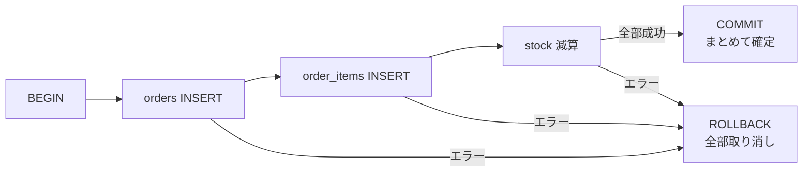

# トランザクションとACID

[[MOC_データアーキテクチャ体系|📚 目次]] ｜ [[05_実行計画の読み方|← 前へ]] ｜ [[02_分離レベルと読み取り異常|次へ →]]

> [!abstract] この記事で分かること
> - トランザクションが「なぜ」必要なのか（振込・在庫引当の例）
> - `BEGIN` / `COMMIT` / `ROLLBACK` / `SAVEPOINT` の使い方
> - ACID の 4 文字それぞれが何を保証し、何を保証しないのか
> - オートコミットと、アプリ／ORM でのトランザクション境界の決め方
> - 長いトランザクションがなぜ害になるのか
>
> **前提**：[[02_SQLの基本操作（CRUD）]] を読んでいると理解しやすいです。

## 1. ひとことで言うと

トランザクション（Transaction）とは、**「複数の操作をひとまとまりにして、全部成功させるか、全部なかったことにするか」を DB に約束させる仕組み**です。

銀行の窓口で「A さんの口座から 1 万円引いて、B さんの口座に 1 万円入れる」という振込を頼んだとします。窓口係が 1 万円引いた直後に停電したら、お金はどこにも存在しなくなります。現実の銀行は「伝票 1 枚を単位として処理する（途中までの処理は無効）」というルールでこれを防いでいます。DB におけるこの伝票 1 枚がトランザクションです。

- 「途中まで」の状態を外に見せない・残さない
- 同時に動く他の処理と混ざらない
- 確定（コミット）したら、電源が落ちても消えない

この 3 つをまとめて保証するのが、後で説明する **ACID** です。

## 2. なぜトランザクションが必要か — 2 つの例

### 2-1. 振込：途中で失敗すると矛盾が残る

Shop のスキーマに、ポイント口座テーブルを足して考えます。

```sql
CREATE TABLE point_accounts (
  user_id BIGINT PRIMARY KEY REFERENCES users(id),
  balance INTEGER NOT NULL CHECK (balance >= 0)
);
```

ユーザー 1 から 2 へ 500 ポイント譲渡するには、2 つの UPDATE が必要です。

```sql
UPDATE point_accounts SET balance = balance - 500 WHERE user_id = 1;
-- ← ここでアプリが落ちたら？
UPDATE point_accounts SET balance = balance + 500 WHERE user_id = 2;
```

トランザクションなしで 1 行目だけ実行されると、500 ポイントが消滅します。

### 2-2. 在庫引当：複数テーブルにまたがる「注文確定」

EC サイトの注文確定は、典型的には次の 3 操作です。

1. `orders` に注文ヘッダを INSERT
2. `order_items` に明細を INSERT
3. `products.stock` を購入数だけ減らす

1・2 だけ成功して 3 が失敗すると「在庫が減っていないのに注文が存在する」、逆だと「在庫だけ減って注文がない」状態になります。どちらも後から人手で直すのは非常に大変です。



## 3. 基本構文：BEGIN / COMMIT / ROLLBACK / SAVEPOINT

### 3-1. 基本の 3 つ

```sql
BEGIN;  -- トランザクション開始（START TRANSACTION; でも可）

INSERT INTO orders (user_id) VALUES (1) RETURNING id;   -- 仮に id = 100 が返った
INSERT INTO order_items (order_id, product_id, quantity, unit_price)
VALUES (100, 10, 2, 1980);
UPDATE products SET stock = stock - 2 WHERE id = 10 AND stock >= 2;

COMMIT; -- 確定。ここで初めて他のセッションから見えるようになる
```

途中で問題に気づいたら `ROLLBACK;` で BEGIN 以降の変更をすべて取り消します。

> [!note] PostgreSQL ではエラー後のトランザクションは「失敗状態」になる
> PostgreSQL では、トランザクション内で 1 文でもエラーになると、以降の文は
> `ERROR: current transaction is aborted, commands ignored until end of transaction block`
> と拒否され、ROLLBACK するしかなくなります。MySQL はエラーになった文だけが失敗し、トランザクションは続行できる（ことが多い）ので、挙動が違います。

### 3-2. SAVEPOINT：途中に「しおり」を挟む

SAVEPOINT（セーブポイント）は、トランザクションの中に戻り地点を作る機能です。ゲームのセーブと同じで、失敗したらそこまで巻き戻せます。

```sql
BEGIN;
INSERT INTO orders (user_id) VALUES (1);              -- 必ず残したい処理

SAVEPOINT before_coupon;
UPDATE coupons SET used = true WHERE code = 'WELCOME'; -- 失敗してもよい処理
-- ここでエラーになった、またはクーポンが無効だったら…
ROLLBACK TO SAVEPOINT before_coupon;                  -- クーポン処理だけ取り消し

COMMIT;  -- 注文は確定する
```

（`coupons` は説明用の仮テーブルです。）PostgreSQL では上の「失敗状態」も `ROLLBACK TO SAVEPOINT` で回復できます。ORM の「ネストしたトランザクション」は、内部的にはたいてい SAVEPOINT で実装されています。

## 4. ACID を 1 文字ずつ

| 文字 | 英語 | 一言で | 主に支える仕組み |
|---|---|---|---|
| A | Atomicity（原子性） | 全部か無か | ロールバック（undo）、WAL |
| C | Consistency（一貫性） | ルールを破った状態で確定しない | 制約 + **アプリの正しい処理** |
| I | Isolation（分離性） | 同時に動いても混ざらない | ロック、MVCC |
| D | Durability（永続性） | コミットしたら消えない | WAL + fsync |

### A：原子性（Atomicity）

「原子＝それ以上分割できないもの」。トランザクション内の操作は**部分的に成功することがない**、という保証です。2-1 の振込なら「引くだけ成功」はあり得ません。エラー・明示的な ROLLBACK・接続断・サーバークラッシュのどれでも、未コミットの変更は捨てられます。

注意したいのは、Atomicity は「同時実行」の話ではないことです。「他の人に途中を見られない」は I の担当です。

### C：一貫性（Consistency）

「DB が守るべきルール（不変条件, Invariant）を、トランザクションの前後で破らない」という保証です。ルールには 2 種類あります。

1. **DB が強制できるルール**：`NOT NULL`、`CHECK (balance >= 0)`、`UNIQUE`、外部キーなど。違反すればその文がエラーになり、トランザクションごと確定できません（詳しくは [[04_キーと制約の設計]]）。
2. **アプリにしか分からないルール**：「振込の前後でポイントの合計は変わらない」「注文明細の合計 = 請求額」など。

2 つ目は DB には分かりません。`balance - 500` と書くべきところを `balance - 50` と書いてしまっても、DB は喜んでコミットします。つまり **C の半分はアプリケーションの責任**で、DB が提供するのは「A・I・D と制約という道具」です。DDIA（『データ指向アプリケーションデザイン』）が「C は本来 ACID に入るべき性質ではない」と書いているのはこのためです。

> [!tip] アプリの不変条件は、できるだけ DB 制約に寄せる
> 「在庫はマイナスにならない」なら `CHECK (stock >= 0)` を付けておけば、アプリのバグでも DB が最後の砦になります。

### I：分離性（Isolation）

同時に走る複数のトランザクションが**互いの途中状態に影響されない**、という保証です。理想は「1 つずつ順番に実行したのと同じ結果（直列化可能, Serializable）」ですが、それを常に保証すると遅くなるため、実際の DB は**分離レベル**で強さを選ばせます。既定値は「完全な分離」ではないことが多く、これが多くのバグの原因になります。詳しくは [[02_分離レベルと読み取り異常]] と [[03_ロックとMVCC]] で扱います。

### D：永続性（Durability）

`COMMIT` が成功を返したら、その直後に電源が落ちても変更は失われない、という保証です。データファイルを毎回全部書くのではなく、**変更の記録（WAL）をディスクに確実に書いてから** COMMIT を返すことで実現しています。仕組みは [[05_WALとクラッシュリカバリ]] で説明します。ディスク自体が壊れた場合まではカバーしないので、レプリケーションやバックアップと組み合わせます。

## 5. オートコミットとトランザクション境界

### 5-1. オートコミット（Autocommit）

`BEGIN` を書かずに SQL を 1 文実行したとき、多くの DB・ドライバは**その 1 文だけを自動でトランザクションにしてコミット**します。これがオートコミットです。

```sql
-- BEGIN なし（オートコミット）
UPDATE point_accounts SET balance = balance - 500 WHERE user_id = 1;  -- この時点で確定
UPDATE point_accounts SET balance = balance + 500 WHERE user_id = 2;  -- 別のトランザクション
```

1 文 1 文は原子的ですが、2 文の間は保護されません。「複数の文で 1 つの意味を成す処理」は必ず明示的に BEGIN〜COMMIT で囲みます。

- PostgreSQL の psql、MySQL クライアントはどちらも既定でオートコミット ON です。
- Python の DB-API（psycopg など）は逆に**既定でオートコミット OFF**（最初の文で暗黙に BEGIN）のものが多く、`commit()` を呼び忘れると変更が消えます。使うドライバの既定を必ず確認しましょう。

### 5-2. アプリ／ORM での境界

実務では SQL を直接書かず、ORM（[[17_ORMとは]]）のトランザクション API を使うことが多いです。Node.js の Prisma なら次のようになります。

```ts
// Prisma: コールバック内の処理がすべて 1 トランザクション
await prisma.$transaction(async (tx) => {
  const order = await tx.order.create({ data: { userId: 1 } });
  await tx.orderItem.create({
    data: { orderId: order.id, productId: 10, quantity: 2, unitPrice: 1980 },
  });
  const updated = await tx.product.updateMany({
    where: { id: 10, stock: { gte: 2 } },
    data: { stock: { decrement: 2 } },
  });
  if (updated.count === 0) throw new Error("在庫不足"); // 例外 → 自動 ROLLBACK
});
```

ポイントは次の 3 つです。

- **境界は「業務的に 1 つの操作」単位で決める**。「注文確定」が 1 トランザクション。リポジトリの 1 メソッドごとに別トランザクションにすると原子性が失われます。
- **コールバック内では必ず `tx` を使う**。外側の `prisma` を使うと別接続・別トランザクションで実行されてしまいます（よくあるバグ）。
- **例外を投げればロールバック**、正常終了すればコミット、という形にしておくと、ROLLBACK 忘れが起きません。

## 6. 長いトランザクションの害

トランザクションは「短く」が鉄則です。開いたままにすると、次の問題が起きます。

```
時間 →
T1: BEGIN ─ UPDATE products(id=10) ───────(外部API待ち 30秒)──────── COMMIT
T2:            UPDATE products(id=10) ⏳⏳⏳⏳⏳⏳⏳⏳⏳⏳⏳⏳⏳⏳ やっと実行
T3:               UPDATE products(id=10) ⏳⏳⏳⏳⏳⏳⏳⏳⏳⏳⏳⏳ ...
```

1. **ロックを持ち続ける**：更新した行のロックは COMMIT まで解放されません。人気商品の行なら、後続の注文が全部待たされ、接続プールが枯渇してサイト全体が止まります（[[03_ロックとMVCC]]）。
2. **古い行バージョンが掃除できない**：PostgreSQL では、古いスナップショットを持つトランザクションがいる限り VACUUM が不要な行を回収できず、テーブルが肥大化します。MySQL でも undo ログが溜まり続けます。
3. **デッドロック・直列化失敗の確率が上がる**：重なる時間が長いほど衝突しやすくなります（[[04_楽観ロック・悲観ロックとデッドロック]]）。
4. **レプリケーションや DDL を詰まらせる**：`ALTER TABLE` は長いトランザクションの終了を待ち、その後ろに通常クエリが並ぶ「ロック待ちの行列」が発生します（[[07_ゼロダウンタイムのスキーマ変更]]）。

> [!warning] トランザクション内でやってはいけないこと
> - 外部 API 呼び出し、メール送信、ファイルアップロード
> - ユーザーの入力待ち（画面で「確認」ボタンを押すまで BEGIN したまま、など）
> - 大量データの一括処理（分割してコミットする）
>
> PostgreSQL では `idle_in_transaction_session_timeout` を設定して、BEGIN したまま放置された接続を自動で切ることができます。

外部 API とトランザクションを組み合わせる必要があるときは、「DB の確定 → 後で非同期に API」（Outbox パターン等）のように分離するのが定石です。

## よくある誤解・つまずき

- ❌ 1 文ずつ実行すれば安全 → ✅ オートコミットでは**文ごと**に確定します。複数文の整合性は BEGIN〜COMMIT で囲まないと守られません。
- ❌ ACID の C は DB が全部保証してくれる → ✅ DB が保証するのは制約で表せるルールだけ。業務ルールの正しさはアプリの責任です。
- ❌ トランザクションで囲めば同時実行も完全に安全 → ✅ 既定の分離レベル（PostgreSQL は READ COMMITTED）では、ロストアップデートなどが普通に起きます（[[02_分離レベルと読み取り異常]]）。
- ❌ ROLLBACK すれば外部への副作用も消える → ✅ 送ったメールや呼んだ API は戻りません。DB の外はトランザクションの対象外です。
- ❌ ORM のトランザクション内なら何を書いても同じ接続 → ✅ Prisma の `tx` のように、渡されたクライアントを使わないと別トランザクションになります。

## まとめ

- トランザクションは複数操作を「全部か無か」で確定させる単位。`BEGIN` → `COMMIT` / `ROLLBACK`、部分的な巻き戻しは `SAVEPOINT`。
- A は部分失敗をなくす、I は同時実行の干渉を防ぐ、D はコミット後の消失を防ぐ。
- C は「不変条件を守る」ことで、半分はアプリの責任。可能な限り CHECK・UNIQUE・外部キーに寄せる。
- オートコミットは 1 文 = 1 トランザクション。複数文の処理は明示的に囲む。
- 境界は業務操作単位で、ORM では渡されたトランザクション用クライアントを使う。
- トランザクションは短く。外部 I/O やユーザー待ちを中に入れない。

## 確認クイズ

1. オートコミットが有効な状態で、振込の 2 つの UPDATE を BEGIN なしで実行しました。2 文目の直前にアプリが落ちたらどうなりますか？
> [!tip]- 答え
> 1 文目はすでに単独のトランザクションとしてコミット済みなので、送金元からポイントが引かれたまま、送金先には入りません。2 文を BEGIN〜COMMIT で囲めば、COMMIT 前に落ちた変更はすべて捨てられます。

2. 「振込の前後でポイントの合計が変わらない」というルールは ACID のどの文字に関係し、誰が守る責任を持ちますか？
> [!tip]- 答え
> C（一貫性）です。ただしこのルールは DB の制約では表しにくく、正しい金額を引いて足すコードを書くのはアプリの責任です。DB は A・I・D でそのコードが途中で壊れたり混ざったりしないよう支えます。

3. 注文確定のトランザクション内で、決済代行会社の API を呼んで結果を待つ実装の問題点を 2 つ挙げてください。
> [!tip]- 答え
> ①API 応答待ちの間、在庫行などのロックを持ち続けて他の注文を待たせる（接続プール枯渇の原因）。②ROLLBACK しても API 側の処理（課金）は取り消されず、DB と外部の状態がずれる。外部呼び出しはトランザクションの外に出すのが基本です。

## 関連ノート

- [[02_分離レベルと読み取り異常]] — ACID の I を詳しく。既定の分離レベルで起きる異常
- [[03_ロックとMVCC]] — I を実現する 2 つの仕組み
- [[05_WALとクラッシュリカバリ]] — A と D を支える WAL
- [[04_キーと制約の設計]] — C を DB に任せるための制約
- [[17_ORMとは]] — ORM でのトランザクションの扱い
- [[トランザクションの仕組み]] — 送金例で ACID と分離レベルを解説するショート動画のクリップ

## 参考

- [PostgreSQL Documentation: Transactions (Tutorial)](https://www.postgresql.org/docs/current/tutorial-transactions.html)
- [PostgreSQL Documentation: SAVEPOINT](https://www.postgresql.org/docs/current/sql-savepoint.html)
- [PostgreSQL Documentation: Client Connection Defaults (idle_in_transaction_session_timeout)](https://www.postgresql.org/docs/current/runtime-config-client.html)
- [MySQL 8.4 Reference Manual: autocommit, Commit, and Rollback](https://dev.mysql.com/doc/refman/8.4/en/innodb-autocommit-commit-rollback.html)
- [Prisma Docs: Transactions and batch queries](https://www.prisma.io/docs/orm/prisma-client/queries/transactions)
