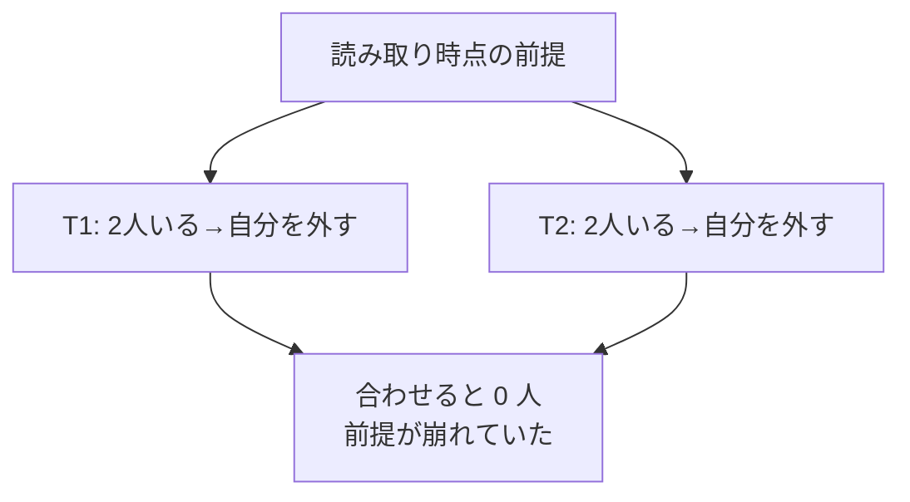

# 分離レベルと読み取り異常

[[MOC_データアーキテクチャ体系|📚 目次]] ｜ [[01_トランザクションとACID|← 前へ]] ｜ [[03_ロックとMVCC|次へ →]]

> [!abstract] この記事で分かること
> - 同時実行で起きる 5 つの異常（ダーティリード、ノンリピータブルリード、ファントム、ロストアップデート、書き込みスキュー）を時系列で再現
> - SQL 標準の 4 つの分離レベルと、それぞれが許す異常
> - PostgreSQL と MySQL（InnoDB）で、同じ名前の分離レベルでも挙動が違う点
> - 実務でどの分離レベルを選び、どう補うか
>
> **前提**：[[01_トランザクションとACID]] を読んでいると理解しやすいです。

## 1. ひとことで言うと

分離レベル（Isolation Level）とは、**「他のトランザクションの途中経過や結果を、どこまで見えてしまってよいか」のダイヤル**です。

図書館で、何人もが同じ資料ファイルを同時に読み書きしている場面を想像してください。「全員を 1 人ずつ順番に部屋に入れる」なら絶対に混乱しませんが、行列ができます。「書きかけのメモも含めて自由に見てよい」なら速いですが、消される予定のメモを信じてしまう人が出ます。DB はこの間に何段階かの妥協点を用意しており、それが分離レベルです。

- 強いほど安全・遅い（待ちやリトライが増える）、弱いほど速い・異常が起きる
- **各 DB の既定値は最強ではない**（PostgreSQL は READ COMMITTED、MySQL InnoDB は REPEATABLE READ）
- 異常の種類と自分の処理を照らし合わせて、「どの異常が起きると困るか」で判断する

## 2. 5 つの異常をタイムラインで再現する

以下、T1・T2 は同時に動く 2 つのトランザクションです。表は上から下へ時間が進みます。

### 2-1. ダーティリード（Dirty Read）

**コミットされていない変更を他人が読んでしまう**異常です。

| 時刻 | T1 | T2 |
|---|---|---|
| 1 | `BEGIN;` | `BEGIN;` |
| 2 | `UPDATE products SET price = 0 WHERE id = 10;`（誤操作） | |
| 3 | | `SELECT price FROM products WHERE id = 10;` → **0**（未コミットの値） |
| 4 | `ROLLBACK;`（取り消し） | |
| 5 | | 価格 0 円でカートに入れて注文確定… |

T2 は「一度も確定しなかった値」をもとに行動してしまいました。

### 2-2. ノンリピータブルリード（Non-repeatable Read）

**同じ行を 2 回読むと、間に他人がコミットした更新のせいで値が変わる**異常です。

| 時刻 | T1 | T2 |
|---|---|---|
| 1 | `BEGIN;` | `BEGIN;` |
| 2 | | `SELECT price FROM products WHERE id = 10;` → 1980 |
| 3 | `UPDATE products SET price = 2480 WHERE id = 10;` | |
| 4 | `COMMIT;` | |
| 5 | | `SELECT price FROM products WHERE id = 10;` → **2480** |

「画面に 1980 円と表示したのに、請求書を作る時点では 2480 円」のような食い違いが起きます。

### 2-3. ファントムリード（Phantom Read）

**同じ条件で検索し直すと、他人が INSERT（や DELETE）してコミットした行が増減する**異常です。既存行の値ではなく「行の集合」が変わる点がノンリピータブルリードとの違いです。

| 時刻 | T1 | T2 |
|---|---|---|
| 1 | `BEGIN;` | `BEGIN;` |
| 2 | | `SELECT count(*) FROM orders WHERE user_id = 1;` → 3 |
| 3 | `INSERT INTO orders (user_id) VALUES (1);` | |
| 4 | `COMMIT;` | |
| 5 | | `SELECT * FROM orders WHERE user_id = 1;` → **4 行**（幽霊が出現） |

集計した件数と明細の行数が合わない、といったレポートのずれの原因になります。

### 2-4. ロストアップデート（Lost Update）

**2 人が同じ値を読んで、それぞれ計算した結果を書き戻すと、片方の更新が消える**異常です。アプリで「読む → 計算 → 書く（read-modify-write）」をすると起きます。実務で最もよく遭遇する異常です。

| 時刻 | T1 | T2 |
|---|---|---|
| 1 | `BEGIN;` | `BEGIN;` |
| 2 | `SELECT stock FROM products WHERE id = 10;` → 5 | |
| 3 | | `SELECT stock FROM products WHERE id = 10;` → 5 |
| 4 | アプリで 5 - 1 = 4 を計算 | アプリで 5 - 1 = 4 を計算 |
| 5 | `UPDATE products SET stock = 4 WHERE id = 10;` | |
| 6 | `COMMIT;` | |
| 7 | | `UPDATE products SET stock = 4 WHERE id = 10;` |
| 8 | | `COMMIT;` |

2 個売れたのに在庫は 1 しか減っていません。T1 の更新が T2 に上書きされて「失われ」ました。対策は [[04_楽観ロック・悲観ロックとデッドロック]] で詳しく扱います（`SET stock = stock - 1` と DB 側で計算する、FOR UPDATE、version カラムなど）。

### 2-5. 書き込みスキュー（Write Skew）

**2 人がそれぞれ「条件を満たしている」ことを確認してから、別々の行を更新した結果、合わせると条件が破れる**異常です。同じ行を書いていないのでロストアップデートより発見しにくいのが特徴です。

例：「Shop の管理者は常に 1 人以上いなければならない」というルール。`users` に `is_admin BOOLEAN` を足し、現在 Alice（id=1）と Bob（id=2）の 2 人が管理者だとします。

| 時刻 | T1（Alice が自分の権限を外す） | T2（Bob が自分の権限を外す） |
|---|---|---|
| 1 | `BEGIN;` | `BEGIN;` |
| 2 | `SELECT count(*) FROM users WHERE is_admin;` → 2 | |
| 3 | | `SELECT count(*) FROM users WHERE is_admin;` → 2 |
| 4 | 2 人いるので OK と判断 | 2 人いるので OK と判断 |
| 5 | `UPDATE users SET is_admin = false WHERE id = 1;` | |
| 6 | | `UPDATE users SET is_admin = false WHERE id = 2;` |
| 7 | `COMMIT;` | `COMMIT;` |

結果、管理者が 0 人になりました。各トランザクションは自分の読んだスナップショットの中では正しかったのに、組み合わせると不変条件（[[01_トランザクションとACID]] の C）が壊れています。「ダブルブッキング（同じ時間帯の予約を 2 人が同時に取る）」も典型例です。



## 3. SQL 標準の 4 つの分離レベル

SQL 標準は、ダーティリード・ノンリピータブルリード・ファントムの 3 つの「現象（Phenomena）」を**許すかどうか**で 4 つのレベルを定義しています。

| 分離レベル | ダーティリード | ノンリピータブルリード | ファントム |
|---|:-:|:-:|:-:|
| READ UNCOMMITTED | 起こりうる | 起こりうる | 起こりうる |
| READ COMMITTED | 起きない | 起こりうる | 起こりうる |
| REPEATABLE READ | 起きない | 起きない | 起こりうる |
| SERIALIZABLE | 起きない | 起きない | 起きない |

設定方法（PostgreSQL）：

```sql
BEGIN ISOLATION LEVEL REPEATABLE READ;
-- または BEGIN; の直後に
SET TRANSACTION ISOLATION LEVEL SERIALIZABLE;
```

> [!warning] 標準の表には「ロストアップデート」と「書き込みスキュー」がない
> SQL 標準の定義は 3 つの現象しか扱っておらず、1995 年の論文（Berenson ら "A Critique of ANSI SQL Isolation Levels"）で「不十分」と指摘されています。標準が SERIALIZABLE に要求しているのは「直列に実行した場合と同じ結果」なので、SERIALIZABLE ならこの 2 つも防がれますが、**それより下のレベルで防げるかどうかは製品次第**です。次節の違いが重要になるのはこのためです。

## 4. PostgreSQL の分離レベル

PostgreSQL は MVCC（多版型同時実行制御、[[03_ロックとMVCC]]）を前提に、各レベルを次のように実装しています。

| 分離レベル | ダーティ | ノンリピータブル | ファントム | 直列化異常（書き込みスキュー等） |
|---|:-:|:-:|:-:|:-:|
| READ UNCOMMITTED | **起きない**（RC と同じ動作） | 起こりうる | 起こりうる | 起こりうる |
| READ COMMITTED（**既定**） | 起きない | 起こりうる | 起こりうる | 起こりうる |
| REPEATABLE READ | 起きない | 起きない | **起きない** | 起こりうる |
| SERIALIZABLE | 起きない | 起きない | 起きない | 起きない |

ポイント：

- **READ UNCOMMITTED は存在しないも同然**。指定しても READ COMMITTED として動き、ダーティリードは決して起きません。
- **READ COMMITTED（既定）**：**文ごと**に、その文の開始時点のスナップショットを見ます。だから同じトランザクション内でも 2 回目の SELECT は新しい値を返します。なお `UPDATE ... SET stock = stock - 1` のように DB 側で計算する UPDATE は、対象行が他人に更新されていたらコミットを待ってから**最新の行で WHERE を再評価**して更新するため、ロストアップデートになりません（read-modify-write をアプリでやると起きます）。
- **REPEATABLE READ**：**トランザクション内で最初の文を実行した時点**のスナップショットを最後まで使う「スナップショット分離（Snapshot Isolation）」です。標準では許されるファントムも起きません。他人がコミット済みの行を更新しようとすると `ERROR: could not serialize access due to concurrent update` で失敗するので、ロストアップデートは**エラーとして検出**されます。ただし書き込みスキューは防げません。
- **SERIALIZABLE**：スナップショット分離に、トランザクション間の読み書きの依存関係を監視する仕組みを足した **SSI（Serializable Snapshot Isolation）** です。読み取りをブロックしない「述語ロック（SIReadLock）」で依存を記録し、直列順序が作れない組み合わせを見つけると片方を `could not serialize access due to read/write dependencies among transactions` で失敗させます。2-5 の書き込みスキューも防げます。

> [!tip] 直列化失敗は「リトライ前提」で使う
> REPEATABLE READ / SERIALIZABLE で出るエラーは SQLSTATE `40001`（serialization_failure）です。アプリ側で「`40001` ならトランザクション全体を最初からやり直す」汎用リトライを用意するのが前提になります。エラーは故障ではなく、正しさを守るための正常な動作です。

## 5. MySQL（InnoDB）の分離レベル

同じ名前でも、InnoDB の実装はかなり違います。

| 分離レベル | InnoDB での動作 |
|---|---|
| READ UNCOMMITTED | 本当にダーティリードが起こりうる |
| READ COMMITTED | 普通の SELECT は文ごとに新しいスナップショット。ギャップロックは（外部キー・重複チェック以外）使わないので、ファントムが起こりうる |
| REPEATABLE READ（**既定**） | 普通の SELECT は**トランザクション内の最初の読み取り時点**のスナップショットを使う。ロックを伴う読み取り・UPDATE・DELETE は**ネクストキーロック／ギャップロック**で範囲への INSERT を防ぐ |
| SERIALIZABLE | REPEATABLE READ に加え、autocommit 無効時は普通の SELECT を暗黙に `SELECT ... FOR SHARE` に変換（読み取りもロックする） |

特に注意したいのが既定の REPEATABLE READ です。

- **ギャップロック（Gap Lock）**：インデックス上の「行と行の間のすき間」をロックし、その範囲に他人が INSERT できないようにする仕組みです。これで `SELECT ... FOR UPDATE` などのロック付き読み取りでもファントムを防ぎます。代わりに、思わぬ範囲がロックされて INSERT が待たされたり、デッドロックが増えたりします。
- **ロストアップデートは検出されない**：PostgreSQL の REPEATABLE READ と違い、InnoDB の REPEATABLE READ では UPDATE が「最新のコミット済みの行」に対して実行され、エラーにはなりません。2-4 のようなアプリ側 read-modify-write では更新が失われます。
- **普通の SELECT と UPDATE が見ている世界が違う**：普通の SELECT はスナップショット、UPDATE は最新。公式マニュアルも「同じトランザクションでロック付きとロックなしの文を混ぜるのは推奨しない」と注意しています。

```
同じ "REPEATABLE READ" でも…

PostgreSQL : スナップショット分離。並行更新はエラー(40001)で知らせる
MySQL      : スナップショット読み取り + 書き込みはロックで待つ。並行更新は上書き
```

（クリップ [[トランザクションの仕組み]] にある「MySQL は行をロックして順番待ち、PostgreSQL は記録しておいて衝突したら片方を止める」はこの違いを表しています。）

## 6. 実務での選び方

1. **基本は既定値のまま**（PostgreSQL: READ COMMITTED、MySQL: REPEATABLE READ）。大多数の Web アプリはこれで動いています。
2. その上で、**危ない処理を個別に守る**：
   - 在庫・残高の増減 → `UPDATE ... SET x = x - 1 WHERE x >= 1` のように DB 側でアトミックに
   - 読んでから判断して書く処理 → `SELECT ... FOR UPDATE`（悲観ロック）か version カラム（楽観ロック）（[[04_楽観ロック・悲観ロックとデッドロック]]）
   - 「重複してはいけない」系 → UNIQUE 制約や排他制約で DB に守らせる（ダブルブッキング対策に強力）
3. 書き込みスキューが絡む複雑な業務ルール（シフト、予約、上限チェック）は、その処理だけ **SERIALIZABLE + リトライ** にするのが安全で、コードも単純になります。
4. 集計レポートなど「一貫した断面で読みたい」読み取り専用処理は REPEATABLE READ（PostgreSQL なら `READ ONLY` も付ける）が適しています。

## よくある誤解・つまずき

- ❌ トランザクションで囲めばロストアップデートは起きない → ✅ PostgreSQL の READ COMMITTED や MySQL の REPEATABLE READ では、アプリで読んで計算して書き戻すと普通に起きます。
- ❌ 「REPEATABLE READ」はどの DB でも同じ意味 → ✅ PostgreSQL はスナップショット分離で並行更新をエラーにし、MySQL はギャップロックを使い並行更新を上書きします。DB を移行すると挙動が変わります。
- ❌ SERIALIZABLE にすれば何も考えなくてよい → ✅ 直列化失敗（40001）が発生するので、リトライの仕組みが必須です。リトライのない SERIALIZABLE はエラーを増やすだけです。
- ❌ PostgreSQL で READ UNCOMMITTED にすれば速くなる → ✅ 内部的には READ COMMITTED と同じです。速くも危なくもなりません。
- ❌ ファントムとノンリピータブルリードは同じ → ✅ 前者は「行の集合」が変わる（INSERT/DELETE）、後者は「既存行の値」が変わる（UPDATE）です。

## まとめ

- 同時実行の異常は 5 種類：ダーティリード、ノンリピータブルリード、ファントム、ロストアップデート、書き込みスキュー。
- SQL 標準は前の 3 つで 4 レベルを定義しているが、後の 2 つが下位レベルで防げるかは製品次第。
- PostgreSQL：既定 READ COMMITTED、READ UNCOMMITTED は RC として動作、REPEATABLE READ はスナップショット分離（ファントムも防ぐ・並行更新はエラー）、SERIALIZABLE は SSI。
- MySQL InnoDB：既定 REPEATABLE READ、ロック付き読み取りはギャップロックで範囲を守るが、ロストアップデートはエラーにならない。
- 実務は既定値 + 危ない箇所を個別に守る（アトミック UPDATE・ロック・制約）。複雑なルールは SERIALIZABLE + リトライ。

## 確認クイズ

1. PostgreSQL の READ COMMITTED で、2 つのトランザクションが同時に `UPDATE products SET stock = stock - 1 WHERE id = 10;` を実行しました。在庫は 2 減りますか？
> [!tip]- 答え
> 2 減ります。後から来た UPDATE は先の UPDATE のコミットを待ち、最新の行に対して `stock - 1` を計算し直すからです。危ないのは、アプリで SELECT した値をもとに `SET stock = 4` のように絶対値を書き戻す場合です。

2. 「同じ会議室の同じ時間帯に予約が重ならない」ことを、SELECT で空きを確認してから INSERT する方式で守ろうとしています。REPEATABLE READ（PostgreSQL）で防げますか？
> [!tip]- 答え
> 防げません。2 人が同時に「空いている」と確認し、別々の行を INSERT する書き込みスキュー（ファントムが絡むもの）です。SERIALIZABLE + リトライにするか、排他制約（EXCLUDE 制約）や UNIQUE 制約で DB に守らせるのが確実です。

3. PostgreSQL と MySQL で、REPEATABLE READ のトランザクションが「他人がコミット済みの行」を UPDATE しようとしたときの違いは？
> [!tip]- 答え
> PostgreSQL は `could not serialize access due to concurrent update`（40001）でエラーにし、アプリにリトライを促します。MySQL InnoDB は最新の行に対して更新を実行し、エラーになりません（そのためアプリ側 read-modify-write ではロストアップデートが起こりえます）。

## 関連ノート

- [[01_トランザクションとACID]] — ACID の I の位置づけ
- [[03_ロックとMVCC]] — 分離レベルを実現するスナップショットとロックの仕組み
- [[04_楽観ロック・悲観ロックとデッドロック]] — ロストアップデート・書き込みスキューへの具体的対策
- [[04_キーと制約の設計]] — 制約で同時実行の異常を防ぐ
- [[トランザクションの仕組み]] — 分離レベルと MySQL/PostgreSQL の違いを短く解説した動画クリップ

## 参考

- [PostgreSQL Documentation: Transaction Isolation](https://www.postgresql.org/docs/current/transaction-iso.html)
- [PostgreSQL Documentation: SET TRANSACTION](https://www.postgresql.org/docs/current/sql-set-transaction.html)
- [MySQL 8.4 Reference Manual: Transaction Isolation Levels](https://dev.mysql.com/doc/refman/8.4/en/innodb-transaction-isolation-levels.html)
- [MySQL 8.4 Reference Manual: InnoDB Locking (Gap Locks / Next-Key Locks)](https://dev.mysql.com/doc/refman/8.4/en/innodb-locking.html)
- [Berenson et al., A Critique of ANSI SQL Isolation Levels (Microsoft Research)](https://www.microsoft.com/en-us/research/publication/a-critique-of-ansi-sql-isolation-levels/)
