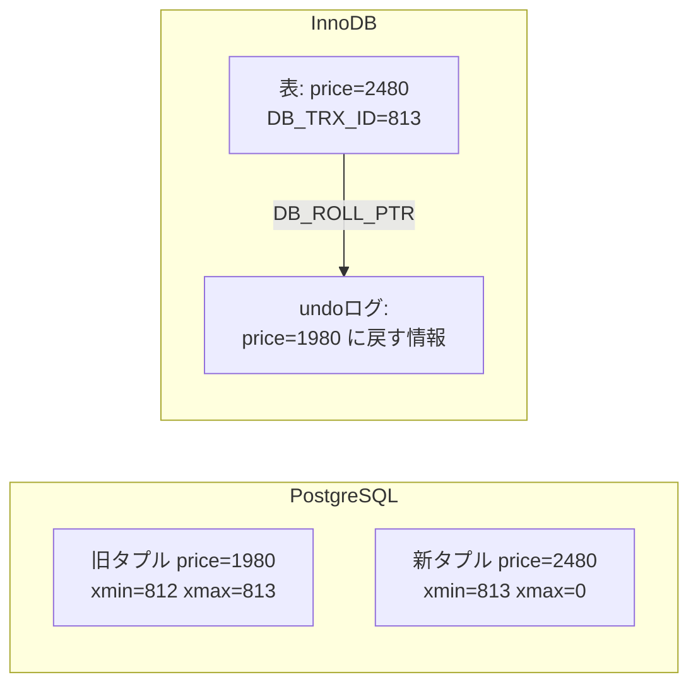

# ロックとMVCC

[[MOC_データアーキテクチャ体系|📚 目次]] ｜ [[02_分離レベルと読み取り異常|← 前へ]] ｜ [[04_楽観ロック・悲観ロックとデッドロック|次へ →]]

> [!abstract] この記事で分かること
> - 共有ロックと排他ロック、行ロックとテーブルロックの違い
> - `SELECT ... FOR UPDATE` / `FOR SHARE` で何がロックされるか
> - MVCC（多版型同時実行制御）の仕組み：PostgreSQL の xmin/xmax と InnoDB の undo ログ
> - 「読み取りは書き込みをブロックしない」の意味と、その代償（VACUUM・肥大化）
>
> **前提**：[[02_分離レベルと読み取り異常]] を読んでいると理解しやすいです。

## 1. ひとことで言うと

同時に動くトランザクションを混ぜないための方法は、大きく 2 つあります。

- **ロック（Lock）**：「使用中」の札をかけて、他の人を待たせる。トイレの鍵と同じです。
- **MVCC（Multi-Version Concurrency Control、多版型同時実行制御）**：データを書き換えるとき古い版を消さずに残し、読む人には「自分が見てよい時点の版」を見せる。Google ドキュメントの版履歴から「昨日の版」を開くと、今だれが編集していても邪魔されずに読めるイメージです。

現代の主要な RDB（PostgreSQL、MySQL InnoDB、Oracle など）は**両方を組み合わせ**ています。

- 書き込み同士の衝突 → ロックで順番待ち
- 読み取りと書き込み → MVCC で別の版を見せるので、互いに待たない

## 2. ロックの基本

### 2-1. 共有ロックと排他ロック

| | 共有ロック（Shared Lock, S） | 排他ロック（Exclusive Lock, X） |
|---|---|---|
| 意味 | 「読んでいるので変えないで」 | 「書くので誰も触らないで」 |
| 他の S | 同時に取れる ✅ | 待つ ⏳ |
| 他の X | 待つ ⏳ | 待つ ⏳ |

本を例にすると、共有ロックは「閲覧中」の札で、何人でも同時に閲覧できますが、その間は書き換えできません。排他ロックは「修正中」の札で、1 人しか持てません。

> [!note] MVCC の DB では「普通の SELECT は共有ロックを取らない」
> 教科書的な「ロックだけで分離を実現する DB」では SELECT が共有ロックを取りますが、PostgreSQL や InnoDB の普通の SELECT は MVCC のスナップショットを読むだけで、行ロックを取りません。共有ロックが欲しいときは明示的に `FOR SHARE` を付けます（MySQL の SERIALIZABLE は例外で、暗黙に FOR SHARE になります）。

### 2-2. ロックの粒度：行ロックとテーブルロック

| 粒度 | 例 | 長所 | 短所 |
|---|---|---|---|
| 行ロック（Row Lock） | UPDATE した行だけ | 同時実行性が高い | 管理コスト・デッドロックの可能性 |
| テーブルロック（Table Lock） | `ALTER TABLE`、`LOCK TABLE` | 単純 | テーブル全体が待たされる |

PostgreSQL も InnoDB も、通常の INSERT/UPDATE/DELETE は**行ロック**です（`UPDATE products ... WHERE id = 10` なら id=10 の行だけ）。ただしテーブルにも弱いロックがかかっています。

- PostgreSQL：UPDATE はテーブルに `ROW EXCLUSIVE` という弱いロックを取ります。これは他の UPDATE とは衝突しませんが、`ALTER TABLE` が取る `ACCESS EXCLUSIVE` とは衝突します。そのため **ALTER TABLE は実行中のトランザクションが終わるまで待ち、その後ろに通常の SELECT まで並んでしまう**、という事故が起きます（[[07_ゼロダウンタイムのスキーマ変更]]）。
- InnoDB：行ロックの前にテーブルへ「インテンションロック（Intention Lock：これから行をロックするという意思表示）」を取り、テーブルロックとの衝突を素早く判定します。

```sql
-- 現在のロック状況を見る（PostgreSQL）
SELECT pid, locktype, relation::regclass, mode, granted
FROM pg_locks
WHERE relation = 'products'::regclass;
```

### 2-3. SELECT ... FOR UPDATE / FOR SHARE

読む時点で行ロックを取る「ロック付き読み取り（Locking Read）」です。

```sql
BEGIN;
-- 在庫を確認して、確定するまで他人に変えさせない
SELECT stock FROM products WHERE id = 10 FOR UPDATE;
-- → 他のトランザクションの UPDATE / FOR UPDATE / FOR SHARE は COMMIT まで待つ
--   （普通の SELECT は待たずに読める）
UPDATE products SET stock = stock - 1 WHERE id = 10;
COMMIT;
```

| 構文 | ロックの強さ | 典型用途 |
|---|---|---|
| `FOR UPDATE` | 排他。他の更新・すべてのロック付き読み取りをブロック | この後その行を更新する（悲観ロック） |
| `FOR SHARE` | 共有。他の FOR SHARE は通すが、更新はブロック | 「この行が消えたり変わったりしないこと」を保証したまま別の行を書く |

PostgreSQL にはさらに `FOR NO KEY UPDATE`（キー列以外の更新用。普通の UPDATE が自動で取るのはこれ）と `FOR KEY SHARE`（外部キーのチェックで使われる最弱のロック）があります。外部キー付きの子行を INSERT すると、親行に `FOR KEY SHARE` がかかります。

- ロックは **COMMIT / ROLLBACK まで解放されません**（途中で外す SQL はない）。だからトランザクションは短くします。
- MySQL InnoDB の REPEATABLE READ では、`FOR UPDATE` がユニーク検索でない場合、**範囲（ギャップ）までロック**します（[[02_分離レベルと読み取り異常]]）。インデックスがない列で検索すると、スキャンした全行がロックされうるので要注意です。

使い分け・NOWAIT・SKIP LOCKED は [[04_楽観ロック・悲観ロックとデッドロック]] で扱います。

## 3. MVCC の仕組み

### 3-1. 発想：上書きせずに新しい版を作る

ロックだけで分離しようとすると、「誰かが書いている行は読めない」ので、レポート用の長い SELECT と注文処理が互いに待ち合ってしまいます。MVCC は**行の複数の版（バージョン）を保持**し、各トランザクションに「自分のスナップショット（Snapshot）＝ある時点でコミット済みだったものの一覧」を持たせることで、読み取りに古い版を見せます。

```
products id=10 の版の連なり

  [版1] price=1980 (txid 100 が作成, txid 205 が削除)
     ↓ UPDATE (txid 205)
  [版2] price=2480 (txid 205 が作成, まだ有効)

txid 203 で始まったトランザクション  → 205 はまだ見えない → 版1 (1980) を読む
txid 210 で始まったトランザクション  → 205 はコミット済み → 版2 (2480) を読む
```

### 3-2. PostgreSQL：タプルの版を表に直接置く

PostgreSQL では、行の 1 つの版を**タプル（Tuple）**と呼び、各タプルに隠し列があります。

- `xmin`：このタプルを作った（INSERT / UPDATE した）トランザクション ID
- `xmax`：このタプルを削除した（DELETE / UPDATE した）トランザクション ID（まだなら 0）

**UPDATE は「古いタプルの xmax に自分の ID を書く + 新しいタプルを INSERT する」**という動作です。つまり UPDATE は内部的には DELETE + INSERT です。実際に見てみましょう。

```sql
SELECT xmin, xmax, ctid, id, price FROM products WHERE id = 10;
--  xmin | xmax | ctid  | id | price
--   812 |    0 | (0,5) | 10 |  1980

UPDATE products SET price = 2480 WHERE id = 10;

SELECT xmin, xmax, ctid, id, price FROM products WHERE id = 10;
--  xmin | xmax | ctid  | id | price
--   813 |    0 | (0,9) | 10 |  2480   ← 別の位置(ctid)に新しいタプル
```

（数値は例です。`ctid` はテーブル内の物理位置。）古いタプル `(0,5)` は xmax=813 が書かれたまま表の中に残っています。各トランザクションは「xmin がスナップショット上コミット済みで、xmax が未設定または自分から見て未コミット」なタプルだけを見ます。

### 3-3. InnoDB：最新版だけを表に置き、古い版は undo ログから復元

InnoDB は逆の方式です。

- 表（クラスタ化インデックス）には**最新版だけ**を置き、その場で上書きする
- 上書き前の内容は **undo ログ（Undo Log）** に書き出す
- 各行は隠し列 `DB_TRX_ID`（最後に更新したトランザクション ID）と `DB_ROLL_PTR`（undo ログへのポインタ）を持つ
- 古いスナップショットで読む人には、undo ログをたどって過去の版を**組み立て直して**見せる



| | PostgreSQL | MySQL InnoDB |
|---|---|---|
| 古い版の置き場所 | テーブル本体（デッドタプル） | undo ログ（ロールバックセグメント） |
| UPDATE の実体 | 新タプルの追加 | その場で上書き + undo 記録 |
| 掃除役 | VACUUM（autovacuum） | パージ（purge）スレッド |
| ROLLBACK | 新タプルを無視するだけで速い | undo を適用して戻す |

クリップ [[トランザクションの仕組み]] の「Postgres は行のバージョンを増やし、MySQL はログから古い値を復元する」はこの違いのことです。

### 3-4. 「読み取りは書き込みをブロックしない」

MVCC の最大の利点は、PostgreSQL の公式ドキュメントの言葉でいえば **「読み取りは書き込みをブロックせず、書き込みは読み取りをブロックしない」** ことです。

| 組み合わせ | 待つ？ |
|---|---|
| 読み（普通の SELECT） × 読み | 待たない |
| 読み × 書き | **待たない**（読む側は古い版を見る） |
| 書き × 書き（同じ行） | **待つ**（行ロック） |
| ロック付き読み（FOR UPDATE） × 書き | 待つ |

だから「重い集計クエリが走っている間も注文処理は止まらない」のです。逆に、同じ行への書き込み同士はやはりロックで待つので、人気商品の在庫行のような「ホットな行」は MVCC でも競合します。

## 4. MVCC の代償：VACUUM と肥大化

### 4-1. PostgreSQL：デッドタプルと VACUUM

UPDATE/DELETE のたびに古いタプルがテーブルに残るので、誰からも見えなくなったタプル（**デッドタプル, Dead Tuple**）を回収する必要があります。これが **VACUUM** です。

- **VACUUM**：デッドタプルの領域を「再利用可能」にマークする。通常の読み書きと並行して動ける。ただし空いた領域は基本的に OS には返さない（テーブルファイルは小さくならない）。
- **autovacuum**：更新量に応じて自動で VACUUM・ANALYZE を走らせるデーモン。**止めてはいけません**。
- **VACUUM FULL**：テーブルを丸ごと書き直して縮める。`ACCESS EXCLUSIVE` ロックで読み書きをすべて止めるので、本番では慎重に（pg_repack などのツールを使うことが多い）。

```sql
-- デッドタプルの溜まり具合と最後の autovacuum を確認
SELECT relname, n_live_tup, n_dead_tup, last_autovacuum
FROM pg_stat_user_tables
ORDER BY n_dead_tup DESC
LIMIT 10;
```

VACUUM は**まだ誰かが見ている可能性のある版は消せません**。そのため、

- 何時間も開きっぱなしのトランザクション（`idle in transaction` の接続など）
- 長時間のレポートクエリ
- 遅れているレプリカの長いクエリ（hot_standby_feedback 有効時）

があると、その開始時点以降のデッドタプルがすべて回収できず、テーブルとインデックスが**肥大化（Bloat）**します。肥大化すると同じデータ量でも読むページが増え、クエリが遅くなります（[[01_データはディスクにどう保存されるか]]）。

> [!warning] トランザクション ID の周回（Wraparound）
> PostgreSQL のトランザクション ID は 32 ビットで周回するため、VACUUM が古いタプルを「凍結（freeze）」し続ける必要があります。VACUUM が長期間できないと、最終的にデータ保護のため書き込みを拒否する状態に陥ります。autovacuum を止めない・長いトランザクションを放置しない、が基本の予防策です。

### 4-2. InnoDB：undo ログとパージ

InnoDB では、古いスナップショットが必要としている間、更新の undo ログを捨てられません。長いトランザクションがあると undo ログが溜まり（`SHOW ENGINE INNODB STATUS` の History list length が増える）、削除済み行の物理削除（パージ）も遅れます。古い版を作り直すために長い undo チェーンをたどることになり、読み取りも遅くなります。MySQL の公式マニュアルも「読み取りだけのトランザクションも含め、定期的にコミットせよ」と書いています。

**結論：どちらの方式でも、長いトランザクションは MVCC の掃除を止めて性能を落とします。**

## よくある誤解・つまずき

- ❌ SELECT しているだけなら他人の邪魔にならない → ✅ ロックはしませんが、長く開いたトランザクションは VACUUM／パージを妨げ、肥大化を招きます。
- ❌ MVCC ならロックは不要 → ✅ 同じ行への書き込み同士はロックで待ちます。MVCC が解消するのは読みと書きの競合だけです。
- ❌ PostgreSQL の UPDATE はその場で値を書き換える → ✅ 新しいタプルを作り、古いタプルはデッドタプルとして残ります。更新の多いテーブルほど VACUUM が重要です。
- ❌ FOR UPDATE のロックは UPDATE が終われば外れる → ✅ ロックは COMMIT / ROLLBACK まで保持されます。
- ❌ VACUUM すればディスク使用量が減る → ✅ 通常の VACUUM は領域を再利用可能にするだけで、ファイルサイズは基本的に縮みません。

## まとめ

- 同時実行制御はロック（待たせる）と MVCC（版を分ける）の組み合わせ。
- 共有ロックは読み同士を通し、排他ロックは 1 人だけ。通常の DML は行ロック、DDL は強いテーブルロック。
- `FOR UPDATE` / `FOR SHARE` で明示的に行ロックを取れる。ロックはトランザクション終了まで続く。
- PostgreSQL は新しいタプルを追加（xmin/xmax）、InnoDB はその場で上書きして undo ログに旧版を保存。
- 「読み取りは書き込みをブロックしない」代わりに、古い版の掃除（VACUUM・パージ）が必要。長いトランザクションはそれを妨げる。

## 確認クイズ

1. PostgreSQL で、ある行を 1 回 UPDATE した直後、テーブル内にはその行のタプルがいくつ存在しますか？
> [!tip]- 答え
> 2 つです。xmax が設定された古いタプル（デッドタプル候補）と、新しいタプルです。古いタプルは、それを見る可能性のあるトランザクションがいなくなった後に VACUUM で回収されます。

2. 長時間の集計 SELECT（REPEATABLE READ）が走っている間に、別のセッションが同じテーブルを UPDATE しました。UPDATE は待たされますか？ また、集計側は何を読みますか？
> [!tip]- 答え
> 待たされません（MVCC により読み取りは書き込みをブロックしない）。集計側は自分のスナップショット時点の古い版を読み続けます。ただし集計が長引くほど、その間のデッドタプル（InnoDB なら undo）が回収できず溜まります。

3. 本番で `ALTER TABLE products ADD COLUMN ...` を実行したら、普段は一瞬で終わる SELECT まで詰まり始めました。考えられる原因は？
> [!tip]- 答え
> ALTER TABLE が `ACCESS EXCLUSIVE` ロックを要求し、products を使っている長いトランザクションの終了を待っている間、後続の SELECT もそのロック待ちの後ろに並んだためです。`lock_timeout` を短く設定して実行する、長いトランザクションを先に解消する、などで防ぎます。

## 関連ノート

- [[02_分離レベルと読み取り異常]] — スナップショットをどの単位で取るかが分離レベルの違い
- [[04_楽観ロック・悲観ロックとデッドロック]] — ロックを使ったアプリ側の設計
- [[01_データはディスクにどう保存されるか]] — ページ・タプルの物理構造
- [[07_ゼロダウンタイムのスキーマ変更]] — DDL のロックで事故らない方法
- [[MOC_パフォーマンス体系]] — 肥大化やロック待ちの調査
- [[トランザクションの仕組み]] — PostgreSQL と MySQL の版管理の違いに触れた動画クリップ

## 参考

- [PostgreSQL Documentation: Concurrency Control — Introduction (MVCC)](https://www.postgresql.org/docs/current/mvcc-intro.html)
- [PostgreSQL Documentation: Explicit Locking](https://www.postgresql.org/docs/current/explicit-locking.html)
- [PostgreSQL Documentation: System Columns (xmin, xmax, ctid)](https://www.postgresql.org/docs/current/ddl-system-columns.html)
- [PostgreSQL Documentation: Routine Vacuuming](https://www.postgresql.org/docs/current/routine-vacuuming.html)
- [MySQL 8.4 Reference Manual: InnoDB Multi-Versioning](https://dev.mysql.com/doc/refman/8.4/en/innodb-multi-versioning.html)
- [MySQL 8.4 Reference Manual: InnoDB Locking](https://dev.mysql.com/doc/refman/8.4/en/innodb-locking.html)
