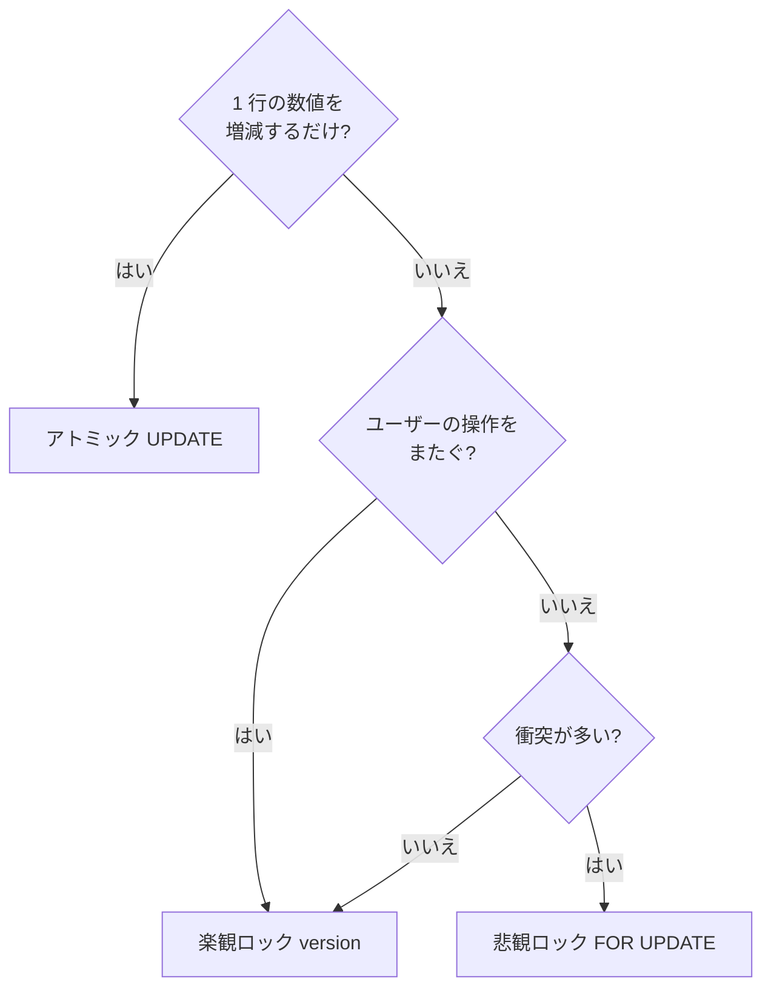

# 楽観ロック・悲観ロックとデッドロック

[[MOC_データアーキテクチャ体系|📚 目次]] ｜ [[03_ロックとMVCC|← 前へ]] ｜ [[05_WALとクラッシュリカバリ|次へ →]]

> [!abstract] この記事で分かること
> - 在庫減算をロックなしでも安全にする「アトミックな UPDATE」
> - 悲観ロック（`FOR UPDATE`）と楽観ロック（version カラム）の実装と使い分け
> - デッドロックが起きる仕組みと、ロック順序・リトライ・タイムアウトによる対策
> - `NOWAIT` / `SKIP LOCKED` を使ったジョブキュー、アドバイザリロック
>
> **前提**：[[02_分離レベルと読み取り異常]]、[[03_ロックとMVCC]] を読んでいると理解しやすいです。

## 1. ひとことで言うと

[[02_分離レベルと読み取り異常]] で見たロストアップデート（同時に読んで書き戻すと片方が消える）を防ぐ方法は、性格の違う 3 つに分かれます。

- **アトミックな UPDATE**：「読んでから書く」をやめ、DB に 1 文で計算させる。最優先で検討する。
- **悲観ロック（Pessimistic Lock）**：「きっと誰かとぶつかる」と考え、読む時点で鍵をかけて他人を待たせる。会議室を**先に予約**しておくやり方。
- **楽観ロック（Optimistic Lock）**：「たぶんぶつからない」と考え、鍵はかけずに作業し、書き込む瞬間に「読んだ後に誰も変えていないか」を確認する。Wiki の「編集が競合しました」画面のやり方。

ロックを使う以上、**デッドロック**（お互いの鍵を待って永遠に進まない状態）への備えも必要です。

## 2. まず考える：アトミックな UPDATE

在庫を 1 減らす処理を、アプリで「読む → 計算 → 書く」とするとロストアップデートが起きます。

```sql
-- ❌ 危険：アプリで計算した値を書き戻す
SELECT stock FROM products WHERE id = 10;        -- 5 を取得
UPDATE products SET stock = 4 WHERE id = 10;     -- アプリで 5-1 を計算
```

DB に計算させれば、1 文の中で「最新の値を読んで書く」が行ロック付きで行われます。

```sql
-- ✅ 安全：1 文で条件チェックと減算をまとめる
UPDATE products
SET stock = stock - 1
WHERE id = 10 AND stock > 0      -- 複数個なら stock >= :qty
RETURNING stock;
```

- 同時に 2 本来ても、後の UPDATE は先のコミットを待ち、**最新の値で WHERE を再評価**します（PostgreSQL の READ COMMITTED、MySQL でも UPDATE は最新の行を読む）。
- **更新件数が 0 なら在庫切れ**です。アプリは件数（または RETURNING の結果）を見て判定します。
- 仕上げに `CHECK (stock >= 0)` を付けておけば、バグがあっても在庫がマイナスになりません。

「ポイント加算」「いいね数 +1」「残高の増減」など、**1 行の数値を条件付きで増減するだけ**なら、ロックの設計は不要でこれが最善です。複数の行を読んで判断する、読んだ値を画面に出してユーザーが編集する、といった場合に次の 2 つを使います。

## 3. 悲観ロック：SELECT ... FOR UPDATE

### 3-1. 実装

読む時点で排他的な行ロックを取り、COMMIT まで他人の更新・ロックを待たせます。

```sql
BEGIN;
-- 注文と、その明細の商品をロック（他の処理はここで待つ）
SELECT id, status FROM orders WHERE id = 100 FOR UPDATE;

-- アプリで状態を確認：status = 'pending' ならキャンセル可能
UPDATE orders SET status = 'cancelled' WHERE id = 100;
UPDATE products p
SET stock = p.stock + oi.quantity
FROM order_items oi
WHERE oi.order_id = 100 AND oi.product_id = p.id;   -- 在庫を戻す
COMMIT;
```

「キャンセル処理」と「発送処理」が同時に来ても、後から来た方は FOR UPDATE で待たされ、先の処理がコミットした後の `status` を読むので、「キャンセル済みの注文を発送する」ことは起きません。

### 3-2. 特徴

- ✅ 確実。衝突したら待つだけで、アプリのリトライ処理が（デッドロック以外は）いらない
- ✅ 衝突が多い場面で無駄な作業が出ない
- ❌ ロックを持っている間、他人が待つ。トランザクションを短く保つ必要がある
- ❌ **画面をまたいで使えない**。「編集画面を開いてから保存するまで」ロックを持つと、ユーザーが席を立っただけで他の人が止まります
- ❌ ロックの取り方次第でデッドロックが起きる（後述）

## 4. 楽観ロック：version カラム

### 4-1. 実装

テーブルに更新のたびに増える `version` 列を足します。

```sql
ALTER TABLE products ADD COLUMN version INTEGER NOT NULL DEFAULT 0;
```

1. 読むときに version も一緒に取得する（トランザクションもロックも不要）
2. 書くときに「version が読んだときのままなら」という条件を付け、同時に version を +1 する
3. 更新件数が 0 なら、誰かが先に更新した＝**競合**。ユーザーに知らせるか、読み直してやり直す

```sql
-- ① 管理画面で商品を開く
SELECT id, name, price, version FROM products WHERE id = 10;
-- → price = 1980, version = 7

-- ② 数分後、価格を 2480 に変更して保存
UPDATE products
SET price = 2480, version = version + 1
WHERE id = 10 AND version = 7;
-- 更新件数 1 → 成功（version は 8 に）
-- 更新件数 0 → その間に別の人が保存していた。「他のユーザーが更新しました」と表示
```

| 時刻 | 管理者 A | 管理者 B |
|---|---|---|
| 1 | 読む（version=7） | 読む（version=7） |
| 2 | `... WHERE version = 7` → **1 件更新**（version=8） | |
| 3 | | `... WHERE version = 7` → **0 件**（競合を検出） |

ORM の多くは楽観ロックを標準で持っています（JPA の `@Version`、Rails の `lock_version` など。[[17_ORMとは]]）。Prisma では `updateMany` の `where` に version を含め、`count` を確認する形で実装します。`updated_at` タイムスタンプを version 代わりに使う方法もありますが、時刻の精度による取りこぼしがあるので整数の version が確実です。

### 4-2. 特徴

- ✅ ロックを持たないので待ちが発生しない。**画面をまたぐ長い編集**に使える
- ✅ 衝突が少ない場面では最も軽い
- ❌ 衝突したら作業がやり直しになる。衝突が多いと無駄が増える
- ❌ すべての更新経路で version を守る必要がある（1 か所でも条件なしで UPDATE すると無意味に）

## 5. 使い分け

| 状況 | おすすめ |
|---|---|
| 数値の増減（在庫、残高、カウンタ） | **アトミック UPDATE**（条件付き） |
| 1 トランザクション内で読んで判断して書く・衝突が多い | **悲観ロック**（FOR UPDATE） |
| ユーザーが画面で編集して保存する・衝突は稀 | **楽観ロック**（version） |
| 複数行にまたがる複雑なルール（書き込みスキュー） | SERIALIZABLE + リトライ、または制約（[[02_分離レベルと読み取り異常]]） |
| 同じ処理を同時に 1 本しか動かしたくない | アドバイザリロック（7 節） |



## 6. デッドロック

### 6-1. 発生例

デッドロック（Deadlock）は、2 つ以上のトランザクションが**互いに相手の持つロックを待って、どちらも進めなくなる**状態です。狭い一本道で 2 台の車が向かい合って止まった状態に似ています。

2 つの商品を同時に注文する処理で、商品の処理順がリクエストによって違うと起きます。

| 時刻 | T1（商品 10 → 20 の順） | T2（商品 20 → 10 の順） |
|---|---|---|
| 1 | `UPDATE products SET stock = stock - 1 WHERE id = 10;` 🔒10 | |
| 2 | | `UPDATE products SET stock = stock - 1 WHERE id = 20;` 🔒20 |
| 3 | `UPDATE ... WHERE id = 20;` ⏳（T2 待ち） | |
| 4 | | `UPDATE ... WHERE id = 10;` ⏳（T1 待ち） → **デッドロック** |

```
   T1 ──持つ──▶ 行10 ◀──待つ── T2
   T1 ──待つ──▶ 行20 ◀──持つ── T2      （待ちが輪になる）
```

DB はこの「待ちの輪」を自動検出し、片方を強制的にエラーにします。

- PostgreSQL：ロック待ちが `deadlock_timeout`（既定 1 秒）続くと検出処理が走り、`ERROR: deadlock detected`（SQLSTATE `40P01`）で片方をアボート
- MySQL InnoDB：既定でデッドロック検出が有効で、即座に片方（変更量の小さい方）をロールバック（エラー 1213）

### 6-2. 対策

1. **ロックを取る順序を統一する**（最も効果的）。上の例なら商品 ID の昇順で処理すれば、輪ができません。
   ```sql
   -- 注文に含まれる商品を、ID 順にまとめてロック
   SELECT id, stock FROM products
   WHERE id IN (20, 10)
   ORDER BY id
   FOR UPDATE;
   ```
2. **トランザクションを短く、ロックする行を少なく**。重なる時間が短いほど起きにくくなります。必要なインデックスがないと、余分な行（InnoDB ではギャップも）までロックされます。
3. **リトライする**。デッドロックは完全にはなくせない前提で、`40P01` / `40001`（MySQL は 1213）ならトランザクション全体をやり直す仕組みを作ります。
   ```ts
   async function withRetry<T>(fn: () => Promise<T>, max = 3): Promise<T> {
     for (let i = 1; ; i++) {
       try { return await fn(); }
       catch (e: any) {
         const retryable = ["40001", "40P01"].includes(e?.code ?? e?.meta?.code);
         if (!retryable || i >= max) throw e;
         await new Promise(r => setTimeout(r, 50 * 2 ** i + Math.random() * 50)); // 指数バックオフ + ゆらぎ
       }
     }
   }
   ```
   （エラーコードの取り出し方はドライバ・ORM によって異なります。）
4. **タイムアウトを設定する**。デッドロックでなくても、長いロック待ちは障害の連鎖を生みます。
   - PostgreSQL：`SET lock_timeout = '3s';`（既定 0 = 無制限）、`statement_timeout`
   - MySQL：`innodb_lock_wait_timeout`（既定 50 秒）

## 7. NOWAIT / SKIP LOCKED とアドバイザリロック

### 7-1. NOWAIT：待たずに諦める

```sql
SELECT * FROM orders WHERE id = 100 FOR UPDATE NOWAIT;
-- 他人がロック中なら待たずに即エラー（PostgreSQL: 55P03 lock_not_available）
```

「他の担当者が処理中です」とすぐ返したい画面などに使います。

### 7-2. SKIP LOCKED：ロック中の行を飛ばす（ジョブキュー）

DB のテーブルをジョブキューとして使い、複数のワーカーが並行して処理する場面の定番です。

```sql
CREATE TABLE jobs (
  id         BIGSERIAL PRIMARY KEY,
  payload    JSONB NOT NULL,
  status     TEXT NOT NULL DEFAULT 'queued',
  created_at TIMESTAMPTZ NOT NULL DEFAULT now()
);

-- 各ワーカーが実行：まだ誰も掴んでいないジョブを 1 件取る
BEGIN;
SELECT id, payload FROM jobs
WHERE status = 'queued'
ORDER BY id
LIMIT 1
FOR UPDATE SKIP LOCKED;
-- … 取得した id のジョブを処理 …
UPDATE jobs SET status = 'done' WHERE id = :id;
COMMIT;
```

`SKIP LOCKED` がないと、全ワーカーが先頭の 1 件を取り合って順番待ちになります。あると、他のワーカーがロック中の行を飛ばして次の行を取るので、**重複なく並列に**処理できます。PostgreSQL 9.5+、MySQL 8.0+ で使えます。ワーカーが落ちれば接続が切れてロールバックされ、ジョブは自動的に `queued` のまま他のワーカーに回ります。

> [!note] SKIP LOCKED の結果は「一貫したビュー」ではない
> ロック中の行を意図的に見ないので、集計や在庫確認には使えません。キューのように「どれか空いているものを 1 つ」の用途専用です。

### 7-3. アドバイザリロック（Advisory Lock）

行やテーブルではなく、**アプリが決めた番号に対してロックを取る** PostgreSQL の機能です。DB はその番号の意味を知らず、アプリ同士の約束として使います。

```sql
-- 日次集計バッチを、複数サーバーで同時に 1 本しか動かさない
SELECT pg_try_advisory_lock(20261012);   -- true なら実行権を得た、false なら他で実行中
-- … バッチ処理 …
SELECT pg_advisory_unlock(20261012);

-- トランザクション単位版：COMMIT / ROLLBACK で自動解放（解放忘れがない）
BEGIN;
SELECT pg_advisory_xact_lock(42);
-- … 処理 …
COMMIT;
```

- セッション単位のロックは ROLLBACK しても外れず、接続が切れるまで残ります。接続プール経由だと解放忘れが起きやすいので、可能ならトランザクション単位版（`_xact_`）を使います。
- 用途：cron の多重起動防止、マイグレーションの同時実行防止（多くのマイグレーションツールが内部で使っています。[[03_マイグレーションの実行とロールバック]]）、「ユーザー単位で処理を直列化」など。
- MySQL では `GET_LOCK('name', timeout)` / `RELEASE_LOCK('name')` が同様の名前付きロックです。

## よくある誤解・つまずき

- ❌ 在庫減算には必ず FOR UPDATE が必要 → ✅ `UPDATE ... SET stock = stock - 1 WHERE stock > 0` の 1 文で十分なことが多く、最も速く安全です。
- ❌ 楽観ロックは「ロックしない」から競合を防げない → ✅ WHERE に version を入れることで、書き込みの瞬間に競合を検出します。検出後の処理（再読込・通知）を実装して初めて完成です。
- ❌ デッドロックはバグなので 0 にできる → ✅ ロック順序の統一で大きく減らせますが、ゼロは難しいので、リトライを組み込むのが前提です。
- ❌ デッドロックが起きると DB が固まる → ✅ DB が自動検出して片方をエラーにします。固まり続けるのは「デッドロックではない長いロック待ち」で、こちらはタイムアウトで守ります。
- ❌ アドバイザリロックは DB が強制してくれる → ✅ 取らずにアクセスするコードは普通に通ります。全員が同じ番号で取るという約束が前提です。

## まとめ

- 数値の増減はアトミック UPDATE（`stock = stock - 1 WHERE stock > 0`）が第一選択。
- 悲観ロック（FOR UPDATE）は確実だが待ちが出る。1 トランザクション内・衝突が多い場面向け。
- 楽観ロック（version 列 + `WHERE version = ?`）は待ちがない。画面をまたぐ編集・衝突が稀な場面向け。
- デッドロックはロック順序の統一・短いトランザクション・リトライ・タイムアウトで対処する。
- `NOWAIT` で即失敗、`SKIP LOCKED` でジョブキュー、アドバイザリロックで処理の多重実行を防ぐ。

## 確認クイズ

1. 楽観ロックで `UPDATE products SET price = 2480, version = version + 1 WHERE id = 10 AND version = 7;` の更新件数が 0 でした。何が起きたと考えられ、アプリは何をすべきですか？
> [!tip]- 答え
> 読んだ後に他の誰かが同じ行を更新し、version が 8 以上になっていた（または行が削除された）と考えられます。最新の値を読み直してユーザーに競合を知らせる、または自動で再計算してやり直します。

2. 注文処理で「カートの商品を順にループして FOR UPDATE する」実装で、たまにデッドロックが出ます。最も効果的な修正は？
> [!tip]- 答え
> ロックを取る順序を統一することです。例えば商品 ID の昇順でソートしてからロックする（`WHERE id IN (...) ORDER BY id FOR UPDATE`）。加えて、デッドロックエラー時のリトライを用意します。

3. 10 台のワーカーが `jobs` テーブルから未処理ジョブを取り出します。`FOR UPDATE` だけだと何が起き、`SKIP LOCKED` を付けると何が変わりますか？
> [!tip]- 答え
> `FOR UPDATE` だけだと、全ワーカーが同じ先頭行のロックを待ち、実質 1 台ずつしか動きません。`SKIP LOCKED` を付けると、ロック中の行を飛ばして次の未処理行を取るので、重複なく並列に処理できます。

## 関連ノート

- [[02_分離レベルと読み取り異常]] — ロストアップデート・書き込みスキューの定義
- [[03_ロックとMVCC]] — ロックの種類と FOR UPDATE の基本
- [[04_キーと制約の設計]] — CHECK・UNIQUE 制約で最後の砦を作る
- [[17_ORMとは]] — ORM の楽観ロック機能
- [[03_マイグレーションの実行とロールバック]] — マイグレーションの多重実行防止
- [[トランザクションの仕組み]] — MySQL のロック待ちとデッドロックに触れた動画クリップ

## 参考

- [PostgreSQL Documentation: Explicit Locking (Row-Level Locks, Deadlocks, Advisory Locks)](https://www.postgresql.org/docs/current/explicit-locking.html)
- [PostgreSQL Documentation: SELECT — The Locking Clause (NOWAIT / SKIP LOCKED)](https://www.postgresql.org/docs/current/sql-select.html#SQL-FOR-UPDATE-SHARE)
- [PostgreSQL Documentation: Advisory Lock Functions](https://www.postgresql.org/docs/current/functions-admin.html#FUNCTIONS-ADVISORY-LOCKS)
- [PostgreSQL Documentation: Lock Management (deadlock_timeout)](https://www.postgresql.org/docs/current/runtime-config-locks.html)
- [MySQL 8.4 Reference Manual: Deadlocks in InnoDB](https://dev.mysql.com/doc/refman/8.4/en/innodb-deadlocks.html)
- [MySQL 8.4 Reference Manual: Locking Read Concurrency with NOWAIT and SKIP LOCKED](https://dev.mysql.com/doc/refman/8.4/en/innodb-locking-reads.html)
