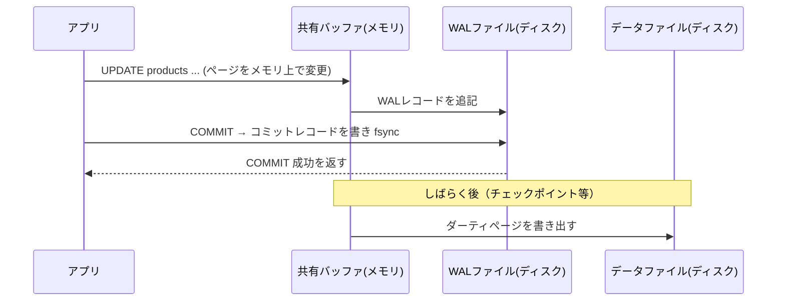
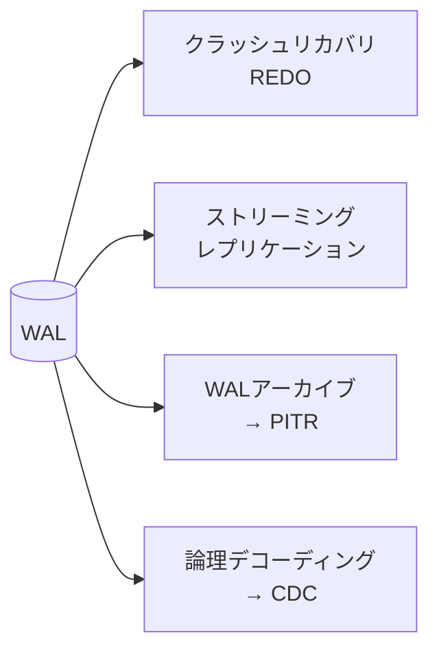

# WALとクラッシュリカバリ

[[MOC_データアーキテクチャ体系|📚 目次]] ｜ [[04_楽観ロック・悲観ロックとデッドロック|← 前へ]] ｜ [[01_マイグレーションとは|次へ →]]

> [!abstract] この記事で分かること
> - 先行書き込みログ（WAL）の原則と、なぜそれで速さと安全を両立できるのか
> - `COMMIT` が成功を返したとき、ディスク上で何が保証されているのか
> - チェックポイントとクラッシュ後の REDO（やり直し）の流れ
> - `fsync` と `synchronous_commit` の意味と、いじってよい・いけない設定
> - WAL のほかの用途（レプリケーション・PITR・CDC）とバックアップの種類
>
> **前提**：[[01_トランザクションとACID]]、[[01_データはディスクにどう保存されるか]] を読んでいると理解しやすいです。

## 1. ひとことで言うと

WAL（Write-Ahead Logging、先行書き込みログ）とは、**「データ本体を書き換える前に、何を変えるかを日誌に書いて確実に保存しておく」**というルールです。

お店の帳簿で例えます。売上のたびに分厚い台帳の該当ページを探して書き直すのは大変です。そこで、まず手元の**レジ日誌**に「10 時 3 分、商品 10 を 1 個販売」と 1 行追記し、台帳への転記は閉店後にまとめて行います。途中で停電して台帳の転記が中途半端になっても、レジ日誌を最初から読み直せば台帳を正しい状態に戻せます。

- レジ日誌 = WAL（追記するだけなので速い）
- 台帳 = テーブル・インデックスのデータファイル（後でまとめて書く）
- 日誌を読み直して台帳を直す = クラッシュリカバリ（REDO）

ACID の **D（永続性）** と、クラッシュ時の **A（原子性）** を支えているのがこの仕組みです。

## 2. WAL の原則と COMMIT の意味

### 2-1. なぜデータファイルを直接書かないのか

DB はデータを 8KB（PostgreSQL）や 16KB（InnoDB）のページ単位で扱い、メモリ上のバッファ（共有バッファ／バッファプール）に載せて読み書きします（[[01_データはディスクにどう保存されるか]]）。コミットのたびに変更したページをすべてディスクに書くと、

- 書き込み先がディスク上のあちこちに散らばる（ランダム I/O）
- 1 行の変更でもページ丸ごと書くことになる
- 注文確定 1 回で products、orders、order_items、各インデックス…と多数のページを書く

ことになり、とても遅くなります。

WAL なら、変更内容を**1 本のログファイルの末尾に順番に追記する（シーケンシャル I/O）**だけで済みます。変更したページ（ダーティページ）はメモリに置いたままにして、後でまとめて書き出せます。

### 2-2. 原則：ログが先、データは後

WAL の規則はたった 1 つです。

> **データページの変更をディスクに書く前に、その変更を記述した WAL レコードが必ずディスクに書かれていなければならない。**



### 2-3. COMMIT が返ったら何が保証されるのか

PostgreSQL の既定設定では、`COMMIT` が成功を返した時点で次が成り立っています。

- そのトランザクションの**コミットレコードまでの WAL が、fsync によってディスク（不揮発ストレージ）に到達している**
- データファイル本体は**まだ古いままかもしれない**（変更はメモリ上にしかない）

それでも「永続」と言えるのは、クラッシュしても WAL から変更を再現できるからです。逆に、COMMIT 前にクラッシュしたトランザクションは、WAL にコミットレコードがないので「なかったこと」になります（原子性）。

> [!note] fsync とは
> OS は性能のため、アプリが「書いた」データをいったん OS のメモリ（ページキャッシュ）に溜め、後でディスクに書きます。`fsync` は「このファイルの内容を今すぐ物理ディスクまで書け、終わるまで戻るな」という OS への命令です。WAL の安全性は fsync が本当にディスクまで届くことに依存しています。

## 3. チェックポイントとクラッシュリカバリ

### 3-1. チェックポイント（Checkpoint）

WAL が永遠に伸び続けると、クラッシュ後の読み直しに何時間もかかってしまいます。そこで定期的に**チェックポイント**を行います。

1. その時点のダーティページをすべてデータファイルに書き出して fsync する
2. 「ここまでの変更はデータファイルに反映済み」という印（チェックポイントレコード）を WAL に書く
3. それより前の WAL は、クラッシュリカバリには不要になる（アーカイブやレプリカに必要なければ削除・再利用できる）

PostgreSQL では `checkpoint_timeout`（既定 5 分）経過か、WAL が `max_wal_size`（既定 1GB、ソフトリミット）に達したときにチェックポイントが走ります。間隔を長くすると平常時の書き込みは減りますが、クラッシュ後の復旧時間が延びます。

> [!tip] full_page_writes
> チェックポイント後に初めて変更するページは、WAL にページ丸ごとの画像を書きます（PostgreSQL の `full_page_writes`、既定 on）。停電でページの書き込みが途中で切れる（破損ページ, torn page）ことへの対策です。InnoDB は doublewrite buffer という別の方法で同じ問題を防いでいます。

### 3-2. クラッシュ後の REDO

```
WAL:  ... [CP] [T1 UPDATE] [T2 INSERT] [T1 COMMIT] [T3 UPDATE] ✖クラッシュ
                ↑ ここから再生
```

再起動時、DB は自動で次を行います。

1. 最後のチェックポイントの位置を見つける
2. そこから WAL を順番に読み、記録された変更をデータページに**再適用（REDO）**する
3. 結果：T1 の変更は反映される（コミット済み）。T2・T3 はコミットレコードがないので、**未完了として扱われ、見えない**

PostgreSQL では、MVCC のおかげで未コミットのタプルは「xmin のトランザクションが中断扱い」となり誰からも見えないため、データを書き戻す UNDO 処理は不要です（[[03_ロックとMVCC]]）。InnoDB は redo ログで REDO した後、undo ログを使って未コミットのトランザクションを巻き戻します。

| | PostgreSQL | MySQL InnoDB |
|---|---|---|
| 先行書き込みログ | WAL（`pg_wal/` ディレクトリ） | redo ログ |
| 未コミット分の扱い | 中断扱いで不可視に | undo ログでロールバック |
| 破損ページ対策 | full_page_writes | doublewrite buffer |
| コミット時の書き込み設定 | `synchronous_commit` | `innodb_flush_log_at_trx_commit` |

## 4. fsync と synchronous_commit

### 4-1. 触ってはいけない：fsync = off

PostgreSQL の `fsync`（既定 on）を off にすると、WAL もデータも fsync されず速くなりますが、公式ドキュメントは「停電やクラッシュで**回復不能なデータ破損**が起こりうる」と警告しています。外部から丸ごと作り直せるデータ（テスト用 DB の初期ロードなど）以外では**絶対に off にしません**。

### 4-2. 選んでよい：synchronous_commit

`synchronous_commit` は「COMMIT 時に WAL のフラッシュを待つか」をトランザクション単位で選べる設定です。

| 値 | 意味 |
|---|---|
| `on`（既定） | ローカルの WAL フラッシュを待つ（同期レプリカ設定時はレプリカのフラッシュも待つ） |
| `remote_apply` / `remote_write` / `local` | 同期レプリケーションでの待ち方の細かい調整 |
| `off` | WAL フラッシュを**待たずに** COMMIT を返す |

`off` にすると、クラッシュ時に**直近のコミット（最大で `wal_writer_delay` の 3 倍、既定なら 600ms 程度）が失われる**可能性があります。ただし fsync=off と違い、DB が壊れることはなく、それらのトランザクションが「最初からなかった」状態で一貫して復旧します。

```sql
-- アクセスログのような「数件消えても困らない」書き込みだけ高速化
BEGIN;
SET LOCAL synchronous_commit = off;
INSERT INTO page_views (user_id, path) VALUES (1, '/products/10');  -- 説明用の仮テーブル
COMMIT;
```

注文や決済には使わず、既定の `on` のままにします。

> [!note] MySQL の場合
> InnoDB では `innodb_flush_log_at_trx_commit`（既定 1 = コミットごとにフラッシュ）が相当します。0 や 2 にすると速くなる代わりに、クラッシュ時に約 1 秒分のコミットを失う可能性があります。レプリケーション用の binlog の `sync_binlog`（既定 1）も合わせて考えます。

### 4-3. ハードウェアの落とし穴

fsync が「完了」を返しても、ディスクやRAIDコントローラの**揮発性の書き込みキャッシュ**に留まっているだけだと、停電で消えます。サーバー用ストレージは電源保護付きキャッシュ（バッテリー/キャパシタ）を備えているかを確認します。クラウドのマネージド DB では通常、事業者側で担保されています。

## 5. WAL のほかの用途

WAL は「DB に起きた変更の完全な記録」なので、クラッシュリカバリ以外にも活用されます。



- **レプリケーション（Replication）**：プライマリの WAL をレプリカに送り、レプリカが同じ REDO を続けることで同じデータを持つ（物理ストリーミングレプリケーション）。読み取りの分散や障害時の切り替えに使います。詳しくは [[MOC_分散システム体系]]。
- **PITR（Point-In-Time Recovery、任意時点復旧）**：ベースバックアップと、その後の WAL をすべて保管しておき、「誤って DELETE した 14:02 の直前」まで WAL を再生して戻す（6 節）。
- **CDC（Change Data Capture、変更データキャプチャ）**：WAL を行単位の変更イベント（INSERT/UPDATE/DELETE）に変換して外部に流す。PostgreSQL では `wal_level = logical` にして論理デコーディング（Logical Decoding）を使い、Debezium などが Kafka へ配信します。検索エンジンやデータウェアハウスへの同期に使われます（[[03_ETL・ELTとデータパイプライン]]）。

`wal_level` は `minimal` / `replica`（既定）/ `logical` の 3 段階で、上の用途ほど多くの情報を WAL に書きます。`minimal` ではレプリケーションも PITR もできません。

## 6. バックアップの種類

WAL は「サーバーが落ちた」には強いですが、「ディスクが壊れた」「誤って `DELETE FROM orders;` を実行した」には無力です（誤操作も正しく WAL に記録・複製されるため、レプリカも一緒に消えます）。そのためにバックアップが必要です。

| 種類 | 代表ツール | 中身 | 長所 | 短所 |
|---|---|---|---|---|
| 論理バックアップ | `pg_dump` / `pg_dumpall`、`mysqldump` | SQL や独自形式で「データの中身」を出力 | テーブル単位で戻せる、バージョンをまたいで移行できる | 大きな DB では取得・復元が遅い。取得時点にしか戻せない |
| 物理バックアップ | `pg_basebackup`、ストレージスナップショット、Percona XtraBackup | データディレクトリのファイルそのもの | 大規模でも高速に復元 | 同じメジャーバージョン・同じ環境向け。テーブル単位の復元は不向き |
| PITR | 物理バックアップ + WAL アーカイブ（MySQL は binlog） | ベース + 以降の全変更履歴 | **任意の時刻**に戻せる | WAL の保管と運用が必要 |

```sql
-- 論理バックアップの例（シェルで実行）
-- pg_dump -Fc -d shop -f shop_20261012.dump
-- pg_restore -d shop_restore shop_20261012.dump
```

PITR の流れ（PostgreSQL）：

1. 平常時：`archive_mode = on` と `archive_command`（または `archive_library`）で WAL を別の場所へ保管し続け、定期的に `pg_basebackup` を取る
2. 事故発生：新しいサーバーにベースバックアップを展開
3. `restore_command` と `recovery_target_time = '2026-10-12 14:01:59+09'` を設定して起動
4. DB がアーカイブから WAL を取り出して指定時刻まで REDO し、そこで止まる

> [!warning] バックアップは「戻せること」を確認して初めてバックアップ
> 取得が成功していても、復元手順を試していなければ本番で戻せないことがよくあります。定期的に別環境へリストアする訓練をし、「どの時点まで戻せるか（RPO）」「何時間で戻せるか（RTO）」を把握しておきます。マネージド DB（Amazon RDS など）は自動バックアップと PITR を提供していますが、保持期間の設定は確認が必要です。

## よくある誤解・つまずき

- ❌ COMMIT が返ったらデータファイルに書き込まれている → ✅ 保証されているのは WAL のディスク到達です。データファイルへの反映はチェックポイントなどで後から行われます。
- ❌ fsync を off にすれば手軽に高速化できる → ✅ クラッシュで回復不能な破損を招きます。速くしたいなら、影響範囲を限定できる `synchronous_commit = off` をトランザクション単位で使います。
- ❌ レプリカがあればバックアップは不要 → ✅ 誤操作（DELETE・DROP）も即座にレプリカへ複製されます。過去の時点に戻せる PITR やバックアップは別に必要です。
- ❌ pg_dump は取得中に書き込みがあると不整合になる → ✅ pg_dump は 1 つのスナップショット（[[03_ロックとMVCC]]）で読むので、取得開始時点の一貫したデータになります（ただし時間がかかり、長いトランザクションの害は受けます）。
- ❌ チェックポイント間隔は長いほど良い → ✅ 平常時の書き込みは減りますが、クラッシュ後の REDO 時間が延びます。

## まとめ

- WAL の原則：データページより先に、変更を記したログをディスクに書く。追記だけなので速い。
- COMMIT 成功 = コミットレコードまでの WAL が fsync 済み。データファイルは後で更新される。
- チェックポイントで WAL の再生開始点を前に進め、クラッシュ後はそこから REDO して復旧する。
- `fsync = off` は禁止、`synchronous_commit = off` は「直近数百ミリ秒を失ってよい」書き込みにだけ。
- WAL はレプリケーション・PITR・CDC の土台でもある。
- バックアップは論理（pg_dump）・物理（pg_basebackup）・PITR（物理 + WAL アーカイブ）を目的に応じて組み合わせ、復元訓練をする。

## 確認クイズ

1. あるトランザクションの COMMIT が成功した 0.1 秒後にサーバーの電源が落ちました（既定設定の PostgreSQL）。データファイルにはまだ変更が書かれていませんでした。再起動後、そのデータはどうなりますか？
> [!tip]- 答え
> 残っています。COMMIT 前に WAL が fsync されているので、再起動時のクラッシュリカバリで最後のチェックポイントから WAL を REDO し、変更がデータページに再適用されます。

2. `synchronous_commit = off` と `fsync = off` の、クラッシュ時の違いを説明してください。
> [!tip]- 答え
> `synchronous_commit = off` は直近の一部のコミットが失われる可能性があるだけで、DB は一貫した状態で復旧します。`fsync = off` は WAL もデータも書き込み順序・到達が保証されなくなるため、回復不能なデータ破損が起こりえます。

3. 14:02 に誤って `DELETE FROM orders;` を実行してしまいました。同期レプリカがあります。どうやって復旧しますか？
> [!tip]- 答え
> レプリカにも DELETE が複製されているので役に立ちません。ベースバックアップと WAL アーカイブを使った PITR で、`recovery_target_time` を 14:01:59 など誤操作の直前に指定して別サーバーに復元し、必要なデータを本番に戻します。

## 関連ノート

- [[01_トランザクションとACID]] — WAL が支える A と D
- [[03_ロックとMVCC]] — 未コミットのタプルが見えない理由、pg_dump のスナップショット
- [[01_データはディスクにどう保存されるか]] — ページとバッファの仕組み
- [[MOC_分散システム体系]] — WAL を使ったレプリケーションと障害時の切り替え
- [[03_ETL・ELTとデータパイプライン]] — CDC を使ったデータ連携
- [[MOC_リリース・デプロイ体系]] — 本番運用・リリース時のバックアップ
- [[トランザクションの仕組み]] — 「D は WAL が支える」と触れている動画クリップ

## 参考

- [PostgreSQL Documentation: Write-Ahead Logging (WAL)](https://www.postgresql.org/docs/current/wal-intro.html)
- [PostgreSQL Documentation: Reliability](https://www.postgresql.org/docs/current/wal-reliability.html)
- [PostgreSQL Documentation: WAL Configuration (Checkpoints)](https://www.postgresql.org/docs/current/wal-configuration.html)
- [PostgreSQL Documentation: Write Ahead Log settings (fsync, synchronous_commit, wal_level, checkpoint_timeout)](https://www.postgresql.org/docs/current/runtime-config-wal.html)
- [PostgreSQL Documentation: Continuous Archiving and Point-in-Time Recovery](https://www.postgresql.org/docs/current/continuous-archiving.html)
- [PostgreSQL Documentation: Logical Decoding](https://www.postgresql.org/docs/current/logicaldecoding.html)
- [MySQL 8.4 Reference Manual: InnoDB Startup Options and System Variables (innodb_flush_log_at_trx_commit)](https://dev.mysql.com/doc/refman/8.4/en/innodb-parameters.html)
- [MySQL 8.4 Reference Manual: Redo Log](https://dev.mysql.com/doc/refman/8.4/en/innodb-redo-log.html)
