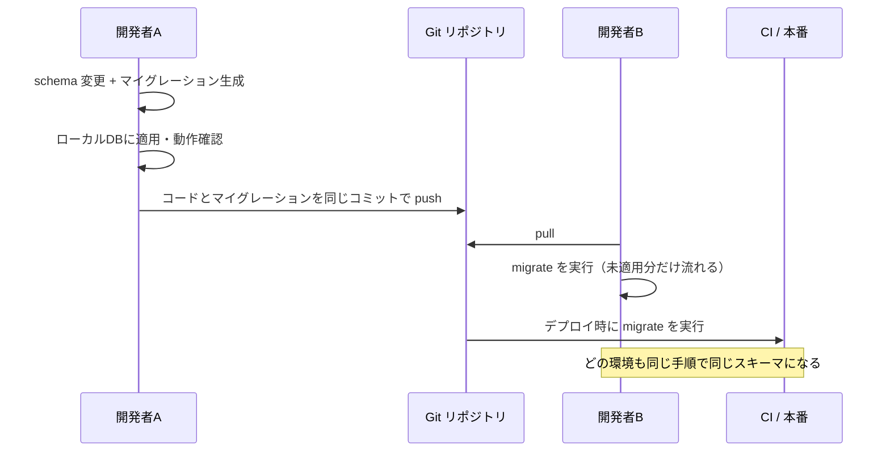

# マイグレーションとは

[[MOC_データアーキテクチャ体系|📚 目次]] ｜ [[05_WALとクラッシュリカバリ|← 前へ]] ｜ [[02_マイグレーションファイルの書き方|次へ →]]

> [!abstract] この記事で分かること
> - マイグレーション（Migration）が「スキーマ変更の手順書をコードとして管理する仕組み」であること
> - マイグレーションを使わないと、チーム開発や環境（開発・ステージング・本番）の間で何が起きるか
> - バージョン管理テーブル・up/down・実行順序という、どのツールにも共通する仕組み
> - Prisma Migrate / TypeORM / Knex / Flyway / Liquibase / Rails / Alembic / Atlas の違いと選び方
>
> **前提**：[[01_リレーショナルモデルとテーブル]] と [[02_SQLの基本操作（CRUD）]] を読んでいると理解しやすいです。

## 1. ひとことで言うと

マイグレーションは、**データベースの「リフォーム手順書」に通し番号を付けて、Git で管理する仕組み**です。

家のリフォームを想像してください。「2024年1月：書斎を増築」「2024年3月：キッチンの壁を撤去」という工事記録が残っていれば、同じ間取りの家をもう一軒建てるときも、記録を上から順にやり直せば同じ家ができます。しかも「どの工事まで済んでいるか」が分かっていれば、途中から再開することもできます。

データベースでも同じです。

- **スキーマ（Schema）**：テーブル・列・制約・インデックスなど、データベースの「間取り」
- **マイグレーションファイル**：間取りを 1 段階変更する手順（SQL やコード）
- **マイグレーションツール**：手順書のうち「まだ実行していないもの」だけを、正しい順番で実行してくれる道具

要点は 3 つです。

1. スキーマの変更を**コード（ファイル）として残す**
2. どこまで実行したかを**データベース自身に記録する**
3. 同じファイルを流せば、**どの環境でも同じスキーマになる**

> [!note] 「マイグレーション」の 2 つの意味
> 「DB マイグレーション」という言葉は、(1) この章で扱う**スキーマ変更の管理**と、(2) オンプレミスの Oracle からクラウドの PostgreSQL へ引っ越す、のような**データベース移行**の両方に使われます。この章は (1) の意味です。

## 2. マイグレーションの種類

マイグレーションで扱う変更は、大きく 2 種類に分かれます。

| 種類 | 何を変えるか | Shop での例 |
|---|---|---|
| **スキーママイグレーション** | 構造（DDL：Data Definition Language、`CREATE` / `ALTER` / `DROP` など） | `users` に `phone` 列を追加する、`products(category_id)` にインデックスを張る |
| **データマイグレーション** | 既存の中身（DML：Data Manipulation Language、`INSERT` / `UPDATE` / `DELETE`） | `orders.status` の値 `'shipped'` を `'delivered'` に置き換える、新しい列に既存データから計算した値を埋める |

実務では両者がセットになることがよくあります。たとえば「`orders` に合計金額列 `total_amount` を追加し（スキーマ）、既存の注文については `order_items` から集計して埋める（データ）」という具合です。具体的な書き方は [[02_マイグレーションファイルの書き方]] で扱います。

## 3. マイグレーションを使わないと何が起きるか

### 3.1 よくある「手作業運用」の会話

```
開発者A: 「users テーブルに phone 列を足しました。SQL を Slack に貼っておきます」
開発者B: 「先週の 'add_index.sql' と、どっちを先に流せばいいですか？」
開発者A: 「たぶん順番は関係ないです……」
開発者C: 「ステージングにはもう流しましたっけ？」
開発者A: 「……覚えていません」
```

この運用では、次の 4 つの問題が必ず起きます。

| 問題 | 具体的に何が困るか |
|---|---|
| **実行順序が分からない** | 「テーブル作成」より先に「そのテーブルへのインデックス追加」を流してエラーになる |
| **どこまで実行したか分からない** | 同じ `ALTER TABLE ... ADD COLUMN` を 2 回流してエラー、または 1 回も流さずに本番障害 |
| **環境ごとにスキーマがずれる** | 「自分の環境では動いたのに」が起きる。開発環境には `phone` 列があるのに本番にはない |
| **変更の理由と履歴が残らない** | 「この列はいつ、なぜ追加されたのか」を誰も答えられない |

### 3.2 環境間の一致がなぜ重要か

ふつうのチームには、少なくとも次の環境があります。

```
開発者のPC（ローカル）× 人数分
   ↓
CI（自動テスト用に毎回作り直すDB）
   ↓
ステージング（本番そっくりの検証環境）
   ↓
本番
```

アプリのコードは Git で全員同じものを使っているのに、DB のスキーマだけ手作業だと、**コードとスキーマの組み合わせが環境ごとにバラバラ**になります。コードが「`users.phone` がある」前提で書かれているのに、その環境の DB に列がなければ、アプリは実行時エラーになります。

マイグレーションを使うと、**スキーマの変更がアプリのコードと同じコミットに入る**ので、「このコミットのコードは、このスキーマで動く」という対応が保証されます。

### 3.3 マイグレーションを使ったチーム開発の流れ



開発者 B は「何を流せばいいか」を聞く必要がありません。`migrate` コマンドを実行すれば、ツールが未適用のものだけを判断して流します。新メンバーの環境構築も「空の DB を作って migrate」で終わります。

## 4. マイグレーションの仕組み

ツールが違っても、仕組みはほぼ共通です。

### 4.1 マイグレーションファイルとディレクトリ

マイグレーションは、1 つの変更ごとに 1 ファイル（またはフォルダ）として保存されます。名前の先頭にタイムスタンプや連番が付きます。

```
migrations/
├── 20260101090000_create_users/migration.sql
├── 20260105120000_create_products/migration.sql
├── 20260115143000_add_phone_to_users/migration.sql
└── 20260201091500_add_index_products_category_id/migration.sql
```

### 4.2 バージョン管理テーブル

ツールは、対象のデータベースの中に**「適用済みマイグレーションの一覧」を記録する専用テーブル**を作ります。

```
_prisma_migrations（Prisma の場合のイメージ）
| migration_name                               | finished_at          | checksum |
|----------------------------------------------|----------------------|----------|
| 20260101090000_create_users                  | 2026-01-01 09:00:05  | 3f2a...  |
| 20260105120000_create_products               | 2026-01-05 12:00:02  | 9b1c...  |
| 20260115143000_add_phone_to_users            | 2026-01-15 14:30:01  | 77de...  |
```

`migrate` コマンドを実行すると、ツールは次の手順で動きます。

```
1. migrations/ フォルダのファイル一覧を名前順に読む
2. DB のバージョン管理テーブルから「適用済み一覧」を読む
3. 差分（＝未適用のファイル）を求める
4. 未適用のファイルを古い順に 1 つずつ実行する
5. 1 つ成功するたびに、バージョン管理テーブルに 1 行追加する
```

多くのツールは**チェックサム（Checksum：ファイル内容から計算した指紋のような値）**も記録します。適用済みのファイルを後から書き換えると指紋が一致しなくなり、ツールが警告やエラーを出します。これは「本番に流したものと手元のファイルが違う」という事故を防ぐためです（詳しくは [[05_マイグレーションのよくある問題と対処法]]）。

### 4.3 up と down

多くのツールでは、1 つのマイグレーションに 2 つの手順を書きます。

| 手順 | 役割 | 例 |
|---|---|---|
| **up（アップ）** | スキーマを新しい状態に進める | `ALTER TABLE users ADD COLUMN phone TEXT;` |
| **down（ダウン）** | up を取り消し、1 つ前の状態に戻す | `ALTER TABLE users DROP COLUMN phone;` |

```
          up →                up →                 up →
[空のDB] ─────▶ [users あり] ─────▶ [products あり] ─────▶ [users.phone あり]
         ◀─────               ◀─────                ◀─────
          ← down               ← down                ← down
```

down を実行することを**ロールバック（Rollback）**と呼びます。ロールバックするとバージョン管理テーブルからも該当行が消え、「未適用」に戻ります。

ただし注意点があります。

- Prisma Migrate や Flyway（無料版）のように、**down を標準では持たないツール**もあります
- `DROP COLUMN` の down で列は戻せても、**消えたデータは戻りません**

このため、実務では down に頼らない戻し方（ロールフォワード）も重要です。詳しくは [[03_マイグレーションの実行とロールバック]] で扱います。

### 4.4 実行順序

マイグレーションは**ファイル名の順**に実行されます。順番が重要なのは、後のマイグレーションが前のマイグレーションの結果に依存するからです。

```
❌ 順番が逆だと失敗する
  20260201_add_index_products_category_id   ← products がまだないのでエラー
  20260105_create_products

✅ 正しい順
  20260105_create_products
  20260201_add_index_products_category_id
```

番号の付け方は 2 通りあります。

| 方式 | 例 | 長所 | 短所 |
|---|---|---|---|
| **タイムスタンプ** | `20260115143000_add_phone` | 複数人が同時に作っても番号がぶつかりにくい | 作成順とマージ順がずれることがある |
| **連番** | `V3__add_phone.sql` | 順番が明確で読みやすい | 2 人が同時に「V3」を作るとぶつかる |

Prisma・Rails・Knex・TypeORM はタイムスタンプ、Flyway は `V1__`、`V2__` のようなバージョン番号を使うのが一般的です。ブランチ間で番号がぶつかったときの対処は [[05_マイグレーションのよくある問題と対処法]] で扱います。

### 4.5 状態の変化を追ってみる

```
【実行前】
DB:              users(id, name, email, created_at)
適用済み一覧:    20260101090000_create_users

【migrate 実行】
未適用:          20260115143000_add_phone_to_users  ← これだけ実行

【実行後】
DB:              users(id, name, email, created_at, phone)
適用済み一覧:    20260101090000_create_users
                 20260115143000_add_phone_to_users  ← 1 行増えた
```

もう一度 `migrate` を実行しても、未適用が 0 件なので何も起きません。この「何度実行しても安全」という性質を**冪等（べきとう、Idempotent）**と呼びます。

## 5. 主要ツールの比較

### 5.1 一覧表

| ツール | 主な言語 | 書き方 | バージョン管理テーブル | down（取り消し） |
|---|---|---|---|---|
| **Prisma Migrate** | TypeScript / JavaScript | `schema.prisma` を編集 → SQL を**自動生成** | `_prisma_migrations` | 標準ではなし。`migrate diff` で `down.sql` を作り手動適用 |
| **TypeORM** | TypeScript | クラスの `up()` / `down()` に SQL かコード。エンティティから生成も可 | `migrations`（既定） | あり（`migration:revert`） |
| **Knex.js** | JavaScript | `exports.up` / `exports.down` にスキーマビルダー | `knex_migrations` | あり（`migrate:rollback`） |
| **Flyway** | Java（言語非依存） | 素の SQL ファイル（`V1__xxx.sql`） | `flyway_schema_history` | 有償版（Teams / Enterprise）の undo スクリプト（`U1__xxx.sql`） |
| **Liquibase** | Java（言語非依存） | XML / YAML / JSON / SQL の changeset | `DATABASECHANGELOG`（＋ロック用 `DATABASECHANGELOGLOCK`） | あり。多くの変更は自動で逆操作を生成 |
| **Rails（Active Record）** | Ruby | Ruby DSL。`change` メソッドなら逆操作を自動推論 | `schema_migrations` | あり（`db:rollback`） |
| **Alembic** | Python（SQLAlchemy） | `upgrade()` / `downgrade()`。モデルから自動生成も可 | `alembic_version` | あり（`alembic downgrade -1`） |
| **Atlas** | Go 製 CLI（言語非依存） | 「あるべきスキーマ」を宣言し差分を計算（宣言型）／バージョン管理型も可 | `atlas_schema_revisions` | 差分計算による戻しを提供 |

このほか、Django（`manage.py makemigrations` / `migrate`）や Sequelize（`sequelize-cli db:migrate`）も広く使われています。

### 5.2 代表的なコマンド

```bash
# Prisma（TypeScript）
npx prisma migrate dev --name add_phone_to_users   # 開発：生成＋適用
npx prisma migrate deploy                          # 本番：未適用分を適用
npx prisma migrate status                          # 状態確認

# TypeORM（TypeScript）
npx typeorm migration:generate src/migrations/AddPhone -d src/data-source.ts
npx typeorm migration:run    -d src/data-source.ts
npx typeorm migration:revert -d src/data-source.ts

# Knex（JavaScript）
npx knex migrate:make add_phone_to_users
npx knex migrate:latest
npx knex migrate:rollback

# Flyway（SQL）
flyway migrate
flyway info

# Rails（Ruby）
bin/rails generate migration AddPhoneToUsers phone:string
bin/rails db:migrate
bin/rails db:rollback STEP=1

# Alembic（Python）
alembic revision --autogenerate -m "add phone to users"
alembic upgrade head
alembic downgrade -1

# Atlas
atlas migrate diff add_phone --env local   # 宣言したスキーマとの差分からファイル生成
atlas migrate apply --env prod
atlas migrate lint --env local             # 危険な変更を検査
```

### 5.3 「手続き型」と「宣言型」

ツールの考え方は 2 系統あります。

| 系統 | 考え方 | 代表 |
|---|---|---|
| **手続き型（バージョン管理型、Versioned）** | 「どう変えるか」の手順を 1 つずつ書いて積み上げる | Flyway、Knex、Rails、TypeORM、Alembic |
| **宣言型（状態ベース、Declarative）** | 「最終的にどうなっていてほしいか」を書き、ツールが差分を計算する | Atlas の宣言モード、Prisma の `db push` |

Prisma Migrate と Atlas は**ハイブリッド**です。開発者は宣言型でスキーマを書き、ツールが差分から手続き型のマイグレーションファイルを生成します。生成されたファイルはレビューして Git に残すので、本番に何が流れるかは事前に分かります。

> [!warning] 宣言型でも生成物は必ず読む
> 差分計算は「列名の変更」と「列の削除＋別の列の追加」を区別できないことがあります。生成された SQL を読まずに本番へ流すと、データが消えることがあります（具体例は [[02_マイグレーションファイルの書き方]]）。

### 5.4 どれを選べばよいか

- **使っている ORM / フレームワークに付属するもの**を使うのが基本です（Rails なら Rails、Django なら Django、Prisma を使うなら Prisma Migrate）。モデル定義との整合を取りやすいからです（ORM については [[17_ORMとは]]）
- **複数の言語のアプリが 1 つの DB を共有する**、あるいは **DBA（データベース管理者）が SQL で管理したい**場合は、言語に依存しない Flyway / Liquibase / Atlas が向いています
- **危険な変更を CI で自動検出したい**場合は、Atlas の `migrate lint` のような検査機能があるツールが便利です

## よくある誤解・つまずき

- ❌ 「マイグレーションはテーブルを最初に作るときだけ使う」
  ✅ 実際は**サービスが動いている限りずっと**使います。列の追加、インデックスの追加、制約の変更など、スキーマが変わるたびに 1 ファイル増えます。

- ❌ 「down を書いておけば、いつでも完全に元に戻せる」
  ✅ down が戻すのは**構造**だけです。`DROP COLUMN` で消えたデータや、`UPDATE` で上書きした値は戻りません。本番ではバックアップやロールフォワードと組み合わせて考えます。

- ❌ 「適用済みのマイグレーションファイルを直接直せばよい」
  ✅ 適用済みのファイルは**編集しない**のが鉄則です。すでに流した環境には変更が反映されず、チェックサムのずれでエラーにもなります。修正は**新しいマイグレーションを追加**して行います。

- ❌ 「ORM のモデルを変えれば DB も勝手に変わる」
  ✅ 開発用の自動同期機能（Prisma の `db push`、TypeORM の `synchronize` など）はありますが、履歴が残らないため本番では使いません。本番はマイグレーションファイル経由で変更します。

## まとめ

- マイグレーションは、**スキーマ変更の手順をファイルとして Git 管理し、ツールで順番に適用する仕組み**
- ツールは DB 内の**バージョン管理テーブル**で「どこまで適用したか」を記録し、未適用分だけを実行する
- 変更は **up（進める）／ down（戻す）**で書くが、down で戻せるのは構造だけでデータは戻らない
- コードとスキーマ変更を同じコミットに入れることで、**全環境のスキーマが一致**する
- ツールは手続き型と宣言型があり、基本は**使っている ORM / フレームワーク付属のもの**を選ぶ

## 確認クイズ

1. マイグレーションツールが「どのファイルを実行すべきか」を判断するために使っている情報は何ですか？

> [!tip]- 答え
> **マイグレーションファイルの一覧**と、**DB 内のバージョン管理テーブル（適用済み一覧）**の 2 つです。両者の差分が「未適用のマイグレーション」で、それを名前順に実行します。

2. 開発者が「本番で失敗したので、適用済みの `20260115_add_phone/migration.sql` を直接書き換えて再実行しよう」と提案しました。何が問題ですか？

> [!tip]- 答え
> すでにそのマイグレーションを適用した環境（他の開発者の DB、ステージングなど）には修正内容が反映されず、**環境ごとにスキーマがずれます**。さらにチェックサムが一致しなくなり、ツールがエラーや警告を出します。修正は新しいマイグレーションとして追加するのが原則です（失敗したマイグレーションの扱いは [[05_マイグレーションのよくある問題と対処法]]）。

3. `ALTER TABLE users DROP COLUMN phone;` を実行するマイグレーションの down に `ALTER TABLE users ADD COLUMN phone TEXT;` を書きました。ロールバックすると何が戻り、何が戻りませんか？

> [!tip]- 答え
> **列（構造）は戻りますが、中身はすべて NULL** になります。削除前の電話番号データは戻りません。データを戻すにはバックアップからの復元などが必要です。

## 関連ノート
- [[02_マイグレーションファイルの書き方]] — 実際にマイグレーションを書く
- [[03_マイグレーションの実行とロールバック]] — 環境ごとの実行と、戻し方の種類
- [[05_マイグレーションのよくある問題と対処法]] — 番号の衝突、履歴の不整合など
- [[07_ゼロダウンタイムのスキーマ変更]] — サービスを止めずにスキーマを変える
- [[17_ORMとは]] — マイグレーション機能を持つことが多い ORM の基本
- [[MOC_リリース・デプロイ体系]] — マイグレーションを含むデプロイの全体像

## 参考
- [Prisma Docs: About migration histories](https://www.prisma.io/docs/orm/prisma-migrate/understanding-prisma-migrate/migration-histories)
- [Prisma CLI reference](https://www.prisma.io/docs/orm/reference/prisma-cli-reference)
- [Redgate Flyway: Migrations](https://documentation.red-gate.com/fd/migrations-271585107.html)
- [Upgrading to Flyway Teams or Enterprise](https://documentation.red-gate.com/fd/upgrading-to-flyway-teams-or-enterprise-184127586.html)
- [Knex.js: Migrations](https://knexjs.org/guide/migrations)
- [Atlas: Declarative vs Versioned workflows](https://atlasgo.io/concepts/declarative-vs-versioned)
- [Liquibase: rollbackOneChangeSetSQL（DATABASECHANGELOG の説明を含む）](https://docs.liquibase.com/tools-integrations/maven/commands/maven-rollbackonechangesetsql.html)
- [Ruby on Rails Guides: Active Record Migrations](https://guides.rubyonrails.org/active_record_migrations.html)
- [Alembic Tutorial](https://alembic.sqlalchemy.org/en/latest/tutorial.html)
