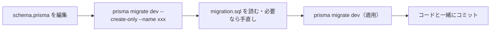

# マイグレーションファイルの書き方

[[MOC_データアーキテクチャ体系|📚 目次]] ｜ [[01_マイグレーションとは|← 前へ]] ｜ [[03_マイグレーションの実行とロールバック|次へ →]]

> [!abstract] この記事で分かること
> - 良いマイグレーションの原則（命名、1 ファイル 1 変更、適用済みは編集しない、トランザクション）
> - Prisma Migrate でスキーマを変更し、マイグレーションを生成・確認・手直しする流れ
> - テーブル作成・列の追加／変更／削除・列名変更・インデックス・外部キーの書き方（SQL と Prisma 両方）
> - 既存データを書き換える「データ移行」をマイグレーションに含める方法
> - SQL で書く場合と ORM のコードで書く場合の違い
>
> **前提**：[[01_マイグレーションとは]] と [[04_キーと制約の設計]] を読んでいると理解しやすいです。

## 1. ひとことで言うと

マイグレーションファイルは、**「工事 1 件分の作業指示書」**です。指示書が「キッチンの改装とついでに屋根の修理と庭の植え替え」のように何件もの作業を混ぜていると、途中で失敗したときにどこまで終わったのか分からなくなります。1 枚には 1 件の作業を書き、題名を見れば中身が分かるようにしておくのが基本です。

この記事では、共通の例題「Shop」（`users`、`categories`、`products`、`orders`、`order_items`）に変更を加えながら、書き方を一通り見ていきます。

## 2. 良いマイグレーションの原則

### 2.1 名前を見れば中身が分かるようにする

```
✅ 良い例
20260115143000_add_phone_to_users
20260201091500_create_reviews
20260210100000_add_index_orders_user_id

❌ 悪い例
20260115143000_migration
20260201091500_update
20260210100000_fix
```

「動詞＋対象」（`add_xxx_to_yyy`、`create_xxx`、`drop_xxx_from_yyy`）にしておくと、フォルダ一覧が**そのまま変更履歴**として読めます。

### 2.2 1 ファイル 1 変更（1 つの目的）

1 ファイルには**1 つの目的の変更**だけを入れます。

- 失敗したときに、原因と影響範囲がすぐ分かる
- レビューしやすい
- 戻すときに、関係ない変更まで巻き戻さなくて済む

「1 目的」なので、`reviews` テーブル作成と、その外部キー用インデックス作成を 1 ファイルにまとめるのは問題ありません。逆に「`reviews` 作成」と「`users.phone` 追加」は別ファイルにします。

### 2.3 適用済みのファイルは編集しない

一度でも共有ブランチにマージされたり、どこかの環境に適用されたりしたファイルは**編集禁止**です。間違いに気づいたら、**修正用のマイグレーションを新しく追加**します。理由は [[01_マイグレーションとは]] で説明したとおり、適用済みの環境に修正が届かず、チェックサムもずれるからです。

### 2.4 トランザクションの扱いを知っておく

PostgreSQL は **DDL もトランザクションの中で実行できる**（Transactional DDL）ので、マイグレーションの途中で失敗しても、全体を `ROLLBACK` して「何もなかった」状態に戻せます。多くのツールは PostgreSQL では 1 マイグレーションを 1 トランザクションで包んで実行します。

> [!warning] MySQL との違い
> MySQL では `CREATE TABLE` や `ALTER TABLE` などの DDL を実行すると**暗黙的にコミット**されます。そのため、DDL を 3 つ含むマイグレーションが 2 つ目で失敗すると、1 つ目だけ適用された**中途半端な状態**が残ります。MySQL では特に「1 ファイル 1 変更」を徹底すると、失敗時の後始末が楽になります。

また、`CREATE INDEX CONCURRENTLY` のように**トランザクションの中では実行できない命令**もあります。その扱いは [[07_ゼロダウンタイムのスキーマ変更]] で説明します。

## 3. Prisma Migrate での基本の流れ

Prisma では、`schema.prisma` に**「こうなっていてほしい」というモデル**を書き、Prisma が差分から SQL を生成します。

### 3.1 フォルダ構成

```
prisma/
├── schema.prisma               ← あるべきスキーマ（人が編集する）
└── migrations/
    ├── migration_lock.toml     ← 使っている DB の種類（postgresql など）
    ├── 20260101090000_init/
    │   └── migration.sql       ← 生成された SQL（Git に入れる）
    └── 20260115143000_add_phone_to_users/
        └── migration.sql
```

### 3.2 手順



```bash
# 1. 生成だけして、まだ適用しない（中身を確認・編集するため）
npx prisma migrate dev --create-only --name add_phone_to_users

# 2. prisma/migrations/<日時>_add_phone_to_users/migration.sql を確認

# 3. 適用する
npx prisma migrate dev
```

`--create-only` を付けずに `migrate dev` を実行すると、生成と適用が一度に行われます。慣れるまでは、**生成 → 読む → 適用**の 3 段階に分けるのがおすすめです。

## 4. よく使う操作カタログ

ここからは、操作ごとに「Prisma のスキーマの書き方」と「生成される（または手で書く）PostgreSQL の SQL」を並べます。

### 4.1 テーブルを作る

商品レビューのテーブル `reviews` を追加します。

```prisma
// schema.prisma
model Review {
  id        BigInt   @id @default(autoincrement())
  productId BigInt   @map("product_id")
  userId    BigInt   @map("user_id")
  rating    Int
  body      String
  createdAt DateTime @default(now()) @map("created_at") @db.Timestamptz
  product   Product  @relation(fields: [productId], references: [id])
  user      User     @relation(fields: [userId], references: [id])

  @@unique([productId, userId])   // 1人1商品につき1レビュー
  @@map("reviews")
}
```

```sql
-- migration.sql（up 相当）
CREATE TABLE reviews (
  id         BIGSERIAL PRIMARY KEY,
  product_id BIGINT NOT NULL REFERENCES products(id),
  user_id    BIGINT NOT NULL REFERENCES users(id),
  rating     INTEGER NOT NULL CHECK (rating BETWEEN 1 AND 5),
  body       TEXT NOT NULL,
  created_at TIMESTAMPTZ NOT NULL DEFAULT now(),
  UNIQUE (product_id, user_id)
);

-- down 相当
DROP TABLE reviews;
```

> [!note] Prisma で表現できないもの
> `CHECK (rating BETWEEN 1 AND 5)` のような CHECK 制約は、Prisma のスキーマでは書けません。`--create-only` で生成した `migration.sql` に**手で追記**します。Prisma は手で追記した SQL も、そのまま履歴として扱います。

### 4.2 列を追加する

```prisma
model User {
  id    BigInt  @id @default(autoincrement())
  name  String
  email String  @unique
  phone String?          // 追加（? は NULL 許可）
  // ...
}
```

```sql
-- up
ALTER TABLE users ADD COLUMN phone TEXT;
-- down
ALTER TABLE users DROP COLUMN phone;
```

**既存の行がある表に、NOT NULL の列を追加するとき**は、デフォルト値を一緒に指定する必要があります。デフォルト値がないと、既存行の値が決まらないためエラーになります。

```sql
-- 既存行は 'active' で埋まる
ALTER TABLE users ADD COLUMN status TEXT NOT NULL DEFAULT 'active';
```

PostgreSQL 11 以降では、`now()` のような変化しない（非 volatile な）デフォルト値の列追加はテーブルの書き換えを伴わず、一瞬で終わります。一方 `clock_timestamp()` のような volatile な関数をデフォルトにすると、全行が書き換えられます（ロックとの関係は [[07_ゼロダウンタイムのスキーマ変更]]）。

### 4.3 列の型・デフォルト値・NULL 可否を変える

```sql
-- 型の変更：price を INTEGER から BIGINT へ
ALTER TABLE products ALTER COLUMN price TYPE BIGINT;

-- 変換方法を指定した型変更（TEXT の '123' を INTEGER にする等）
ALTER TABLE products ALTER COLUMN stock TYPE INTEGER USING stock::INTEGER;

-- デフォルト値の設定・削除
ALTER TABLE orders ALTER COLUMN status SET DEFAULT 'pending';
ALTER TABLE orders ALTER COLUMN status DROP DEFAULT;

-- NOT NULL の追加（既存に NULL があると失敗するので、先に埋める）
UPDATE products SET category_id = 1 WHERE category_id IS NULL;
ALTER TABLE products ALTER COLUMN category_id SET NOT NULL;

-- NOT NULL の解除
ALTER TABLE products ALTER COLUMN category_id DROP NOT NULL;
```

> [!warning] MySQL の書き方は違う
> MySQL では `ALTER TABLE products MODIFY COLUMN price BIGINT NOT NULL;` のように、`MODIFY COLUMN` で列定義を**丸ごと**書き直します。NOT NULL やデフォルト値を書き忘れると、それらが外れてしまうので注意してください。

型変更は、多くの場合**テーブル全体の書き換え**になり、大きな表では長時間ロックがかかります。本番での安全な進め方は [[04_マイグレーションの実践例]] と [[07_ゼロダウンタイムのスキーマ変更]] で扱います。

### 4.4 列を削除する

```sql
-- up
ALTER TABLE products DROP COLUMN legacy_code;
-- down（構造は戻るが、データは戻らない）
ALTER TABLE products ADD COLUMN legacy_code TEXT;
```

列の削除は**アプリのコードがその列を使わなくなってから**行います。順番を間違えると、デプロイ直後に「列がない」エラーが出ます（手順は [[04_マイグレーションの実践例]]）。

### 4.5 列名を変える（Prisma の落とし穴）

`users.name` を `display_name` に変えたいとします。`schema.prisma` で `name` を `displayName` に書き換えて生成すると、Prisma は**「name 列の削除」と「display_name 列の追加」**として SQL を生成することがあります。

```sql
-- ❌ 差分計算が生成しがちな SQL（データが消える！）
ALTER TABLE users DROP COLUMN name,
                  ADD COLUMN display_name TEXT NOT NULL;
```

ツールには「名前が変わった」のか「別の列に入れ替えた」のかが分からないためです。`--create-only` で生成して、**手で `RENAME` に書き換えます**。

```sql
-- ✅ 手で直した SQL（データは保持される）
ALTER TABLE users RENAME COLUMN name TO display_name;
```

> [!tip] DB の列名は変えずにコード上の名前だけ変える
> Prisma なら `displayName String @map("name")` と書けば、**コード上の名前だけ**変えて DB の列名は `name` のままにできます。DB の列名変更は、動いているアプリを壊しやすい操作なので、本当に必要かを先に考えましょう（安全な手順は [[07_ゼロダウンタイムのスキーマ変更]]）。

### 4.6 インデックスを追加・削除する

```prisma
model Order {
  id     BigInt @id @default(autoincrement())
  userId BigInt @map("user_id")
  // ...
  @@index([userId])          // 単一列インデックス
  @@index([status, orderedAt]) // 複合インデックス
  @@map("orders")
}
```

```sql
-- up
CREATE INDEX orders_user_id_idx ON orders (user_id);
-- down
DROP INDEX orders_user_id_idx;
```

MySQL では `DROP INDEX orders_user_id_idx ON orders;` のようにテーブル名が必要です。どの列にインデックスを張るべきかは [[03_インデックスの基本と設計]] を参照してください。

### 4.7 外部キーを追加する

```sql
-- up
ALTER TABLE orders
  ADD CONSTRAINT orders_user_id_fkey
  FOREIGN KEY (user_id) REFERENCES users(id) ON DELETE RESTRICT;

-- down
ALTER TABLE orders DROP CONSTRAINT orders_user_id_fkey;
```

Prisma では `@relation(fields: [userId], references: [id], onDelete: Restrict)` と書くと、上と同じ SQL が生成されます。外部キーを追加すると、既存のデータに**参照先のない行（孤児）**が 1 件でもあると失敗します。先に次のクエリで確認しておくと安心です。

```sql
SELECT o.id, o.user_id
FROM orders o
LEFT JOIN users u ON u.id = o.user_id
WHERE u.id IS NULL;   -- 1行でも出たら外部キーは追加できない
```

制約名は**自分で付ける**ことをおすすめします。DB が自動で付けた名前は環境によって変わることがあり、後で `DROP CONSTRAINT` するときに困るからです（制約の考え方は [[04_キーと制約の設計]]）。

## 5. データ移行をマイグレーションに含める

### 5.1 例：注文の合計金額列を追加して埋める

`orders` に合計金額 `total_amount` を持たせることにしました。新しい注文はアプリが値を入れますが、既存の注文は空です。

```sql
-- 1. 列を追加（まずは NULL 許可）
ALTER TABLE orders ADD COLUMN total_amount BIGINT;

-- 2. 既存の注文について order_items から集計して埋める
UPDATE orders o
SET total_amount = s.total
FROM (
  SELECT order_id, SUM(quantity * unit_price) AS total
  FROM order_items
  GROUP BY order_id
) s
WHERE s.order_id = o.id;

-- 3. 明細のない注文は 0 にする
UPDATE orders SET total_amount = 0 WHERE total_amount IS NULL;

-- 4. 全行が埋まったので NOT NULL にする
ALTER TABLE orders ALTER COLUMN total_amount SET NOT NULL;
```

Prisma では `--create-only` で列追加の SQL を生成し、2〜4 を手で追記します。

### 5.2 データ移行を書くときの注意

| 注意点 | 理由 |
|---|---|
| **ORM のモデルクラスを使わず SQL で書く** | モデルは「最新のスキーマ」に合わせて将来変わる。古いマイグレーションがモデルを使っていると、後で新しい環境を作るときに壊れる |
| **何度実行しても同じ結果になるように書く** | `WHERE total_amount IS NULL` のように条件を付けておけば、途中で失敗して再実行しても安全 |
| **大量データなら分けて実行する** | 数百万行の `UPDATE` を 1 トランザクションで行うと、長時間ロックやログの肥大化を招く（分割の方法は [[07_ゼロダウンタイムのスキーマ変更]]） |
| **down でデータを戻せるかを考える** | 上書きした値は元に戻せないことが多い。戻せないなら、そのことをコメントに残す |

> [!note] スキーマ変更とデータ移行を分けるという考え方
> 規模が大きいチームでは、「列を追加するマイグレーション」「データを埋めるバッチ処理」「NOT NULL にするマイグレーション」を**別々のデプロイ**に分けます。マイグレーションの中で長い `UPDATE` を走らせると、デプロイ全体が止まってしまうためです。小規模なら 5.1 のように 1 ファイルにまとめても構いません。

## 6. SQL で書くか、ORM のコードで書くか

同じ「`users` に `phone` 列を追加する」マイグレーションを、ツールごとに書くと次のようになります。

```sql
-- Prisma / Flyway：素の SQL
ALTER TABLE users ADD COLUMN phone TEXT;
```

```typescript
// TypeORM：クラスに up/down を書く（中身は SQL）
import { MigrationInterface, QueryRunner } from "typeorm";

export class AddPhoneToUsers1768487400000 implements MigrationInterface {
  public async up(queryRunner: QueryRunner): Promise<void> {
    await queryRunner.query(`ALTER TABLE users ADD COLUMN phone TEXT`);
  }

  public async down(queryRunner: QueryRunner): Promise<void> {
    await queryRunner.query(`ALTER TABLE users DROP COLUMN phone`);
  }
}
```

```javascript
// Knex：スキーマビルダー（DB の方言を吸収してくれる）
exports.up = (knex) =>
  knex.schema.alterTable("users", (t) => {
    t.text("phone");
  });

exports.down = (knex) =>
  knex.schema.alterTable("users", (t) => {
    t.dropColumn("phone");
  });
```

```ruby
# Rails：change に書けば down は自動で推論される
class AddPhoneToUsers < ActiveRecord::Migration[8.0]
  def change
    add_column :users, :phone, :string
  end
end
```

| 観点 | SQL で書く | ORM / ビルダーのコードで書く |
|---|---|---|
| 何が実行されるか | **一目瞭然**。DBA もレビューできる | ビルダーが生成する SQL を想像する必要がある |
| DB 固有の機能 | 何でも書ける（部分インデックス、CHECK、`CONCURRENTLY` など） | ビルダーが対応していなければ生 SQL に頼る |
| 複数 DB への対応 | DB ごとに書き分けが必要 | 方言の違いをある程度吸収してくれる |
| down の自動生成 | 自分で書く | Rails の `change` などは自動推論できる |

実務的には、**「本番で何が流れるかを正確に把握できる」ことが最も大事**です。ビルダーで書く場合でも、`--dry-run` や生成 SQL の表示機能（Knex なら `.toString()`、Rails なら実行ログ）で、実際の SQL を確認する習慣を付けましょう。

## 7. レビューのチェックリスト

マイグレーションを含むプルリクエストでは、次を確認します。

- [ ] ファイル名から目的が分かるか、1 ファイル 1 目的になっているか
- [ ] 生成された SQL を読んだか（特に `DROP` が意図せず含まれていないか）
- [ ] 既存データがあっても成功するか（NOT NULL・UNIQUE・外部キーの追加前に違反データがないか）
- [ ] 大きなテーブルへの変更で、長時間ロックがかからないか
- [ ] 新しいスキーマで**古いバージョンのアプリ**も動くか（デプロイ途中は新旧が混在するため）
- [ ] down、または戻すときの手順を考えてあるか
- [ ] データ移行は再実行しても安全か

## よくある誤解・つまずき

- ❌ 「ツールが生成した SQL だから、読まずに流しても大丈夫」
  ✅ 差分計算は列名変更を「削除＋追加」と解釈することがあり、そのまま流すとデータが消えます。生成された SQL は必ず読みます。

- ❌ 「NOT NULL の列は、そのまま `ADD COLUMN ... NOT NULL` で追加できる」
  ✅ 既存の行がある表では、デフォルト値を指定するか、「NULL 許可で追加 → 値を埋める → NOT NULL にする」の順に分ける必要があります。

- ❌ 「データ移行でも ORM のモデルを使えば楽」
  ✅ モデルは将来変わるので、古いマイグレーションが壊れる原因になります。マイグレーション内のデータ操作は SQL で書くのが安全です。

- ❌ 「PostgreSQL でも MySQL でも、失敗したら全部巻き戻る」
  ✅ PostgreSQL は DDL もトランザクションで巻き戻せますが、MySQL は DDL ごとに暗黙コミットされるため、途中まで適用された状態が残ります。

## まとめ

- ファイル名は「動詞＋対象」、**1 ファイル 1 目的**、**適用済みは編集せず新しいファイルで直す**
- Prisma では `migrate dev --create-only` で生成 → **SQL を読む・手直し** → 適用、の 3 段階が安全
- 列名変更は差分計算が「削除＋追加」にしがちなので、**`RENAME COLUMN` に手で直す**
- NOT NULL・UNIQUE・外部キーの追加前に、**違反する既存データがないか確認**する
- データ移行は **SQL で、再実行しても安全なように**書く。大量なら分割する
- どの書き方でも、**本番で実行される SQL を把握する**ことが最重要

## 確認クイズ

1. `products` に 10 万行のデータがある状態で、`ALTER TABLE products ADD COLUMN sku TEXT NOT NULL;` を実行するとどうなりますか？　どう書き直せばよいですか？

> [!tip]- 答え
> 既存の 10 万行の `sku` が NULL になってしまうため、NOT NULL 制約違反でエラーになります。`DEFAULT` を付けて追加するか、「NULL 許可で追加 → `UPDATE` で値を埋める → `SET NOT NULL`」の 3 段階に分けます。

2. Prisma で `name` を `displayName` に書き換えてマイグレーションを生成したところ、`DROP COLUMN "name"` と `ADD COLUMN "display_name"` が出力されました。どう対処しますか？

> [!tip]- 答え
> `--create-only` で生成したファイルを `ALTER TABLE users RENAME COLUMN name TO display_name;` に手で書き換えてから適用します。あるいは DB の列名は変えず、`displayName String @map("name")` としてコード上の名前だけ変える方法もあります。

3. マイグレーション内のデータ移行で、ORM のモデルクラスを使わず SQL で書くべき理由は何ですか？

> [!tip]- 答え
> モデルクラスは常に**最新のスキーマ**に合わせて変更されます。1 年前のマイグレーションが現在のモデルを使っていると、新しい環境で最初から順に流したときに、その時点では存在しない列を参照するなどして失敗するためです。

## 関連ノート
- [[01_マイグレーションとは]] — マイグレーションの仕組みとツールの比較
- [[03_マイグレーションの実行とロールバック]] — 書いたマイグレーションを各環境で実行する
- [[04_マイグレーションの実践例]] — 列名変更・型変更・テーブル分割をステップで
- [[07_ゼロダウンタイムのスキーマ変更]] — 大きなテーブルを止めずに変更する
- [[04_キーと制約の設計]] — 主キー・外部キー・CHECK 制約の考え方
- [[03_インデックスの基本と設計]] — どの列にインデックスを張るか
- [[17_ORMとは]] — ORM の基本

## 参考
- [Prisma CLI reference（migrate dev --create-only など）](https://www.prisma.io/docs/orm/reference/prisma-cli-reference)
- [Prisma Docs: About migration histories](https://www.prisma.io/docs/orm/prisma-migrate/understanding-prisma-migrate/migration-histories)
- [PostgreSQL Documentation: ALTER TABLE](https://www.postgresql.org/docs/current/sql-altertable.html)
- [MySQL 8.4 Reference Manual: Online DDL Operations](https://dev.mysql.com/doc/refman/8.4/en/innodb-online-ddl-operations.html)
- [Knex.js: Migrations](https://knexjs.org/guide/migrations)
- [Ruby on Rails Guides: Active Record Migrations](https://guides.rubyonrails.org/active_record_migrations.html)
