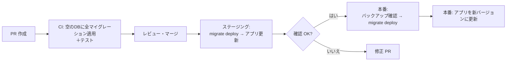

# マイグレーションの実行とロールバック

[[MOC_データアーキテクチャ体系|📚 目次]] ｜ [[02_マイグレーションファイルの書き方|← 前へ]] ｜ [[04_マイグレーションの実践例|次へ →]]

> [!abstract] この記事で分かること
> - 本番でマイグレーションを流す前に確認すべきこと（状態確認・SQL のレビュー・バックアップ・リハーサル）
> - 開発・CI・ステージング・本番で、実行するコマンドがなぜ違うのか
> - CI/CD パイプラインの中で、マイグレーションを「いつ・誰が」実行するか
> - 戻し方の 3 種類（down マイグレーション／ロールフォワード／バックアップ復元）と使い分け
> - down が書けない（書いても意味がない）ケース
>
> **前提**：[[01_マイグレーションとは]] と [[02_マイグレーションファイルの書き方]] を読んでいると理解しやすいです。

## 1. ひとことで言うと

マイグレーションの実行は、**飛行機の離陸**に似ています。離陸前にはチェックリストで機体を確認し、天候が悪ければ引き返す判断基準を決めておきます。離陸してから「どうやって戻るか」を考え始めても遅いのです。

マイグレーションも同じで、

- **流す前**：何が流れるかを確認し、バックアップを取り、リハーサルしておく
- **流すとき**：環境ごとに決められたコマンドを、決められたタイミングで流す
- **失敗したら**：あらかじめ決めておいた戻し方（down／ロールフォワード／復元）を選ぶ

という 3 段階で考えます。

## 2. 実行前の確認

### 2.1 何が流れるかを確認する

```bash
# Prisma：未適用のマイグレーションがあるか、履歴と DB が食い違っていないか
npx prisma migrate status

# TypeORM
npx typeorm migration:show -d src/data-source.ts

# Rails
bin/rails db:migrate:status

# Flyway
flyway info
```

確認するのは次の 3 点です。

1. **未適用のマイグレーションは想定どおりか**（数と名前）
2. **それぞれの SQL を読んだか**（意図しない `DROP` がないか）
3. **履歴と実際の DB が食い違っていないか**（誰かが手で SQL を流していないか）

### 2.2 バックアップを取る

本番の重要な変更の前には、**直前のバックアップ**を取るか、バックアップがあることを確認します。

```bash
# PostgreSQL：カスタム形式でダンプ（pg_restore で部分復元しやすい）
pg_dump -Fc -h db.example.com -U app -d shop -f shop_20260115_1430.dump

# 特定テーブルだけ
pg_dump -Fc -t users -d shop -f users_20260115_1430.dump

# MySQL
mysqldump --single-transaction -u app -p shop > shop_20260115_1430.sql
```

マネージド DB（Amazon RDS、Cloud SQL など）なら、**スナップショット**の取得や、**PITR（Point-In-Time Recovery：任意の時刻の状態に戻す機能）**が有効になっているかを確認します。PITR は WAL（先行書き込みログ）を使って実現されています（仕組みは [[05_WALとクラッシュリカバリ]]）。

### 2.3 本番に近いデータでリハーサルする

開発環境の DB は数十行しかないことが多く、**本番の 1000 万行で何秒かかるか、ロックがどれだけ続くか**は分かりません。

- ステージングに本番相当の件数のデータ（必要に応じて個人情報をマスキングしたもの）を用意して流す
- **所要時間**を計測し、本番での影響を見積もる
- 可能なら「適用 → 戻す → 再適用」まで試し、戻し方が本当に動くか確認する

### 2.4 本番実行前チェックリスト

- [ ] `migrate status` で未適用分と内容を確認した
- [ ] 生成 SQL をレビューした（2 人以上の目）
- [ ] バックアップ／スナップショット／PITR を確認した
- [ ] ステージングで所要時間とロックの影響を確認した
- [ ] **失敗したときの戻し方**（下の 5 章のどれを使うか）を決めた
- [ ] 新しいスキーマで、デプロイ途中の**古いアプリ**も動くことを確認した

## 3. 環境ごとの実行

### 3.1 環境によってコマンドが違う理由

開発環境では「スキーマを変えながら試行錯誤したい」、本番では「決められたファイルを、決められたとおりに流すだけにしたい」と、求めるものが違います。Prisma では、これがコマンドの違いとしてはっきり表れています。

| 環境 | Prisma のコマンド | 何をするか |
|---|---|---|
| **開発（ローカル）** | `prisma migrate dev` | シャドウ DB（Shadow Database：差分検出用の一時 DB）で履歴を再生してずれを検出し、schema の変更から**新しいマイグレーションを生成**して適用する。ずれがあると DB のリセットを提案することがある |
| **開発（作り直し）** | `prisma migrate reset` | DB を削除して作り直し、全マイグレーションを最初から適用する。**データは全部消える** |
| **CI（テスト）** | `prisma migrate reset --force` または空の DB に `prisma migrate deploy` | 毎回きれいな DB を作ってテストする |
| **ステージング・本番** | `prisma migrate deploy` | **既存のマイグレーションファイルを適用するだけ**。新しいファイルの生成や、リセットはしない |

> [!danger] 本番で `migrate dev` や `migrate reset` を使わない
> `migrate dev` は開発用で、状況によっては DB のリセット（全データ削除）を提案します。`migrate reset` は確実に全データを消します。本番・ステージングでは必ず `migrate deploy`（他のツールでも「適用だけするコマンド」）を使います。

### 3.2 ほかのツールの対応

| ツール | 開発 | 本番 |
|---|---|---|
| TypeORM | `migration:generate` → `migration:run`（`synchronize: true` は開発のみ） | `migration:run` |
| Knex | `migrate:make` → `migrate:latest` | `migrate:latest` |
| Rails | `db:migrate`（`db:reset` で作り直し） | `db:migrate` |
| Alembic | `revision --autogenerate` → `upgrade head` | `upgrade head` |
| Flyway | `migrate`（`clean` で全削除。本番では `cleanDisabled` を有効にしておく） | `migrate` |

## 4. CI/CD での実行タイミング

### 4.1 誰がいつ実行するか

本番のマイグレーションを「担当者がサーバーに SSH して手で実行する」運用は、手順漏れや実行忘れが起きやすく、誰がいつ流したかも残りません。現在は **CI/CD パイプラインの 1 ステップとして自動実行**するのが一般的です。



実行場所の選択肢は主に次の 3 つです。

| 方式 | 例 | 長所 | 注意点 |
|---|---|---|---|
| **デプロイ前の専用ジョブ** | CI のジョブ、Kubernetes の Job、Heroku の release phase | 1 回だけ確実に実行される。失敗したらデプロイを止められる | ジョブから DB に接続できる権限・ネットワークが必要 |
| **アプリ起動時に実行** | コンテナの起動コマンドで `migrate deploy && node server.js` | 仕組みが簡単 | アプリが 10 台なら 10 台が同時に実行しようとする。起動が遅くなる。失敗するとアプリが起動しない |
| **手動（承認付き）** | パイプラインの「承認ボタン」を押したら実行 | 危険な変更を人が判断できる | 実行忘れ・実行順の間違いが起きやすい |

おすすめは**デプロイ前の専用ジョブ**です。アプリ起動時に実行する場合でも、多くのツールは同時実行を防ぐロックを持っています（Prisma は PostgreSQL などでアドバイザリーロック、Knex は `knex_migrations_lock` テーブル、Liquibase は `DATABASECHANGELOGLOCK` テーブル）が、「何台もが順番待ちをする」こと自体は避けられません。

### 4.2 「マイグレーション → アプリ更新」の順が基本

ふつうは**マイグレーションを先に流し、その後でアプリを新しいバージョンに入れ替えます**。新しいコードは新しい列を必要とするからです。

しかしこの順番だと、**マイグレーションが終わってからアプリの入れ替えが終わるまでの間、古いアプリが新しいスキーマの上で動く**ことになります。

```
時間 →
DB     : [旧スキーマ]──migrate──▶[新スキーマ]──────────────────────
アプリ : [旧コード]───────────────────[旧コード＋新コード混在]──[新コード]
                                   ↑ ここで旧コードが新スキーマに触る
```

そのため、マイグレーションは**「古いコードでも動く」変更**にしておく必要があります。

- 列の**追加**（NULL 許可またはデフォルト値あり）→ 古いコードは新しい列を無視するので OK
- 列の**削除・名前変更** → 古いコードが「列がない」エラーを起こすので NG

削除や名前変更をどう安全に行うかは [[07_ゼロダウンタイムのスキーマ変更]]、デプロイ手法全体は [[MOC_リリース・デプロイ体系]] で扱います。

## 5. 戻し方の 3 種類

マイグレーション後に問題が見つかったとき、戻し方は 3 つあります。

### 5.1 down マイグレーション（ロールバック）

up の逆操作を実行して、1 つ前の状態に戻します。

```bash
npx typeorm migration:revert -d src/data-source.ts   # 最新の1つを戻す（繰り返せば複数）
npx knex migrate:rollback                            # 最後に実行したバッチを戻す
bin/rails db:rollback STEP=3                         # 3つ戻す
bin/rails db:migrate VERSION=20260101090000          # 指定バージョンまで戻す
alembic downgrade -1                                 # 1つ戻す
python manage.py migrate shop 0002                   # Django：0002 の状態まで戻す
```

**Prisma には down を実行するコマンドがありません**。戻したい場合は、`migrate diff` で逆向きの SQL（`down.sql`）を作って実行し、失敗したマイグレーションであれば履歴を「ロールバック済み」として記録します。

```bash
# 事前に down.sql を作っておく（schema.prisma を編集した後、migrate dev の前に）
npx prisma migrate diff \
  --from-schema prisma/schema.prisma \
  --to-migrations prisma/migrations \
  --script > down.sql

# 失敗した add_reviews を戻すとき
npx prisma db execute --file ./down.sql
npx prisma migrate resolve --rolled-back 20260201091500_add_reviews
```

`migrate resolve` が使えるのは**失敗したマイグレーション**だけです。成功済みのマイグレーションを取り消したい場合は、`schema.prisma` を元に戻して**新しいマイグレーションを作る**（＝次のロールフォワード）のが Prisma の流儀です。

### 5.2 ロールフォワード（Roll Forward：前に進んで直す）

戻すのではなく、**問題を打ち消す新しいマイグレーションを追加して前に進む**方法です。

```
20260201091500_add_reviews                ← 問題あり（rating の CHECK が厳しすぎた）
20260201150000_relax_reviews_rating_check ← 修正用の新しいマイグレーション
```

```sql
-- 20260201150000_relax_reviews_rating_check/migration.sql
ALTER TABLE reviews DROP CONSTRAINT reviews_rating_check;
ALTER TABLE reviews ADD CONSTRAINT reviews_rating_check CHECK (rating BETWEEN 0 AND 5);
```

ロールフォワードには次の利点があり、**本番では最もよく使われる戻し方**です。

- 通常のマイグレーションと同じ手順（レビュー・CI・`migrate deploy`）で流せる
- 履歴が一直線のまま残り、全環境の状態がそろう
- down の「データは戻らない」問題を、修正内容に応じて個別に考えられる

### 5.3 バックアップからの復元

データそのものが壊れたり消えたりしたときの**最後の手段**です。

```bash
# PostgreSQL：カスタム形式のダンプから特定テーブルだけ別DBに復元して確認
createdb shop_restore
pg_restore -d shop_restore -t users shop_20260115_1430.dump

# 確認後、必要な行だけ本番に戻す（例：消えた phone を書き戻す）
```

DB 全体をバックアップ時点に戻すと、**バックアップ以降に入った注文などもすべて消えます**。そのため実務では、別の DB に復元してから**必要なデータだけを本番に書き戻す**ことが多いです。PITR があれば「マイグレーション直前の時刻」に戻した DB を別に作れます。

### 5.4 使い分け

| 方法 | 戻せるもの | 向いている場面 | 注意点 |
|---|---|---|---|
| **down** | 構造 | 開発環境、適用直後でデータがまだ増えていない場合 | 消えたデータ・上書きされた値は戻らない |
| **ロールフォワード** | 構造（＋修正用のデータ操作） | **本番の基本**。適用後に時間がたっている場合 | 修正マイグレーションのレビュー時間が必要 |
| **バックアップ復元** | 構造とデータ | データが消えた・壊れた場合 | バックアップ以降のデータの扱いを考える必要がある。時間がかかる |

## 6. down が書けない（意味がない）ケース

down は「いつでも書けるもの」ではありません。次のような場合、down を書いても**元の状態には戻りません**。

| ケース | 例 | なぜ戻らないか |
|---|---|---|
| **データを捨てる変更** | `DROP COLUMN phone`、`DROP TABLE reviews` | 列やテーブルは作り直せても、中身は消えている |
| **情報が減る型変更** | `TEXT` → `VARCHAR(20)`、`NUMERIC` → `INTEGER` | 切り捨てられた文字・小数は戻らない |
| **上書きするデータ変更** | `UPDATE products SET category_id = 1 WHERE category_id IS NULL` | どの行が元は NULL だったか分からない |
| **値をまとめる変更** | `status` の `'shipped'` と `'delivered'` を `'completed'` に統合 | どちらだったか区別できない |
| **適用後にデータが増えた** | `reviews` 作成後に 1 万件のレビューが投稿された | down で `DROP TABLE` すると、その 1 万件が消える |
| **DB の外への副作用** | 外部サービスへの通知、ファイル出力 | DB の操作では取り消せない |

対策は次のとおりです。

- 戻せない変更は、down に `throw new Error("irreversible")` のように**明示的にエラーを書き**、「戻すならバックアップから」とコメントに残す（Rails には `ActiveRecord::IrreversibleMigration` という専用の例外があります）
- 情報が消える変更は、**消す前に退避テーブルにコピー**しておく（例：`CREATE TABLE _backup_users_phone AS SELECT id, phone FROM users;`）
- 削除は**すぐにしない**。まずコードから使わなくし、しばらく様子を見てから消す（[[04_マイグレーションの実践例]]）

## 7. 失敗したときの判断フロー

```
本番マイグレーションで問題発生
│
├─ マイグレーション自体が途中で失敗した
│    ├─ PostgreSQL（1トランザクションで実行）→ 自動で巻き戻っている。原因を直して再実行
│    └─ MySQL など途中まで適用された → 状態を確認し、手で後始末（→ 05 の記事）
│
└─ マイグレーションは成功したが、アプリに問題が出た
     ├─ データは失われていない → ロールフォワード（修正マイグレーション）
     │                           急ぐならアプリだけ前のバージョンに戻す
     └─ データが失われた／壊れた → 別DBにバックアップ復元 → 必要なデータを書き戻す
```

「アプリだけ前のバージョンに戻す」ができるのは、マイグレーションが**古いコードでも動く変更**だった場合だけです。これが 4.2 の原則が重要な理由です。

## よくある誤解・つまずき

- ❌ 「問題が起きたら down で戻せばいい」
  ✅ down は構造しか戻せません。本番では、データが増えた後の down はかえって被害を広げることがあります。本番の基本はロールフォワードです。

- ❌ 「アプリの起動時にマイグレーションを実行すれば手間がない」
  ✅ 複数台が同時に起動すると、同じマイグレーションを実行しようとして待ち合いが起き、失敗するとアプリ自体が起動しなくなります。デプロイ前の専用ジョブで 1 回だけ実行するのが安全です。

- ❌ 「`migrate dev` は本番でも使える」
  ✅ `migrate dev` は開発用で、DB のリセットを提案することがあります。本番では `migrate deploy` を使います。

- ❌ 「バックアップから戻せば元どおり」
  ✅ バックアップ時点より後のデータ（新しい注文など）は消えます。別 DB に復元して必要な分だけ書き戻す、という作業になることが多いです。

## まとめ

- 実行前に **`status` で確認 → SQL レビュー → バックアップ → 本番相当データでリハーサル**
- 環境ごとにコマンドを分ける。**本番は「適用だけ」のコマンド**（Prisma なら `migrate deploy`）
- CI/CD では**デプロイ前の専用ジョブ**で 1 回だけ実行し、**マイグレーション → アプリ更新**の順にする
- マイグレーションは**古いアプリでも動く変更**にしておくと、アプリだけを戻す選択肢が残る
- 戻し方は **down／ロールフォワード／バックアップ復元**。本番の基本はロールフォワード
- データを捨てる・上書きする変更は down で戻らない。**退避してから消す**

## 確認クイズ

1. 本番で `reviews` テーブルを作るマイグレーションを流してから 3 日後、テーブル設計の誤りが見つかりました。down（`DROP TABLE reviews`）で戻すべきでしょうか？

> [!tip]- 答え
> 戻すべきではありません。3 日間に投稿されたレビューがすべて消えてしまいます。設計の誤りを修正する**新しいマイグレーション（ロールフォワード）**を追加するのが適切です。

2. デプロイの手順を「アプリを新バージョンに更新 → マイグレーションを実行」の順にすると、何が起きますか？

> [!tip]- 答え
> マイグレーションが終わるまでの間、新しいコードが**まだ存在しない列やテーブル**にアクセスしてエラーになります。基本は「マイグレーション → アプリ更新」の順で、マイグレーションは古いコードでも動く内容にしておきます。

3. Prisma でマイグレーションの適用に失敗し、`migrate deploy` が先に進まなくなりました。どのコマンドで状態を解消しますか？

> [!tip]- 答え
> 失敗した変更を手で戻した（`prisma db execute --file down.sql` など）うえで `prisma migrate resolve --rolled-back <マイグレーション名>`、または手で適用を完了させたうえで `prisma migrate resolve --applied <マイグレーション名>` を実行し、履歴にその結果を記録します。

## 関連ノート
- [[02_マイグレーションファイルの書き方]] — up/down の書き方
- [[05_マイグレーションのよくある問題と対処法]] — 失敗時の途中状態や履歴の不整合への対処
- [[07_ゼロダウンタイムのスキーマ変更]] — 古いコードと新しいスキーマが共存できる変更の作り方
- [[05_WALとクラッシュリカバリ]] — PITR を支える WAL の仕組み
- [[MOC_リリース・デプロイ体系]] — CI/CD とデプロイ戦略

## 参考
- [Prisma CLI reference（migrate dev / deploy / reset / resolve / diff）](https://www.prisma.io/docs/orm/reference/prisma-cli-reference)
- [Prisma Docs: Generating down migrations](https://www.prisma.io/docs/orm/prisma-migrate/workflows/generating-down-migrations)
- [PostgreSQL Documentation: pg_dump](https://www.postgresql.org/docs/current/app-pgdump.html)
- [PostgreSQL Documentation: pg_restore](https://www.postgresql.org/docs/current/app-pgrestore.html)
- [Ruby on Rails Guides: Active Record Migrations](https://guides.rubyonrails.org/active_record_migrations.html)
- [Knex.js: Migrations](https://knexjs.org/guide/migrations)
