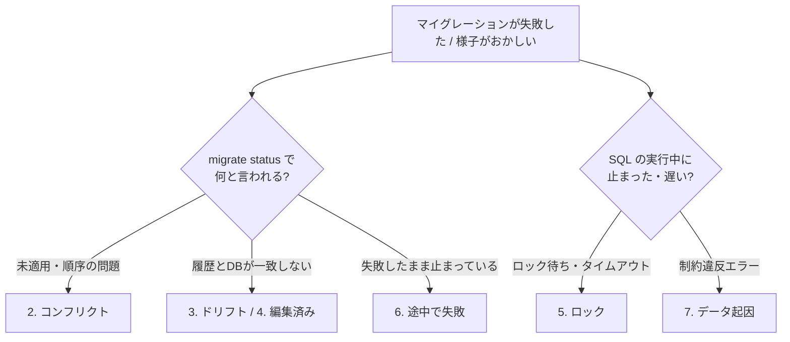

# マイグレーションのよくある問題と対処法

[[MOC_データアーキテクチャ体系|📚 目次]] ｜ [[04_マイグレーションの実践例|← 前へ]] ｜ [[06_シードデータ|次へ →]]

> [!abstract] この記事で分かること
> - ブランチ間でマイグレーションがぶつかる「コンフリクト」の種類と解消方法
> - 履歴テーブルと実際の DB がずれる「ドリフト」の原因と、既存 DB を途中から管理する「ベースライン」
> - 本番でのロック待ち、途中で失敗したマイグレーションの後始末
> - 既存データ・環境差・同時実行が原因の失敗と、その予防策
>
> **前提**：[[01_マイグレーションとは]] と [[03_マイグレーションの実行とロールバック]] を読んでいると理解しやすいです。

## 1. ひとことで言うと

マイグレーションのトラブルの大半は、**「台帳（履歴テーブル）」と「現物（実際のスキーマ）」と「設計図（マイグレーションファイル）」の 3 つが食い違うこと**から起きます。

倉庫に例えると、台帳には「棚 A を設置済み」と書いてあるのに棚がない、設計図が 2 人の担当者によって別々に書き換えられている、といった状態です。対処の基本は、

1. **3 つのどれがずれているのかを確かめる**
2. **正しい方に合わせる**（多くの場合は「現物」を確認し、「台帳」を直す）
3. **再発しない仕組みを入れる**（CI でのチェック、手作業の禁止など）

です。以下、問題ごとに「症状 → 原因 → 対処 → 予防」の順で見ていきます。



## 2. コンフリクト（ブランチ間の衝突）

### 症状
- 2 人が別々のブランチで作ったマイグレーションを両方マージしたら、片方の環境で失敗した
- 連番方式で、2 人とも `V12__xxx.sql` を作った
- Alembic で「Multiple head revisions are present」と言われた
- Rails の `db/schema.rb` が Git でコンフリクトした

### 原因
マイグレーションは**一直線の履歴**を前提にしています。並行開発でブランチが分かれると、履歴が二股に分かれます。

```
main:     ... ─ 0100_create_reviews
                 ├─ (Aさんのブランチ) 0101_add_phone_to_users      [1月15日作成]
                 └─ (Bさんのブランチ) 0101_add_index_orders_status [1月14日作成]
```

| 方式 | 何が起きるか |
|---|---|
| **連番** | 同じ番号が 2 つできる。Flyway では同じバージョンが重複すると検証エラーになる |
| **タイムスタンプ** | 番号はぶつからないが、**B さんのファイルの方が古い日時**なのに、マージされたのは A さんの後、ということが起きる。A さんの変更を適用済みの環境では、B さんのファイルは「過去に割り込んだ未適用ファイル」になる |
| **親を指す方式（Alembic、Django）** | 両方が同じ親を指すので「頭が 2 つ」になる |

### 対処
- **連番の衝突**：後からマージする方が、番号を最新の次に振り直す（まだどこにも適用していない場合に限る）
- **タイムスタンプの順序逆転**：2 つの変更が独立（別テーブル、別の列）なら、多くの場合そのままで問題ありません。ただし Flyway は既定では「適用済みより古いバージョンの未適用ファイル」をエラーにする（`outOfOrder` 設定で許可できる）など、ツールごとの挙動を確認します。依存関係がある場合は、ファイル名の日時を最新に付け直します
- **Alembic の複数ヘッド**：`alembic merge heads -m "merge"` で 2 つの頭をまとめるマージ用リビジョンを作ります（Django は `makemigrations --merge`）
- **Rails の `schema.rb` の衝突**：手で直さず、`main` を取り込んでから `bin/rails db:migrate` を実行して再生成します

### 予防
- **マージ前に最新の `main` を取り込み、CI で「空の DB に全マイグレーション適用」を走らせる**。これで多くの衝突はマージ前に見つかります
- 同じテーブルを複数人が同時に変更する場合は、事前に声をかけ合う

## 3. ドリフト（履歴と実際の DB が一致しない）

### 症状
```
# Prisma
Drift detected: Your database schema is not in sync with your migration history.

# よくあるエラー
ERROR: column "phone" of relation "users" already exists
ERROR: relation "reviews" does not exist
```

### 原因
- 誰かが**本番やステージングで直接 SQL を実行した**（緊急対応でインデックスを手で張った、など）
- 開発中に Prisma の `db push` や TypeORM の `synchronize` を使って、履歴を残さずスキーマを変えた
- 失敗したマイグレーションを手で後始末したが、履歴テーブルを直していない

### 対処
**まず現物を確認します。**

```sql
-- PostgreSQL：テーブルの列を確認
SELECT column_name, data_type, is_nullable
FROM information_schema.columns
WHERE table_name = 'users'
ORDER BY ordinal_position;

-- インデックスを確認
SELECT indexname, indexdef FROM pg_indexes WHERE tablename = 'orders';
```

```bash
# Prisma：「マイグレーション履歴が作るはずのスキーマ」と「実際のDB」の差分を SQL で表示
npx prisma migrate diff \
  --from-migrations prisma/migrations \
  --to-config-datasource \
  --script
```

次に、どちらに合わせるかを決めます。

| 状況 | 対処 |
|---|---|
| 手で入れた変更を**残したい**（緊急で張ったインデックスなど） | 同じ内容のマイグレーションファイルを作り、その環境では「適用済み」として記録する。Prisma なら `prisma migrate resolve --applied <名前>`、Flyway なら履歴を直す手順（`repair` など）を使う |
| 手で入れた変更を**消したい** | 手で戻す SQL を実行して、履歴どおりの状態にする |
| 開発環境だけの問題 | DB を作り直す（`prisma migrate reset` など）のが最速 |

> [!warning] 履歴テーブルを直接 `INSERT` / `DELETE` しない
> 古い記事では `DELETE FROM migrations WHERE name = '...'` のように履歴テーブルを直接書き換える方法が紹介されていることがあります。チェックサムなどの列と食い違いを起こしやすいので、まずはツールの公式コマンド（`migrate resolve`、`flyway repair` など）を使いましょう。

### 予防
- **本番・ステージングで手作業の DDL を禁止**し、緊急時もマイグレーションファイル経由にする（権限を分けるのが効果的）
- CI や定期ジョブで `migrate diff` / `migrate status` を実行し、ドリフトを検出する

### 補足：既存の DB を途中からマイグレーション管理する（ベースライン）

マイグレーションツールを使わずに運用してきた本番 DB に、途中からツールを導入するときは、**「現在の状態」を 1 つ目のマイグレーションとして記録し、本番では『適用済み』扱いにする**作業が必要です。これを**ベースライン（Baseline）**と呼びます。

```bash
# Prisma の例
mkdir -p prisma/migrations/0_init
npx prisma migrate diff --from-empty --to-schema prisma/schema.prisma --script \
  > prisma/migrations/0_init/migration.sql
npx prisma migrate resolve --applied 0_init   # 本番では実行せず「適用済み」と記録するだけ
```

Flyway にも `baseline` コマンドがあります。ベースラインをせずに `migrate deploy` を実行すると、Prisma は「DB が空ではない」というエラー（P3005）で止まります。

## 4. 適用済みのファイルを編集してしまった

### 症状
```
# Prisma（migrate deploy）
WARNING The following migrations have been modified since they were applied:

# Flyway
Validate failed: Migration checksum mismatch for migration version 3
```

### 原因
適用済みのマイグレーションファイルの中身を書き換えたため、チェックサムが一致しなくなった。

### 対処
1. **ファイルを元に戻す**（Git の履歴から復元）のが第一選択です
2. 直したかった内容は、**新しいマイグレーションとして追加**します
3. どうしても編集を正としたい場合（コメントの修正だけなど、実害がないと確認できた場合）は、Flyway なら `repair` でチェックサムを再計算します

Prisma のドキュメントも、`migrate reset` で解消するのではなく原因（編集）を元に戻すことを推奨しています。リセットで表面上直っても、他の環境には修正が届いていないからです。

## 5. 本番でロック待ちになる・タイムアウトする

### 症状
- マイグレーションを流したら、**アプリ全体が応答しなくなった**
- `ALTER TABLE` が何分たっても終わらない
- `canceling statement due to lock timeout`

### 原因
PostgreSQL の多くの `ALTER TABLE` は、テーブルに最も強いロック（`ACCESS EXCLUSIVE`）を必要とします。これは**読み取り（`SELECT`）とも衝突**します。

```
1. 分析用の長い SELECT が users を読んでいる（ロック保持）
2. マイグレーションの ALTER TABLE users ... が ACCESS EXCLUSIVE を待つ
3. その後に来た普通の SELECT / INSERT は、2 の後ろに並んで待つ
   → ALTER 自体は一瞬で終わる内容でも、アプリ全体が止まって見える
```

### 対処
**いま止まっている場合**は、ロックを待っているマイグレーションを特定してキャンセルします。

```sql
-- 誰が誰を待たせているか
SELECT pid, pg_blocking_pids(pid) AS blocked_by, state,
       now() - query_start AS duration, left(query, 60) AS query
FROM pg_stat_activity
WHERE cardinality(pg_blocking_pids(pid)) > 0;

-- マイグレーションのセッションをキャンセル（pid は上で確認したもの）
SELECT pg_cancel_backend(12345);
```

### 予防
マイグレーションの冒頭で `lock_timeout` を設定し、**ロックが取れなければすぐ諦めて後で再試行**するようにします。PostgreSQL の `lock_timeout` の既定値は 0（無効＝いつまでも待つ）です。

```sql
SET lock_timeout = '3s';
ALTER TABLE users ADD COLUMN phone TEXT;
```

ロックの種類と、ロックを最小限にする変更手順は [[07_ゼロダウンタイムのスキーマ変更]] で詳しく扱います。ロックそのものの仕組みは [[03_ロックとMVCC]] を参照してください。

## 6. 途中で失敗して中途半端な状態になった

### 症状
- マイグレーションが失敗し、以降の `migrate deploy` が進まない（Prisma では「失敗したマイグレーションがある」というエラー P3009）
- MySQL で、マイグレーション内の 3 つの `ALTER TABLE` のうち 1 つ目だけが反映されている

### 原因と状態

| DB / 操作 | 失敗したときの状態 |
|---|---|
| PostgreSQL（トランザクション内で実行） | **全部巻き戻る**。DB は失敗前のまま。履歴には「失敗」と記録されることがある |
| MySQL（DDL は暗黙コミット） | **成功した DDL までは反映済み**。DB は中途半端 |
| PostgreSQL の `CREATE INDEX CONCURRENTLY`（トランザクション外） | 失敗すると **`INVALID` なインデックス**が残る。検索には使われないのに、更新のたびにメンテナンスの負荷だけかかる |

### 対処
1. **現物を確認**し、どこまで反映されたかを調べる（3 章のクエリ）
2. 次のどちらかに揃える
   - 反映された部分を**手で戻し**、ツールに「ロールバック済み」と記録する（Prisma：`migrate resolve --rolled-back <名前>`）
   - 残りを**手で適用し**、ツールに「適用済み」と記録する（Prisma：`migrate resolve --applied <名前>`）
3. 原因を直したマイグレーションを、改めて流す

`INVALID` なインデックスは、削除して作り直すか、`REINDEX INDEX CONCURRENTLY` で再構築します。

```sql
-- INVALID なインデックスを探す
SELECT indexrelid::regclass AS index_name
FROM pg_index WHERE NOT indisvalid;

DROP INDEX CONCURRENTLY orders_status_idx;
CREATE INDEX CONCURRENTLY orders_status_idx ON orders (status);
```

### 予防
- MySQL では特に **1 ファイル 1 DDL** に近づける
- `CREATE INDEX CONCURRENTLY` は**単独のマイグレーション**にする

## 7. 既存データが原因で失敗する

開発環境では成功したのに本番で失敗する原因の多くは、**本番にしかない汚れたデータ**です。制約を追加する前に、違反データを数えるクエリを流しておきます。

| 追加する制約 | エラー例 | 事前チェックのクエリ |
|---|---|---|
| NOT NULL | `column "category_id" ... contains null values` | `SELECT count(*) FROM products WHERE category_id IS NULL;` |
| UNIQUE | `could not create unique index ... is duplicated` | `SELECT email, count(*) FROM users GROUP BY email HAVING count(*) > 1;` |
| 外部キー | `insert or update ... violates foreign key constraint` | `SELECT o.id FROM orders o LEFT JOIN users u ON u.id = o.user_id WHERE u.id IS NULL;` |
| CHECK | `check constraint ... is violated by some row` | `SELECT count(*) FROM products WHERE price < 0;` |

UNIQUE の重複でよくあるのは、**大文字・小文字の違い**です（`Alice@example.com` と `alice@example.com`）。どちらを残すかはビジネス判断が必要なので、マイグレーションで機械的に消さず、先にデータ修正の方針を決めます。

## 8. 環境差が原因で失敗する

### 症状
「ローカルと CI では通るのに、本番だけ失敗する」

### よくある原因
- **DB のバージョンが違う**（例：ローカルは PostgreSQL 18、本番は 15。新しい構文が本番で使えない）
- **拡張機能（Extension）がない**（`CREATE EXTENSION pg_trgm` は権限が必要。マネージド DB では使える拡張が限られる）
- **権限が違う**（本番のマイグレーション用ユーザーに `CREATE` 権限がない、テーブルの所有者が違う）
- **データ量が違う**（ローカルでは一瞬の `UPDATE` が本番では 30 分）

### 予防
- ローカルや CI の DB は、**本番と同じメジャーバージョン**の Docker イメージで動かす（例：`postgres:15`）
- ステージングを本番と同じ構成・権限・データ量に近づける

## 9. 同時実行・長時間実行

### 同時実行
アプリの起動時にマイグレーションを実行する構成で、複数のコンテナが同時に起動すると、同じマイグレーションを実行しようとします。多くのツールはロックで防ぎますが、たとえば Prisma のアドバイザリーロックは**10 秒でタイムアウト**するため、待たされた側のコンテナが失敗して起動できないことがあります。デプロイ前の専用ジョブで 1 回だけ実行する構成に変えるのが根本対策です（[[03_マイグレーションの実行とロールバック]]）。

### 長時間実行
大量の行を 1 回の `UPDATE` で書き換えると、長時間のロック、WAL（変更ログ）の急増、レプリカの遅延を引き起こします。

古い記事では「`LIMIT 1000 OFFSET n` で n を増やしながら `UPDATE` する」例を見かけますが、これは誤りです。PostgreSQL の `UPDATE` には `LIMIT` がなく（MySQL の `UPDATE` も `OFFSET` は使えません）、仮に動いても、更新済みの行が条件から外れるたびに位置がずれて**行を取りこぼします**。条件に合う行を毎回先頭から少しずつ取る形にします。

```sql
-- ✅ 条件に合う行を主キー順に 1000 件ずつ更新する（0 件になるまで繰り返す）
UPDATE users SET status = 'active'
WHERE id IN (
  SELECT id FROM users
  WHERE status IS NULL
  ORDER BY id
  LIMIT 1000
);
```

分割実行の詳しいやり方は [[07_ゼロダウンタイムのスキーマ変更]] で扱います。

## よくある誤解・つまずき

- ❌ 「履歴がおかしくなったら、履歴テーブルを `DELETE` すれば直る」
  ✅ 現物の状態を確認しないまま履歴だけ消すと、次の実行で「すでに存在する」エラーになったり、チェックサムが合わなくなったりします。現物を確認し、ツールの公式コマンドで記録を直します。

- ❌ 「開発環境で通ったマイグレーションは本番でも通る」
  ✅ 本番には、開発環境にない汚れたデータ、大量のデータ、異なるバージョン・権限があります。事前チェッククエリとステージングでのリハーサルが必要です。

- ❌ 「`ALTER TABLE ... ADD COLUMN` は一瞬で終わるから、ロックの心配はない」
  ✅ 処理は一瞬でも、ロックを**取るまで**に長いクエリを待つと、その後ろにアプリのクエリが行列を作ります。`lock_timeout` を設定しておくべきです。

- ❌ 「タイムスタンプ方式なら、ブランチ間の衝突は起きない」
  ✅ 番号の重複は起きにくいですが、作成順とマージ順のずれや、同じテーブルへの依存関係のある変更は起こり得ます。マージ前に最新の `main` を取り込んで CI で全適用を確認します。

## まとめ

- トラブルの多くは**ファイル・履歴テーブル・実際のスキーマの食い違い**。まず現物を確認する
- コンフリクトは**マージ前に最新 main を取り込み、CI で全マイグレーションを適用**して見つける
- ドリフトは**手作業の DDL を禁止**して防ぎ、起きたら `migrate diff` で差分を見てツールのコマンドで記録を直す
- 適用済みファイルは編集しない。**元に戻して、新しいマイグレーションで直す**
- 本番では **`lock_timeout`**、制約追加前の**違反データチェック**、**本番と同じバージョンでのテスト**を習慣にする
- 途中で失敗したら、どこまで反映されたかを確認し、`resolve` などで**「全部戻す」か「全部進める」**に揃える

## 確認クイズ

1. 本番で `ALTER TABLE users ADD COLUMN phone TEXT;` を流したら、この ALTER は本来一瞬で終わる処理なのに、アプリ全体が 2 分間応答しなくなりました。何が起きていたと考えられますか？

> [!tip]- 答え
> `users` を読む長いクエリが走っていたため、`ALTER TABLE` が `ACCESS EXCLUSIVE` ロックを取れずに待ち、その後ろにアプリのクエリが並んで待たされたと考えられます。`lock_timeout` を設定して、ロックが取れなければすぐ諦めて再試行するようにします。

2. 誰かが本番で直接 `CREATE INDEX orders_status_idx ON orders (status);` を実行していました。このインデックスを残したい場合、どう対処しますか？

> [!tip]- 答え
> 同じ内容のマイグレーションファイルを作成し、他の環境では通常どおり適用します。本番ではすでに存在するので、ツールに「適用済み」として記録します（Prisma なら `prisma migrate resolve --applied <名前>`）。

3. ユーザーのメールアドレスに UNIQUE 制約を追加するマイグレーションが本番だけで失敗しました。事前にどんなクエリを流しておくべきでしたか？

> [!tip]- 答え
> `SELECT email, count(*) FROM users GROUP BY email HAVING count(*) > 1;` で重複を確認します。大文字・小文字違いも同一とみなすなら `lower(email)` でグループ化して確認します。

## 関連ノート
- [[01_マイグレーションとは]] — 履歴テーブルとチェックサムの仕組み
- [[03_マイグレーションの実行とロールバック]] — 実行方式と戻し方
- [[07_ゼロダウンタイムのスキーマ変更]] — ロックを避ける変更手順と分割実行
- [[03_ロックとMVCC]] — PostgreSQL のロックの仕組み
- [[04_キーと制約の設計]] — 制約の種類

## 参考
- [Prisma Docs: About migration histories](https://www.prisma.io/docs/orm/prisma-migrate/understanding-prisma-migrate/migration-histories)
- [Prisma Docs: Development and production（advisory locking）](https://www.prisma.io/docs/orm/prisma-migrate/workflows/development-and-production)
- [Prisma CLI reference（migrate resolve / diff）](https://www.prisma.io/docs/orm/reference/prisma-cli-reference)
- [PostgreSQL Documentation: Explicit Locking](https://www.postgresql.org/docs/current/explicit-locking.html)
- [PostgreSQL Documentation: Client Connection Defaults（lock_timeout）](https://www.postgresql.org/docs/current/runtime-config-client.html)
- [PostgreSQL Documentation: CREATE INDEX（Building Indexes Concurrently）](https://www.postgresql.org/docs/current/sql-createindex.html)
- [Alembic: Working with Branches](https://alembic.sqlalchemy.org/en/latest/branches.html)
