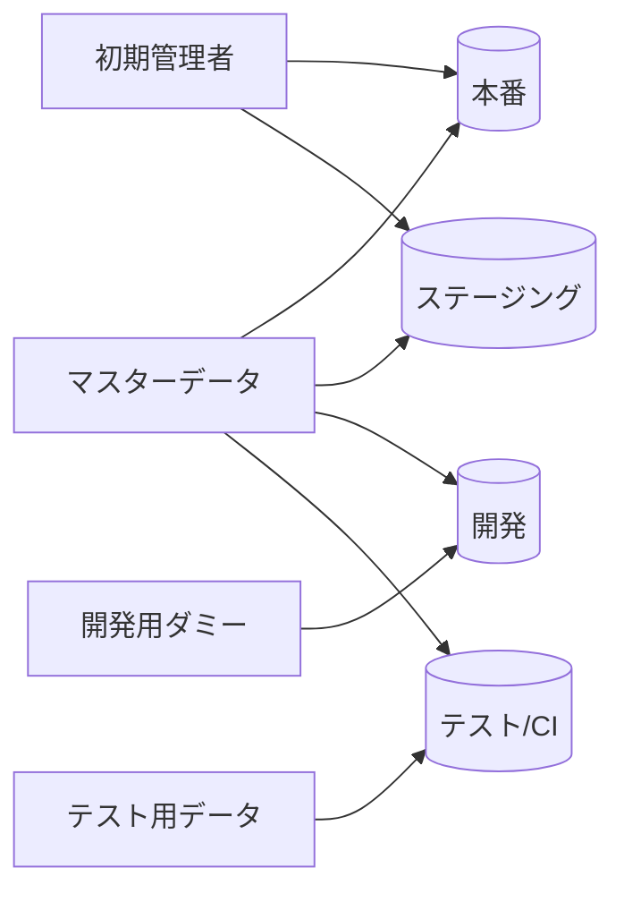

# シードデータ

[[MOC_データアーキテクチャ体系|📚 目次]] ｜ [[05_マイグレーションのよくある問題と対処法|← 前へ]] ｜ [[07_ゼロダウンタイムのスキーマ変更|次へ →]]

> [!abstract] この記事で分かること
> - シード（Seed Data）とは何か、マイグレーションとどう役割を分けるか
> - マスターデータ・初期アカウント・開発用ダミー・テストデータの違いと、どの環境に入れるか
> - 何回実行しても同じ結果になる「冪等な」シードの書き方（SQL と Prisma）
> - faker と乱数シードで、毎回同じダミーデータを作る方法
>
> **前提**：[[01_マイグレーションとは]] と [[02_マイグレーションファイルの書き方]] を読んでいると理解しやすいです。

## 1. ひとことで言うと

**シード（seed data）**とは、データベースに**最初から入れておくデータ**と、それを投入する処理のことです。「DB にシードする（seeding）」のように動詞としても使います。

マイグレーションが「本棚を組み立てる」作業なら、シードは「本棚に最初の本を並べる」作業です。棚だけあっても、本がなければ図書館は開けません。

- 「カテゴリ」テーブルが空 → 商品登録画面のプルダウンに何も出ない
- 「権限」テーブルが空 → ユーザー登録時に権限を割り当てられずエラー
- 開発環境に注文が 1 件もない → 一覧画面やページングの確認ができない

これを毎回手作業で SQL を打って入れていると、「人によって入っているデータが違う」「新メンバーの環境構築に時間がかかる」「テストのたびに状態がバラバラ」という、マイグレーションを使わないときと同じ問題が起きます。そこで、**初期データもコードとして管理し、コマンド 1 つで同じ状態を作れるようにする**のがシードです。

> [!note] 乱数の「シード」とは別物
> 乱数の「シード値」は名前が同じだけの別の概念です → [[擬似乱数と乱数シード]]。どちらのシードの話かを見分けるには [[05_シード（乱数シードとDBシード）]] も参照してください。

## 2. マイグレーションとの違い

| | マイグレーション | シード |
|---|---|---|
| 扱うもの | **構造**（テーブル、列、インデックス） | **中身**（行） |
| たとえると | 本棚を組み立てる | 本棚に本を並べる |
| 実行順 | 先 | 後 |
| 履歴管理 | される（どこまで適用したか DB に記録） | 基本的にされない（毎回全体を流す） |
| 本番で使うか | 必ず使う | マスターデータなど一部だけ使うことが多い |

```
DBを作る → マイグレーション（テーブルを作る） → シード（初期データを入れる） → アプリ起動
```

シードは履歴管理されず**何度も流される**前提なので、「2 回流しても壊れない」ように書くことが一番大切です（5 章）。

### 2.1 マイグレーションの中でデータを入れる場合との使い分け

[[02_マイグレーションファイルの書き方]] で見たように、マイグレーションファイルの中でデータを追加することもできます。

| 方法 | 向いているデータ | 例 |
|---|---|---|
| **マイグレーションで入れる** | スキーマの一部と言えるデータ。**全環境に一度だけ確実に入れたい**もの | 新しく増えた注文ステータスの種類、NOT NULL 化のための「未分類」カテゴリ、既存データの変換 |
| **シードで入れる** | 環境ごとに違ってよいデータ。**何度も入れ直す**もの | 開発用ダミーデータ、テスト用ユーザー、初期の管理者アカウント |

判断に迷ったら、「**このデータがないとアプリのコードが壊れるか？**」と考えます。コードが `WHERE name = '未分類'` を前提にしているなら、そのデータはスキーマと同じくらい重要なので、マイグレーションで入れる方が安全です。

## 3. シードで入れるデータの種類

| 種類 | 説明 | Shop での例 | どの環境に入れるか |
|---|---|---|---|
| **マスターデータ** | アプリの選択肢や区分。めったに変わらない | カテゴリ（家電・書籍・食品）、都道府県、通貨 | すべての環境（本番も） |
| **初期アカウント** | システムを使い始めるための最初のユーザー | 最初の管理者 | 本番でも入れることがある（パスワードは環境変数から） |
| **開発用ダミーデータ** | 画面を作る・動かすための大量の架空データ | 架空のユーザー 100 人、商品 500 件、注文 2000 件 | 開発環境だけ |
| **テストデータ** | 自動テストで使う、内容が決まったデータ | 「在庫 0 の商品」「注文履歴のあるユーザー」 | テスト環境だけ |

**本番に入れるものと、開発・テストだけに入れるものを分ける**のが最も大事です。ダミーユーザーや「テスト商品 ¥1」が本番に入ってしまう事故は、実際によく起きます。



## 4. ツールごとの書き方

### 4.1 SQL だけで書く（PostgreSQL）

マスターデータは SQL ファイル 1 つでも管理できます。`ON CONFLICT` を使えば、何度流しても重複しません。

```sql
-- seeds/master.sql
INSERT INTO categories (name) VALUES
  ('家電'),
  ('書籍'),
  ('食品'),
  ('未分類')
ON CONFLICT (name) DO NOTHING;   -- すでにあれば何もしない
```

```bash
psql -d shop -f seeds/master.sql
```

`ON CONFLICT` は PostgreSQL の構文です。MySQL では `INSERT IGNORE` や `INSERT ... ON DUPLICATE KEY UPDATE` を使います。

### 4.2 Prisma

```typescript
// prisma/seed.ts
import { prisma } from "../src/lib/prisma"; // PrismaClient の生成はプロジェクトの設定に従う

async function main() {
  // マスターデータ：upsert なら何回実行しても重複しない
  for (const name of ["家電", "書籍", "食品", "未分類"]) {
    await prisma.category.upsert({
      where: { name },   // name は UNIQUE
      update: {},        // あれば何もしない
      create: { name },  // なければ作る
    });
  }

  // 開発環境だけダミーデータを入れる
  if (process.env.APP_ENV === "development") {
    await prisma.user.createMany({
      data: [
        { email: "alice@example.com", name: "Alice" },
        { email: "bob@example.com", name: "Bob" },
      ],
      skipDuplicates: true, // email の UNIQUE に引っかかる行は飛ばす
    });
  }
}

main()
  .catch((e) => {
    console.error(e);
    process.exit(1);
  })
  .finally(() => prisma.$disconnect());
```

シードを実行するコマンドは、設定ファイルに登録します。Prisma 7 では `prisma.config.ts` の `migrations.seed` に書きます（Prisma 6 までは `package.json` の `"prisma": { "seed": ... }` に書く方法が一般的でした）。

```typescript
// prisma.config.ts（抜粋）
import { defineConfig } from "prisma/config";

export default defineConfig({
  schema: "prisma/schema.prisma",
  migrations: {
    path: "prisma/migrations",
    seed: "tsx prisma/seed.ts",
  },
});
```

```bash
npx prisma db seed       # シードを実行
npx prisma migrate reset # DB を作り直して全マイグレーションを適用
```

> [!warning] Prisma 7 ではシードが自動で走らない
> Prisma 6 までは `migrate reset` や `migrate dev` の後に自動でシードが実行されていましたが、Prisma 7 ではこの自動実行が廃止され、`prisma db seed` を**明示的に**実行する必要があります。古い記事の手順をそのまま使うと「シードが入っていない」ことになるので注意してください。

### 4.3 そのほかのフレームワーク

| フレームワーク | ファイル | コマンド |
|---|---|---|
| Ruby on Rails | `db/seeds.rb` | `bin/rails db:seed`（`db:reset` / `db:setup` でも実行される） |
| Laravel | `database/seeders/` | `php artisan db:seed` |
| Django | `fixtures/*.json` | `python manage.py loaddata <ファイル>` |
| Knex.js | `seeds/` | `npx knex seed:run` |
| TypeORM | （公式機能なし。typeorm-extension などを使う） | — |

## 5. 冪等なシードを書く

### 5.1 なぜ冪等でなければならないか

**冪等（べきとう、Idempotent）**とは、「何回実行しても、1 回実行したときと同じ結果になる」ことです。シードは履歴管理されないので、

- 開発者が「念のため」もう一度流す
- CI が毎回流す
- 本番のマスターデータに 1 件追加したので、全体を流し直す

ということが日常的に起きます。素朴な `INSERT` だけで書くと、2 回目に**重複データ**ができるか、**ユニーク制約違反**で失敗します。

### 5.2 冪等にするための 4 つの方法

| 方法 | 書き方 | 向いている場面 |
|---|---|---|
| **あれば何もしない** | SQL `ON CONFLICT DO NOTHING`、Prisma `createMany({ skipDuplicates: true })` | マスターデータの追加 |
| **あれば更新、なければ作成（upsert）** | SQL `ON CONFLICT (name) DO UPDATE SET ...`、Prisma `upsert` | マスターデータの表示名などを直したいとき |
| **存在確認してから入れる** | `INSERT ... SELECT ... WHERE NOT EXISTS (...)` | 一意キーがないデータ |
| **全部消して入れ直す** | `TRUNCATE ... RESTART IDENTITY CASCADE` → `INSERT` | 開発用・テスト用データ（**本番では絶対にしない**） |

```sql
-- upsert：既存カテゴリの名前の表記ゆれは直さないが、説明文は最新に更新する例
-- （categories に description 列を足した場合）
INSERT INTO categories (name, description) VALUES
  ('家電', '冷蔵庫・洗濯機などの家電製品'),
  ('書籍', '紙の本・電子書籍')
ON CONFLICT (name) DO UPDATE SET description = EXCLUDED.description;
```

`EXCLUDED` は「今入れようとして衝突した行」を指す特別な名前です。

### 5.3 一意キーが冪等性の鍵

upsert も `ON CONFLICT` も、**「同じものかどうか」を判定する一意キー（UNIQUE 制約や主キー）**が必要です。`categories.name` に UNIQUE があるからこそ、「家電」が 2 件にならずに済みます。

自動採番の `id` は環境ごとに違う値になることがあるので、シードでは `id` ではなく**意味のある一意キー**（`name`、`code`、`email` など）で照合します。シードデータを持つテーブルには、そうしたキーを設計段階で用意しておきましょう（[[04_キーと制約の設計]]）。

## 6. 大量のダミーデータを作る

開発用に何百件ものデータが欲しいときは、faker などのライブラリで生成します。

```typescript
import { faker } from "@faker-js/faker";

faker.seed(123); // 乱数シードを固定 → 毎回同じダミーデータになる

const users = Array.from({ length: 100 }, () => ({
  email: faker.internet.email(),
  name: faker.person.fullName(),
}));

await prisma.user.createMany({ data: users, skipDuplicates: true });
```

ここで出てくる `faker.seed(123)` は**乱数シード**で、DB シードとは別物です（→ [[擬似乱数と乱数シード]]）。乱数シードを固定しておくと、**実行するたびに同じ名前・同じメールアドレスのデータ**が入るので、画面の確認やテストが安定します。

ダミーデータでは、次の点も意識すると開発がはかどります。

- **境界値を混ぜる**：在庫 0 の商品、価格 0 円の商品、とても長い商品名、絵文字を含む名前
- **関連を作る**：ユーザー → 注文 → 注文明細 の順に作り、外部キーが成り立つようにする
- **実際の比率に近づける**：注文の 9 割が `delivered`、1 割が `pending` など。偏りがないと、本番で遅くなるクエリに気づけない

## 7. 注意点とベストプラクティス

### 7.1 本番用と開発用を分ける
- ファイルを分ける（`seed.production.ts` / `seed.development.ts`）か、環境変数で分岐する
- 本番で開発用シードが**絶対に動かない**ようにガードを入れる

```typescript
if (process.env.APP_ENV === "production") {
  throw new Error("本番環境で開発用シードは実行できません");
}
```

### 7.2 秘密情報を直書きしない
初期管理者のパスワードなどは、コードに書かず環境変数（やシークレット管理サービス）から読みます。シードファイルは Git に入るからです。

### 7.3 スキーマ変更に追従させる
マイグレーションで列を増やしたのにシードを直し忘れて、シードが壊れることがよくあります。CI で「DB 作成 → 全マイグレーション → シード」を毎回実行して確認すると安心です（Prisma 7 なら `migrate reset --force` の後に `db seed`）。

### 7.4 テストでの使い方に注意する
E2E テストでシードを使う場合、テスト同士が同じデータを書き換えると結果が不安定になります。テストごとに DB を初期化するか、テスト専用のデータを作るようにします（→ [[05_テストデータの用意]]）。

## よくある誤解・つまずき

- ❌ 「シードは開発環境のためのもので、本番には関係ない」
  ✅ カテゴリや権限の種類などのマスターデータは、本番にも必要です。ただし開発用ダミーとは必ず分けて管理します。

- ❌ 「`INSERT` を並べたシードで十分」
  ✅ シードは何度も流されるので、2 回目に重複や制約違反が起きます。`ON CONFLICT` や `upsert` で冪等に書きます。

- ❌ 「シードでは `id = 1` のカテゴリ、のように ID で指定すればよい」
  ✅ 自動採番の ID は環境によってずれることがあります。`name` や `code` のような意味のある一意キーで照合します。

- ❌ 「`prisma migrate reset` をすればシードも入る」
  ✅ Prisma 7 からは自動では入りません。`prisma db seed` を明示的に実行します。

## まとめ

- **シード**は DB に初期データを入れるスクリプト。マイグレーションが**構造**、シードが**中身**
- データは**マスター / 初期アカウント / 開発用ダミー / テスト用**に分け、環境ごとに入れるものを決める
- 「このデータがないとコードが壊れる」ものは、シードではなく**マイグレーションで入れる**
- シードは何度も流されるので、**一意キー＋`ON CONFLICT` / `upsert` で冪等に**書く
- **本番用と開発用を分ける**、**秘密情報は環境変数から読む**、**CI でシードまで流して壊れていないか確かめる**
- faker の `seed()` は乱数シードで、DB シードとは別物

## 確認クイズ

1. 次のシードを 2 回実行すると何が起きますか？　どう直せばよいですか？
   `INSERT INTO categories (name) VALUES ('家電'), ('書籍');`

> [!tip]- 答え
> `categories.name` には UNIQUE 制約があるので、2 回目はユニーク制約違反でエラーになります（UNIQUE がなければ重複行ができます）。`ON CONFLICT (name) DO NOTHING` を付けて冪等にします。

2. 「NOT NULL 化のために、`category_id` が NULL の商品を『未分類』カテゴリに入れる」作業で使う『未分類』カテゴリは、シードとマイグレーションのどちらで入れるべきですか？

> [!tip]- 答え
> マイグレーションです。後続のマイグレーション（NULL を埋める `UPDATE`）やアプリのコードがこのデータの存在を前提にしているため、本番を含む全環境に一度だけ確実に入れる必要があるからです。

3. `faker.seed(123)` を書く理由は何ですか？

> [!tip]- 答え
> 乱数シードを固定することで、実行のたびに**同じダミーデータ**が生成されるようにするためです。画面の確認やテストの結果が毎回同じになり、問題の再現がしやすくなります。DB のシードとは別の概念です。

## 関連ノート
- [[02_マイグレーションファイルの書き方]] — マイグレーションの中でデータを入れる方法
- [[03_マイグレーションの実行とロールバック]] — 環境ごとの実行コマンド
- [[05_マイグレーションのよくある問題と対処法]] — 本番だけにある汚れたデータの扱い
- [[04_キーと制約の設計]] — シードの照合に使う一意キーの設計
- [[05_テストデータの用意]] — フィクスチャ・ファクトリ・シードの使い分け
- [[擬似乱数と乱数シード]] — 名前は同じだが別の概念の「乱数シード」
- [[05_シード（乱数シードとDBシード）]] — どちらのシードか見分けるための案内

## 参考
- [Prisma Docs: Seeding](https://www.prisma.io/docs/orm/prisma-migrate/workflows/seeding)
- [Prisma CLI reference](https://www.prisma.io/docs/orm/reference/prisma-cli-reference)
- [PostgreSQL Documentation: INSERT（ON CONFLICT）](https://www.postgresql.org/docs/current/sql-insert.html)
- [Ruby on Rails Guides: Active Record Migrations（Migrations and Seed Data）](https://guides.rubyonrails.org/active_record_migrations.html)
- [Knex.js: Seed files](https://knexjs.org/guide/migrations.html#seed-files)
- [Faker: Usage（Reproducible results）](https://fakerjs.dev/guide/usage.html)
