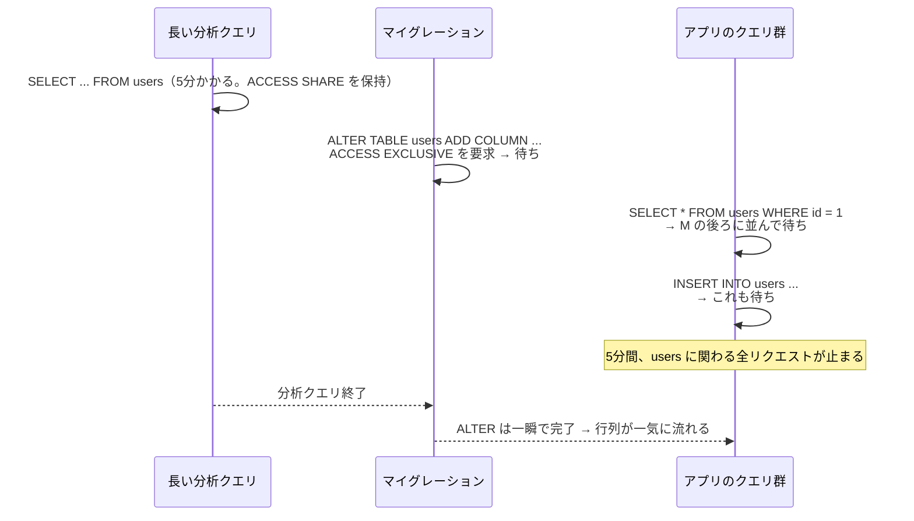

# ゼロダウンタイムのスキーマ変更

[[MOC_データアーキテクチャ体系|📚 目次]] ｜ [[06_シードデータ|← 前へ]] ｜ [[08_データのエンコードとスキーマ進化|次へ →]]

> [!abstract] この記事で分かること
> - なぜ `ALTER TABLE` がサービス全体を止めることがあるのか（`ACCESS EXCLUSIVE` ロックとロック待ちの行列）
> - `lock_timeout` で「止まる」を「失敗して再試行」に変える方法
> - Expand/Contract（並行変更）パターンで、列名変更を止めずに行う手順
> - NOT NULL・外部キー・インデックスを、長時間ロックなしで追加する手順（`NOT VALID` → `VALIDATE`、`CONCURRENTLY`）
> - 大量データのバックフィルを分割する方法、デプロイとの順序、MySQL の gh-ost / pt-online-schema-change
>
> **前提**：[[04_マイグレーションの実践例]] と [[03_ロックとMVCC]] を読んでいると理解しやすいです。

## 1. ひとことで言うと

ゼロダウンタイム（Zero Downtime）のスキーマ変更とは、**電車を走らせたまま線路を付け替える工事**です。

一晩運休して工事する（メンテナンス時間を取る）なら簡単です。運休できないなら、新しい線路を隣に敷く → 電車を少しずつ新しい線路に移す → 全部移ったら古い線路を撤去する、という手順になります。また、工事車両が線路をふさぐ時間はできるだけ短くし、ふさげなかったら無理をせずやり直します。

データベースに置き換えると、

- **線路をふさぐ時間を短くする**：強いロックを長く持たない（`lock_timeout`、`CONCURRENTLY`、`NOT VALID`）
- **隣に新しい線路を敷く**：古いものを残したまま新しいものを足し、移行してから古いものを消す（Expand/Contract）
- **少しずつ移す**：大量データの更新を小分けにする（バッチ処理）

の 3 つが柱です。以下、PostgreSQL（バージョン 18 の公式ドキュメント）を基準に説明します。

## 2. ロックの危険

### 2.1 ALTER TABLE は最強のロックを取る

PostgreSQL の公式ドキュメントには、`ALTER TABLE` について「特に明記がない限り `ACCESS EXCLUSIVE` ロックを取得する」と書かれています。`ACCESS EXCLUSIVE` は**すべてのロックと衝突する**最も強いロックで、ふつうの `SELECT` すら待たせます。

| ロック | 主な取得者 | 読み取り（SELECT）を止める？ | 書き込み（INSERT/UPDATE/DELETE）を止める？ |
|---|---|---|---|
| `ACCESS SHARE` | `SELECT` | — | — |
| `ROW EXCLUSIVE` | `INSERT` / `UPDATE` / `DELETE` | — | — |
| `SHARE UPDATE EXCLUSIVE` | `VACUUM`、`CREATE INDEX CONCURRENTLY`、`VALIDATE CONSTRAINT` | 止めない | 止めない |
| `SHARE` | `CREATE INDEX`（CONCURRENTLY なし） | 止めない | **止める** |
| `SHARE ROW EXCLUSIVE` | `ADD FOREIGN KEY` | 止めない | **止める** |
| `ACCESS EXCLUSIVE` | 多くの `ALTER TABLE`、`DROP TABLE`、`TRUNCATE` | **止める** | **止める** |

ロックの仕組みそのものは [[03_ロックとMVCC]] で扱っています。

### 2.2 本当に怖いのは「ロック待ちの行列」

「`ADD COLUMN` は一瞬で終わるから大丈夫」と考えがちですが、問題は**ロックを取るまでの待ち時間**です。



ロックは基本的に**順番待ち**なので、`ACCESS EXCLUSIVE` を待っているマイグレーションの後ろに来た軽いクエリも、一緒に待たされます。ALTER 自体は一瞬でも、**待っている間はテーブルが止まっている**のと同じです。

### 2.3 lock_timeout で「止まる」を「失敗」に変える

対策は、マイグレーションのセッションで `lock_timeout` を設定することです。公式ドキュメントによると、`lock_timeout` は「ロックの取得を指定時間より長く待った文を中止する」設定で、**既定値は 0（無効）**です。つまり何も設定しなければ、いつまでも待ち続けます。

```sql
-- マイグレーションの先頭で
SET lock_timeout = '3s';         -- ロックを 3 秒待っても取れなければ中止
SET statement_timeout = '15min'; -- 文全体の実行時間の上限（任意）

ALTER TABLE users ADD COLUMN phone TEXT;
```

3 秒で取れなければエラーになり、マイグレーションは失敗します。アプリが止まるのは最大 3 秒で済み、**空いている時間帯に再試行**すればよいのです。CI/CD のジョブで「失敗したら数回リトライ」を組み込んでおくと運用が楽になります。

### 2.4 どの変更が危険か（PostgreSQL）

| 変更 | テーブル書き換え・全件スキャン | 危険度 | 安全な代替 |
|---|---|---|---|
| `ADD COLUMN`（NULL 許可、デフォルトなし） | なし | 低（ロック待ちだけ注意） | `lock_timeout` を付けるだけ |
| `ADD COLUMN ... DEFAULT 定数` / `DEFAULT now()` | なし（PostgreSQL 11 以降） | 低 | 同上 |
| `ADD COLUMN ... DEFAULT clock_timestamp()` など volatile な関数 | **全行書き換え** | 高 | NULL 許可で追加 → バックフィル |
| `ALTER COLUMN TYPE`（`INTEGER`→`BIGINT` など） | **全行書き換え＋インデックス再作成** | 高 | 新しい列を作って移行（5 章） |
| `ALTER COLUMN TYPE`（`VARCHAR(n)`→`TEXT` などバイナリ互換） | 書き換えなし | 低 | — |
| `SET NOT NULL` | **全件スキャン**（ACCESS EXCLUSIVE のまま） | 高 | CHECK `NOT VALID` → `VALIDATE`（4 章） |
| `ADD CONSTRAINT ... CHECK` / `FOREIGN KEY` | **全件スキャン** | 高 | `NOT VALID` → `VALIDATE`（4 章） |
| `CREATE INDEX` | 全件読み込み、その間**書き込み停止** | 高 | `CREATE INDEX CONCURRENTLY`（5 章） |
| `DROP COLUMN` | なし（見えなくするだけ） | 中（アプリが使っていると壊れる） | 先にコードから消す |
| `RENAME COLUMN` / `RENAME TABLE` | なし | **高（動いているアプリが壊れる）** | Expand/Contract（3 章） |

## 3. Expand/Contract パターン

### 3.1 考え方

**Expand/Contract（拡張と縮小）**は、Parallel Change（並行変更）とも呼ばれ、**互換性を壊す変更を「互換性を壊さない小さな変更」の連続に分解する**手法です。

```
Expand（拡張）  : 新しい列・表を「追加」する。古いものはそのまま
Migrate（移行） : アプリが両方に書き、既存データを新しい方へコピーする
Contract（縮小）: アプリが新しい方だけを使うようになったら、古いものを消す
```

どの瞬間を切り取っても、**DB のスキーマは「今動いているすべてのバージョンのアプリ」と互換**になっているのがポイントです。

### 3.2 列名変更：users.name → display_name

| # | デプロイ内容 | DB | アプリの読み | アプリの書き |
|---|---|---|---|---|
| 1 | マイグレーション：列追加 | `name`, `display_name`(NULL可) | `name` | `name` |
| 2 | アプリ v2 | 同上 | `name` | **`name` と `display_name` の両方** |
| 3 | バックフィル（6 章） | `display_name` を全行埋める | `name` | 両方 |
| 4 | マイグレーション：NOT NULL（4 章の手順） | `display_name` NOT NULL | `name` | 両方 |
| 5 | アプリ v3 | 同上 | **`display_name`** | 両方 |
| 6 | アプリ v4 | 同上 | `display_name` | **`display_name` のみ** |
| 7 | マイグレーション：列削除 | `display_name` だけ | `display_name` | `display_name` |

```sql
-- 1. Expand
SET lock_timeout = '3s';
ALTER TABLE users ADD COLUMN display_name TEXT;

-- 7. Contract（v4 が全台に行き渡り、古いバージョンに戻す可能性がなくなってから）
SET lock_timeout = '3s';
ALTER TABLE users DROP COLUMN name;
```

手順 2 の「両方に書く」はアプリ側で行うのが一般的ですが、アプリを変えずに**トリガー**で同期させる方法もあります（MySQL の pt-online-schema-change は、まさにトリガーでこれを自動化しています。8 章）。

> [!tip] 本当に DB の列名を変える必要があるか
> 7 回もデプロイするのは大変です。ORM のマッピング（Prisma の `@map("name")` など）で**コード上の名前だけ変える**、あるいは短いメンテナンス時間を取って `RENAME` 1 文で済ませる、という判断も十分に合理的です。

### 3.3 どの変更が何ステップ必要か

| 変更 | Expand | Migrate | Contract |
|---|---|---|---|
| 列の追加 | 追加 | — | — |
| 列の削除 | — | コードから参照を消す | 削除 |
| 列名変更 | 新列追加 | 両方に書く＋バックフィル＋読み切り替え | 旧列削除 |
| 型変更 | 新しい型の列を追加 | 同上 | 旧列削除 |
| テーブル分割 | 新テーブル作成 | 両方に書く＋コピー＋読み切り替え | 旧列削除 |

## 4. 制約を安全に追加する（NOT VALID → VALIDATE）

### 4.1 なぜ普通に追加すると危ないか

`ALTER TABLE products ALTER COLUMN category_id SET NOT NULL;` は、**全行を読んで NULL がないことを確かめる間、`ACCESS EXCLUSIVE` ロックを持ち続けます**。1 億行なら数分間、`products` への読み書きがすべて止まります。

### 4.2 安全な手順（CHECK 制約を経由する）

PostgreSQL には、**「新しい行にだけ制約をかけ、既存行の検査は後回しにする」`NOT VALID`** という仕組みがあります。そして後から行う `VALIDATE CONSTRAINT` は、`SHARE UPDATE EXCLUSIVE` という**読み書きを止めない弱いロック**で検査できます。

```sql
-- ステップ1：制約を「NOT VALID」で追加（既存行は検査しないので一瞬）
SET lock_timeout = '3s';
ALTER TABLE products
  ADD CONSTRAINT products_category_id_not_null
  CHECK (category_id IS NOT NULL) NOT VALID;
-- ↑ この時点から、新しく NULL を入れようとする INSERT/UPDATE は拒否される
--   （なので、先にアプリが NULL を書かないバージョンをデプロイしておく）

-- ステップ2：既存の NULL を埋める（大量なら 6 章の方法で分割）
UPDATE products
SET category_id = (SELECT id FROM categories WHERE name = '未分類')
WHERE category_id IS NULL;

-- ステップ3：既存行を検査（SHARE UPDATE EXCLUSIVE なので読み書きは止まらない）
ALTER TABLE products VALIDATE CONSTRAINT products_category_id_not_null;

-- ステップ4：NOT NULL を付ける
--   有効な CHECK 制約が「NULL がない」ことを証明しているので、全件スキャンは省略される
SET lock_timeout = '3s';
ALTER TABLE products ALTER COLUMN category_id SET NOT NULL;

-- ステップ5：役目を終えた CHECK 制約を消す
ALTER TABLE products DROP CONSTRAINT products_category_id_not_null;
```

公式ドキュメントには、`SET NOT NULL` について「NULL が存在し得ないことを証明する有効な `CHECK` 制約があれば、テーブルのスキャンは省略される」と明記されています。

> [!note] PostgreSQL 18 では NOT NULL 自体を NOT VALID で付けられる
> PostgreSQL 18 では、NOT NULL 制約そのものを `NOT VALID` で追加し、後から `VALIDATE CONSTRAINT` できるようになりました。
> ```sql
> ALTER TABLE products ADD CONSTRAINT products_category_id_nn NOT NULL category_id NOT VALID;
> ALTER TABLE products VALIDATE CONSTRAINT products_category_id_nn;
> ```
> 17 以前を使っている場合は、上の CHECK 経由の手順を使います。

### 4.3 外部キーも同じ手順

```sql
SET lock_timeout = '3s';
ALTER TABLE orders
  ADD CONSTRAINT orders_user_id_fkey
  FOREIGN KEY (user_id) REFERENCES users(id) NOT VALID;

ALTER TABLE orders VALIDATE CONSTRAINT orders_user_id_fkey;
```

外部キーの追加は `SHARE ROW EXCLUSIVE` ロックを**両方のテーブル**（`orders` と参照先の `users`）に取り、書き込みを止めます。`NOT VALID` にすれば、そのロックは一瞬で済みます。

## 5. インデックスを止めずに作る（CREATE INDEX CONCURRENTLY）

### 5.1 普通の CREATE INDEX の問題

通常の `CREATE INDEX` は、公式ドキュメントのとおり「完了するまでテーブルへの書き込みを締め出す（読み取りは可能）」動きをします。大きなテーブルなら、その間**注文が入らない**ことになります。

### 5.2 CONCURRENTLY を使う

```sql
CREATE INDEX CONCURRENTLY orders_status_ordered_at_idx
  ON orders (status, ordered_at);
```

`CONCURRENTLY` を付けると、書き込みを止めずにインデックスを作れます。代わりに次の制約があります。

| 特徴 | 内容 |
|---|---|
| 時間がかかる | テーブルを 2 回スキャンし、既存のトランザクションの終了を待つ |
| **トランザクション内で実行できない** | `BEGIN ... COMMIT` の中では使えない。マイグレーションツールが自動でトランザクションに包む場合は、それを外す設定が必要 |
| 失敗すると `INVALID` なインデックスが残る | 検索には使われず、更新の負荷だけがかかる。`DROP INDEX` して作り直すか、`REINDEX INDEX CONCURRENTLY` |
| 1 テーブルで同時に 1 つまで | 同じテーブルに並行して複数作れない |

トランザクションを外す設定の例です。

```ruby
# Rails
class AddIndexToOrdersStatus < ActiveRecord::Migration[8.0]
  disable_ddl_transaction!
  def change
    add_index :orders, [:status, :ordered_at], algorithm: :concurrently
  end
end
```

```javascript
// Knex
exports.config = { transaction: false };
exports.up = (knex) =>
  knex.raw("CREATE INDEX CONCURRENTLY orders_status_ordered_at_idx ON orders (status, ordered_at)");
```

Prisma など SQL ファイルを流すツールでは、`CREATE INDEX CONCURRENTLY` を**そのマイグレーション唯一の文**にし、ツールがトランザクションに包まずに実行するかをドキュメントで確認してください。削除も `DROP INDEX CONCURRENTLY` が使えます。

インデックス設計そのものは [[03_インデックスの基本と設計]] を参照してください。

## 6. 大量データのバックフィルを分割する

**バックフィル（Backfill）**とは、新しく追加した列に既存行の値を埋める作業です。1 億行を 1 文の `UPDATE` で埋めると、

- 1 つの巨大なトランザクションになり、更新した行のロックを最後まで持ち続ける
- WAL（変更ログ）が一気に増え、レプリカ（読み取り用の複製）の遅延やディスク逼迫を招く
- 途中で失敗すると、全部やり直しになる

という問題が起きます。そこで、**主キーの範囲で小分けにし、1 回ごとにコミット**します。

```sql
-- PostgreSQL 11 以降：プロシージャ内で COMMIT できる
CREATE OR REPLACE PROCEDURE backfill_users_display_name(batch_size BIGINT DEFAULT 5000)
LANGUAGE plpgsql
AS $$
DECLARE
  last_id BIGINT := 0;
  max_id  BIGINT;
BEGIN
  SELECT coalesce(max(id), 0) INTO max_id FROM users;
  WHILE last_id < max_id LOOP
    UPDATE users
    SET display_name = name
    WHERE id > last_id
      AND id <= last_id + batch_size
      AND display_name IS NULL;      -- 再実行しても安全（冪等）
    last_id := last_id + batch_size;
    COMMIT;                          -- 1 バッチごとに確定してロックを手放す
    PERFORM pg_sleep(0.05);          -- 本番の負荷に配慮して少し休む
  END LOOP;
END;
$$;

CALL backfill_users_display_name();  -- BEGIN の外で実行する
```

ポイントは次のとおりです。

- **主キーの範囲（`id > ... AND id <= ...`）で区切る**：主キーのインデックスが使えるので、後半になっても遅くならない（`OFFSET` 方式は後半ほど遅く、取りこぼしも起きる）
- **`display_name IS NULL` を条件に入れる**：途中で止まっても、再実行すれば続きから埋まる
- **1 バッチごとにコミット**：ロックを長く持たず、失敗しても進んだ分は残る
- **休憩を入れ、レプリカの遅延を監視する**：本番のピーク時間は避ける

規模が大きい場合は、マイグレーションとは別の**バッチジョブ**として実行し、進捗をログに出すのが一般的です。デプロイのたびに何十分もかかる処理をマイグレーションに入れると、デプロイ全体が止まるためです。

## 7. デプロイとの順序

ローリングデプロイ（サーバーを 1 台ずつ新しいバージョンに入れ替える方式）では、**新旧のアプリが同時に動く時間**があります。だから、マイグレーションを「いつ」流すかが重要です。

| 変更の種類 | いつ流すか | 理由 |
|---|---|---|
| 追加系（列・表・インデックスの追加、NOT VALID 制約） | **アプリのデプロイ前** | 新しいコードが使う前に用意しておく。古いコードは無視するので安全 |
| 削除系（列・表の削除） | **アプリのデプロイ後**（次のリリースなど） | 古いコードがまだ使っている可能性があるので、全台が新コードになってから |
| 検証系（VALIDATE、SET NOT NULL） | バックフィル完了後、アプリが新しい値を必ず書くようになってから | 新しい違反データが入らない状態を作ってから |

```
リリース N   : [migrate: ADD COLUMN display_name] → [deploy: 両方に書くコード]
             → [バッチ: バックフィル] → [migrate: 制約追加・VALIDATE]
リリース N+1 : [deploy: display_name を読むコード]
リリース N+2 : [deploy: name を使わないコード] → [migrate: DROP COLUMN name]
```

この順序を守ると、**アプリだけを 1 つ前のバージョンに戻しても DB と互換性が保たれる**ので、障害時に安全に戻せます。ローリングデプロイやブルーグリーンデプロイの仕組みは [[MOC_リリース・デプロイ体系]] を参照してください。新旧のコードが同時に動くことが「データの形」に与える影響は、次の [[08_データのエンコードとスキーマ進化]] で詳しく扱います。

## 8. MySQL の場合：Online DDL と gh-ost / pt-osc

MySQL（InnoDB）にも、テーブルを止めずに変更する仕組みがあります。

### 8.1 Online DDL の ALGORITHM

| ALGORITHM | 意味 | 例（MySQL 8.4） |
|---|---|---|
| `INSTANT` | メタデータの変更だけで一瞬で終わる | 列の追加・削除（8.4 では `INSTANT` が既定） |
| `INPLACE` | テーブルをコピーせずに変更。多くは同時の読み書きを許す | インデックスの追加 |
| `COPY` | テーブルを丸ごとコピーして作り直す。その間書き込み停止 | **列のデータ型の変更**（`COPY` でしかできない） |

```sql
-- 指定した方式で実行できなければエラーにしてくれる（意図しない COPY を防ぐ）
ALTER TABLE users ADD COLUMN phone VARCHAR(20), ALGORITHM=INSTANT;
```

MySQL でも DDL は**メタデータロック（MDL）**を取るため、長いトランザクションがあると PostgreSQL と同じ「ロック待ちの行列」が起きます。`lock_wait_timeout` を短く設定するのが定石です。

### 8.2 オンラインスキーマ変更ツール

`COPY` が必要な大きなテーブルの変更には、専用ツールを使います。どちらも「**新しい構造の空テーブル（ゴーストテーブル）を作り、少しずつデータをコピーし、最後に名前を入れ替える**」という同じ発想です。

| ツール | 開発元 | 変更の追従方法 | 特徴 |
|---|---|---|---|
| **pt-online-schema-change** | Percona | 元テーブルに**トリガー**を付け、INSERT/UPDATE/DELETE をゴーストテーブルにも反映 | 歴史が長く広く使われる。トリガーの負荷がかかる |
| **gh-ost** | GitHub | **バイナリログ（binlog）**を読んで変更をゴーストテーブルに非同期で反映（トリガーなし） | 負荷に応じて一時停止（スロットル）でき、最後の入れ替え（cut-over）のタイミングを人が制御できる |

PostgreSQL にはこれらに相当する定番ツールは少なく、本記事の `NOT VALID` / `CONCURRENTLY` / Expand/Contract を組み合わせて対応するのが一般的です。

### 8.3 危険な変更を自動で検出する

人の注意だけに頼らず、CI でマイグレーションを検査するツールもあります。

- **Atlas の `migrate lint`**：破壊的な変更やロックを伴う変更を検出
- **squawk**：PostgreSQL のマイグレーション SQL 用のリンター
- **strong_migrations**：Rails 用。危険な操作を検出し、安全な書き方を提案

## よくある誤解・つまずき

- ❌ 「処理が一瞬で終わる ALTER なら、本番で流しても影響はない」
  ✅ ロックを**取るまで**に長いクエリを待つと、その後ろにすべてのクエリが並びます。`lock_timeout` を必ず設定します。

- ❌ 「`CREATE INDEX` は読み取りを止めないから安全」
  ✅ 読み取りは止めませんが、**書き込みを止めます**。本番の大きなテーブルでは `CREATE INDEX CONCURRENTLY` を使います。

- ❌ 「NOT NULL を付けるには `SET NOT NULL` しかない」
  ✅ `CHECK (... IS NOT NULL) NOT VALID` → `VALIDATE` → `SET NOT NULL` とすれば、長時間のロックを避けられます（PostgreSQL 18 なら NOT NULL 自体を `NOT VALID` で付けられます）。

- ❌ 「バックフィルは 1 本の UPDATE で十分」
  ✅ 巨大なトランザクションはロック・WAL・レプリカ遅延の原因になります。主キー範囲で分割し、1 回ごとにコミットします。

- ❌ 「Expand/Contract は常に必要」
  ✅ 手間が大きいので、小さいテーブルやメンテナンス時間を取れるサービスでは、単純な方法で十分なこともあります。**テーブルの大きさ・アクセス量・止められる時間**で判断します。

## まとめ

- PostgreSQL の多くの `ALTER TABLE` は **`ACCESS EXCLUSIVE`** を取り、待っている間も後続のクエリを止める。**`lock_timeout` を必ず設定**して、取れなければ再試行する
- 互換性を壊す変更は **Expand/Contract** で「追加 → 両方に書く → 移行 → 切り替え → 削除」に分ける
- NOT NULL・CHECK・外部キーは **`NOT VALID` → `VALIDATE`**、インデックスは **`CONCURRENTLY`** で長時間ロックを避ける
- バックフィルは**主キー範囲で分割し、1 回ごとにコミット**、再実行しても安全に書く
- **追加はデプロイ前、削除はデプロイ後**。アプリだけを戻しても DB と互換が保たれるようにする
- MySQL では `ALGORITHM=INSTANT/INPLACE` を確認し、大きなテーブルの COPY 変更は **gh-ost / pt-online-schema-change** を使う

## 確認クイズ

1. `ALTER TABLE orders ADD COLUMN memo TEXT;` は書き換えを伴わない一瞬の処理なのに、本番で流したら注文処理が 1 分間止まりました。原因と対策を答えてください。

> [!tip]- 答え
> `orders` を読む長いクエリがあり、`ALTER TABLE` が `ACCESS EXCLUSIVE` ロックを待っている間、その後ろに注文処理のクエリが並んでしまったためです。マイグレーションの先頭で `SET lock_timeout = '3s';` などを設定し、ロックが取れなければ失敗させて、後で再試行します。

2. 1 億行の `products` の `category_id` に NOT NULL を付けたいとき、長時間のロックを避ける手順を答えてください（PostgreSQL 17 を想定）。

> [!tip]- 答え
> ① `CHECK (category_id IS NOT NULL) NOT VALID` を追加（新しい行だけに効く）→ ② 既存の NULL を分割して埋める → ③ `VALIDATE CONSTRAINT`（読み書きを止めない `SHARE UPDATE EXCLUSIVE` ロック）→ ④ `SET NOT NULL`（有効な CHECK があるので全件スキャンが省略される）→ ⑤ CHECK 制約を削除。

3. 列 `users.name` を削除するマイグレーションを、アプリのデプロイ「前」に流してはいけないのはなぜですか？

> [!tip]- 答え
> デプロイが完了するまで、`name` 列を使う古いバージョンのアプリが動いているからです。列を消した瞬間に古いアプリがエラーになります。削除系の変更は、全台が `name` を使わない新しいコードになった**後**に流します。

## 関連ノート
- [[04_マイグレーションの実践例]] — 列名変更・型変更・NOT NULL 追加の基本手順
- [[05_マイグレーションのよくある問題と対処法]] — ロック待ちや INVALID インデックスの後始末
- [[08_データのエンコードとスキーマ進化]] — 新旧のコードが同時に動くときの互換性
- [[03_ロックとMVCC]] — PostgreSQL のロックの仕組み
- [[03_インデックスの基本と設計]] — どのインデックスを作るべきか
- [[MOC_リリース・デプロイ体系]] — ローリングデプロイ・ブルーグリーンデプロイ
- [[MOC_パフォーマンス体系]] — 本番 DB の負荷と監視

## 参考
- [PostgreSQL Documentation: ALTER TABLE](https://www.postgresql.org/docs/current/sql-altertable.html)
- [PostgreSQL Documentation: Explicit Locking](https://www.postgresql.org/docs/current/explicit-locking.html)
- [PostgreSQL Documentation: CREATE INDEX（Building Indexes Concurrently）](https://www.postgresql.org/docs/current/sql-createindex.html)
- [PostgreSQL Documentation: Client Connection Defaults（lock_timeout / statement_timeout）](https://www.postgresql.org/docs/current/runtime-config-client.html)
- [MySQL 8.4 Reference Manual: Online DDL Operations](https://dev.mysql.com/doc/refman/8.4/en/innodb-online-ddl-operations.html)
- [github/gh-ost](https://github.com/github/gh-ost)
- [Percona Toolkit: pt-online-schema-change](https://docs.percona.com/percona-toolkit/pt-online-schema-change.html)
- [Martin Fowler: ParallelChange](https://martinfowler.com/bliki/ParallelChange.html)
- [Atlas: Declarative vs Versioned workflows（migrate lint）](https://atlasgo.io/concepts/declarative-vs-versioned)
