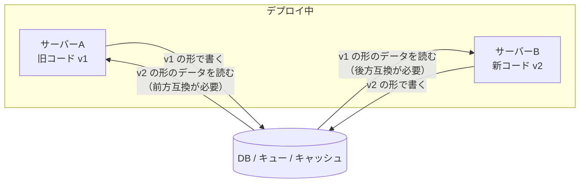

# データのエンコードとスキーマ進化

[[MOC_データアーキテクチャ体系|📚 目次]] ｜ [[07_ゼロダウンタイムのスキーマ変更|← 前へ]] ｜ [[01_OLTPとOLAP|次へ →]]

> [!abstract] この記事で分かること
> - エンコード（Encoding）とは何か、JSON・Protocol Buffers・Avro の違い
> - 後方互換（Backward Compatibility）と前方互換（Forward Compatibility）の意味と、どちらがなぜ必要か
> - ローリングデプロイで新旧のコードが同時に動くと、データに何が起きるか
> - API やイベント（メッセージ）のスキーマを安全に変える方法と、スキーマレジストリ
> - DB の「書き込み時スキーマ」と「読み取り時スキーマ」の違い
>
> **前提**：[[07_ゼロダウンタイムのスキーマ変更]] と [[07_NoSQLのデータモデル]] を読んでいると理解しやすいです。この記事は『Designing Data-Intensive Applications』（DDIA）第 2 版 5 章（第 1 版では 4 章）「Encoding and Evolution」の内容をもとにしています。

## 1. ひとことで言うと

ここまでの記事では、DB のテーブルの形（スキーマ）を変える方法を見てきました。しかし、データの「形」はテーブルだけにあるわけではありません。API のレスポンス、メッセージキューに流すイベント、キャッシュに入れたオブジェクト、ファイルに書き出したログ……**データはプログラムの外に出るたびに、何らかの形式に変換されて保存・送信されます**。

これは**手紙の書式**に似ています。会社の申込書の様式を新しくしても、古い様式で書かれた申込書は引き続き届きますし、古い様式しか知らない支店にも新しい様式の申込書が届きます。どちらも問題なく処理できるように、様式の変え方にはルールが必要です。

- **エンコード**：プログラムの中のデータを、保存・送信できるバイト列に変換すること
- **スキーマ進化（Schema Evolution）**：その形式を、古いデータ・古いプログラムと共存させながら変えていくこと

要点は、**「データは、それを書いたコードより長生きする」**ということです。

## 2. エンコードとは何か

### 2.1 メモリの中と外で、データの形は違う

プログラムの中では、データはオブジェクト・配列・ポインタなどの形でメモリにあります。これをファイルに書いたりネットワークで送ったりするには、**一続きのバイト列**に変換する必要があります。

```
プログラム内のオブジェクト            バイト列（ファイル・ネットワーク・DB）
{ id: 42, name: "Alice",   ──エンコード（シリアライズ）──▶  7b 22 69 64 22 3a 34 32 ...
  email: "a@example.com" } ◀──デコード（デシリアライズ）──
```

変換の方式（形式）にはいくつかの系統があります。

| 系統 | 例 | 長所 | 短所 |
|---|---|---|---|
| **言語固有の形式** | Java の Serializable、Python の pickle | 手軽 | 他の言語で読めない。互換性の配慮がない。信頼できないデータを読むと任意コード実行の危険 |
| **テキスト形式** | JSON、XML、CSV | 人が読める。どの言語でも扱える | サイズが大きい。数値の精度があいまい（JSON では大きな整数が JavaScript で丸められる）。スキーマが任意 |
| **スキーマ付きバイナリ形式** | Protocol Buffers、Avro、Thrift | 小さく速い。スキーマが文書と互換性チェックの役割を果たす | 人が直接読めない。スキーマの管理が必要 |

> [!warning] 言語固有の形式を外部とのやり取りに使わない
> pickle や Java のシリアライズは、デコード時に任意のクラスを生成できるため、外部から受け取ったデータを読むとセキュリティ事故につながります。保存や通信には JSON や Protobuf などを使います。

### 2.2 同じデータを 3 つの形式で表す

Shop の `users` の 1 行を例にします。

**JSON**（キー名がデータの中に毎回入る）

```json
{"id": 42, "name": "Alice", "email": "alice@example.com", "phone": null}
```

**Protocol Buffers**（`.proto` ファイルでスキーマを定義。各フィールドに**番号（タグ）**を付ける）

```protobuf
syntax = "proto3";

message User {
  int64  id    = 1;
  string name  = 2;
  string email = 3;
  optional string phone = 4;
}
```

バイト列には「フィールド名」ではなく「タグ番号＋型＋値」が入ります。名前を入れない分だけ小さくなり、**名前を変えても番号が同じなら互換性が保たれます**。

**Avro**（JSON 風の言語でスキーマを定義。タグ番号はない）

```json
{
  "type": "record",
  "name": "User",
  "fields": [
    {"name": "id",    "type": "long"},
    {"name": "name",  "type": "string"},
    {"name": "email", "type": "string"},
    {"name": "phone", "type": ["null", "string"], "default": null}
  ]
}
```

Avro のバイト列には**フィールド名も番号も入らず、値が順番に並ぶだけ**です。そのため、読むときには**書いたときのスキーマ（書き手のスキーマ、Writer's Schema）**が必ず必要です。読み手は、書き手のスキーマと自分のスキーマ（読み手のスキーマ、Reader's Schema）を**フィールド名で突き合わせて**変換します。

DDIA では、同じ小さなレコードを各形式でエンコードしたときのサイズとして、JSON（空白なし）81 バイト、Protocol Buffers 33 バイト、Avro 32 バイトという例が示されています。データ量が多いほど、この差がストレージ代や通信量に効いてきます。

## 3. 後方互換と前方互換

### 3.1 2 つの互換性

| 互換性 | 意味 | 例 |
|---|---|---|
| **後方互換（Backward Compatibility）** | **新しいコードが、古いコードの書いたデータを読める** | 新しいアプリが、3 年前に保存された注文データを読める |
| **前方互換（Forward Compatibility）** | **古いコードが、新しいコードの書いたデータを読める** | デプロイ途中の古いサーバーが、新しいサーバーの書いたデータを読める |

後方互換は「新しい側が古い形式を知っていればよい」ので比較的簡単です。難しいのは前方互換で、**古いコードは未来の形式を知らない**ので、「知らないフィールドは無視する」といった振る舞いを形式とコードの両方で守る必要があります。

### 3.2 変更の種類と互換性

| 変更 | Protocol Buffers | Avro | JSON（自前ルール） |
|---|---|---|---|
| **フィールドを追加** | ✅ 両方向 OK（古いコードは知らないタグを読み飛ばす） | ✅ **デフォルト値を付ければ**両方向 OK | ✅ 古いコードが「知らないキーを無視する」なら OK |
| **フィールドを削除** | ✅ OK。ただし**その番号は二度と使わない**（`reserved` で予約） | ✅ **デフォルト値のあるフィールドなら** OK | ⚠️ 古いコードがそのキーを必須としていると壊れる |
| **フィールド名を変更** | ✅ 番号が同じならバイト列は互換（JSON 変換時の名前は変わる） | ⚠️ 読み手側にエイリアスを書けば後方互換のみ | ❌ 別のキー扱いになる |
| **型を変更** | ⚠️ 一部のみ（`int32`→`int64` は可能だが、古いコードが読むと値が切り捨てられる） | ⚠️ `int`→`long` など一部のみ | ❌ 基本的に不可 |
| **番号（タグ）を変更** | ❌ 削除＋追加と同じ。互換性が壊れる | —（番号なし） | — |

```protobuf
message User {
  reserved 4;           // 削除した phone の番号。再利用すると古いデータを誤読する
  reserved "phone";
  int64  id    = 1;
  string name  = 2;
  string email = 3;
  string display_name = 5;  // 新しいフィールドは新しい番号で
}
```

ここから導かれる**安全なスキーマ変更の基本ルール**は、DB のときと同じです。

- **追加は、省略可能（デフォルト値あり）にする**
- **削除は、必須ではないものだけ。番号や名前は再利用しない**
- **名前変更・型変更は、新しいフィールドを追加して移行する**（[[07_ゼロダウンタイムのスキーマ変更]] の Expand/Contract と同じ発想）

## 4. 新旧のコードが同時に動く問題

### 4.1 ローリングデプロイでは「混在」が避けられない

サーバーを 1 台ずつ入れ替えるローリングデプロイでは、しばらくの間**新旧のコードが同時に動きます**。モバイルアプリならもっと深刻で、古いバージョンを何か月も使い続けるユーザーがいます。



つまり、デプロイの途中では**後方互換と前方互換の両方**が必要です。

### 4.2 知らないフィールドを「消してしまう」問題

前方互換で特に注意したいのが、**古いコードが新しいデータを読み、更新して書き戻すとき**です。

```
1. 新コード v2 が  {"id": 42, "name": "Alice", "nickname": "Ali"} を保存
2. 旧コード v1 がこれを読む。v1 の User クラスには nickname がない
   → オブジェクトに変換した時点で nickname が捨てられる
3. v1 が name を更新して保存 → {"id": 42, "name": "Alicia"}
4. nickname が消えた！
```

対策は次のとおりです。

- **知らないフィールドを保持して書き戻す**仕組みを使う（Protocol Buffers の proto3 は、パース時に未知のフィールドを保持し、再シリアライズ時に出力します）
- JSON なら、**読み込んだオブジェクト全体を保持**し、変更したキーだけを上書きする
- RDB なら、`UPDATE users SET name = $1 WHERE id = $2` のように**変更する列だけを更新する**（全列を上書きする書き方を避ける）

### 4.3 データはコードより長生きする

アプリのコードは 5 分でデプロイし直せますが、**5 年前に保存されたデータは 5 年前の形のまま**残っています。RDB では [[01_マイグレーションとは]] のマイグレーションで既存データもまとめて新しい形に変換するのが基本ですが、次のような場所のデータは一括変換できない（またはコストが高すぎる）ことがあります。

- `JSONB` 列やドキュメント DB に保存された半構造化データ
- Kafka などのイベントログ（過去のイベントを書き換えないのが原則）
- バックアップ、データレイクのファイル、キャッシュ

こうしたデータについては、**「新しいコードは古い形式も読める（後方互換）」をずっと保つ**必要があります。

## 5. DB における「書き込み時スキーマ」と「読み取り時スキーマ」

### 5.1 2 つの考え方

| 考え方 | 意味 | 代表 | たとえ |
|---|---|---|---|
| **書き込み時スキーマ（Schema-on-Write）** | **書き込むときに**形をチェックし、合わないデータは拒否する | RDB（テーブル定義、制約） | 入口で検査する倉庫。棚には決まった形の箱しか置けない |
| **読み取り時スキーマ（Schema-on-Read）** | 書き込むときは自由。**読むときに**コードが形を解釈する | ドキュメント DB、`JSONB` 列、データレイク | 何でも置ける倉庫。取り出す人が中身を見て判断する |

「スキーマレス」と呼ばれるドキュメント DB にも、実際には**暗黙のスキーマ（コードが期待する形）**があります。違いは、そのスキーマを DB が強制するか、コードが担うかです（詳しくは [[07_NoSQLのデータモデル]]）。

### 5.2 形を変えるときの違い

`users` の「名前」を `first_name` と `last_name` に分ける場合で比べます。

**書き込み時スキーマ（RDB）**：マイグレーションで全行を変換します。

```sql
ALTER TABLE users ADD COLUMN first_name TEXT, ADD COLUMN last_name TEXT;
UPDATE users SET first_name = split_part(name, ' ', 1),
                 last_name  = split_part(name, ' ', 2);
```

全行が新しい形になるので、コードは新しい形だけを扱えばよくなります（大きな表での注意点は [[07_ゼロダウンタイムのスキーマ変更]]）。

**読み取り時スキーマ（JSONB やドキュメント DB）**：古いデータはそのままにし、**読むときに変換**します。

```typescript
// users.profile（JSONB）を読むときに、古い形式を新しい形式に変換する
type ProfileV1 = { schemaVersion?: 1; name: string };
type ProfileV2 = { schemaVersion: 2; firstName: string; lastName: string };

function readProfile(raw: ProfileV1 | ProfileV2): ProfileV2 {
  if (raw.schemaVersion === 2) return raw;
  const [firstName, lastName = ""] = raw.name.split(" ");
  return { schemaVersion: 2, firstName, lastName };   // 古い形式を変換
}
```

このように、データに**バージョン番号**を持たせておくと、読む側で分岐しやすくなります。読んだついでに新しい形式で書き戻して少しずつ移行する方法を、**遅延マイグレーション（Lazy Migration）**と呼びます。

| | 書き込み時スキーマ | 読み取り時スキーマ |
|---|---|---|
| 形の保証 | DB が保証（制約違反は書けない） | コードの責任 |
| 形を変えるコスト | マイグレーション（大きな表では重い） | 書き込みは即座に新形式。古い形式を読むコードを残し続ける |
| 向いているデータ | 構造が安定していて、整合性が重要なもの（注文、在庫、会計） | 構造が多様・頻繁に変わるもの（設定、外部 API の生データ、ログ） |

実務では、RDB の中で一部の列だけを `JSONB` にするなど、**両方を組み合わせる**ことがよくあります。

## 6. API とイベントのスキーマ進化

### 6.1 API（REST / GraphQL / gRPC）

API は、**呼び出し側（クライアント）を自分でアップグレードできない**ことが多いのが特徴です（他社のシステムやユーザーのスマホアプリ）。そのため互換性への要求が DB より厳しくなります。

| ルール | 理由 |
|---|---|
| レスポンスへの**フィールド追加**は OK、**削除・名前変更・型変更**は NG | 古いクライアントは新しいフィールドを無視できるが、消えたフィールドは困る |
| リクエストへの**必須パラメータ追加**は NG（省略可能にする） | 古いクライアントは新しいパラメータを送らない |
| 互換性を壊すときは**バージョンを分ける**（`/v1/orders` と `/v2/orders`） | 古いクライアントは v1 を使い続けられる |
| 廃止は**予告期間を設ける**（非推奨の表示 → 利用状況の監視 → 削除） | 誰が使っているか分からないまま消すと事故になる |

gRPC は Protocol Buffers を使うので、3.2 の Protobuf のルールがそのまま API の互換性ルールになります。

### 6.2 イベント・メッセージ（Kafka など）

メッセージキューやイベントストリームでは、**書き手（プロデューサー）と読み手（コンシューマー）が別々のチーム・別々のタイミングでデプロイ**されます。さらに Kafka のようにイベントを長期間保存する場合、新しいコンシューマーが**何か月も前のイベント**を最初から読み直すこともあります。

ここで役立つのが**スキーマレジストリ（Schema Registry）**です。

```
プロデューサー                スキーマレジストリ                 コンシューマー
  │ ① 新しいスキーマを登録 ──▶ 互換性チェック（NG なら拒否）
  │ ② スキーマ ID を取得  ◀──
  │ ③ [スキーマID + データ] をトピックに書く ─────────────────▶ ④ ID からスキーマを取得してデコード
```

Avro はデコードに書き手のスキーマが必要なので、メッセージには小さな**スキーマ ID** だけを付け、スキーマ本体はレジストリから取得します。レジストリは、登録時に**互換性ルールを自動チェック**し、互換性を壊すスキーマの登録を拒否します。

Confluent Schema Registry の互換性モード（既定は `BACKWARD`）は次のとおりです。

| モード | 保証すること | 先にアップグレードするのは |
|---|---|---|
| `BACKWARD`（既定） | 新しいスキーマのコンシューマーが、**直前のスキーマ**で書かれたデータを読める | コンシューマー |
| `FORWARD` | 直前のスキーマのコンシューマーが、**新しいスキーマ**で書かれたデータを読める | プロデューサー |
| `FULL` | 上の両方 | どちらからでもよい |
| `*_TRANSITIVE` | 直前だけでなく、**過去のすべてのスキーマ**に対して保証する | — |
| `NONE` | チェックしない | — |

Confluent は既定の `BACKWARD` を推奨しており、その理由として「コンシューマーをトピックの最初まで巻き戻して読み直せる」ことを挙げています。長期間イベントを保存して読み直すなら、過去すべてと互換な `BACKWARD_TRANSITIVE` を検討します。

## 7. 実務でのチェックリスト

データの形を変えるときは、それが DB の列でも、API でも、イベントでも、次を確認します。

- [ ] この形式のデータを**読む側・書く側**は誰か（別チーム？　古いアプリ？　過去のデータ？）
- [ ] 追加するフィールドは**省略可能（デフォルト値あり）**か
- [ ] 削除するフィールドを**必須として読んでいる**ところはないか。番号・名前を再利用していないか
- [ ] 名前変更・型変更を、**追加 → 移行 → 削除**に分けているか
- [ ] 古いコードが**未知のフィールドを捨てて書き戻す**ことはないか
- [ ] 一括変換できない古いデータ（イベント、JSONB、バックアップ）を、新しいコードが**読み続けられる**か
- [ ] スキーマの互換性を**人の目ではなくツール**（スキーマレジストリ、`buf breaking` などの Protobuf 互換性チェック、マイグレーションのリンター）でチェックしているか

## よくある誤解・つまずき

- ❌ 「JSON はスキーマレスだから、形を変えても問題ない」
  ✅ JSON を読むコードには、必ず暗黙の期待（このキーがある、この型である）があります。スキーマを書いていないだけで、互換性の問題は同じように起きます。

- ❌ 「デプロイすれば全サーバーが一斉に新しいコードになる」
  ✅ ローリングデプロイでは新旧が同時に動きます。モバイルアプリなら数か月混在します。だから後方互換と前方互換の両方が必要です。

- ❌ 「Protobuf ならフィールドを消しても大丈夫」
  ✅ 消すこと自体は安全ですが、**その番号を再利用すると**古いデータを別の意味で読んでしまいます。`reserved` で予約しておきます。

- ❌ 「後方互換と前方互換は同じようなもの」
  ✅ 後方互換は「新しいコードが古いデータを読める」、前方互換は「古いコードが新しいデータを読める」です。前方互換の方が難しく、「未知のフィールドを無視・保持する」設計が必要です。

## まとめ

- **エンコード**はデータをバイト列にすること。JSON は読みやすいが大きく曖昧、**Protobuf はタグ番号**、**Avro は書き手と読み手のスキーマの突き合わせ**で互換性を保つ
- **後方互換**＝新しいコードが古いデータを読める、**前方互換**＝古いコードが新しいデータを読める。デプロイ中は両方必要
- 安全な変更の基本は DB と同じ：**追加は省略可能に、削除は必須でないものだけ、名前・型の変更は追加して移行**
- 古いコードが**未知のフィールドを捨てて書き戻す**問題に注意する
- DB には**書き込み時スキーマ**（RDB）と**読み取り時スキーマ**（JSONB・ドキュメント DB）があり、後者は読むときに古い形式を変換する
- API はバージョニングと廃止の予告、イベントは**スキーマレジストリ**で互換性を自動チェックする

## 確認クイズ

1. デプロイ中、新しいサーバーが書いた注文データを古いサーバーが読む場合、必要なのは後方互換と前方互換のどちらですか？

> [!tip]- 答え
> **前方互換**です。古いコード（過去）が、新しいコード（未来）の書いたデータを読む必要があるからです。

2. Protocol Buffers のメッセージから `phone = 4` を削除し、しばらくしてから新しいフィールド `string nickname = 4;` を追加しました。何が問題ですか？

> [!tip]- 答え
> 過去に保存された（または古いクライアントが送る）データのタグ 4 には電話番号が入っているので、新しいコードはそれを `nickname` として誤って読んでしまいます。削除したフィールドの番号は `reserved 4;` で予約し、新しいフィールドには新しい番号を使います。

3. Kafka のトピックで、コンシューマーを過去のイベントまで巻き戻して読み直す運用をしています。スキーマレジストリの互換性モードは何を選ぶのが適切ですか？

> [!tip]- 答え
> 新しいスキーマのコンシューマーが過去のすべてのスキーマで書かれたイベントを読める必要があるので、**`BACKWARD_TRANSITIVE`** が適切です（既定の `BACKWARD` は直前のスキーマとの互換性しか保証しません）。

## 関連ノート
- [[07_ゼロダウンタイムのスキーマ変更]] — DB での Expand/Contract とデプロイの順序
- [[01_マイグレーションとは]] — 書き込み時スキーマの DB で形を変える仕組み
- [[07_NoSQLのデータモデル]] — ドキュメント DB と読み取り時スキーマ
- [[05_バッチ処理とストリーム処理]] — イベントストリームとその処理
- [[MOC_分散システム体系]] — 複数のサービス・ノードがデータをやり取りする仕組み
- [[MOC_リリース・デプロイ体系]] — ローリングデプロイ
- [[MOC_バックエンド体系]] — API 設計

## 参考
- [Designing Data-Intensive Applications, 2nd Edition — Chapter 5. Encoding and Evolution（O'Reilly）](https://www.oreilly.com/library/view/designing-data-intensive-applications/9781098119058/ch05.html)
- [Protocol Buffers: Language Guide (proto3)](https://protobuf.dev/programming-guides/proto3/)
- [Apache Avro Specification（Schema Resolution）](https://avro.apache.org/docs/current/specification/)
- [Confluent: Schema Evolution and Compatibility for Schema Registry](https://docs.confluent.io/platform/current/schema-registry/fundamentals/schema-evolution.html)
- [PostgreSQL Documentation: JSON Types](https://www.postgresql.org/docs/current/datatype-json.html)
