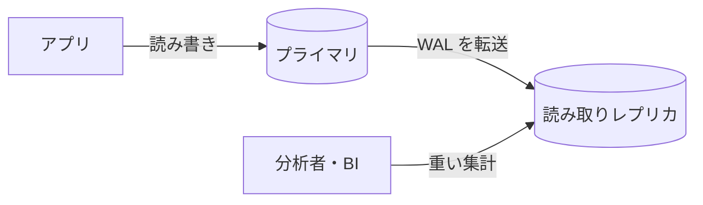

# OLTPとOLAP

[[MOC_データアーキテクチャ体系|📚 目次]] ｜ [[08_データのエンコードとスキーマ進化|← 前へ]] ｜ [[02_列指向ストレージとデータウェアハウス|次へ →]]

> [!abstract] この記事で分かること
> - 業務処理（OLTP）と分析処理（OLAP）が「同じ SQL でも別の競技」である理由
> - アクセスパターン・データ量・応答時間・利用者の 4 つの観点での違い
> - 本番 DB で重い集計を流してはいけない理由（ロック・バッファ汚染・負荷）
> - 読み取りレプリカという「中間解」の良いところと限界
> - アプリ DB → 取り込み → DWH → BI という分析基盤の全体像
>
> **前提**：[[03_ロックとMVCC]] と [[01_データはディスクにどう保存されるか]] を読んでいると理解しやすいです。

## 1. ひとことで言うと

コンビニのレジと、本部の売上分析チームを想像してください。レジは「お客さん 1 人の会計を数秒で終わらせる」ことがすべてで、1 日に何千回も短い処理をこなします。本部の分析チームは「全国 1 万店の過去 3 年分の売上を、地域別・月別に集計する」ような、時間がかかってもよいが巨大な処理をします。もしレジの横で分析担当者が伝票の山を全部ひっくり返し始めたら、レジ待ちの列はどんどん伸びるでしょう。

- **OLTP（Online Transaction Processing／オンライン・トランザクション処理）**：アプリを動かす処理。注文・ログイン・在庫更新など、少数の行を素早く読み書きする。
- **OLAP（Online Analytical Processing／オンライン分析処理）**：意思決定のための処理。大量の行をまとめて読み、集計する。
- 両者は求められる性質が正反対なので、**データの置き場所（と設計）を分ける**のが実務の基本です。

## 2. 業務処理と分析処理は何が違うのか

Shop の例で、典型的なクエリを比べてみます。

```sql
-- OLTP：あるユーザーの注文履歴を表示する（数行だけ読む）
SELECT o.id, o.status, o.ordered_at
FROM orders o
WHERE o.user_id = 42
ORDER BY o.ordered_at DESC
LIMIT 20;

-- OLTP：注文を 1 件確定する（数行だけ書く）
BEGIN;
INSERT INTO orders (user_id) VALUES (42) RETURNING id;   -- 例：id = 1001
INSERT INTO order_items (order_id, product_id, quantity, unit_price)
VALUES (1001, 7, 2, 1980);
UPDATE products SET stock = stock - 2 WHERE id = 7 AND stock >= 2;
COMMIT;
```

```sql
-- OLAP：カテゴリ別・月別の売上（全期間の明細を読む）
SELECT c.name                           AS category,
       date_trunc('month', o.ordered_at) AS month,
       SUM(oi.quantity * oi.unit_price)  AS revenue,
       COUNT(DISTINCT o.user_id)         AS buyers
FROM order_items oi
JOIN orders     o ON o.id = oi.order_id
JOIN products   p ON p.id = oi.product_id
JOIN categories c ON c.id = p.category_id
WHERE o.status = 'paid'
GROUP BY 1, 2
ORDER BY 2, 1;
```

どちらも SQL ですが、性格がまったく違います。

| 観点 | OLTP（業務処理） | OLAP（分析処理） |
|---|---|---|
| アクセスパターン | 主キーやインデックスで **少数の行** を特定して読み書き | **大量の行** をスキャンし、**少数の列** を集計 |
| 読み書きの比率 | 読みも書きも多い（INSERT/UPDATE が日常） | ほぼ読み取り。書き込みは定期的な一括ロード |
| 1 回に触るデータ量 | 数行〜数百行（KB 単位） | 数百万〜数十億行（GB〜TB 単位） |
| 応答時間 | ミリ秒〜数十ミリ秒が必須 | 数秒〜数分でも許容されることが多い |
| 同時実行数 | 非常に多い（ユーザー数に比例） | 少ない（分析者やダッシュボードの数） |
| 利用者 | エンドユーザー（アプリ経由） | 社内のアナリスト・経営層・データサイエンティスト |
| データの鮮度 | 常に最新（今この瞬間の在庫） | 数分〜1 日遅れでもよいことが多い |
| スキーマ設計 | 正規化（更新の矛盾を防ぐ） | 非正規化・スタースキーマ（結合を減らす） |
| 得意な格納方式 | 行指向 | 列指向 |

> [!note] 「行指向／列指向」について
> 最後の行は次回 [[02_列指向ストレージとデータウェアハウス]] で詳しく扱います。ここでは「OLTP は 1 行をまとめて置くのが得意、OLAP は 1 列をまとめて置くのが得意」とだけ覚えてください。

設計の違いについては [[02_正規化]] と [[03_非正規化と実務での判断]] も参照してください。OLTP 側では「同じ情報を 2 か所に持たない」ことで更新の矛盾を防ぎますが、分析側では「毎回 4 テーブルを JOIN するのは遅いし面倒」なので、あえて結合済みの形に崩して持ちます。**1 つの設計で両方を最適にすることは原理的にできない**、というのがポイントです。

## 3. 本番DBで集計してはいけない理由

小さなサービスなら、本番の PostgreSQL に直接集計クエリを投げても問題は起きません。しかしデータが増えると、ある日「月末に経理が集計を回したら注文画面が固まった」という事故が起きます。原因は大きく 3 つあります。

### 3-1. 負荷（CPU・I/O・接続の奪い合い）

上の OLAP クエリは `order_items` を全件読みます。1 億行あれば、ディスクから数十 GB を読み、ハッシュ結合や集計のために CPU とメモリ（`work_mem`）を大量に使います。DB サーバーの資源は OLTP クエリと共有なので、

- ディスク I/O の帯域が埋まり、本来 1ms で返るインデックス検索の待ち時間が伸びる
- CPU が集計に使われ、短いクエリの処理が順番待ちになる
- 集計が並列ワーカーを使うと、さらに多くのコアを占有する

という形で、**関係のないユーザーの注文処理まで遅くなります**。

### 3-2. ロックと長時間トランザクション

PostgreSQL は MVCC（多版型同時実行制御）のおかげで、`SELECT` が `UPDATE` をブロックすることは基本的にありません（[[03_ロックとMVCC]]）。それでも長い集計は次の問題を起こします。

- **VACUUM が進まない**：集計が 1 時間かかると、その間に更新・削除された行の古いバージョンを片付けられません（集計が「古いスナップショット」を見続けているため）。結果としてテーブルやインデックスが膨張（bloat）し、OLTP 全体が遅くなります。
- **DDL が詰まる**：集計中のテーブルに `ALTER TABLE` を流すと、`ALTER` は集計の終了を待ち、その後ろに並んだ通常のクエリまで全部待たされる「ロック待ちの行列」が起きます（[[07_ゼロダウンタイムのスキーマ変更]]）。
- **MySQL（InnoDB）の場合**も、長時間トランザクションが undo ログの purge を止め、似た膨張が起きます。また `INSERT ... SELECT` のように集計結果を書き込む形にすると、読み取り側の行にも共有ロックがかかりやすい点に注意が必要です。

### 3-3. バッファ汚染（キャッシュの追い出し）

DB は、よく使うページをメモリ（PostgreSQL では shared_buffers、InnoDB ではバッファプール）にキャッシュしています。OLTP が速いのは「人気商品や最近の注文」のページがメモリに載っているからです。

そこへ全件スキャンが来ると、**一度しか読まない大量のページがキャッシュに流れ込み、本当に大事なページを追い出してしまいます**。これをバッファ汚染（cache pollution）と呼びます。集計が終わったあと、OLTP クエリはディスクから読み直しになり、しばらく遅いままです。

> [!info] DB 側の防御策
> PostgreSQL は大きなテーブルの順次スキャンや VACUUM などで「バッファアクセス戦略（Buffer Access Strategy）」を使い、小さなリング状のバッファだけを使い回して共有バッファ全体を荒らさないようにしています。ただし OS のページキャッシュや、インデックス経由で大量に読むケースまでは守れないので、「本番で重い集計をしても大丈夫」という意味ではありません。

```
 shared_buffers（メモリ）
 ┌────────────────────────────────────┐
 │ 人気商品 │ 最新注文 │ users索引 │ ... │  ← 通常時：OLTP の熱いページ
 └────────────────────────────────────┘
          ↓ 全期間の order_items をスキャン
 ┌────────────────────────────────────┐
 │ 3年前の明細 │ 2年前の明細 │ ...      │  ← 一度しか読まないページで埋まる
 └────────────────────────────────────┘
          ↓
 注文画面のクエリがディスク読みに戻り、急に遅くなる
```

## 4. 読み取りレプリカという中間解

「本番に負荷をかけたくないなら、コピーで集計すればよい」——これが **読み取りレプリカ（Read Replica）** です。プライマリ DB の WAL（変更ログ）を別サーバーに流し、ほぼリアルタイムに同じ内容を持つ読み取り専用の DB を作ります（仕組みは [[MOC_分散システム体系]] のレプリケーションの回へ）。



**良いところ**
- 本番の CPU・I/O・バッファを守れる（物理的に別サーバー）
- 追加の仕組みがほぼ不要で、同じ SQL がそのまま使える
- データの遅れは数秒程度で、鮮度が高い

**限界**
- **中身は OLTP 用の設計のまま**：行指向・正規化されたテーブルなので、全件集計はやはり遅い。レプリカを速くしてくれるわけではありません。
- **レプリカにも副作用がある**：PostgreSQL のストリーミングレプリケーションでは、レプリカ上の長いクエリとプライマリから届く VACUUM の適用が衝突し、クエリがキャンセルされることがあります（`max_standby_streaming_delay`）。これを避けるために `hot_standby_feedback = on` にすると、今度はプライマリ側の VACUUM が止まり、3-2 の膨張問題がプライマリに戻ってきます。
- **複数のデータソースを結合できない**：注文 DB・会員 DB・広告の CSV・アクセスログを横断した分析はレプリカではできません。
- **履歴が残らない**：OLTP は「今の状態」しか持ちません。商品価格を UPDATE すると、昨日の価格は消えます。分析では「当時の値」が必要になることが多いです。

つまりレプリカは **「小〜中規模での負荷分離」としては正しい解** ですが、データ量や分析の種類が増えてくると、分析専用の置き場が必要になります。

## 5. 分析基盤の全体像

分析専用の置き場が **データウェアハウス（DWH：Data Warehouse）** です。DWH は 1988 年に IBM の研究者が「部門ごとに数字が合わない」という経営課題を解くために提唱した考え方で、ビル・インモンは DWH を「サブジェクト指向・統合・時系列・不揮発（一度入れたら書き換えない）」なデータの集まりと定義しました。DB が「現在の写真」なら、DWH は「すべて残っているフィルム」です。

現代の分析基盤は、だいたい次の形をしています。

```mermaid
flowchart LR
  subgraph 業務システム（OLTP）
    A1[(アプリDB<br>PostgreSQL)]
    A2[(会員DB<br>MySQL)]
    A3[SaaS<br>決済・広告・CRM]
    A4[アクセスログ<br>イベント]
  end
  subgraph 取り込み
    I[バッチ抽出 / CDC<br>Fivetran・Debezium など]
  end
  subgraph 分析基盤（OLAP）
    L[(データレイク<br>S3・GCS)]
    W[(DWH<br>BigQuery・Snowflake など)]
    T[変換<br>dbt]
  end
  subgraph 利用
    B[BI ダッシュボード<br>Looker・Metabase など]
    N[アナリストの SQL<br>・機械学習]
  end
  A1 --> I
  A2 --> I
  A3 --> I
  A4 --> I
  I --> L --> W
  I --> W
  W <--> T
  W --> B
  W --> N
```

| 段 | 役割 | このシリーズでの回 |
|---|---|---|
| 業務システム | データが生まれる場所（OLTP） | 第 1〜34 回 |
| 取り込み（Ingestion） | 本番からデータを抜き出して運ぶ | [[03_ETL・ELTとデータパイプライン]] |
| 置き場 | 列指向の DWH、ファイルを置くデータレイク | [[02_列指向ストレージとデータウェアハウス]]・[[04_データレイクとレイクハウス]] |
| 変換（Transformation） | 汚れを落とし、分析しやすい形に整える | [[03_ETL・ELTとデータパイプライン]] |
| 利用 | BI（Business Intelligence）ツールでの可視化、SQL 分析、機械学習 | — |
| 処理方式 | 1 日 1 回まとめて流すか、流れ続けるデータを即時処理するか | [[05_バッチ処理とストリーム処理]] |

> [!tip] いつ分けるべきか（目安）
> - **数 GB 程度・分析者数人**：本番 DB でも、夜間に軽い集計なら回る。まずはレプリカ。
> - **テーブルが数千万行を超え、集計が分単位になってきた／複数のデータソースを結合したい**：DWH を導入するタイミング。
> - **ノート PC で手早く分析したい**：DuckDB で本番のエクスポート（Parquet）を読むのも有力な選択肢。
>
> 最近は Aurora → Redshift の「ゼロ ETL」統合や、1 つの DB で両方こなす **HTAP（Hybrid Transactional/Analytical Processing）** 製品（TiDB、SingleStore など）もあり、境界は少しずつ溶けています。それでも「OLTP と OLAP は要求が正反対」という原理は変わりません。

## よくある誤解・つまずき

- ❌ 「PostgreSQL は MVCC だから、本番で集計してもロックは起きないので安全」
  ✅ 読み取りが書き込みをブロックしないのは事実ですが、CPU・I/O の奪い合い、バッファ汚染、VACUUM の停止による膨張、DDL のロック待ち行列といった形で本番に影響します。
- ❌ 「読み取りレプリカを作れば分析は速くなる」
  ✅ レプリカは本番を守るための負荷分離であって、データの持ち方は OLTP のままです。全件集計が遅いことは変わりません。
- ❌ 「DWH があれば本番 DB は不要」
  ✅ DWH は 1 行ずつの更新や、書いた直後に正確に読むことが苦手です。注文の受付は OLTP の仕事で、両者は「現在を守る DB」と「過去を積む DWH」という分業です。
- ❌ 「OLAP = OLAP キューブという特定の製品」
  ✅ 昔は事前集計したキューブ（多次元配列）を指すことが多かったのですが、今は列指向 DWH で生の明細を直接集計するのが主流で、OLAP は「分析処理全般」を指す言葉として使われます。

## まとめ

- OLTP は「少数の行を素早く・大量の同時ユーザーで」、OLAP は「大量の行を・少数の列だけ・少数の利用者で」という正反対の処理です。
- 本番 DB での重い集計は、負荷の奪い合い、長時間トランザクションによる膨張やロック待ち、バッファ汚染によって、無関係なユーザーまで遅くします。
- 読み取りレプリカは手軽な負荷分離ですが、OLTP 向けの設計のままで、複数ソースの結合や履歴の保持はできません。
- 規模が大きくなったら、取り込み → DWH（＋レイク）→ 変換 → BI という分析基盤を作り、OLTP と OLAP を分けます。

## 確認クイズ

1. 本番の PostgreSQL で 1 時間かかる集計クエリを毎日流しています。行ロックは発生していないのに、数週間後から OLTP 全体が遅くなってきました。考えられる原因を 1 つ挙げてください。
> [!tip]- 答え
> 長時間のトランザクション（スナップショット）が残っている間は、VACUUM が古い行バージョンを回収できません。テーブルやインデックスが膨張（bloat）し、OLTP のクエリが読むページ数が増えて遅くなります。ほかにバッファ汚染でキャッシュヒット率が下がることも考えられます。

2. 読み取りレプリカで分析するとき、レプリカ側の長いクエリが「canceling statement due to conflict with recovery」で失敗しました。`hot_standby_feedback = on` にすれば解決しますが、どんな副作用がありますか。
> [!tip]- 答え
> レプリカが「この古い行はまだ読んでいる」とプライマリに伝えるため、プライマリ側の VACUUM がその行を回収できなくなります。結果としてプライマリのテーブルが膨張し、本番に影響が戻ってきます。

3. 次のうち、OLAP の特徴として正しいものはどれですか。(a) 主キーで 1 行を取得する (b) 列数の少ない集計で大量の行を読む (c) ミリ秒の応答が必須 (d) 書き込みが多い
> [!tip]- 答え
> (b)。OLAP は少数の列について大量の行を読んで集計します。(a)(c)(d) は OLTP の特徴です。

## 関連ノート

- [[02_列指向ストレージとデータウェアハウス]] — 次回。OLAP が速い理由（列指向）と DWH 製品
- [[03_ロックとMVCC]] — MVCC と VACUUM、長時間トランザクションの影響
- [[03_非正規化と実務での判断]] — 分析のためにあえて崩す設計
- [[05_実行計画の読み方]] — 集計クエリがなぜ重いかを実行計画で確かめる
- [[MOC_分散システム体系]] — 読み取りレプリカとレプリケーションの仕組み
- [[OLAP、OLTPの仕組み]] — クリップ：行指向と列指向の並べ方の違いを短く解説（YouTube ショート）
- [[本番DBで集計してはいけない理由]] — クリップ：月末集計の事故から DWH の誕生、Snowflake までの歴史

## 参考

- [PostgreSQL Documentation: Glossary（Buffer Access Strategy）](https://www.postgresql.org/docs/current/glossary.html)
- [PostgreSQL Documentation: Hot Standby（Handling Query Conflicts）](https://www.postgresql.org/docs/current/hot-standby.html#HOT-STANDBY-CONFLICT)
- [PostgreSQL Documentation: Routine Vacuuming](https://www.postgresql.org/docs/current/routine-vacuuming.html)
- Martin Kleppmann, Chris Riccomini『Designing Data-Intensive Applications, 2nd Edition』O'Reilly, 2026（OLTP と分析システムの比較）
