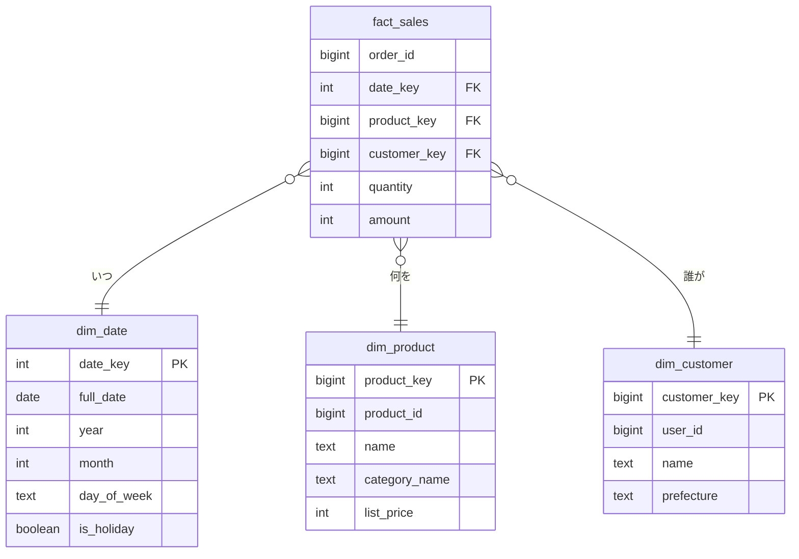

# 列指向ストレージとデータウェアハウス

[[MOC_データアーキテクチャ体系|📚 目次]] ｜ [[01_OLTPとOLAP|← 前へ]] ｜ [[03_ETL・ELTとデータパイプライン|次へ →]]

> [!abstract] この記事で分かること
> - 行指向と列指向で、ディスク上のデータの並び方がどう違うか
> - 列指向が集計に強い 3 つの理由（必要な列だけ読む・圧縮・ベクトル化実行）
> - 分析データの標準ファイル形式 Parquet の中身
> - DWH の定番設計「スタースキーマ」（ファクトとディメンション）
> - BigQuery / Snowflake / Redshift / ClickHouse / DuckDB の特徴と課金モデル
>
> **前提**：[[01_OLTPとOLAP]] と [[01_データはディスクにどう保存されるか]] を読んでいると理解しやすいです。

## 1. ひとことで言うと

学校の名簿を想像してください。1 人 1 枚の「個人カード」（名前・クラス・身長・体重）を束ねておけば、「山田さんの情報を全部見せて」には 1 枚めくるだけで答えられます。これが **行指向** です。一方「全校生徒の平均身長は？」と聞かれたら、全員のカードを 1 枚ずつめくって身長欄だけを拾うことになり、大変です。最初から「身長だけを並べた 1 枚の表」を作っておけば、その表を上から読むだけで済みます。これが **列指向** です。

- **行指向（Row-oriented）**：1 行のすべての列を隣り合わせに保存する。1 行の読み書きが速い → OLTP 向き。
- **列指向（Column-oriented / Columnar）**：1 列の値をまとめて保存する。少数の列を大量の行にわたって読むのが速い → OLAP 向き。
- 列指向のストレージを中心に、分析専用に作られた DB が **データウェアハウス（DWH）** です。

## 2. 行指向と列指向の格納イメージ

Shop の `orders` を、分析しやすいように明細と結合した「売上明細」テーブルで考えます。

| order_id | ordered_at | user_id | category | quantity | amount |
|---|---|---|---|---|---|
| 1 | 2026-10-01 | 42 | 本 | 1 | 1980 |
| 2 | 2026-10-01 | 7 | 家電 | 1 | 29800 |
| 3 | 2026-10-01 | 42 | 本 | 2 | 3960 |
| 4 | 2026-10-02 | 13 | 本 | 1 | 1200 |

```
【行指向】ページ（8KB など）の中に、行がまるごと順番に並ぶ
 ページ1: [1|2026-10-01|42|本|1|1980] [2|2026-10-01|7|家電|1|29800] [3|...] ...
 ページ2: [4|2026-10-02|13|本|1|1200] ...

 SELECT SUM(amount) を計算するには、
 order_id も ordered_at も category も一緒に全部読まされる

【列指向】列ごとに別々の領域（ファイル・ブロック）に並ぶ
 order_id   : 1, 2, 3, 4, ...
 ordered_at : 2026-10-01, 2026-10-01, 2026-10-01, 2026-10-02, ...
 user_id    : 42, 7, 42, 13, ...
 category   : 本, 家電, 本, 本, ...
 quantity   : 1, 1, 2, 1, ...
 amount     : 1980, 29800, 3960, 1200, ...   ← SUM(amount) はここだけ読めばよい

 「i 番目の値どうしが同じ行」という約束で、行を復元できる
```

列が 50 本ある幅広いテーブルで 2 列だけを集計するなら、列指向は理屈の上で読む量が約 1/25 になります。分析クエリは「多数の列のうち少数だけを使う」ことがほとんどなので、これが効きます。

逆に、列指向で **1 行を追加・更新する** には、50 個の列領域それぞれに書き込む必要があります。そのため列指向 DB は、1 行ずつの INSERT/UPDATE が苦手で、**まとめて一括ロード** する使い方が前提です（多くの製品はメモリ上の行形式バッファに貯めてから列形式に書き出します。この発想は [[02_B-TreeとLSM-Tree]] の LSM-Tree に似ています）。

## 3. 列指向が速い理由：読む量・圧縮・ベクトル化

### 3-1. 必要な列だけ読む（射影のプッシュダウン）

上で見たとおりです。ディスクやネットワークから読む量そのものが減るので、もっとも効果が大きい要素です。BigQuery が「読んだ列のバイト数」で課金するのも、この性質をそのまま料金にしたものです。

### 3-2. 圧縮がよく効く

同じ列には同じ型・似た値が並ぶため、圧縮率が非常に高くなります。代表的な手法は次のとおりです。

| 手法 | 仕組み | 効く列の例 |
|---|---|---|
| 辞書エンコーディング（Dictionary） | 文字列を小さな整数 ID に置き換える（本=0, 家電=1） | category, status |
| ランレングス（RLE：Run-Length Encoding） | 連続する同じ値を「値 × 個数」にまとめる | 並べ替え済みの日付 |
| ビットマップ | 値ごとに「どの行がその値か」を 0/1 で持つ | 種類の少ない列 |
| 差分（Delta） | 前の値との差だけを持つ | 増え続ける ID・時刻 |

```
category（辞書化）: 本,家電,本,本  → 辞書 {0:本,1:家電}、値 0,1,0,0
ordered_at（並べ替え後にRLE）: 10-01,10-01,10-01,10-02 → (10-01×3),(10-02×1)
```

圧縮すると読む量がさらに減り、CPU キャッシュにも多くの値が載ります。製品によっては **圧縮したまま** 集計できます（RLE なら「1980 × 3 件」を展開せずに掛け算で済む）。

### 3-3. ベクトル化実行

PostgreSQL のような従来型の DB は、基本的に「1 行取り出して処理し、次の 1 行へ」という **1 行ずつ（tuple-at-a-time）** の実行モデルです。列指向エンジンは、1 列の値を数千個まとめた **ベクトル（バッチ）** 単位で演算します。

- 関数呼び出しや分岐の回数が数千分の 1 になる
- 同じ型の値が連続しているので、CPU の SIMD 命令（1 命令で複数の値を同時に計算）が使える
- CPU キャッシュに乗ったまま処理が進む

これを **ベクトル化実行（Vectorized Execution）** と呼び、DuckDB・ClickHouse・Snowflake などの現代的な分析エンジンはほぼすべて採用しています。

> [!note] ソートキー／クラスタリング
> 列指向 DWH では「どの順番で行を並べて保存するか」も重要です。日付で並べておけば、`WHERE ordered_at >= '2026-10-01'` のときに各ブロックの最小値・最大値を見て、範囲外のブロックを丸ごと読み飛ばせます（ゾーンマップ／データスキッピング）。インデックスとは違う、分析向けの絞り込みの仕組みです。BigQuery ではパーティション＋クラスタリング、Redshift ではソートキー、ClickHouse では `ORDER BY`（主キー）として指定します。

## 4. Parquet：分析データの共通フォーマット

**Apache Parquet** は、列指向のデータを 1 つのファイルに保存するためのオープンなファイル形式です。CSV の「分析向け上位互換」と思ってください。ほぼすべての DWH・Spark・pandas・DuckDB が読み書きでき、次回以降のデータレイクでも主役になります。

```
orders.parquet
┌──────────────────────────────────────┐
│ "PAR1"（マジックナンバー）              │
│ ┌ 行グループ 1（例：約 100 万行）──────┐ │
│ │ 列チャンク order_id   [ページ…]      │ │
│ │ 列チャンク ordered_at [ページ…]      │ │
│ │ 列チャンク amount     [ページ…]      │ │
│ └────────────────────────────────────┘ │
│ ┌ 行グループ 2 ──────────────────────┐ │
│ │ ...                                  │ │
│ └────────────────────────────────────┘ │
│ フッター：スキーマ、各列チャンクの位置、  │
│           最小値・最大値などの統計情報    │
│ フッター長 + "PAR1"                      │
└──────────────────────────────────────┘
```

- **行グループ（Row Group）** で行をいくつかの塊に分け、その中で **列チャンク（Column Chunk）** ごとに列指向で格納します。
- **フッター** にスキーマと統計情報があり、読み手はまずフッターを読んで「必要な列」「条件に合う可能性のある行グループ」だけを読みに行きます。
- 型情報を持つので、CSV のように「数字が文字列として読まれる」問題が起きません。スキーマ進化（列の追加など）については [[08_データのエンコードとスキーマ進化]] も参照してください。

DuckDB を使うと、本番 DB からエクスポートした Parquet をノート PC 上で SQL 集計できます（以下は DuckDB の構文です。PostgreSQL 単体では Parquet を直接読めません）。

```sql
-- DuckDB：Parquet ファイルを直接クエリする
SELECT category,
       date_trunc('month', ordered_at) AS month,
       SUM(amount) AS revenue
FROM 'sales_*.parquet'          -- ワイルドカードで複数ファイルをまとめて読める
WHERE ordered_at >= DATE '2026-01-01'
GROUP BY ALL
ORDER BY month, category;

-- DuckDB：クエリ結果を Parquet に書き出す
COPY (SELECT * FROM 'sales_*.parquet' WHERE category = '本')
TO 'books.parquet' (FORMAT parquet);
```

## 5. スタースキーマ：ファクトとディメンション

DWH の中のテーブル設計で最も定番なのが、ラルフ・キンボールが広めた **スタースキーマ（Star Schema）** です。中心に「出来事」を記録する **ファクトテーブル**、周りに「出来事を説明する属性」を持つ **ディメンションテーブル** を置きます。図にすると星形になるのが名前の由来です。

- **ファクトテーブル（Fact Table）**：1 行 = 1 つの出来事（注文明細 1 件、ページビュー 1 回）。数値の **指標（メジャー）**（数量・金額）と、ディメンションへの外部キーを持つ。行数が非常に多い。
- **ディメンションテーブル（Dimension Table）**：「誰が・何を・いつ・どこで」を表す。商品・顧客・日付・店舗など。行数は比較的少なく、列（属性）が多い。



PostgreSQL で書くと次のようになります（DWH 製品でもほぼ同じ SQL です）。

```sql
CREATE TABLE dim_date (
  date_key    INTEGER PRIMARY KEY,       -- 20261001 のような整数
  full_date   DATE NOT NULL UNIQUE,
  year        INTEGER NOT NULL,
  month       INTEGER NOT NULL,
  day_of_week TEXT NOT NULL,
  is_holiday  BOOLEAN NOT NULL DEFAULT false
);

CREATE TABLE dim_product (
  product_key   BIGSERIAL PRIMARY KEY,   -- DWH 側で振る代理キー
  product_id    BIGINT NOT NULL,         -- 元の products.id（自然キー）
  name          TEXT NOT NULL,
  category_name TEXT,                    -- categories を結合済み（非正規化）
  list_price    INTEGER NOT NULL
);

CREATE TABLE fact_sales (
  order_id     BIGINT NOT NULL,
  date_key     INTEGER NOT NULL REFERENCES dim_date(date_key),
  product_key  BIGINT  NOT NULL REFERENCES dim_product(product_key),
  user_id      BIGINT  NOT NULL,
  quantity     INTEGER NOT NULL,
  amount       INTEGER NOT NULL          -- quantity * unit_price
);

-- 典型的な分析クエリ：JOIN はファクトから各ディメンションへの 1 段だけ
SELECT d.year, d.month, p.category_name, SUM(f.amount) AS revenue
FROM fact_sales f
JOIN dim_date    d ON d.date_key    = f.date_key
JOIN dim_product p ON p.product_key = f.product_key
WHERE d.is_holiday
GROUP BY d.year, d.month, p.category_name
ORDER BY d.year, d.month;
```

ポイントは次のとおりです。

- **ディメンションは非正規化する**：`dim_product` は `categories` を結合済みで持ちます。OLTP では避けた重複を、分析の分かりやすさと速さのために受け入れます（[[03_非正規化と実務での判断]]）。ディメンションをさらに正規化して枝分かれさせた形は **スノーフレークスキーマ** と呼びます（製品の Snowflake とは別物）。
- **日付ディメンション** を作ると、「祝日だけ」「第 2 四半期」などの条件が `date_trunc` の計算なしに書けます。
- **緩やかに変化するディメンション（SCD：Slowly Changing Dimension）**：商品の価格やユーザーの住所が変わったとき、上書きする（Type 1）か、新しい行を追加して有効期間を持たせ履歴を残す（Type 2）かを決めます。「当時の住所で集計したい」なら Type 2 です。代理キー `product_key` を元の ID と別に振るのはこのためです。
- 実際の DWH 製品の多くは **外部キー制約を強制しません**（宣言はできても検証しない）。整合性はロード処理側で保証します。
- 最近は、ディメンションを全部結合済みにした **1 枚の幅広いテーブル（OBT：One Big Table）** を作る流儀もあります。列指向なら使わない列は読まれないので、幅の広さがあまり問題にならないためです。

## 6. 主要なDWHと課金モデル

| 製品 | 形態 | 特徴 | 課金モデル（概要） |
|---|---|---|---|
| **BigQuery**（Google Cloud） | フルマネージド・サーバーレス | クラスタの概念がなく、SQL を投げるだけ。Dremel 論文由来の大規模並列実行。 | **オンデマンド**：スキャンしたデータ量（読んだ列のバイト数）に課金。2026 年 10 月時点で 1 TiB あたり $6.25、毎月 1 TiB まで無料。**容量課金（Editions）**：スロット（計算資源）時間で課金。ストレージは別料金。 |
| **Snowflake** | マネージド（AWS/Azure/GCP 上） | **ストレージとコンピュートの分離** の代表。データは 1 か所に置き、用途ごとに独立した「仮想ウェアハウス」（計算クラスタ）を起動できる。 | ウェアハウスの稼働時間をクレジットで課金。サイズが 1 段上がるごとに 1 時間あたりのクレジットが倍（X-Small = 1、Small = 2 …）。秒単位課金だが起動ごとに最低 60 秒。自動停止（auto-suspend）が重要。ストレージは圧縮後の容量で月額。 |
| **Amazon Redshift** | マネージド（AWS） | PostgreSQL 由来の SQL 方言。AWS のサービスとの統合が強い。Aurora からの「ゼロ ETL」統合もある。 | **プロビジョンド**：ノード × 稼働時間。**Serverless**：使った RPU（Redshift Processing Unit）時間で課金、秒単位・最低 60 秒、アイドル中は無料。 |
| **ClickHouse** | OSS（セルフホスト）／ClickHouse Cloud | 非常に高速な列指向 DB。MergeTree エンジンでの大量 INSERT と、ログ・イベントのリアルタイム集計に強い。 | OSS は無料（サーバー代のみ）。Cloud はコンピュートとストレージの使用量課金。 |
| **DuckDB** | OSS・**組み込み型**（SQLite の分析版） | サーバー不要。アプリやノート PC のプロセス内で動き、Parquet/CSV を直接クエリできる。1 台に収まる規模（数百 GB 程度まで）なら驚くほど速い。 | 無料（MIT ライセンス）。マネージド版として MotherDuck がある。 |

> [!warning] 料金は変わります
> 上記は執筆時点で公式ページを確認した概要です。リージョンやエディションで単価が異なり、改定もあるので、導入時は必ず各社の料金ページで確認してください。

課金モデルの違いは、そのまま **運用で気をつける点** の違いになります。

- **スキャン量課金（BigQuery オンデマンド）**：`SELECT *` は全列を読むので高くつきます。必要な列だけ書く、パーティション（日付など）で絞る、が鉄則です。`LIMIT` を付けてもスキャン量は減らない点に注意してください（読んだ後に件数を絞るため）。
- **稼働時間課金（Snowflake、Redshift）**：クエリが軽くても、ウェアハウスを動かしっぱなしにすると課金が続きます。自動停止の設定と、用途ごとのサイズ選びが重要です。
- **セルフホスト（ClickHouse OSS、DuckDB）**：料金は安いですが、運用（バックアップ・拡張）は自分で行います。

**選び方の目安**

- まず手元で試したい・データが数十 GB 以下 → **DuckDB**
- 運用をほぼゼロにしたい・利用頻度が不規則 → **BigQuery**
- 部署ごとに計算資源を分けたい・マルチクラウド → **Snowflake**
- AWS 中心のシステム → **Redshift**
- ログやイベントを秒単位で集計してダッシュボードに出したい → **ClickHouse**

## よくある誤解・つまずき

- ❌ 「列指向は行指向より常に速い」
  ✅ 列指向が速いのは「少数の列 × 大量の行」の読み取りです。1 行をまるごと読む・1 行ずつ更新する処理は行指向のほうが圧倒的に速いので、注文処理を DWH に置き換えてはいけません。
- ❌ 「BigQuery で `LIMIT 10` を付ければ安くなる」
  ✅ オンデマンド課金は読んだ列のデータ量で決まり、`LIMIT` では減りません。列を絞る・パーティションで絞るのが正解です。
- ❌ 「DWH にもインデックスを貼れば速くなる」
  ✅ 多くの列指向 DWH には B-Tree のようなインデックスはなく、パーティション・ソートキー（クラスタリング）・ゾーンマップでブロックを読み飛ばす方式です。設計の発想が違います。
- ❌ 「スタースキーマは正規化をやめた悪い設計」
  ✅ 分析の分かりやすさと速さのための、意図的な非正規化です。ファクトは正規化された粒度（1 行 1 出来事）を守り、ディメンションだけを崩しています。

## まとめ

- 行指向は 1 行をまとめて、列指向は 1 列をまとめて保存します。分析は少数の列を大量の行で使うので列指向が有利です。
- 列指向の強みは「必要な列だけ読む」「圧縮が効く」「ベクトル化実行で CPU を効率よく使う」の 3 つです。
- Parquet は列指向データの標準ファイル形式で、フッターの統計情報で不要な部分を読み飛ばせます。
- DWH の定番設計はファクトとディメンションからなるスタースキーマです。
- DWH 製品は課金モデルが違い（スキャン量・稼働時間・セルフホスト）、それが運用上の注意点を決めます。

## 確認クイズ

1. 列が 40 本ある `events` テーブル（10 億行）で、`SELECT event_type, COUNT(*) FROM events GROUP BY event_type` を実行します。行指向と列指向で、ディスクから読む量はおおよそどう違いますか。
> [!tip]- 答え
> 行指向は 40 列すべてを含むページを読むので、テーブル全体を読みます。列指向は `event_type` の 1 列だけを読めばよく、さらに種類の少ない列は辞書・RLE 圧縮がよく効くため、読む量は全体の数十分の 1 以下になります。

2. 商品の価格が 1980 円から 2200 円に変わりました。「値上げ前に買った人の売上」を当時の価格で分析したい場合、`dim_product` をどう設計しますか。
> [!tip]- 答え
> SCD Type 2 にします。価格変更時に既存行を上書きせず、新しい行（新しい `product_key`）を追加し、`valid_from` / `valid_to` のような有効期間列を持たせます。ファクトは購入時点の `product_key` を指すので、当時の属性で集計できます。

3. BigQuery のオンデマンド課金で、コストを下げるために効果のある対策を 2 つ挙げてください。
> [!tip]- 答え
> (1) `SELECT *` をやめて必要な列だけ指定する、(2) テーブルを日付でパーティション分割し、`WHERE` でパーティションを絞る。ほかにクラスタリングの設定、集計済みテーブルの作成なども有効です。`LIMIT` は効果がありません。

## 関連ノート

- [[01_OLTPとOLAP]] — 前回。分析を本番から分ける理由
- [[03_ETL・ELTとデータパイプライン]] — 次回。DWH にデータを運び、整える方法
- [[04_データレイクとレイクハウス]] — Parquet をオブジェクトストレージに置く設計
- [[02_B-TreeとLSM-Tree]] — 書き込みをまとめてから書き出す発想の比較
- [[03_非正規化と実務での判断]] — スタースキーマの非正規化の考え方
- [[04_集約とウィンドウ関数]] — 分析 SQL の基本
- [[OLAP、OLTPの仕組み]] — クリップ：行指向と列指向の並べ方を図で解説
- [[本番DBで集計してはいけない理由]] — クリップ：列指向 DWH（C-Store、Snowflake）の歴史

## 参考

- [Apache Parquet: File Format](https://parquet.apache.org/docs/file-format/)
- [BigQuery pricing](https://cloud.google.com/bigquery/pricing)
- [Snowflake Documentation: Overview of warehouses](https://docs.snowflake.com/en/user-guide/warehouses-overview)
- [Amazon Redshift pricing](https://aws.amazon.com/redshift/pricing/)
- [DuckDB Documentation: Reading and Writing Parquet Files](https://duckdb.org/docs/current/data/parquet/overview.html)
- [ClickHouse Documentation: MergeTree](https://clickhouse.com/docs/engines/table-engines/mergetree-family/mergetree)
