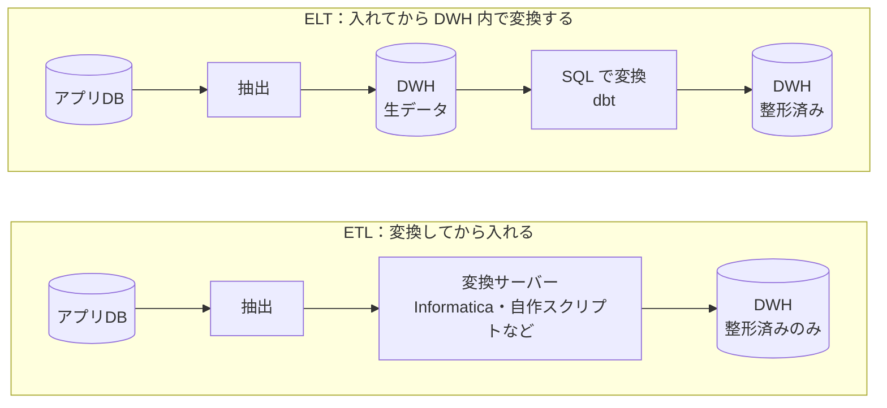
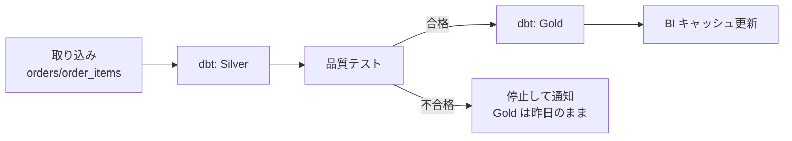

# ETL・ELTとデータパイプライン

[[MOC_データアーキテクチャ体系|📚 目次]] ｜ [[02_列指向ストレージとデータウェアハウス|← 前へ]] ｜ [[04_データレイクとレイクハウス|次へ →]]

> [!abstract] この記事で分かること
> - データパイプラインの 3 段（取り込み・変換・置き場）と、ETL と ELT の違い
> - 取り込みの 2 方式：バッチ抽出（増分）と CDC（Debezium）
> - dbt による SQL モデルでの変換と、メダリオン（Bronze / Silver / Gold）構成
> - Airflow・Dagster によるオーケストレーション
> - 「流し直しても壊れない」冪等な作りとデータ品質テスト、Reverse ETL
>
> **前提**：[[01_OLTPとOLAP]] と [[01_トランザクションとACID]] を読んでいると理解しやすいです。

## 1. ひとことで言うと

浄水場を思い浮かべてください。川（アプリ DB）から水を引き込み（取り込み）、ゴミを取り除いて消毒し（変換）、貯水池に貯めて（置き場）、各家庭の蛇口（BI ダッシュボード）に届けます。どこかで濁った水が混ざると、蛇口から出る水すべてが信用できなくなります。

**データパイプライン（Data Pipeline）** は、業務システムのデータを分析できる場所へ運び、使える形に整える一連の仕組みです。

- 骨組みは **取り込み（Extract / Ingest）→ 変換（Transform）→ 置き場への書き込み（Load）**。
- 変換を DWH に入れる **前** にやるのが **ETL**、入れた **後** に DWH の中でやるのが **ELT**。現代は ELT が主流です。
- 実務で一番大事なのは、**途中で落ちて流し直しても数字が壊れない（冪等な）作り** と、**おかしな数字を出さないための関門（テスト）** です。

## 2. ETL と ELT



| 観点 | ETL | ELT |
|---|---|---|
| 変換する場所 | DWH の手前の専用サーバー | DWH の中（SQL） |
| 生データ | 残らないことが多い | DWH に残る（後から作り直せる） |
| 計算資源 | 変換サーバーの性能に制約される | DWH のスケールする計算資源を使える |
| 変換を書く人 | データエンジニア（専用ツール・コード） | SQL が書ければアナリストも書ける |
| 向いている場面 | 個人情報を DWH に入れる前に必ず落としたい、DWH が高価だった時代 | クラウド DWH が前提の現在 |

ELT が主流になった理由は、クラウド DWH でストレージが安くなり、計算資源もいくらでも借りられるようになったからです。**生データをまず全部入れておけば、変換ロジックにバグがあっても DWH の中で作り直せます**。ETL では、変換で捨てた情報は取り戻せません。

ただし、個人情報（メールアドレスなど）のマスキングのように「DWH に入れる前に必ずやるべき変換」は、ELT でも取り込み時に行います。現実には両者の混合です。

## 3. 取り込み：バッチ抽出と CDC

### 3-1. バッチ抽出（全件・増分）

一定間隔（毎晩、毎時）で本番 DB に SELECT を投げて、結果を運ぶ方式です。

- **全件抽出（Full Extract）**：毎回テーブル全体を運ぶ。単純で確実だが、データが増えると終わらなくなる。マスタ系の小さなテーブル向き。
- **増分抽出（Incremental Extract）**：前回運んだところから続きだけを運ぶ。「前回どこまで運んだか」を本のしおりのように記録しておき（ウォーターマーク／カーソル）、次はそこから読む。

増分抽出には「いつ更新されたか」を示す列が必要です。Shop の `orders` に `updated_at` を足して考えます。

```sql
-- 増分抽出用に更新時刻を持たせる（アプリ側 or トリガーで更新）
ALTER TABLE orders ADD COLUMN updated_at TIMESTAMPTZ NOT NULL DEFAULT now();
CREATE INDEX idx_orders_updated_at ON orders (updated_at);

CREATE OR REPLACE FUNCTION set_updated_at() RETURNS trigger AS $$
BEGIN
  NEW.updated_at := now();
  RETURN NEW;
END;
$$ LANGUAGE plpgsql;

CREATE TRIGGER trg_orders_updated_at
BEFORE UPDATE ON orders
FOR EACH ROW EXECUTE FUNCTION set_updated_at();

-- 抽出クエリ：前回のしおり（:last_watermark）以降に変わった行
SELECT id, user_id, status, ordered_at, updated_at
FROM orders
WHERE updated_at >  :last_watermark
  AND updated_at <= :this_run_started_at   -- 上限を固定し、次回のしおりにする
ORDER BY updated_at;
```

> [!warning] 増分抽出の落とし穴
> - **作成時刻ではなく更新時刻で見る**：注文がキャンセルされた（status が変わった）行も運ぶ必要があるため。
> - **物理削除（DELETE）は検出できない**：消えた行は `WHERE` に引っかかりません。論理削除（`deleted_at` 列）にするか、CDC を使います。
> - **コミットの遅れ**：`now()` はトランザクション開始時刻です。長いトランザクションが「しおりより前の時刻」で後からコミットされると、取りこぼします。少し前に重ねて（例：しおりの 5 分前から）読み、取り込み側で重複を除くのが定石です。

### 3-2. CDC（変更データキャプチャ）

**CDC（Change Data Capture／変更データキャプチャ）** は、DB の変更ログ（PostgreSQL の WAL、MySQL の binlog）を読んで、INSERT・UPDATE・DELETE を 1 件ずつイベントとして流す方式です（WAL については [[05_WALとクラッシュリカバリ]]）。

代表的な OSS が **Debezium** です。PostgreSQL の場合は **論理デコーディング（logical decoding）** と組み込みの `pgoutput` プラグインを使い、レプリケーションスロットから変更を読み取って Kafka などに流します。初回は既存データのスナップショットを取り、その時点の WAL 位置から変更の追跡を始めるので、取りこぼしが起きません。

```
 orders テーブルへの操作        Debezium が出すイベント（簡略化）
 INSERT id=1001             → {op:"c", after:{id:1001,status:"pending"}}
 UPDATE id=1001 status=paid → {op:"u", before:{...}, after:{id:1001,status:"paid"}}
 DELETE id=1001             → {op:"d", before:{id:1001,...}}
```

| 観点 | バッチ増分抽出 | CDC |
|---|---|---|
| 遅れ | 実行間隔ぶん（時間〜1 日） | 秒単位 |
| 削除の検出 | できない（論理削除が必要） | できる |
| 本番への負荷 | 抽出時に SELECT の負荷 | ログを読むだけで軽い |
| 運用の難しさ | 低い | 高い（スロット管理、Kafka など） |
| 中間の変更 | 最後の状態しか分からない | すべての変更が分かる |

> [!caution] レプリケーションスロットの放置に注意
> PostgreSQL で CDC を使うには `wal_level = logical` が必要です。また、Debezium が止まったままだとスロットが「まだ読んでいない WAL」を保持し続け、本番のディスクが WAL で埋まります。スロットの遅れは必ず監視してください。

実務では、Fivetran・Airbyte のような **マネージドの取り込みサービス** を使い、数百種類の SaaS や DB からのコネクタを買ってくることも多いです。

## 4. 変換：dbt と メダリオン構成

### 4-1. dbt：SELECT 文を「モデル」として管理する

**dbt（data build tool）** は、ELT の「T」を担うツールです。変換を **SELECT 文 1 つ = 1 モデル（1 テーブル／ビュー）** として書き、dbt がそれを DWH 上で `CREATE TABLE AS` などに変換して実行します。

```sql
-- models/silver/stg_orders.sql：生データを整える
SELECT
  id                                  AS order_id,
  user_id,
  lower(trim(status))                 AS status,       -- 表記ゆれをそろえる
  ordered_at AT TIME ZONE 'Asia/Tokyo' AS ordered_at_jst -- 1 日の区切りを JST に統一
FROM {{ source('shop', 'orders') }}
WHERE user_id NOT IN (SELECT id FROM {{ ref('internal_test_users') }})  -- 社内テスト注文を除外
```

```sql
-- models/gold/fct_daily_sales.sql：日次売上（incremental モデル）
{{ config(materialized='incremental', unique_key='sales_date') }}

SELECT
  o.ordered_at_jst::date            AS sales_date,
  COUNT(DISTINCT o.order_id)        AS orders,
  SUM(oi.quantity * oi.unit_price)  AS revenue
FROM {{ ref('stg_orders') }}      o
JOIN {{ ref('stg_order_items') }} oi ON oi.order_id = o.order_id
WHERE o.status = 'paid'

  -- 遅れて届くデータを拾うため、直近 3 日を毎回作り直す
  AND o.ordered_at_jst >= (SELECT MAX(sales_date) FROM {{ this }}) - INTERVAL '3 days'

GROUP BY 1
```

- `{{ ref('...') }}` で他のモデルを参照すると、dbt が **依存関係の DAG（有向非巡回グラフ）** を自動で組み、正しい順番で実行します。
- `materialized` で、ビュー・テーブル・増分（incremental）などの作り方を選べます。`unique_key` を指定すると、同じキーの行は追加ではなく置き換え（マージ）になります。
- SQL を Git で管理し、レビューし、テストできる——つまり **変換をソフトウェア開発と同じやり方で扱える** のが dbt の価値です。

### 4-2. メダリオン構成（Bronze / Silver / Gold）

変換を段階に分けて、どこまで整ったデータかを名前で分かるようにする設計を **メダリオンアーキテクチャ（Medallion Architecture）** と呼びます（Databricks が広めた呼び方。staging / intermediate / marts と呼ぶ流儀もあります）。

| 層 | 中身 | 例 | 利用者 |
|---|---|---|---|
| **Bronze（生）** | 取り込んだままのデータ。加工しない。 | `raw_shop.orders`（CDC イベントそのまま） | データエンジニア |
| **Silver（整形）** | 型・表記・タイムゾーンをそろえ、重複・テストデータを除いたもの。 | `stg_orders`、`stg_order_items` | データエンジニア・アナリスト |
| **Gold（集計・業務用）** | ビジネスの問いに答える形。スタースキーマや集計表。 | `fct_sales`、`dim_product`、`fct_daily_sales` | BI・経営層 |

Bronze を残しておけば、Silver 以降のロジックを直したときに **最初から作り直せます**。これが ELT の大きな利点です。

## 5. オーケストレーションと冪等性

### 5-1. オーケストレーション：誰が・いつ・どの順で動かすか

取り込み → dbt → ダッシュボード更新を、毎晩正しい順番で動かし、失敗したら再試行し、担当者に通知する役割を **オーケストレーター（Orchestrator）** が担います。

- **Apache Airflow**：最も普及しているオーケストレーター。Python で **DAG（タスクの依存関係のグラフ）** を書き、スケジュール実行・再試行・過去日付の再実行（バックフィル）ができる。「タスク（処理）」を中心に考える。
- **Dagster**：「どのデータ資産（テーブル）をどの資産から作るか」を中心に考える **アセット指向** のオーケストレーター。dbt のモデルをそのまま資産として扱え、データの鮮度や系譜（リネージ）を見やすい。



### 5-2. 冪等性：何度流しても同じ結果

パイプラインは必ず途中で落ちます（メモリ不足、ネットワーク切断、上流の遅延）。そして必ず流し直します。このとき **何回実行しても 1 回実行したのと同じ結果になる性質** を **冪等性（Idempotency）** と呼びます。

足し込むだけの書き方は冪等ではありません。

```sql
-- 集計結果の置き場（例として主キーを付けない形で作る）
CREATE TABLE daily_sales (
  sales_date DATE    NOT NULL,
  orders     BIGINT  NOT NULL,
  revenue    BIGINT  NOT NULL
);

-- ❌ 2 回流すと 10/01 の行が 2 つになる（二重計上）
INSERT INTO daily_sales (sales_date, orders, revenue)
SELECT o.ordered_at::date, COUNT(DISTINCT o.id), SUM(oi.quantity * oi.unit_price)
FROM orders o JOIN order_items oi ON oi.order_id = o.id
WHERE o.ordered_at >= '2026-10-01' AND o.ordered_at < '2026-10-02'
  AND o.status = 'paid'
GROUP BY 1;
```

対象期間（パーティション）を **丸ごと消して入れ直す** 処理を、1 つのトランザクションにまとめると冪等になります。

```sql
-- ✅ 何度流しても 10/01 の行は正しく 1 つ
BEGIN;
DELETE FROM daily_sales WHERE sales_date = DATE '2026-10-01';
INSERT INTO daily_sales (sales_date, orders, revenue)
SELECT o.ordered_at::date, COUNT(DISTINCT o.id), SUM(oi.quantity * oi.unit_price)
FROM orders o JOIN order_items oi ON oi.order_id = o.id
WHERE o.ordered_at >= '2026-10-01' AND o.ordered_at < '2026-10-02'
  AND o.status = 'paid'
GROUP BY 1;
COMMIT;
```

途中で落ちれば `DELETE` もなかったことになるので、「空っぽの日」も見えません（[[01_トランザクションとACID]] の原子性）。主キーがある表なら `INSERT ... ON CONFLICT (sales_date) DO UPDATE`（MySQL では `INSERT ... ON DUPLICATE KEY UPDATE`）や `MERGE` でも冪等にできます。DWH 製品によってはパーティションを丸ごと上書きする命令もあります。

冪等にしておくと、次のような運用が安心してできます。

- **遅れて届くデータ** を拾うため、毎晩「直近 3 日分」を流し直す
- バグ修正後に、過去 1 年分をバックフィル（再計算）する

> [!tip] 「1 日」をどの時計で区切るか
> サーバーの時刻は UTC で記録されていることが多く、日本時間（JST）とは 9 時間ずれます。UTC で日付を切ると、日本の 0〜9 時の注文が前日に入ります。エラーは出ず数字が静かにずれるだけなので、**どのタイムゾーンで 1 日を区切るか** を最初に決めて明記してください。

### 5-3. データ品質テスト：段と段の間に関門を置く

アプリ側で列名が変わった、取り込みが半分で止まった——そんなときに、おかしな数字をそのまま Gold まで流すのが最悪のパターンです。**間違った数字を出すより、遅れるほうがまし** です。dbt では YAML でテストを宣言できます。

```yaml
# models/silver/schema.yml
models:
  - name: stg_orders
    columns:
      - name: order_id
        tests: [unique, not_null]          # 重複・欠損がないか
      - name: status
        tests:
          - accepted_values:
              values: ['pending', 'paid', 'shipped', 'cancelled']
      - name: user_id
        tests:
          - relationships:                 # 参照先が存在するか
              to: ref('stg_users')
              field: user_id
```

ほかにも「件数が先週の同じ曜日より極端に少なくないか（ボリュームの異常）」「最新データが何時間前か（鮮度）」といったチェックを入れます。上流のアプリのスキーマ変更が原因になることが多いので、**アプリの表を変えるときはデータ担当に一声かける**（データコントラクトとして明文化する）のも品質の仕事です（[[08_データのエンコードとスキーマ進化]]）。

## 6. Reverse ETL：DWH から業務ツールへ戻す

DWH で計算した結果（「解約しそうな顧客スコア」「LTV（顧客生涯価値）」など）を、営業の CRM やマーケティングツール、アプリの DB に **書き戻す** 流れを **Reverse ETL** と呼びます。Hightouch や Census などの専用サービスがあります。

注意点は、DWH が「本番を支える依存先」になってしまうことです。書き戻し先の業務が DWH の遅延や障害の影響を受けるので、鮮度の要件と失敗時の挙動を決めておきましょう。

## よくある誤解・つまずき

- ❌ 「1 回流して正しい結果が出たから、このパイプラインは正しい」
  ✅ 本当に試すべきは「同じ日を 2 回流しても同じか」「途中で落としてから流し直しても同じか」です。`INSERT` だけで書かれていたら疑ってください。
- ❌ 「増分抽出は作成時刻（created_at）で見ればよい」
  ✅ キャンセルなどの更新を取りこぼします。更新時刻で見るか、CDC を使います。物理削除はどちらでも工夫が必要です。
- ❌ 「ELT なら変換前のことは何も考えなくてよい」
  ✅ 個人情報のマスキングやアクセス権限など、DWH に入れる前に決めるべきことがあります。Bronze に生の個人情報を置くなら、誰が読めるかを厳しく管理します。
- ❌ 「Airflow がデータを変換してくれる」
  ✅ オーケストレーターは「いつ・どの順で・失敗したらどうするか」を管理する指揮者です。重い処理そのものは DWH や Spark にやらせ、Airflow のワーカーで巨大なデータを扱わないのが原則です。

## まとめ

- データパイプラインは取り込み・変換・置き場の 3 段。DWH の中で変換する ELT が現在の主流で、生データを残すので作り直しができます。
- 取り込みは、簡単な **バッチ増分抽出**（更新時刻＋しおり）と、削除も秒単位で拾える **CDC**（Debezium）の 2 方式があります。
- dbt で変換を SQL モデルとして管理し、Bronze / Silver / Gold の層に分けると、どこまで整ったデータかが分かります。
- Airflow や Dagster が順序・スケジュール・再試行を管理します。
- 「パーティションを消して入れ直す」を 1 トランザクションにすれば冪等になり、流し直しや遅延データの再処理が安全にできます。段の間には品質テストの関門を置きます。

## 確認クイズ

1. 毎晩 2 時に「前日分の注文を集計して `INSERT` する」ジョブが、ある日エラーで止まったので朝 9 時に手動で再実行しました。翌朝、前日の売上が通常の約 1.5 倍になっていました。何が起きたと考えられ、どう直せばよいですか。
> [!tip]- 答え
> 2 時のジョブが途中まで書き込んだ状態で止まり、再実行で全件がもう一度足し込まれて一部が二重計上されました。対象日の行を `DELETE` してから `INSERT` する処理を 1 つのトランザクションにまとめる（または主キー＋`ON CONFLICT DO UPDATE`／`MERGE` にする）ことで冪等にします。

2. `updated_at` による増分抽出では検出できない変更を 1 つ挙げ、その対策を答えてください。
> [!tip]- 答え
> 物理削除（DELETE）です。削除された行は検索に引っかからないため、論理削除（`deleted_at` 列を立てる）に変えるか、WAL を読む CDC（Debezium など）を使います。

3. Bronze 層に生データを残しておくと、どんな場面で役に立ちますか。
> [!tip]- 答え
> 変換ロジック（Silver/Gold）のバグ修正や仕様変更のとき、本番 DB に負担をかけず、過去にさかのぼって DWH の中だけで作り直せます。本番 DB にはもう残っていない過去の状態（更新前の値など）も保持できます。

## 関連ノート

- [[02_列指向ストレージとデータウェアハウス]] — 前回。置き場となる DWH とスタースキーマ
- [[04_データレイクとレイクハウス]] — 次回。Bronze をファイルとして置くデータレイク
- [[05_バッチ処理とストリーム処理]] — CDC のイベントを流れたまま処理する方法
- [[01_トランザクションとACID]] — 冪等な入れ替えを支える原子性
- [[05_WALとクラッシュリカバリ]] — CDC が読む変更ログの正体
- [[08_データのエンコードとスキーマ進化]] — 上流のスキーマ変更とデータコントラクト
- [[データパイプラインの中身 — 取り込み・変換・置き場｜ねる前エンジニアリング]] — クリップ：途中で落ちる夜、冪等な作り、遅れて届くデータ、時差、関門を図解
- [[本番DBで集計してはいけない理由]] — クリップ：ゼロ ETL など、取り込みの境界が溶ける流れ

## 参考

- [dbt Docs: Configure incremental models](https://docs.getdbt.com/docs/build/incremental-models)
- [dbt Docs: Add data tests to your DAG](https://docs.getdbt.com/docs/build/data-tests)
- [Debezium connector for PostgreSQL](https://debezium.io/documentation/reference/stable/connectors/postgresql.html)
- [PostgreSQL Documentation: Logical Decoding](https://www.postgresql.org/docs/current/logicaldecoding.html)
- [Databricks: What is the medallion lakehouse architecture?](https://docs.databricks.com/aws/en/lakehouse/medallion)
- [Apache Airflow Documentation: DAGs](https://airflow.apache.org/docs/apache-airflow/stable/core-concepts/dags.html)
- [Dagster Documentation: Assets](https://dagster.io/docs/guides/build/assets)
