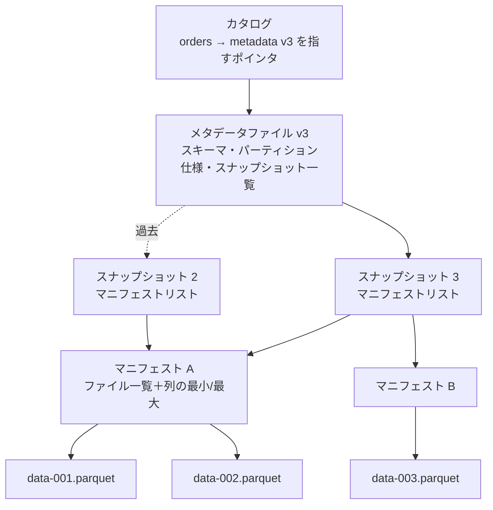

# データレイクとレイクハウス

[[MOC_データアーキテクチャ体系|📚 目次]] ｜ [[03_ETL・ELTとデータパイプライン|← 前へ]] ｜ [[05_バッチ処理とストリーム処理|次へ →]]

> [!abstract] この記事で分かること
> - データレイク（オブジェクトストレージ＋ファイル）とは何か、DWH と何が違うか
> - 「データスワンプ」になる理由と、ファイルを直接置くだけの限界
> - テーブルフォーマット（Apache Iceberg・Delta Lake・Apache Hudi）が ACID とタイムトラベルを実現する仕組み
> - レイクハウスとカタログの役割
> - どの規模で何を選べばよいか
>
> **前提**：[[02_列指向ストレージとデータウェアハウス]]（Parquet）と [[01_トランザクションとACID]] を読んでいると理解しやすいです。

## 1. ひとことで言うと

DWH が「棚・ラベル・在庫管理システムが完備された整理整頓済みの倉庫」だとすると、**データレイク** は「とにかく何でも放り込める巨大で安い貸し倉庫」です。段ボール（ファイル）を好きなだけ置けますが、ラベルを貼らず、在庫台帳も付けずに放り込み続けると、何がどこにあるか誰も分からない「ゴミ屋敷」になります。これを **データスワンプ（データの沼）** と呼びます。

**レイクハウス** は、その安い貸し倉庫に「在庫台帳（メタデータ）」と「出し入れのルール（トランザクション）」を後付けして、倉庫並みに安心して使えるようにしたものです。

- **データレイク（Data Lake）**：S3 や GCS などのオブジェクトストレージに、Parquet・JSON・画像などのファイルをそのまま置く。安く、形式を問わない。
- **テーブルフォーマット（Table Format）**：ファイルの集まりを「1 つのテーブル」として扱うためのメタデータの規約。Iceberg・Delta Lake・Hudi。
- **レイクハウス（Lakehouse）**：データレイク＋テーブルフォーマット＋複数の計算エンジン。DWH の信頼性とレイクの安さ・自由度を両立させる構成。

## 2. データレイク：オブジェクトストレージにファイルを置く

### 2-1. 仕組み

データレイクの実体は、**オブジェクトストレージ（Object Storage）** に置かれたファイルの集まりです。オブジェクトストレージは、キー（パスのような文字列）で巨大なファイルを出し入れできる、非常に安く・ほぼ無限に容量のある保存サービスです（Amazon S3、Google Cloud Storage、Azure Blob Storage など）。

```
s3://shop-datalake/
├── raw/                                   ← Bronze：取り込んだまま
│   ├── orders/dt=2026-10-01/part-0000.parquet
│   ├── orders/dt=2026-10-02/part-0000.parquet
│   ├── clickstream/dt=2026-10-01/events-*.json.gz
│   └── product_images/7.jpg
└── curated/                               ← Silver / Gold
    └── fct_sales/dt=2026-10-01/part-*.parquet
```

`dt=2026-10-01` のようにディレクトリ名に値を埋め込む方式は **Hive 形式のパーティション** と呼ばれ、クエリエンジン（Spark、Trino、Athena、DuckDB など）は `WHERE dt = '2026-10-01'` のときにそのディレクトリだけを読みます。

### 2-2. DWH との違い

| 観点 | DWH | データレイク |
|---|---|---|
| 保存するもの | 構造化データ（テーブル） | 何でも（Parquet・CSV・JSON・ログ・画像・音声） |
| スキーマ | 書き込み時に決める（Schema on Write） | 読むときに解釈する（Schema on Read） |
| ストレージ単価 | 比較的高い | 非常に安い |
| 計算エンジン | 製品に組み込み（1 つ） | 自由に選べる（Spark、Trino、DuckDB、機械学習ライブラリ…） |
| データの形式 | 製品独自（ロックイン） | オープン（Parquet など） |
| トランザクション・更新 | ある | **ない**（ファイルを置くだけ） |

データレイクが選ばれる理由は、**大量の生データ（ログ・イベント・画像など）を安く長期保存したい** ことと、**機械学習など SQL 以外の処理でも同じデータを使いたい** ことです。

### 2-3. ファイルを直接置くだけの限界

ところが、ファイルを置くだけのレイクには DB として致命的な弱点があります。

- **原子性がない**：100 個のファイルを書く途中でジョブが落ちると、50 個だけ置かれた状態が読み手に見えます。
- **更新・削除が難しい**：「user_id = 42 のデータを消して（GDPR などの削除請求）」に対して、該当行を含むファイルを全部探して書き直す必要があります。
- **同時書き込みで壊れる**：2 つのジョブが同じディレクトリに書くと、互いのファイルを上書き・削除しかねません。
- **ファイル一覧が遅い**：パーティションが数万個あると、ディレクトリを列挙（LIST）するだけで時間がかかります。
- **スキーマの変化に弱い**：ある日から列が増えた・型が変わったファイルが混ざると、読み手が壊れます。

## 3. データスワンプ問題

技術的な限界に加えて、運用の問題でレイクは「沼」になりがちです。

- 誰がいつ何の目的で置いたファイルか分からない（**メタデータ・所有者の不在**）
- 同じようなデータが `orders_v2_final_fix/` のように乱立する（**重複と信頼性の低下**）
- 中身のスキーマや意味が書かれていない（**発見できない**）
- 個人情報がどこに入っているか把握できない（**ガバナンスの欠如**）

> [!warning] 「とりあえず全部レイクに入れておこう」の罠
> 「Schema on Read だから後で考えればよい」は、実際には「誰も読めない」になりがちです。最低限、**置き場のルール（層・命名規則）**、**所有者**、**カタログへの登録**、**アクセス権限** を最初に決めてください。

## 4. テーブルフォーマット：ファイルの集まりに ACID を与える

### 4-1. 基本の発想

テーブルフォーマットは、「**どのファイルがこのテーブルの今のバージョンに含まれるか**」をメタデータとして記録し、そのメタデータの更新を原子的に行う仕組みです。読み手はディレクトリを列挙せず、メタデータに書かれたファイルだけを読みます。

Apache Iceberg の構造を簡略化すると次のようになります。



書き込みの流れは次のとおりです。

1. 新しいデータファイル（Parquet）を書く。この時点では誰からも見えない。
2. 新しいマニフェストとメタデータファイル（v4）を書く。
3. カタログ上の「現在のメタデータ」ポインタを v3 → v4 に **原子的に付け替える**（比較して交換：v3 のままなら v4 にする）。

ポインタの付け替えは 1 回の操作なので、読み手からは「v3 の世界」か「v4 の世界」のどちらかしか見えません。途中で落ちても、ゴミファイルが残るだけでテーブルは壊れません。2 つの書き手が同時にコミットしようとしたら、付け替えに失敗した側が最新の状態を読み直して再試行します（**楽観的並行性制御**、[[04_楽観ロック・悲観ロックとデッドロック]]）。これで **ACID** のうち原子性・一貫性・分離性が実現されます。

### 4-2. タイムトラベル

古いスナップショットのメタデータとファイルは、明示的に削除（期限切れ処理）するまで残っています。そのため **過去のある時点のテーブルをそのまま読む** ことができます。これを **タイムトラベル（Time Travel）** と呼びます。

```sql
-- Spark SQL + Iceberg の例（PostgreSQL の構文ではありません）
-- スナップショットの一覧を見る
SELECT committed_at, snapshot_id, operation
FROM shop.sales.fct_sales.snapshots;

-- 昨日の朝の時点のテーブルを読む（バグのあるジョブが走る前）
SELECT SUM(amount)
FROM shop.sales.fct_sales TIMESTAMP AS OF '2026-10-11 06:00:00';

-- スナップショット ID を指定して読む
SELECT * FROM shop.sales.fct_sales VERSION AS OF 10963874102873;
```

タイムトラベルは、**誤ったジョブで壊したデータの復旧**、**機械学習の再現性**（どの時点のデータで学習したか）、**監査** に役立ちます。ただし古いファイルを保持し続けるとストレージ代が増えるので、保持期間を決めて定期的に期限切れ処理を行います。

### 4-3. 3 つのテーブルフォーマット

| | Apache Iceberg | Delta Lake | Apache Hudi |
|---|---|---|---|
| 生まれ | Netflix → Apache | Databricks → Linux Foundation | Uber → Apache |
| メタデータ | メタデータファイル＋マニフェストの木構造 | `_delta_log/` に JSON のコミットログを連番で追記（定期的に Parquet のチェックポイント） | タイムライン（コミットの時系列）＋ファイルグループ |
| 得意なこと | エンジン中立性、隠しパーティション（`days(ordered_at)` のような変換を利用者が意識しない）、パーティション仕様の変更 | Spark・Databricks との統合の深さ | 高頻度の upsert・CDC 取り込み（Copy-on-Write／Merge-on-Read を選べる） |
| 主な利用エンジン | Spark、Trino、Flink、Snowflake、BigQuery、Athena、DuckDB など幅広い | Spark、Databricks、Trino など | Spark、Flink など |

> [!note] 2026 年時点の状況
> 3 つとも ACID・タイムトラベル・スキーマ進化を備え、機能差は縮まっています。業界は「Iceberg を共通の言語にする」方向に寄っており、Snowflake・BigQuery・AWS（S3 Tables）などが Iceberg テーブルを直接扱えるようになっています。Delta Lake と Iceberg の相互変換（Delta UniForm、Apache XTable）もあります。新規で選ぶなら、エンジンの選択肢が最も広い Iceberg が無難です。

### 4-4. 更新・削除の 2 つのやり方

列指向のファイル（Parquet）は書き換えられないので、行の更新・削除は次のどちらかで行います。

- **Copy-on-Write（CoW）**：該当行を含むファイルを丸ごと書き直す。読むのは速いが、書き込みが重い。
- **Merge-on-Read（MoR）**：「この行は削除した」「この行はこう更新した」という差分ファイルを別に書き、読むときに合成する。書くのは速いが、読むときに手間がかかる。差分が溜まったら **コンパクション（Compaction）** でまとめ直す。

[[02_B-TreeとLSM-Tree]] の LSM-Tree と同じ発想です。

## 5. レイクハウスとカタログ

### 5-1. レイクハウス

**レイクハウス（Lakehouse）** は、データレイク（安いオブジェクトストレージ＋オープンなファイル形式）の上にテーブルフォーマットを載せ、DWH のような使い勝手を実現した構成です。

```mermaid
flowchart TB
  subgraph エンジン（目的ごとに選ぶ）
    E1[Spark<br>大規模バッチ]
    E2[Trino / Athena<br>対話的 SQL]
    E3[Flink<br>ストリーム書き込み]
    E4[Snowflake / BigQuery<br>DWH から直接参照]
    E5[DuckDB / Python<br>手元分析・機械学習]
  end
  CAT[カタログ<br>テーブル名 → 現在のメタデータ・権限]
  subgraph ストレージ
    TF[テーブルフォーマット<br>Iceberg / Delta / Hudi]
    OS[(オブジェクトストレージ<br>S3・GCS 上の Parquet)]
  end
  E1 & E2 & E3 & E4 & E5 --> CAT --> TF --> OS
```

- **ストレージとコンピュートの分離**：データは 1 か所に 1 部だけ置き、用途に応じたエンジンを横から差し込みます。DWH にデータをコピーする必要がありません。
- **オープンな形式**：製品を乗り換えてもデータはそのまま残ります（ベンダーロックインを避けられる）。
- **代償**：テーブルの最適化（小さなファイルの結合、古いスナップショットの削除、統計の更新）を自分で、またはマネージドサービスに頼んで行う必要があります。DWH ではこれを製品が裏でやってくれます。

### 5-2. カタログ

**カタログ（Catalog）** は「`shop.sales.fct_sales` というテーブルの現在のメタデータはどこか」を管理する台帳です。前述の原子的なポインタ付け替えもカタログが担います。多くの製品はさらに、権限管理・データの説明・系譜（リネージ）まで扱います。

- **技術的なカタログ**：Hive Metastore、AWS Glue Data Catalog、Iceberg REST カタログ（Apache Polaris など）、Unity Catalog
- **業務的なカタログ（データカタログ）**：DataHub、OpenMetadata など。「このテーブルは何の意味か、誰が所有者か、どの列に個人情報があるか」を検索できるようにし、データスワンプを防ぐ

## 6. どの規模で何を選ぶか

| 状況 | おすすめ | 理由 |
|---|---|---|
| 分析対象が数十 GB、分析者は数人 | 本番のレプリカ＋DuckDB、または小さな DWH（BigQuery など） | 仕組みを増やすほうが高くつく |
| 構造化データ中心、数 TB 規模、SQL で分析 | **クラウド DWH**（BigQuery・Snowflake・Redshift） | 運用がほぼ不要。最適化は製品任せ |
| ログ・イベント・画像など多様な生データを大量に長期保存 | **データレイク（Bronze）＋ DWH（Silver/Gold）** | 安い保存と、使いやすい分析を分担 |
| 数十 TB〜PB、複数エンジン（Spark・ML・SQL）で同じデータを使う、ロックインを避けたい | **レイクハウス（Iceberg など）** | 1 部のデータを全エンジンで共有 |
| すでに DWH があり、一部をオープンにしたい | DWH の Iceberg テーブル機能 | DWH の使い勝手を保ったまま形式をオープンに |

> [!tip] 小さく始める
> 最初からレイクハウスを組む必要はありません。DWH で始め、データの種類・量・使うエンジンが増えてきたら、Bronze 層からレイク（Iceberg）に移していくのが現実的です。「Parquet で置いておく」「層と命名のルールを決める」だけでも、後の移行はずっと楽になります。

## よくある誤解・つまずき

- ❌ 「データレイクは安いので、とりあえず何でも入れておけばよい」
  ✅ 所有者・スキーマ・カタログ・権限を決めずに入れると、誰も使えないデータスワンプになります。保存は安くても、探す・信頼するコストが膨らみます。
- ❌ 「Iceberg は新しいファイル形式（Parquet の代わり）」
  ✅ Iceberg・Delta Lake・Hudi は **テーブルフォーマット** で、データ本体は Parquet などのファイル形式のままです。その上に「どのファイルがテーブルか」を管理するメタデータ層を載せたものです。
- ❌ 「タイムトラベルがあるからバックアップは不要」
  ✅ 古いスナップショットは期限切れ処理で消えますし、ストレージやカタログ自体の障害・誤削除には無力です。バックアップや別リージョンへの複製は別途考えます。
- ❌ 「レイクハウスにすれば DWH は要らない」
  ✅ 規模や組織によっては DWH のほうが安く簡単です。レイクハウスは運用（コンパクションなど）とエンジン選定の手間を引き受ける代わりに、自由度とオープン性を得る選択です。

## まとめ

- データレイクはオブジェクトストレージにファイルを置く安くて自由な置き場ですが、そのままでは原子性・更新・同時書き込みに弱く、運用を誤るとデータスワンプになります。
- テーブルフォーマット（Iceberg・Delta Lake・Hudi）は、ファイル一覧をメタデータで管理し、ポインタの原子的な付け替えで ACID を実現します。
- 古いスナップショットを残すことでタイムトラベルができ、誤操作からの復旧や再現性に役立ちます。
- レイクハウスはレイク＋テーブルフォーマット＋カタログ＋複数エンジンの構成で、1 部のデータを全エンジンで共有できます。
- 小さいうちは DWH、多様で巨大なデータと複数エンジンが必要になったらレイク／レイクハウスへ、が基本です。

## 確認クイズ

1. S3 に Parquet を直接置いているレイクで、日次ジョブが 200 ファイル中 120 ファイルを書いたところで落ちました。この間にダッシュボードが集計すると何が起きますか。Iceberg ではどうなりますか。
> [!tip]- 答え
> ファイルを直接置く方式では、読み手はディレクトリを列挙して 120 ファイルを読むので、その日の数字が欠けて見えます。Iceberg では新しいファイルはメタデータのポインタが付け替えられるまで読まれないので、読み手には前回のスナップショットの完全な状態だけが見えます（落ちたジョブのファイルはゴミとして残り、後で掃除されます）。

2. 「Copy-on-Write」と「Merge-on-Read」は、それぞれどんな使い方に向いていますか。
> [!tip]- 答え
> Copy-on-Write は書き込み時にファイルを書き直すので読み取りが速く、更新が少なく読む頻度が高いテーブル向きです。Merge-on-Read は差分だけを書くので書き込みが速く、CDC のように高頻度で更新が流れ込むテーブル向きです（定期的なコンパクションが必要）。

3. データスワンプを防ぐために、レイクを作り始める時点で決めておくべきことを 3 つ挙げてください。
> [!tip]- 答え
> 例：層（Bronze/Silver/Gold）とパス・テーブルの命名規則、各データの所有者、カタログへの登録とスキーマ・説明の記載、アクセス権限と個人情報の扱い、保持期間。

## 関連ノート

- [[03_ETL・ELTとデータパイプライン]] — 前回。Bronze/Silver/Gold の層と冪等な書き込み
- [[05_バッチ処理とストリーム処理]] — 次回。レイクの上で動く Spark・Flink
- [[02_列指向ストレージとデータウェアハウス]] — Parquet と DWH の仕組み
- [[01_トランザクションとACID]] — テーブルフォーマットが実現する ACID の意味
- [[04_楽観ロック・悲観ロックとデッドロック]] — コミット時の楽観的並行性制御
- [[02_B-TreeとLSM-Tree]] — Merge-on-Read とコンパクションの発想の元
- [[データパイプラインの中身 — 取り込み・変換・置き場｜ねる前エンジニアリング]] — クリップ：日付ごとの区画（パーティション）に置く考え方
- [[本番DBで集計してはいけない理由]] — クリップ：ストレージとコンピュートの分離（Snowflake）の歴史

## 参考

- [Apache Iceberg: Spark Queries（Time Travel）](https://iceberg.apache.org/docs/latest/spark-queries/)
- [Apache Iceberg: Table Spec](https://iceberg.apache.org/spec/)
- [Delta Lake Documentation](https://docs.delta.io/latest/index.html)
- [Apache Hudi: Table & Query Types](https://hudi.apache.org/docs/table_types)
- [Databricks: What is a data lakehouse?](https://docs.databricks.com/aws/en/lakehouse/)
- [Amazon S3 Tables](https://aws.amazon.com/s3/features/tables/)
