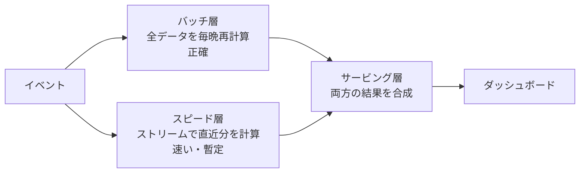

# バッチ処理とストリーム処理

[[MOC_データアーキテクチャ体系|📚 目次]] ｜ [[04_データレイクとレイクハウス|← 前へ]]

> [!abstract] この記事で分かること
> - 有界データ（バッチ）と無界データ（ストリーム）の違い
> - バッチ処理の系譜：MapReduce から Spark へ
> - ストリーム処理の部品：Kafka（ログ）と Flink（処理エンジン）
> - イベント時刻と処理時刻、ウィンドウ、遅れて届くデータの扱い
> - 「exactly-once」が本当に意味すること、Lambda / Kappa アーキテクチャ、どちらを選ぶか
>
> **前提**：[[03_ETL・ELTとデータパイプライン]]（冪等性・CDC）と [[04_データレイクとレイクハウス]] を読んでいると理解しやすいです。

## 1. ひとことで言うと

郵便物の処理にたとえます。**バッチ処理** は「1 日分の郵便物を夜にまとめて仕分ける」やり方です。全部そろってから処理するので確実で効率的ですが、結果が出るのは翌朝です。**ストリーム処理** は「届いた郵便物を 1 通ずつその場で仕分け続ける」やり方です。すぐ結果が出ますが、「今日の分はもう全部届いたのか？」が永遠に分からないという難しさがあります。

- **バッチ処理（Batch Processing）**：始まりと終わりがある **有界（bounded）** なデータをまとめて処理する。例：前日分の注文から日次売上を作る。
- **ストリーム処理（Stream Processing）**：終わりのない **無界（unbounded）** なデータを、届くそばから処理し続ける。例：不正注文を数秒以内に検知する。
- 両者は対立するものではなく、「ストリームを区切ったものがバッチ」と考えると、同じ考え方の延長で理解できます。

## 2. 有界データと無界データ

```
有界データ（バッチ）
 ┌────────── 2026-10-01 の注文 ──────────┐
 │ ● ● ● ● ● ● ● ● ● ● ● ● ● ● ● ● ●    │  ← 全部そろってから処理
 └──────────────────────────────────────┘
   入力が確定しているので、何度処理しても同じ結果（流し直しが容易）

無界データ（ストリーム）
 ──●──●───●●──●────●─●──●──●───●──●●──●──▶ 時間（終わりがない）
        ↑処理      ↑処理       ↑処理
   届くたびに処理。「全部そろう」瞬間は来ない
```

| 観点 | バッチ | ストリーム |
|---|---|---|
| 入力 | 有界（固定のファイル・テーブル） | 無界（イベントが流れ続ける） |
| 遅延（レイテンシ） | 分〜時間〜1 日 | ミリ秒〜秒 |
| 結果の確定 | 処理が終われば確定 | 「暫定」の結果が更新されていく |
| 失敗時の再実行 | 入力を読み直せばよい（簡単） | 状態（途中の集計）を復元する必要がある（難しい） |
| 代表的な用途 | 日次レポート、機械学習の学習、過去データの再計算 | 不正検知、リアルタイムダッシュボード、通知、CDC の反映 |
| 代表的な技術 | Spark、DWH の SQL、dbt | Kafka、Flink、Kafka Streams、Spark Structured Streaming |

## 3. バッチ処理：MapReduce から Spark へ

### 3-1. MapReduce

2004 年に Google が論文で発表した **MapReduce** は、何千台ものマシンで巨大なデータを処理するためのプログラミングモデルです。オープンソース実装の Hadoop とともに、2010 年代前半のビッグデータ処理の中心でした。

処理は 3 段階です。

1. **Map**：入力の各レコードから「キーと値」の組を作る（例：注文明細 → `(カテゴリ, 金額)`）
2. **Shuffle（シャッフル）**：同じキーの組を同じマシンに集める（ネットワーク越しに並べ替え）
3. **Reduce**：キーごとに値をまとめる（例：カテゴリごとに金額を合計）

```
 入力（分散ファイル）     Map             Shuffle（キーで集める）     Reduce
 [本,1980][家電,29800] → (本,1980)    ┐  本:   1980, 3960, 1200 → (本, 7140)
 [本,3960][本,1200]    → (家電,29800) ┼→ 家電: 29800           → (家電, 29800)
                         (本,3960)    │
                         (本,1200)    ┘
```

SQL の `GROUP BY category` と `SUM(amount)` を、何千台に分けて実行する仕組みだと考えると分かりやすいです。MapReduce の大事な性質は、**入力を書き換えず、出力を新しく作る** ことです。失敗したタスクは同じ入力から再実行すればよく、結果は何度やっても同じになります。これは前回までの「冪等なパイプライン」と同じ発想です。

弱点は、各段の結果を毎回ディスク（分散ファイルシステム）に書き出すため遅いこと、そして Java で Map と Reduce を書くのが面倒なことでした。

### 3-2. Spark

**Apache Spark** は MapReduce の後継として普及した分散処理エンジンです。

- 中間結果を **メモリ** に置き、処理全体を **DAG（有向非巡回グラフ）** として最適化するため、MapReduce より大幅に速い
- 失敗時は、どの入力からどの変換で作ったか（系譜）を記録しておき、失われた部分だけを再計算する
- **DataFrame API と Spark SQL** で、SQL や Python（PySpark）で書ける
- 同じ API でバッチもストリーム（Structured Streaming、小さなバッチを連続実行する方式）も扱える

現在は、多くのバッチ処理がクラウド DWH の SQL（dbt）で済むようになり、Spark は「SQL では書きにくい処理」「機械学習の前処理」「レイクハウス上の大規模変換」で使われることが多くなっています。

## 4. ストリーム処理：Kafka と Flink

### 4-1. Kafka：イベントを貯める「ログ」

**Apache Kafka** は、イベントを順番に追記していく **ログ（Log）** を、複数のマシンに分散して保存するシステムです。ここでの「ログ」は、[[05_WALとクラッシュリカバリ]] の WAL と同じく「追記専用で順序のある記録」の意味です。

```
 トピック orders（パーティション 0）
 オフセット:  0     1     2     3     4     5   ...
            [注文] [注文] [取消] [注文] [注文] [注文]  ← 末尾に追記されていく
                          ↑               ↑
                 消費者 A（不正検知）  消費者 B（DWH への書き込み）
                 はここまで読んだ       はここまで読んだ
```

- **プロデューサー（Producer）** がトピックにイベントを書き、**コンシューマー（Consumer）** が読みます。
- イベントは読まれても消えず、保持期間（例：7 日）まで残ります。コンシューマーはそれぞれ「どこまで読んだか（オフセット）」を記録し、自分のペースで読みます。新しいコンシューマーを足したり、過去にさかのぼって読み直したりできます。
- トピックは **パーティション** に分割され、パーティション内では順序が保証されます（全体の順序は保証されない）。同じ注文のイベントを同じパーティションに入れたいなら、`order_id` をキーにします。
- 前回の Debezium（CDC）の出力先として使われることが多く、「DB の変更履歴を全社に配る背骨」になります。

### 4-2. Flink：状態を持つストリーム処理エンジン

**Apache Flink** は、Kafka などから届くイベントを 1 件ずつ処理し続けるエンジンです。単なる変換だけでなく、「直近 5 分間のユーザーごとの注文回数」のような **状態（State）** を持つ集計ができます。

- 状態は定期的に **チェックポイント** として保存され、障害時はチェックポイントの状態と、そのとき読んでいた Kafka のオフセットから処理を再開します。
- **Flink SQL** で、ストリームに対しても SQL で処理を書けます。

ほかに、Kafka に同梱されたライブラリの **Kafka Streams**、Spark の **Structured Streaming**、マネージドサービス（Google Cloud Dataflow など）もあります。

## 5. イベント時刻・ウィンドウ・exactly-once

### 5-1. イベント時刻と処理時刻

ストリーム処理で最初につまずくのが「時刻が 2 種類ある」ことです。

- **イベント時刻（Event Time）**：出来事が実際に起きた時刻。端末やアプリがイベントに記録する。
- **処理時刻（Processing Time）**：イベントが処理エンジンに届いて処理された時刻。

スマホの電波が切れていた、ネットワークが混んでいた、コンシューマーが再起動していた——などの理由で、両者はずれます。イベントは **順番どおりに届くとは限りません**。

```
 イベント時刻 →  23:58     23:59      00:01      23:59(遅延)
 処理時刻     →  23:58:01  23:59:02   00:01:01   00:07:30
                                                  ↑ 電車内で送れなかった操作が後から届く
```

「10 月 1 日の売上」を処理時刻で数えると、遅れて届いた 23:59 の注文が 10 月 2 日に入ってしまい、**流し直すたびに結果が変わります**（届く順は毎回違うため）。正しく再現性のある集計をするには、**イベント時刻で数える** のが原則です。

### 5-2. ウィンドウとウォーターマーク

無界データには終わりがないので、「区切り」を決めて集計します。これを **ウィンドウ（Window）** と呼びます。

| 種類 | 区切り方 | 例 |
|---|---|---|
| タンブリング（Tumbling） | 重ならない固定幅 | 5 分ごとの注文数（10:00〜10:05、10:05〜10:10…） |
| ホッピング／スライディング（Hopping / Sliding） | 固定幅で、少しずつずらして重ねる | 直近 1 時間の注文数を 5 分おきに更新 |
| セッション（Session） | 一定時間イベントが来なかったら区切る | ユーザーの 1 回の訪問（30 分無操作で終了） |

では「10:00〜10:05 のウィンドウ」はいつ閉じて結果を出せばよいのでしょうか。遅れたイベントをいつまでも待つと結果が出ません。そこで **ウォーターマーク（Watermark）** を使います。ウォーターマークは「イベント時刻 t までのイベントはもうほぼ届いた」という処理エンジンの推定で、ウォーターマークがウィンドウの終わりを過ぎたら結果を確定します。それより後に届いたイベントは **遅延データ（Late Data）** として、捨てる・結果を更新する・別に記録する、のいずれかで扱います。

```sql
-- Flink SQL の例（PostgreSQL の構文ではありません）
-- ordered_at をイベント時刻とし、最大 30 秒の遅れを許すウォーターマークを定義
CREATE TABLE order_events (
  order_id   BIGINT,
  user_id    BIGINT,
  amount     INT,
  ordered_at TIMESTAMP(3),
  WATERMARK FOR ordered_at AS ordered_at - INTERVAL '30' SECOND
) WITH ('connector' = 'kafka', 'topic' = 'orders', 'format' = 'json' /* 接続設定は省略 */);

-- 5 分ごとのタンブリングウィンドウで売上を集計
SELECT window_start, window_end, COUNT(*) AS orders, SUM(amount) AS revenue
FROM TABLE(TUMBLE(TABLE order_events, DESCRIPTOR(ordered_at), INTERVAL '5' MINUTES))
GROUP BY window_start, window_end;
```

同じ集計をバッチ（PostgreSQL 14 以降）で書くと次のようになります。ストリームの「ウィンドウ」は、バッチの「時間で区切った GROUP BY」と同じ考え方だと分かります。

```sql
-- PostgreSQL：5 分ごとの売上（date_bin は PostgreSQL 14 以降。MySQL にはない）
SELECT date_bin('5 minutes', o.ordered_at, TIMESTAMPTZ '2026-01-01 00:00:00+09') AS window_start,
       COUNT(DISTINCT o.id)                AS orders,
       SUM(oi.quantity * oi.unit_price)    AS revenue
FROM orders o
JOIN order_items oi ON oi.order_id = o.id
WHERE o.ordered_at >= '2026-10-01 00:00:00+09'
  AND o.ordered_at <  '2026-10-02 00:00:00+09'
GROUP BY 1
ORDER BY 1;
```

### 5-3. exactly-once の本当の意味

メッセージ処理の保証には 3 段階があります。

| 保証 | 意味 | 起きうること |
|---|---|---|
| at-most-once（最大 1 回） | 失敗したら再送しない | 取りこぼし |
| at-least-once（最低 1 回） | 届くまで再送する | **重複** |
| exactly-once（ちょうど 1 回） | 結果が 1 回処理したのと同じ | — |

ネットワーク越しでは、「送ったが返事が来ない」ときに相手が受け取ったかどうかを知る方法がありません。そのため **メッセージを物理的にちょうど 1 回だけ届けることは一般には不可能** です。実際の **exactly-once は「何度か処理されることはあっても、最終的な結果は 1 回分になる」**（effectively-once）という意味です。実現方法は 2 つあります。

1. **原子的なコミット**：「処理結果の書き込み」と「どこまで読んだか（オフセット）の記録」を 1 つのトランザクションにする。Kafka は冪等プロデューサー（再送しても重複して書かれない）とトランザクションを備え、コンシューマーを `isolation.level=read_committed` にするとコミット済みの結果だけを読めます。Flink はチェックポイントと連動した 2 相コミットで、対応した出力先に対してこれを実現します。
2. **冪等な書き込み**：出力先への書き込みを冪等にする（主キーで上書き、`INSERT ... ON CONFLICT DO UPDATE` など）。再処理で同じイベントが来ても結果は変わりません。

> [!warning] exactly-once は「システムの中だけ」の話
> Kafka や Flink の exactly-once は、そのシステムが管理する範囲（Kafka のトピック、対応した出力先）での保証です。処理の中で **メール送信や外部 API 呼び出し** をすると、再処理で 2 回送られます。外部への副作用には、イベント ID を使った重複排除（冪等キー）が別途必要です。結局のところ、[[03_ETL・ELTとデータパイプライン]] で学んだ **冪等性** がここでも鍵になります。

## 6. Lambda / Kappa アーキテクチャと選び方

### 6-1. Lambda アーキテクチャ

かつてのストリーム処理は「速いが不正確（障害時に重複・欠落する）」だったため、**バッチ（正確だが遅い）とストリーム（速いが暫定）を並べて走らせ、結果を合わせる** 構成が考えられました。これが **Lambda アーキテクチャ** です。



問題は、**同じ集計ロジックを 2 つの別システム（例：Spark のバッチと Flink のストリーム）で 2 回書いて保守する** ことです。片方だけ修正して数字がずれる、という事故が起きやすくなります。

### 6-2. Kappa アーキテクチャ

ストリーム処理エンジンが exactly-once と状態管理を備えて正確になったことで、**ストリーム処理 1 本にまとめる** 構成が提案されました（2014 年、Jay Kreps）。これが **Kappa アーキテクチャ** です。

- すべてのデータを Kafka のようなログに十分な期間残しておく
- 通常は 1 本のストリーム処理で結果を出す
- ロジックを直したら、**ログの先頭から新しいバージョンの処理で読み直し**、追いついたら古い結果と切り替える

「バッチ = ログの一部区間を読み直すストリーム処理」と見なすことで、ロジックを 1 つにできます。ただし、何年分ものデータをストリームで再処理するのは時間とコストがかかるので、現実には「長期の履歴はレイクハウス（Iceberg など）に置き、そこからバッチで再計算する」という混合がよく見られます。最近の Flink や Spark は同じ API・同じ SQL でバッチとストリームの両方を書けるので、Lambda の「2 回書く」問題は小さくなっています。

### 6-3. どちらを選ぶか

まず問うべきは「**その数字は何秒以内に必要か。遅れると誰が困るか**」です。

| 要件 | 選択 |
|---|---|
| 日次・週次のレポート、経営指標 | **バッチ**（dbt + DWH）で十分 |
| 数十分〜1 時間程度の鮮度でよいダッシュボード | **短い間隔のバッチ**（マイクロバッチ、増分モデル） |
| 秒単位の反応が必要（不正検知、在庫のリアルタイム反映、レコメンド、アラート） | **ストリーム**（Kafka + Flink など） |
| アプリ DB の変更を検索エンジンやキャッシュに即時反映 | **CDC + ストリーム**（Debezium + Kafka） |
| 機械学習の学習、過去データの全面的な再計算 | **バッチ**（Spark、DWH） |

> [!tip] 迷ったらバッチから
> ストリーム処理は、状態管理・遅延データ・順序・再処理・監視と、運用の難しさが一段上がります。「リアルタイムだと嬉しい」程度ならバッチの間隔を短くするほうが、ずっと安く確実です。本当に秒単位が必要な部分だけをストリームにしましょう。

## よくある誤解・つまずき

- ❌ 「ストリーム処理はバッチ処理の上位互換で、全部リアルタイムにすべき」
  ✅ ストリームは運用コストが高く、結果が暫定で変わり続けます。多くの分析は 1 日 1 回のバッチで十分で、そのほうが正確・安価・簡単です。
- ❌ 「exactly-once を有効にすれば、メール送信も 1 回だけになる」
  ✅ exactly-once は処理エンジンが管理する状態と出力先での「結果が 1 回分になる」保証です。外部への副作用は再処理で重複しうるので、冪等キーで重複を排除します。
- ❌ 「サーバーに届いた時刻で集計すれば十分」
  ✅ 処理時刻で集計すると、遅延や再処理のたびに結果が変わります。業務的に意味のある集計はイベント時刻で行い、ウォーターマークと遅延データの扱いを決めます。
- ❌ 「Kafka はメッセージキューなので、読んだら消える」
  ✅ Kafka はログで、読まれてもイベントは保持期間まで残ります。複数のコンシューマーが独立に読め、過去にさかのぼって再処理できるのが大きな特徴です。

## まとめ

- バッチは有界データをまとめて処理し、ストリームは無界データを届くそばから処理します。ストリームを区切ったものがバッチ、と考えると両者はつながります。
- バッチ処理は MapReduce（Map → Shuffle → Reduce）から、メモリと DAG 最適化を使う Spark へ進化しました。入力を変えず出力を作り直すので、再実行が安全です。
- ストリーム処理は、イベントを保持するログ（Kafka）と、状態を持って処理するエンジン（Flink など）の組み合わせが定番です。
- 集計はイベント時刻で行い、ウィンドウとウォーターマークで区切り、遅延データの扱いを決めます。
- exactly-once は「結果が 1 回分になる」という意味で、原子的コミットか冪等な書き込みで実現します。外部への副作用には別途冪等性が必要です。
- Lambda はバッチとストリームの併用、Kappa はストリームへの一本化です。まず必要な鮮度を問い、迷ったらバッチから始めます。

## 確認クイズ

1. スマホアプリの操作ログを「サーバーで処理した時刻」で 1 時間ごとに集計しています。障害で 2 時間処理が止まり、復旧後にまとめて処理したところ、グラフにおかしな山と谷ができました。原因と対策を答えてください。
> [!tip]- 答え
> 処理時刻で集計しているため、止まっていた 2 時間分のイベントが復旧後の 1 時間に集中して数えられ（山）、止まっていた時間帯は 0 件（谷）になりました。イベント時刻（端末で操作が起きた時刻）で集計し、ウォーターマークと遅延データの扱いを決めれば、処理のタイミングに関係なく同じ結果になります。

2. 「Kafka から注文イベントを読み、注文ごとにポイントを付与して DB に書き込む」処理で、at-least-once の配信しか保証されていません。ポイントの二重付与を防ぐにはどうしますか。
> [!tip]- 答え
> 書き込みを冪等にします。たとえば `point_grants (order_id PRIMARY KEY, ...)` のように注文 ID を一意キーにして `INSERT ... ON CONFLICT (order_id) DO NOTHING` とすれば、同じイベントが 2 回処理されてもポイントは 1 回だけ付与されます。あるいは、DB への書き込みと読み取り位置（オフセット）の記録を同じトランザクションでコミットします。

3. Lambda アーキテクチャの最大の運用上の課題は何で、Kappa アーキテクチャはそれをどう解決しようとしましたか。
> [!tip]- 答え
> 同じ集計ロジックをバッチ層とスピード層の 2 つのシステムで別々に実装・保守しなければならず、結果がずれやすいことです。Kappa はすべてをストリーム処理 1 本にまとめ、ロジックを変えたときはログを先頭から読み直して再計算することで、ロジックを 1 つにしました。

## 関連ノート

- [[04_データレイクとレイクハウス]] — 前回。Spark・Flink が読み書きするレイクハウス
- [[03_ETL・ELTとデータパイプライン]] — CDC（Debezium）と冪等なパイプライン
- [[01_OLTPとOLAP]] — シリーズ「分析・データ基盤」章の出発点
- [[05_WALとクラッシュリカバリ]] — 「ログ」という考え方の原点
- [[04_集約とウィンドウ関数]] — SQL の集約（ストリームのウィンドウとは別物だが発想は近い）
- [[MOC_分散システム体系]] — 分散システムでの合意・配信保証
- [[データパイプラインの中身 — 取り込み・変換・置き場｜ねる前エンジニアリング]] — クリップ：遅れて届くデータと「どの時計で 1 日を区切るか」
- [[本番DBで集計してはいけない理由]] — クリップ：分析基盤の歴史と、境界が溶けていく流れ

## 参考

- Martin Kleppmann, Chris Riccomini『Designing Data-Intensive Applications, 2nd Edition』O'Reilly, 2026（第 11 章 バッチ処理、第 12 章 ストリーム処理）
- [Designing Data-Intensive Applications, 2nd Edition（O'Reilly）](https://www.oreilly.com/library/view/designing-data-intensive-applications/9781098119058/)
- [Apache Flink: Timely Stream Processing（Event Time / Watermarks）](https://nightlies.apache.org/flink/flink-docs-stable/docs/concepts/time/)
- [Apache Flink: Windowing TVF（Flink SQL）](https://nightlies.apache.org/flink/flink-docs-stable/docs/dev/table/sql/queries/window-tvf/)
- [Confluent: Kafka Message Delivery Semantics](https://docs.confluent.io/kafka/design/delivery-semantics.html)
- [Jeffrey Dean, Sanjay Ghemawat: MapReduce: Simplified Data Processing on Large Clusters（2004）](https://research.google/pubs/mapreduce-simplified-data-processing-on-large-clusters/)
- [Jay Kreps: Questioning the Lambda Architecture（2014）](https://www.oreilly.com/radar/questioning-the-lambda-architecture/)
- [PostgreSQL Documentation: Date/Time Functions（date_bin）](https://www.postgresql.org/docs/current/functions-datetime.html)
