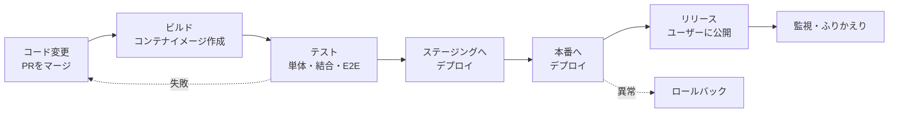

# リリースとデプロイの違い

[[MOC_リリース・デプロイ体系|📚 目次]] ｜ [[02_デプロイ戦略の全体像と選び方|次へ →]]

> [!abstract] この記事で分かること
> - 「デプロイ（Deploy）」と「リリース（Release）」がなぜ別の作業として扱われるのか
> - ビルド → テスト → デプロイ → リリースという一連の流れと、それぞれの役割
> - 継続的インテグレーション / 継続的デリバリー / 継続的デプロイメントの違い
> - Google SRE 本が挙げるリリースエンジニアリングの 4 原則と、「小さく頻繁に出す」が安全な理由
> - 手動デプロイ（scp / rsync）から自動化へ、デプロイが「儀式」でなくなるまでの歴史
>
> **前提**：Web アプリを作ってサーバーで動かしたことがあれば十分です。CI/CD の全体像は [[MOC_CI-CD体系]] も参考にしてください。

## 1. ひとことで言うと

レストランで新メニューを出すときを想像してください。厨房で料理を作れるように食材と手順を準備しておくこと（**仕込み**）と、メニュー表に載せてお客さんが注文できるようにすること（**提供開始**）は、別の作業です。仕込みは前の晩に済ませておき、提供開始は「明日のランチから」と決めることができます。仕込んだけれど味が微妙なら、メニューに載せなければお客さんには何の影響もありません。

ソフトウェアでも同じで、

- **デプロイ（Deploy）**＝新しいコードを本番環境に「置いて動かす」こと（仕込み）
- **リリース（Release）**＝その機能をユーザーが「使える状態にする」こと（提供開始）

と分けて考えます。昔はこの 2 つが同時に起きるのが当たり前でしたが、今は意図的に分けることで「デプロイは毎日、気軽に」「リリースはビジネスの都合で、慎重に」を両立させています。

> [!note] 要点
> デプロイは **技術的なイベント**、リリースは **ビジネス（ユーザー）向けのイベント**。分けると、デプロイのリスクとリリースのリスクを別々に管理できる。

## 2. デプロイとリリースを分けるとは

### 2.1 分けない世界（昔のやり方）

Shop の「注文確定 API にクーポン機能を追加する」変更を例にします。分けない世界では、

1. クーポン機能のコードを main にマージ
2. 本番サーバー 4 台に新しいコードを配置（＝デプロイ）
3. 配置した瞬間から、全ユーザーにクーポン入力欄が見える（＝リリース）

となり、**デプロイした瞬間がリリースの瞬間**です。もしクーポンの計算にバグがあれば、全ユーザーが一斉に影響を受けます。直すには「もう一度デプロイし直す」しかありません。

### 2.2 分ける世界（今のやり方）

分ける世界では、次のようにします。

1. クーポン機能のコードを main にマージ。ただし **フィーチャーフラグ（Feature Flag：機能の ON/OFF スイッチ）** で OFF にしておく
2. 本番にデプロイ。コードは本番で動いているが、クーポン欄は誰にも見えない
3. 社内ユーザーだけ ON にして本番で動作確認
4. 問題なければ 5% → 50% → 100% のユーザーに ON（＝リリース）
5. 問題が出たらフラグを OFF にするだけ。再デプロイは不要

```text
             ┌──────── デプロイ（技術の都合で、毎日でも）─────────┐
コード ──▶ ビルド ──▶ テスト ──▶ 本番に配置（フラグOFF）
                                          │
             ┌──────── リリース（ビジネスの都合で）─────────┐
                                          ▼
                              社内 → 5% → 50% → 100% に公開
```

こうすると、

- **デプロイの失敗**（サーバーが起動しない、メモリ不足など）は、ユーザーに機能が見える前に気づける
- **リリースの失敗**（仕様の考慮漏れ、想定外の使われ方など）は、スイッチ 1 つで戻せる
- マーケティングの「〇月〇日 10 時に新機能公開」に合わせて、デプロイを前日までに済ませておける

というメリットがあります。フラグの詳しい使い方は [[06_フィーチャーフラグ]] で扱います。

### 2.3 フラグ以外の「分け方」

デプロイとリリースを分ける手段はフラグだけではありません。この章で順に扱う戦略は、どれも「本番に置くこと」と「ユーザーに届けること」の間にワンクッション入れる工夫です。

| 手段 | 「置いたけど見せていない」状態の作り方 | 回 |
|---|---|---|
| Blue-Green | 新バージョンを待機側の環境に置き、ロードバランサーの向きを変えるまでユーザーは来ない | [[04_Blue-Greenデプロイ]] |
| カナリア | 新バージョンに一部のトラフィックだけ流す | [[05_カナリアリリース]] |
| フィーチャーフラグ | コードは全台にあるが、機能はスイッチで隠す | [[06_フィーチャーフラグ]] |
| ダークローンチ | 裏で動かすがユーザーに結果は見せない | [[07_シャドウデプロイとダークローンチ]] |

> [!info] 用語のゆれ
> 現場では「リリース」を「本番デプロイ」の意味で使うことも多く、「リリースノート」「リリース判定」のように両方をまとめて指す場面もあります。このシリーズでは、区別が必要な場面で上記の定義を使います。

## 3. ビルド → テスト → デプロイ → リリースの流れ

コードが書かれてからユーザーに届くまでの典型的な流れは次のとおりです。



| 段階 | やること | Shop での具体例 | 成果物 |
|---|---|---|---|
| ビルド（Build） | ソースから実行できる形を作る | `docker build` で Shop API のイメージを作り、`shop-api:1.8.0` としてレジストリに push | コンテナイメージ（**アーティファクト**：成果物） |
| テスト（Test） | 壊れていないか自動で確かめる | `npm test`、API の結合テスト、注文フローの E2E テスト | テスト結果 |
| デプロイ（Deploy） | 成果物を環境に配置して動かす | Kubernetes の Deployment のイメージを `1.8.0` に更新 | 動いているプロセス |
| リリース（Release） | ユーザーが使える状態にする | クーポン機能のフラグを ON | 使える機能 |

ここで大事なのは **「ビルドは 1 回だけ、同じ成果物をすべての環境に流す」** ことです。ステージング用と本番用に別々にビルドすると、「ステージングで試したもの」と「本番に出したもの」が微妙に違う可能性が生まれます。イメージのダイジェスト（`sha256:...` で表される中身のハッシュ）が同じものを流せば、「試したものと同じものを出した」と言い切れます。

GitHub Actions で書くと、最小構成はこんな形です（2026 年時点の主要アクションのメジャーバージョン）。

```yaml
# .github/workflows/deploy.yml
name: build-test-deploy
on:
  push:
    branches: [main]

jobs:
  build:
    runs-on: ubuntu-latest
    outputs:
      image: ${{ steps.meta.outputs.image }}
    steps:
      - uses: actions/checkout@v4
      - uses: actions/setup-node@v4
        with:
          node-version: '22'
      - run: npm ci
      - run: npm test                       # テスト
      - id: meta
        run: echo "image=ghcr.io/example/shop-api:${GITHUB_SHA::7}" >> "$GITHUB_OUTPUT"
      - run: docker build -t ${{ steps.meta.outputs.image }} .   # ビルドは1回だけ
      - run: echo "${{ secrets.GITHUB_TOKEN }}" | docker login ghcr.io -u ${{ github.actor }} --password-stdin
      - run: docker push ${{ steps.meta.outputs.image }}

  deploy-staging:
    needs: build
    runs-on: ubuntu-latest
    environment: staging
    steps:
      - run: kubectl set image deployment/shop-api shop-api=${{ needs.build.outputs.image }} -n staging

  deploy-production:
    needs: [build, deploy-staging]
    runs-on: ubuntu-latest
    environment: production                 # 承認者を設定すれば「人が押すまで止まる」
    steps:
      - run: kubectl set image deployment/shop-api shop-api=${{ needs.build.outputs.image }} -n production
```

> [!note]
> 実際には kubectl の認証設定（クラスタへの接続情報）が必要です。ここでは流れを見せるために省略しています。GitHub Actions 自体の詳細は [[04-GitHub-Actionsによる自動化]] を参照してください。

## 4. CI・継続的デリバリー・継続的デプロイメントの違い

「CI/CD」とひとまとめに呼ばれますが、実は 3 つの段階があります。

| 用語 | 英語 | どこまで自動か | 本番に出すのは |
|---|---|---|---|
| 継続的インテグレーション | Continuous Integration（CI） | マージのたびにビルドとテストを自動実行 | （対象外） |
| 継続的デリバリー | Continuous Delivery（CD） | 本番に **いつでも出せる状態** まで自動。ステージングまでは自動デプロイ | 人がボタンを押して決める |
| 継続的デプロイメント | Continuous Deployment（CD） | テストを通った変更は **すべて自動で本番へ** | パイプラインが自動で |

Martin Fowler は継続的デリバリーを「いつでも本番にリリースできるようにソフトウェアを作る規律」と定義し、継続的デプロイメントは「すべての変更がパイプラインを通って自動的に本番に入ること」としています。そして **継続的デプロイメントをするには、継続的デリバリーができている必要がある** と述べています。

```text
CI                    : [コミット] → [ビルド] → [テスト]
継続的デリバリー       : [コミット] → [ビルド] → [テスト] → [ステージング] → (人が判断) → [本番]
継続的デプロイメント   : [コミット] → [ビルド] → [テスト] → [ステージング] → [本番]   ← 全自動
```

上の GitHub Actions の例で `environment: production` に承認者を設定していれば継続的デリバリー、承認なしで流れれば継続的デプロイメントです。

> [!tip] どちらを目指すべき？
> 継続的デプロイメントは「テストとモニタリングが十分に信頼できる」ことが前提です。最初は継続的デリバリー（本番は人が押す）から始め、**デプロイとリリースを分けた上で**（フラグで隠す等）自動化の範囲を広げていくのが現実的です。デプロイが自動でも、リリース（ユーザーに見せるタイミング）は人が決められるからです。

## 5. Google SRE 本のリリースエンジニアリング 4 原則

Google の『Site Reliability Engineering』第 8 章「Release Engineering」は、リリースエンジニアリング（ソフトウェアをビルドして届ける仕組みづくり）の考え方を 4 つの原則にまとめています。

| 原則 | 原文 | 意味 | Shop に当てはめると |
|---|---|---|---|
| ① 自己完結（セルフサービス） | Self-Service Model | 各チームが自分でリリースの頻度とタイミングを決めて実行できる。リリースは自動で、人手が要るのは問題が起きたときだけ | 「インフラ担当に頼んでデプロイしてもらう」のではなく、Shop API チームが自分で GitHub Actions から出せる |
| ② 高速 | High Velocity | 頻繁なリリースほどバージョン間の変更が少なくなり、テストやトラブルシューティングが楽になる | 月 1 回 50 個の変更をまとめて出すより、毎日 2〜3 個ずつ出す |
| ③ ハーメチックビルド | Hermetic Builds | ビルドがビルドマシンに入っているライブラリ等に左右されない。同じ入力なら同じ結果になる | `package-lock.json` と `npm ci`、ベースイメージのバージョン固定（`node:22.11-slim` のように）で「誰がいつビルドしても同じ」にする |
| ④ ポリシーと手順の強制 | Enforcement of Policies and Procedures | 誰が何をできるか（変更の承認、リリース作成、デプロイ）をアクセス制御で守る。何が変わったかを記録する | main へのマージはレビュー必須、本番デプロイは `production` 環境の承認者のみ、デプロイ履歴を残す |

**ハーメチック（hermetic）** は「密閉された」という意味です。ビルドが外の環境（開発者の PC に入っている Node のバージョン、その日の npm の最新版など）に影響されず、密閉された箱の中で毎回同じように行われる、というイメージです。これが崩れると「手元では動いたのに CI では壊れる」「先週ビルドしたものと今日ビルドしたものが違う」という事態が起きます。

SRE 本ではほかに、本番バグの修正は **main（メインライン）に先に入れてから、リリースブランチに cherry-pick（特定のコミットだけ取り込む）する**、ブランチは main にマージし戻さない、といった運用も紹介されています。ブランチ運用は [[01_リリースサイクルとブランチ戦略]] で扱います。

## 6. 「小さく頻繁に出す」が安全な理由

直感的には「慎重にまとめて、たまに出す」ほうが安全に思えます。しかし実際は逆です。

```text
【まとめて出す】  変更 50 個 ──▶ 本番 ──▶ エラー！ ──▶ 50 個のどれが原因？（調査に数時間）
【小さく出す】    変更 2 個  ──▶ 本番 ──▶ エラー！ ──▶ 2 個のどちらか（数分で特定、すぐ戻す）
```

理由を整理すると次の 4 つです。

1. **原因を特定しやすい**：1 回のデプロイに含まれる変更が少ないほど、問題が起きたときに疑う範囲が狭い。
2. **影響が小さい**：変更が小さいほど、壊れたときの壊れ方も小さい。
3. **戻しやすい**：小さな変更は戻すのも簡単。50 個の変更をまとめて戻すと、正しく動いていた 48 個も一緒に巻き戻ってしまう。
4. **慣れる**：月 1 回しかやらない作業は手順を忘れ、手作業のミスが起きやすい。毎日やる作業は自動化され、体が覚える。

この考え方は CI の原点でもあります。1990 年代、各チームが数ヶ月別々に開発して最後にまとめて統合する「インテグレーション・ヘル（統合地獄）」が問題になり、Kent Beck らのエクストリーム・プログラミング（XP）は「1 日に何度も統合する」ことで痛みを小さくしました。デプロイでも同じ理屈が成り立ちます（詳しくはクリップ [[なぜデプロイは怖くなくなったのか]]）。

### DORA の 4 指標

この「速く出すほうが安全」を大規模調査で裏付けたのが、Google Cloud の研究プログラム **DORA（DevOps Research and Assessment）** です。DORA はソフトウェアデリバリーの成績を測る指標として、次の 4 つ（通称 Four Keys）を提唱してきました。

| 指標 | 何を測るか | 種類 |
|---|---|---|
| デプロイ頻度（Deployment frequency） | どれくらいの頻度で本番にデプロイしているか | 速さ |
| 変更のリードタイム（Change lead time） | コミットから本番で動くまでの時間 | 速さ |
| 変更失敗率（Change fail rate） | デプロイのうち、ロールバックやホットフィックスなど即時対応が必要になった割合 | 安定性 |
| 失敗したデプロイからの復旧時間（Failed deployment recovery time） | 失敗したデプロイから復旧するまでの時間（旧称 MTTR） | 安定性 |

調査の結果、成績の良いチームは **速さと安定性の両方が高い** ことが繰り返し示されています。「速さを取ると安定性を失う」というトレードオフは、実際には成り立たないということです。

> [!info] 2026 年時点の DORA
> DORA の公式ガイドでは、上の 4 つに **デプロイの手戻り率（Deployment rework rate：本番障害がきっかけで計画外に行われたデプロイの割合）** を加えた 5 指標が紹介されています。指標の測り方とふりかえりへの使い方は [[04_リリースのふりかえりとDORA指標]] で詳しく扱います。

## 7. 手動デプロイから自動化への歴史

### 7.1 手動デプロイの時代

かつてのデプロイは、開発者がサーバーに直接ファイルをコピーする作業でした。

```bash
# FTP や scp でファイルを送る
scp -r ./dist/ deploy@web01.example.com:/var/www/shop/

# rsync で差分だけ送る（--delete で消えたファイルも反映）
rsync -avz --delete ./dist/ deploy@web01.example.com:/var/www/shop/

# サーバーにログインして再起動
ssh deploy@web01.example.com 'sudo systemctl restart shop-api'
```

これを web01、web02、web03……と台数分繰り返します。手順書は分厚く、作業は深夜、失敗したら朝までかけて元に戻す――デプロイは数ヶ月に 1 回の **儀式** でした。問題点は明らかです。

- **人によって結果が変わる**：コマンドを 1 つ飛ばす、サーバーを 1 台忘れる
- **記録が残らない**：いつ誰が何を出したのか分からない
- **戻しにくい**：上書きしてしまうと、前のファイルがない
- **止まる**：再起動中はサービスが止まる

### 7.2 自動化への流れ

| 時期 | 出来事 | 変わったこと |
|---|---|---|
| 1990 年代 | Microsoft のデイリービルド、XP の「頻繁な統合」 | 統合を小さく頻繁に |
| 2000〜2001 年 | Martin Fowler の論文「Continuous Integration」、最初の CI サーバー CruiseControl | 統合とテストの自動化 |
| 2005〜2011 年 | 川口耕介氏の Hudson → Jenkins | CI サーバーが一般化 |
| 2009 年 | Flickr の講演「1 日 10 回以上のデプロイ」 | デプロイを日常にする発想 |
| 2010 年 | Jez Humble / David Farley『継続的デリバリー』 | デプロイパイプラインの体系化 |
| 2010 年代 | Docker、Kubernetes、Infrastructure as Code（Terraform 等） | 「何を動かすか」をコードで宣言 |
| 2018 年〜 | GitHub Actions など、リポジトリに付属する CI/CD | 設定ファイル 1 つでパイプラインが動く |

最近は **GitOps**（Git リポジトリに書いた「あるべき状態」を Argo CD や Flux などのツールが自動で本番に反映する方式）も広く使われています。人がサーバーにログインしてコマンドを打つのではなく、**Git への変更がそのままデプロイになる** ので、履歴と承認が Git に自然に残ります。

### 7.3 自動化のための基本的な心得

旧来の教材から引き継ぐ、今でも有効なベストプラクティスです。

- 本番・ステージング・開発の **環境を分ける**（ステージングの作り方は [[04_リハーサルとステージング環境]]）
- デプロイ前に **自動テストと静的解析**、依存ライブラリやコードのセキュリティチェック（SCA / SAST / DAST）を通す
- **ロールバック手順を先に用意する**（[[01_ロールバック戦略]]）
- **デプロイ履歴・監査証跡** を残す（いつ・誰が・何を・どこに）
- インフラもコードで管理する（Terraform、CloudFormation、Helm など）

## よくある誤解・つまずき

❌ **誤解**：デプロイ＝リリース。本番に出したら即ユーザーに見える。
✅ **実際**：分けて考えるのが今の主流です。フラグや Blue-Green を使えば「本番で動いているが、まだ誰にも見えない」状態を作れます。

❌ **誤解**：継続的デリバリーと継続的デプロイメントは同じ意味。
✅ **実際**：継続的デリバリーは「いつでも出せる状態」まで、継続的デプロイメントは「本番まで全自動」です。本番に出すのを人が決めるかどうかが違います。

❌ **誤解**：デプロイ頻度を下げて、まとめて慎重に出すほうが安全。
✅ **実際**：変更をまとめるほど 1 回のリスクが大きくなり、原因の特定も難しくなります。DORA の調査でも、デプロイ頻度が高いチームほど安定性も高い傾向が示されています。

❌ **誤解**：ステージングと本番は別々にビルドしてよい。
✅ **実際**：ビルドは 1 回だけにして、同じ成果物（同じイメージダイジェスト）を各環境に流します。そうしないと「試したものと出したものが違う」可能性が残ります。

## まとめ

- **デプロイ**は「コードを環境に置いて動かす」技術的な作業、**リリース**は「ユーザーに機能を出す」ビジネス上の判断。分けるとリスクを別々に管理できる
- 流れは **ビルド → テスト → デプロイ → リリース**。ビルドは 1 回だけにして、同じ成果物を全環境に流す
- **CI** は統合とテストの自動化、**継続的デリバリー**は「いつでも出せる」状態の維持、**継続的デプロイメント**は本番まで全自動
- Google SRE 本の 4 原則は **セルフサービス・高速・ハーメチックビルド・ポリシーの強制**
- **小さく頻繁に出す**ほうが、原因特定・影響範囲・戻しやすさのすべてで有利。DORA 指標がそれを裏付けている
- デプロイは scp / rsync の手作業から、CI/CD・コンテナ・GitOps による自動化へ進化し、「儀式」から「日常」になった

## 確認クイズ

1. Shop で「クーポン機能を来週月曜 10 時に公開したい」と言われました。デプロイとリリースを分ける考え方を使うと、どう進めるのが安全でしょうか。
> [!tip]- 答え
> クーポン機能をフィーチャーフラグで OFF にした状態で、数日前までに本番へデプロイしておきます。社内ユーザーだけ ON にして本番で確認し、月曜 10 時にフラグを ON にしてリリースします。デプロイ由来のトラブル（起動しない等）は事前に片付き、リリース後に問題が出てもフラグを OFF にするだけで戻せます。

2. 「main にマージされたらテストが走り、通ればステージングに自動デプロイ。本番はリリース担当がボタンを押す」という運用は、継続的デリバリーと継続的デプロイメントのどちらですか。
> [!tip]- 答え
> 継続的デリバリーです。本番に出すかどうかを人が判断しているためです。テストを通ったものが承認なしで本番まで自動で流れるなら継続的デプロイメントです。

3. 開発者 A の PC では `npm install` でビルドが通るのに、CI では失敗することがあります。SRE 本の 4 原則のうちどれが守られていない可能性が高く、どう直しますか。
> [!tip]- 答え
> ハーメチックビルドです。ビルド環境ごとに依存ライブラリやツールのバージョンが違っている可能性があります。`package-lock.json` をコミットして `npm ci` を使う、Node やベースイメージのバージョンを固定する、ビルドを CI のコンテナ内に統一するなどして、「同じ入力なら同じ結果」になるようにします。

## 関連ノート

- [[02_デプロイ戦略の全体像と選び方]] — 次の回。デプロイ戦略を比較して選ぶ
- [[06_フィーチャーフラグ]] — デプロイとリリースを分ける代表的な手段
- [[04_リリースのふりかえりとDORA指標]] — DORA 指標の詳しい測り方と使い方
- [[01_リリースサイクルとブランチ戦略]] — リリースブランチと cherry-pick の運用
- [[なぜデプロイは怖くなくなったのか]] — CI/CD の歴史を追ったクリップ（インテグレーション・ヘルから DORA まで）
- [[止めずに入れ替える — デプロイの仕組み｜ねる前エンジニアリング]] — 「出すことと見せることを分ける」の分かりやすい解説を含むクリップ
- [[MOC_CI-CD体系]] — CI/CD パイプラインの作り方の本拠地
- [[04-GitHub-Actionsによる自動化]] — GitHub Actions の書き方
- [[03-Trunk-Based-Development]] — 小さく頻繁に統合するブランチ戦略
- [[05_信頼性とスピードの両立]] — SRE の観点から見た速さと安定性の関係

## 参考

- [Google SRE Book — Chapter 8: Release Engineering](https://sre.google/sre-book/release-engineering/)
- [Martin Fowler — ContinuousDelivery](https://martinfowler.com/bliki/ContinuousDelivery.html)
- [Martin Fowler — Continuous Integration](https://martinfowler.com/articles/continuousIntegration.html)
- [Pete Hodgson — Feature Toggles (aka Feature Flags)](https://martinfowler.com/articles/feature-toggles.html)
- [DORA — DORA's software delivery performance metrics](https://dora.dev/guides/dora-metrics/)
- [GitHub Docs — Managing environments for deployment](https://docs.github.com/en/actions/managing-workflow-runs-and-deployments/managing-deployments/managing-environments-for-deployment)
